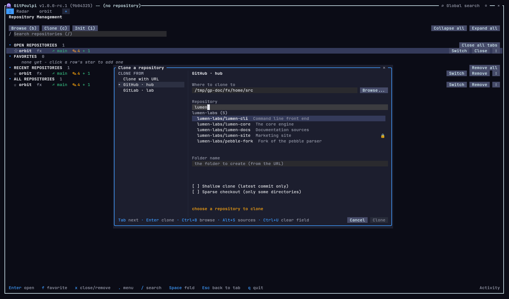

[English](../hosting-integration.md) · [Čeština](../cs/hosting-integration.md) · [Deutsch](../de/hosting-integration.md) · [Español](../es/hosting-integration.md) · [Français](../fr/hosting-integration.md) · [Italiano](../it/hosting-integration.md) · [日本語](../ja/hosting-integration.md) · [한국어](../ko/hosting-integration.md) · [Nederlands](../nl/hosting-integration.md) · **Polski** · [Português (Brasil)](../pt-BR/hosting-integration.md) · [Português (Portugal)](../pt-PT/hosting-integration.md) · [Русский](../ru/hosting-integration.md) · [Svenska](../sv/hosting-integration.md) · [Türkçe](../tr/hosting-integration.md) · [Українська](../uk/hosting-integration.md) · [简体中文](../zh-CN/hosting-integration.md)

# Integracje z hostingiem i trackerami zgłoszeń

GitPoulpi łączy się z tymi produktami:

- **Hosting** (pull requesty, zgłoszenia, klonowanie z twojego konta, klucze SSH):
  GitHub, GitHub Enterprise, GitLab, GitLab Self-Managed, Azure DevOps,
  Azure DevOps Server, Bitbucket, Bitbucket Data Center, Gitea i Forgejo
  (także Codeberg). **Gerrit Code Review** jest hostingiem tylko do przeglądu: jego zmiany to
  pull requesty, nie ma zgłoszeń.
- **Trackery zgłoszeń** (tylko zgłoszenia): Jira Cloud, Jira Data Center, Trello,
  Linear, YouTrack (Cloud i Server) oraz Redmine.
- **Lokalne notatki Markdown** (tylko zgłoszenia, bez tokena, bez sieci): folder z notatkami Markdown, na przykład folder vaultu Obsidian, zob. [Zgłoszenia lokalne i Obsidian](local-issues.md).

Każda integracja używa **osobistego tokenu**. Nie ma konta GitPoulpi ani
logowania OAuth. Integracje są opcjonalne i **włączane osobno dla każdego
repozytorium**: nic nie jest pobierane, dopóki nie powiążesz repozytorium. Twój
token jest przechowywany w menedżerze poświadczeń, nigdy w `config.toml`. Zwykłe
operacje `git` (fetch, pull, push) nie potrzebują integracji: używają
poświadczeń, które twój `git` już ma.

**Dokąd dalej.** Ta strona to konfiguracja: tokeny, łączenie, powiązanie repozytorium, klucze SSH. Gdy konto jest połączone:

- sekcje panelu bocznego PULL REQUESTS i ZGŁOSZENIA, tablica zgłoszeń, tworzenie pull requesta lub zgłoszenia, znacznik na pasku narzędzi i odwołania w opisach commitów: **[Pull requesty i zgłoszenia](pull-requests-and-issues.md)**;
- widok jednego zgłoszenia lub żądania w aplikacji, z komentarzami, pisaniem i publikowaniem jako: **[Rozmowy](conversations.md)**;
- czytanie i recenzowanie żądania z wątkami komentarzy i oczekującym przeglądem: **[Recenzowanie pull requesta](review.md)**;
- pull requesty i zgłoszenia całej przestrzeni roboczej w jednej liście: **[Radar](radar.md)**.

## 1. Utwórz token na hoście

Formularz połączenia ma odnośnik *Wygeneruj token na <host>*. Otwiera stronę
tokenów hosta z już zaznaczonymi właściwymi zakresami. Aby zrobić to ręcznie:

| Host | Gdzie | Zakresy |
|---|---|---|
| GitHub, GitHub Enterprise | Settings > Developer settings > Personal access tokens (classic) > Generate new token | `repo` (repozytoria, pull requesty, zgłoszenia), `read:user` (kim jesteś), `admin:public_key` (tylko do dodawania lub usuwania kluczy SSH) |
| GitLab, GitLab Self-Managed | User settings > Access tokens > Add new token | `api`, `read_user` |
| Azure DevOps | User settings > Personal access tokens, pod adresem `dev.azure.com/<organization>/_usersSettings/tokens` | `Code (Read & write)`, `Work Items (Read & write)`. Utwórz token **dla tej organizacji**, a nie dla „All accessible organizations”: tokeny globalne przestają działać 2026-12-01. |
| Azure DevOps Server | Ta sama strona na twoim serwerze (`https://<server>/<collection>/_usersSettings/tokens`) | Te same dwa zakresy |
| Bitbucket | `id.atlassian.com/manage-profile/security/api-tokens` > Create API token with scopes | `read:user:bitbucket`, `read:workspace:bitbucket`, `read:repository:bitbucket`, `write:repository:bitbucket`, `read:pullrequest:bitbucket`, `write:pullrequest:bitbucket`. Dla kluczy SSH także `read:ssh-key:bitbucket`, `write:ssh-key:bitbucket`, `delete:ssh-key:bitbucket`. |
| Bitbucket Data Center | Profile picture > Manage account > HTTP access tokens | `Repository (Read & write)`, `Projects (Read)` |
| Gitea, Forgejo (Codeberg) | Settings > Applications > Generate New Token, pod adresem `<host>/user/settings/applications` | Odczyt `user`; odczyt i zapis `repository`, `issue` i `user` (ostatni dla kluczy SSH). Gitea nie pokazuje zakresów po fakcie, więc GitPoulpi nie może ostrzec o brakującym: odrzucone wywołanie o tym mówi. |
| Linear | Settings > Account > Security & access > Personal API keys > New API key (`linear.app/settings/account/security`) | Read, write, create issues. Klucz działa jako ty. |
| YouTrack (Cloud i Server) | Twój profil > Account Security > New token, pod adresem `<host>/users/me?tab=account-security` | Zakres `YouTrack`. Stały token działa jako ty. |
| Gerrit | Settings > HTTP Credentials > Generate new token (nowsze serwery; starsze: Generate new password), pod adresem `<host>/settings/#HTTPCredentials` | Brak. Token to **hasło HTTP** i działa jako ty; obok niego podaje się nazwę użytkownika. |
| Redmine | My account > API access key > Show, pod adresem `<host>/my/account`. Administrator musi włączyć **Administration > Settings > API > Enable REST web service**. | Brak. Klucz działa jako ty. |
| Jira Cloud | `id.atlassian.com/manage-profile/security/api-tokens` > Create API token (klasyczny rodzaj, bez zakresów) | Brak. Token działa jako ty. |
| Jira Data Center | Profile > Personal Access Tokens | Brak. Token działa jako ty. |
| Trello | Najpierw **klucz API** z `trello.com/apps/admin` (utwórz Power-Up, potem wygeneruj klucz API). Potem **token** z `trello.com/1/authorize?...&key=<your key>`. | `read`, `write` |

Nadaj tokenowi nazwę, np. „GitPoulpi”, i datę wygaśnięcia. Skopiuj token: host
pokazuje go tylko raz.

## 2. Połącz go

1. Naciśnij `Ctrl+,` i wybierz **Integracje**.
2. Wybierz produkt po lewej. Produkty są w dwóch grupach: **Hosting** i
   **Trackery zgłoszeń**.
3. Naciśnij **Połącz**. Aby dodać drugie konto tego samego produktu, użyj
   **+ Dodaj profil**.

   

4. Wypełnij formularz i wklej token. Token jest pokazywany jawnym tekstem
   podczas wpisywania, więc upewnij się, że nikt nie patrzy. Formularz wylicza
   zakresy, których potrzebuje.

   

5. Naciśnij **Połącz**. GitPoulpi sprawdza token z hostem w tle. Strona pokazuje
   potem kartę z twoim imieniem i loginem, *Połączono* na zielono oraz sekcję
   klucza SSH. Token bez jednego z oczekiwanych zakresów nadal się łączy, a
   brakujące zakresy są wymienione na czerwono.

Na karcie: **Edytuj** ponownie otwiera formularz. **Rozłącz** usuwa token i
zachowuje profil. **Usuń** usuwa oba, po potwierdzeniu.

Klawiatura na stronie Integracje: `Tab` / `Shift+Tab` przechodzą między listą
produktów, paskiem profili i formularzem. `a` dodaje profil, `e` go edytuje,
`d` lub `Delete` go usuwa, `o` otwiera stronę tokenu, `Esc` cofa o jeden
krok.

### O co prosi każdy formularz

Odnośnik *Wygeneruj token* działa dopiero po wpisaniu hosta lub organizacji.

- **GitHub, GitLab:** tylko token. **GitHub Enterprise** i
  **GitLab Self-Managed** proszą też o **Domena hosta**
  (`gitlab.example.com`; https, chyba że wpiszesz `http://`). Nazwa bez kropki
  (usługa Dockera albo maszyna w sieci lokalnej) wymaga portu lub `http://`: `gitea:3000`,
  `http://nas`. Serwer hostowany samodzielnie może
  działać po zwykłym http, na przykład lokalny kontener pod `http://localhost:8080`. Token wysłany
  zwykłym http jest przesyłany bez szyfrowania, więc używaj http tylko w sieci
  lokalnej lub zaufanej.
- **Azure DevOps:** **Organizacja**, czyli nazwa w
  `dev.azure.com/<organization>`. Adres `https://<org>.visualstudio.com` też
  jest przyjmowany. Dwie organizacje wymagają dwóch profili. Repozytorium
  używa profilu organizacji wskazanej przez jego zdalne repozytorium. **Azure DevOps Server**
  prosi o **URL kolekcji**, na przykład `tfs.corp/tfs/DefaultCollection`.
  GitPoulpi nie używa systemowego menedżera poświadczeń dla Azure DevOps: Git
  Credential Manager przechowuje tam token logowania, a nie osobisty token
  dostępu.
- **Bitbucket:** **E-mail konta Atlassian** i token API. Jeśli e-mail jest
  pusty, token jest wysyłany jako token typu bearer: użyj tego dla tokenu
  dostępu workspace lub repozytorium. GitPoulpi znajduje twoje workspace'y na
  podstawie tokenu. **Bitbucket Data Center:** **URL serwera** i token dostępu
  HTTP.
- **Gitea, Forgejo:** **Domena hosta** i token. **Forgejo** zaczyna od
  `https://codeberg.org`: zastąp ją dla serwera na własnym hostingu. Gitea nie ma
  publicznej wartości domyślnej. Adres `http://localhost:3000` działa dla serwera lokalnego.
  Oba rodzaje dzielą jednego klienta (Forgejo to fork Gitea z tym samym
  `/api/v1`); token jest wysyłany jako `Authorization: token <token>`. Systemowy
  menedżer poświadczeń nie jest dla nich używany.
- **Jira Cloud:** **URL witryny** (`acme.atlassian.net`), twój **E-mail konta
  Atlassian** i klasyczny token API. Tokeny Jira z zakresami nie są obsługiwane.
  **Jira Data Center:** **URL serwera** i osobisty token dostępu.
- **Trello:** **Klucz API** i **token**. Klucz API jest publiczny, więc jest
  przechowywany w `config.toml` (jako `account`). Token jest tajny i trafia do
  menedżera poświadczeń. Formularz ma dwa odnośniki: *Pobierz klucz API w Trello*
  i, po wpisaniu klucza, *Wygeneruj token*. Klucz i token są wysyłane w
  nagłówku, nigdy w adresie URL.

- **Linear:** tylko **klucz API**: Linear ma jeden publiczny host, więc nie ma
  adresu do wpisania. Klucz jest wysyłany bez zmian w nagłówku `Authorization`
  (Linear nie przyjmuje `Bearer` dla kluczy osobistych). Aby odwołania `ENG-12`
  w opisach commitów otwierały właściwą stronę, zapisz URL profilu razem ze swoim
  obszarem roboczym (`https://linear.app/acme`, z CLI: `--url`); same wiersze zgłoszeń
  zawsze niosą dokładny adres.
- **YouTrack:** **URL witryny** (`acme.youtrack.cloud` dla Cloud, w pozostałych
  przypadkach twój własny serwer, z jego ścieżką kontekstu, jeśli ją ma, na przykład
  `host/youtrack`) i stały token, wysyłany jako `Authorization: Bearer`. Ten sam
  klient obsługuje Cloud i Server (`<url>/api`).

- **Gerrit:** **URL serwera** (ze ścieżką kontekstu, jeśli ją ma), twoja **Nazwa użytkownika** i hasło
  HTTP jako token. Podróżują jako uwierzytelnianie HTTP basic; GitPoulpi rozmawia z API REST `/a/`
  serwera i ignoruje linię `)]}'`, od której zaczyna się każda odpowiedź. Nazwa użytkownika nie jest tajna i jest przechowywana w
  `config.toml` (jako `account`), hasło trafia do menedżera poświadczeń. Repozytorium jest powiązane z *projektem*
  Gerrit w sekcji PULL REQUESTS (tam wypisane są jego zmiany); Gerrit nie ma zgłoszeń, a zmianę tworzy się
  wypychając (zob. *Wypchnięcie do przeglądu* w [Przeglądzie](review.md#gerrit)).
- **Redmine:** **URL witryny** twojego Redmine (z podścieżką, jeśli ją ma,
  na przykład `host/redmine`) i twój klucz API, wysyłany jako `X-Redmine-API-Key`. Jeśli
  Redmine odpowiada 403 lub stroną HTML, usługa REST jest wyłączona (poproś
  administratora albo włącz ją w **Administration > Settings > API**).

Jira, Trello, Linear, YouTrack i Redmine to wyłącznie trackery zgłoszeń: bez pull requestów, bez
repozytoriów do sklonowania i bez kluczy SSH. Bitbucket nie ma zgłoszeń
(Atlassian wycofał Bitbucket Issues). Zamiast tego powiąż sekcję ZGŁOSZENIA
repozytorium Bitbucket z projektem Jira.

## 3. Gdzie przechowywany jest token

Token jest przechowywany w systemowym **menedżerze poświadczeń** (Git Credential
Manager w Windows, libsecret lub `pass` w Linuksie, Keychain w macOS). Używa
prywatnego wpisu, którego nie da się pomylić z poświadczeniami prawdziwego
hosta. Nigdy nie jest zapisywany w `config.toml` ani wypisywany.

Jeśli żaden menedżer poświadczeń nie jest skonfigurowany albo odrzuca token,
GitPoulpi trzyma token **w pamięci tylko na tę sesję** i cię o tym informuje.
Po restarcie połącz ponownie.

GitPoulpi szuka tokenu profilu w tej kolejności:

1. Zmienna środowiskowa `GITPOULPI_TOKEN_<PROFILE ID>`. Użyj jej, by podać
   token bez przechowywania, na przykład w CI.
2. Token zapisany dla profilu (`token_ref`).
3. Tylko dla profili GitHub i GitLab: systemowy menedżer poświadczeń dla hosta,
   gdy żaden inny włączony profil nie używa tego samego hosta.

Każdy profil to wpis `[[integrations]]` w `config.toml`. Zob.
[Opis konfiguracji](config-reference.md#integrations-hosting-i-trackery-zgłoszeń).

## Kontrola bezpieczeństwa

Zapisany token jest tak bezpieczny, jak adres, na który jest wysyłany. Dlatego GitPoulpi zapamiętuje dla każdej integracji, z czym była połączona, i zatrzymuje się, gdy to się zmieni:

- **Adres.** Przy pierwszym użyciu integracji (lub połączeniu) jej adres jest zapisywany w `trust.toml`, w prywatnym folderze danych dostępnym tylko dla użytkownika (`<data>/private/`), a nie w `config.toml`: edycja konfiguracji nigdy nie poszerzy tego, czemu zaufano. Jeśli adres w konfiguracji nie jest już zapisanym, nic nie jest do niego wysyłane, a token nie jest nawet odczytywany. Różne zapisy jednego adresu (`HTTPS://Git.Example.com:443/`) to ten sam adres; host z podobną nazwą nie.
- **Konto.** Po połączeniu tokenu, a potem mniej więcej raz dziennie (i raz na uruchomienie dla tokenu pochodzącego z `GITPOULPI_TOKEN_*` lub z helpera poświadczeń), GitPoulpi pyta hosta, do kogo należy token, i porównuje **id** konta, a nie login. Token, który teraz należy do kogoś innego, jest zatrzymywany.
- **Certyfikat.** Serwery, których certyfikat nie łączy się ze znanym urzędem (prywatny urząd certyfikacji, serwer z certyfikatem samopodpisanym), są akceptowane tylko dla dokładnie tego klucza, który zaakceptowałeś, a uzgadnianie TLS nadal dowodzi, że serwer ma ten klucz. Przy włączonym ścisłym przypinaniu klucz musi pasować nawet wtedy, gdy certyfikat łączy się z publicznym korzeniem; ceną jest to, że każda rotacja klucza pyta ponownie, dlatego jest to opcja do włączenia. Hosty publiczne (github.com, gitlab.com, codeberg.org, bitbucket.org, dev.azure.com, `*.atlassian.net`, ...) nie mają zapisu certyfikatu.
- **Zwykłe http.** Adres `http://` inny niż pętla zwrotna jest odrzucany, chyba że zezwolono na niego dla tej integracji.

Każde żądanie jest też ograniczone do własnego adresu integracji (a dla hosta publicznego do jego hosta API, takiego jak `api.github.com`): żądanie gdziekolwiek indziej jest odrzucane przed wysłaniem, a przekierowanie na inny adres nie jest śledzone.

**Integracje połączone, zanim ta kontrola istniała**, dostają swój zapis po cichu, z konfiguracji w jej dawnym kształcie, przy pierwszym użyciu po aktualizacji: zachowują dzisiejszy poziom zaufania i nic o nic nie pyta.

### Z wiersza poleceń

Zatrzymane polecenie kończy się kodem wyjścia 2 i wypisuje, co się zmieniło (zob. [Opis CLI](cli-reference.md)). `gitpoulpi hosting integrations trust <id>` pokazuje, czemu zaufano; `--accept-origin <url>`, `--accept-account <id>`, `--accept-certificate <sha256>`, `--strict-tls on|off` i `--allow-insecure-http on|off` akceptują po jednej rzeczy, wskazując dokładną wartość. Po zaakceptowaniu nowego adresu wpisz token ponownie. Rozłączenie (`hosting logout`) lub usunięcie integracji kasuje jej token, zapis zaufania i to, co z niej zapisano w pamięci podręcznej (zapisane listy repozytoriów okna Klonuj, listy kont Radaru i robocze wersje zdalnych przeglądów jej hosta).

Agent (MCP) niczego nie może zaakceptować: dostaje informację, że kontrola bezpieczeństwa wymaga ciebie.

### W interfejsie terminala

Zatrzymane żądanie otwiera okno **Kontrola bezpieczeństwa integracji** nad tym, co akurat robiłeś. Mówi, co się zmieniło (stary i nowy adres, stare i nowe konto z ich id albo stary i nowy certyfikat jako mała tabela z odciskiem SHA-256 w grupach po cztery, podmiotem, wystawcą i ważnością) oraz że token nie został wysłany. Odpowiedzi są ponumerowane:

1. **Rozłącz** kasuje zapisany token, zapis zaufania i to, co z integracji zapisano w pamięci podręcznej.
2. **Zaufaj** nowemu adresowi, kontu lub certyfikatowi (adres bez szyfrowania: **Zezwól na zwykłe http**).
3. **Anuluj** niczego nie zmienia.

Żadna odpowiedź nie jest podświetlona, dopóki nie naciśniesz strzałki lub cyfry, więc przypadkowy Enter niczego nie akceptuje. Esc i krzyżyk zamknięcia anulują; kliknięcie poza oknem nic nie robi. Długa treść przewija się kółkiem, Page Up/Page Down lub paskiem przewijania. Kilka kontroli ustawia się w kolejce (jedna na integrację i rodzaj zmiany) i są zadawane jedna po drugiej. Anulowana kontrola nie wyskakuje ponownie, dopóki się nie zmieni; **Integracje: Przejrzyj kontrolę bezpieczeństwa** w palecie poleceń ją przywraca.

Po zaufaniu nowemu **adresowi** formularz integracji otwiera się z aktywnym polem tokenu i podpowiedzią „Zalecane jest ponowne wpisanie tokenu”: zapisany token nigdy tam nie został wysłany. W formularzu adres zmieniony celowo jest akceptowany razem z wpisanym dla niego tokenem; bez tokenu formularz o niego prosi.

Formularz ma też dwa przełączniki. **Ścisłe przypinanie certyfikatu** (dla adresu https) przypina klucz certyfikatu, który serwer przedstawia przy łączeniu. **Zezwól na zwykłe http (bez szyfrowania)** jest oferowane tylko dla adresu `http://` innego niż ten komputer, z czerwonym ostrzeżeniem, że token jest przesyłany otwartym tekstem. Karta połączonej integracji pokazuje przypięty odcisk.

### Co może token i do kiedy

Połączenie pyta też hosta, co token może robić. GitHub (tokeny klasyczne), GitLab i Bitbucket (gdy przesyła zakresy) raportują swoje zakresy: karta pokazuje żółty wiersz „Ten token ma więcej uprawnień, niż potrzebuje GitPoulpi” z listą zakresów ponad to, czego GitPoulpi używa, a te wrażliwe (takie jak `delete_repo`, `admin:org`, `sudo`) na czerwono, z radą, by wybrać token o precyzyjnych uprawnieniach z datą wygaśnięcia. Klasyczny token GitHub (`ghp_...`) dostaje tę radę nawet wtedy, gdy jego zakresy są dokładne. O uprawnienia tokenu GitHub o precyzyjnych uprawnieniach nie da się zapytać, więc pokazywana jest tylko jego data wygaśnięcia. Karta pokazuje datę wygaśnięcia, gdy host ją podaje. Token bez daty wygaśnięcia nie pokazuje przypomnienia, a inne produkty nie raportują zakresów i nie wywołują ostrzeżenia. Te same pola są w JSON polecenia `hosting integrations login` i `test` (`excess_scopes`, `token_flavor`, `recommend_fine_grained`, `expires_at`). Są odczytywane przy połączeniu, więc karta pokazuje je dla sesji, która się połączyła.

## 4. Powiąż repozytorium

Powiązanie jest jawne i dla każdego repozytorium osobne. Gdy profil jest
połączony, panel boczny Refs pokazuje po TAGS sekcję **PULL REQUESTS** i
sekcję **ZGŁOSZENIA**. Każda sekcja ma dwie listy: dostawcę i projekt.

- Lista dostawcy **proponuje** konta pasujące do zdalnych repozytoriów
  (najpierw `origin`), jako wiersze typu `owner/name · origin · GitHub`. Jeden
  wybór ustawia i dostawcę, i projekt.
- Nic nie jest powiązywane automatycznie. Jira, Trello, Linear, YouTrack i Redmine nigdy nie są
  proponowane, bo żadne zdalne repozytorium ich nie wskazuje: wybierz je sam.
- **Brak (odłącz to repozytorium)** na górze listy odłącza sekcję. Nic nie
  powiąże jej ponownie samo.
- Powiązanie jest zapisywane w pliku `.gitpoulpi/repo-state.toml` repozytorium.

Obie sekcje są powiązywane **osobno**. Na przykład pull requesty mogą pochodzić
z Azure DevOps, a zgłoszenia z Jira.

| Dostawca | Projekt PULL REQUESTS | Projekt ZGŁOSZENIA |
|---|---|---|
| GitHub, GitLab | `owner/name`, `group/sub/proj` | to samo |
| Azure DevOps | `Project/Repo` (organizacja pochodzi z profilu) | `Project` (elementy pracy) |
| Gitea, Forgejo | `owner/name` | to samo |
| Bitbucket | `workspace/slug` (Data Center: `PROJ/slug`) | brak: powiąż Jirę |
| Jira | brak | klucz projektu, na przykład `ABC` |
| Trello | brak | tablica |
| Linear | brak | klucz zespołu, na przykład `ENG` (zespoły są wypisane) |
| YouTrack | brak | krótka nazwa projektu, na przykład `ABC` |
| Gerrit | nazwa projektu Gerrit, na przykład `team/tool` | brak |
| Redmine | brak | identyfikator projektu, na przykład `bench` (ostatnia część adresu projektu) |

Listę projektów ZGŁOSZENIA można przeszukiwać. Można też wpisać projekt, którego
lista nie pokazuje.

**Dodatkowe zapytanie.** Źródło zgłoszeń ma opcjonalny wiersz filtra pod listą
projektu. Jest łączony (AND) z projektem:

- Jira: fragment **JQL** (`component = UI AND labels = backend`).
- Azure DevOps: warunek **WIQL** (`[System.AssignedTo] = @Me`).
- YouTrack: **zapytanie YouTrack** (`#Unresolved Type: Bug`, `tag: ui or tag: ux`).
  Jest ujmowane w nawiasy, więc `or` nie może poszerzyć projektu. Twoje
  `sort by:` zastępuje domyślne `sort by: updated desc`.
- Redmine: brak (filtry stanu i „przypisane do mnie” w sekcji wystarczą).
- Linear: brak (filtry stanu i „przypisane do mnie” w sekcji
  wystarczą).
- Trello: lista rozwijana, na której zaznaczasz **listy** Trello do pokazania. Bez zaznaczenia
  pokazuje każdą otwartą listę.
- GitHub i GitLab go ignorują.

`Enter` zachowuje wpisane zapytanie, `Esc` je odrzuca. Paleta:
*Zgłoszenia: Wybierz filtr...*.

Z CLI: `gitpoulpi hosting link pulls --id <profile>` (lub `issues`),
`--clear` odłącza, `--filter` dla dodatkowego zapytania. Zob.
[Opis CLI](cli-reference.md#polecenia).

### Klonowanie z połączonego konta

Połączony profil (GitHub, GitLab, Gitea, Forgejo, Azure DevOps, Bitbucket, Gerrit) jest też źródłem w oknie **Klonuj** (przycisk **Klonuj** na karcie Home albo tam `c`). Każdy profil jest wymieniony pod **Klonuj z URL** jako osobne źródło (`GitHub · name`, `GitLab · name`); GitHub i GitLab nigdy się nie mieszają. Wybierz jedno, a załadują się jego repozytoria, pogrupowane według właściciela: najpierw twoje konto, potem jedna sekcja na organizację lub grupę (`quarry/tools` dla podgrupy GitLaba), każda pod nagłówkiem z liczbą. Kłódka oznacza repozytorium prywatne.


Pole wyszukiwania filtruje we wszystkich sekcjach (nazwa, pełna ścieżka i opis); sekcja bez dopasowań znika. `Enter` na wierszu wypełnia klon adresem HTTPS tego repozytorium i nazwą folderu.



Lista profilu, który już otwierano, pokazuje się od razu z zapisanej kopii, podczas gdy host jest pytany ponownie (*odświeżanie...* obok etykiety); gdy odpowiedź dotrze, nowe repozytoria się pojawiają, a nieistniejące znikają, przy czym podświetlone i wybrane repozytorium zostają na miejscu. Jeśli odświeżenie się nie powiedzie, zapisana lista zostaje z adnotacją, a przyczyna jest w Dzienniku aktywności.

Jeśli host odrzuci token, okno zamiast listy pokazuje *nie można wylistować repozytoriów* z przyczyną (a zapisana kopia jest usuwana); pozostałe źródła nadal działają.

## 5. Klucze SSH

### Klucz SSH na profil

Połączony profil ma sekcję **Klucz SSH** pod swoją kartą. Bez klucza wybierz
jedno z:

- **Klucz domyślny**: twój ssh-agent lub `~/.ssh`. Nic się nie zmienia.
- **Wygeneruj nowy klucz**: opcjonalny tytuł (domyślnie
  `GitPoulpi <host> <date>`). Przy zaznaczonym **Dodaj klucz publiczny do
  <host>** GitPoulpi go wysyła, jeśli host jeszcze go nie ma. Klucz jest
  zapisywany bez hasła w `~/.ssh/gitpoulpi_<profile id>_ed25519` i `.pub`.
  Nie jest potrzebne `ssh-keygen`. Istniejący plik nigdy nie jest nadpisywany.
- **Własny klucz**: wpisz ścieżkę lub użyj **Przeglądaj**, aby wskazać plik
  klucza prywatnego, potem naciśnij **Użyj tego klucza**.

Gdy klucz jest dołączony, sekcja pokazuje `title (SHA256:...)` z:

- **Usuń**: odłącza klucz i usuwa go na hoście, jeśli dodał go GitPoulpi.
- **Usuń pliki**: to samo, a dodatkowo usuwa pliki klucza, po potwierdzeniu
  wymieniającym obie ścieżki.

### Klucz SSH dla jednego repozytorium

Aby jedno repozytorium używało określonego klucza, otwórz menu karty (`Ctrl+T`
lub prawy przycisk na karcie) i wybierz **SSH i poświadczenia...** albo uruchom
polecenie palety *Repozytorium: SSH i poświadczenia...*, a pod SSH wybierz
**Plik klucza** (lub **Klucz konta** dla klucza profilu integracji). Wybór jest
przechowywany w prywatnym folderze GitPoulpi: nic nie jest zapisywane w
repozytorium ani w konfiguracji gita. Zob.
[Ustawienia](settings.md#ustawienia-repozytorium-ssh-i-poświadczenia).

Repozytorium, które nadal ma własne `core.sshCommand` z dawnego przypięcia „Klucz
SSH dla tego repozytorium”, pokazuje je na tej stronie, tylko do odczytu, z
przyciskiem **Przenieś do GitPoulpi**.

CLI i MCP: `gitpoulpi repo-auth` (wybór dla repozytorium) oraz, dla samego
przypięcia `core.sshCommand`, `gitpoulpi ssh-command show | set --key <file> |
clear`.

Klucz globalny z Ustawienia > SSH i poświadczenia (*Ścieżka klucza
prywatnego* lub *Generuj parę kluczy*) obowiązuje każde repozytorium bez
własnego wyboru. Plik klucza lub przypięcie repozytorium wygrywa z nim.

## 6. Ochrona gałęzi przy przepisywaniu historii

Gdy przepisujesz historię ([warsztat](history-rewrite.md)), GitPoulpi pyta hosta, które gałęzie chroni, aby
domyślnie pominąć je w przepisywaniu. Pyta tylko o repozytorium **powiązane** (sekcja pull requestów lub
zgłoszeń w panelu bocznym albo przypięty profil), tokenem tego profilu, a token, który nie może tego odczytać,
daje po prostu „nieznane”: nic się nie psuje. Co odpowiada każdy dostawca i czego potrzebuje token:

| Host | Co jest czytane | Czego potrzebuje token |
|---|---|---|
| GitHub (i Enterprise Server) | flaga `protected` gałęzi oraz aktywne rulesety gałęzi (wzorce `~DEFAULT_BRANCH`, `~ALL` i `refs/heads/...`) | klasyczny token z `repo` (`public_repo` dla publicznego) albo token szczegółowy z Metadata (read). Ruleset, którego token nie może odczytać, jest zgłaszany, a reguły klasyczne nadal się liczą |
| GitLab (gitlab.com i własny serwer) | `protected_branches` (nazwy i wzorce z `*`) | `read_api` oraz rola, która widzi ustawienia repozytorium |
| Azure DevOps (Services i Server) | włączone, blokujące polityki gałęzi repozytorium (zakresy `Exact`, `Prefix` i `DefaultBranch`) | Code (read). Uprawnienie „force push” to ustawienie zabezpieczeń i nie jest czytane |
| Bitbucket Cloud | ograniczenia gałęzi, które zatrzymują push (`push`, `force`, `delete`) | `repository:admin`. Ograniczenie z modelu gałęzi nie jest rozwiązywane |
| Bitbucket Data Center | uprawnienia gałęzi, które zatrzymują force push (`fast-forward-only`, `pull-request-only`, `read-only`) | administrator repozytorium |

Strona ustawień ochrony (oraz gałęzi domyślnej i usuwania repozytorium) jest budowana z adresu zdalnego
repozytorium dla GitHub, GitLab, Azure DevOps i Bitbucket, nawet gdy repozytorium nie jest powiązane,
i pokazywana z trzema drogami wyjścia, gdy host odrzuci push.

## 7. Listy obejmujące całe konto w Radarze

Radar zwykle obserwuje sklonowane przez ciebie repozytoria. Profil może też
wypisać to, co cię dotyczy na całym hoście, sklonowane lub nie, trzema przełącznikami w
swojej tabeli `[integrations.radar]` (wszystkie domyślnie wyłączone; zob.
[opis konfiguracji](config-reference.md#integrationsradar-listy-obejmujące-całe-konto)):

- **żądania do przeglądu**: otwarte żądania, które proszą o twój przegląd;
- **otwarte żądania**: każde otwarte żądanie twojej własnej przestrzeni nazw i każdej organizacji lub
  grupy, do której należysz, albo przestrzeni nazw, które podasz. Nigdy cały host;
  **Przestrzenie nazw** profilu (po jednej w wierszu w Ustawienia > Integracje > Radar, opcjonalnie
  jako wyrażenia regularne) ograniczają wszystkie trzy listy: wiersz pasuje do pełnej ścieżki
  repozytorium, gdy jest jej równy albo jest jej prefiksem kończącym się na `/` (`orbit` zachowuje
  `orbit/products/x`, nie `orbitx/y`), i jest stosowany do wierszy zwracanych przez host, a także po
  stronie serwera, gdy wyszukiwanie hosta na to pozwala (kwalifikatory `user:` / `repo:` GitHuba);
- **przypisane zgłoszenia**: otwarte zgłoszenia przypisane do ciebie.

Odpowiadają GitHub, GitLab (także własny serwer), Gitea, Forgejo, Azure DevOps (Services
i Server), Bitbucket Data Center i Gerrit. Jak pyta się każdy z nich:

| Host | Żądania | Zgłoszenia |
|---|---|---|
| Azure DevOps | aktywne pull requesty całej organizacji (`searchCriteria.reviewerId` dla tych czekających na ciebie; żądanie, na które już zagłosowałeś, jest pomijane); gdy serwer odrzuci trasę na poziomie organizacji, pytane są po kolei pierwsze 20 projektów. `namespaces` to nazwy projektów | elementy pracy przypisane do ciebie, które nie są Done, Closed ani Removed |
| Bitbucket Data Center | twój pulpit: rola `REVIEWER` jeszcze bez akceptacji dla żądań do przeglądu, `AUTHOR` i `PARTICIPANT` dla otwartych żądań; `namespaces` to klucze projektów | brak (Data Center nie ma trackera zgłoszeń; mówi o tym notka) |
| Gerrit | `is:open reviewer:self -owner:self -is:ignored`; otwarte żądania to `is:open projects:<prefix>` dla każdej przestrzeni nazw (prefiks ścieżki projektu), albo twoje własne i przeglądane zmiany, gdy żadnej nie podano; zmiana work-in-progress to szkic | brak |

Bitbucket Cloud nie ma wierszy obejmujących całe konto: nie oferuje punktu końcowego, który wypisuje
żądania z wielu repozytoriów, a pytanie każdego repozytorium z osobna oznaczałoby zbyt wiele
wywołań. Jego sklonowane repozytoria zachowują własne listy, a `gitpoulpi hosting
radar --id <bitbucket>` tak mówi. Gdy Gerrit ma więcej zmian, niż wynosi limit, który
zwraca, lista jest oznaczona jako obcięta, z notką.

Szkice są pomijane, chyba że je zachowasz. Każda lista jest ograniczona: 300 wierszy na rodzaj, z
notką mówiącą, ile było więcej, a w GitHubie kilka wywołań wyszukiwania na
rundę, ponieważ jego API wyszukiwania dopuszcza tylko 30 na minutę. Przestrzeń nazw, której token
nie może odczytać, staje się notką, a pozostałe nadal się wczytują; odrzucony token lub
limit zapytań kończy błędem tylko ten profil. Odpowiedzi są używane ponownie przez pięć minut
(`radar-account.json` w folderze konfiguracji).

W Ustawienia > Integracje połączony profil hosta kodu ma blok **Radar**
pod swoim kluczem SSH: jedno pole wyboru na listę (*Żądania czekające na mój przegląd*,
*Każde otwarte żądanie*, *Uwzględnij szkice*, *Zgłoszenia przypisane do mnie*, ostatnie
nieobecne dla hostów bez zgłoszeń), pole *Przestrzenie nazw* (jeden wpis na wiersz: nazwa pasująca do tej grupy lub właściciela i wszystkiego pod nią,
albo wyrażenie regularne w wierszu przy zaznaczonym *Wyrażenia regularne*; puste oznacza twoją własną
i każdą, do której należysz) oraz wybór *Żądanie z
repozytorium, które nie jest sklonowane*: *Zapytaj*, *Sklonuj* lub *Przejrzyj przez API*.
Wszystko jest zapisywane w trakcie zmiany. Hosty bez zapytania obejmującego całe konto (Bitbucket
Cloud) pokazują zamiast tego jedną linię z tą informacją. Paleta poleceń dociera do bloku
przez *Ustawienia: Opcje Radaru profilu...*, a wyszukiwarka Ustawień znajduje każdą
kontrolkę po jej etykiecie.

Z wiersza poleceń: `gitpoulpi hosting integrations radar <id> --review-requests on`
włącza listę, `gitpoulpi hosting radar --json` wypisuje listy (a
`--refresh` pomija pamięć podręczną). Agenci AI mają te same dwa polecenia przez MCP
(`hosting_radar`, `hosting_integrations_radar`).

## 8. Działanie jako bot GitHub App

Projekt, który nie może pokazywać czyjegoś imienia, może robić wszystko na hoście przez **GitHub App**: każdy
komentarz, przegląd, zamknięcie lub ponowne otwarcie i zmiana etykiety pojawia się wtedy jako
`<app-slug>[bot]`. Działa to dla jednego repozytorium naraz i zostawia twoje pozostałe repozytoria na twoim
własnym tokenie.

1. Utwórz GitHub App dla organizacji z uprawnieniami **Issues** i **Pull requests** ustawionymi na *Read & write*
   (oraz *Contents: read*, aby można było wyświetlać i przeglądać pull requesty) i zainstaluj ją w repozytorium.
2. Napisz mały skrypt, który wypisuje **token instalacji** na swoim standardowym wyjściu (klucz prywatny App
   podpisuje krótkotrwały JWT, który jest wymieniany na token ważny przez godzinę). GitPoulpi nigdy nie widzi
   klucza.
3. W **Ustawienia > Ustawienia repozytorium > SSH i poświadczenia** wybierz **Polecenie tokenu** w HTTPS, wpisz
   skrypt jako **Polecenie** i host (`github.com`) w **Hosty**, i zaznacz **Użyj do API hostingu (zgłoszenia,
   pull requesty)**. Zapisz i potwierdź polecenie (człowiek zawsze
   je potwierdza, wraz z jego SHA-256). Z wiersza poleceń: `gitpoulpi repo-auth set --https token-command --hosts
   github.com --use-for-hosting --yes --command ./app-token.sh`.

Co się zmienia dla tego repozytorium:

- Jego wywołania zgłoszeń i pull requestów (wyświetlanie, tworzenie, komentowanie, przeglądanie, merge, zamykanie,
  etykiety) używają tokenu polecenia, z tym samym 30-sekundowym limitem, pamięcią podręczną w pamięci i redakcją co
  własne logowanie gita. Gdy host odpowiada 401, bo token wygasł, polecenie jest uruchamiane ponownie jeden raz.
  Jeśli polecenia nie da się uruchomić, wywołanie jest odrzucane: twój osobisty token nigdy nie jest rozwiązaniem
  awaryjnym.
- Nie ma „mnie”: token instalacji nie może zapytać, kim jest. Nagłówek sekcji nazywa profil z **(bot aplikacji)**,
  a filtry zbudowane na „mnie” (*Przypisane do mnie*, *Moje*, *Czekają na mój przegląd*) nie mają czego dopasować. Nic
  nie jest pokazywane jako błąd.
- **Publikuj jako.** Każda wiadomość, którą GitPoulpi publikuje, jest pokazywana z nazwą, jako którą jest
  publikowana (*Publikowanie jako my-app[bot] (bot GitHub App)* pod nagłówkiem [rozmowy](conversations.md#publikowanie-jako) i w jej
  polu komentarza; `posted_as` w odpowiedzi CLI). Z tokenem osobistym jest to twój login (`GET /user`). Z tokenem
  App jest to nazwa **Publikuj jako**, na przykład `my-app[bot]`: ustaw ją dla każdego repozytorium w
  **Ustawienia > Integracje** (`general.hosting_post_as`, także
  `gitpoulpi config set general.hosting_post_as my-app[bot]`) albo dla jednego repozytorium w **Ustawienia >
  Ustawienia repozytorium > SSH i poświadczenia > Hosting**, co wygrywa. Gdy jest pusta, GitPoulpi pyta GitHub
  (GraphQL `viewer { login }`), a w razie braku odpowiedzi poznaje nazwę z autora pierwszego komentarza, który
  opublikuje, i przechowuje ją z repozytorium. Ta nazwa służy też do rozpoznawania twoich własnych komentarzy,
  więc edycja i usuwanie są oferowane tylko na nich (komentarze App muszą też pochodzić z konta bota); dopóki nie
  jest znana, można zmieniać tylko komentarze opublikowane przez tę instalację.
- App nie można przypisać. Połącz tę konfigurację z blokadą przypisywania opisaną niżej.
- Włączenie lub wyłączenie **Użyj do API hostingu** wymaga człowieka, tak jak nowe polecenie.

Tylko profile GitHub używają tokenu repozytorium w ten sposób; inne hosty zachowują własny token profilu. (Token
dostępu projektu lub grupy GitLab to także bot: jest tokenem profilu, pokazywanym jako *bot projektu*, i nic nie
trzeba ustawiać.)

### Blokowanie przypisywania w repozytorium

**Ustawienia > Ustawienia repozytorium > SSH i poświadczenia** ma wiersz **Przypisywanie** (**Dozwolone** domyślnie
albo **Zablokowane**; zapisywane od razu). Gdy jest zablokowane, przypisywanie w zgłoszeniach i pull requestach tego
repozytorium jest niemożliwe, kto by o nie nie prosił:

- wybór przypisanych jest pominięty w formularzach nowego zgłoszenia i nowego pull requesta (z notatką, dlaczego),
  polecenie palety *Hosting: Edytuj przypisanych...* jest wyszarzone z powodem, a menu wiersza mówi o tym zamiast je
  otwierać;
- każdy klient odrzuca przypisanie, zanim cokolwiek zostanie wysłane, także przypisanych podanych przy tworzeniu
  zgłoszenia lub pull requesta: CLI odpowiada `{"refused": {"reason": "assignment_blocked", ...}}` z kodem wyjścia
  2, a agent przez MCP dostaje to samo odrzucenie;
- istniejący przypisani pozostają widoczni (tylko do odczytu).

`gitpoulpi hosting assignment` pokazuje ustawienie, `--block` je włącza, a `--allow` wyłącza z powrotem; ponownie
zezwolić może tylko człowiek (serwer MCP nie może).

## 9. Z wiersza poleceń

```
echo $TOKEN | gitpoulpi hosting login --id my-gitlab --token-stdin
gitpoulpi hosting integrations list --json
gitpoulpi hosting prs --mine --json
gitpoulpi hosting edit-url --branch my-branch --open
gitpoulpi hosting open pr 12 --browser
gitpoulpi hosting pr-edit 12 --add-reviewer ann --add-label bug --milestone v1.0
gitpoulpi hosting radar --what review --json
gitpoulpi hosting assignment --block
```

Wszystkie polecenia opisuje [Opis CLI](cli-reference.md#polecenia). Token nigdy nie
jest przyjmowany jako argument, a serwer MCP nie oferuje
`hosting login`, więc token nigdy nie przechodzi przez agenta. `hosting login`
wypisuje `stored: "os"`, gdy token trzyma systemowy magazyn poświadczeń, albo
`stored: "session"` i `store_error`, gdy magazyn odmówił, a token żyje w pamięci
tylko na czas tej sesji.

## Rozwiązywanie problemów

| Objaw | Rozwiązanie |
|---|---|
| *Połącz* kończy się błędem uwierzytelniania | Token jest zły, wygasł lub został unieważniony. Utwórz nowy. |
| Zakres jest wymieniony na czerwono | Token go nie ma. Połączenie działa, ale ta funkcja nie. Dodaj zakres na hoście, potem **Edytuj** i wklej nowy token. |
| Panel boczny nie ma sekcji PULL REQUESTS | Żaden włączony profil nie jest połączony. Połącz jeden, potem powiąż repozytorium na liście sekcji. |
| Wiersz *Połącz ponownie* na liście | Token zginął (restart bez menedżera poświadczeń) albo wygasł. Kliknij wiersz, aby otworzyć profil. |
| Instancja self-managed zawodzi | Sprawdź, czy **Domena hosta** nie ma ścieżki i czy twój komputer ufa certyfikatowi instancji. |

## Znane ograniczenia

- **Pull requesty z forków:** Azure DevOps i Bitbucket nie mogą zrobić checkout
  żądania z forka (zob. [Akcje na wierszu](pull-requests-and-issues.md#akcje-na-wierszu)). Azure DevOps nie
  może utworzyć pull requesta z forka.
- **Trello** pokazuje najwyżej pierwsze 1000 kart tablicy. Użyj filtra listy,
  aby zawęzić. **Jira**, **Linear** i **YouTrack** wypisują najwyżej 500
  zgłoszeń na odświeżenie. Użyj fragmentu JQL lub zapytania YouTrack, aby zawęzić.
- **Linear** przyjmuje jedną osobę przypisaną na zgłoszenie: jeśli w selektorze wybierzesz kilka,
  wysyłana jest pierwsza. Jego „kamień milowy” to **cykl** zespołu (kamienie milowe
  projektu nie są używane). W **YouTrack** to pole `Fix versions`; wersja nie ma
  numeru, więc selektor numeruje niewydane według ich pozycji w projekcie.
  Żaden z tych trackerów nie ma pull requestów.
- **Redmine** przyjmuje jedną osobę przypisaną na zgłoszenie (pierwszą z selektora), nie ma etykiet
  i wypisuje najwyżej 500 zgłoszeń na odświeżenie. Przypisani to członkowie projektu
  (osoby i grupy), rozróżniani po nazwie wyświetlanej. Kolumny tablicy Kanban
  to statusy zgłoszeń, a przeniesienie karty zmienia status; obowiązują domyślne
  reguły workflow Redmine (rola, która nie może wykonać tego przejścia, dostaje
  odmowę, a karta wraca). „Resolved” nie jest statusem zamkniętym w domyślnych
  danych Redmine: kolumna Zamknięte to statusy „Closed” i „Rejected”.
- **Bitbucket Data Center** nie ma odnośników w przeglądarce dla nowych pull
  requestów, gałęzi ani commitów. Strony pull requestów otwierają się normalnie.
- **Azure DevOps** nie pokazuje awatarów autorów. Filtry „moje” i „czeka na
  przegląd” potrzebują punktu końcowego, który może odrzucać osobiste tokeny
  dostępu. W takim przypadku profil łączy się bez nazwy użytkownika, a te dwa
  filtry są niedostępne. Nieprawidłowy token dostaje stronę logowania zamiast
  błędu; GitPoulpi zgłasza to jako odrzucony token.
- **Gitea i Forgejo:** szkic to żądanie, którego tytuł zaczyna się od `WIP:`
  (serwer nie ma flagi szkicu przy tworzeniu). Żądanie wypisuje jako recenzentów
  każdego, kto już je przejrzał, a wycofanie prośby o przegląd usuwa
  tylko oczekujące. Pull requesty z lokalnej gałęzi forka robią
  checkout przez `refs/pull/<n>/head`, jak GitHub. Wzmianki są wyszukiwane
  filtrem serwera `mentioned_by`. Serwer nie pokazuje zakresów tokenu, więc
  brakujący zakres wychodzi na jaw dopiero, gdy wywołanie zostanie odrzucone.
- **Tablica zgłoszeń** przenosi karty w każdym źródle zgłoszeń. W Jira przeniesienie wykonuje przejście workflow prowadzące do kolumny;
  przejście, które wymaga pól (na przykład rozwiązania), jest odrzucane przez Jirę, a karta wraca z jej komunikatem. W Azure DevOps
  work item typu bez stanu docelowego wraca wraz z powodem.
- **Bitbucket:** hasła aplikacji już nie istnieją; użyj tokenu API.
  Repozytoria są wyliczane workspace po workspace.
- **Jira Cloud:** działają tylko klasyczne tokeny API (bez tokenów z zakresami,
  bez OAuth). Nowe zgłoszenie Jira dostaje opis jako zwykły tekst.
- **Rozmowy:** najpierw ładuje się najnowszych 300 wpisów (**Wczytaj starsze** dla reszty); komentarz, edycja lub
  usunięcie opublikowane z GitPoulpi to działanie na zewnątrz i nie można ich z niego cofnąć; to, czego nie potrafi
  każdy host, jest w [tabeli](conversations.md#czego-nie-potrafi-każdy-host). W Gerrit wiadomości ani komentarza nie można edytować
  ani usunąć, a tekst Gerrit jest zwykły.
- Utworzenie pull requesta, elementu pracy, zgłoszenia lub karty odbywa się na
  hoście i **nie można tego cofnąć** z GitPoulpi. Checkout żądania można cofnąć
  normalnie.
