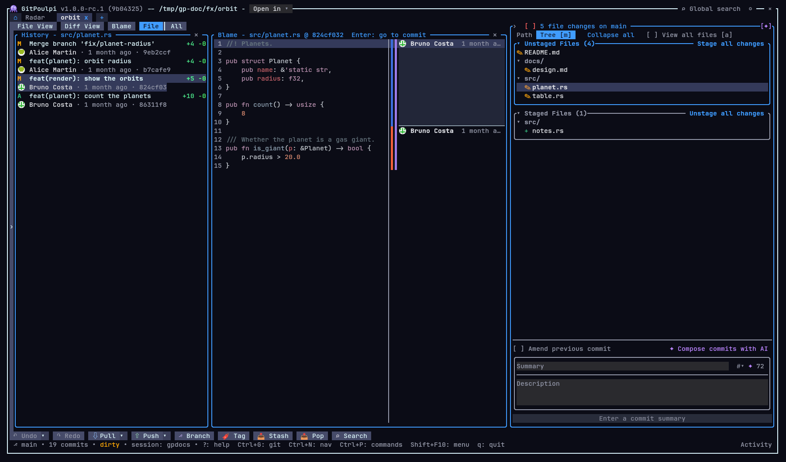

[English](../log-and-history.md) · [Čeština](../cs/log-and-history.md) · [Deutsch](../de/log-and-history.md) · [Español](../es/log-and-history.md) · [Français](../fr/log-and-history.md) · [Italiano](../it/log-and-history.md) · [日本語](../ja/log-and-history.md) · [한국어](../ko/log-and-history.md) · [Nederlands](../nl/log-and-history.md) · **Polski** · [Português (Brasil)](../pt-BR/log-and-history.md) · [Português (Portugal)](../pt-PT/log-and-history.md) · [Русский](../ru/log-and-history.md) · [Svenska](../sv/log-and-history.md) · [Türkçe](../tr/log-and-history.md) · [Українська](../uk/log-and-history.md) · [简体中文](../zh-CN/log-and-history.md)

# Praca z Logiem

Log to centrum GitPoulpi: cała historia jako graf, a na nim każda gałąź, każdy
tag i każdy stash. Ta strona opisuje, jak go czytać, jak w nim szukać i co
można zrobić z commitami i refami. Obszary okna nazywa
[przewodnik po interfejsie](interface-tour.md); dokładne klawisze są w
[Skrótach klawiszowych](keybindings.md), a gesty myszy w
[Myszy i gestach](mouse-and-gestures.md).


## Czytanie grafu

Każdy wiersz to commit, najnowszy na górze. Kropka leży na ścieżce commita;
linie łączą commit z jego rodzicami; merge pokazuje dwie linie schodzące się w
jedną. Plakietki po lewej nazywają gałęzie i tagi na tym commicie, w kolorze
ścieżki, z cienką linią do kropki. Ikona laptopa oznacza gałąź lokalną, globus
zdalną, a `✓` gałąź, na której jesteś (checkout). `+N` oznacza, że na ten
commit wskazuje więcej refów; najedź na nie, by wyświetlić listę, albo użyj
menu poniżej.

Pierwszy wiersz to **zmiany robocze** (przerywane kółko: twoja niezatwierdzona
praca, połączona z commitem, na którym leży). Stashe pojawiają się jako małe
kwadraty na ścieżce obok commita, na którym powstały.

### Kolory, odcień wiersza i awatary

Kolory ścieżek pochodzą z motywu. *Ustawienia > Wygląd > Motyw kolorów grafu*
łączy dowolny motyw z dowolną paletą ścieżek, a selektor *Aplikacja: Zmień
motyw kolorów grafu...* w palecie (`Ctrl+N Shift+Y`) pokazuje na żywo podgląd
każdej palety; zob. [Motywy](themes.md). *Tło ścieżek grafu* ustawione na
**Podbarwienie wiersza** maluje blady pas koloru ścieżki za kolumną grafu i cienki pasek
na jego krawędzi. *Intensywność podbarwienia* (**Mocne**, **Średnie** (domyślnie),
**Subtelne**) ustala, jak wyblakły jest ten pas.

| Paleta ścieżek Serie z podbarwieniem wiersza | Paleta ścieżek Material z podbarwieniem wiersza |
|---|---|
|  |  |

*Awatary autorów* (obraz w kropce grafu lub w kolumnie Autor) są domyślnie
wyłączone. Włączenie ich wysyła do Gravatara hash adresu e-mail każdego autora
i odpytuje twojego dostawcę hostingu. *Źródła awatarów* i *Awatar zapasowy* na
tej samej stronie wybierają, skąd pochodzą obrazy i co jest rysowane, gdy ich
nie ma.

Jeśli twój terminal nie potrafi pokazywać obrazów, graf jest rysowany znakami.
*Renderer grafu* i *Protokół obrazów* wymuszają jedno lub drugie; zob.
[Rozwiązywanie problemów](troubleshooting.md).

Podświetlenie zaznaczonego lub najechanego wiersza zaczyna się od kółka
commita. Ścieżki na lewo od niego zachowują zwykłe tło.

### Kolumny

Kliknij nagłówek prawym przyciskiem, by wybrać kolumny: **Ref**, **Graf**,
**Opis** (zawsze włączona), **Autor**, **Data**, **Zmiany** i **SHA**.
Opcjonalna kolumna **Zmiany** pokazuje dla każdego commita `n files +added
-removed`. Przeciągnij granicę między dwoma nagłówkami, by zmienić szerokość
kolumny; wybór jest zapamiętywany, a szerokość podawana w komórkach terminala. Przy domyślnym `ui.column_resize = "line"` granicą jest odstęp jednej komórki na końcu kolumny: w wierszu nagłówka spoczywa w nim mały znacznik, a gdy wskaźnik jest na odstępie (w nagłówku lub gdziekolwiek w dół tabeli), rysowana jest cienka linia akcentu na całej wysokości tabeli, a przeciągnięcie z dowolnego jej miejsca zmienia szerokość (wskaźnik zmienia się we wskaźnik zmiany rozmiaru w terminalach, które to obsługują). Przy `"header"` nie ma znacznika ani linii: pierwszy znak komórki nagłówka za granicą zapala się po najechaniu i od niego zaczyna się przeciąganie, tylko w wierszu nagłówka (Ustawienia > Log i graf > Zmiana szerokości kolumn). Wiersze wyglądają tak samo w obu trybach: odstęp należy do kolumny po jego lewej, więc zaznaczenie i odcienie wierszy biegną przez niego. Ref, Graf i pozostałe kolumny zachowują szerokość przy zmianie rozmiaru lub maksymalizacji okna: rośnie i maleje tylko **Opis** (w bardzo wąskim oknie pozostałe kolumny tymczasowo ustępują, najpierw Graf, i wracają do twoich szerokości, gdy okno znów się powiększy). Przeciągnij kolumnę Graf do najmniejszej szerokości, jednej kropki commita, a graf stanie się zwarty: każdy commit leży na jednym torze, jeden pod drugim, bez linii gałęzi i merge. O jedną komórkę szerzej i drzewo wraca.

Przeciąganie nagłówka pokazuje duszka jego nazwy podążającego za wskaźnikiem i pasek akcentu tam, gdzie kolumna wyląduje; kolejność zmienia się po puszczeniu, a `Esc` anuluje. Okno wyboru otwarte prawym przyciskiem to lista kontrolna (`[x]` / `[ ]`) z ✕ w tytule; jest też dostępne z palety (`Widok: Log: Wybierz kolumny do pokazania`), porusza się po nim strzałkami i przełącza `Spacją` / `Enter`.

Z klawiatury `Shift+C` (albo polecenie palety `Widok: Kolumna Logu: Wybierz kolumnę do przesunięcia lub zmiany szerokości`) wybiera kolumnę, a jej komórka nagłówka się podświetla. Potem `Tab` / `Shift+Tab` wybierają inną kolumnę, `<` / `>` przesuwają ją o jedno miejsce w lewo lub w prawo wśród pokazanych kolumn (klawiaturowy odpowiednik przeciągnięcia jej nagłówka), `]` / `[` poszerzają lub zwężają ją (odpowiednik przeciągnięcia jej granicy; ostatnia kolumna przesuwa swoją lewą krawędź), `0` przywraca wszystkim szerokościom wartość automatyczną, a `Esc` lub `Enter` kończy. Strzałki w tym czasie nadal poruszają się po commitach. Kolejność i szerokości są zapamiętywane tak jak po przeciągnięciu i należą do samego Logu: kolumna commitów obok diffa ma własną listę.


*Dopasowanie do zawartości.* **Dwukrotne kliknięcie** granicy kolumny dopasowuje kolumnę po jej lewej do jej najszerszej widocznej zawartości i nagłówka (szerokie znaki i emoji liczone według zajmowanych komórek). W układzie dopasowanym Log zawsze wypełnia swój panel, więc kolumna kończy na tym, na co panel ma miejsce, gdy **Opis** zachowa swoją część, a każda inna kolumna swoją najmniejszą szerokość: linia statusu mówi wtedy `Autor potrzebuje 34 komórek, mieści się 20.` To samo z klawiatury: przy wybranej kolumnie (`Shift+C`, `Tab`) `=` dopasowuje ją, a `+` dopasowuje każdą kolumnę; paleta ma `Widok: Kolumna Logu: Dopasuj kolumnę do zawartości` i `... Dopasuj wszystkie kolumny do zawartości`; okno wyboru otwarte prawym przyciskiem pod polami wyboru wymienia `Dopasuj <kolumna> do zawartości` (kolumna pod wskaźnikiem), `Dopasuj wszystkie kolumny do zawartości` i `Zresetuj szerokości kolumn`. **Opis** jest kolumną elastyczną i nie ma własnej szerokości do dopasowania: zajmuje miejsce, które zostawiają inne.

*Przewijanie w poziomie.* Domyślnie każda kolumna mieści się w panelu. W układzie **scroll** (pole `Przewijaj w poziomie (kolumny zachowują szerokości)` w oknie wyboru, Ustawienia > Log i graf > Układ kolumn, polecenie palety `Widok: Log: Przełącz przewijanie kolumn w poziomie` albo `s` przy wybranej kolumnie) kolumny zachowują swoje szerokości, **Opis** też (ma tam własną szerokość, a jego dopasowanie bierze najszersze podsumowanie), nic nie ustępuje w wąskim oknie, a tabela może być szersza niż panel. Pasek na dolnej krawędzi przewija ją wtedy: przeciągnij suwak, naciśnij puste tło paska, by przenieść suwak pod wskaźnik, albo użyj strzałek na jego końcach. Z klawiatury `Shift+Left` / `Shift+Right` przewijają o cztery komórki (paleta ma `Widok: Log: Przewiń kolumny w lewo` / `w prawo`); to samo robią pozioma rolka lub `Shift`+rolka nad tabelą, a wybranie kolumny (`Shift+C`, `Tab`) przewija ją do widoku. Tabela węższa niż panel zostawia puste miejsce po prawej, a pasmo zaznaczonego wiersza biegnie do krawędzi. Każdy układ zachowuje własne szerokości (`ui.log_column_widths` i `ui.log_column_widths_scroll`); pierwsze przeciągnięcie, klawisz lub dopasowanie w układzie scroll zapisuje każdą kolumnę z szerokością, jaką ma, więc rusza się tylko ta, którą zmieniasz. W układzie dopasowanym dopasowanie, które nie mieści się w panelu, mówi o tym i wskazuje ten układ.

*Uchwyt ostatniej kolumny.* Ostatnia kolumna też ma uchwyt, na swojej ostatniej komórce (nie na krawędzi panelu, która nadal zmienia rozmiar paneli): przeciągnięcie przesuwa ją o drogę przebytą przez wskaźnik, a **Opis** przejmuje różnicę. **SHA** ma domyślnie 8 komórek szerokości (7 cyfr i komórka uchwytu).


### Autorzy i `.mailmap`

Gdy repozytorium ma plik `.mailmap` (plik git, który nadaje jedną nazwę i jeden
e-mail osobie commitującej pod kilkoma), kolumna **Autor** w Logu, szczegóły
commita, Blame i Historia pliku pokazują tożsamość **kanoniczną**, tak jak
robi to `git log`. Same commity pozostają nietknięte. Ustawienie
`log.use_mailmap` (Ustawienia > Log i graf, domyślnie włączone) wyłącza to i
pokazuje zapisane nazwy. Wyszukiwanie po autorze dopasowuje nazwę i e-mail w takiej
postaci, w jakiej są pokazywane, więc szukanie nazwy kanonicznej znajduje wszystkie
commity tej osoby. Karta **Tożsamości** warsztatu historii wymienia nazwy i
e-maile z historii i sama zapisuje linie `.mailmap`, zob. `history-rewrite.md`;
z terminala: `gitpoulpi mailmap list|check|add`.

## Wyszukiwanie

- **Szukaj** (`f`, przycisk **Szukaj** na pasku narzędzi albo polecenie
  palety *Nawigacja: Szukaj commitów...*): dopasowuje cały opis commita,
  imię i e-mail autora, hash oraz nazwy refów. Przyciemnia to, co nie pasuje,
  i zachowuje kształt grafu. `Enter` / `Shift+Enter` przeskakują do
  następnego / poprzedniego dopasowania.
- **Filtr refów** (`/` w panelu bocznym): zawęża listy gałęzi, tagów i
  zdalnych repozytoriów według nazwy.
- **Solo** (klawisz `o` albo menu refa, na refie, folderze lub zdalnym):
  pokazuje tylko commity refów w solo; włącz solo dla kilku, by zobaczyć ich
  sumę. `Shift+O` kończy solo.
- **Ukryj** ref (jego menu), by wyjąć go z grafu: znika jego pigułka, a z nią
  commity osiągalne tylko przez niego (wyewidencjonowany commit zawsze zostaje,
  razem z wierszem drzewa roboczego). *Ukryte n* w tytule Refs je zlicza, a
  **Pokaż wszystko** (`Shift+H`) przywraca je. Suma w linii statusu liczy
  widoczną historię.

## Gałęzie, tagi i panel Refs

Kliknij dwukrotnie gałąź lokalną lub tag, by wykonać checkout. Kliknij ref
prawym przyciskiem (w panelu bocznym albo jego plakietkę w Logu), by zobaczyć
menu. Najprzydatniejsze pozycje:

| Pozycja | Co robi |
|---|---|
| Pokaż w grafie | Przewija Log do commita refu (w razie potrzeby wcześniej wczytując starszą historię) i na chwilę podświetla wiersz; zaznaczenie zostaje. Pojedyncze kliknięcie refu robi to samo, chyba że w Ustawieniach wyłączono *Kliknięcie refu pokazuje go w grafie*. Ref ukryty w grafie (lub przez Solo) zgłasza to zamiast tego na pasku stanu |
| Checkout | Przełącza na gałąź albo odłącza HEAD na tagu |
| Merge, Rebase na | Scala ten ref z bieżącą gałęzią albo robi rebase bieżącej gałęzi na ten ref |
| Fast-forward `<branch>` do `<current>` / `<current>` do `<branch>` | Przesuwa gałąź do przodu, gdy da się to zrobić fast-forwardem; inaczej jest wyszarzone z powodem (`rozbieżne, to nie fast-forward`) |
| Utwórz worktree z... | Otwiera dołączony worktree we własnej karcie |
| Pull, Push, Fetch, Ustaw upstream... | Operacje sieciowe na tej gałęzi |
| Ukryj / Pokaż w grafie, Solo | Tylko wyświetlanie; ukrywają lub izolują ref (ukrycie usuwa też commity osiągalne tylko przez ten ref) bez dotykania repozytorium |
| Zmień nazwę, Usuń | Usuń najpierw pyta; można usunąć także zdalny odpowiednik |
| Kopiuj nazwę gałęzi, Kopiuj link do gałęzi na zdalnym | Do schowka systemowego |

**Gdzie jest tag.** Tag może być na tym komputerze, na zdalnym albo w obu miejscach, a wiersze TAGS w panelu
bocznym (i plakietka taga w Logu) pokazują to znacznikiem po nazwie. Najedź na tag, aby przeczytać to samo
słowami.

| Znacznik | Znaczenie |
|---|---|
| strzałka w górę | Tylko tutaj: żadne zdalne go nie ma. Jego menu oferuje *Push* |
| strzałka w lewo i w prawo | Tutaj i na zdalnym, na tym samym commicie |
| strzałka w dół (wiersz przyciemniony) | Tylko na zdalnym: nie ma go w tym repozytorium (nigdy nie był pobrany albo został tu usunięty). Jego menu oferuje *Fetch `<tag>` z `<remote>`* i *Usuń `<tag>` w `<remote>`...*; w palecie `Git: Fetch zaznaczony tag` |
| strzałka w górę i w dół | Jest też na zdalnym, ale na innym commicie (push zostałby odrzucony) |

git nie trzyma refów śledzących zdalne dla tagów, więc GitPoulpi dowiaduje się, co ma każde zdalne, z twojego
ostatniego **fetcha** (każdego, także automatycznego) oraz z własnych pushy i usunięć tagów. Podczas
przeglądania nic nie pyta sieci; jeśli ktoś inny zmienił tagi zdalnego, zrób fetch, aby to zobaczyć. Te same
informacje są w `gitpoulpi tag list` (pola `local`, `remote`, `differs_on`, `where`).

**Usuwanie taga.** Gdy tag ma zdalne repozytorium, czerwony przycisk **Usuń** otwiera okno z trzema
ponumerowanymi wierszami (`1`-`9` albo Up/Down i `Enter`; `Esc` anuluje), a zaznaczony wiersz wyjaśnia się pod
spodem:

1. **Usuń lokalnie**: usuwa go tylko z tego repozytorium. Dzieje się od razu, a komunikat mówi, że zdalne
   nadal go ma. **Następny fetch go przywróci** (git podąża za tagami zdalnego), chyba że usuniesz go także
   na zdalnym.
2. **Usuń w `<remote>`**: usuwa go tam dla wszystkich (`git push <remote> --delete`). Pyta o potwierdzenie
   z nazwą zdalnego. Twój lokalny tag zostaje. Tego nie można cofnąć.
3. **Usuń lokalnie i w `<remote>`**: oba, po tym samym potwierdzeniu, więc fetch go nie przywróci.
   **Cofnięcie przywraca tylko tag lokalny** (ten sam obiekt taga); jest wtedy znowu tylko lokalny, a *Push*
   przywraca go na zdalnym.


Przy kilku zdalnych każde ma własne wiersze. Tag tylko tutaj zachowuje zwykłe potwierdzenie; tag tylko na
jednym zdalnym przechodzi od razu do potwierdzenia dla tego zdalnego.
CLI: `gitpoulpi tag delete <nazwa> [--local | --remote <r> | --both [--remote <r>]]`.

**Fetch a tagi.** Fetch odświeża też to, co ma każde zdalne (znaczniki), a własne podążanie git za tagami nadal
działa: tag usunięty tylko tutaj zostaje pobrany ponownie. Tag, który ktoś **usunął na zdalnym**, znika po
stronie zdalnej znacznika po dowolnym fetchu, ale zostaje u ciebie jako tag lokalny (teraz *tylko tutaj*),
bo domyślnie git nie czyści tagów. **Ustawienia > Synchronizacja > Auto-prune tagów** (domyślnie wyłączone;
`gitpoulpi fetch --prune-tags`) usuwa też taki tag lokalny, ale tylko taki, który był na zdalnym: tag, którego
nigdy nie wypchnięto, albo przesunięty, nie jest nigdy ruszany. Do ustalenia, co usunięto, potrzebny jest
git 2.41 lub nowszy.

**Nowa gałąź lub tag.** Przyciski **Gałąź** i **Tag** na pasku narzędzi,
`Ctrl+G b` i `Ctrl+G t` albo *Utwórz gałąź tutaj...* z menu commita pytają o
nazwę we wbudowanym polu w kolumnie Ref, w wierszu docelowego commita. `Enter`
tworzy, `Esc` anuluje, a nazwa, której git by nie przyjął, jest zgłaszana na
czerwono bez zamykania pola.

Przy commicie bez refa najechanie na wiersz pokazuje też wyblakłą pigułkę w kolumnie Ref z nazwą gałęzi, do której należy (w razie braku jej gałąź zdalną), wywnioskowaną z historii; tag nigdy nie jest pokazywany jako widmo. Gałąź usunięta po scaleniu nadal się pokazuje, przekreślona, pod nazwą z tematu commita scalającego (`Merge branch 'x'`, `Merge pull request #N from owner/x`...); scalenia typu squash, rebase i fast-forward nie zostawiają takiego śladu. Najechanie na pigułkę pokazuje jej rodzaj. Nic nie tworzy: użyj powyższego polecenia utworzenia gałęzi. **Pokaż widmową gałąź dla najechanego commita** w Ustawieniach > Log i graf to wyłącza; tam, gdzie kolumna Ref jest zbyt wąska, nic nie jest rysowane.

**Zdalne repozytoria.** Przycisk `+` w tytule ZDALNE dodaje nowe; kliknij
nazwę zdalnego prawym przyciskiem, by wykonać fetch, skopiować jego link
webowy, ustawić je jako domyślne, ukryć je w grafie, edytować jego adresy URL
albo je usunąć. **Ukrycie zdalnego** (oko w jego wierszu, pozycja menu
*Ukryj zdalne w grafie* albo `Zdalne: Ukryj zdalne w grafie...` w palecie)
ukrywa każdą jego gałąź, obecną i przyszłą, a commity osiągalne tylko przez nie
znikają z Logu: sposób na przeglądanie jednej historii bez historii niezwiązanego
zdalnego archiwum; przywróć je pozycją *Pokaż zdalne w grafie*. Pokazanie
zdalnego pokazuje też jego gałęzie ukryte pojedynczo. Użycie oka gałęzi ukrytego
zdalnego mówi o tym w linii statusu: najpierw pokaż zdalne.

**Stashe.** **Stash** zapisuje w stashu wszystko (łącznie z nieśledzonymi
plikami); `Ctrl+G m` najpierw pyta o opis (przy włączonym AI `Ctrl+G` w tym
polu podpowiada go). Kliknij wiersz stasha prawym przyciskiem, w Logu lub w
sekcji STASHES, by wybrać **Pop**, **Apply** (zachowaj stash) albo **Drop**.

**Worktree.** *Utwórz worktree z...* (na gałęzi, tagu lub commicie) otwiera
okno z propozycją folderu obok repozytorium, opcjonalną nazwą nowej gałęzi i
opcją „Otwórz nowy worktree jako kartę”. Worktree pojawiają się w sekcji
WORKTREES; kliknij jeden dwukrotnie, by go otworzyć, a jego karta zamyka się
sama, gdy worktree zostanie usunięty.

## Przeciąganie refów na commity

Możesz nacisnąć gałąź (w panelu bocznym albo jej plakietkę w
Log) i ją przeciągnąć. Za wskaźnikiem podąża etykieta-duch, a prawidłowe cele
się podświetlają; puść, by dostać menu:

- gałąź lokalna **na inną gałąź lokalną**: Merge, Rebase, Interaktywny rebase,
  Fast-forward;
- gałąź lokalna **na gałąź zdalną**: Push do tego zdalnego;
- gałąź zdalna **na gałąź lokalną**: Merge, Rebase, Fast-forward, Pull.

`Esc` anuluje przeciąganie. Odpowiednik z klawiatury to polecenie palety
*Refs: Upuść zaznaczony ref na bieżącą gałąź...*.

## Menu commita

Kliknij commit prawym przyciskiem (albo naciśnij na nim `.`), by zobaczyć jego
menu:


| Pozycja | Co robi |
|---|---|
| **Cherry-pick na `<branch>`** | Odtwarza commit na bieżącej gałęzi |
| **Revert commita...** | Tworzy commit, który go cofa. Przy merge commicie lista rozwijana najpierw pyta, który rodzic jest linią główną (stroną, która zostaje; rodzic 1 to gałąź, na której zrobiono merge), potem pojawia się zwykłe potwierdzenie. Cofnij przywraca poprzedni stan |
| **Reset `<branch>` do tego commita** | Podmenu z rodzajem resetu; hard reset prosi o potwierdzenie |
| **Edytuj opis commita...** | Zob. niżej |
| **Popraw...** | Zmienia opis, imię, e-mail i datę autora commita w jednym oknie; zob. [Poprawianie commita](#poprawianie-commita-opis-autor-daty) |
| **Podziel commit...** | Dzieli commit na kilka; zob. [Podział commita](#podział-commita) |
| **Podziel commit (AI)...** | To samo, z podziałem zaproponowanym przez model; tylko gdy [AI](ai.md) jest włączone |
| **Wyjaśnij zmiany (AI)** | Okno z wyjaśnieniem od AI; tylko gdy [AI](ai.md) jest włączone |
| **Interaktywny rebase stąd...** | Zob. niżej |
| **Utwórz gałąź tutaj...**, **Utwórz tag tutaj...**, **Utwórz opisany tag tutaj...** | Wbudowane pole nazwy |
| **Checkout tego commita**, **Utwórz worktree tutaj...** | Odłączony HEAD albo worktree |
| **Utwórz patch z tego commita...**, **stąd do `<branch>`...** | Zapisuje pliki `.patch`; *Zastosuj patch...* jest w menu refa |
| **Kopiuj link do commita na zdalnym**, **Kopiuj** > | Do schowka systemowego (hash, opis i więcej) |

## Edycja opisu commita (reword)

*Edytuj opis commita...* (lub `Ctrl+G e`) otwiera pełny opis: jednowierszowe
podsumowanie z licznikiem, pod nim opis szczegółowy, **Anuluj** i **Zaktualizuj
opis**. Opis można zmienić w każdym commicie bieżącej gałęzi (HEAD lub
przodkowi); commity nad nim są tworzone od nowa z własnymi drzewami, autorami i
datami, merge'e pozostają merge'ami, a twoje zmiany staged i unstaged zostają
nietknięte. Jeśli commit został już wypchnięty, okno ostrzega bursztynowym
kolorem, że potrzebny będzie force push (z lease), i prosi o drugie
potwierdzenie. `Ctrl+Z` (Cofnij na pasku narzędzi) cofa reword; zob.
[Cofnij i ponów](undo-redo.md). Pasek stanu podaje też poprzedni wierzchołek gałęzi.

## Poprawianie commita (opis, autor, daty)

Pozycja *Popraw...* w menu commita (albo `Ctrl+G Shift+E`, albo *Commit: Popraw...* w palecie) otwiera jedno okno z właściwościami commita: podsumowaniem, opisem oraz imieniem, e-mailem i datą autora, każde wypełnione wartościami commita. Zmień, co chcesz, i naciśnij **Zastosuj**; wysyłane są tylko zmienione pola. Datę zapisuje się jako `YYYY-MM-DD HH:MM:SS +HH:MM` i do czasu edycji jest pokazywana w UTC. Committerem zostajesz ty, z bieżącą datą (jak przy reword). Poprawić można każdy commit bieżącej gałęzi, z tymi samymi zasadami, tym samym ostrzeżeniem o już wypchniętym commicie i tym samym drugim potwierdzeniem co w *Edytuj opis commita...*; commity powyżej są tworzone od nowa z własnymi autorami i datami, a twoje zmiany w poczekalni i poza nią zostają nietknięte. `Ctrl+Z` (Cofnij na pasku narzędzi) wycofuje operację. W kompilacjach z przepisywaniem historii przycisk **Zmień historię głębiej...** (`Alt+H`) w lewym dolnym rogu okna zamyka je bez stosowania czegokolwiek i otwiera [warsztat przepisywania historii](history-rewrite.md) z zakresem od tego commita do najnowszego; jeśli zmieniono jakieś pole, najpierw pyta (`Esc` potwierdza). `Ctrl+N` pokazuje plakietkę przy każdym polu i przycisku okna; naciśnij ją, by ustawić kursor w tym polu lub nacisnąć ten przycisk (zob. [Plakietki](keybindings.md#plakietki)).

Każda droga do okna otwiera je w całości, ze wszystkimi polami widocznymi i edytowalnymi; różni się tylko położenie kursora. W panelu szczegółów commita (po prawej) kliknij prawym przyciskiem podsumowanie, opis lub blok autora i wybierz *Popraw podsumowanie...*, *Popraw opis...* albo *Popraw autora...*, lub kliknij dwukrotnie podsumowanie, opis, autora albo datę autora: okno otwiera się z kursorem w tym polu. Odpowiedniki klawiaturowe działają z Logu i z panelu szczegółów: `Ctrl+G Shift+E` (wszystkie pola), `Ctrl+G Shift+A` (autor) oraz w palecie *Commit: Popraw...*, *Commit: Popraw autora...*, *Commit: Popraw podsumowanie...* i *Commit: Popraw opis...*. Oba skróty można przypisać na nowo (`git_prefix.amend`, `git_prefix.edit_author`; zob. [Skróty klawiszowe](keybindings.md)). Ze skryptu lub od agenta: `gitpoulpi amend <commit>` z `--message` (lub `--summary` / `--description`), `--author-name`, `--author-email`, `--author-date` i odpowiednimi `--committer-*` (narzędzie MCP nazywa się `amend`).

## Podział commita

*Podziel commit...* w menu commita (lub w palecie: *Git: Podziel zaznaczony commit...*)
dzieli jeden commit na dwa lub więcej, od najstarszego. Podzielić można każdy commit
niebędący merge'em na wybranej gałęzi (HEAD lub jego przodka, także commit początkowy).
Edytor podziału ma dwa panele: po lewej **Nowe commity** (każdy z własnym opisem),
po prawej **Zmiany** commita, po jednym wierszu na plik i hunk, każdy z polem `[N v]`
wskazującym nowy commit, który je dostaje.

| Klawisz | Mysz | Działanie |
|---|---|---|
| `Up` / `Down` (`k` / `j`) | kliknięcie wiersza | przesuwa się po zmianach (`Shift+Up` / `Shift+Down` rozszerza zaznaczenie) |
| `1`-`9` | pole `[N v]` wiersza, potem wybór | przypisuje zaznaczoną zmianę do tego nowego commita; `0` zostawia ją nieprzypisaną |
| `Enter` / `m` | pole `[N v]` | otwiera listę commitów dla zaznaczonej zmiany |
| `n` | `+ Nowy commit` | wstawia zaznaczoną zmianę do nowego commita |
| `v` | | **tryb linii**: dzieli hunk linia po linii (przeciągnij po liniach, by zaznaczyć zakres) |
| `Tab` | kliknięcie panelu | przełącza między commitami a zmianami |
| `e` / `Enter` (w panelu commitów) | ołówek | edytuje opis tego commita |
| `d` / `Delete` | krzyżyk | usuwa nowy commit (jego zmiany stają się nieprzypisane) |
| `Alt+Up` / `Alt+Down` | strzałki | przesuwa nowy commit w górę lub w dół |
| `s` | pole wyboru | podpisuje nowe commity |
| `Shift+R` | `Resetuj` | wraca do początkowego planu |
| `Ctrl+S` | `Podziel na N` | wykonuje podział |
| `Esc` | krzyżyk, `Anuluj` | wychodzi; przy niezapisanych zmianach potwierdza drugie naciśnięcie |

Każda zmiana musi trafić do dokładnie jednego commita; edytor liczy, co jest jeszcze
*Nieprzypisane*, a przycisk jest odrzucany, dopóki nie zostanie zero. Plik binarny, taki,
w którym commit zmienia tylko tryb, nowy lub usunięty w commicie, submoduł i plik LFS można
przypisać tylko w całości. Pierwszy commit zaczyna z oryginalnym opisem; każdemu nowemu
nadaj własny. Nowy commit zachowuje oryginalnego autora i datę; zatwierdzającym jesteś ty,
teraz.

**W repozytorium zmienia się tylko gałąź.** Ostatni nowy commit ma dokładnie taką samą
zawartość jak oryginalny, więc commity nad nim są tworzone na nowo z tymi samymi drzewami,
autorami i opisami (merge'e pozostają merge'ami), a zmiany w poczekalni i poza nią nie są
ruszane: brudne drzewo robocze nie przeszkadza i konflikt jest niemożliwy. Hooki się nie
uruchamiają. Podział jest blokowany, dopóki czeka auto-stash.

**Podpisywanie.** Pole *Podpisz commity* startuje z wartości `commit.gpgSign` repozytorium.
Gdy jest odznaczone, podpisy przepisanych commitów (nowych i tych nad nimi) są usuwane, o
czym edytor informuje pod polem. Gdy zaznaczone, podpisywane są wszystkie; jeśli podpisanie
się nie uda, nic się nie zmienia.

**Cofanie.** Jedno `Ctrl+Z` (Cofnij na pasku narzędzi) przywraca oryginalny commit, także
przy brudnym drzewie roboczym; zob. [Cofnij i ponów](undo-redo.md). Commit, który już
wypchnięto, wymaga potem force push (z lease).

**Z interaktywnego rebase.** Każdy wiersz przeglądu rebase ma mały przycisk **podziel...**
(`t` na wierszu): otwiera ten sam edytor dla tego commita, a po podziale (lub anulowaniu)
wracasz na ekran przeglądu, już na nowej historii. Jeśli edytowano plan, naciśnij podziel
drugi raz, aby potwierdzić, że te zmiany przepadną.

Dla skryptów i agentów: `split-source` i `split-commit` w
[opisie CLI](cli-reference.md); agent może też otworzyć ten edytor wypełniony do twojego
przeglądu (`ui propose split`, zob. [MCP i agenci](mcp-and-agents.md)).

## Interaktywny rebase

Wybierz **Interaktywny rebase stąd...** na commicie będącym przodkiem bieżącej
gałęzi albo przeciągnij gałąź na inną i wybierz *Interaktywny rebase*. Log
zostaje zastąpiony ekranem przeglądu: jeden wiersz na commit, najnowszy na
górze, każdy z uchwytem do przeciągania i rozwijaną listą akcji.


| Akcja | Klawisz | Efekt |
|---|---|---|
| Pick | `p` | Zachowuje commit |
| Reword | `r` | Zachowuje go z nowym opisem |
| Squash | `s` | Wtapia go w commit poniżej, łącząc opisy |
| Fixup | `f` | Wtapia go w commit poniżej, odrzucając jego opis |
| Drop | `d` | Pomija go |
| Edit | `e` | Zatrzymuje się tam, aby można było go poprawić (amend) |

Przeciągnij wiersz (albo `Ctrl+Up` / `Ctrl+Down`), by zmienić kolejność. `a`
pokazuje podgląd autosquash (commity `squash!` i `fixup!` przesuwają się obok
swoich celów). Nic się nie dzieje, dopóki nie naciśniesz **Uruchom rebase**
(`Ctrl+S`); **Resetuj** przywraca plan, a **Anuluj rebase** (`Esc`) wychodzi
bez żadnych zmian. Gdy krok zatrzyma się na konflikcie lub na `edit`, baner
nad Logiem oferuje **Kontynuuj**, **Pomiń** i **Przerwij**. Zakresu zawierającego
merge commit nie można poddać interaktywnemu rebase; pozycja menu podaje
powód.

## Cherry-pick wielu commitów

`Ctrl+klik` przełącza commit, `Shift+klik` (albo `Alt+klik`) zaznacza zakres, `Space` przełącza
bieżący, `Esc` czyści zaznaczenie. Kliknij zaznaczony commit prawym
przyciskiem, by wybrać **Cherry-pick N commitów na `<branch>`...**: otwiera
się ten sam ekran przeglądu, z tymi samymi akcjami i zmianą kolejności, a
**Uruchom cherry-pick** odtwarza je po kolei.

## Kopiowanie commitów jako gitGraph Mermaid


Zaznacz commity w Logu (`Ctrl+klik`, `Shift+klik`, `Space`; albo zostaw kursor na jednym)
i otwórz **Kopiuj jako gitGraph Mermaid...**: `Shift+Y` w Logu, podmenu **Kopiuj** menu
commita albo polecenie palety `Log: Kopiuj jako gitGraph Mermaid...`. Okno pokazuje
wygenerowany skrypt [Mermaid](https://mermaid.js.org/syntax/gitgraph.html), na żywo i z
przewijaniem; `Enter` (albo przycisk **Kopiuj**) wkłada dokładnie ten tekst do schowka.
Wklej go do README, opisu pull requesta albo na [mermaid.live](https://mermaid.live).

Okno ma trzy pola wyboru, pole zaznaczenia i podgląd (`Tab` przechodzi między nimi; każde
pole wyboru otwiera `Enter`, `Space` lub `Down`):

- **Commity**: zaznaczenie albo, gdy zaznaczony jest jeden commit, a HEAD od niego pochodzi,
  **Od zaznaczenia do HEAD**, czyli ciąg commitów między nimi (odpowiedź z wczytanej części Logu).
- **Szczegóły**: `structure` (commity, gałęzie i merge; identyfikatory to krótkie SHA), `refs` (dodaje
  prawdziwe nazwy gałęzi jako gałęzie Mermaid, tagi jako `tag:` i commit HEAD jako `type: HIGHLIGHT`),
  `subjects` (identyfikator commita staje się `<sha> <opis>`, z escapowaniem i przycięty do
  `ui.mermaid_subject_width` znaków) i `full` (dodaje do identyfikatora autora i datę UTC).
  W oknie poziomy nazywają się Struktura, Refs, Opisy i Pełne.
- **Kierunek**: od lewej do prawej (`gitGraph LR:`) albo od góry do dołu (`gitGraph TB:`).
- **Dołącz blok ```mermaid** opakowuje skrypt w blok kodu Markdown.

Szczegóły, kierunek i blok kodu są zapamiętywane (`ui.mermaid_detail`, `ui.mermaid_orientation`,
`ui.mermaid_fence`). Ten sam generator działa z wiersza poleceń:
`gitpoulpi log --format mermaid [--detail structure|refs|subjects|full] [--orientation lr|tb] [--fence]
[--range A..B | --limit N]` (zob. [Opis CLI](cli-reference.md)); serwer MCP udostępnia go jako
argument `format` narzędzia `log`.

`gitGraph` Mermaid to język odtwarzania (commit, branch, checkout, merge), a nie opis grafu,
więc generator robi kilka wyborów, które warto znać:

- Commit kontynuuje gałąź swojego pierwszego zaznaczonego rodzica; pozostałe dzieci otwierają nową
  gałąź nazwaną od prawdziwej gałęzi na nim (`b1`, `b2`... przy `structure`). Pierwsza gałąź to `main`
  (albo prawdziwa nazwa, przez nagłówek `mainBranchName`) i idzie za łańcuchem pierwszych rodziców HEAD.
- Merge dołącza gałąź drugiego rodzica. Gdy ta gałąź poszła dalej po rodzicu, generator rozwidla małą
  gałąź-wskaźnik (`<branch>-<sha>`) w rodzicu i merge'uje ją, aby merge nadal wskazywał właściwy commit.
- Rodzic spoza zaznaczenia jest pomijany: commit bez żadnego zaznaczonego rodzica zaczyna własną linię,
  więc luki w zaznaczeniu wyglądają jak rozłączone linie.
- Octopus merge (trzech lub więcej rodziców) staje się kolejnymi merge; pośrednie mają sufiks
  ` (octopus 1/2)`, ostatni niesie prawdziwy commit.
- Cherry-picki nie są wykrywane; cudzysłowy w opisach stają się apostrofami (Mermaid nie potrafi
  ich escapować).

## Porównywanie commitów

Zaznacz dwa lub więcej wierszy Logu: `Ctrl+klik` przełącza wiersz, `Shift+klik` (albo `Alt+klik`, `Shift+Up/Down`, `Alt+Up/Down`) bierze zakres, `Space` przełącza bieżący wiersz. Zaznaczać można commity, wiersz **WIP** i wiersze **stash**. Prawy panel zamienia się w panel **Porównanie**:

- nagłówek ma przycisk **Zamień**, a pod nim każdy zaznaczony wiersz jest wypisany w kolejności Logu (od najnowszego) jako dwuwierszowy **kafelek**: awatar autora (według ustawień awatarów Logu: obraz w terminalach obsługujących obrazy, w przeciwnym razie inicjały), nazwa, jak dawno temu, krótki ID i podsumowanie. Wiersz **WIP** to „Drzewo robocze / Niezatwierdzone zmiany”, stash pokazuje glif stasha, `stash@{n}` i swój opis. Najstarszy koniec nosi etykietę **Od**, a najnowszy etykietę **Do** (Zamień je zamienia); przy trzech lub więcej wierszach notatka mówi, że zmiany są połączone. Lista kafelków zajmuje najwyżej jedną trzecią panelu, potem się przewija (kółko, pasek przewijania albo przeciągnij rozdzielacz pod nią, by zmienić rozmiar);
- kliknij kafelek, by przenieść kursor Logu do tego wiersza i sprawić, by mignął w grafie; zaznaczenie pozostaje nietknięte, więc `Space` usuwa potem ten wiersz z zaznaczenia;
- pod nią zwykła lista zmienionych plików (widok ścieżek lub drzewa, filtr, sortowanie) wypisuje pliki, którymi się różnią. Kliknij plik albo naciśnij `Enter`, by otworzyć jego diff pośrodku, w tych samych układach unified lub split, z Blame, Historią pliku i widokiem pliku po nowszej stronie.


To, co jest porównywane, zależy od zaznaczenia:

| Zaznaczenie | Porównywane |
|---|---|
| dwa commity (albo stash i commit) | starszy z nowszym, w kolejności Logu, bez względu na kolejność klikania |
| wiersz WIP i commit lub stash | ten commit z drzewem roboczym: zmiany staged i unstaged w plikach śledzonych (pliki nieśledzone nie są częścią diffu) |
| trzy lub więcej commitów | ich połączone zmiany: od chwili tuż przed najstarszym do najnowszego (merge podążają za pierwszym rodzicem) |

Zmiana nazwy pokazuje się jako usunięcie plus dodanie. **Zamień** (`x`) zamienia końce porównania dwóch wierszy; przy wierszu WIP, który zawsze jest nowszym końcem, albo przy zakresie trzech lub więcej wierszy nie ma czego zamieniać. Porównanie z wierszem WIP podąża za drzewem roboczym, gdy zapisujesz pliki.

Klawiatura: `v` (albo **Log: Porównaj zaznaczenie** w palecie poleceń) przenosi fokus na listę plików porównania; `x` (albo **Log: Zamień końce porównania**) zamienia; `n` (albo **Log: przejdź do następnego porównywanego wiersza**) to klawiaturowy bliźniak kliknięcia kafelka: kursor Logu przechodzi do następnego zaznaczonego wiersza, zawijając się na końcu. `Esc` albo zwykłe kliknięcie wiersza wraca do pojedynczego commita. Pozycja **Cherry-pick** liczy tylko commity z zaznaczenia; wiersz WIP i stashe są tam ignorowane.

Te same listy są dostępne dla skryptów i agentów: `gitpoulpi diff --from <rev> [--to <rev|worktree>] [--name-only]` (CLI i narzędzie MCP `diff`; `--to` domyślnie to drzewo robocze).

## Konflikty i inne banery

Gdy merge, rebase, cherry-pick lub revert zatrzyma się na konflikcie, nad Logiem
pojawia się baner, a pliki z konfliktem dostają czerwony `!` w panelu Status.
Rozwiąż je w edytorze merge, potem użyj w banerze **Kontynuuj** lub
**Commit merge**, albo **Przerwij**, by się wycofać. Zob.
[Rozwiązywanie konfliktów merge](merge-conflicts.md).

Inne banery nad Logiem:

| Baner | Przyciski | Paleta |
|---|---|---|
| *Rebase `<branch>` na `<commit>` · krok/razem · zatrzymano na ...* | **Kontynuuj**, **Pomiń**, **Przerwij** | *Rebase: Kontynuuj / Pomiń / Przerwij* |
| *Stosowanie patchy (git am) · patch n z m* (zatrzymane `git am`) | **Rozwiąż konflikty...** (gdy patch powoduje konflikt), **Kontynuuj**, **Pomiń**, **Przerwij** (najpierw pyta) | *git am: Kontynuuj / Pomiń tę łatkę / Przerwij* |
| *Pozostały plik index.lock (n s) blokuje każdą zmianę w tym repozytorium* (polecenie git zakończyło się awarią i zostawiło `.git/index.lock`) | **Usuń index.lock** (najpierw pyta; oferowane tylko, gdy plik ma co najmniej 10 sekund) | *Repozytorium: Usuń nieaktualny index.lock* |
| *Auto-stash oczekuje: ...* | Zob. [Auto-stash](#auto-stash) | *Baner: ...* |

## Blame

Blame pokazuje cały plik z numerami wierszy i kolorami składni oraz kolumnę adnotacji **po prawej** stronie kodu (`ui.blame_side = "left"` przenosi ją na lewo). Otwórz go z paska pliku (`Blame`), z menu pliku, z palety albo z wiersza historii (`b`). Z drzewa roboczego wiersze jeszcze niezatwierdzone są pokazane osobno (zob. Paski).

- **Hunki.** Ciąg kolejnych wierszy, które ostatnio zmienił jeden commit, to hunk. Jego pierwszy wiersz pokazuje awatar autora (obraz tam, gdzie terminal rysuje obrazy, w innym razie plakietkę z inicjałami, nic przy wyłączonych *Awatarach autorów*), autora, jak dawno oraz podsumowanie commita; pozostałe wiersze pokazują tylko kolorowy pasek autora. Cienka linia oddziela hunki. Gdy hunk zaczyna się nad ekranem, jego adnotacja powtarza się w pierwszym widocznym wierszu.
- **Paski.** Obok adnotacji: kolorowy pasek autora i **pasek wieku**: ciepłe kolory dla świeżych wierszy, zimne dla starych, względem najstarszego i najnowszego wiersza samego pliku (legenda jest w tytule). Wiersze jeszcze niezatwierdzone są kropkowane i mówią „Jeszcze nie zatwierdzono”.
- **Karta.** Zatrzymaj wskaźnik na chwilę na adnotacji albo naciśnij `i`, aby zobaczyć kartę szczegółów hunka: pełny ID commita, autora i e-mail, datę, podsumowanie i jego akcje. Wybrany hunk jest podświetlony.

  
- **Akcje** (wiersze karty, menu kontekstowe na hunku, klawisze i `Blame: ...` w palecie): pokaż commit w Logu (`Enter`), skopiuj jego SHA (`Shift+Y`), pokaż diff commita dla tego pliku (`d`), Blame na rodzicu commita (`b`, z podążaniem za zmianami nazw), otwórz Historię pliku (`Shift+H`).
- **Poruszanie się.** `j` / `k`, PageUp/PageDown, Home, `Shift+G` i kółko jak wszędzie; `n` / `p` następny / poprzedni hunk, `Shift+N` / `Shift+P` następny / poprzedni hunk tego samego commita, `g` przejdź do numeru wiersza.
- **Wysokie hunki.** Pod podsumowaniem hunk o trzech lub więcej wierszach pokazuje krótki ID commita i pełną datę (przygaszone), żeby kolumna nie była pusta.
- **Minimapa.** Przy włączonym `ui.minimap` (przycisk `Mapa`, `M`) minimapa pliku leży obok kodu, pokolorowana tak samo jak pasek wieku; kliknij lub przeciągnij wzdłuż niej, aby przewijać.
- **Szerokość.** Przeciągnij krawędź kolumny adnotacji albo naciśnij `>` / `<`; szerokość zapisuje się jako `ui.blame_width`.

## Historia pliku

Otwórz ją segmentem `Plik` przełącznika `Plik │ Wszystkie` na pasku diffu, z menu pliku albo z palety (`Historia pliku: ...`). Środek dzieli się na dwie połowy: po lewej commity pliku, od najnowszego, ze zmianami nazw; po prawej diff pliku dla wybranego commita, ze wszystkimi trybami widoku Diff (hunki / cały plik, w linii / obok siebie, diff słowami, minimapa, zawijanie).

- **Lista.** Dwa wiersze na commit. Pierwszy: litera zmiany (A dodany, M zmieniony, D usunięty, R zmieniona nazwa), podsumowanie i kolorowe `+dodane -usunięte`. Drugi, przygaszony: awatar autora (dokładnie to, co pokazuje kolumna Autor w Logu zależnie od *Awatarów autorów*), autor, data względna, krótki ID commita i `stara -> nowa` przy commicie, który zmienił nazwę pliku. Wąska lista porzuca najpierw zmianę nazwy, potem ID, potem koniec nazwy autora, ale nigdy autora ani daty. Strony po 100 doczytują się przy zbliżaniu do końca; w międzyczasie widać wiersz `wczytywanie kolejnych...`.
- **Poruszanie się.** `j` / `k`, strzałki, PageUp/PageDown, Home / End, kółko i kliknięcie; diff podąża od razu (diffy są pobierane w tle, buforowane osobno dla każdego wiersza, a przytrzymany klawisz prosi tylko o jeden). Wiersz sprzed zmiany nazwy jest porównywany pod nazwą, jaką plik miał wtedy.
- **Diff / Plik / Blame.** Przyciski paska widoku **Widok pliku**, **Diff** i **Blame** wybierają, co prawa strona pokazuje dla wybranego commita: jego **widok Diff**, **widok pliku** (plik taki, jaki był w tym commicie) albo jego **Blame**, wszystko wewnątrz podziału, z listą po lewej, a segment `Plik` przełącznika kolumny pozostaje podświetlony. Wybrany tryb zostaje przy zmianie wiersza, a prawa strona podąża za zaznaczeniem. Klawisze `Alt+1` / `Alt+2` / `Alt+3` (na liście także `d` / `o` / `b`), z obu połówek, oraz wiersze `Historia pliku: ...` w palecie robią to samo; `Esc` wraca do Diff.
- **Kolumna.** Lista to *kolumna commitów* pokazująca swoją listę **Plik**: ukrywanie, pokazywanie, rozmiary i przełącznik `Plik │ Wszystkie` opisano raz, w części [Kolumna commitów](interface-tour.md#kolumna-commitów). Kliknięcie `Wszystkie` opuszcza Historię pliku i zostawia widok przy zaznaczonym commicie.

  

  
- **Porównanie dwóch commitów.** `Shift+Up` / `Shift+Down` lub `Shift+kliknięcie` zaznaczają zakres; prawa strona pokazuje diff pliku między oboma końcami, każdy z własną ścieżką. `Esc` porzuca zakres.
- **Fokus.** `Tab` (lub kliknięcie) oddaje klawiaturę diffowi i z powrotem; diff zachowuje własne klawisze.
- **Akcje** (menu kontekstowe, klawisze i `Historia pliku: ...` w palecie): pokaż w Logu (`Enter`, dwukrotne kliknięcie; Log wczytuje się tak daleko wstecz, jak trzeba), skopiuj ID (`y`) lub podsumowanie (`Shift+Y`), pokaż diff (`d`), plik w tym commicie (`o`) lub jego blame (`b`) po prawej, porównaj z drzewem roboczym (`c`, ponownie, aby wrócić), przywróć plik do tej wersji (`Shift+R`, z potwierdzeniem).
- **Cofnij.** Przywrócenie wersji to jeden zapisany krok: Cofnij (`Ctrl+Z`) przywraca dawne bajty pliku.
- **Rozdzielacz.** Przeciągnij krawędź między połowami albo `Alt+Right` / `Alt+Left`, `Alt+0` aby zresetować; szerokość jest pamiętana dla sesji.

## Fetch, pull i push

- **Pull** (`Ctrl+G p`) działa tak, jak mówi *Ustawienia > Git i kodowanie >
  Przycisk Pull* (`git.pull_mode`: merge, tylko fast-forward, rebase;
  ustawienie per repozytorium). Jego `▾` jednorazowo uruchamia *Fetch wszystkich*,
  *Pull (fast-forward, jeśli się da)*, *Pull (tylko fast-forward)* albo *Pull
  (rebase)*, nie zmieniając przycisku. Tryb jest zawsze przekazywany gitowi
  jawnie, więc `pull.rebase` z twojej konfiguracji gita nie może cię
  zaskoczyć.
- **Push** (`Ctrl+G Shift+P`) wysyła bieżącą gałąź do domyślnego zdalnego,
  ustawiając upstream za pierwszym razem. Jego `▾` jednorazowo wypycha do
  innego wybranego zdalnego. Jeśli zdalne ma commity, których ty nie masz,
  okno oferuje **Pull (merge), potem push**, **Force push (z lease)...**
  (nigdy gołe `--force`) albo **Anuluj**.
- `Ctrl+G f` robi fetch wszystkich zdalnych. W *Ustawienia > Synchronizacja*
  *Auto-prune* decyduje, czy fetche czyszczą, a *Interwał auto-fetch
  (minuty)* uruchamia fetch w tle.

Wszystko to jest dostępne także jako `gitpoulpi fetch`, `pull` i `push` w
[CLI](cli-reference.md).

## Auto-stash

Gdy niezatwierdzone zmiany blokują checkout, pull, merge lub rebase,
GitPoulpi może je dla ciebie odłożyć: robi stash, wykonuje operację, a potem
robi pop. *Ustawienia > Synchronizacja > Auto-stash przed checkout, pull,
merge lub rebase* (`general.auto_stash`):

- **pytaj** (domyślnie): okno oferuje *Zrób stash zmian i kontynuuj*, *Zawsze rób stash automatycznie* (to samo, a dodatkowo ustawia `general.auto_stash = "always"`, żeby nie pytać ponownie; Ustawienia > Synchronizacja przywracają to ustawienie) albo *Anuluj*.
  CLI i MCP zamiast tego kończą się błędem i wskazują `--autostash`.
- **zawsze**: wykonywane bez pytania. **nigdy**: operacja jest odrzucana.

*Uwzględnij nieśledzone pliki w auto-stash* obejmuje też pliki nieśledzone.
Czyste drzewo nigdy nie widzi stasha. Stash, operacja i pop są osobno
cofalne.

Jeśli stasha nie da się przywrócić (koliduje z wynikiem albo merge lub rebase
zatrzymał się na własnym konflikcie), zostaje na liście stashy. **Baner nad
Logiem** informuje: *Auto-stash oczekuje: twoje zmiany sprzed checkoutu są w
stash@{n}*. Jego przyciski:

| Przycisk | Co robi |
|---|---|
| **Rozwiąż konflikty...** | Otwiera edytor merge (tylko po pop z konfliktem) |
| **Zachowaj wynik** | Zostawia drzewo robocze, jakie jest, i usuwa kopię stasha (tylko po pop z konfliktem, gdy żaden plik nie ma już konfliktu) |
| **Pop teraz** (**Ponów pop** po nieudanym pop) | Przywraca stash |
| **Pokaż stash** | Pokazuje zmiany ze stasha |
| **Zacznij od nowa** | Zob. niżej |
| **Drop** | Usuwa stash (najpierw pyta) |

Każdy przycisk ma polecenie palety (*Baner: Pop oczekującego auto-stasha*,
*Baner: Zacznij od nowa...*, ...). Nic nie jest ponawiane ani usuwane za
ciebie.

**Zacznij od nowa** najpierw pyta. Potem:

1. zachowuje kopię bieżącego stanu plików ze stasha pod
   `refs/gitpoulpi-backup/autostash-start-over-<time>`;
2. odrzuca zmiany tylko w tych plikach (odmawia i wymienia je, jeśli inne
   pliki mają lokalne zmiany, które mogłyby zostać utracone);
3. cofa operację, która zrobiła auto-stash, przez dziennik cofania (więc ta
   operacja musi być ostatnia);
4. przywraca stash na pierwotnym commicie i czyści baner.

Jeśli któryś krok się nie powiedzie, zatrzymuje się z nietkniętym stashem i
mówi, gdzie. Dopóki baner jest widoczny, a ostatnią operacją jest ta, która
zrobiła auto-stash, **Cofnij** (`Ctrl+Z`, `gitpoulpi undo`) robi to samo, po
potwierdzeniu. Skrypty używają `gitpoulpi autostash start-over [--dry-run]
[--yes]` (kod wyjścia 3 bez `--yes`).

**Gdy auto-stash oczekuje, operacje przesuwające historię są odrzucane:**
checkout gałęzi lub commita, merge, rebase (także interaktywny), pull,
fast-forward, cherry-pick, revert, reword, komponowanie commitów przez AI i
redo. Okno wyszarza te przyciski i pozycje palety i podaje powód. CLI i MCP
dostają błąd `PendingAutoStash` (kod wyjścia 1). Wszystko inne pozostaje
dozwolone: odczyty, staging, odrzucanie, commit, gałęzie, tagi, zdalne,
fetch, push, rebase continue / skip / abort, rozwiązywanie konfliktów,
`stash push`, `reset` oraz `stash pop` / `apply` / `drop`. Cofnij też jest
dozwolone.

Gdy auto-stash czeka na merge lub rebase, który zatrzymał się na konfliktach,
jest przywracany sam, gdy tylko ta operacja się zakończy (w GitPoulpi albo w
zwykłym gicie, po odświeżeniu).
