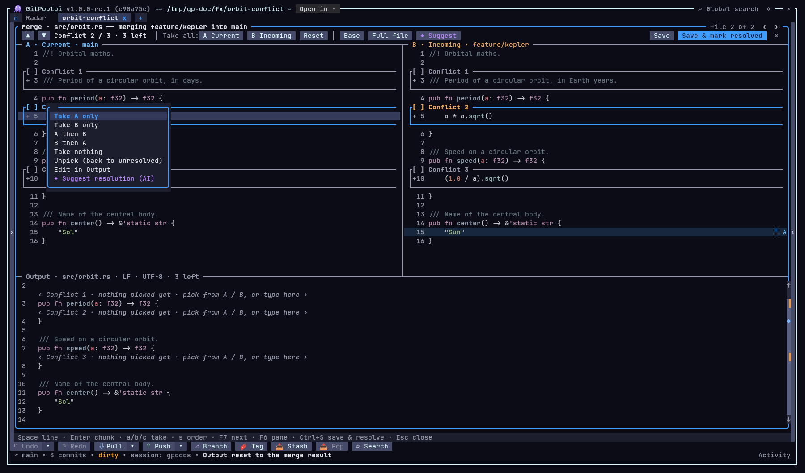
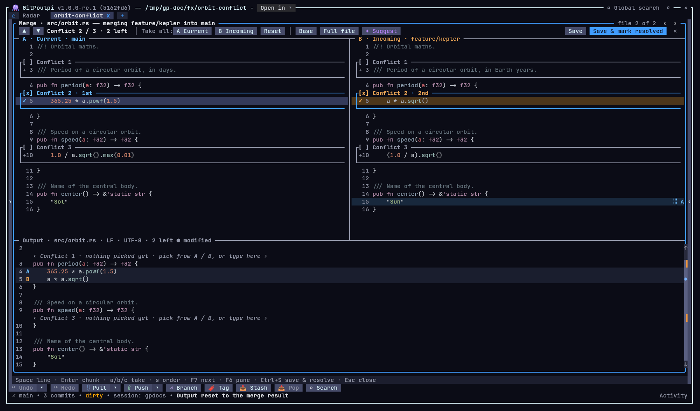
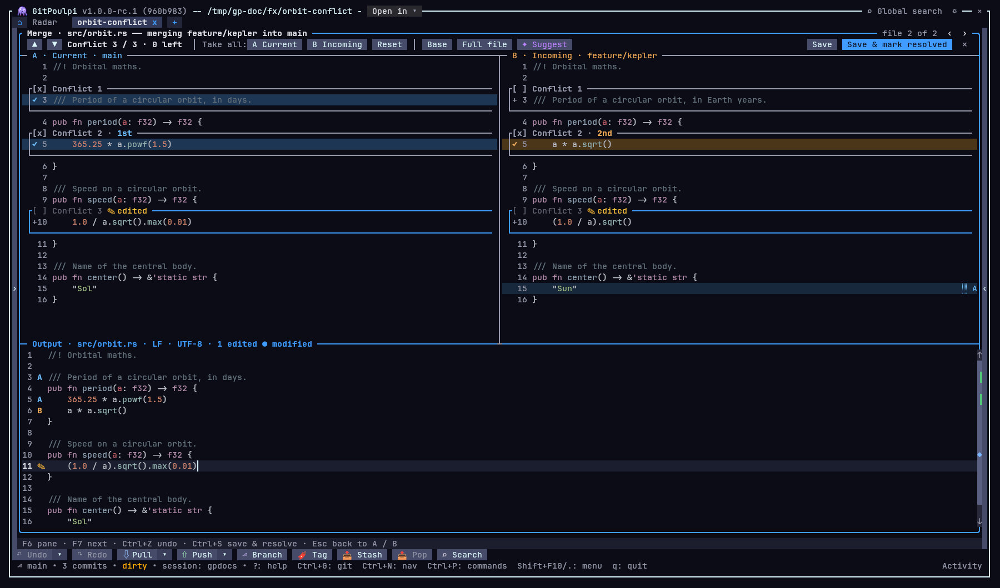
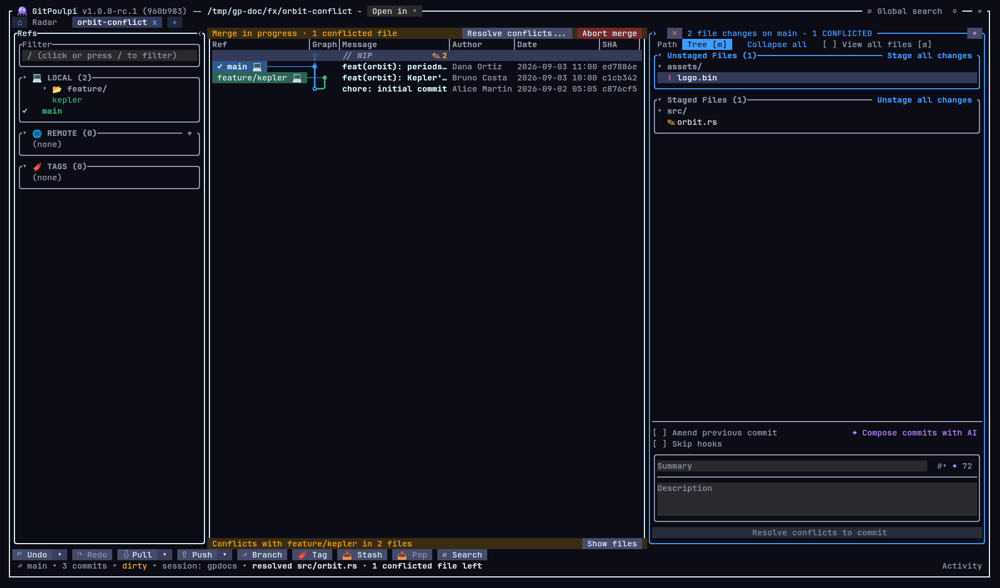
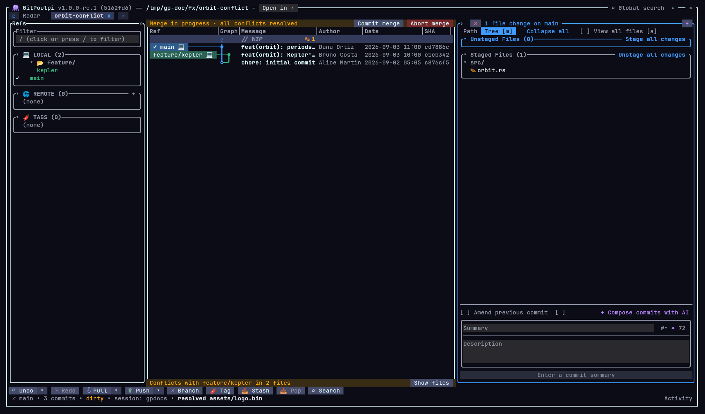
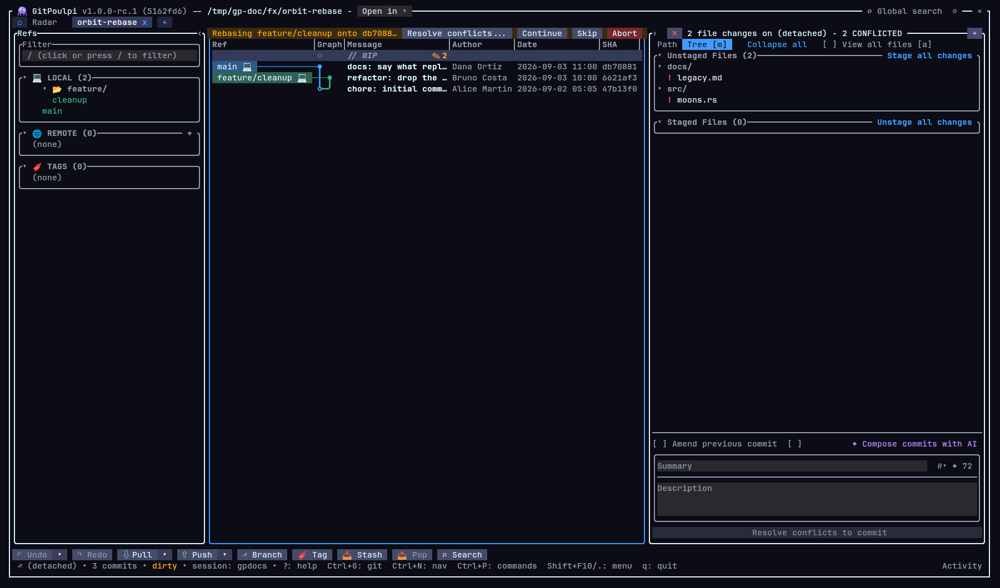
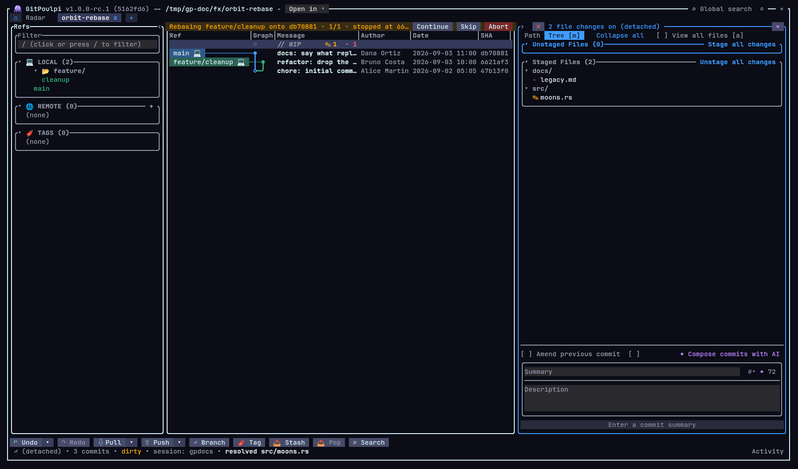
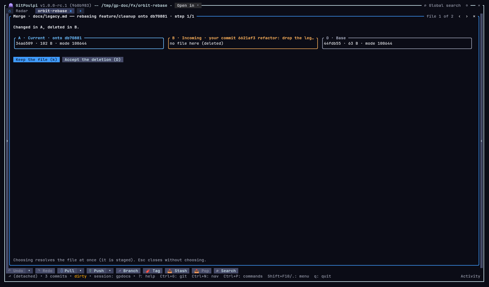

[English](../merge-conflicts.md) · [Čeština](../cs/merge-conflicts.md) · [Deutsch](../de/merge-conflicts.md) · [Español](../es/merge-conflicts.md) · [Français](../fr/merge-conflicts.md) · [Italiano](../it/merge-conflicts.md) · [日本語](../ja/merge-conflicts.md) · [한국어](../ko/merge-conflicts.md) · [Nederlands](../nl/merge-conflicts.md) · **Polski** · [Português (Brasil)](../pt-BR/merge-conflicts.md) · [Português (Portugal)](../pt-PT/merge-conflicts.md) · [Русский](../ru/merge-conflicts.md) · [Svenska](../sv/merge-conflicts.md) · [Türkçe](../tr/merge-conflicts.md) · [Українська](../uk/merge-conflicts.md) · [简体中文](../zh-CN/merge-conflicts.md)

# Rozwiązywanie konfliktów merge

Gdy merge, cherry-pick, revert lub rebase zatrzymuje się na konfliktach, Log pokazuje
baner (*Trwa merge · feature do main · 2 pliki z konfliktem*), a pliki z konfliktem
pojawiają się w panelu Status z czerwonym `!`. Otwórz jeden z nich w **edytorze
merge**: A (strona bieżąca) i B (strona przychodząca) obok siebie, a pod nimi
**Wynik**, czyli plik, który piszesz. Ta strona to wersja skrócona;
pełna lista klawiszy jest w [Skrótach klawiszowych](keybindings.md).

## Otwieranie

- Enter albo podwójne kliknięcie wiersza `!` w panelu Status; jego menu prawego przycisku
  zaczyna się od **Otwórz w edytorze merge**.
- Przycisk banera **Rozwiąż konflikty...** (otwiera pierwszy plik z konfliktem).
- Widok Diff pliku z konfliktem: przycisk **Edytor merge** (`Shift+E`).
- Paleta: **Konflikty: Otwórz edytor merge**.

Nic nie otwiera się samo: zatrzymana operacja pokazuje tylko baner i wiersze
`!`.

Edytor zajmuje całą szerokość okna: panel boczny Refs i
prawy panel są ukryte, gdy jest otwarty, i wracają po jego zamknięciu (`F9`
w międzyczasie je pokazuje lub ukrywa). A i B są obok siebie zawsze, gdy edytor ma
co najmniej `merge.side_by_side_min_width` kolumn szerokości (domyślnie 100, Ustawienia >
Diff i edytor; `0` oznacza zawsze); w węższym widać jedną stronę naraz w kartach. Długie
linie przewijają się w bok, A i B razem (`Shift+←` / `Shift+→`, Shift+kółko lub
kółko poziome), nigdy nie są zawijane.

## Wybieranie

Każdy konflikt to blok w ramce w A i w B, z polem wyboru w nagłówku i
`+` / `✓` przed każdą linią. Kliknij blok prawym przyciskiem, by zobaczyć wybory dla tego konfliktu:

| Aby... | Klawisz | Mysz |
|---|---|---|
| wziąć linię pod kursorem (strona z fokusem) | `Space` | kliknij linię |
| wziąć cały fragment strony z fokusem | `Enter` | kliknij `[ ]` w jego nagłówku |
| wziąć tylko A / tylko B dla tego konfliktu | `a` / `b` | prawy przycisk na fragmencie |
| wziąć obie, A potem B / B potem A | `c` / `Shift+C` | prawy przycisk na fragmencie |
| nie brać niczego | `x` | prawy przycisk na fragmencie |
| zamienić kolejność dwóch wybranych stron | `s` | kliknij plakietkę `1st` / `2nd` |
| wziąć całe A / całe B (każdy konflikt) | `Shift+A` / `Shift+B` | pasek narzędzi |
| cofnąć wybór tego konfliktu (znów nierozwiązany) | `u` w A / B, `Alt+U` wszędzie | prawy przycisk na fragmencie, **Cofnij wybór** |
| przywrócić cały plik do pierwotnych konfliktów (pyta najpierw, gdy wpisano coś w Wyniku; `Ctrl+Z` to przywraca) | `Shift+U` w A / B, `Alt+R` wszędzie | **Resetuj** obok Użyj wszystkich |
| następny / poprzedni konflikt | `F7` / `Shift+F7`, `Alt+Down` / `Alt+Up` (`n` / `Shift+N` w A / B) | `▼` / `▲` albo kliknij znacznik na pasku przewijania |
| liczba powtarza ruch | `3j`, `2k`, `2n`, `3N` (w A / B) | |
| następny / poprzedni plik z konfliktem | `Alt+PageDown` / `Alt+PageUp` | `›` / `‹` w nagłówku |
| pokazać lub ukryć panel Bazy (wspólny przodek) | `Alt+D` (`d` w A / B) | `Baza` |
| pokazać cały plik w A i B (**Cały plik**) | `Alt+F` (`f` w A / B) | `Cały plik` |
| dać A lub B więcej szerokości / wrócić do równych szerokości | `Alt+Right` / `Alt+Left`, `Alt+0` | przeciągnij separator; kliknij go dwukrotnie |
| przewinąć A / B / Bazę w bok | `Shift+←` / `Shift+→` (`Shift+H` / `Shift+L`) | Shift+kółko, kółko poziome |
| pokazać lub ukryć panele Refs i Status | `F9` | |
| ustawić fokus na A, B, Wyniku | `F6` / `Shift+F6` | kliknięcie |
| przeskoczyć do panelu, na konflikcie, na którym jesteś | `Alt+1` A, `Alt+2` B, `Alt+3` Wynik, `Alt+4` Baza; albo `Ctrl+N`, potem `1` / `2` / `3` | |
| przejść do sąsiedniego panelu (A, Baza, B, Wynik), ten sam konflikt | `h` / `l` albo `←` / `→` w A / B | |
| przełączać wysokość Wyniku | `z` | przeciągnij jego tytuł |
| cofnąć / ponowić (wybory i pisanie, jeden stos) | `Ctrl+Z` / `Ctrl+Y` | |
| zapisać plik, zostawiając go w konflikcie | `Alt+S` | **Zapisz** |
| zapisać plik i oznaczyć jako rozwiązany | `Ctrl+S` | **Zapisz i oznacz jako rozwiązany** |
| zamknąć | `Esc` | `✕` |

Każdy pasek przewijania (A / B / Baza oraz Wynik) niesie jeden znacznik na konflikt:
pomarańczowy, gdy nadal wymaga wyboru, zielony po obsłużeniu, niebieski dla bieżącego.
Kliknięcie znacznika przeskakuje do tego konfliktu (znacznik pod suwakiem paska
jest już na ekranie, więc tam kliknięcie przeciąga suwak).

Wzięcie obu stron (**A, potem B**) zapisuje w Wyniku, pod znacznikiem konfliktu, najpierw linie A, a potem B, każdą oznaczoną swoją stroną; plakietki `1st` / `2nd` na obu blokach mówią o kolejności, a `s` ją zamienia:

**Cały plik** pokazuje cały plik w A i B z pokolorowaną każdą różnicą, nie tylko konfliktami:

Wynik to prawdziwy edytor: kliknij w nim i pisz, zaznaczaj, wycinaj i wklejaj, szukaj przez
`Ctrl+F`. Wybór na konflikcie, który edytowano ręcznie, zastępuje twoją edycję (`Ctrl+Z`
ją przywraca). Zapis z konfliktem, w którym nic nie wybrano, albo z linią,
która nadal wygląda jak znacznik konfliktu, pyta najpierw.

### ✦ Zasugeruj rozwiązanie (AI)

Gdy AI jest włączone (Ustawienia > AI; zob. [Wsparcie AI](ai.md)), pasek narzędzi ma
przycisk **✦ Zasugeruj**, menu prawego przycisku konfliktu ma *✦ Zasugeruj rozwiązanie (AI)*, a
`Alt+I` i paleta (`AI: Zasugeruj rozwiązanie konfliktu merge`) robią to samo. Działa
tylko na bieżącym konflikcie i uruchamia się tylko na twoją prośbę. Odpowiedź zastępuje
część Wyniku dla tego konfliktu jako jedną edycję, oznaczoną jako edytowana (`✎`), więc `Ctrl+Z`
przywraca konflikt do poprzedniego stanu. Nigdy nie jest zapisywana ani dodawana do stage za ciebie. Gdy
działa, wiersz podpowiedzi pokazuje upływający czas; `Esc` anuluje, a błąd też jest tam
pokazany. Przy wyłączonym AI żadna z tych kontrolek nie istnieje.

Po **Zapisz i oznacz jako rozwiązany** plik jest w stage, a lista plików z konfliktem
wraca; następny plik otwierasz sam. `Ctrl+Z` (lub przycisk Cofnij)
cofa ostatnie „oznacz jako rozwiązany”.

Gdy nie zostaje żaden plik, baner oferuje
**Commit merge** (albo **Kontynuuj** dla cherry-pick, revert lub rebase) oraz
**Przerwij merge**, który pyta najpierw: przywraca HEAD, indeks i drzewo robocze
do poprzedniego stanu.

Rebase zatrzymuje się tak samo, krok po kroku. Jego baner podaje gałąź i to, na co jest przebazowana, oraz ma **Rozwiąż konflikty...**, **Kontynuuj**, **Pomiń** i **Przerwij**:

Gdy ostatni plik jest rozwiązany, ten sam baner jest gotowy do **Kontynuuj**:

Merge, którego wynik równa się HEAD (wszędzie wzięto naszą stronę), nie ma niczego
w stage ani zmienionego pliku, a mimo to można go zakończyć: **Commit merge**
otwiera okno commita z opisem merge, a commit ma obu
rodziców. Podobnie przycisk Commit kompozytora jest aktywny bez niczego w stage,
gdy merge jest zatrzymany.

Pusty cherry-pick lub revert (zmiana jest już zastosowana) nie może zostać
zatwierdzony: git go odrzuca, a **Kontynuuj** o tym mówi i wskazuje **Pomiń**.
**Pomiń** (przycisk banera, pozycja palety *Git: Pomiń cherry-pick lub revert*, CLI
`conflicts skip`) pyta najpierw, a potem kończy operację, nic dla niej nie zapisując;
HEAD, indeks i drzewo robocze wracają do HEAD. Pominięcia nie da się cofnąć
(nic nie jest tracone, z czego nie zrezygnowano celowo); merge
nie ma czego pomijać.

## Konflikty, które nie są tekstem

Plik binarny, wskaźnik Git LFS, plik powyżej 8 MiB, plik usunięty po jednej stronie,
pozostałość po zmianie nazwy, dowiązanie symboliczne, zmiana trybu lub submoduł nie mają linii do
wyboru. Edytor pokazuje **kartę** z tym, co trzyma każda strona, i jednym przyciskiem na
wybór; wybranie rozwiązuje i dodaje plik do stage od razu.

| Karta | Wybory |
|---|---|
| Plik binarny, wskaźnik LFS, za duży | **Zachowaj A** (`a`), **Użyj B** (`b`), **Użyj Bazy** (`o`, gdy jest), **Otwórz w narzędziu merge** (`m`) |
| Usunięty po jednej stronie, zmieniony po drugiej | **Zachowaj plik** (`k`), **Zaakceptuj usunięcie** (`Shift+D`) |
| Pozostałość po zmianie nazwy (ścieżka istnieje tylko po jednej stronie) | **Zachowaj plik** (`k`), **Usuń plik** (`Shift+D`) |
| Dowiązanie symboliczne, submoduł, tryb pliku | **Zachowaj A**, **Użyj B**, **Użyj Bazy** |

Gdy plik jest obrazem (PNG, JPEG, GIF, WebP, BMP, ICO), ramki pokazują też
obrazy A, B i Bazy, dopasowane i tylko do odczytu, w oknie dość szerokim, by je
pomieścić; zob. [Obrazy](image-view.md#w-edytorze-merge).

`Esc` zamyka kartę bez wyboru. Zewnętrzne narzędzie merge to
`general.external_merge_tool` w Ustawienia > Diff i edytor (`{base}`, `{local}` = A,
`{remote}` = B, `{merged}`; puste oznacza `git mergetool`); plik trafia do stage, gdy
narzędzie zakończy się powodzeniem.

## Zapobieganie konfliktom

GitPoulpi potrafi ostrzec, *zanim* zrobisz merge. Gdy gałąź, na której jesteś, skonfliktowałaby się z gałęzią, z której powstała
(jej **bazą**), na górnej ramce Log pojawia się pasek: **Konflikty z origin/main w 2 plikach**, z przyciskiem
**Pokaż pliki**. Zajmuje najbliższy wolny wiersz ramki za banerami trwających operacji, więc gdy któryś z nich jest
widoczny, może poczekać na miejsce. Nic nie jest scalane: demon robi w pamięci merge obu commitów
(libgit2 albo `git merge-tree --write-tree` z git 2.38 lub nowszym; starszy git wyłącza funkcję jednym wpisem
w dzienniku), więc pliki, indeks i refy pozostają nietknięte.

- **Bazą** jest gałąź docelowa pull requesta tej gałęzi, gdy GitPoulpi już ją zna (z pamięci podręcznej sekcji
  PULL REQUESTS; nie wykonuje się w tym celu żadnego zapytania do sieci), a w przeciwnym razie gałąź spośród wzorców
  **Gałęzi bazowych** (Ustawienia > Zapobieganie konfliktom) z najmniejszą liczbą commitów od rozwidlenia. Remis wygrywa
  gałąź, której koniec jest najbliżej rozwidlenia, potem gałąź zdalna przed lokalną, na końcu nazwa. Sama gałąź i jej
  zdalna kopia nigdy nie są bazą.
- **Okno** (kliknij pasek albo użyj polecenia palety **Konflikty: Pokaż przewidywane konflikty**, które działa
  z klawiatury) wylicza pliki i ma przyciski **Otwórz podgląd merge** oraz **Rebase na bazę**. To wiersze menu samej gałęzi
  bazowej (*Merge <baza> do <gałąź>*, *Rebase <gałąź> na <baza>*) uruchamiane za ciebie: trafiają do historii cofania, więc
  `Ctrl+Z` je cofa, a merge, który naprawdę się skonfliktuje, zatrzymuje się w edytorze merge jak każdy inny. Left i Right
  przechodzą między przyciskami, Enter naciska wybrany, Esc zamyka.
- **Kiedy działa**: w tle, około 2 sekundy po tym, jak repozytorium ucichnie (commit, checkout, fetch, który przesunął
  gałąź, rebase), raz dla każdej pary `(HEAD, baza)`. Pasek znika, gdy tylko HEAD się przesunie, i wraca albo nie,
  zależnie od nowej odpowiedzi. Odłączony HEAD nie jest sprawdzany.
- **Listy gałęzi bazowych**: skąd repozytorium bierze Gałęzie bazowe, wybiera się na jego stronie **Zapobieganie
  konfliktom**. **Domyślne** podąża za globalną wartością domyślną (wbudowane `**`, czyli każda gałąź, dopóki w
  Ustawienia > Zapobieganie konfliktom nie wybierzesz innej listy); **Lista: <nazwa>** podąża za jedną z twoich
  nazwanych list; **Własna lista** to lista tylko tego repozytorium. Listy są współdzielone: edytuj jedną, a każde
  repozytorium, które z niej korzysta, użyje zmiany przy następnym sprawdzeniu, bez restartu. **Zapisz jako listę...**
  zamienia własne wzorce repozytorium w nazwaną listę, **Przywróć domyślne** odrzuca wybór repozytorium. Usunięcie listy,
  którą repozytorium śledzi, sprawia, że używa ono domyślnej.
- **Wyłączenie**: **Włącz proaktywne wykrywanie konfliktów** w Ustawienia > Zapobieganie konfliktom albo dla jednego repozytorium na jego
  stronie **Zapobieganie konfliktom**. W skrypcie `gitpoulpi conflicts check` wypisuje tę samą odpowiedź jako JSON
  ([Opis CLI](cli-reference.md)).

## Agenci

Agent może pokazać ci konflikt (`gitpoulpi ui show conflict <path> [--conflict
N]`: edytor otwiera się na nim, nic nie jest wybrane) albo **zaproponować** rozwiązanie
(`gitpoulpi ui propose resolution <path> --pick 1=a,2=ba` lub `--content-file F`,
wymaga *Pozwól agentom AI proponować zmiany do mojego potwierdzenia*). Propozycja otwiera
edytor z wyborami (lub całym tekstem) już w Wyniku i fioletowym
banerem *✦ Propozycja od claude-code*. Przejrzyj ją, zmień, co chcesz, i naciśnij
**Ctrl+S**: tylko to cokolwiek zapisuje lub dodaje do stage. Zamknięcie edytora odrzuca
propozycję. Zob. [MCP i agenci](mcp-and-agents.md).

W skrypcie te same operacje to `gitpoulpi conflicts list | show | resolve |
unresolve | state | abort` ([Opis CLI](cli-reference.md)); `conflicts check` przewiduje je przed merge.
