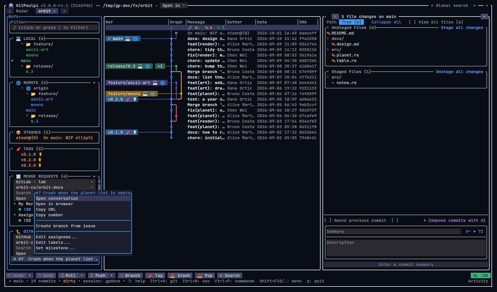

[English](../pull-requests-and-issues.md) · [Čeština](../cs/pull-requests-and-issues.md) · [Deutsch](../de/pull-requests-and-issues.md) · [Español](../es/pull-requests-and-issues.md) · [Français](../fr/pull-requests-and-issues.md) · [Italiano](../it/pull-requests-and-issues.md) · [日本語](../ja/pull-requests-and-issues.md) · [한국어](../ko/pull-requests-and-issues.md) · [Nederlands](../nl/pull-requests-and-issues.md) · **Polski** · [Português (Brasil)](../pt-BR/pull-requests-and-issues.md) · [Português (Portugal)](../pt-PT/pull-requests-and-issues.md) · [Русский](../ru/pull-requests-and-issues.md) · [Svenska](../sv/pull-requests-and-issues.md) · [Türkçe](../tr/pull-requests-and-issues.md) · [Українська](../uk/pull-requests-and-issues.md) · [简体中文](../zh-CN/pull-requests-and-issues.md)

# Pull requesty i zgłoszenia

Czytanie, tworzenie i zarządzanie pull / merge requestami i zgłoszeniami z panelu bocznego, tablicy i paska narzędzi. Najpierw połącz konto i powiąż repozytorium: zob. [Integracje z hostingiem i trackerami zgłoszeń](hosting-integration.md). Wszystko, co dotyczy jednego zgłoszenia lub żądania (komentarze, przeglądy, wątki), jest w [Rozmowach](conversations.md); czytanie i recenzowanie żądania jest w [Recenzowaniu pull requesta](review.md).

## Pull requesty i zgłoszenia w panelu bocznym

### PULL REQUESTS

Sekcja ma nagłówek z licznikiem i `+` (utwórz pull request), listy dostawcy
i projektu, pole wyszukiwania oraz listę stanu (*Otwarte*, *Merged / closed*,
*Wszystkie*). Potem są cztery grupy, każda ze swoim licznikiem:

- **Moje pull requesty**: jesteś autorem.
- **Przypisane do mnie**.
- **Czekają na mój przegląd**: jesteś wskazanym recenzentem.
- **Wszystkie pull requesty**: na początku zwinięte.

Pole wyszukiwania filtruje każdą grupę (tytuł, numer, autor, gałąź). Każda
zmiana listy stanu ponownie pyta hosta.

Wiersz zaczyna się od znaku stanu: `●` otwarty (zielony), `○` szkic, `◆`
scalony (fioletowy), `✕` zamknięty (czerwony). Żądanie bieżącej gałęzi jest
pogrubione. Wiersze wyglądają jak `#12  title` (GitHub, Bitbucket) lub
`!53  title` (GitLab, Azure DevOps).

### ZGŁOSZENIA

Tytuł sekcji wskazuje dostawcę: `GITHUB ZGŁOSZENIA`, `JIRA ZGŁOSZENIA` i tak dalej.
Dla Azure DevOps brzmi `... ELEMENTY PRACY`, a dla Trello `... KARTY`. Pod
listami: pole wyszukiwania, lista stanu (*Otwarte*, *Przypisane do mnie*,
*Zamknięte*, *Wszystkie*) i zgłoszenia. Wiersz Jira wygląda jak
`ABC-12  title`, z przyciemnionym typem i statusem, gdy panel boczny jest
dość szeroki.

### Akcje na wierszu

- `Enter` lub dwukrotne kliknięcie otwiera wiersz: pull request w [przeglądzie](review.md) (GitHub, GitLab, Gitea,
  Forgejo, Gerrit), zgłoszenie oraz żądanie w Azure DevOps lub Bitbucket jako [rozmowę](conversations.md) w oknie,
  a wszystko inne w przeglądarce. **Otwórz w przeglądarce** w menu wiersza zawsze otwiera przeglądarkę.
- Prawy przycisk myszy lub `.` otwiera menu wiersza:
  - **Otwórz rozmowę** (zgłoszenia i żądania, które nie mają widoku przeglądu), **Otwórz w przeglądarce**,
    **Kopiuj URL**, **Kopiuj numer**.
  - Dla pull requesta: **Edytuj na <dostawca>**, **Checkout gałęzi
    źródłowej**, **Pokaż commity gałęzi źródłowej**. Dla żądania z forka
    checkout brzmi **Checkout pull request (fork)**, a **Pokaż** jest
    wyszarzone.
  - Dla zgłoszenia: **Utwórz gałąź ze zgłoszenia**. Otwiera okno nowej gałęzi
    z nazwą typu `12-fix-the-thing` (lub `ABC-123-fix-the-thing` dla Jira).
  - W GitHub, GitLab, Gitea i Forgejo wiersz pull requesta ma też **Przejrzyj...**
    (także **Enter** na wierszu): przegląd w aplikacji, zob.
    [Przegląd pull lub merge requesta](review.md).
  - W GitHub, GitLab, Gitea i Forgejo oba wiersze mają też **Edytuj przypisanych...**,
    **Edytuj etykiety...** i **Ustaw kamień milowy...** (oraz **Edytuj recenzentów...** przy
    pull requeście): zob.
    [Przypisani, recenzenci, etykiety i kamień milowy](#przypisani-recenzenci-etykiety-i-kamień-milowy).
- **Edytuj na <dostawca>** ma trzy inne wejścia: ołówek `✎` na prawym końcu
  wiersza pull requesta pod kursorem lub zaznaczonego, `e` na zaznaczonym
  wierszu oraz polecenie palety *Integracje: Edytuj powiązany pull request na
  hoście* (dla żądania bieżącej gałęzi).
- Jeśli gałęzi źródłowej nie ma jeszcze w repozytorium, GitPoulpi o tym mówi.
  Najpierw zrób fetch (`Ctrl+G f`).

**Checkout pull requesta.** GitPoulpi pobiera żądanie do lokalnej gałęzi
`pr/<n>` (`mr/<n>` w GitLab), która je śledzi, i przełącza się na nią. W GitHub,
GitLab, Gitea i Forgejo działa to także dla forków (GitPoulpi pobiera specjalny ref head
hosta). Azure DevOps i Bitbucket pobierają gałąź źródłową żądania. Żądanie z
forka jest tam odrzucane: dodaj fork jako zdalne repozytorium i sam zrób checkout jego
gałęzi. Cofnięcie wraca do poprzedniej gałęzi. CLI: `gitpoulpi hosting
checkout-pr <n>`.

**Przegląd pull requesta z wiersza poleceń (i przez agenta).** W GitHub
(także Enterprise), GitLab (także self-managed), Gitea i Forgejo żądanie można
czytać i przeglądać bez opuszczania GitPoulpi: `hosting review show <n>` (pliki,
stan scalenia, kontrole), `hosting review threads <n>` (wątki przeglądu i
dyskusja), `hosting review comment`, `hosting review reply`, `hosting review resolve`
oraz `hosting review submit <n> --event approve|request-changes|comment
--comment path:line[:side]:text`. Diff pochodzi z twojego repozytorium, nie z
hosta: `hosting review fetch <n>` pobiera head żądania do
`refs/gitpoulpi/pr/<n>`, a jego gałąź docelową do `refs/gitpoulpi/pr/<n>-base`
(żadne z nich nie jest gałęzią, nic nie jest wyewidencjonowywane). Numery linii są z tego
diffa: `new` to linia w head, `old` linia w bazie scalenia. GitLab
nie ma stanu przeglądu „request changes”: jest tam odrzucany, nic nie jest wysyłane.
Gitea i Forgejo przyjmują komentarz tylko do jednej linii (bez zakresów); wątek to
komentarze do jednej linii pliku. Gitea potrafi rozwiązać wątek, Forgejo 11 nie
(host nie ma do tego punktu końcowego: wywołanie o tym mówi). Odpowiedź na serwerze
bez punktu końcowego odpowiedzi jest publikowana jako jednokomentarzowy przegląd tej samej linii.
Gitea odmawia zaakceptowania lub odrzucenia twojego własnego żądania.
Bez klonu: dodaj `--project owner/name` (GitLab: `group/project`) do `review show`, `threads`,
`comment`, `reply`, `resolve`, `submit` i `suggest`, aby przejrzeć projekt, który nie jest bieżącym repozytorium,
`hosting review diff <n> --project P` czyta diff (hunki każdego pliku) z API hosta, a
`hosting file <path> --project P [--ref R]` czyta plik w danej rewizji (GitHub, GitLab, Gitea, Forgejo i Gerrit; w Gerricie diff
patch setu jest czytany plik po pliku, a plik pochodzi z gałęzi albo, dla id commita, z commita). Plik, którego host
nie pokazuje w diffie (za duży), jest oznaczony jako `omitted`.
Narzędzia MCP to te same polecenia (`hosting_review_show`, `hosting_review_submit`, `hosting_review_diff`,
`hosting_file`...).

### Przypisani, recenzenci, etykiety i kamień milowy

W GitHub (także Enterprise), GitLab (także self-managed), Gitea i
Forgejo możesz zmienić, komu przypisano pull request lub zgłoszenie, kto je przegląda, jego etykiety
i kamień milowy bez opuszczania GitPoulpi. Inni dostawcy nie pokazują nic z tego.

- **Menu wiersza**: **Edytuj przypisanych...**, **Edytuj recenzentów...** (tylko pull requesty),
  **Edytuj etykiety...**, **Ustaw kamień milowy...**.
- **Paleta**: *Hosting: Edytuj przypisanych...*, *Hosting: Edytuj recenzentów...*,
  *Hosting: Edytuj etykiety...*, *Hosting: Ustaw kamień milowy...* najpierw wypisują
  żądania i zgłoszenia z paska bocznego do wyboru. W
  [Radarze](radar.md) te same cztery działają na zaznaczonym wierszu.
- Selektor otwiera się od razu i wczytuje od hosta osoby lub etykiety projektu (oraz to, co
  element ma teraz). Wiersz ze spinnerem pojawia się po około 150 ms.
  Wpisz, aby filtrować (dopasowanie rozmyte), `Up` / `Down` przesuwają, `Space` zaznacza lub
  odznacza, `Enter` stosuje, `Esc` anuluje, `Tab` dociera do przycisków. Kliknięcie
  wiersza go zaznacza, a kółko przewija. Osoby mają plakietkę z inicjałami,
  etykiety swój kolor.
- Kamień milowy to lista rozwijana (z **Brak kamienia milowego**, aby go wyczyścić).
- Po **Zastosuj** host jest aktualizowany, a listy i Radar pokazują
  zmianę po następnym odświeżeniu, które zaczyna się od razu.

Formularze tworzenia (pull requesta, zgłoszenia) mają te same wybory jako rząd
przycisków: `Przypisani: brak`, `Recenzenci: brak`, `Etykiety: brak`,
`Kamień milowy: brak`. W GitHub, GitLab, Gitea i Forgejo przycisk Etykiety zastępuje wpisywane
pole etykiet formularza zgłoszenia. Jeśli host przyjmie nowy pull request, ale
odrzuci niektóre jego etykiety lub osoby, mówi o tym pasek stanu.

CLI: `gitpoulpi hosting members|labels|milestones`, `hosting pr-edit <n>`,
`hosting issue edit <n>` oraz `--assignee`, `--reviewer`, `--label`,
`--milestone` przy `hosting pr` i `hosting issue create`; zob.
[Opis CLI](cli-reference.md).

### Klawisze w sekcjach

| Klawisz | Akcja |
|---|---|
| `Enter` / dwukrotne kliknięcie | otwiera rozmowę w GitPoulpi, gdy host ją ma (pull request w GitHub, GitLab, Gitea lub Gerrit otwiera przegląd), w przeciwnym razie przeglądarkę |
| `o` | otwiera wiersz w przeglądarce |
| `.` / prawy przycisk | menu wiersza |
| `e` | edytuje zaznaczony pull request na hoście |
| `n` | nowy pull request (PULL REQUESTS) lub nowe zgłoszenie (ZGŁOSZENIA) |
| `v` | otwiera listę stanu |
| `r` | odświeża |
| `Enter` / `Space` na nagłówku | zwija lub rozwija sekcję |

### Ponowne połączenie i tryb offline

Gdy brakuje tokenu, został on odrzucony albo brakuje mu zakresu, pierwszy wiersz sekcji
brzmi `Połącz ponownie (token odrzucony)`. Kliknij go lub naciśnij `Enter`, aby
otworzyć profil w Ustawienia > Integracje.

Gdy host jest nieosiągalny, ostatnie listy zostają na ekranie, a nagłówek
pokazuje ich wiek (`· 5m old`). Ostatnia odpowiedź jest też buforowana na dysku
(`.gitpoulpi/hosting-cache.json`), więc listy pojawiają się, zanim odpowie sieć.

## Tablica zgłoszeń

Przycisk **Tablica** w nagłówku ZGŁOSZENIA (paleta: **Zgłoszenia: Otwórz tablicę**) pokazuje zgłoszenia powiązanego źródła jako tablicę Kanban
nad oknem. Kolumny zależą od źródła:

| Źródło | Kolumny | Przenoszenie karty |
|---|---|---|
| Lokalne notatki Markdown | statusy (`statuses` profilu, potem każdy inny w użyciu) | przepisuje `status` notatki |
| GitHub, GitLab, Gitea, Forgejo | **Otwarte**, potem wybrane przez ciebie etykiety, potem **Zamknięte** | podmienia etykietę statusu; do **Zamknięte** zamyka zgłoszenie, do kolumny znów je otwiera |
| Trello | otwarte listy tablicy, od lewej do prawej | przenosi kartę na listę |
| Redmine | statusy zgłoszeń | zmienia status zgłoszenia (obowiązują reguły workflow Redmine) |
| Jira (Cloud i Data Center) | statusy projektu, najpierw do zrobienia, na końcu zrobione | uruchamia przejście workflow prowadzące do kolumny (`GET`, potem `POST .../transitions`); gdy takiego przejścia nie ma, karta wraca, a pasek stanu mówi `no transition from X to Y` |
| Azure DevOps (Services i Server) | stany typów elementów pracy projektu, według kategorii stanu | ustawia `System.State`; element pracy, którego typ nie ma stanu kolumny, wraca z powodem (`a Bug has no state Done`) |

W projekcie GitHub lub GitLab **Kolumny** (albo `c`, albo **Tablica: Ustaw etykiety kolumn...**) pytają o etykiety, które są
kolumnami, po kolei, na przykład `status::todo, status::doing, status::review`. Proponują etykiety projektu, które
wyglądają jak statusy. Wybór jest zapisywany dla repozytorium. Bez etykiet tablica to Otwarte / Zamknięte. Przeniesienie karty
dotyka tylko wymienionych przez ciebie etykiet statusu: jej inne etykiety zostają. Tablica hosta wypisuje otwarte zgłoszenia i 60 ostatnio
zamkniętych.

Przejście w Jira, które wymaga wymaganych pól (na przykład rozwiązania), jest odrzucane przez Jirę, a karta wraca z jej własnym
komunikatem: zrób to jedno na stronie.

Ta sama tablica jest dostępna dla skryptów i agentów: `gitpoulpi hosting board` wypisuje kolumny z kartami, a
`gitpoulpi hosting board move <card> <column>` przenosi jedną (zob. [opis CLI](cli-reference.md)).

Karta pokazuje numer, tytuł, przypisanych jako inicjały, etykiety i kamień milowy. Przeciągnij ją na inną kolumnę,
albo `Shift+Left` / `Shift+Right`, albo **Tablica: Przenieś kartę do...** (`m`). Przenosi się od razu; po około 150 ms spinner
mówi, że host jeszcze pracuje, a jeśli host odmówi, karta wraca, a pasek stanu mówi dlaczego. `Enter` otwiera
[rozmowę](conversations.md) zgłoszenia w GitPoulpi, a tablica wraca po jej zamknięciu; `e` edytuje przypisanych, etykiety i kamień milowy; `n` zaczyna nowe zgłoszenie w
zaznaczonej kolumnie; `a`, `l`, `M` i `/` filtrują według przypisanego, etykiety, kamienia milowego i tekstu, `x` czyści filtry; `r`
czyta hosta ponownie. Tablica czyta ponownie, gdy listy paska bocznego się odświeżają. Radar nie ma tablicy.

## Utwórz pull request

Otwórz formularz przez `+` w nagłówku PULL REQUESTS, `n` w sekcji albo
polecenie palety *Pull Requesty: Utwórz pull request...*. Menu gałęzi ma też
**Rozpocznij pull request z <gałąź>...**.

Formularz zawiera:

- Jedną kartę na każdy połączony profil, który ma pull requesty (`Left` /
  `Right` na pasku kart).
- Listy **Z repozytorium** / **Gałąź** i **Do repozytorium** / **Gałąź**.
  Długie listy można przeszukiwać. Można wpisać gałąź lub repozytorium, których
  listy nie pokazują.
- **Tytuł**, wypełniony tematem commita na końcu gałęzi.
- **Opis**, w wielu liniach (`Enter` dodaje nową linię, `Tab` opuszcza pole).
- Przyciski **Przypisani**, **Recenzenci**, **Etykiety** i **Kamień milowy** (GitHub,
  GitLab, Gitea i Forgejo), które otwierają selektor.
- **Wyślij jako szkic**.
- Przy włączonym [AI](ai.md): **Wygeneruj tytuł i opis**.

Formularz otwiera się na profilu, repozytorium i gałęziach bieżącej gałęzi
(`feature -> main`). Inne repozytorium źródłowe tworzy żądanie z forka.

**Utwórz pull request** (lub `Ctrl+S`) tworzy żądanie na hoście. Wynik otwiera
się w przeglądarce, a pasek stanu go nazywa.

## Utwórz zgłoszenie

Gdy sekcja ZGŁOSZENIA ma dostawcę **i** projekt, jej nagłówek ma `+` (*Nowe
zgłoszenie*). Także: `n` w sekcji albo polecenie palety
*Hosting: Nowe zgłoszenie...*.

Formularz ma **Tytuł** (wymagany), **Opis** (wiele linii) i **Etykiety**
(po przecinku, na przykład `bug, ui`; w GitHub, GitLab, Gitea i Forgejo
przyciski Etykiety, Przypisani i Kamień milowy otwierają zamiast tego selektor). Jira i Azure DevOps
dodają listę **Typ**. Trello dodaje listę **Lista**. Linear i YouTrack
dodają listę **Status** (stan workflow albo wartość `State`, w jakim zgłoszenie
zaczyna). Redmine dodaje listę **Typ** z trackerami projektu (Bug, Feature,
Support...); nie ma etykiet, więc nie ma dla niego przycisku Etykiety, a etykieta
podana w wierszu poleceń jest odrzucana. Formularz wypełnia te
listy z hosta przy otwarciu.

**Utwórz zgłoszenie** (lub `Ctrl+S`) tworzy je na hoście. `Esc` lub **Anuluj**
zamyka formularz. Jeśli host odmówi (odrzucony token, brak zakresu, nieznany
projekt, nieznana etykieta), formularz pokazuje powód i zachowuje wpisane
dane. Po sukcesie pasek stanu nazywa nowe zgłoszenie, a sekcja ZGŁOSZENIA jest
odświeżana.

CLI: `gitpoulpi hosting issue create --title ... [--body ... | --body-file ...]
[--label ...] [--type ...] [--list ...]`.

## Utwórz na własnej stronie WWW hosta

Formularz nowego zgłoszenia i formularz tworzenia pull requesta mają przycisk
**Utwórz na <dostawca>** w prawym górnym rogu. Klawisz to `Alt+W`. Otwiera on
w przeglądarce formularz WWW hosta, wypełniony tym, co dotąd wpisano. Okno
pozostaje otwarte. Nie potrzebuje tokenu i nie wywołuje API, więc działa też
po błędzie API.

- GitHub nie ma parametru URL dla *szkicu*, więc pole szkicu nie jest
  przenoszone. GitLab dostaje prefiks tytułu `Draft: `.
- GitLab przyjmuje etykiety tylko po id, więc są dodawane jako szybka akcja
  `/label ~"x"` na końcu opisu.
- Bardzo długi opis jest ucinany, aby URL zmieścił się w 6000 znaków, z
  adnotacją `[...truncated: paste the rest]`.
- Bitbucket Data Center nie ma adresu formularza WWW, więc nie ma przycisku
  **Utwórz na <dostawca>**.

CLI: `gitpoulpi hosting issue create ... --web` i `gitpoulpi hosting pr --web`
wypisują ten sam URL.

## Znacznik na pasku narzędzi

Na końcu paska narzędzi (domyślnie po prawej) znacznik pokazuje żądanie bieżącej gałęzi:
`GH #12` (GitHub), `GL !53` (GitLab), `AZ !12` (Azure DevOps) lub `BB #12`
(Bitbucket). Jego kolor pokazuje stan: zielony otwarty, szary szkic, fioletowy
scalony, czerwony zamknięty.

- Najedź na niego, by zobaczyć tytuł, stan i `source → target`.
- Kliknij go lub naciśnij `Ctrl+G g`, aby otworzyć żądanie w przeglądarce.
- Kliknij go prawym przyciskiem dla **Otwórz w przeglądarce**, **Kopiuj URL**,
  **Odśwież** i **Zmień profil**.

Wypchnięta gałąź bez żądania pokazuje przyciemniony znacznik `+ PR`. Kliknij go,
aby rozpocząć pull request. Znacznika nie ma, gdy żaden profil nie pasuje, gdy
gałąź nie jest wypchnięta albo gdy host był nieosiągalny. W wąskim oknie
znacznik jest ukrywany, aby zostawić miejsce na przyciski paska narzędzi.

## Kiedy listy się odświeżają

Listy odświeżają się:

- gdy otwierasz repozytorium;
- gdy zmienia się przełączona gałąź;
- po push lub fetch;
- co *Odświeżanie: pull requesty i zgłoszenia (minuty)*
  (`general.hosting_refresh_minutes`, domyślnie 5, `0` wyłącza licznik;
  Ustawienia > Integracje);
- gdy zamykasz Ustawienia;
- gdy naciśniesz `r`, uruchomisz *Integracje: Odśwież pull requesty i zgłoszenia*
  albo zmienisz filtr.

Żądania nigdy nie blokują okna.

Hosty ograniczają liczbę wywołań. GitPoulpi odsyła `ETag` ostatniej odpowiedzi,
więc niezmieniona lista kosztuje niewiele (nic w GitHubie). Gdy host zgłasza, że
zostało niewiele wywołań, mówi o tym pasek stanu. Gdy nie zostało żadnego,
GitPoulpi przestaje pytać ten host do czasu zresetowania limitu, a listy
zostają bez zmian.

## Terminologia

GitHub, Azure DevOps i Bitbucket mówią „pull request”. GitLab mówi „merge
request”. *Terminologia żądań przeglądu* (`ui.pr_terminology`, w
Ustawienia > Integracje) wybiera słowo dla każdej etykiety, menu, polecenia
palety i komunikatu:

- **Auto (wg hosta)**: idzie za powiązanym dostawcą repozytorium („Pull
  Request”, dopóki nic nie jest powiązane).
- **Pull Request** lub **Merge Request**: zawsze to słowo.

Zmiana działa od razu. CLI i MCP zawsze mówią „pull/merge request”. Ta strona
mówi „pull request”.

## Odwołania w opisach commitów i nazwach gałęzi

Gdy zgłoszenia lub pull requesty repozytorium są powiązane, odwołania w opisie
commita w szczegółach commita są podkreślone. Kliknięcie otwiera powiązaną
stronę. Klawiatura: polecenie palety
*Integracje: Otwórz odwołanie z commita (#zgłoszenie / !żądanie)...* (menu, gdy
opis ma kilka odwołań). Repozytorium bez powiązań nie ma odnośników.

Co jest odwołaniem, zależy od dostawcy sekcji ZGŁOSZENIA:

| ZGŁOSZENIA powiązane z | W opisie | W nazwie gałęzi |
|---|---|---|
| GitHub, GitLab, Gitea, Forgejo | `#123` | `123-fix-login` |
| Azure DevOps | `#123` i `AB#123` | `123-fix-login` |
| Jira | `ABC-123`, tylko gdy `ABC` jest kluczem powiązanego projektu. Tekst taki jak `UTF-8`, `SHA-256` lub `ISO-8601` nigdy nie jest odnośnikiem. | `ABC-123` w dowolnym miejscu nazwy (`feature/ABC-123-x`), wielkimi literami |
| Linear | `ENG-123`, tylko gdy `ENG` jest kluczem powiązanego zespołu (albo zespołu z listy zespołów profilu). `UTF-8` nigdy nie jest odnośnikiem. | własne `branchName` Linear, gdy tworzysz gałąź ze zgłoszenia; `ENG-123` w dowolnym miejscu nazwy jest odczytywane z powrotem |
| YouTrack | `ABC-123`, tylko gdy `ABC` jest krótką nazwą powiązanego projektu (albo projektu z listy projektów profilu) | `ABC-123` w dowolnym miejscu nazwy |
| Redmine | `#123`, tylko gdy Redmine jest powiązanym źródłem ZGŁOSZENIA (źródło pull requestów zachowuje własny znak) | `123-fix-login` |
| Trello | adres `https://trello.com/c/<shortLink>`; `#12` tylko gdy buforowana karta ma numer 12 | `12-fix-login` |

| PULL REQUESTS powiązane z | W opisie |
|---|---|
| GitLab, Azure DevOps | `!45` |
| GitHub, Bitbucket, Gitea, Forgejo | `#45` |

Gdy pasują obie listy `#N`, wygrywa zgłoszenie. CLI:
`gitpoulpi hosting refs --message TEXT | --commit REV | --branch NAME`.

**W rozmowach.** Tekst zgłoszenia lub żądania jest czytany z gramatyką jego hosta, szerszą niż tabela powyżej:
`owner/repo#7`, `!7`, `GH-7`, `@login`, id commitów i inne formy wymienione w
[Odwołaniach krzyżowych](conversations.md#odwołania-krzyżowe). Najpierw dopasowywane są powiązane źródła repozytorium, więc klucz Jira
w komentarzu GitHub nadal otwiera swoje zgłoszenie w aplikacji. `gitpoulpi hosting markdown --body TEXT --id I`
pokazuje, co aplikacja znajduje w tekście.

### Wstaw odwołanie do zgłoszenia

W kompozytorze commita przycisk `#▾` na prawym końcu Podsumowania otwiera
filtrowaną listę powiązanych zgłoszeń. Zgłoszenie wskazane przez bieżącą
gałąź jest pierwsze, oznaczone *(z gałęzi)*. `Enter` lub kliknięcie wstawia
jego odwołanie (`ABC-123`, `#12`, `AB#12`) w miejscu kursora. Klawiatura:
`Alt+R` w kompozytorze. Paleta: *Commit: Wstaw odwołanie do zgłoszenia...*.
Bez powiązanej listy zgłoszeń przycisk jest wyszarzony i mówi *najpierw
powiąż listę zgłoszeń na pasku bocznym*. GitPoulpi nigdy nie dodaje odwołania
samo.
