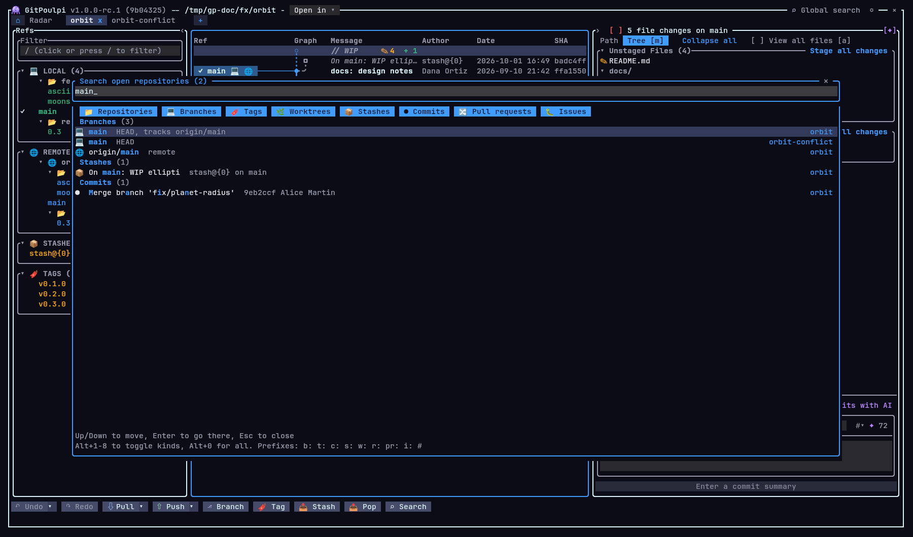

[English](../search.md) · [Čeština](../cs/search.md) · [Deutsch](../de/search.md) · [Español](../es/search.md) · [Français](../fr/search.md) · [Italiano](../it/search.md) · [日本語](../ja/search.md) · [한국어](../ko/search.md) · [Nederlands](../nl/search.md) · **Polski** · [Português (Brasil)](../pt-BR/search.md) · [Português (Portugal)](../pt-PT/search.md) · [Русский](../ru/search.md) · [Svenska](../sv/search.md) · [Türkçe](../tr/search.md) · [Українська](../uk/search.md) · [简体中文](../zh-CN/search.md)

# Wyszukiwanie

`Ctrl+Alt+F` (albo `Ctrl+P`, potem `Szukaj: Obszar roboczy...`) otwiera przybliżoną
przeszukiwarkę **każdego repozytorium, w którym pracujesz**: repozytoriów aktywnego
[obszaru roboczego](workspaces.md), gdy jest, a w przeciwnym razie otwartych
kart. Przycisk **Szukaj wszędzie** (lupa z etykietą na pasku tytułu, tuż na lewo od
koła zębatego) też ją otwiera. Znajduje:

- **repozytoria** (po nazwie, potem po ścieżce),
- **gałęzie** (lokalne i zdalne) oraz **tagi**,
- **worktree** (po folderze, potem po ścieżce i gałęzi),
- **stashe** (po opisie),
- **commity** (po temacie; treść commita jest przeszukiwana tylko wtedy, gdy jego temat
  nie pasuje, a wpisałeś trzy znaki lub więcej),
- **pull lub merge requesty** i **zgłoszenia** (po tytule, `#numerze`, autorze i gałęzi).

Wyniki są pogrupowane według rodzaju, w każdej grupie od najlepszego dopasowania.
Każdy wiersz ma ikonę rodzaju, podświetlone dopasowane znaki, przygaszony szczegół
(upstream gałęzi, autora i gałąź requestu, pozycję stasha) oraz nazwę repozytorium
po prawej, więc dwa repozytoria z gałęzią `main` nigdy się nie mylą. W tytule pojawia
się wskaźnik postępu, gdy repozytorium wciąż indeksuje swoje commity (pierwsze
wyszukiwanie w dużym repozytorium może chwilę potrwać); pozostałe rodzaje są od
razu, a commity dołączają, gdy tylko będą gotowe.

## Przechodzenie do wyniku

| Klawisz | Działanie |
|---|---|
| `Up` / `Down`, `PageUp` / `PageDown`, `Home` / `End` | Przesuwa po wynikach (nagłówki grup są pomijane). |
| `Enter` | Przechodzi do wyniku: karta repozytorium się otwiera (albo jest przełączana), potem wynik jest pokazany. |
| `Esc` | Zamyka wyszukiwanie. |
| `Alt+1` .. `Alt+8` | Włącza lub wyłącza rodzaj (znaczniki nad listą, w ich kolejności). `Alt+0` włącza wszystkie. |

Co znaczy „przechodzi do wyniku”:

| Wynik | Enter |
|---|---|
| Gałąź lub tag | Zaznacza go w panelu Refs, a jego commit w Logu. |
| Commit | Zaznacza go w Logu, najpierw wczytując więcej Logu, gdy jest starszy niż to, co wczytano. |
| Stash | Zaznacza jego wiersz w sekcji STASHES. |
| Worktree | Otwiera go jako kartę. |
| Pull/merge request, zgłoszenie | Zaznacza jego wiersz na pasku bocznym (w karcie tego repozytorium). |
| Repozytorium | Przełącza na jego kartę (otwierając ją, gdy nie jest otwarta). |

`Ctrl+N Backspace` (albo `Wstecz` w palecie) wraca tam, gdzie byłeś, tak jak po każdej
zmianie widoku zrobionej przez agenta. Przejście gdziekolwiek nie robi checkoutu, merge
ani żadnej zmiany.

Myszą: kliknięcie wiersza go zaznacza, podwójne kliknięcie tam przechodzi, kliknięcie
znacznika włącza lub wyłącza ten rodzaj, kółko przewija, a kliknięcie poza oknem je zamyka.

## Zawężanie prefiksem

Zacznij zapytanie od prefiksu, by szukać tylko jednego rodzaju, niezależnie od znaczników:

| Prefiks | Rodzaj |
|---|---|
| `r:` | repozytoria |
| `b:` | gałęzie |
| `t:` | tagi |
| `w:` | worktree |
| `s:` | stashe |
| `c:` | commity |
| `pr:` (albo `mr:`, `p:`) | pull lub merge requesty |
| `i:` | zgłoszenia |
| `#` | pull/merge requesty i zgłoszenia (`#12` znajdzie numer 12) |

`fix: login` to zwykłe zapytanie, nie prefiks: liczy się tylko pojedyncza litera (albo
`pr:` / `mr:`) z dwukropkiem albo początkowe `#`.

## Jak dopasowuje

Te same trzy poziomy co paleta poleceń: twój tekst dosłownie, potem dosłownie gdziekolwiek,
potem jego znaki po kolei, ale osobno. Wcześniejsze dopasowanie i krótszy tekst wygrywają.
Wielkie i małe litery są równe.

## Pull requesty i zgłoszenia

Pochodzą z tego, co GitPoulpi już wczytał dla każdego repozytorium (listy za sekcjami
PULL REQUESTS i ZGŁOSZENIA na pasku bocznym), zapisanego w małym pliku pamięci podręcznej w
folderze `.gitpoulpi/` repozytorium. Wyszukiwanie **nigdy nie wywołuje GitHuba ani
GitLaba**: repozytorium, którego requesty nigdy nie zostały wczytane w oknie, nie ma ich
do znalezienia, a to, co widzisz, jest tak świeże jak ostatnie odświeżenie paska
bocznego. Bez powiązanego konta nie ma czego znajdować i niczego nie trzeba konfigurować.

## Z wiersza poleceń

`gitpoulpi search <query> [--workspace ID] [--kind K]... [--limit N]` robi to samo
i wypisuje JSON (zob. [Opis CLI](cli-reference.md#obszary-robocze-i-wyszukiwanie));
serwer MCP ma narzędzie `search`, więc agent znajdzie to, co ty.
`search.commit_limit` w [Ustawieniach](config-reference.md#search-wyszukiwanie-w-obszarze-roboczym)
ogranicza, ile commitów każdego repozytorium jest indeksowanych (`0` wyłącza wyszukiwanie
commitów).

## Zmiana klawisza

`Szukaj: Obszar roboczy...` to polecenie palety, a klawisz to akcja `global.workspace_search`:
zmień go w Ustawienia > Klawiatura i mysz albo w tabeli `[keybindings.global]`
(`workspace_search = "Ctrl+Alt+F"`).
