[English](../themes.md) · [Čeština](../cs/themes.md) · [Deutsch](../de/themes.md) · [Español](../es/themes.md) · [Français](../fr/themes.md) · [Italiano](../it/themes.md) · [日本語](../ja/themes.md) · [한국어](../ko/themes.md) · [Nederlands](../nl/themes.md) · **Polski** · [Português (Brasil)](../pt-BR/themes.md) · [Português (Portugal)](../pt-PT/themes.md) · [Русский](../ru/themes.md) · [Svenska](../sv/themes.md) · [Türkçe](../tr/themes.md) · [Українська](../uk/themes.md) · [简体中文](../zh-CN/themes.md)

# Motywy

Motyw ustala każdy kolor, który maluje GitPoulpi: tekst, panele, zaznaczenie,
przyciski, widoki diffa i merge, edytor, ikony paska narzędzi oraz kolory ścieżek
grafu Log. Motyw zmienisz w **Ustawienia > Wygląd > Motyw** albo poleceniem
`gitpoulpi config set ui.theme <slug>`. Aby zobaczyć, jak wygląda każdy z nich, przejdź do [galerii](#galeria).

## Motywy wbudowane

`gitpoulpi theme list` wypisuje motywy wbudowane z twojej kompilacji, w kolejności, w jakiej
pokazuje je lista w Ustawieniach: najpierw **GitPoulpi Dark** (`dark`, malowany
na tle własnego terminala) i **GitPoulpi Light** (`light`), potem każdy inny
motyw wbudowany alfabetycznie według etykiety. `ui.theme = "system"` (wartość domyślna)
podąża za terminalem: Light na jasnym tle terminala, w pozostałych przypadkach
Dark (zob. „Wykrywanie systemu” poniżej); dawne `default` to to samo co
`system`. Lista palet ścieżek używa tej samej kolejności.

| Slug | Etykieta | Źródło kolorów |
|---|---|---|
| `system` (domyślny) | System | to nie paleta: GitPoulpi Light na jasnym tle terminala, w przeciwnym razie GitPoulpi Dark |
| `dark` | GitPoulpi Dark | oryginalny motyw GitPoulpi, namalowany na własnym tle terminala |
| `light` | GitPoulpi Light | oryginalny motyw GitPoulpi |
| `catppuccin-latte` / `catppuccin-frappe` / `catppuccin-macchiato` / `catppuccin-mocha` | Catppuccin Latte / Frappé / Macchiato / Mocha | [github.com/catppuccin/palette](https://github.com/catppuccin/palette) |
| `cyberpunk` | Cyberpunk | [iTerm2-Color-Schemes](https://github.com/mbadolato/iTerm2-Color-Schemes) „Cyberpunk” |
| `dracula` | Dracula | [draculatheme.com/contribute](https://draculatheme.com/contribute) |
| `everforest-dark` | Everforest Dark | [github.com/sainnhe/everforest/blob/master/palette.md](https://github.com/sainnhe/everforest/blob/master/palette.md) |
| `fire` / `fire-light` | Fire / Fire Light | oryginalne motywy GitPoulpi: Fire to żar na przypalonopomarańczowym tle z płomiennym pomarańczem; Fire Light to jego jasny bliźniak na prawdziwie pomarańczowym tle |
| `github-dark` / `github-light` | GitHub Dark / GitHub Light | motywy Primer GitHuba, [github.com/primer/github-vscode-theme](https://github.com/primer/github-vscode-theme) z @primer/primitives (`canvas.default`, `canvas.inset` jako panel boczny, `fg.*`, `accent.fg`); żadna wartość nie została zmieniona |
| `gruvbox-dark` / `gruvbox-light` | Gruvbox Dark / Light | [github.com/morhetz/gruvbox#palette](https://github.com/morhetz/gruvbox#palette) |
| `kanagawa` / `kanagawa-lotus` | Kanagawa (wave) / Kanagawa Lotus | [github.com/rebelot/kanagawa.nvim](https://github.com/rebelot/kanagawa.nvim) |
| `matrix` | Matrix | [iTerm2-Color-Schemes](https://github.com/mbadolato/iTerm2-Color-Schemes) „Matrix” (w schemacie nie ma czerwieni: `danger` to `#ff5555`) |
| `monokai` | Monokai | oryginalna paleta Monokai ([monokai.nl](https://monokai.nl/)) |
| `nord` | Nord | [www.nordtheme.com](https://www.nordtheme.com) |
| `one-dark` / `one-light` | One Dark / One Light | Atom One Dark / One Light ([One Dark](https://github.com/atom/one-dark-syntax), [One Light](https://github.com/atom/one-light-syntax)) |
| `rose-pine` / `rose-pine-moon` / `rose-pine-dawn` | Rosé Pine / Moon / Dawn | [rosepinetheme.com/palette](https://rosepinetheme.com/palette/) |
| `solarized-dark` / `solarized-light` | Solarized Dark / Light | Solarized Ethana Schoonovera ([ethanschoonover.com/solarized](https://ethanschoonover.com/solarized/)) |
| `sunset` | Sunset | oryginalny motyw GitPoulpi: indygowy zmierzch z koralem i złotem |
| `terminal` | Terminal (16 colors) | używa tylko 16 własnych kolorów twojego terminala |
| `tokyo-night` / `tokyo-night-day` | Tokyo Night (night) / Tokyo Night Day | [github.com/folke/tokyonight.nvim](https://github.com/folke/tokyonight.nvim) (pierwszy plan wariantu Day jest przyciemniony, aby spełniał reguły kontrastu) |
| `vesper` | Vesper | [github.com/raunofreiberg/vesper](https://github.com/raunofreiberg/vesper) (w palecie nie ma niebieskiego ani fioletu: akcent jest brzoskwiniowy) |
| `vscode-dark` / `vscode-light` | VS Code Dark / VS Code Light | domyślne Dark Modern / Light Modern z VS Code, [github.com/microsoft/vscode/tree/main/extensions/theme-defaults/themes](https://github.com/microsoft/vscode/tree/main/extensions/theme-defaults/themes) (`dark_modern.json`, `light_modern.json`, plus domyślne kolory VS Code dla zaznaczenia na liście i akcentów ANSI/wykresów; wyciszona szarość wariantu Light to `616161`) |

### Zaimportowane z terminalcolors.com

Zaimportowane z palet terminalowych terminalcolors.com; każdy schemat należy do swoich autorów. 90 motywów powstaje z tła, pierwszego planu, zaznaczenia i 16 kolorów ANSI palety (akcent = niebieski, success = zielony, warning = żółty, danger = czerwony, AI = magenta, muted = jasna czerń), jedną wspólną dla wszystkich metodą wyprowadzania; kolor, który nie spełnia reguł kontrastu GitPoulpi, jest rozjaśniany lub przyciemniany, aż je spełni. Tabela jest generowana przez `scripts/gen-terminalcolors.py` do `crates/gitpoulpi-config/src/theme/terminalcolors_data.rs`. Slugi mają postać `<rodzina>-<wariant>` (`default` pominięte); etykiety są na liście ułożone alfabetycznie jak pozostałe.

| Rodzina | Slugi |
|---|---|
| [Apprentice](https://terminalcolors.com/themes/apprentice/) | `apprentice` |
| [Ayu](https://terminalcolors.com/themes/ayu/) | `ayu-dark`, `ayu-light`, `ayu-mirage` |
| [Cobalt2](https://terminalcolors.com/themes/cobalt2/) | `cobalt2` |
| [Deus](https://terminalcolors.com/themes/deus/) | `deus` |
| [Dracula](https://terminalcolors.com/themes/dracula/) | `dracula-soft` |
| [Everforest](https://terminalcolors.com/themes/everforest/) | `everforest-light` |
| [GitHub](https://terminalcolors.com/themes/github/) | `github-dark-colorblind`, `github-dark-dimmed`, `github-dark-high-contrast`, `github-dark-legacy`, `github-light-colorblind`, `github-light-high-contrast`, `github-light-legacy` |
| [Gotham](https://terminalcolors.com/themes/gotham/) | `gotham` |
| [Gruvbox](https://terminalcolors.com/themes/gruvbox/) | `gruvbox-dark-hard-contrast`, `gruvbox-dark-soft-contrast`, `gruvbox-light-hard-contrast`, `gruvbox-light-soft-contrast` |
| [Iceberg](https://terminalcolors.com/themes/iceberg/) | `iceberg-dark`, `iceberg-light` |
| [Jellybeans](https://terminalcolors.com/themes/jellybeans/) | `jellybeans` |
| [Kanagawa](https://terminalcolors.com/themes/kanagawa/) | `kanagawa-dragon` |
| [Lucario](https://terminalcolors.com/themes/lucario/) | `lucario` |
| [Miasma](https://terminalcolors.com/themes/miasma/) | `miasma` |
| [Moonfly](https://terminalcolors.com/themes/moonfly/) | `moonfly` |
| [Night](https://terminalcolors.com/themes/night-owl/) | `night-owl-dark`, `night-owl-light` |
| [Nightfly](https://terminalcolors.com/themes/nightfly/) | `nightfly` |
| [Nightfox](https://terminalcolors.com/themes/nightfox/) | `nightfox`, `nightfox-carbonfox`, `nightfox-dawnfox`, `nightfox-dayfox`, `nightfox-duskfox`, `nightfox-nordfox`, `nightfox-terafox` |
| [Noctis](https://terminalcolors.com/themes/noctis/) | `noctis`, `noctis-azureus`, `noctis-bordo`, `noctis-hibernus`, `noctis-lilac`, `noctis-lux`, `noctis-minimus`, `noctis-obscuro`, `noctis-sereno`, `noctis-uva`, `noctis-viola` |
| [Nordic](https://terminalcolors.com/themes/nordic/) | `nordic` |
| [One](https://terminalcolors.com/themes/one-half/) | `one-half-dark`, `one-half-light` |
| [Panda](https://terminalcolors.com/themes/panda/) | `panda` |
| [Posterpole](https://terminalcolors.com/themes/posterpole/) | `posterpole`, `posterpole-gray` |
| [Seoul256](https://terminalcolors.com/themes/seoul256/) | `seoul256-dark`, `seoul256-light` |
| [Shades](https://terminalcolors.com/themes/shades-of-purple/) | `shades-of-purple`, `shades-of-purple-super-dark` |
| [Sonokai](https://terminalcolors.com/themes/sonokai/) | `sonokai`, `sonokai-andromeda`, `sonokai-atlantis`, `sonokai-espresso`, `sonokai-maia`, `sonokai-shusia` |
| [Srcery](https://terminalcolors.com/themes/srcery/) | `srcery` |
| [Tender](https://terminalcolors.com/themes/tender/) | `tender` |
| [Tokyo](https://terminalcolors.com/themes/tokyo-night/) | `tokyo-night-moon`, `tokyo-night-storm` |
| [Tomorrow](https://terminalcolors.com/themes/tomorrow/) | `tomorrow`, `tomorrow-night`, `tomorrow-night-blue`, `tomorrow-night-bright`, `tomorrow-night-eighties` |
| [Zenbones](https://terminalcolors.com/themes/zenbones/) | `zenbones-duckbones`, `zenbones-forestbones-dark`, `zenbones-forestbones-light`, `zenbones-kanagawabones`, `zenbones-neobones-dark`, `zenbones-neobones-light`, `zenbones-nordbones`, `zenbones-rosebones-dark`, `zenbones-rosebones-light`, `zenbones-seoulbones-dark`, `zenbones-seoulbones-light`, `zenbones-tokyobones-dark`, `zenbones-tokyobones-light`, `zenbones-vimbones`, `zenbones-zenburned`, `zenbones-zenwritten-dark`, `zenbones-zenwritten-light` |

`ui.side_bg` to tło panelu Refs i prawego panelu (szczegóły commita, zmiany
robocze, listy plików), tak jak GitHub i VS Code malują swoje panele
boczne. Catppuccin (jego `mantle`), GitHub i VS Code
je ustawiają; w każdym innym motywie wbudowanym jest to `default`, czyli to samo co
`ui.bg`. Plik motywu może ustawić `side_bg` w `[ui]` (wypisuje je
`gitpoulpi theme export`).

Trzy kolejne role w `[ui]` kolorują obramowanie okna, tak jak robią to VS Code:

| Rola | Co maluje |
|---|---|
| `ui.toolbar_bg` | Wiersz paska narzędzi oraz **zaznaczoną kartę repozytorium**, dzięki czemu karta wygląda na połączoną z paskiem narzędzi. Przyciski paska narzędzi zachowują własne `chrome.toolbar_bg`. |
| `ui.statusbar_bg` | Pasek stanu (na dole, chyba że `ui.statusbar_position` mówi top). |
| `ui.statusbar_fg` | Tekst paska stanu. Tekst, który nie byłby czytelny na tym tle, jest przemalowywany tym kolorem; tekst ostrzeżeń i błędów, który jest czytelny, zachowuje swój kolor. |

Motywy wbudowane ustawiają je tak, by pasowały do swojej aplikacji: VS Code Dark i Light niebieski (`#007acc`) pasek
stanu z białym tekstem i szarości paska tytułu VS Code dla paska narzędzi;
GitHub swoje odcienie nagłówka. Każdy inny motyw wbudowany (w tym zaimportowane palety
terminalowe) wyprowadza pasek narzędzi o jeden stopień od `bg`, a pasek stanu
nieco od niego, z `text` na nim, a reguły kontrastu dbają o czytelność tekstu.
`dark` (GitPoulpi Dark) i `terminal` używają własnego tła terminala, więc wszystkie
trzy mają tam `default`: nic nie jest malowane, a zaznaczona karta zachowuje
kolor zaznaczenia. Plik motywu, który je pomija, dziedziczy wartości ze swojej
bazy; `default` oznacza brak odcienia (pasek stanu podąża wtedy za `side_bg`).

Tam, gdzie komentarz lub wyciszona szarość schematu jest zbyt blada, by ją
odczytać, jest rozjaśniana, aż spełni reguły kontrastu GitPoulpi; odcienie
paneli i zaznaczenia, których schemat nie ma, są wyprowadzane z jego tła.

### Galeria

Każdy wbudowany motyw, w tym samym repozytorium z zaznaczonym commitem merge (`scripts/docs-screenshots.sh` robi je od nowa).

| **GitPoulpi Dark** (`dark`) | **GitPoulpi Light** (`light`) | **Apprentice** (`apprentice`) |
|---|---|---|
| 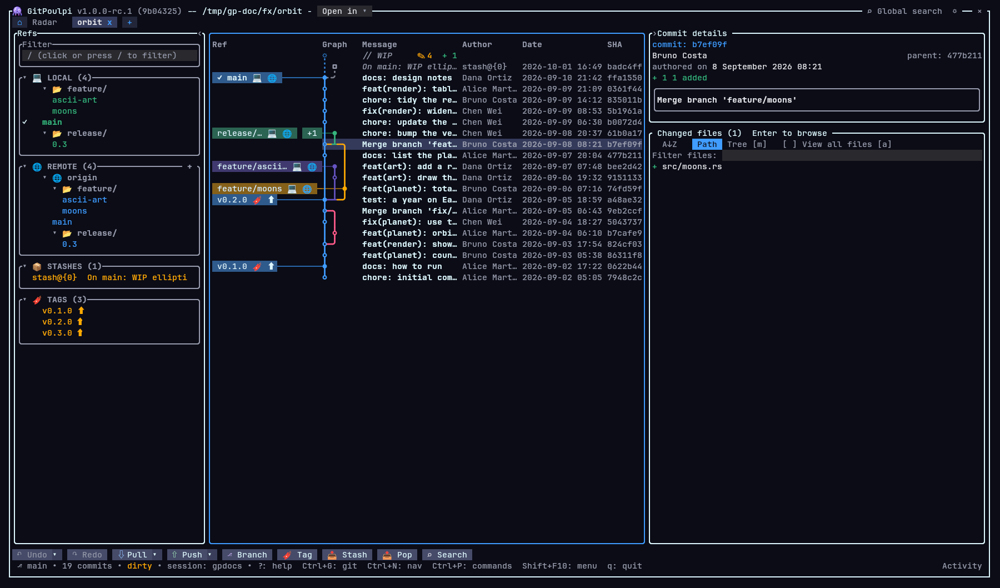 |  |  |
| **Ayu Dark** (`ayu-dark`) | **Ayu Light** (`ayu-light`) | **Ayu Mirage** (`ayu-mirage`) |
|  |  |  |
| **Catppuccin Frappé** (`catppuccin-frappe`) | **Catppuccin Latte** (`catppuccin-latte`) | **Catppuccin Macchiato** (`catppuccin-macchiato`) |
|  |  |  |
| **Catppuccin Mocha** (`catppuccin-mocha`) | **Cobalt2** (`cobalt2`) | **Cyberpunk** (`cyberpunk`) |
|  |  |  |
| **Deus** (`deus`) | **Dracula** (`dracula`) | **Dracula Soft** (`dracula-soft`) |
| 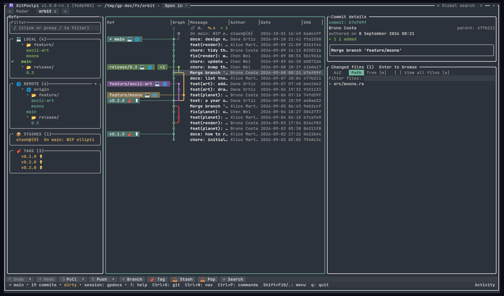 |  |  |
| **Everforest Dark** (`everforest-dark`) | **Everforest Light** (`everforest-light`) | **Fire** (`fire`) |
|  |  |  |
| **Fire Light** (`fire-light`) | **GitHub Dark** (`github-dark`) | **GitHub Dark Colorblind** (`github-dark-colorblind`) |
| 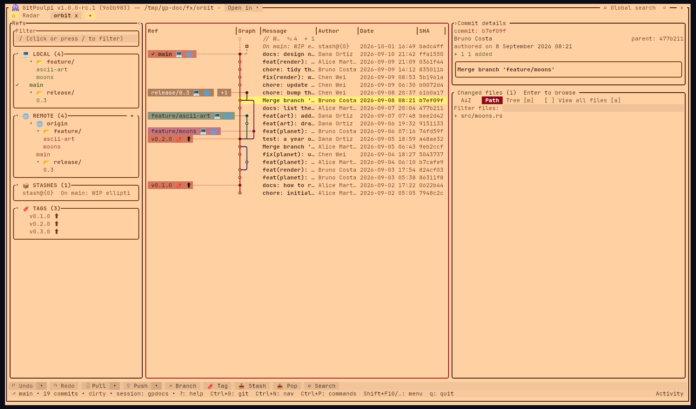 |  |  |
| **GitHub Dark Dimmed** (`github-dark-dimmed`) | **GitHub Dark High Contrast** (`github-dark-high-contrast`) | **GitHub Dark Legacy** (`github-dark-legacy`) |
|  |  |  |
| **GitHub Light** (`github-light`) | **GitHub Light Colorblind** (`github-light-colorblind`) | **GitHub Light High Contrast** (`github-light-high-contrast`) |
|  |  |  |
| **GitHub Light Legacy** (`github-light-legacy`) | **Gotham** (`gotham`) | **Gruvbox Dark** (`gruvbox-dark`) |
|  | 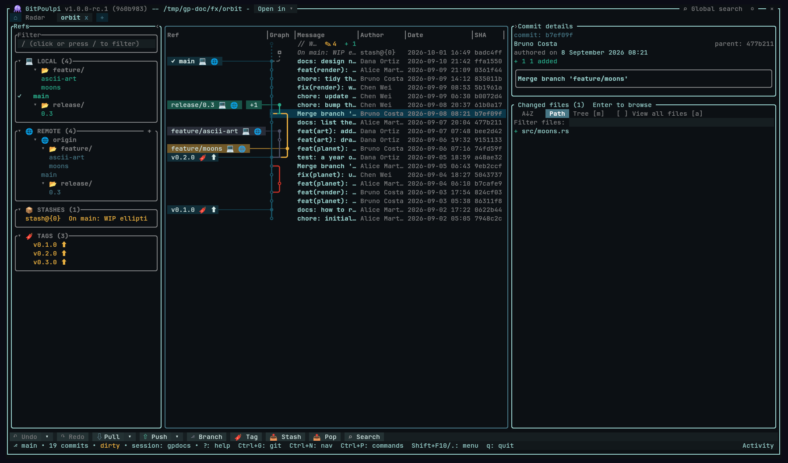 |  |
| **Gruvbox Dark Hard Contrast** (`gruvbox-dark-hard-contrast`) | **Gruvbox Dark Soft Contrast** (`gruvbox-dark-soft-contrast`) | **Gruvbox Light** (`gruvbox-light`) |
|  |  |  |
| **Gruvbox Light Hard Contrast** (`gruvbox-light-hard-contrast`) | **Gruvbox Light Soft Contrast** (`gruvbox-light-soft-contrast`) | **Iceberg Dark** (`iceberg-dark`) |
|  |  |  |
| **Iceberg Light** (`iceberg-light`) | **Jellybeans** (`jellybeans`) | **Kanagawa** (`kanagawa`) |
|  |  |  |
| **Kanagawa Dragon** (`kanagawa-dragon`) | **Kanagawa Lotus** (`kanagawa-lotus`) | **Lucario** (`lucario`) |
|  |  |  |
| **Matrix** (`matrix`) | **Miasma** (`miasma`) | **Monokai** (`monokai`) |
|  |  | 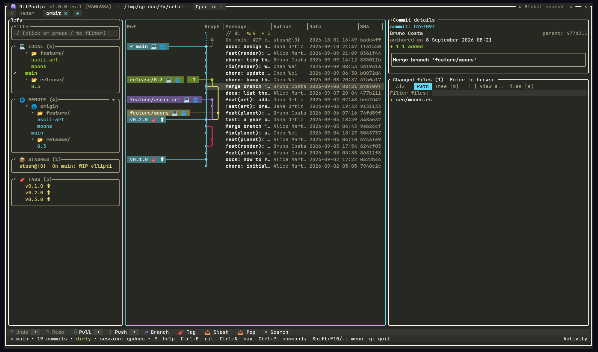 |
| **Moonfly** (`moonfly`) | **Night Owl Dark** (`night-owl-dark`) | **Night Owl Light** (`night-owl-light`) |
|  |  |  |
| **Nightfly** (`nightfly`) | **Nightfox** (`nightfox`) | **Nightfox Carbonfox** (`nightfox-carbonfox`) |
|  |  | 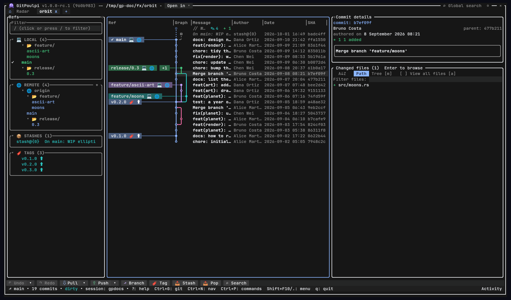 |
| **Nightfox Dawnfox** (`nightfox-dawnfox`) | **Nightfox Dayfox** (`nightfox-dayfox`) | **Nightfox Duskfox** (`nightfox-duskfox`) |
|  |  |  |
| **Nightfox Nordfox** (`nightfox-nordfox`) | **Nightfox Terafox** (`nightfox-terafox`) | **Noctis** (`noctis`) |
|  |  |  |
| **Noctis Azureus** (`noctis-azureus`) | **Noctis Bordo** (`noctis-bordo`) | **Noctis Hibernus** (`noctis-hibernus`) |
|  |  |  |
| **Noctis Lilac** (`noctis-lilac`) | **Noctis Lux** (`noctis-lux`) | **Noctis Minimus** (`noctis-minimus`) |
|  |  |  |
| **Noctis Obscuro** (`noctis-obscuro`) | **Noctis Sereno** (`noctis-sereno`) | **Noctis Uva** (`noctis-uva`) |
|  |  |  |
| **Noctis Viola** (`noctis-viola`) | **Nord** (`nord`) | **Nordic** (`nordic`) |
|  |  |  |
| **One Dark** (`one-dark`) | **One Half Dark** (`one-half-dark`) | **One Half Light** (`one-half-light`) |
|  |  | 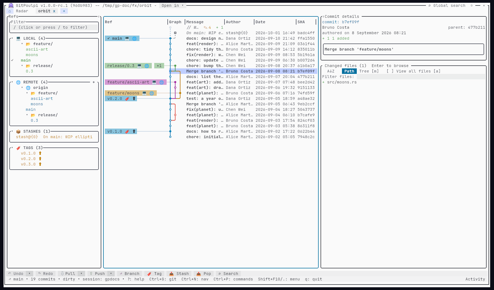 |
| **One Light** (`one-light`) | **Panda** (`panda`) | **Posterpole** (`posterpole`) |
|  |  |  |
| **Posterpole Gray** (`posterpole-gray`) | **Rosé Pine** (`rose-pine`) | **Rosé Pine Dawn** (`rose-pine-dawn`) |
|  |  |  |
| **Rosé Pine Moon** (`rose-pine-moon`) | **Seoul256 Dark** (`seoul256-dark`) | **Seoul256 Light** (`seoul256-light`) |
|  |  |  |
| **Shades of Purple** (`shades-of-purple`) | **Shades of Purple Super Dark** (`shades-of-purple-super-dark`) | **Solarized Dark** (`solarized-dark`) |
|  |  |  |
| **Solarized Light** (`solarized-light`) | **Sonokai** (`sonokai`) | **Sonokai Andromeda** (`sonokai-andromeda`) |
|  |  |  |
| **Sonokai Atlantis** (`sonokai-atlantis`) | **Sonokai Espresso** (`sonokai-espresso`) | **Sonokai Maia** (`sonokai-maia`) |
|  |  |  |
| **Sonokai Shusia** (`sonokai-shusia`) | **Srcery** (`srcery`) | **Sunset** (`sunset`) |
|  |  |  |
| **Tender** (`tender`) | **Terminal (16 colors)** (`terminal`) | **Tokyo Night** (`tokyo-night`) |
|  |  |  |
| **Tokyo Night Day** (`tokyo-night-day`) | **Tokyo Night Moon** (`tokyo-night-moon`) | **Tokyo Night Storm** (`tokyo-night-storm`) |
|  |  |  |
| **Tomorrow** (`tomorrow`) | **Tomorrow Night** (`tomorrow-night`) | **Tomorrow Night Blue** (`tomorrow-night-blue`) |
|  |  |  |
| **Tomorrow Night Bright** (`tomorrow-night-bright`) | **Tomorrow Night Eighties** (`tomorrow-night-eighties`) | **Vesper** (`vesper`) |
|  | 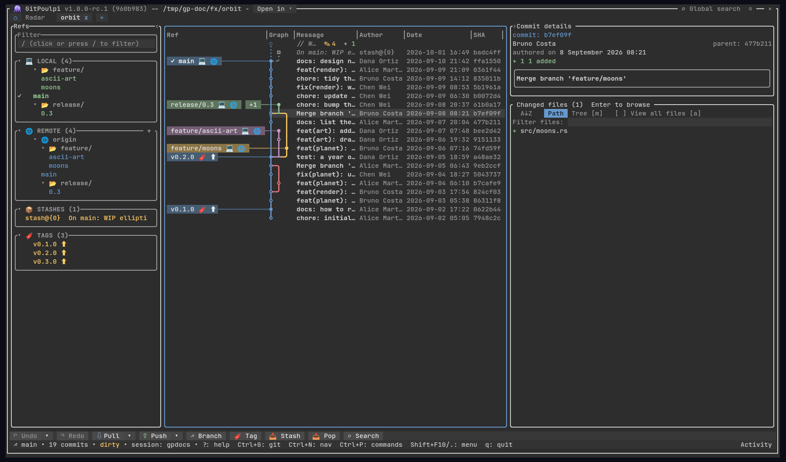 |  |
| **VS Code Dark** (`vscode-dark`) | **VS Code Light** (`vscode-light`) | **Zenbones Duckbones** (`zenbones-duckbones`) |
|  |  |  |
| **Zenbones Forestbones Dark** (`zenbones-forestbones-dark`) | **Zenbones Forestbones Light** (`zenbones-forestbones-light`) | **Zenbones Kanagawabones** (`zenbones-kanagawabones`) |
|  | 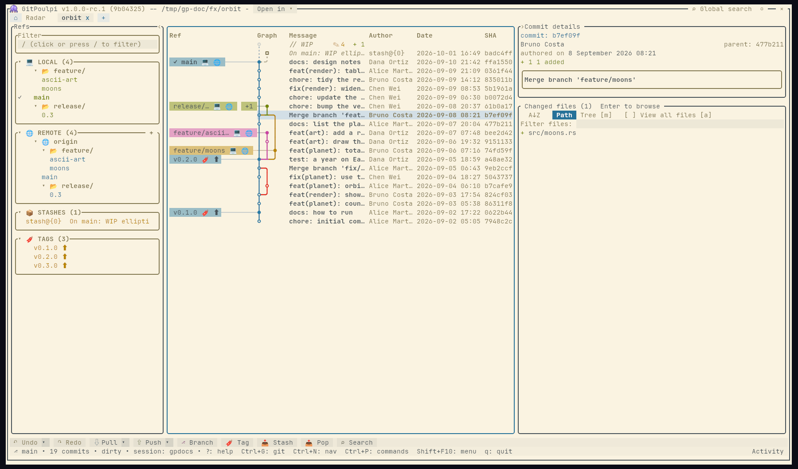 |  |
| **Zenbones Neobones Dark** (`zenbones-neobones-dark`) | **Zenbones Neobones Light** (`zenbones-neobones-light`) | **Zenbones Nordbones** (`zenbones-nordbones`) |
|  |  |  |
| **Zenbones Rosebones Dark** (`zenbones-rosebones-dark`) | **Zenbones Rosebones Light** (`zenbones-rosebones-light`) | **Zenbones Seoulbones Dark** (`zenbones-seoulbones-dark`) |
|  |  |  |
| **Zenbones Seoulbones Light** (`zenbones-seoulbones-light`) | **Zenbones Tokyobones Dark** (`zenbones-tokyobones-dark`) | **Zenbones Tokyobones Light** (`zenbones-tokyobones-light`) |
|  | 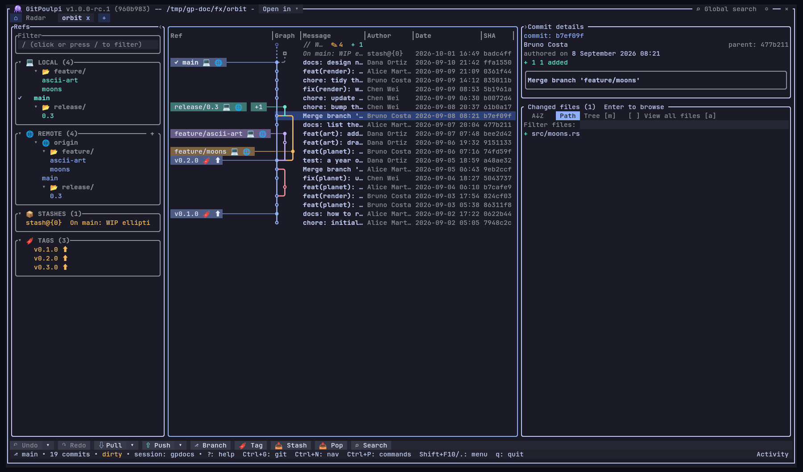 |  |
| **Zenbones Vimbones** (`zenbones-vimbones`) | **Zenbones Zenburned** (`zenbones-zenburned`) | **Zenbones Zenwritten Dark** (`zenbones-zenwritten-dark`) |
|  |  |  |
| **Zenbones Zenwritten Light** (`zenbones-zenwritten-light`) |
|  |

## Dowolny motyw z dowolną paletą ścieżek

Każdy motyw ma własne kolory ścieżek grafu Log, ale można połączyć dowolny motyw
z dowolną paletą: **Ustawienia > Wygląd > Motyw kolorów grafu** oferuje
**Zgodnie z motywem** (domyślnie) oraz każdą paletę ścieżek każdego motywu
(GitPoulpi Dark, GitPoulpi Light, potem Material, Serie, ... i
`graph_palette` własnych plików motywów). 

W `config.toml`:

```toml
[ui]
theme = "nord"
graph_color_theme = "material"   # albo "theme", aby podążać za motywem
```

`ui.input_color` to ten sam rodzaj nadpisania dla pól tekstowych: domyślne
`theme` podąża za kolorami pól motywu; `gray`, `blue`, `slate`, `dark` i
`custom` wymuszają tło (to ciemne kolory, więc w jasnym motywie wybierz
`theme`).

## Własne motywy

Umieść plik `.toml` w folderze `themes/` katalogu konfiguracji
(`gitpoulpi config path` wypisuje jego katalog nadrzędny; folder to
`${config}/themes/`). Nazwa pliku bez `.toml` to slug motywu, który przyjmuje
`ui.theme`. Plik nie może użyć ponownie sluga motywu wbudowanego (jest pomijany z
ostrzeżeniem).

Zacznij od kompletnego pliku:

```
gitpoulpi theme export nord > "$(dirname "$(gitpoulpi config path)")/themes/mine.toml"
```

Potem zostaw tylko to, co zmieniasz. Plik to zestaw **częściowych nadpisań**
względem `base` (motywu wbudowanego albo innego motywu użytkownika; łańcuchy mają co
najwyżej 4 poziomy, cykle są odrzucane; brak `base` oznacza `dark`):

```toml
name = "My Nord"            # etykieta na liście; domyślnie nazwa pliku
base = "nord"
light = false               # dziedziczone, gdy brak
syntax = "base16-ocean.dark"
graph_palette = ["#88c0d0", "#a3be8c"]

[ui]
bg = "#2e3440"              # "default" | "#rrggbb" | "ansi:N"
accent = "#88c0d0"
toolbar_bg = "#3b4252"      # wiersz paska narzędzi i zaznaczona karta
statusbar_bg = "#5e81ac"    # pasek stanu
statusbar_fg = "#eceff4"

[diff]
add_bg = "#2f3b2f"
```

Kolory to `"#rrggbb"`, `"ansi:N"` (pozycja N palety terminala) lub `"default"`
(własny kolor terminala). Grupy i klucze są takie jak w
`gitpoulpi theme export <slug>`. Nic nie jest krytyczne: nieznany klucz albo
zły kolor jest ignorowany, nieznany `base` przechodzi na `dark`, a
`gitpoulpi theme list` zgłasza każdy problem w `warnings` (aplikacja pokazuje je
raz na pasku stanu).

Pliki są wczytywane ponownie, gdy otwiera się lista Motyw i gdy Ustawienia się
zamykają. Działające okno zauważa też przepisanie `config.toml` (na przykład
przez `gitpoulpi config set ui.theme ...` z powłoki) oraz pliku aktywnego motywu
i stosuje nowe kolory w ciągu około sekundy, bez restartu.

### `ui.border_focused`

Ramka panelu, który ma fokus klawiatury: Log, panel Refs, panele Staged i
Unstaged, szczegóły commita, panele historii, przeglądu i przepisywania, ramki
diffu, plików i edytora. Maluje wyłącznie obramowania; tekst, etykiety i ikony
(etykieta „commit :", ikona Home, przyciski kart) nadal używają `ui.accent`.
Dzięki temu motyw może obramować aktywny panel kolorem, który jako tekst byłby
nieczytelny, na przykład jaskrawożółtym w jasnym motywie. Gdy motyw go nie
ustawia, klucz podąża za `ui.accent` (także w pliku użytkownika: plik, który
zmienia sam `accent`, nadaje ten akcent ramkom z fokusem), więc każdy motyw
wbudowany wygląda jak dotąd. Okna dialogowe i wyskakujące okienka zachowują
ramkę w kolorze akcentu.

```toml
[ui]
accent = "#1f5fbf"
border_focused = "#ffd700"
```

## Wykrywanie systemu

Przy `ui.theme = "system"` GitPoulpi pyta terminal o kolor tła **raz, przy
starcie** (zapytanie OSC 11, na które odpowiadają kitty, WezTerm, Alacritty,
foot, iTerm2, Windows Terminal, tmux i większość innych) i wybiera Light dla
jasnego tła, w przeciwnym razie Dark. Czekanie trwa najwyżej około 100 ms, a
terminal, który nie zna zapytania, nic nie kosztuje: odpowiedź jest zawsze
odczytywana przed startem interfejsu, więc nic nie jest wypisywane i żadne
klawisze nie są połykane. Bez odpowiedzi (i zawsze w Windows, który nie wysyła
zapytania) czyta `COLORFGBG`, a potem wraca do Dark. Terminal, którego tło
zmienia się w trakcie działania GitPoulpi, nie jest śledzony; uruchom go
ponownie albo wybierz jawnie Light lub Dark.

## Głębia kolorów

Motywy są w truecolor (`#rrggbb`). `ui.color_depth` (Ustawienia > Wygląd >
Głębia kolorów, działa od razu) decyduje, jak to dociera do terminala:

| Wartość | Efekt |
|---|---|
| `auto` (domyślnie) | Truecolor, poza miejscami, o których wiadomo, że nie działa: Apple Terminal (`TERM_PROGRAM=Apple_Terminal`) używa 256 kolorów, konsola Linuksa (`TERM=linux`) 16, a terminal `*-256color` bez `COLORTERM` (i niebędący WezTerm, kitty ani Windows Terminal) 256. `COLORTERM=truecolor` zawsze oznacza truecolor. |
| `truecolor` | Zawsze kolor 24-bitowy. |
| `256` | Każdy kolor RGB zamienia się na najbliższą pozycję xterm-256. |
| `16` | Najbliższy z 16 kolorów ANSI; dokładny odcień ustala paleta samego terminala. |

Użyj `256` lub `16`, jeśli motyw pokazuje złe kolory przez ssh lub w starym
multiplekserze. Motyw Terminal nie potrzebuje żadnego z tego. Truecolor nic nie
kosztuje; przebieg mapowania działa na ekranie raz na klatkę i tylko wtedy,
gdy jest aktywny.

## Podgląd na żywo

W Ustawienia > Wygląd lista Motyw pokazuje **System (zgodny z terminalem)**,
motywy wbudowane, potem własne pliki motywów. Przesunięcie podświetlenia stosuje
ten motyw od razu, więc cały ekran Ustawień przemalowuje się na bieżąco;
**Enter** go zachowuje (jest zapisywany), **Esc** albo kliknięcie obok
przywraca poprzedni i niczego nie zapisuje. Pozycja palety **Aplikacja: Motyw...**
(`Ctrl+P`) otwiera Ustawienia na tym wierszu.

### Zmiana motywu z palety

**Aplikacja: Zmień motyw...** (`Ctrl+P` albo `Ctrl+N t`; klawisz można przypisać
na nowo jako `nav_prefix.change_theme`) otwiera listę tych samych motywów bez
przechodzenia przez Ustawienia: **System (zgodny z terminalem)**, motywy wbudowane, potem
własne pliki motywów, każdy z czterema małymi próbkami kolorów. Bieżący
motyw jest zaznaczony. Wpisz tekst, aby zawęzić listę; przesunięcie
podświetlenia od razu pokazuje podgląd motywu, **Enter** go stosuje i zapisuje
`ui.theme` w `config.toml`, **Esc** (albo kliknięcie poza listą) przywraca
poprzedni motyw i niczego nie zapisuje.

Pod polem filtra segmentowy filtr wstępny zawęża listę: **Wszystkie**,
**Ciemne**, **Jasne** i **Kolorowe** (kliknij segment, `Tab` / `Shift+Tab` albo
`Alt+1`..`Alt+4`). Ciemne i Jasne wynikają z jasności `ui.bg` motywu;
**Kolorowe** zostawia motywy, których tło jest wyraźnie zabarwione (niebieskie,
fioletowe, żółte, zielone...), i pomija biele, złamane biele, czernie i
prawie czarne szarości, więc Solarized Dark, Dracula czy Nord są kolorowe, a
GitHub Dark i One Light nie. Motyw kolorowy pokazuje się też w Ciemnych lub
Jasnych. **System** i motywy przezroczyste (bez własnego tła) pojawiają się
tylko we Wszystkich. Filtr wstępny łączy się z tym, co wpiszesz. Listy motywu
kolorów grafu i języka pokazują podgląd tak samo: ścieżki Logu i cały interfejs
zmieniają się, gdy przesuwa się podświetlenie.


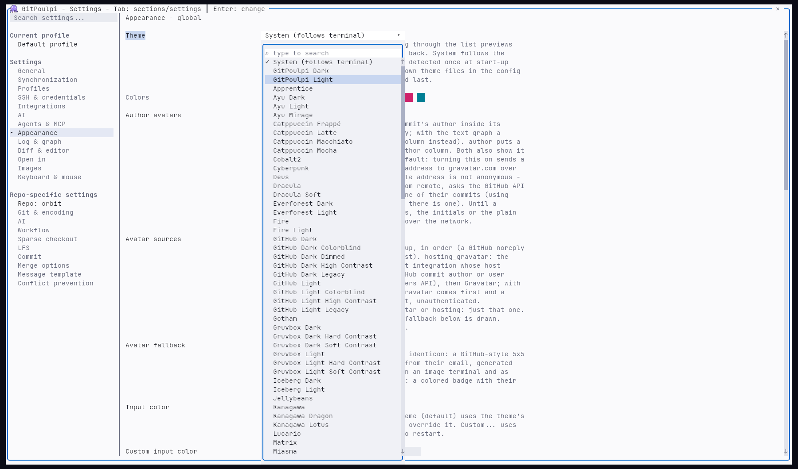

Pod listą pasek próbek kolorów pokazuje obowiązujący motyw (tło, tekst,
wyciszony, akcent, zaznaczenie, danger, diff dodane, diff usunięte, potem
pierwsze sześć kolorów ścieżek) i podąża za podglądem. Lista **Motyw kolorów
grafu** na stronie **Wygląd** pokazuje kilka kolorów ścieżek obok każdej palety, a
wybory stosują się po zamknięciu Ustawień.

Motyw z własnym tłem (Light i inne malowane motywy wbudowane) wypełnia całe okno, także
Ustawienia i widoki pełnostronicowe, i nadaje tekstowi, który nie ma własnego
koloru, kolor tekstu motywu; Dark i Terminal zostawiają kolory terminala
w spokoju.

## Z wiersza poleceń

| Polecenie | Wynik |
|---|---|
| `gitpoulpi theme list` | JSON `{themes: [{slug, label, source, light, lane_palette}], warnings}`; `source` to `preset` lub `user`. |
| `gitpoulpi theme export <slug>` | Kompletny plik motywu jako TOML na stdout (JSON: `{slug, toml}`); parsuje się z powrotem do tego samego motywu. |
| `gitpoulpi config set ui.theme <slug>` | Sprawdzane względem motywów wbudowanych i folderu `themes/`; nieznana nazwa to błąd wymieniający poprawne. `system` i `default` są akceptowane. |
| `gitpoulpi config set ui.graph_color_theme <name>` | `theme` (podążaj za motywem) albo dowolna nazwa palety ścieżek; nieznana nazwa wymienia poprawne. |

Serwer MCP udostępnia `theme_list` i `theme_export` jako narzędzia tylko do
odczytu.
