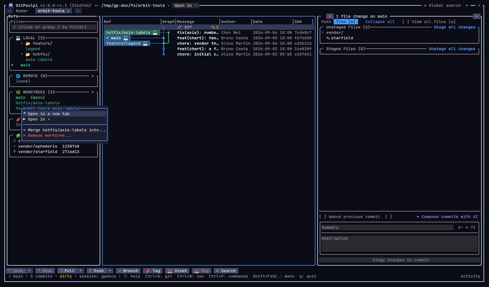
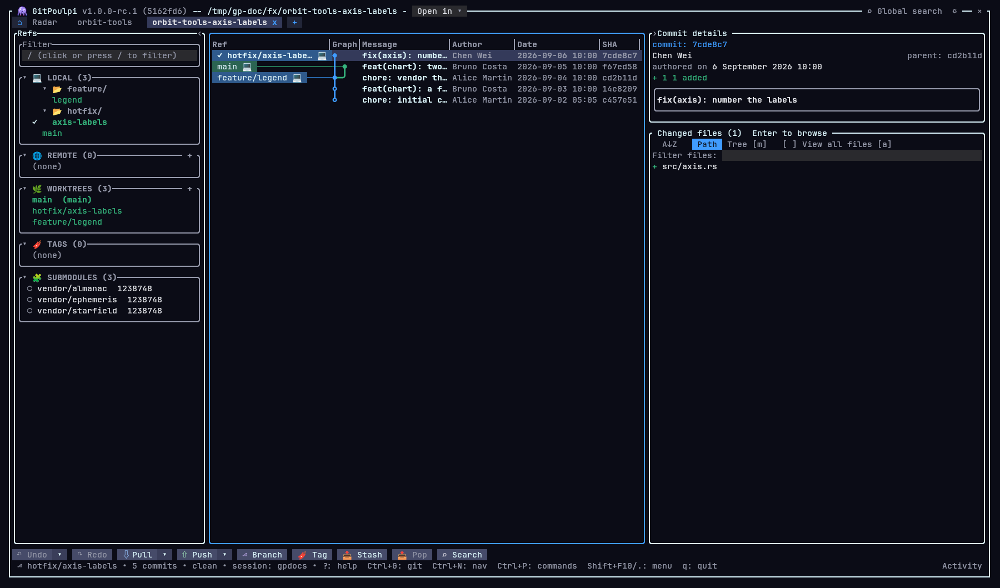

[English](../worktrees.md) · [Čeština](../cs/worktrees.md) · [Deutsch](../de/worktrees.md) · [Español](../es/worktrees.md) · [Français](../fr/worktrees.md) · [Italiano](../it/worktrees.md) · [日本語](../ja/worktrees.md) · [한국어](../ko/worktrees.md) · [Nederlands](../nl/worktrees.md) · **Polski** · [Português (Brasil)](../pt-BR/worktrees.md) · [Português (Portugal)](../pt-PT/worktrees.md) · [Русский](../ru/worktrees.md) · [Svenska](../sv/worktrees.md) · [Türkçe](../tr/worktrees.md) · [Українська](../uk/worktrees.md) · [简体中文](../zh-CN/worktrees.md)

# Worktree

Worktree to druga rozpakowana kopia repozytorium: inny folder, na innej
gałęzi, ze wspólną historią. Sekcja WORKTREES panelu Refs je wylicza; główny
jest oznaczony `(główny)`.

## Pokazywanie sekcji

W repozytorium, które nie ma jeszcze powiązanego worktree, sekcja jest ukryta.
Żeby ją mimo to zobaczyć (pokazuje wtedy „Brak worktree: + tworzy nowe”),
użyj polecenia palety **Panel boczny: Pokaż sekcję worktree**, zaznacz
**WORKTREES** na liście pokaż/ukryj panelu bocznego (prawy przycisk myszy na
nagłówku sekcji) albo uruchom dowolne z poleceń tworzenia poniżej. GitPoulpi
zapamiętuje to dla danego repozytorium (zob. **Sekcje panelu bocznego** w
[Ustawieniach](settings.md)); inne repozytorium bez worktree nadal zaczyna z
ukrytą sekcją.

## Tworzenie worktree

Przycisk **+** w nagłówku WORKTREES (klawiatura: `+` w sekcji; paleta:
**Refs: Utwórz worktree...**) otwiera menu:

- **Z bieżącej gałęzi**: gałąź jest przełączona w głównym folderze, więc okno
  proponuje na niej nową gałąź (`worktree-<id>`).
- **Z zaznaczonego commita**: wyszarzone, dopóki w Logu nie zaznaczysz
  commita. Okno proponuje tam nową gałąź `worktree-<id>`, która zaczyna się w
  tym commicie; wyczyść pole gałęzi, by dostać odłączony worktree.
- **Wybierz gałąź...**: okno otwiera się na liście **Gałąź worktree**, by
  otworzyć gałąź, która już istnieje.

Paleta ma te same trzy (**Refs: Utwórz worktree z bieżącej gałęzi**,
**Git: Utwórz worktree dla zaznaczonego commita...**, **Refs: Utwórz worktree z
wybranej gałęzi**). Starsze pozycje nadal działają: **Utwórz worktree z...** w
menu gałęzi, tagu lub commita.

Okno proponuje wszystko i pozwala to zmienić. **Nazwa** i nowa gałąź zaczynają
od `worktree-<id>`, gdzie `<id>` to 8 losowych cyfr szesnastkowych (te same dla
obu), więc dwa worktree nigdy się nie zderzają.

| Pole | Znaczenie |
|---|---|
| **Nazwa** | Od niej bierze nazwę folder. **Nazwa z gałęzi** (`Alt+N`) ustawia ją na `worktree-<gałąź>`: ukośniki zamieniają się w `-`, a słowo nie jest podwajane (`worktree-foo` i `feature/worktree-x` zostają, jakie są, `feature/login` daje `worktree-feature-login`). |
| **Folder** | Sąsiad repozytorium, `<repozytorium>-<nazwa>`. Podąża za polem Nazwa, dopóki nie wpiszesz czegoś w polu Folder; **Przeglądaj...** wybiera miejsce. |
| **Ref** | Gdzie zaczyna się *nowa* gałąź: gałąź lub commit (lista; pisz, by szukać). Nie jest używany i mówi o tym, gdy wybrano istniejącą gałąź. |
| **Gałąź worktree** | Jedno pole, dwa znaczenia, opisane pod nim. Nazwa, która nie jest lokalną gałęzią, tworzy nową gałąź z Ref (**nowa gałąź z main**). Lokalna gałąź, która nie jest przełączona gdzie indziej (wybierz ją z listy albo wpisz jej nazwę), jest tam przełączana bez zmian (**przełącza na tę gałąź**). Pierwszy wiersz listy lub puste pole przełącza gałąź z Ref (lub odłącza HEAD na commicie); jest to odrzucane, gdy ta gałąź jest już przełączona. |
| **Losuj ponownie** | `Alt+R`. Losuje nowe `<id>` i podmienia Nazwę oraz gałąź, z wyjątkiem tego, co wpisałeś sam (wpisana Nazwa lub gałąź zostaje) i istniejącej gałęzi (nigdy nie jest podmieniana). Nazwa z **Nazwa z gałęzi** lub od AI liczy się jak wygenerowana. |
| **Nazwij z AI** | Tylko przy włączonym AI (zob. niżej). |
| **Otwórz nowy worktree jako kartę** | Domyślnie włączone. |

Niepusty folder, niepoprawna nazwa, nazwa gałęzi, którą git odrzuca, lub gałąź,
którą ma inny worktree, są zgłaszane w osobnym wierszu okna, a **Utwórz**
pozostaje wyszarzone.

### Nazywanie z AI

Przy włączonym [AI](ai.md) **Nazwij z AI** (`Alt+A`) otwiera w oknie pole:
*Opisz funkcję, błąd lub zadanie*. **Nazwij** prosi model o krótką nazwę
worktree i nazwę gałęzi zgodną z nazewnictwem gałęzi w samym repozytorium
(`feature/`, `fix/`, małe litery z myślnikami). Wypełniają one Nazwę (jako
`worktree-<nazwa>`) i pole gałęzi, nadal do edycji; nazwa gałęzi, która już
istnieje, dostaje przyrostek `-2`, więc odpowiedź nigdy po cichu niczego nie
przełącza. Pole pokazuje stan zajętości, **Stop** (lub `Esc`) anuluje, a błąd
jest pokazany w oknie. Wysyłany jest tylko twój opis i nazwy lokalnych gałęzi.

## Menu wiersza

Kliknij worktree prawym przyciskiem myszy (albo zaznacz go i naciśnij klawisz
menu, `Shift+F10` lub `.`):

- **Otwórz w nowej karcie**: jak dwukrotne kliknięcie lub `Enter`.
- **Otwórz w**: wpisy [Otwórz w](open-in.md), które mają zaznaczone pole
  **Może otwierać worktree** (Ustawienia > Otwórz w; domyślnie każdy wpis jest
  zaznaczony). Działają z folderem worktree jako `${cwd}`.
- **Merge <gałąź> do...**: wybierz gałąź, do której scalić (domyślnie gałąź
  głównego worktree). Zwykły merge działa w worktree, w którym ta gałąź jest
  przełączona, z twoimi opcjami merge; konflikt rozwiązuje się tam zwykłym
  przepływem konfliktów. Gałąź przełączona nigdzie jest odrzucana z podaniem
  powodu. Niedostępne dla odłączonego worktree.
- **Usuń worktree...**: nigdy głównego.

**Otwórz w nowej karcie** (albo dwukrotne kliknięcie, albo `Enter`) otwiera folder
worktree jako osobną kartę, z własnym Logiem, statusem i gałęzią:

Paleta ma te same akcje na zaznaczonym wierszu (**Refs: Otwórz worktree w...**,
**Refs: Merge gałęzi worktree do...**, **Refs: Usuń worktree...**,
**Refs: Otwórz worktree w karcie**).

## Usuwanie worktree

Czysty worktree dostaje zwykłe potwierdzenie. Jeśli jego gałąź jest już scalona
(z jej upstreamem, gałęzią głównego worktree albo `main` / `master`), pole
**Skasuj też gałąź <b>** jest domyślnie zaznaczone; niescalona gałąź mówi, że
zostaje. **Merge do... i usuń** najpierw scala i usuwa dopiero, gdy merge
zakończył się bez konfliktów.

Przy niezatwierdzonych zmianach (śledzonych lub nieśledzonych) okno je wylicza
(liczba, z przewijaniem) i oferuje:

- **Commit i usuń**: pole opisu w oknie; każda zmiana trafia do poczekalni
  (z poszanowaniem `.gitignore`) i jest zatwierdzana na gałęzi worktree, po
  czym worktree jest usuwany. Odłączony worktree w tym samym oknie podaje
  gałąź dla commita.
- **Stash i usuń**: każda zmiana, także w plikach nieśledzonych, trafia do
  stasha z edytowalnym opisem (domyślnie „WIP w <folder>”), po czym worktree
  jest usuwany. Lista stashy jest wspólna dla wszystkich worktree: stash leży
  potem w STASHES głównego repozytorium, gotowy do pop.
- **Otwórz, by zrobić commit**: otwiera worktree w karcie z aktywnym polem
  opisu commita; nic nie jest usuwane.
- **Usuń mimo to**: odrzuca zmiany po drugim, wyraźnym potwierdzeniu.

## Cofanie

Usunięcia worktree nie można cofnąć: folder znika. To, co zapisano wcześniej,
zostaje: commit jest na swojej gałęzi, stash na liście. Skasowanie gałęzi,
które dodaje **Skasuj też gałąź**, jest zwykłym zapisanym w dzienniku:
**Cofnij** przywraca gałąź (nie folder). Utworzenie worktree też nie należy do
historii.

## Ze skryptu lub od agenta

`gitpoulpi worktree changes <path>` wylicza niezatwierdzone zmiany worktree.
`gitpoulpi worktree remove <path> [--force] [--commit-message M
[--commit-branch B]] [--stash-message M] [--delete-branch]` je usuwa; narzędzia
MCP to `worktree_changes` i `worktree_remove`. `gitpoulpi ai
worktree-name --describe "<task>"` wypisuje nazwy worktree i gałęzi, które AI
proponuje (`{ name, worktree, branch }`), i niczego nie tworzy; narzędzie MCP to
`ai_worktree_name`. Zob. [Opis CLI](cli-reference.md).
