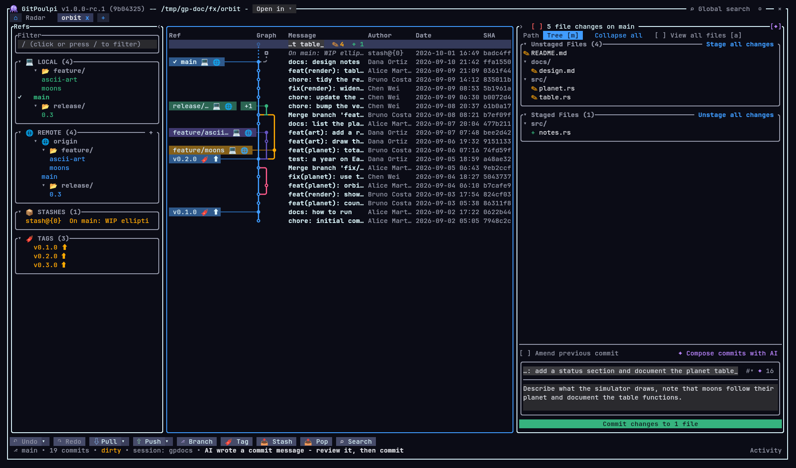

[English](../ai.md) · [Čeština](../cs/ai.md) · [Deutsch](../de/ai.md) · [Español](../es/ai.md) · [Français](../fr/ai.md) · [Italiano](../it/ai.md) · [日本語](../ja/ai.md) · [한국어](../ko/ai.md) · [Nederlands](../nl/ai.md) · [Polski](../pl/ai.md) · **Português (Brasil)** · [Português (Portugal)](../pt-PT/ai.md) · [Русский](../ru/ai.md) · [Svenska](../sv/ai.md) · [Türkçe](../tr/ai.md) · [Українська](../uk/ai.md) · [简体中文](../zh-CN/ai.md)

# Assistência de IA

O GitPoulpi nunca precisa de uma conta, e a **IA vem desativada por padrão**.
Com a IA ativada, ela pode escrever mensagens de commit e de stash, explicar
alterações, escrever descrições de pull requests, sugerir resoluções de
conflitos de merge e dividir suas alterações em andamento em vários commits. O
modelo é seu: uma chave de API que você possui, um servidor local ou uma CLI de
agente já instalada (como `claude -p`).

Todo controle de IA mostra o `✦` roxo. Enquanto a IA está desativada:

- Nada é enviado a lugar nenhum.
- Nenhum controle de IA é mostrado: sem botão `✦`, sem comando `IA:` na paleta,
  sem linha de menu de IA e sem dica de tecla de IA. As teclas de IA não fazem
  nada.
- A página de IA do repositório mostra só “A IA está desativada (Configurações > IA)”.
- O servidor MCP não lista as ferramentas `ai_*`. Os comandos de CLI
  `gitpoulpi ai ...` se recusam com a mesma mensagem.

**Ativar IA** vale na hora. Você não precisa reiniciar.

Há duas maneiras de usar IA com o GitPoulpi:

| | IA integrada (esta página) | Um agente externo |
|---|---|---|
| O quê | O GitPoulpi pede a um modelo uma mensagem de commit, uma explicação, ... | Claude Code, Cursor, Codex... usam o GitPoulpi como ferramenta |
| Configurado em | Configurações > IA (`[ai]`) | a configuração MCP do agente, limites em `[mcp]` |
| Guia | abaixo | [MCP e agentes](mcp-and-agents.md) |

## Configurar a IA

1. `Ctrl+,` > **IA** > marque **Ativar IA**.
2. Os perfis formam a lista da aba **Perfis (conexões)**, à esquerda da página (empilhada acima em um terminal
   estreito): escolha um para editá-lo à direita (`Enter` vai para as linhas dele; o
   comando da paleta **IA: Editar perfil...** leva até a lista). **+ Adicionar**
   cria outro, **Duplicar** copia o selecionado (sem a chave) e **Remover**
   pergunta antes. Escolha o **Provedor** e preencha os campos dele:

   | Provedor | Campos | Padrões |
   |---|---|---|
   | **Agente local** (sem chave, sem conta própria) | **Tipo de agente** (qual agente é), **Comando** (o programa exato: no seu `PATH`, um alias ou script wrapper, ou um caminho completo), **Argumentos** que o tornam não interativo e **Variáveis de ambiente** opcionais. O prompt vai no stdin dele, a resposta é lida do stdout. | Claude Code: `claude`, `-p --model haiku` |
   | **Anthropic** | **Chave de API**, **Modelo** e **URL base** opcionais | `claude-sonnet-5`, `https://api.anthropic.com/v1` |
   | **OpenAI** | **Chave de API**, Modelo, URL base | `gpt-5`, `https://api.openai.com/v1` |
   | **OpenRouter** | **Chave de API**, Modelo, URL base | `openai/gpt-5`, `https://openrouter.ai/api/v1` |
   | **Compatível com OpenAI** (Ollama, LM Studio, vLLM, um gateway da empresa) | **URL base** (`.../v1`), **Modelo**, chave opcional | `http://localhost:11434/v1` (Ollama; o LM Studio é `http://localhost:1234/v1`), `llama3` |

   **Predefinições** (você sempre pode digitar outro valor):

   

   - **Agente local > Tipo de agente** é uma lista das CLIs de agente comuns, as
     mais usadas primeiro: Claude Code, OpenAI Codex CLI, Gemini CLI, opencode,
     Cursor Agent, GitHub Copilot CLI, Pi, Qwen Code, Aider, Goose, Crush, Amp
     ou *Outro (sem sugestões)*. O tipo é **separado do comando**: ele só
     escolhe quais sugestões você recebe. Escolher um preenche antes o
     **Comando** (enquanto ele ainda for o padrão do tipo anterior) e os
     **Argumentos** com a invocação headless (`claude -p`, `codex exec -`,
     `gemini -p ...`, ...). O **Comando** é texto livre: escreva
     `/opt/bin/work-claude`, um script wrapper ou o destino de um alias e o
     tipo, com suas opções, lista de modelos e variáveis, permanece. Quando o
     **Tipo de agente** está vazio, o GitPoulpi o deduz do comando.
   - **Opções dos argumentos** adiciona ou remove opções que servem ao uso
     pontual do GitPoulpi, cada uma com um motivo de uma linha: sem ferramentas,
     sem sessão salva, saída em texto simples, pouco esforço de raciocínio, modo
     somente leitura, sem pedidos de permissão, sem verificação de atualização
     nem estatísticas de uso. A lista difere por agente porque os agentes
     diferem (só alguns podem desligar as ferramentas pela linha de comando; no
     opencode isso é uma variável de ambiente). **Modelo** lista os modelos
     desse agente e escreve a opção certa (`--model haiku` para o Claude Code,
     `-m gpt-6-luna` para o Codex, `--model provider/model` para o opencode);
     *(padrão - sem opção)* a remove. O Amp não tem opção de modelo. O `aider`
     lê o prompt de `/dev/stdin`, então funciona só no Linux e no macOS.
   - **Variáveis de ambiente** valem só para o processo desse agente, nunca para
     o GitPoulpi nem para outros perfis. **Adicionar uma variável de ambiente**
     oferece as variáveis documentadas que importam para esse agente, cada uma
     com o que faz (desligar telemetria e verificações de atualização, nível de
     esforço, pasta de configuração, chave de API, URL base ou host local, ...);
     você também pode digitar `NAME` ou `NAME=value`. Cada variável passa então
     a ter sua própria linha **Env NAME**: o valor aparece como um botão (pressione-o
     para digitar um novo; ele salva quando você sai do campo) e um botão **[x]**
     apaga a variável. Um valor
     pode ser `${env:NAME}` para tomar emprestada uma das variáveis do próprio
     GitPoulpi (útil para chaves de API, para que não sejam gravadas no
     `config.toml`). Valores que parecem segredos (nomes terminando em `_KEY`,
     `_TOKEN`, `_SECRET`, ... ou prefixos de chave conhecidos) aparecem como
     bolinhas e são digitados do zero. Os valores nunca são registrados em log.
   - **Provedores HTTP > Predefinição do provedor** preenche a URL base e um
     modelo para OpenAI, Anthropic, OpenRouter, Google Gemini, xAI, DeepSeek,
     Mistral, Groq, Together, Fireworks, Cerebras, Perplexity, Moonshot, Qwen
     (DashScope), Zhipu (GLM) e os servidores locais Ollama, LM Studio,
     llama.cpp, vLLM, Jan e LocalAI. **Modelo** é uma lista dos modelos desse
     provedor, com texto livre permitido.

3. Pressione **Testar conexão**: *Último teste* mostra `conectado: o modelo
   respondeu` ou `falhou: <motivo>`.
4. Com vários perfis, escolha o **Perfil padrão** no final; cada ação ainda pode
   indicar o seu.


As **chaves de API** são digitadas com `Enter` na linha **Chave de API** e
guardadas no auxiliar de credenciais do seu sistema (Git Credential Manager,
libsecret / `pass`, Keychain) sob `ai:<profile id>`, nunca no `config.toml`. Sem
um helper, o GitPoulpi avisa em vez de fingir que a guardou. *Configurações >
SSH e credenciais > Esquecer todos os usuários e senhas* as remove.

O mesmo no `config.toml` (todo o resto está na [referência de
configuração](config-reference.md#ai-ia-integrada-desativada-por-padrão)):

```toml
[ai]
enabled = true
default_profile = "claude-code"

[[ai.profiles]]
id = "claude-code"
name = "Claude Code"
kind = "local_agent"      # open_ai | anthropic | open_router | open_ai_compatible | local_agent
command = "claude"        # livre: um alias, um script wrapper, um caminho absoluto
harness = "claude"        # qual agente é; vazio = inferido de `command`
args = ["-p", "--model", "haiku"]

[ai.profiles.env]         # somente o processo deste agente; ${env:NAME} usa uma variável nossa
CLAUDE_CODE_DISABLE_NONESSENTIAL_TRAFFIC = "1"
ANTHROPIC_API_KEY = "${env:ANTHROPIC_API_KEY}"
```

## Modo de execução: headless ou terminal virtual

Um perfil de agente local executa o agente de duas maneiras, escolhidas em
**Modo de execução** (exibido para o Claude Code, o OpenAI Codex CLI e o
Gemini CLI):

- **Headless (não interativo)**, o padrão: o modo de execução única do agente
  (`claude -p`), prompt na entrada padrão, resposta na saída padrão.
- **Interativo (terminal virtual)**: o GitPoulpi inicia a tela própria do
  agente em um terminal oculto, digita a solicitação como uma pessoa faria,
  espera a resposta e fecha o agente. Alguns agentes cobram ou limitam o modo
  headless de forma diferente do interativo; o que vale para você, e o que os
  termos do provedor dizem sobre cada um, depende do provedor, então consulte
  os dele.

Cada modo mantém seus próprios **Argumentos**, **Opções dos argumentos** e
**Modelo**: trocar de modo não perde nada, e o modo interativo só oferece as
opções que fazem sentido sem a opção headless. Mais duas linhas valem para os
dois modos:

- **Pasta de trabalho**: *Pasta dedicada* é uma pasta vazia que pertence ao
  GitPoulpi, então o agente não vê nenhum projeto e pede que você confie nela
  uma vez. *Repositório atual* dá ao agente o contexto do próprio projeto (seu
  `CLAUDE.md`, por exemplo), e ele pede confiança uma vez por repositório.
  *Padrão* é a pasta dedicada no modo interativo e, no modo headless, a pasta
  em que o GitPoulpi é executado, como antes.
- **Tempo limite (segundos)**: quanto tempo o agente pode levar antes de o
  GitPoulpi desistir e interrompê-lo. Vazio significa 120 segundos no headless
  e 180 no interativo.

**As perguntas da primeira execução são suas para responder.** Um agente que
nunca foi executado em uma pasta pergunta algo primeiro (confiar nesta pasta,
entrar na conta, escolher um tema). O GitPoulpi nunca responde por você: a
solicitação para com uma mensagem, e **Abrir o agente...** (no perfil, ou *IA:
abrir o agente* na paleta de comandos) abre o agente uma vez, em um terminal
visível, na pasta de trabalho que ele vai usar. Responda à pergunta, feche o
agente e tente de novo; o agente se lembra da resposta.

A resposta é lida da transcrição da sessão do agente no Claude Code (o texto
exato dela, apagada depois) e da tela entre duas linhas marcadoras que a
solicitação pede, no Codex e no Gemini. No máximo duas execuções em terminal
virtual acontecem ao mesmo tempo, e pressionar Esc durante uma solicitação
interrompe o agente.

```toml
[[ai.profiles]]
id = "claude-terminal"
kind = "local_agent"
command = "claude"
harness = "claude"
args = ["-p"]                       # o conjunto headless, mantido
run_mode = "terminal"               # headless (padrão) | terminal
terminal_args = ["--effort", "low"] # o conjunto interativo
workdir = "dedicated"               # default | dedicated | repository
timeout_secs = 180                  # 0 ou ausente: 120 headless, 180 terminal
```

## Instruções

Texto que você acrescenta ao que é dito ao modelo. O prompt integrado de cada
ação (que fixa o formato da resposta) vem sempre primeiro e não pode ser
editado; depois vêm quatro níveis, do mais geral ao mais específico, cada um só
quando não está vazio:

1. **Instruções globais** (toda ação). Os chips de *Inserção rápida* do editor
   inserem frases comuns: *Responder em `<idioma>`*, *Respostas concisas*, *Usar
   o imperativo*, *Tom técnico*, *Tom informal*.
2. **Instruções do espaço de trabalho** (toda ação, todo repositório do
   [espaço de trabalho](workspaces.md#instruções-de-ia-de-um-espaço-de-trabalho)): para todas as ações,
   e opcionalmente por ação. Editadas no formulário Editar do espaço de trabalho.
3. **Instruções do repositório** (toda ação, só este repositório), com
   *Combinar com o global*: **Somar ao global** (depois delas) ou **Substituir o
   global** (no lugar delas).
4. **Instruções da ação** (*Geração de mensagem de commit*, *Explicar
   alterações*, *Geração de mensagem de stash*, *Pull request*, *Compositor de
   commits*, *Resolução de conflitos*, *Revisão de código*), cada
   bloco com seus próprios chips no editor (por exemplo *Formato conventional commits*,
   *Limite de 50 caracteres*) e sua própria lista **Perfil** (`Padrão (<nome>)`
   segue o perfil padrão).

`Enter` em uma linha *Instruções personalizadas* abre um editor de várias linhas
(`Ctrl+S` salva, `Esc` cancela). Acima do texto, uma linha *Inserção rápida*
reúne os chips dessa seção: clique em um para inserir a frase dele no cursor.
Pelo teclado, `Tab` vai até a linha, `Left`/`Right` escolhem um chip, `Enter` ou
`Space` o insere e volta ao texto (`Tab` ou `Esc` voltam sem inserir). Um chip
cuja frase já está nas instruções aparece esmaecido, e inseri-lo de novo não faz
nada. O texto é um editor completo: o clique posiciona o cursor, um arrasto ou
`Shift`+setas selecionam, `Ctrl+A` seleciona tudo, `Ctrl+C` / `Ctrl+X` copiam e
recortam a seleção, `Ctrl`+setas saltam por palavras, e `Home` / `End`,
`PageUp` / `PageDown` e a roda do mouse percorrem textos longos. A própria
página mostra só uma prévia de cada instrução.


**Por repositório**: *Configurações > Configurações do repositório > IA* (com um
repositório aberto) guarda as instruções do repositório e, por ação, um perfil e
instruções que substituem os globais. Um campo vazio usa a configuração global
(mostrada em cinza nele); **Voltar ao global** remove uma substituição. Salvo no
`.gitpoulpi/repo-state.toml` do repositório, e respeitado também pela CLI.


### Como os níveis se combinam

A ordem enviada é: prompt integrado, **global**, **espaço de trabalho**, **repositório**,
depois as instruções da própria ação. O modo de um nível decide o que acontece com
os de cima:

- **Somar** (o padrão): o texto do nível é acrescentado depois dos mais gerais.
- **Substituir**: o texto do nível é usado *no lugar de* todo nível mais geral
  (o global, e o do espaço de trabalho quando o repositório substitui). Um nível sem texto
  nunca substitui nada.

As instruções da própria ação seguem a mesma ideia: as globais dessa
ação, depois as do espaço de trabalho para essa ação (somadas depois delas, ou substituindo-as),
e uma substituição própria do repositório para a ação vence as duas. O
espaço de trabalho usado é o espaço de trabalho ativo da janela quando ele contém o
repositório, senão o primeiro espaço de trabalho que o contém; na linha de comando
é o de `GITPOULPI_WORKSPACE`, senão o primeiro.

Para ver exatamente o que é enviado, nível por nível, execute
`gitpoulpi ai prompt --action <ação> --repo .` (`base`, `global`, `workspace`,
`repository`, `task` e o `system_prompt` final). Ele não chama nenhum modelo e
funciona com a IA desativada. Defina as instruções de um espaço de trabalho a partir de um script com
`gitpoulpi workspace set-ai-instructions <id> [--action <a>] [--mode
append|replace] --text ...` (ou `--clear`).

### Variáveis do prompt

Todo texto de instruções (global, do espaço de trabalho, do repositório, por ação) pode conter
variáveis `${name}`. Elas são substituídas pelo seu valor imediatamente antes de
o prompt ser enviado (o texto salvo mantém o `${...}`). Um nome que não está na
tabela é enviado como escrito e o editor avisa; escreva `$${` para um `${`
literal.

| Variável | Expande para | Exemplo |
|---|---|---|
| `${uilang}` | O idioma da interface, pelo nome em inglês | `French` |
| `${repo}` | O nome da pasta do repositório | `gitpoulpi` |
| `${branch}` | A branch atual | `main` |
| `${ref}` / `${commit}` | Sha curto do commit de que a ação trata (*Explicar*), senão HEAD | `4c0443d` |
| `${commit_subject}` | Assunto desse commit | `feat: add search` |
| `${date}` | Data local, ISO | `2026-10-03` |
| `${time}` | Hora local, `HH:MM` | `14:05` |
| `${datetime}` | Data e hora locais | `2026-10-03 14:05` |
| `${user}` / `${email}` | `git config user.name` / `user.email` | `Ada Lovelace` |
| `${remote}` | O remoto padrão (`origin`, senão o primeiro) | `origin` |
| `${host}` | `github`, `gitlab`, `other` (outro host) ou `none` | `github` |
| `${files}` | Número de arquivos no diff da ação | `3` |
| `${action}` | A ação em execução | `commit_message` |

No editor de instruções: digite `${` e um popup lista as variáveis
correspondentes (`Up`/`Down` escolhem, `Enter` ou `Tab` insere, `Esc` fecha); ou
use a lista **Variáveis** no canto inferior esquerdo (`Ctrl+T`, ou *IA: Inserir
variável do prompt* na paleta de comandos), que insere na posição do cursor.
Cada entrada tem uma descrição, mostrada na lista e na linha acima dos botões
enquanto você passa o ponteiro ou a realça.

## O que ela pode fazer

| Ação | Na janela | CLI |
|---|---|---|
| **Mensagem de commit** | Faça stage das alterações, pressione o `✦` à direita do campo Resumo, `Ctrl+G i`, ou o comando da paleta `IA: gerar mensagem de commit`. O resumo e a descrição são preenchidos para você editar; nada é commitado. | `ai commit-message` (imprime), `commit --ai` (faz o commit) |
| **Explicar alterações** | O `✦` no canto superior direito do painel de alterações em andamento (`Ctrl+G w`: o commit selecionado, senão as alterações em andamento), ou *Explicar alterações (IA)* no menu de um commit. Um popup: as setas rolam, `c` copia, `Esc` fecha. | `ai explain [rev] [--wip]` |
| **Mensagem de stash** | `Ctrl+G m` abre o diálogo de stash; o botão Mensagem da IA (`Ctrl+G` no diálogo) pergunta ao modelo. O comando da paleta `IA: gerar mensagem de stash` faz os dois. | `stash push --ai` |
| **Título e descrição do pull request** | *Gerar título e descrição* no formulário Criar pull request (os commits e o diff da branch são lidos localmente). | |
| **Resolução de conflito de merge** | No editor de conflitos de merge: o botão `✦ Sugerir` da barra, o menu de botão direito de um conflito *✦ Sugerir resolução (IA)*, `Alt+I`, ou o comando da paleta `IA: sugerir resolução de conflito de merge`. A sugestão substitui a região do *conflito atual* no Resultado como uma única edição (marcada como editada, um passo de desfazer); nada é salvo nem passa para stage até você salvar. | `ai resolve-conflict <path> [--conflict N]` (imprime) |
| **Dividir um commit** | O menu de um commit *Dividir commit (IA)...*, ou o comando da paleta `IA: dividir o commit selecionado...`. O editor de divisão abre com o agrupamento do modelo já preenchido; veja abaixo. | `ai split-plan <rev>` (imprime) |
| **Revisão de código** | Na [revisão de um pull ou merge request](review.md#-rascunho-de-revisão-da-ia): o botão `✦ Gerar rascunho...`, `s`, ou o comando da paleta `Revisão: ✦ gerar rascunho de revisão...` (abre as opções de revisão, `Enter` executa). O modelo lê o diff, a descrição e os comentários existentes da solicitação (e, por padrão, o `CLAUDE.md` e o `AGENTS.md` do projeto: veja [Contexto da revisão](#contexto-da-revisão)) e propõe comentários; você aceita, edita ou dispensa cada um. Nada chega ao host antes de você enviar a revisão. | `hosting review suggest <n>` (imprime JSON, não publica nada), `ai review-context` (os padrões) |
| **Script de reescrita do histórico** | No [painel de reescrita do histórico](history-rewrite.md#escrever-um-script-com-ia): o botão `✦ Escrever com IA...` do editor de Script, ou o comando da paleta `Reescrita: escrever um script com IA...`. Um diálogo mostra exatamente o que será enviado; o script cai no editor, marcado, e nunca é executado nem aplicado no seu lugar. | `ai rewrite-script "<instrução>" [--sample N]` (imprime) |
| **Regras de reescrita do histórico** | No [painel de reescrita do histórico](history-rewrite.md#criar-regras-com-ia): o botão `✦ Criar regras com IA...`, `Alt+I`, ou o comando da paleta `Reescrita: criar regras com IA...`. Um diálogo de várias linhas mostra exatamente o que será enviado; as regras e as configurações caem no painel, e nada é pré-visualizado nem aplicado no seu lugar. | `ai rewrite-rules "<descrição>" [--context]` (imprime) |
| **Compositor de commits** | O menu da linha WIP *Compor commits (IA)...*, `Ctrl+G C`, o comando da paleta `IA: compor commits a partir das alterações em andamento...` | |

`Esc` cancela uma requisição em andamento (o processo de um agente local é
encerrado).

### Resolução de conflito de merge

O modelo recebe o caminho e a linguagem do arquivo, os blocos base, atual (A) e
recebido (B) do conflito com os rótulos que o editor mostra, até 20 linhas de
texto já mesclado antes e depois dele, e as suas instruções (global, do
repositório, e as de *Resolução de conflitos* em Configurações > IA). Ele
responde com o texto resolvido daquele único conflito em um bloco de código; uma
resposta com marcadores de conflito ou conversa em vez de código é devolvida uma
vez, depois recusada. Um conflito com mais de 40 KB (`ai.limits.conflict_bytes`,
*Configurações > IA > Limites*) é retido por trás de um aviso que informa o tamanho
dele e o limite, com *Enviar mesmo assim* (só esta requisição, ainda limpa pelas
verificações de privacidade), *Abrir configuração* e *Cancelar*; o limite é uma
proteção do próprio GitPoulpi, então aumente-o quando o seu modelo tiver espaço. Os
controles ficam ocultos enquanto a IA está desativada, e uma sugestão nunca
salva, faz stage nem resolve nada: revise o Resultado, edite-o e salve como de
costume.




### O compositor de commits

O modelo divide as alterações em andamento em vários commits (cada arquivo
alterado em exatamente um; um plano inválido é devolvido uma vez, depois
recusado). Enquanto ainda há arquivos com conflitos, nada é perguntado: um diálogo
os lista e abre a vista de resolução de conflitos, já que o compositor precisa de
uma árvore sem conflitos. Você revisa o plano antes de qualquer coisa ser commitada:


| Tecla | Mouse | Faz |
|---|---|---|
| `Up` / `Down` (`k` / `j`) | clique em uma linha | mover entre commits e arquivos |
| `Alt+Up` / `Alt+Down` (`K` / `J`), `m` | as setas, arrastar e soltar | mover um commit; mover um arquivo para outro commit |
| `Right` / `Left`, `*` | a seta da linha | expandir / recolher um commit, todos eles (`ui.composer_files` define o início) |
| `e` / `Enter` | o lápis | editar a mensagem |
| `d` / `Delete` | `drop` / `restaurar` | deixar um commit de fora (seus arquivos continuam sem commit) |
| `n` | `+ commit próprio` | mover um arquivo para um commit só dele |
| `r` | `Redefinir` | voltar ao plano do modelo |
| `Ctrl+S` / `a` | `Criar N commits` | criá-los, em ordem |
| `Esc` | `Cancelar` | sair, nada é feito |

Criar faz stage dos arquivos de cada commit e os commita um a um; a árvore de
trabalho nunca é tocada. Um arquivo com stage só parcial é commitado inteiro. Se
um passo falha, ele para e diz quantos commits foram feitos.

### Dividindo um commit

O modelo lê as alterações do commit, numeradas como o [editor de divisão](log-and-history.md#dividindo-um-commit)
as numera, e propõe vários commits, cada um com uma mensagem; ele pode agrupar hunks e
linhas avulsas. Uma resposta que deixa uma alteração de fora, atribui uma duas vezes ou
cita algo que não existe é recusada. De qualquer forma o editor de divisão abre: com a
proposta preenchida ou, se o modelo falhou, com o motivo em uma nota, para você dividir
manualmente. Nada é dividido até você pressionar **Dividir** (`Ctrl+S`); mova alterações,
renomeie commits ou adicione um antes, se o agrupamento não estiver bom. O perfil e as
instruções são os de *Divisão de commit* em Configurações > IA.

### Um script de reescrita do histórico

Você descreve o que a reescrita deve fazer ("mover cada commit feito à noite para a
manhã seguinte", "trocar meu e-mail antigo pelo novo, só antes de 2024") e o modelo
escreve um [script Lua](history-rewrite.md#scripts-lua) para a regra de Script, com o
cabeçalho, `rewrite_commit(c, ctx)` e as funções auxiliares do isolamento. O daemon
compila a resposta; quando ela não compila, o erro volta ao modelo uma vez. O que
sobra aparece no editor: leia, teste e depois gere a prévia. Os detalhes e o diálogo
estão em [Reescrita do histórico](history-rewrite.md#escrever-um-script-com-ia). O
perfil e as instruções são os de *Script de reescrita do histórico* em
Configurações > IA.

### Regras de reescrita do histórico

Você descreve com as suas palavras como o histórico deve ser reescrito ("trocar meu
e-mail antigo a@b.org por c@d.org", "remover secrets.txt de todo o histórico") e o
modelo propõe um escopo, algumas configurações e uma lista de
[regras de reescrita](history-rewrite.md#criar-regras-com-ia) no próprio vocabulário do
painel. **Ele só prepara**: a resposta preenche o painel, nada é pré-visualizado nem
aplicado, e uma entrada que não pode ser usada aparece com o motivo, enquanto as
válidas são mantidas. Uma regra de Script nunca é criada assim. Opcionalmente, o
escopo, os nomes de branches e tags e os autores dos commits mais recentes vão junto
(uma caixa, desligada por padrão, mostrada no painel "o que é enviado"). O perfil e as
instruções são os de *Regras de reescrita do histórico* em Configurações > IA.

## Para onde vai a chave

Uma chave de API (OpenAI, Anthropic, OpenRouter, um servidor compatível com a OpenAI) fica vinculada ao endereço para o qual foi guardada: a origem da URL base do perfil, registrada em `trust.toml` na pasta de dados privada só do usuário. Se a URL base depois apontar para outro lugar, a requisição é recusada antes de qualquer coisa ser enviada e a chave fica onde está. Execute `gitpoulpi ai trust <profile> --accept-origin <url>` (ou aceite no aplicativo) para mover a chave para o novo endereço de propósito.

- O `http://` simples é permitido nesta máquina (Ollama, LM Studio em `localhost`); em qualquer outro lugar ele exige `gitpoulpi ai trust <profile> --allow-insecure-http on`.
- Um servidor próprio cujo certificado não se encadeia a uma autoridade conhecida é aceito só para a impressão digital da chave que você fixar com `--accept-certificate <sha256>`; o handshake TLS ainda prova que o servidor tem essa chave.
- Um perfil que já tinha uma chave antes de existir esta verificação é registrado em silêncio, a partir da URL base atual, na primeira vez que é usado.
- Um agente local (`claude -p` e similares) não tem chave nem HTTP, então não há nada a vincular.

## Contexto da revisão

Um rascunho de revisão de código (`✦`, ou `hosting review suggest`) lê o diff, o título, a descrição e os
comentários existentes da solicitação. Ele também pode receber as convenções do próprio projeto, em um
bloco **Project conventions** colocado antes do diff, e um agente local pode trabalhar dentro do
repositório. Os padrões são:

| Configuração | Padrão | Significado |
|---|---|---|
| `run_in_repository` | `profile` | `profile`: a *Pasta de trabalho* do perfil de IA decide. `yes`: um agente local roda no repositório durante a revisão, seja qual for o perfil. `no`: não roda lá (um perfil definido como *Repositório* usa a pasta dedicada). Perfis HTTP não têm pasta de trabalho, então isto não muda nada para eles. |
| `include_claude_md` | ativado | Entrega ao modelo o `CLAUDE.md` do repositório. |
| `include_agents_md` | ativado | Entrega ao modelo o `AGENTS.md` do repositório. |
| `extra_file` | nenhum | Mais um arquivo: um caminho relativo à raiz do repositório, um caminho absoluto ou um link. |

Elas são sobrepostas como as instruções, e a mais específica vence campo a campo: a tabela global
`[ai.review]`, depois os valores próprios do repositório (um campo não definido herda), depois as escolhas
de uma execução. Um repositório que não está clonado guarda seus valores próprios por `host/project` em
`remote-reviews.toml`, ao lado dos rascunhos de revisão.

Um repositório também pode desligar o arquivo extra global: o `no_extra_file = true` dele (a caixa **Nenhum arquivo extra**
em *Configurações do repositório > IA*, no diálogo de opções da revisão ✦ e a flag `--no-extra-file` de
`ai review-context`) significa "nenhum arquivo extra para este repositório", seja o que for que `[ai.review]` indique. Um campo
**Arquivo extra** **vazio** não é a mesma coisa: ele herda o arquivo global. Um arquivo do repositório e a chave
se excluem (definir um limpa o outro), e a chave prevalece se um arquivo editado à mão tiver os dois.
Um `extra_file = ""` antigo de um repositório continua significando nenhum.

De onde vêm os arquivos:

- O `CLAUDE.md`, o `AGENTS.md` e um arquivo extra relativo são lidos da **raiz** do repositório, na
  branch de destino da solicitação, nunca da árvore de trabalho (que pode estar em outra branch ou ter
  edições locais). Com um clone, a partir do commit base da solicitação; sem um, pela API do host.
- Um caminho absoluto é lido desta máquina.
- Um link para um arquivo de um host de código (GitHub `.../blob/<branch>/<path>`, GitLab
  `.../-/blob/<branch>/<path>`, Gitea e Forgejo `.../src/branch/<branch>/<path>`, ou um link raw) é lido
  pelo perfil de integração cujo host corresponde, então um repositório privado funciona com o token que
  você já informou. Um link que nenhum perfil reconhece, ou qualquer outro endereço, é buscado de forma
  anônima. Um nome de branch com barra não pode ser lido de um link: use um caminho, ou um link em uma
  branch sem barra.
- Um `CLAUDE.md` ou `AGENTS.md` ausente é ignorado em silêncio; um arquivo extra ausente é informado
  (`context.problems` no JSON da CLI).
- Cada arquivo é cortado em **8 KB** e os arquivos juntos em **16 KB**, com uma nota visível
  `[CLAUDE.md cut: showing ... of ... bytes]` no que o modelo lê.

Quando um agente local roda no repositório, o prompt avisa que os arquivos em checkout podem não
corresponder ao head da solicitação e que o diff é a referência.

Na tela de revisão, `s` abre o diálogo **✦ Opções de revisão** com esses valores preenchidos: os do repositório
sobre os globais. Mude-os só para esta execução, ou marque *Salvar como padrão deste repositório* para
mantê-los (veja [Opções de revisão](review.md#opções-de-revisão)). Os padrões também podem ser editados em
*Configurações > IA* (o bloco *Revisão de código*, quatro linhas) e por repositório em *Configurações do
repositório > IA*, onde cada linha pode *Usar o global* e um botão *Voltar ao global* descarta os
valores próprios do repositório; a busca das Configurações os encontra (`Incluir AGENTS.md`, `Arquivo extra`).
O que o modelo não pôde receber (um arquivo extra ausente) ou que foi cortado para caber aparece no cartão do
rascunho.

Pela linha de comando:

```sh
gitpoulpi ai review-context                      # os padrões globais e o que uma revisão recebe
gitpoulpi ai review-context --agents-md off      # salva um padrão global
gitpoulpi --repo ~/work/app ai review-context --claude-md off --context-file docs/REVIEW.md
gitpoulpi ai review-context --project github.com/acme/app --context-file https://github.com/acme/rules/blob/main/review.md
gitpoulpi ai review-context --repo ~/work/app --reset   # volta a seguir os padrões globais
gitpoulpi hosting review suggest 12 --claude-md off --context-file docs/REVIEW.md --run-in-repo no
```

`ai review-context` não precisa de modelo e funciona com a IA desativada. `ai prompt --action code_review`
imprime o contexto efetivo como `review_context`. As mesmas quatro configurações são `ai.review.*` no
`config.toml` ([referência](config-reference.md#ai-ia-integrada-desativada-por-padrão)).

## Limites de entrada

Toda entrada que o GitPoulpi coloca em uma requisição tem um limite de tamanho, uma
configuração em `[ai.limits]` (*Configurações > IA > Limites*). Os limites são uma
proteção do próprio GitPoulpi (a janela de contexto varia de modelo para modelo):
aumente-os quando o seu modelo tiver espaço, reduza-os para manter as requisições
pequenas.

| Configuração (`ai.limits.`) | Padrão | O que limita |
|---|---|---|
| `conflict_bytes` | 40000 | Os blocos base, atual e recebido de um conflito de merge |
| `diff_bytes` | 60000 | O diff da mensagem de um commit, de uma explicação, de um nome de stash, da descrição de um pull request, de um plano de commits ou de uma divisão; o diff inteiro de uma revisão de código |
| `review_file_bytes` | 12000 | O diff de um arquivo em uma revisão de código |
| `review_text_bytes` | 4000 | A descrição do pull request revisado |
| `review_threads_bytes` | 6000 | Os comentários de revisão que já existem |
| `review_context_file_bytes` | 8192 | Um arquivo de contexto do projeto em uma revisão (`CLAUDE.md`, `AGENTS.md`, o arquivo extra) |
| `review_context_bytes` | 16384 | Todos os arquivos de contexto de uma revisão juntos |

**Nada é cortado em silêncio.** Quando uma entrada passa do limite, a requisição
espera e *Acima do limite da IA* lista o que passou: qual parte (o diff, um arquivo,
a descrição, um arquivo de contexto), o tamanho, o limite e a configuração. Uma
revisão lista todas as partes que passaram em um único diálogo. Os botões, cada um
com a sua tecla:

- *Enviar tudo* (`T`): só esta requisição, nada é cortado. Ela ainda passa pelas
  verificações de privacidade (segredos substituídos, arquivos sensíveis deixados de
  fora) e, quando está ativado, pelo painel *O que é enviado*, que vem a seguir.
- *Enviar truncado* (`U`): o que passou do limite é cortado, como sempre foi; cada
  linha do diálogo diz o que fica de fora (o final do diff, os últimos hunks, os
  arquivos que não cabem).
- *Abrir configuração* (`A`): cancela a requisição e abre *Configurações > IA >
  Limites* no primeiro limite listado. O foco começa aqui: Enter nunca envia.
- *Cancelar* (`C`, `Esc`, a cruz ou um clique fora): não envia nada.

Um conflito é a exceção: ele nunca é cortado. *Enviar mesmo assim* (`E`) o envia
inteiro uma vez.

Nada inicia uma requisição de IA por conta própria, então não existe execução em
segundo plano que pudesse perguntar: toda requisição é uma que você iniciou. Uma
execução que não pode perguntar (a CLI e o MCP) trunca como antes e avisa; veja
abaixo.

**Na linha de comando**, nada pode responder a um diálogo, então uma entrada acima
do limite é truncada como antes e a resposta diz o que foi cortado:
`truncated: [{part, detail?, bytes, limit, setting}]` (presente só quando algo foi
cortado; `part` é um de `diff`, `split_hunks`, `review_diff`, `review_file`,
`review_text`, `review_threads`, `context_file`, `context_total`). `--send-all`
(apelido `--no-truncate`) envia tudo inteiro: em `ai` (todos os seus comandos,
inclusive `ai resolve-conflict`, em que um conflito acima do limite é recusado de
outro modo), em `commit --ai`, em `stash push --ai` e em `hosting review suggest`.
As ferramentas do MCP têm o mesmo argumento `send_all` e o mesmo campo `truncated`.

## Privacidade

- Nada é enviado até você pressionar um botão ou executar um comando. Sem IA em
  segundo plano, sem telemetria, sem conta do GitPoulpi.
- O que é enviado: o prompt (o integrado, depois as suas instruções) e o diff
  sobre o qual você perguntou; para um pull request, também os assuntos dos
  commits da branch. Um diff acima de 60 KB (`ai.limits.diff_bytes`) nunca é cortado
  em silêncio: veja [Limites de entrada](#limites-de-entrada).
- Uma requisição de script de reescrita do histórico envia a sua instrução e o
  contrato fixo do script (a API do isolamento do script). O autor, a data e o
  assunto de até 20 commits vão junto **somente** se você marcar *Enviar uma
  amostra* no diálogo (desligado por padrão; a CLI exige `--sample N`). O conteúdo
  dos arquivos e os valores de segredos nunca são enviados.
- Vai apenas para o perfil escolhido para aquela ação: aquele host de API, ou o
  stdin do comando do seu agente local (que então faz o que esse agente faz).
- As chaves de API são usadas pelo próprio processo `gitpoulpi` e nunca chegam
  ao daemon, aos outros clientes da janela nem a um cliente MCP.
- O texto gerado nunca é commitado, enviado por push nem aplicado por conta
  própria.

### O que é removido de uma requisição

Toda requisição, seja qual for a ação que a envia e o provedor que a recebe (uma
API hospedada ou um agente local), passa primeiro pela mesma etapa de limpeza:

- **Os segredos são ocultados** (`[ai.privacy] redact_secrets`, ativado por padrão). Um token
  com prefixo conhecido, um bloco de chave privada, um JWT, uma senha em uma URL e uma
  linha `password = valor` cujo valor parece aleatório são substituídos por
  `[REDACTED:<rule>]`. Isso não é exaustivo: encontra as formas comuns (o mesmo
  scanner de `rewrite scan-secrets`).
- **Os arquivos sensíveis são deixados de fora** (`[ai.privacy] exclude_sensitive_files`, ativado
  por padrão). O diff de um arquivo que corresponde a `[privacy] sensitive_patterns` (`.env`
  e `.env.*`, exceto os arquivos `.example`, `.sample` e `.template`, `*.pem`,
  `*.key`, chaves privadas SSH, `*.p12`, `*.pfx`, `*.jks`, `*.keystore`, `*.crt`,
  `*.cer`, `*.der`, `*.kdbx`) não faz parte da requisição. Uma parte de divisão ou uma
  lista de arquivos do compositor que cita um arquivo assim é cortada do mesmo jeito, então um plano para ele
  pode ser recusado por incompleto: faça stage ou divida esse arquivo você mesmo.

Desativar qualquer um dos dois é uma escolha, e as Configurações > IA mostram uma linha vermelha embaixo dele
enquanto estiver desativado.

**O que é enviado, antes de ser enviado.** Antes de uma requisição sair, a TUI mostra o
diálogo **O que é enviado**: as instruções e a requisição depois da limpeza (o mesmo
painel dos diálogos de reescrita do histórico, rolável, `Alt+W` o mostra ou oculta), quantos
segredos foram substituídos e quais arquivos foram deixados de fora (uma regra e uma
prévia mascarada como `ghp_****abcd`, nunca um valor), uma caixa **Não mostrar de novo para
<ação>** e **Enviar** / **Cancelar** (`Esc`, o `✕` de fechar e um clique
fora cancelam; nada sai até Enviar). A caixa grava
`[ai.sent_preview] <ação> = false`; Configurações > IA > *Mostrar o que é enviado
antes de...* tem uma chave por ação e **Mostrar tudo de novo**. Os dois diálogos de reescrita
do histórico já mostram a sua requisição, então não têm chave.

**Na linha de comando**, toda resposta de `ai ...` (e de `hosting review suggest`)
traz `privacy: {redactions: N, excluded_files: [...]}`, e `--print-sent`
imprime o texto de sistema e de usuário já limpo, como `{sent: [{system, user}], privacy,
dry_run: true}`, sem chamar o modelo (exige `ai.enabled = true`, nenhuma chave e nenhuma
rede).

**Um limite.** Um agente local cuja pasta de trabalho é o repositório
(`workdir = repository`, ou *Executar o agente no repositório* em uma revisão) pode
ler os arquivos por conta própria: a limpeza cobre o que o GitPoulpi envia a ele, não o que
ele abre sozinho. Use a pasta de trabalho `dedicated` para mantê-lo fora do
repositório.

## Solução de problemas

| Sintoma | Solução |
|---|---|
| Nenhum `✦` em lugar algum | A IA está desativada: *Configurações > IA > Ativar IA*. |
| O `✦` está cinza | Nada passou para stage (mensagem de commit). |
| *Testar conexão*: comando não encontrado | O **Comando** do agente local não está no `PATH` que o GitPoulpi enxerga: inicie o GitPoulpi onde `claude --version` funcione, ou informe o caminho completo. |
| Um agente local trava ou mostra uma tela interativa | No modo de execução *Headless*, adicione a opção headless dele (`-p` para o Claude Code) em **Argumentos**, ou escolha o **Tipo de agente** de novo para restaurar a invocação headless. A tela interativa é para isso que serve o modo de execução *Interativo (terminal virtual)*. |
| "Use "Open the agent"..." | O agente fez uma pergunta da primeira execução (confiar na pasta, entrar na conta). Use **Abrir o agente...** no perfil, responda, feche o agente e tente de novo. |
| Uma solicitação em terminal virtual expira | A mensagem termina com as últimas linhas da tela do agente: um pedido de permissão, um login ou uma pergunta de atualização aparece ali. Responda com **Abrir o agente...**, ou aumente o **Tempo limite**. |
| `falhou:` 401 | Chave errada, ou uma chave de outro provedor: digite-a de novo. |
| `falhou:` 404 | O **Modelo** não existe lá: limpe-o para usar o padrão. |
| `falhou:` erro de conexão (Ollama, LM Studio) | O servidor não está em execução, ou a **URL base** tem a porta errada ou não tem `/v1`. |
| A chave mostra `(não definida)` depois de digitada | Sem auxiliar de credenciais: configure um (`git config --global credential.helper ...`) e digite-a de novo. |
| Idioma ou estilo errado | Adicione instruções; os chips de Inserção rápida do editor tornam isso rápido. |
| O compositor diz que o plano é inválido | O modelo pulou ou repetiu um arquivo: tente de novo ou use um modelo mais forte. |
| *Acima do limite da IA* | Uma entrada da requisição passou de um limite de `[ai.limits]`: escolha *Enviar tudo*, *Enviar truncado*, *Abrir configuração* ou *Cancelar* (veja [Limites de entrada](#limites-de-entrada)). |
| "Conflito grande demais para enviar" | O conflito passou de `ai.limits.conflict_bytes` (40000 por padrão). *Enviar mesmo assim* o envia uma vez; *Abrir configuração* vai ao limite em Configurações > IA > Limites. |

## Arquivos de configuração antigos

Um `config.toml` antigo com `[[ai.presets]]` e `[ai.defaults]` ainda é
carregado:

- A predefinição padrão de cada ação vira o seu `[ai.actions.<action>]`
  (`system_prompt` vira `instructions`).
- Toda predefinição antiga é mantida em `[[ai.legacy_presets]]`. Configurações >
  IA as mostra em *Predefinições antigas*, com *Excluir arquivo*.
- O antigo `[preferences.ai_presets]` de um repositório vira uma substituição do
  repositório.

O prompt integrado agora vem sempre primeiro. Se um prompt antigo copiou um
prompt integrado, remova a parte copiada e mantenha só o que você quer
acrescentar.
