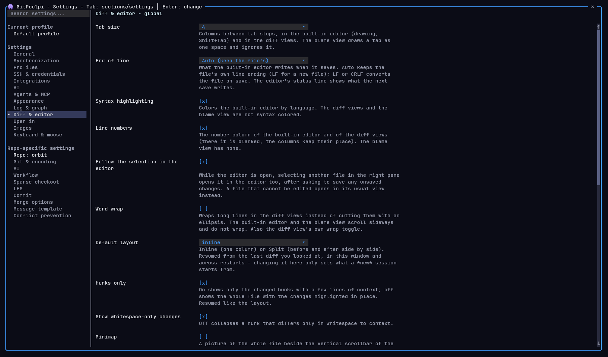

[English](../settings.md) · [Čeština](../cs/settings.md) · [Deutsch](../de/settings.md) · [Español](../es/settings.md) · [Français](../fr/settings.md) · [Italiano](../it/settings.md) · [日本語](../ja/settings.md) · [한국어](../ko/settings.md) · [Nederlands](../nl/settings.md) · [Polski](../pl/settings.md) · **Português (Brasil)** · [Português (Portugal)](../pt-PT/settings.md) · [Русский](../ru/settings.md) · [Svenska](../sv/settings.md) · [Türkçe](../tr/settings.md) · [Українська](../uk/settings.md) · [简体中文](../zh-CN/settings.md)

# Configurações

Abra as Configurações com `Ctrl+,`, `Ctrl+N` e depois `,`, a engrenagem na
barra de título (à esquerda do `×`), ou `Ctrl+P` > *Configurações*. A tela de
Configurações substitui a janela enquanto está aberta. Feche-a com o `✕` no canto
superior direito, `Esc` ou `q`. Ela só pergunta antes quando fechar faria você perder
algo (veja [Fechando as Configurações](#fechando-as-configurações)).

As alterações são salvas no `config.toml` na hora. A
[referência de configuração](config-reference.md) descreve cada chave, seu valor
padrão e sua variável de ambiente. Esta página descreve a tela de Configurações.

## Usando a tela de Configurações

| Para | Faça |
|---|---|
| Alternar entre a lista de páginas e as opções | `Tab` / `Shift+Tab`, ou clique. |
| Mover | `j` / `k` ou as setas. |
| Alterar uma opção | `Enter` ou `Space`, ou clique no valor. Veja abaixo. |
| Fechar | Clique em `✕`, ou pressione `Esc` ou `q`. Enquanto um campo, um menu suspenso ou uma confirmação está aberto, `Esc` fecha só isso. |

O que `Enter` ou `Space` faz depende da linha:

- Uma caixa de seleção alterna.
- Um menu suspenso abre. As setas escolhem, `Enter` aceita.
- Um campo de texto ou número começa a ser editado. As setas, `Home`, `End`,
  `Backspace` e `Delete` funcionam, e um clique posiciona o cursor. `Enter`, `Tab`,
  `Up`, `Down` ou um clique em outro lugar salva o valor. `Esc` cancela. Um valor
  recusado fica no campo, em vermelho, e a linha de status dá o motivo.
- Uma linha de botões (**Criar**, **Remover**, **Testar**...) mostra só os botões que
  se aplicam no momento. `Left` / `Right` escolhem um, `Enter` o aciona, ou clique nele.
  Um botão que exclui algo pergunta antes.

Em todas as páginas os valores começam na mesma coluna: os rótulos ficam alinhados à
esquerda e os campos à direita. Um texto ou número é uma faixa sombreada, uma escolha
é uma faixa terminada em `▾`, uma caixa de seleção é `[x]`. Um rótulo longo quebra em
vez de ser cortado e, em uma janela estreita, o valor passa para baixo do rótulo.

Uma linha acinzentada diz por que está inativa. Por exemplo, **Intensidade do tom da
linha** fica acinzentada enquanto **Fundo das faixas do grafo** está **Desativado**.

### Listas

As páginas que editam vários itens do mesmo tipo (Perfis, IA, Fluxo de trabalho,
Abrir em, Imagens) os mostram como uma **lista à esquerda e os campos do item
selecionado à direita**. Em uma janela estreita, a lista fica acima dos campos. A lista
tem o mesmo formato em todo lugar:

- A marca de uma linha indica o estado: `●` o perfil ativo, `★` a entrada padrão, `⚠` um
  item incompleto (um perfil sem e-mail), com o motivo no lugar dos detalhes.
- Sob a lista: **+ Adicionar**, **Duplicar**, **Remover**, `↑` e `↓`. Um botão que não
  se aplica no momento (`↑` na primeira linha) fica esmaecido. **+ Adicionar ▾** abre
  um menu suspenso quando a página oferece predefinições ou tipos.
- **Remover** pergunta antes, exceto para um item que você acabou de adicionar e não
  editou.
- Arraste uma linha para movê-la; uma barra mostra onde ela vai cair, e `Esc` cancela o
  arrasto. Um clique duplo leva aos campos do item.

| Tecla | Faz |
|---|---|
| `Up` / `Down`, `Home` / `End`, `PageUp` / `PageDown` | Seleciona um item. |
| `Insert` | Adiciona um item (abre o menu suspenso quando há um). |
| `Ctrl+D` | Duplica o item. |
| `Delete` | Remove o item, após uma confirmação. |
| `Alt+Up` / `Alt+Down` | Move o item para cima ou para baixo. |
| `Enter` ou `Right` | Vai para os campos do item. |
| `Left` | Volta à lista de páginas. |
| `Alt+Left` / `Alt+Right` | Alterna entre a aba Geral e a aba da lista (em qualquer ponto da página). |

Cada uma dessas páginas tem duas **subabas** sob o título, para que uma configuração da página nunca seja confundida com uma propriedade do item selecionado: **Geral**, as configurações da própria página (o perfil ativo, a entrada padrão, as instruções que toda ação de IA recebe, o modelo de fluxo...), e uma aba com o nome dos itens (**Perfis**, **Perfis (conexões)**, **Entradas**, **Editores**, **Regras**) que contém a lista e os campos do item selecionado. Uma página abre em **Geral**; as configurações lembram a aba em que você deixou cada página até você fechar o aplicativo, assim como a posição de rolagem e a linha selecionada de cada página (e de cada aba). Clique em uma aba ou pressione `Alt+Left` / `Alt+Right`. A busca, as linhas de configurações da paleta de comandos e os links que dizem "defina nas configurações" abrem a aba em que a configuração está.
[Teclado e mouse](#teclado-e-mouse) tem as mesmas duas abas (**Geral**, **Atalhos de teclado**).

As teclas podem ser reatribuídas em **Teclado e mouse** (contexto *preferences*, veja
[Atalhos de teclado](keybindings.md)).

### Editores de várias linhas

As configurações que guardam várias linhas (como os caminhos do checkout parcial, a descrição do modelo de commit, as branches base da prevenção de conflitos e os hooks de fluxo de trabalho) abrem em um pequeno editor com `Enter` ou um clique; `Ctrl+S` mantém o texto e `Esc` o descarta. O mouse funciona ali como em qualquer caixa de texto:

- Um clique coloca o cursor onde você clicou.
- Arrastar seleciona o texto; a roda rola.
- Um clique duplo seleciona a palavra sob o ponteiro.
- `Shift` + clique estende a seleção do cursor até o ponteiro.

O teclado oferece o mesmo: `Shift` com as setas seleciona, `Ctrl` com as setas salta de palavra em palavra, `Ctrl+A` seleciona tudo, `Ctrl+C` e `Ctrl+X` copiam e recortam.

### Fechando as Configurações

O `✕`, o `Esc` e o `q` fazem o mesmo. As Configurações aplicam cada alteração na hora,
então na maioria das vezes elas simplesmente se fecham. Elas perguntam **Fechar as
Configurações?** só quando algo seria perdido:

- a página **Fluxo de trabalho** tem alterações não salvas;
- o modelo de mensagem de commit tem alterações não salvas;
- um perfil está sem e-mail de autor (os commits que ele faz não podem ser atribuídos a
  você).

A caixa oferece **Ir para lá** (abre essa página), **Descartar e fechar** ou **Fechar
mesmo assim**, e **Cancelar**. Os pequenos editores dentro das Configurações (um texto de
instruções de IA, um hook de fluxo de trabalho, os caminhos do checkout parcial) têm
seu próprio `✕` e só perguntam **Descartar alterações?** quando o texto foi editado.

### Popups sobre as Configurações

A linha de título mostra o polvo e o nome do aplicativo, como a janela principal.
Clique no polvo para abrir o Sobre.

Alguns popups de toda a janela abrem sobre as Configurações e as devolvem como
estavam (a página, a posição de rolagem e as alterações não salvas de Fluxo de
trabalho ou do modelo continuam):

- a paleta de comandos (`Ctrl+P`),
- o seletor de tema (`Ctrl+N y`, **App: mudar tema...**), que mostra cada tema
  nas próprias Configurações; `Esc` devolve o tema anterior,
- os seletores de idioma e de cores do grafo (`Ctrl+N` e depois as mesmas letras
  da janela principal),
- a busca no espaço de trabalho (`Ctrl+Alt+F`),
- o Sobre (`Ctrl+N a`, o polvo ou **Ajuda: sobre o GitPoulpi**) e a ajuda (`?`).

Feche cada um com `Esc`, com o próprio `✕` ou com um clique fora dele. Os comandos
que agem sobre o que as Configurações cobrem (uma aba, uma branch, um diff...)
aparecem na paleta, mas esmaecidos com "feche as Configurações primeiro", e os
atalhos `Ctrl+N` deles mostram essa linha na borda inferior das Configurações:
feche as Configurações e depois execute-os.

`Ctrl+N` mostra um selo em cada controle da página: a caixa de busca, a lista de páginas (um só selo, na página atual), as subabas, a lista e seus botões, cada campo na tela e o ✕ de fechar. Pressione o caractere de um selo e acontece o mesmo que um clique nesse controle: um campo de texto abre para edição, uma caixa de seleção é marcada, uma lista suspensa abre, um botão é acionado. `Esc` cancela. Um campo rolado para fora da tela não tem selo. Enquanto você digita em um campo, ou há uma lista suspensa, um editor ou a busca aberta, `Ctrl+N` pertence a eles. Veja [Selos](keybindings.md#selos).

### A caixa de busca

A caixa no topo da lista de páginas busca no nome e na descrição de cada opção em
todas as páginas. Clique nela, ou pressione `/` ou `Ctrl+F`, e digite. Uma lista de
correspondências se abre. Cada correspondência mostra a opção e sua página. `Up` /
`Down` escolhem, `Enter` vai até a opção, `Esc` fecha a lista.

## Configurações pela paleta de comandos

A maioria das configurações pode ser alterada sem abrir esta tela: digite `Configurações:` ou `Settings:` na paleta de comandos (`Ctrl+P`). As linhas são geradas a partir dos campos das páginas, então uma configuração nova aparece nos dois lugares.

- Uma caixa de seleção é **Configurações: alternar ...**. Alterna na hora, e a linha mostra `[x]` ou `[ ]`.
- Uma lista suspensa é **Configurações: ...**. `Enter` reduz a paleta aos seus valores, com o atual marcado como `atual`; `Enter` em um valor o escolhe.
- Um número ou um texto abre um campo preenchido com o valor atual. Um valor que a página recusaria (não é número, fora do intervalo) é recusado do mesmo jeito, e o campo continua aberto.
- Uma configuração que precisa da página (uma lista, uma lista suspensa cujas opções são descobertas na execução) abre as Configurações nela.

Um valor é salvo em `config.toml` e aplicado exatamente como a página faz. As palavras em inglês da chave da configuração (`remember tabs`) encontram a linha em qualquer idioma.

## As páginas

A lista de páginas tem dois grupos:

- **Preferências**: configurações globais.
- **Configurações do repositório**: configurações do repositório da aba ativa. Só
  aparecem enquanto um repositório está aberto.

### Geral

| Opção | O que faz |
|---|---|
| **Idioma** | O idioma da interface: **Auto** (o idioma do seu sistema, senão inglês), English, Français, Español, Português (Brasil), Português (Portugal), Italiano, Deutsch, 简体中文, 日本語, 한국어, Русский, Українська, Polski, Čeština, Nederlands, Svenska, Türkçe. Aplica-se na hora, sem reiniciar. Os nomes dos meses e as datas do Log o acompanham. A variável de ambiente `GITPOULPI_LANG` (por exemplo `GITPOULPI_LANG=fr`) substitui esta escolha. A saída da CLI e do MCP continua em inglês. |
| **Traduzir termos do git** | Desativado por padrão: commit, push, pull, stash, tag e os outros termos do git continuam em inglês em todos os idiomas. Ativado: usa o vocabulário próprio do git do idioma (francês: *Tirer*, *Pousser*, *Remiser*, *Étiquette*). Aplica-se na hora. |
| **Palavras git em inglês** | Só para japonês, coreano e chinês: mostra *stage*, *unstage*, *staged* como palavras em inglês em vez de sua transcrição. Sem efeito enquanto **Traduzir termos do git** está ativado. |
| **Lembrar abas** | Reabre as abas da última sessão ao iniciar. Desativado, uma inicialização dentro de um repositório abre só esse repositório, e uma inicialização fora de um começa em Início, sem aba de repositório. Exige reiniciar. |
| **Ativar o Radar** | Ativado por padrão (`general.radar_enabled`). Desativado oculta a aba do Radar, seus comandos da paleta e `Alt+R`, e nada é buscado para ele em segundo plano. Vale na hora. Veja [o Radar](radar.md#fechando-a-aba-ou-desativando-o-radar). Não aparece em uma compilação sem Radar. |
| **Aba inicial dentro de um repositório** | A aba em que uma inicialização abre quando a pasta de onde parte está dentro de um repositório (`general.startup_tab_in_repo`): **Repositório atual** (padrão, a aba desse repositório, aberta se preciso), **Última aba** (a aba ativa no último encerramento), **Início**, **Radar**. Um repositório indicado com `--repo` abre sempre a própria aba. **Última aba** vira Início se **Lembrar abas** estiver desativado ou não houver nada lembrado; **Radar** vira Início se o Radar estiver desativado ou fora do build. Lido uma vez na inicialização; exige reinício. |
| **Aba inicial fora de um repositório** | A aba em que uma inicialização abre quando a pasta de onde parte não é um repositório (uma pasta de usuário, por exemplo) (`general.startup_tab_outside_repo`): **Início** (padrão), **Última aba**, **Radar**. **Última aba** vira Início se **Lembrar abas** estiver desativado ou não houver nada lembrado; **Radar** vira Início se o Radar estiver desativado ou fora do build. Lido uma vez na inicialização; exige reinício. |
| **Aba inicial pelo lançador** | A aba em que uma inicialização abre quando o GitPoulpi é iniciado pelo atalho da área de trabalho ou do menu Iniciar que ele criou (passam `--launcher`), seja qual for a pasta (`general.startup_tab_launcher`): **Última aba** (padrão), **Início**, **Radar**. Tem prioridade sobre as duas configurações acima. **Última aba** vira Início se **Lembrar abas** estiver desativado ou não houver nada lembrado; **Radar** vira Início se o Radar estiver desativado ou fora do build. Os atalhos de uma versão antiga recebem a opção na próxima inicialização. Lido uma vez na inicialização; exige reinício. No Windows, uma cópia que você fixou na barra de tarefas também é reescrita na próxima inicialização, e uma inicialização sem um shell em volta (clique duplo, o próprio exe fixado) conta como uma inicialização pelo lançador. |
| **Agrupar as abas de worktrees** | Ativado por padrão (`general.group_worktree_tabs`). As abas dos worktrees vinculados de um repositório ficam logo depois da aba do repositório, e uma aba de worktree arrastada para longe volta para lá. Desativado deixa as abas onde você as colocar. Ativar reagrupa as abas abertas. |
| **Pasta de clone padrão** | Onde o diálogo Clonar começa. Vazio: `%USERPROFILE%\source\repos` no Windows, `~/src` nos demais. |
| **O diálogo Clonar começa em** | A fonte em que o diálogo Clonar abre (`repos.clone_start_source`): **Último usado** (padrão, a fonte que ele mostrava quando foi fechado pela última vez, ao clonar ou cancelar), **Clonar por URL**, ou uma das suas integrações conectadas. Uma fonte que não está mais disponível volta para Clonar por URL. Um clone iniciado pelo Radar mantém a própria fonte. |
| **Pasta de navegação padrão** | Onde Procurar abre. Vazio: a última pasta que você usou, senão sua pasta pessoal. |
| **Local dos dados do repositório** | Onde o GitPoulpi guarda os dados de cada repositório (`session.per_repo_state_dir`): **Dentro de .git** (o padrão: nada aparece na sua árvore de trabalho e todos os worktrees o compartilham), **Na árvore de trabalho** (uma pasta `.gitpoulpi`; necessária para fazer commit de um `workflow.toml` da equipe) ou **Na minha pasta de dados de usuário** (fora do repositório). Uma pasta `.gitpoulpi` deixada por uma versão antiga é movida para o novo lugar na primeira vez em que for necessária, e removida quando fica vazia; um arquivo que o git rastreia (um `workflow.toml` com commit feito) nunca é movido nem excluído e continua legível. |
| **Nome da branch padrão** | A primeira branch de um repositório que você cria com Init. Vazio: o git decide. Não renomeia nenhuma branch existente. |
| **Ativar a detecção proativa de conflitos** | Ativada por padrão (`general.conflict_detection`). Avisa no Log quando um merge da branch atual na branch de onde ela partiu daria conflito, antes de você tentar. Um repositório pode desativá-la para si na página **Prevenção de conflitos** dele. Veja [Resolver conflitos de merge](merge-conflicts.md#prevenção-de-conflitos). Aplicado ao fechar as Configurações. |
| **Nível do registro**, **Manter os arquivos de registro por**, **Tamanho máximo de um arquivo de registro** | O registro do aplicativo por trás do Registro de atividade: a linha mais detalhada registrada (`log.level`), por quanto tempo os arquivos são mantidos (um número inteiro e uma unidade, dias, semanas, meses ou anos, na mesma linha: clique no número para digitá-lo, Cima e Baixo o ajustam, Tab vai para a unidade e Enter abre a lista dela; de 1 a no máximo 10 anos, padrão 1 semana, `log.retention_days` e `log.retention_unit`) e o tamanho em que o arquivo de um dia é rotacionado (um número e MiB ou GiB, de 1 MiB a 1 GiB, `log.max_file_mb` e `log.max_file_unit`). |
| **Mostrar a duração das operações**, **Registro estendido** | A aba Operações do Git do Registro de atividade: a duração de cada operação (`log.timings`, ligado por padrão) e também o trabalho em segundo plano, atualização e auto-fetch (`log.extended`, desligado por padrão). Veja [Quando algo falha](troubleshooting.md#o-registro-de-atividade). |
| **Desfazer ativado**, **Profundidade do histórico de desfazer**, **Registrar alterações feitas fora do GitPoulpi** | O grupo **Histórico de desfazer**. Ativa ou desativa o Desfazer, e define quantas operações ele mantém (padrão 100, `0` significa ilimitado). Desativar o Desfazer apaga o histórico de desfazer, após uma confirmação. A última opção também registra o que um shell ou um agente faz em branches, tags, stashes e HEAD. Veja [Desfazer e refazer](undo-redo.md). |

#### Lançador (integração com a área de trabalho)

O grupo **Lançador**, o último da página Geral, cria um atalho que inicia o GitPoulpi pelo
lançador do sistema operacional, no terminal que você escolher.

| Linha | O que faz |
|---|---|
| **Terminal dos atalhos** | `ui.launch_terminal`: **Automático**, **Padrão do sistema** ou um dos terminais encontrados nesta máquina (a mesma detecção de **Abrir em**). Automático: Windows Terminal no Windows (senão WezTerm, Alacritty, o console simples), `xdg-terminal-exec` no Linux (Omarchy; senão o primeiro terminal encontrado), Terminal no macOS, a menos que iTerm2, Ghostty, WezTerm ou kitty estejam instalados. |
| **Reabrir nesse terminal com clique duplo** | Somente Windows (`ui.relaunch_in_terminal`). Um clique duplo no exe abre o console padrão, que desenha mal as imagens: o GitPoulpi se reabre no terminal escolhido e a primeira janela fecha. Não acontece quando ele foi iniciado a partir de um terminal. |
| **Mostrar a janela aberta ao clicar** | `ui.reuse_window` (ativado por padrão). Um clique em um atalho do GitPoulpi (`gitpoulpi launch`) mostra a janela de um GitPoulpi que já está aberto, em vez de iniciar outro. Um novo terminal só é iniciado quando nenhum está aberto, o ajuste está desativado ou a janela não consegue ir para o primeiro plano. Ela vai para o primeiro plano no Windows, no WezTerm e no Hyprland; em outros desktops Linux o clique ainda inicia uma nova janela. Não é usado no macOS (o Dock já faz isso). Hold **Shift** while clicking (Windows) or use the **New Window** launcher action (Linux) to open another window on purpose; `gitpoulpi launch --new-window` does it from a script. |
| **Alias de comando** | `ui.command_alias`: uma lista suspensa com **Nenhum** e `gp`, ou digite qualquer nome (letras, dígitos, `-`, `_`, `.`; sem espaços nem separadores de caminho). O botão **Criar** na própria linha faz esse nome iniciar o GitPoulpi (ele vira **Remover** quando o alias existe, e remove todos os aliases que o GitPoulpi criou). Um aviso aparece sob a linha quando o nome já executa outra coisa no seu PATH e, no Windows, quando o PowerShell tem um alias embutido com esse nome (`gp` é `Get-ItemProperty` ali, e ele vence qualquer arquivo). Um alias ou função de shell não pode ser visto daqui: o oh-my-zsh define o `gp` por conta própria e ele vence o nosso. |
| **Alias de nova aba** | `ui.command_alias_add`: um segundo comando, por exemplo `gpa`, que abre a pasta atual em uma nova aba do GitPoulpi que já está aberto (`gitpoulpi --add`), em vez de iniciar outro; se nenhum estiver aberto, inicia o GitPoulpi normalmente, e com vários pergunta a qual se juntar. Uma lista suspensa com **Nenhum**, `gpa` e o nome do alias seguido de `a`, ou digite qualquer nome (mesmas regras acima). O único botão **Criar** faz os dois comandos, **Remover** remove todos os comandos que o GitPoulpi criou; cada um tem sua própria linha de status. No Linux e no macOS é um script de duas linhas, no Windows um `.cmd`. Veja a [referência da CLI](cli-reference.md#adicionar-uma-pasta-à-janela-aberta). |
| **Adicionar o GitPoulpi ao PATH** | Coloca a pasta de onde o GitPoulpi roda e a pasta do alias no seu PATH, para novos terminais. O botão da linha mostra **Adicionar** ou **Remover**, e **Remover** tira exatamente o que foi adicionado. Pastas que já estão no PATH são deixadas como estão (a linha então diz **já está no PATH**). |
| **Linux: Lançador de aplicativos** | Grava `~/.local/share/applications/gitpoulpi.desktop` (respeita `XDG_DATA_HOME`) e o ícone em `~/.local/share/icons/hicolor/256x256/apps`. No Omarchy a entrada é a mesma que o `omarchy-tui-install` cria (`xdg-terminal-exec --app-id=TUI.tile -e <exe>`); para os outros terminais, o comando correspondente (`kitty`, `wezterm start --`, `alacritty -e`, `ghostty -e`, `foot`, ...). |
| **Linux: Área de trabalho** | A mesma entrada na sua pasta Área de trabalho, se houver uma. |
| **Windows: Menu Iniciar** | `GitPoulpi.lnk` em `%APPDATA%\Microsoft\Windows\Start Menu\Programs`. Uma cópia fixada na barra de tarefas acompanha sozinha as mudanças de ícone e de cor; se o ícone continuar antigo, desafixe e fixe de novo (clique com o botão direito na entrada do menu Iniciar e **Fixar na barra de tarefas**). |
| **Windows: Área de trabalho** | `GitPoulpi.lnk` na sua área de trabalho. |
| **macOS: Pasta Aplicativos** | `~/Applications/GitPoulpi.app`, um pequeno pacote que abre o terminal executando o GitPoulpi. |

Cada linha mostra o seu estado: **não criado**, **criado**, **desatualizado**
(o exe mudou de lugar ou outro terminal foi escolhido; o GitPoulpi o grava de novo sozinho
em menos de um segundo, então você raramente o vê) ou **existe um arquivo que não é do
GitPoulpi** (existe um arquivo com esse nome que não foi criado pelo GitPoulpi, então ele
nunca é alterado). **Remover** exclui somente arquivos criados pelo GitPoulpi (eles têm o
marcador `X-GitPoulpi=1`). O ícone é o polvo na cor do seu logotipo (Sobre > cor); no Linux
cada cor tem o seu próprio nome de ícone, então um lançador que guarda ícones em cache mostra
a cor nova. Depois de criado, um atalho se mantém atualizado sozinho: quando você muda a
cor, o terminal ou o exe muda de lugar, o GitPoulpi regrava os atalhos que criou (nunca um
que não criou, e sem nunca criar um novo), na inicialização e enquanto roda. Não há botão
Atualizar; só **Criar** (para um atalho que ainda não existe) e **Remover**.

**Agrupamento na barra de tarefas e no dock.** O GitPoulpi roda dentro de uma janela de terminal, então a barra de tarefas normalmente o mostra sob o ícone do terminal, sem o ponto de “em execução” sob o ícone fixado do GitPoulpi. Windows: os atalhos levam o AppUserModelID `GitPoulpi.GitPoulpi`, e um GitPoulpi iniciado por um deles dá à janela do seu terminal o mesmo ID e o seu ícone (ele encontra a janela dando a ela por um instante um título único e depois restaura o título), de modo que a janela fica sob o ícone fixado do GitPoulpi. Uma janela de terminal com várias abas se move como um todo: todas as suas abas se agrupam sob o ícone do GitPoulpi enquanto o GitPoulpi roda nela. Atalhos e itens fixados na barra de tarefas criados antes são reescritos pela mesma sincronização; se um item fixado ainda mostrar o ícone do terminal, desafixe e fixe de novo. Linux: kitty, foot, Alacritty, WezTerm e Ghostty são iniciados com a classe de janela `gitpoulpi` e a entrada `.desktop` a nomeia (`StartupWMClass`), então um dock agrupa a janela sob o ícone do lançador; os outros terminais mantêm o próprio ícone. macOS: nada a fazer, o Dock agrupa por aplicativo.

##### Alias de comando e PATH, por sistema

| Sistema | Alias | PATH |
|---|---|---|
| Linux, macOS | Um link simbólico `~/.local/bin/<name>` para `gitpoulpi-tui`. Um link não pode guardar um marcador, então conta como nosso quando o destino é um arquivo chamado `gitpoulpi-tui`; um arquivo comum, ou um link para qualquer outra coisa, **não é nosso** e nunca é substituído nem removido. | Um bloco entre `# >>> GitPoulpi PATH (X-GitPoulpi=1) >>>` e `# <<< GitPoulpi PATH <<<` em `~/.bashrc` e `~/.zshrc` (os que existirem; `~/.zshrc` no macOS e `~/.bashrc` nos demais quando nenhum existe), e `~/.config/fish/conf.d/gitpoulpi-path.fish` quando o fish está configurado. Remover apaga o bloco (ou o arquivo do fish) e mais nada. |
| Windows | `%LOCALAPPDATA%\Programs\GitPoulpi\bin\<name>.cmd`, um shim de duas linhas com `REM X-GitPoulpi=1`. | O PATH do usuário em `HKCU\Environment`, gravado pelo PowerShell, seguido de um aviso `WM_SETTINGCHANGE` para que os novos programas o vejam. O valor `GitPoulpiPathAdded` registra o que foi adicionado, e Remover tira só isso. |

Os novos terminais enxergam a mudança no PATH, não os que já estão abertos. Nenhuma das duas ações vai para o histórico de desfazer: não há Desfazer para elas, **Remover** é o caminho de volta.

A paleta tem as mesmas ações (**Lançador: criar atalho**, **Lançador: criar atalho da área de
trabalho**, **Lançador: remover atalhos**, **Lançador: criar alias de comando**, **Lançador: remover alias de comando**, **Lançador: adicionar ao PATH**, **Lançador: remover do PATH**), e `gitpoulpi desktop shortcut
status|install|remove [--where launcher|desktop|startmenu]` faz o mesmo a partir de um script.

O comando da paleta **App: mudar idioma...** (`Ctrl+N g`) abre a mesma lista de
idiomas. Ali, o idioma destacado é pré-visualizado ao vivo; `Enter` o mantém e
`Esc` restaura o anterior.

### Sincronização

Como o GitPoulpi mantém um repositório em dia com seus remotos, e o que ele faz com
suas alterações locais nesse meio-tempo.

| Opção | O que faz |
|---|---|
| **Intervalo do auto-fetch** | Faz fetch de todos os remotos em segundo plano neste intervalo, um número e uma unidade (minutos ou horas) na mesma linha. Padrão 5 minutos, máximo 60 minutos (1 hora), `0` desativa. `general.auto_fetch_interval_minutes` continua em minutos; `general.auto_fetch_interval_unit` só registra como ele é mostrado. Exige reiniciar. |
| **Fetch ao abrir uma aba** | Executa Fetch All em segundo plano quando uma aba de repositório abre. Ativado por padrão. Um repositório que teve fetch nos últimos 60 segundos não o recebe de novo. |
| **Auto-prune** | Os fetches também removem branches de rastreamento remoto que não existem mais no remoto. Desativado por padrão. |
| **Auto-prune de tags** | Os fetches também excluem as tags locais que o remoto excluiu. Só são afetadas as tags que estavam no remoto: uma tag que você nunca enviou (push) é mantida. Desativado por padrão, como no git. Exige git 2.41 ou mais recente. CLI: `gitpoulpi fetch --prune-tags`; chave de configuração `general.auto_prune_tags`. Veja [Branches, tags e a barra lateral Refs](log-and-history.md#branches-tags-e-a-barra-lateral-refs). |
| **Manter submódulos atualizados** | Após um checkout ou um pull, atualiza os submódulos para os commits que o repositório registra. Veja [Submódulos](submodules.md). |
| **Excluir arquivos “.orig” após o merge** | Depois que um merge termina, exclui os arquivos de backup `*.orig`. Desativado por padrão. |
| **Auto-stash antes de checkout, pull, merge ou rebase** | O que fazer quando alterações locais bloqueiam uma dessas operações: **perguntar** (um diálogo oferece fazer stash das alterações, executar a operação e restaurar o stash), **sempre** (faz sem perguntar) ou **nunca** (recusa). |
| **Incluir arquivos não rastreados no auto-stash** | O stash automático também leva os arquivos não rastreados. |

Também nesta página, em **Reescrita de histórico**, os tempos limite dos scripts externos (veja [Reescrita do histórico](history-rewrite.md)):

| Opção | O que faz |
|---|---|
| **Tempo limite de resposta do script** | Quanto tempo um script externo tem para responder a um commit, um número e uma unidade (milissegundos ou segundos) na mesma linha. Padrão 5 segundos, de 1 milissegundo a 10 minutos (`rewrite.script_timeout_ms`, `rewrite.script_timeout_unit`). Em um tempo limite, o processo inteiro é encerrado e a reescrita falha sem mover nada. |
| **Tempo limite do script por passada** | Quanto tempo uma passada inteira de um script externo pode levar, um número e uma unidade (segundos, minutos ou horas). Padrão 1 hora, até 24 horas (`rewrite.script_total_timeout_s`, `rewrite.script_total_timeout_unit`). |

Também nesta página, em **Atualizações**:

| Opção | O que faz |
|---|---|
| **Verificar atualizações** | Uma lista suspensa (`updates.mode`): **Notificar** (o padrão) verifica uma vez por dia em segundo plano e mostra `vX.Y.Z disponível` na barra de título; **Automático** também baixa a atualização em segundo plano quando o GitPoulpi foi instalado a partir de um pacote de versão (você ainda escolhe quando reiniciar); **Desativado** nunca faz uma requisição. Aplicado imediatamente. Veja [Atualizações](updates.md). |
| **Canal de atualização** | Uma lista suspensa (`updates.channel`): **Estável** (o padrão) ou **Pré-lançamento** (também as candidatas a lançamento). Aplicado imediatamente. |
| **Instalado com** | Somente leitura. Como o GitPoulpi chegou a este computador (um arquivo de release, o instalador para este usuário ou para todos os usuários, Chocolatey, winget, Scoop, Homebrew, apt, um pacote MSI, o AUR, uma imagem Docker, cargo ou uma build de desenvolvimento). Isso define como as atualizações são aplicadas, veja [Atualizações](updates.md). |

Uma linha que o seu administrador definiu na política de atualização da máquina inteira mostra **Definido pelo seu administrador** e não pode ser alterada aqui.

### Perfis

Perfis de identidade de commit: o nome e o e-mail usados nos commits feitos pelo
GitPoulpi. A aba **Geral** contém o menu suspenso **Perfil ativo**; a aba
**Perfis** é uma [lista](#listas) (adicionar, duplicar, remover, reordenar) com os
campos do perfil selecionado. Cada perfil tem um **ID do perfil**, um **Nome do perfil**, um **Nome do
autor** e um **E-mail do autor**. Um perfil sem e-mail mostra `⚠` na lista. Sem perfil
ativo, ou com um perfil de nome ou e-mail em branco, valem o `user.name` e o
`user.email` do próprio repositório.

Com dois ou mais perfis, a barra de ferramentas mostra uma caixa de combinação de perfil na sua
extremidade direita. Ela define o perfil só do repositório ativo. Depois que você
escolhe, um diálogo oferece gravar também a identidade na configuração git desse
repositório. O comando da paleta é **Repositório: alterar perfil...**.

Esses perfis não são os perfis de hospedagem da página Integrações, nem os perfis de
IA da página IA.

### SSH e credenciais

O SSH usa o `ssh` do seu sistema, então seu ssh-agent e sua configuração do ssh
continuam funcionando. O GitPoulpi nunca lê material de chave.

| Opção | O que faz |
|---|---|
| **Caminho da chave privada** | Quando definido, fetch, pull, push e clone executam o git com `GIT_SSH_COMMAND=ssh -i "<key>" -o IdentitiesOnly=yes`, então o ssh oferece apenas essa chave. Vazio: o agente e sua configuração do ssh valem sem alterações. |
| **Caminho da chave pública** | Usado só quando o caminho da chave privada está vazio: o ssh escolhe a chave correspondente mantida pelo ssh-agent (ou uma chave de hardware). |
| **Tipo de chave** | O tipo que **Gerar par de chaves** cria: `ed25519`, `rsa` (4096 bits) ou `ecdsa` (NIST P-256). |
| **Credenciais HTTPS** | Como fetch, pull, push e clone se autenticam por HTTPS: **credential_helper** (o auxiliar do próprio git, o padrão), **prompt** (ignora auxiliares; o git pergunta em um terminal) ou **none** (sem credenciais, só remotos públicos). |
| **Esquecer todos os usuários e senhas** | Remove todo token que o GitPoulpi guardou no seu auxiliar de credenciais. Pede confirmação antes. |
| **Gerar par de chaves** | Cria um par de chaves do **Tipo de chave** em `~/.ssh/gitpoulpi_<type>`, sem senha, e registra seus dois caminhos. Nunca sobrescreve um arquivo. |

Os caminhos das chaves valem para a próxima transferência. Um prefixo `~/` significa
sua pasta pessoal.

Uma configuração feita em outro lugar sempre vence estes caminhos. A ordem, da maior
prioridade para a menor:

1. `GIT_SSH_COMMAND` ou `GIT_SSH` no ambiente em que o GitPoulpi roda.
2. `core.sshCommand` na configuração git do repositório ou na sua configuração git
   global. O item *Chave SSH...* do menu da aba grava isto para um repositório.
3. Os dois caminhos de chave desta página.
4. Os padrões do próprio ssh e o agente.

Uma chave também pode pertencer a uma conta de hospedagem; veja
[Integrações de hospedagem e de rastreadores de issues](hosting-integration.md#chave-ssh-por-perfil).

### Integrações

Conecta suas contas. O grupo **Hospedagem** tem GitHub, GitHub Enterprise, GitLab,
GitLab Self-Managed, Azure DevOps, Azure DevOps Server, Bitbucket, Bitbucket Data Center, Gitea, Forgejo e Gerrit. O grupo **Rastreadores de issues** tem Jira Cloud, Jira Data Center, Trello, Linear, YouTrack, Redmine e Local Markdown.
Cada provedor tem **Conectar**, um campo de token, os escopos de que o token precisa
e um link para a página de tokens do host. Esta página tem seu próprio guia:
[Integrações de hospedagem e de rastreadores de issues](hosting-integration.md).

Duas opções ficam acima dos provedores. Pressione `Up` no primeiro provedor para
chegar a elas.

| Opção | O que faz |
|---|---|
| **Atualização de pull requests e issues** | Com que frequência as listas da barra lateral e o chip da barra de ferramentas são atualizados, um número e uma unidade (minutos ou horas). Padrão 5 minutos, até 2 horas, `0` desativa o temporizador (`general.hosting_refresh_minutes`, `general.hosting_refresh_unit`). |
| **Terminologia de solicitação de revisão** | A palavra usada para as revisões hospedadas: **Auto (por host)**, **Pull request** ou **Merge request**. |
| **Ocultar o chip de pull request após o fechamento ou o merge** | Ativado por padrão (`ui.hide_finished_pr_chip`; no GitLab aparece como "merge request"). O chip da barra de ferramentas mostra a solicitação mais recente da branch atual; quando ela é fechada ou integrada, o chip some e o chip esmaecido **+ PR** (iniciar uma nova solicitação) aparece no lugar, como se a branch não tivesse nenhuma. Desativado, o chip sempre mostra a solicitação mais recente, seja qual for o estado. Vale na hora. |

### IA

Na aba **Geral**: o interruptor que ativa a IA, o perfil padrão, as instruções que
toda ação recebe, e um perfil e instruções para cada ação. A aba **Perfis (conexões)**
é uma [lista](#listas) dos perfis de IA com uma tabela embutida para as variáveis de
ambiente de um perfil. O bloco *Revisão de código* da aba Geral também
guarda os padrões do [contexto da revisão](ai.md#contexto-da-revisão): **Executar o agente no repositório**
(*Definição do perfil*, *Sim*, *Não*), **Incluir CLAUDE.md**, **Incluir AGENTS.md** e **Arquivo extra** (um caminho ou um
link; vazio não adiciona nenhum, com um botão **Procurar...** embaixo que abre um seletor de arquivos; `Enter` no botão
é a forma pelo teclado). Esta página tem seu próprio guia: [Assistência de IA](ai.md).

Abaixo dos blocos por ação, o grupo **Privacidade**:

| Opção | O que faz |
|---|---|
| **Ocultar segredos antes de enviar** | Ativado (padrão): tokens, chaves privadas e senhas encontrados em uma requisição são substituídos por `[REDACTED:<rule>]` antes de ela sair. Desativado: uma linha vermelha diz que os segredos são enviados como estão. |
| **Deixar de fora arquivos sensíveis** | Ativado (padrão): as alterações de arquivos `.env`, chaves privadas e certificados (`[privacy] sensitive_patterns`) nunca fazem parte de uma requisição. Desativado: uma linha vermelha diz que elas são enviadas quando fazem parte de uma. |
| **Mostrar o que é enviado antes de...** | Uma chave por ação (mensagem de commit, explicar, mensagem de stash, descrição de pull request, compositor de commits, resolução de conflito, revisão de código, dividir commit): mostra a requisição no diálogo **O que é enviado** antes de ela sair. A caixa *Não mostrar de novo* do diálogo desativa uma. As ações de reescrita do histórico mostram o próprio diálogo. |
| **Mostrar tudo de novo** | Aparece enquanto uma chave está desativada; ativa todas de novo. |

Veja [IA > Privacidade](ai.md#privacidade).

### Agentes e MCP

O que os agentes de IA podem fazer nesta janela, se o servidor MCP pode rodar e como
o endpoint HTTP dele é protegido. As linhas de MCP só aparecem em compilações que incluem
o servidor; veja [MCP e agentes](mcp-and-agents.md).

| Opção | O que faz |
|---|---|
| **Servidor MCP** | Ativado (padrão): um agente pode iniciar o servidor (`gitpoulpi mcp serve`). Desativado: ele se recusa a iniciar. Salvo em `mcp.enabled`. Uma mudança vale na próxima vez que um agente iniciar o servidor; um servidor que já está em execução mantém suas configurações. |
| **Porta do servidor MCP** | A porta em que `--http` escuta quando nenhum endereço é informado, de 1 a 65535 (padrão 8808). Salva na porta de `mcp.bind`; a parte do host é mantida (`127.0.0.1` se vazia). Vale na próxima vez que um agente iniciar o servidor. |
| **Permitir que agentes de IA controlem a visualização** | Deixa os agentes mostrarem a você um commit, um arquivo ou um aviso nesta janela (`ui show`). Desativado: nenhum agente alcança a janela. |
| **Deixar agentes de IA proporem alterações para eu confirmar** | Deixa os agentes abrirem diálogos já preenchidos de Reword, commit, branch ou tag que você confirma. Desativado por padrão. Veja [MCP e agentes](mcp-and-agents.md#permissões). |
| **Abrir uma janela para agentes**, **Comando de abertura (custom)** | Se um agente pode abrir uma janela do GitPoulpi quando nenhuma está aberta, e com qual terminal ou multiplexador. Desativado por padrão. |
| **Autenticação HTTP** | Ativado (padrão): o endpoint HTTP do MCP só responde a uma requisição que traz o token de acesso. Desativado mostra um aviso vermelho: qualquer programa que alcance o endpoint pode executar todas as ferramentas que as configurações do MCP permitem, e `--allow-remote` é recusado. Salvo como `mcp.http_auth`. |
| **Token de acesso** | O token, mascarado. O valor mascarado é um botão: `Enter` (ou um clique) o mostra por inteiro na linha de baixo e o oculta de novo. **Copiar** o coloca na área de transferência sem repeti-lo na linha de status, **Substituir** o troca depois de uma confirmação (os clientes que têm o token antigo são recusados na hora, sem reiniciar o servidor), **Criar** faz o primeiro. `Left` / `Right` movem entre os botões e `Enter` pressiona um. O mesmo token é o de `gitpoulpi mcp token`. |
| **TLS** | **Desativado** (padrão), **Autoassinado** (o servidor cria um certificado uma vez e mostra a impressão digital dele) ou **Arquivos** (o seu certificado e a sua chave). O servidor encerra o TLS por conta própria. Salvo como `mcp.tls`; vale na próxima vez que o servidor iniciar. |
| **Caminho do certificado**, **Caminho da chave** | Os arquivos PEM usados com **Arquivos** (`mcp.tls_cert`, `mcp.tls_key`). |
| **Impressão digital do certificado** | Somente leitura: a impressão digital SHA-256 do certificado que o endpoint apresenta, para os clientes conferirem. |
| **Atrás de um túnel ou proxy reverso** | Sua declaração de que um túnel ou proxy na frente do endpoint criptografa o tráfego, o que deixa `--allow-remote` funcionar sem TLS. O servidor não tem como conferir isso, então mostra um aviso vermelho enquanto está ativado. Salvo como `mcp.behind_proxy`. Veja [MCP e agentes](mcp-and-agents.md#acessando-o-endpoint-de-outra-máquina). |

### Aparência

| Opção | O que faz |
|---|---|
| **Tema** | **Sistema (segue o terminal)**, um tema embutido, ou um dos seus próprios arquivos de tema. O tema destacado é pré-visualizado ao vivo: `Enter` o mantém, `Esc` restaura o anterior. A faixa **Cores** sob a linha mostra as cores em vigor. Veja [Temas](themes.md). |
| **Avatares dos autores** | **desativado** (padrão, sem rede), **grafo** (no ponto do commit) ou **autor** (na coluna Autor). Quando ativado, um hash do e-mail de cada autor é enviado ao Gravatar e ao seu provedor de hospedagem. |
| **Fontes de avatar**, **Avatar alternativo** | De onde as imagens são procuradas, e em que ordem. Para autores sem imagem: **identicon** (um padrão gerado) ou **iniciais**. |
| **Cor dos campos**, **Cor personalizada dos campos** | O fundo dos campos de texto: **Seguir o tema** (padrão), uma cor escura fixa, ou o seu próprio `#rrggbb`. |
| **Profundidade de cor** | **auto** (padrão), **truecolor**, **256** ou **16**. Veja [Temas](themes.md). |
| **Tema de cores do grafo** | **Seguir o tema** (padrão: as cores de faixa do próprio tema) ou qualquer paleta de faixas. Cada paleta mostra algumas de suas cores. Aplica-se quando as Configurações se fecham. O comando da paleta **App: Mudar tema de cores do grafo...** (`Ctrl+N Shift+Y`) pré-visualiza cada paleta ao vivo. |
| **Fundo das faixas do grafo** | **Desativado** (transparente) ou **Tom da linha**: uma faixa suave na cor da faixa atrás da coluna do grafo, com uma barra fina na sua borda. |
| **Intensidade do tom da linha** | Quão esmaecida é a faixa de Tom da linha: **Forte**, **Média** (padrão) ou **Sutil**. A barra da borda mantém sua cor plena. |
| **Posição da barra de ferramentas** | `ui.toolbar_position`: Onde fica a barra de ferramentas: Topo, Base (padrão), Esquerda ou Direita. Esquerda e Direita formam uma coluna ao lado dos painéis; uma janela com menos de 80 colunas a desenha na base. Aplicado imediatamente. |
| **Alinhamento dos botões da barra de ferramentas** | `ui.toolbar_align`: Onde ficam os botões ao longo da barra: Início (padrão), Centro ou Fim. O início é a esquerda de uma linha e o topo de uma coluna; o fim é a direita e a base. Aplicado imediatamente. |
| **Fixar o botão de pull request no fim** | `ui.toolbar_pr_pinned`: Ativado (padrão), o botão de pull request fica na extremidade da barra de ferramentas (à direita, ou na base em uma coluna), qualquer que seja o alinhamento. Desativado, ele flui com os outros botões e se alinha com eles. Aplicado imediatamente. |
| **Posição da linha de status** | `ui.statusbar_position`: Onde fica a linha de status (branch, contagens, mensagens, atalhos): Topo, acima das abas de repositório, ou Base (padrão). A aba Início mantém a própria linha de status na base. Aplicado imediatamente. |
| **Posição da barra de abas** | `ui.tabs_position`: Onde ficam as abas de repositório: Topo (padrão), Base ou Esquerda, uma lista com uma aba por linha na borda esquerda da janela. Uma janela com menos de 80 colunas as desenha no topo. Ao lado de uma barra de ferramentas em coluna, as abas ficam por fora. Aplicado imediatamente. |
| **Localidade de data/hora** | **sistema** (padrão): nomes de meses e dias da semana no idioma da interface. **english**: sempre nomes em inglês. |
| **Formato de data**, **Formato de data/hora**, **Formato de data detalhado** | Os padrões de data do Histórico do arquivo e da coluna de data do Blame, da coluna Data do Log, e dos detalhes do commit. Cada um mostra uma prévia ao vivo. Veja a [Referência de configuração](config-reference.md#ui) para os tokens. |

### Log e grafo

Como o grafo de commits é desenhado e quantos commits o Log carrega. As cores do
grafo ficam na página **Aparência**.

| Opção | O que faz |
|---|---|
| **Renderizador do grafo** | **auto** desenha uma imagem onde o terminal suporta, e caracteres nos demais. **image** força a imagem, **text** força caracteres. Exige reiniciar. |
| **Protocolo de imagem** | Como as imagens chegam ao terminal: **auto**, **kitty**, **iterm2**, **sixel** ou **none**. Exige reiniciar. |
| **Mostrar stashes no grafo** | Uma linha para cada stash no Log. Desativado: os stashes aparecem só na barra lateral. |
| **Mostrar uma branch fantasma no commit sob o mouse** | Ativado por padrão (`ui.graph_ghost_ref`). Na coluna Ref, o commit sob o mouse que não tem ref própria mostra uma pílula esmaecida com o nome da branch a que pertence (senão a branch remota), deduzido do histórico, onde a coluna tem espaço. Uma branch excluída depois de um merge ainda aparece, riscada, com o nome do assunto do commit de merge (`Merge branch 'x'`, `Merge pull request #N from owner/x`, ...); squash merges, rebases e fast-forwards não deixam esse rastro. Tags nunca são mostradas como fantasma. Passar o mouse na pílula mostra o tipo. Clicar não faz nada de especial; o comando da paleta `Git: criar branch no commit selecionado...` cria uma branch. |
| **Conector ref-commit** | Uma linha fina do rótulo de uma ref até o ponto do commit dela. |
| **Disposição das colunas** | `ui.log_columns_layout`, aplicada na hora ao Log. **Ajustar ao painel** (o padrão): cada coluna cabe exatamente no painel e só a Mensagem se ajusta. **Rolar para os lados**: as colunas mantêm suas larguras, a Mensagem também, e a tabela rola para os lados quando é mais larga que o painel (`Shift+Left` / `Shift+Right`, a roda horizontal, uma barra na borda inferior). A mesma alternância está no seletor de colunas do Log e na paleta. |
| **Redimensionamento das colunas** | `ui.column_resize`, aplicado na hora ao Log, ao Radar e à coluna de commits das visões de diff, arquivo e blame. **Linha** (o padrão): cada limite de coluna é um espaço de uma célula com uma pequena marca no cabeçalho, uma linha fina de destaque é desenhada em toda a tabela enquanto o ponteiro está sobre o limite, e arrastar em qualquer ponto dela redimensiona. **Cabeçalho**: sem marca, o primeiro caractere da célula do cabeçalho depois do limite se acende e é o único lugar de onde arrastar. As teclas de dimensionamento (`Shift+C` no Log, `C` no Radar, `Tab` na coluna de commits) fazem o mesmo nos dois. |
| **Mostrar contagens de alterações do WIP na mensagem quando a coluna Alterações está oculta** | Mostra as contagens de alterações (`✎ 3  + 2  − 1`) na mensagem da linha WIP. Quando a coluna Alterações está visível, as contagens vão para lá. |
| **Árvore de pastas de branches** | Agrupa branches e tags por `/` em pastas na barra lateral. `y` no painel Refs alterna. |
| **Seções do painel esquerdo** | De quem é a escolha das seções mostradas ou ocultas no painel esquerdo: **por repositório** (o padrão; cada repositório guarda o seu conjunto, e o global é o ponto de partida) ou **global** (um único conjunto para todos os repositórios). Alternar entre os dois mantém ambos os conjuntos. Veja [mouse e gestos](mouse-and-gestures.md). (`ui.sidebar_sections_scope`) |
| **Clicar em uma ref a mostra no grafo** | Um único clique em uma ref no painel Refs rola o Log até onde ela aponta e faz a linha piscar (a seleção de commits e o painel direito não mudam). Desativado: um clique só seleciona a linha da barra lateral. **Mostrar no grafo** funciona nos dois casos. |
| **Propostas do compositor** | Se o compositor de commits com IA abre com os arquivos de cada proposta **expandidos** ou **recolhidos**. |
| **Commits iniciais no grafo** | Quantos commits o Log carrega quando um repositório abre. Padrão 5000, mínimo 500. Valores maiores deixam repositórios grandes mais lentos. |
| **Carregar commits sob demanda no grafo** | Ativado: mais commits são carregados em segundo plano quando você rola até o commit mais antigo carregado. Desativado: o Log para nos commits iniciais. |
| **Commits por página sob demanda** | Quantos commits cada carregamento em segundo plano busca. |
| **Máximo de commits no grafo** | O carregamento sob demanda para neste número. `0` significa sem limite. Cada commit usa cerca de 300 bytes de memória. |
| **Contar o total de commits com** | Como a linha de status descobre o total em `carregados / total` (`log.commit_count`, uma lista suspensa, aplicada na hora): **Git do sistema** executa um processo `git rev-list --count` (o padrão, normalmente o mais rápido); **libgit2** conta dentro do GitPoulpi e não inicia nenhum processo, para máquinas em que um antivírus examina cada comando e deixa lenta cada chamada do git; **desativado** nunca conta e mostra só os commits carregados. |
| **Mostrar autores pelo .mailmap** | O Log, o blame e o histórico de arquivo mostram cada autor como o `.mailmap` do repositório o nomeia (`log.use_mailmap`, uma chave, ativada por padrão, aplicada na hora). Os commits gravados nunca mudam. Desativado, mostra os nomes como foram commitados. Veja `history-rewrite.md`, *A aba Identidades*. |

### Diff e editor

| Opção | O que faz |
|---|---|
| **Tamanho da tabulação** | Colunas por parada de tabulação, de 1 a 8 (padrão 4). |
| **Fim de linha** | O que o editor grava ao salvar: **Auto (manter o do arquivo)**, **LF** ou **CRLF**. |
| **Realce de sintaxe** | Cores de linguagem no editor. |
| **Números de linha** | A coluna de números de linha do editor e do diff. |
| **Seguir a seleção no editor** | Com o editor aberto, selecionar outro arquivo no painel direito também o abre no editor, depois de perguntar se as alterações não salvas devem ser salvas. Um arquivo que não pode ser editado abre na visualização habitual. Só para as alterações de trabalho: um arquivo escolhido em um commit sai do editor para o diff desse commit. Ativada por padrão (`editor.follow_selection`). |
| **Quebra de linha** | Quebra linhas longas do diff. |
| **Anotações do blame**, **Largura das anotações do blame** | Em qual lado da visão Blame fica a coluna de anotações (avatar, autor, idade, resumo): **right** (o padrão) ou **left**, e a largura dela em células (24 a 90). Arrastar a borda da coluna na visão Blame, ou as teclas `>` / `<`, salva a largura aqui (`ui.blame_side`, `ui.blame_width`). Veja [Blame](log-and-history.md#blame). |
| **Layout padrão**, **Só hunks**, **Mostrar alterações só de espaços em branco**, **Minimapa** | O estado inicial da visualização de diff. A barra da visualização de diff os altera e os salva. |
| **Editor de merge: lado a lado a partir de (colunas)** | A partir desta largura, o editor de merge mostra A e B lado a lado. Padrão 100, mínimo 40, `0` significa sempre. Abaixo dela, A e B são abas. Veja [Resolvendo conflitos de merge](merge-conflicts.md). |
| **Editor externo** | O comando do item *Abrir no editor externo* de um arquivo. `{file}` é o caminho. Vazio: o VS Code se instalado, senão o padrão do sistema. |
| **Ferramenta de diff externa** | O comando de *Abrir na ferramenta de diff externa*. `{local}` e `{remote}` são as duas versões. Vazio: `git difftool`. |
| **Ferramenta de merge externa** | O comando de *Abrir na ferramenta de merge* em um cartão de conflito. `{base}`, `{local}`, `{remote}` e `{merged}` são os arquivos. Vazio: `git mergetool`. |
| **Explorador de arquivos** | O comando de *Mostrar na pasta*. `{path}` é o arquivo, `{dir}` é a pasta dele. |

### Abrir em

Edita a lista do botão **Abrir em** na barra de título. A aba **Geral** contém os
botões de pasta **Sair e cd**, a **Entrada padrão** e **Restaurar padrões detectados**.
A aba **Entradas** é uma [lista](#listas) (um rótulo e um comando cada): **+ Adicionar ▾**
oferece as predefinições e **Personalizada**, e a entrada padrão é marcada com `★`.
Os campos da entrada selecionada incluem um botão **Testar**. Veja [Abrir em](open-in.md).

A primeira linha, **Seguir a pasta da aba ativa**, tem dois valores:

- **botões** (padrão): a linha de abas mostra **Sair e cd aqui** quando a aba ativa
  não é a pasta em que o GitPoulpi foi iniciado.
- **auto**: sem botão. Toda saída muda a pasta do seu shell para a da aba ativa, e
  abrir uma nova aba executa a entrada Abrir em padrão.

Veja [Seguindo a pasta da aba ativa](following-the-tab-folder.md).

### Imagens

Como os arquivos de imagem são mostrados, e qual programa **Editar em** usa. Veja
[Imagens](image-view.md). A aba **Geral** contém as opções do visualizador abaixo, a
**Entrada padrão** e **Restaurar padrões detectados**; a aba **Editores** é a lista de
editores de imagens. Uma compilação sem pré-visualização de imagens não tem as opções
do visualizador.

| Opção | O que faz |
|---|---|
| **Pré-visualizar imagens** | Mostra um arquivo de imagem como imagem na visualização de Diff e na Visualização de arquivo. Desativado: o aviso binário habitual. Ativado por padrão. |
| **Sem protocolo de imagem** | Em um terminal sem protocolo de imagem embutido: **Cores de meio bloco** (o padrão) ou **Só a ficha de informações**. |
| **Tamanho máximo da pré-visualização** | Imagens maiores não são decodificadas; a ficha de informações aparece no lugar. Um número e MiB ou GiB, padrão 32 MiB, até 1 GiB (`ui.image_view_max_mib`, `ui.image_view_max_unit`). |
| **Zoom pixelado a partir de** | `1x`, `2x` (padrão) ou `never`: a partir deste zoom, a imagem mostra pixels quadrados em vez de uma imagem suavizada. |
| **Sincronizar zoom e rolagem antes/depois** | Os dois painéis de um diff de imagem compartilham um zoom e uma posição de rolagem. Ativado por padrão. |

A aba **Editores** é uma [lista](#listas) como a de [Abrir em](open-in.md):
por editor, um **Rótulo**, um **Comando**, os chips de
variáveis `${file}` `${dir}` `${name}` `${repo}` e **Testar com uma imagem de exemplo**;
**+ Adicionar ▾** oferece predefinições e **Personalizada**, e **Restaurar padrões
detectados** redefine a lista. Até você editá-la, a lista contém
os editores instalados nesta máquina e o aplicativo padrão do sistema. Toda alteração
se aplica na hora.

### Teclado e mouse

**Configurações > Teclado e mouse** tem duas abas (clique, ou `Alt+Left` / `Alt+Right`).
**Geral** reúne o protocolo de teclado e as configurações do mouse; **Atalhos de teclado**
lista todos os atalhos por contexto, com uma caixa de busca (`/`) e filtros. Em uma linha:

| Tecla | Ação |
|---|---|
| `Enter` ou clique duplo | Captura uma nova tecla. Conflitos e avisos do terminal aparecem enquanto você a pressiona. |
| `a` | Adiciona uma tecla alternativa. |
| `u` | Desatribui a ação. |
| `r` | Redefine a linha para o padrão. |
| `R` | Redefine todos os atalhos, após uma confirmação. |
| `c` ou um clique no `!` da linha | Mostra a ação com todas as ações com que a tecla dela conflita; `Esc` mostra tudo de novo. Uma tecla em conflito com a de outra ação fica vermelha, um aviso só sobre a tecla (o terminal não consegue enviá-la) laranja. |

Use-a para resolver conflitos com o tmux, o AutoHotkey, o herdr ou o seu terminal. As
mesmas configurações ficam na tabela `[keybindings]` do `config.toml`; veja a
[referência de configuração](config-reference.md#keybindings) e
[Atalhos de teclado](keybindings.md).

Três opções ficam na aba **Geral**.

| Opção | O que faz |
|---|---|
| **Protocolo de teclado do Kitty** | **auto** pede ao terminal o protocolo de teclado do kitty, então `Ctrl+,`, `Ctrl+Enter` e `Ctrl+Shift+N` chegam. **off** nunca pede; use se um terminal se comportar mal. Exige reiniciar. |
| **Mouse ativado** | Desativado deixa o mouse e a seleção de texto para o seu terminal. Exige reiniciar. |
| **Linhas da roda do mouse** | Quantas linhas um passo da roda move no Log. Exige reiniciar. |

### Específico do repositório: Git e codificação

| Opção | O que faz |
|---|---|
| **Backend do git** | `git2` (libgit2, o padrão) ou `system` (o seu `git` instalado). Global. Vale para os daemons iniciados depois da mudança. |
| **Botão Pull** | O que o botão Pull faz: merge (fast-forward se possível), somente fast-forward, ou rebase. Global. Os itens do `▾` não o alteram. |
| **Botão Push** | **direto** faz push na hora; **perguntar** mostra antes o menu de remotos. Global. |
| **Codificação padrão** | A codificação usada para mostrar texto que **não é UTF-8 válido**: conteúdo de arquivos, blame, diffs e mensagens de commit. A página tem uma linha global e uma linha para este repositório; a do repositório vence. UTF-8 válido nunca é redecodificado, e o stage nunca recodifica nada. |
| **core.autocrlf**, **core.eol** | As configurações git próprias deste repositório. A linha grava `core.autocrlf` ou `core.eol` na configuração git do repositório. **(herdado)** remove o valor do repositório, então vale a sua configuração git global. `Ctrl+Z` restaura o valor anterior. O equivalente na CLI é `gitpoulpi repo-config`. |
| **Git LFS** | Mostra o Git LFS na interface. Veja [Git LFS](lfs.md). |
| **Instalar os filtros LFS antes de pull e push** | Antes de um pull ou de um push, executa `git lfs install --local` quando o repositório usa LFS e seus filtros estão ausentes. |
| **Programa git-lfs** | O programa `git-lfs` detectado (somente leitura). |
| **Inicializar o LFS neste repositório** | Executa `git lfs install --local` agora. |

### Específico do repositório: Checkout parcial

Os mesmos controles do diálogo Checkout parcial (`Repositório: checkout parcial...`), como uma página das configurações
deste repositório (`gitpoulpi ui show settings sparse-checkout`).

| Opção | O que faz |
|---|---|
| **Estado** | Se esta árvore de trabalho é um checkout parcial. |
| **Diretórios a manter** | Um diretório por linha, relativo à raiz do repositório. `Enter` (ou um clique) abre um editor de várias linhas: `Ctrl+S` mantém o texto, `Esc` o descarta. Com o checkout parcial ativado, o campo mostra os diretórios atuais. O modo cone do git só conhece diretórios (sem padrões nem arquivos avulsos), os arquivos da raiz sempre são extraídos e uma lista vazia é recusada. |
| **Iniciar checkout parcial** | Extrai só os diretórios listados. Depois que o checkout parcial está ativado, o mesmo botão passa a dizer **Aplicar lista de diretórios** e aplica a lista editada: um diretório que saiu da lista é removido da sua árvore de trabalho. Fica em cinza enquanto a lista está vazia. |
| **Encerrar checkout parcial** | Volta ao checkout completo: todos os arquivos reaparecem (após uma confirmação). Fica em cinza enquanto o checkout parcial está desativado. |
| **Atualizar checkout parcial** | Aplica a lista atual de novo (por exemplo, depois que um script ou outra ferramenta extraiu arquivos fora dela). Envia os diretórios atuais, não o texto ainda não enviado do campo. Fica em cinza enquanto o checkout parcial está desativado. |

Os botões rodam como ações comuns em segundo plano (a página mostra "aplicando o checkout parcial..." enquanto um roda). Como
o diálogo, eles não entram na pilha do Desfazer: nada se perde, e **Encerrar** traz todos os arquivos de volta.

### Específico do repositório: LFS

O estado do LFS deste repositório (`gitpoulpi ui show settings lfs`; ausente em uma build sem LFS).

- **Não inicializado:** "O Git LFS não está configurado em `<repositório>`" e o botão **Configurar o LFS aqui**,
  que executa `git lfs install --local` (os filtros e hooks deste repositório, nunca a sua configuração global; exige
  `git-lfs`). Quando o `.gitattributes` do repositório já encaminha arquivos pelo LFS, mas os hooks estão ausentes, a
  página avisa.
- **Inicializado:** "O Git LFS está configurado em `<repositório>`", e os padrões rastreados no `.gitattributes`
  (`filter=lfs`).

O LFS conta como **inicializado** quando este repositório tem os próprios hooks do LFS (o hook `pre-push` ou `post-checkout` que
`git lfs install --local` grava). Só os filtros não bastam: `git lfs install` no nível do usuário os define para todos os
repositórios, então todo repositório pareceria inicializado.

O botão **`LFS ▾`** da barra de ferramentas segue o mesmo estado: só aparece em um repositório em que o LFS está inicializado ou
em que o `.gitattributes` já o usa, e fica oculto em um repositório comum (e até a primeira leitura do LFS de um
repositório chegar, então pode aparecer um instante depois que o repositório abre). Inicializar por esta página o faz
aparecer. Os comandos `LFS:` da paleta continuam disponíveis em qualquer lugar, **LFS: inicializar neste repositório** incluído.

### Específico do repositório: Commit

Como um commit feito neste repositório se comporta (`gitpoulpi ui show settings commit`). As duas opções vêm **desativadas** por
padrão e são salvas só para este repositório (`[preferences]` em
[`repo-state.toml`](config-reference.md#configurações-por-repositório-gitpoulpirepo-statetoml)).

| Opção | O que faz |
|---|---|
| **Push a cada commit** | Depois de um commit bem-sucedido, faz push da branch em checkout para o seu upstream, como o push de sempre (uma transferência acompanhada, com o texto em andamento "fazendo commit e depois push..."). Uma branch sem upstream recebe o commit, mas não o push, e o aviso diz isso: o primeiro push de uma branch nova continua sendo do botão **Push**, que define o upstream. Um push rejeitado abre o cartão de push rejeitado de sempre; o commit permanece. |
| **Contornar os hooks do git por padrão em todo commit** | A caixa **Ignorar hooks** do formulário de commit (ao lado de **Amend do commit anterior**; `Shift+H` no painel Status, ou **Commit: alternar Ignorar hooks** na paleta) começa marcada, então os hooks `pre-commit` e `commit-msg` não rodam (`git commit --no-verify`). Continua sendo uma escolha feita a cada commit: depois de um commit ela volta a este padrão. |

Sem o padrão, os hooks de commit de um repositório rodam em todo commit, seja qual for o backend que o GitPoulpi usa (um repositório
com hooks de commit recebe o commit pelo `git` do sistema, porque o libgit2 não executa nenhum). Um hook que falha mostra a
saída na entrada dela no Registro de atividade (a linha de status diz que o commit falhou) e nada recebe commit.

### Específico do repositório: Opções de merge

Uma opção, **Squash** (desativada por padrão). Quando ativada, fazer merge de uma branch local (o menu da branch, um arrastar e soltar, `Merge`
na paleta) coloca as alterações da branch em stage sem criar um commit de merge (`git merge --squash`): o commit fica
por sua conta. O formulário de commit abre com a mensagem de squash do git (`SQUASH_MSG`, sem as linhas de comentário), uma vez por
squash. Depois nada fica em andamento (sem `MERGE_HEAD`), então **Abortar** não se aplica: para voltar atrás, descarte as
alterações em stage. Um squash que para em conflitos os deixa no painel Status como qualquer merge em conflito.
As alterações em stage não são uma entrada do Desfazer (nenhuma ref se moveu, então não há o que restaurar); o
`gitpoulpi merge <branch> --squash` da CLI faz o mesmo, seja qual for a configuração.

### Específico do repositório: Modelo de mensagem

Uma mensagem com a qual o formulário de commit começa (`gitpoulpi ui show settings commit-template`).

- **Preencher um painel de commit vazio com o modelo**: um formulário de commit *vazio* vem preenchido com o modelo, uma vez por commit
  (limpá-lo à mão é respeitado até o próximo commit).
- **Descartar linhas de comentário ao fazer um commit**: quando o commit é feito, as linhas que começam com `#` (ou com o
  `core.commentChar` do repositório) são removidas da mensagem, como faria `git commit --cleanup=strip`. O GitPoulpi faz o commit com
  `-m`, que o git não limpa, então ele mesmo faz isso. Com a opção desativada, uma linha `#` fica no commit.
- **Resumo** (o rótulo conta as 72 colunas que restam, e quantas passam do limite) e uma **Descrição** de várias linhas
  (`Enter` ou um clique abre o editor, `Ctrl+S` o mantém).
- **Salvar modelo** grava o modelo em `commit-template.txt` na pasta de dados do repositório (veja
  `session.per_repo_state_dir`) e define o `commit.template` deste repositório para esse arquivo, para que o `git commit` na
  linha de comando e outras ferramentas também o usem. Se o `commit.template` já aponta para outro arquivo, a página mostra o
  caminho desse arquivo, edita *esse arquivo* e deixa a configuração como está.

### Específico do repositório: Prevenção de conflitos

`gitpoulpi ui show settings conflict-prevention`. A página da detecção proativa de conflitos deste repositório
(veja [Resolver conflitos de merge](merge-conflicts.md#prevenção-de-conflitos)):

- **Ativar a detecção proativa de conflitos com a branch de destino**: ativada por padrão. Desmarcá-la desativa a detecção
  só para este repositório; a opção global é **Ativar a detecção proativa de conflitos** na página Geral.
  As duas precisam estar ativadas.
- **Branches base** (`**` por padrão): as branches de onde a branch atual pode ter partido, um padrão por linha
  (`Enter` ou um clique abre o editor, `Ctrl+S` o mantém). A tabela de padrões abaixo dele é a referência:

  | Padrão | Corresponde a |
  |---|---|
  | `origin/main` | só essa branch |
  | `origin/**` | todas as branches do remoto `origin` |
  | `origin/feature/**` | as branches do `origin` que começam com `feature/` |
  | `!origin/abc` | exclui essa branch |

  Uma branch local é o nome simples (`main`), uma de rastreamento remoto tem o remoto na frente (`origin/main`). `*` e `?`
  ficam dentro de um segmento do caminho, `**` os atravessa. Linhas em branco e comentários `#` são ignorados; uma lista só
  de exclusões significa "todas as branches, menos estas". Fica guardada em `repo-state.toml` e é lida de novo quando as Configurações fecham.

### Específico do repositório: IA

O perfil de IA deste repositório e as instruções para cada ação, e as
*Instruções do repositório* que valem para toda ação neste repositório. Campos
vazios usam as configurações de IA globais. Veja [Assistência de IA](ai.md#instruções). O seu bloco *Revisão de código* repete as
quatro linhas do contexto da revisão: cada escolha começa em *Usar o global (valor)*, mostrando o valor global, e um
**Arquivo extra** vazio mostra o global esmaecido (e tem o mesmo botão **Procurar...**; o seletor começa na
raiz do repositório e um arquivo dentro do repositório é guardado relativo a ela); a chave **Nenhum arquivo extra** desliga o
arquivo extra global para este repositório, enquanto um campo vazio continua seguindo-o; **Voltar ao global** (mostrado quando o repositório tem valores próprios)
devolve todas. Elas ficam no `repo-state.toml` deste repositório.

### Específico do repositório: Fluxo de trabalho

`gitpoulpi ui show settings workflow`. O fluxo de branches deste repositório (modelo, detecção, branch base) tem um guia próprio: [Fluxos de branches](branching-workflows.md#configurações--fluxo-de-trabalho). A aba **Geral**
contém o que não é regra (modelo, detecção, hooks, fluxo de issues, onde é salvo); a aba **Regras** é uma
[lista](#listas) em grupos (**Branches base**, **Tipos de tópico**, **Regras de conclusão**); **+ Adicionar ▾**
escolhe o tipo e os itens se movem dentro do próprio grupo. Ao contrário das outras páginas, ela mantém um rascunho
(a barra aparece nas duas abas):
uma barra fixa no fim da página mostra **● Não salvo** (ou **Sem alterações**) com **Salvar no arquivo compartilhado**,
**Só para mim** e **Descartar alterações**, e fechar as Configurações com um rascunho não salvo pergunta antes.

## Arquivos, variáveis de ambiente e a CLI

- O arquivo de configurações é o `config.toml` na pasta de configuração do seu SO.
  `gitpoulpi config path` imprime sua localização.
- O estado por repositório fica em `.gitpoulpi/repo-state.toml` dentro do
  repositório.
- `gitpoulpi config get <key>` e `gitpoulpi config set <key> <value>` leem e gravam
  toda configuração.
- Variáveis de ambiente e flags da linha de comando substituem o arquivo.

A [referência de configuração](config-reference.md) dá os detalhes.
