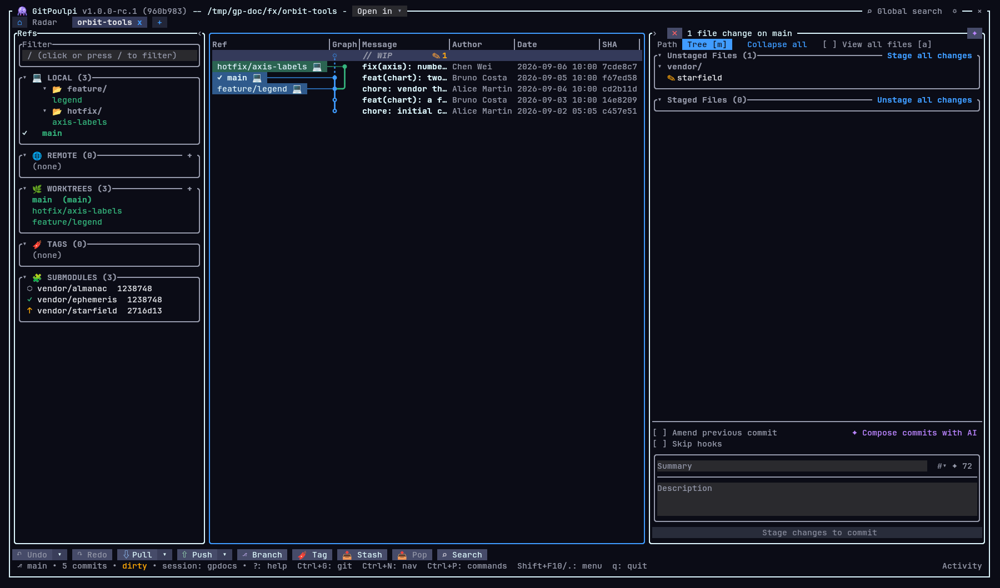

[English](../worktrees.md) · [Čeština](../cs/worktrees.md) · [Deutsch](../de/worktrees.md) · [Español](../es/worktrees.md) · [Français](../fr/worktrees.md) · [Italiano](../it/worktrees.md) · [日本語](../ja/worktrees.md) · [한국어](../ko/worktrees.md) · [Nederlands](../nl/worktrees.md) · [Polski](../pl/worktrees.md) · **Português (Brasil)** · [Português (Portugal)](../pt-PT/worktrees.md) · [Русский](../ru/worktrees.md) · [Svenska](../sv/worktrees.md) · [Türkçe](../tr/worktrees.md) · [Українська](../uk/worktrees.md) · [简体中文](../zh-CN/worktrees.md)

# Worktrees

Um worktree é uma segunda cópia com checkout do repositório: outra pasta, em outra
branch, compartilhando o mesmo histórico. A seção WORKTREES do painel Refs os lista; o
principal é marcado com `(main)`.

## Mostrando a seção

A seção fica oculta em um repositório que ainda não tem nenhum worktree vinculado. Para
vê-la mesmo assim (ela então mostra "Nenhum worktree ainda: + para criar um"), use o
comando da paleta **Painel esquerdo: mostrar a seção Worktrees**, marque **WORKTREES** na
lista de mostrar/ocultar do painel esquerdo (clique com o botão direito em um cabeçalho de
seção) ou execute qualquer um dos comandos de criação abaixo. O GitPoulpi lembra isso para
aquele repositório (veja **Seções do painel esquerdo** em [Configurações](settings.md));
outro repositório sem worktrees continua começando com a seção oculta.

## Criando um worktree

O **+** no cabeçalho WORKTREES (teclado: `+` na seção; paleta: **Refs: criar
worktree...**) abre um menu:

- **A partir da branch atual**: a branch está em checkout na pasta principal, então o
  diálogo propõe uma nova branch sobre ela (`worktree-<id>`).
- **A partir do commit selecionado**: fica esmaecido até que um commit seja selecionado
  no Log. O diálogo propõe uma nova branch `worktree-<id>` partindo dali; esvazie o campo
  da branch para um worktree desanexado.
- **Escolher uma branch...**: o diálogo abre na lista **Branch do worktree**, para abrir
  uma branch que já existe.

A paleta tem os mesmos três (**Refs: criar worktree a partir da branch atual**, **Git:
criar worktree no commit selecionado...**, **Refs: criar worktree escolhendo uma
branch**). As entradas mais antigas continuam funcionando: **Criar worktree a partir
de...** no menu de uma branch, tag ou commit.

O diálogo propõe tudo e deixa você mudar. O **Nome** e a nova branch começam ambos como
`worktree-<id>`, em que `<id>` são 8 dígitos hexadecimais aleatórios (os mesmos nos dois),
então dois worktrees nunca colidem.

| Campo | Significado |
|---|---|
| **Nome** | A pasta recebe esse nome. **Nome pela branch** (`Alt+N`) o define como `worktree-<branch>`: as barras viram `-`, e a palavra não é repetida (`worktree-foo` e `feature/worktree-x` ficam como estão, `feature/login` dá `worktree-feature-login`). |
| **Pasta** | Uma irmã do repositório, `<repositório>-<nome>`. Ela acompanha o Nome até você digitar na Pasta; **Procurar** escolhe onde. |
| **Ref** | De onde parte uma branch *nova*: uma branch ou um commit (uma lista; digite para buscar). Não é usada, e o diálogo avisa, enquanto uma branch existente está escolhida. |
| **Branch do worktree** | Um campo, dois sentidos, ditos logo abaixo dele. Um nome que não é uma branch local cria uma nova branch a partir da Ref (**nova branch a partir de main**). Uma branch local que não está em checkout em outro lugar (escolha-a na lista ou digite o nome) é colocada em checkout ali como está (**faz checkout desta branch**). A primeira linha da lista, ou um campo vazio, faz checkout da branch da Ref (ou desanexa em um commit); é recusado quando essa branch já está em checkout. |
| **Gerar outro** | `Alt+R`. Sorteia um novo `<id>` e troca o Nome e a branch por ele, exceto o que você mesmo digitou (um Nome ou uma branch escritos por você ficam) e uma branch existente (nunca trocada). Um Nome vindo de **Nome pela branch** ou da IA conta como gerado. |
| **Nomear com IA** | Só com a IA ativada (veja abaixo). |
| **Abrir o novo worktree como aba** | Ativado por padrão. |

Uma pasta que não está vazia, um nome inválido, um nome de branch que o git recusa ou uma
branch que outro worktree já tem são informados na linha do próprio diálogo, e **Criar**
continua esmaecido.

### Nomeando com IA

Com a [IA](ai.md) ativada, **Nomear com IA** (`Alt+A`) abre uma caixa dentro do diálogo:
*Descreva a funcionalidade, o bug ou a tarefa*. **Nomear** pede ao modelo um nome curto de
worktree e um nome de branch que siga os nomes de branch do próprio repositório
(`feature/`, `fix/`, kebab-case em minúsculas). Eles preenchem o Nome (como
`worktree-<nome>`) e o campo da branch, ainda editáveis; um nome de branch que já existe
ganha o sufixo `-2`, para que a resposta nunca faça checkout de algo em silêncio. A caixa
mostra o estado de ocupado, **Parar** (ou `Esc`) cancela, e uma falha aparece dentro do
diálogo. Só a sua descrição e os nomes das branches locais são enviados.

## O menu da linha

Clique com o botão direito em um worktree (ou selecione-o e pressione a tecla de menu,
`Shift+F10` ou `.`):

- **Abrir em uma nova aba**: como um clique duplo ou `Enter`.
- **Abrir em**: as entradas de [Abrir em](open-in.md) cuja caixa **Pode abrir um
  worktree** está marcada (Configurações > Abrir em; toda entrada vem marcada por padrão).
  Elas rodam com a pasta do worktree como `${cwd}`.
- **Merge <branch> em...**: escolha a branch que vai receber o merge (por padrão, a
  branch do worktree principal). O merge comum roda no worktree em que essa branch está em
  checkout, com as suas opções de merge; um conflito é resolvido ali pelo fluxo de
  conflitos de sempre. Uma branch que não está em checkout em lugar nenhum é recusada,
  com o motivo. Não é oferecido para um worktree desanexado.
- **Remover worktree...**: nunca o principal.

**Abrir em uma nova aba** (ou um clique duplo, ou `Enter`) abre a pasta do worktree como uma
aba própria, com o seu próprio Log, status e branch:

A paleta tem as mesmas ações sobre a linha selecionada (**Refs: abrir o worktree em...**,
**Refs: Merge da branch do worktree em...**, **Refs: remover worktree...**, **Refs: abrir
worktree em uma aba**).

## Removendo um worktree

Um worktree limpo recebe uma confirmação simples. Se a branch dele já passou por merge
(no upstream dela, na branch do worktree principal ou em `main` / `master`), a caixa
**Excluir também a branch <b>** vem marcada por padrão; uma branch sem merge avisa que
continua. **Merge em... e remover** faz o merge primeiro e só remove quando o merge
terminou sem conflitos.

Com alterações pendentes (rastreadas ou não), o diálogo as lista (contagem, com rolagem)
e oferece:

- **Fazer commit e remover**: um campo de mensagem no próprio diálogo; toda alteração é
  preparada (respeitando o `.gitignore`) e vira commit na branch do worktree, e depois o
  worktree é removido. Um worktree desanexado dá nome a uma branch para o commit no mesmo
  diálogo.
- **Fazer stash e remover**: toda alteração, inclusive os arquivos não rastreados, vai
  para um stash com uma mensagem editável (padrão "WIP em <pasta>"), e depois o worktree
  é removido. A lista de stashes é compartilhada por todos os worktrees: o stash fica
  depois em STASHES do repositório principal, pronto para o pop.
- **Abrir para commit**: abre o worktree em uma aba com a mensagem de commit em foco;
  nada é removido.
- **Remover mesmo assim**: descarta as alterações depois de uma segunda confirmação
  explícita.

## Desfazer

Remover um worktree não pode ser desfeito: a pasta se foi. O que foi salvo antes
continua: o commit está na branch, o stash na lista. A exclusão de branch que **Excluir
também a branch** acrescenta é a comum, registrada no diário: **Desfazer** traz a branch
de volta (não a pasta). Criar um worktree também não faz parte do histórico.

## Por um script ou um agente

`gitpoulpi worktree changes <path>` lista as alterações pendentes de um worktree.
`gitpoulpi worktree remove <path> [--force] [--commit-message M [--commit-branch B]]
[--stash-message M] [--delete-branch]` o remove; as ferramentas MCP são
`worktree_changes` e `worktree_remove`. `gitpoulpi ai worktree-name --describe "<tarefa>"`
imprime os nomes de worktree e de branch que a IA propõe (`{ name, worktree, branch }`) e
não cria nada; a ferramenta MCP é `ai_worktree_name`. Veja a [referência da CLI](cli-reference.md).
