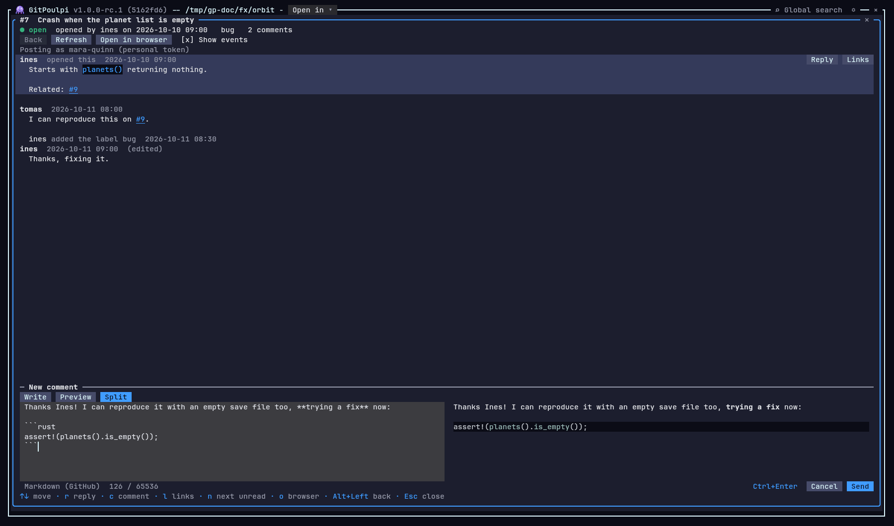

[English](../conversations.md) · [Čeština](../cs/conversations.md) · [Deutsch](../de/conversations.md) · [Español](../es/conversations.md) · [Français](../fr/conversations.md) · [Italiano](../it/conversations.md) · [日本語](../ja/conversations.md) · [한국어](../ko/conversations.md) · [Nederlands](../nl/conversations.md) · [Polski](../pl/conversations.md) · [Português (Brasil)](../pt-BR/conversations.md) · **Português (Portugal)** · [Русский](../ru/conversations.md) · [Svenska](../sv/conversations.md) · [Türkçe](../tr/conversations.md) · [Українська](../uk/conversations.md) · [简体中文](../zh-CN/conversations.md)

# Conversas

A vista de conversa de uma issue, item de trabalho, cartão ou pull / merge request. Precisa de uma conta e de um repositório associado: veja [Integrações de alojamento e de gestores de issues](hosting-integration.md); as listas que a abrem estão em [Pull requests e issues](pull-requests-and-issues.md); rever código está em [Rever um pull ou merge request](review.md).

Uma **conversa** é tudo o que foi dito sobre uma issue, item de trabalho, cartão, alteração ou pull / merge request: a
descrição, os comentários, as revisões, os tópicos no código e os eventos (etiquetas, atribuições, mudanças de estado,
pushes). O GitPoulpi lê-a do host, mostra-a formatada e deixa-o responder sem sair da janela.

### Abrir uma

| A partir de | Como |
|---|---|
| Uma linha de ISSUES | `Enter` ou um clique duplo; **Abrir conversa** no menu da linha; paleta *Alojamento: abrir a conversa de uma issue...* (uma lista das issues no ecrã). **Abrir no navegador** no menu da linha mantém o navegador. |
| Uma linha de PULL REQUESTS no Azure DevOps ou no Bitbucket | `Enter` ou **Abrir conversa**. No GitHub, GitLab, Gitea, Forgejo e Gerrit a linha abre a [revisão](review.md), cuja página Resumo é esta mesma conversa (a cronologia, as teclas e a caixa de comentário abaixo). |
| Um cartão do [quadro de issues](pull-requests-and-issues.md#o-quadro-de-issues) | `Enter` ou um clique duplo. |
| O [Radar](radar.md) | `i` numa linha de issue ou de pedido, **Abrir conversa** no menu da linha, ou *Radar: abrir a conversa da issue*. |
| Uma referência noutra conversa | Clique nela (ou `l` e depois escolha-a): `#7`, `!12`, `ABC-12` de uma fonte associada abrem na aplicação e entram numa pilha de Voltar. |
| Um agente | `gitpoulpi ui show issue <n> --view conversation` (também `ui show pr`), veja [a referência da CLI](cli-reference.md). |

**Repositórios que não estão clonados.** Uma linha do Radar de um repositório de que não tem clone abre também a sua
conversa: a vista precisa apenas do perfil de integração e do projeto, por isso o Radar hospeda-a na sua própria janela,
e `Esc` devolve o Radar. O que precisa de um clone fica de fora: uma referência a um commit abre no host em vez de no
Log, e *Deixar a IA ler o repositório* fica a cinzento com o seu motivo (veja [o capítulo da IA](ai.md#ajuda-de-escrita-num-host)).
Um pedido de um repositório clonado tem antes a sua revisão (`e`), e **Abrir conversa** do Radar diz que não há
conversa para ler aqui para ele; uma issue de um repositório clonado abre-a no separador desse repositório.

Uma issue de um host que não tem nenhuma para ler (o Bitbucket e o Gerrit não têm issues) abre o navegador como antes, e
uma compilação sem a funcionalidade `conversation` faz o mesmo em todo o lado ([compilações personalizadas](custom-builds.md)).

### A vista

Uma vista de janela inteira: o cabeçalho (estado, quem a abriu e quando, as etiquetas, o número de comentários,
**Mostrar eventos**, **Voltar**, **Atualizar**, **Abrir no navegador**), a linha **A publicar como**, a cronologia e,
por baixo, a caixa de comentário.

- A cronologia lê-se do mais antigo para o mais recente e começa na janela mais recente (no máximo 300 entradas).
  **Carregar mais antigos** no seu topo (`m`, paleta *Conversa: carregar entradas mais antigas*) lê a janela anterior,
  com o número ainda por vir quando o host o diz.
- Um comentário mostra o autor, a data, uma marca `editado`, uma marca `bot` para bots, `interno` para notas privadas, e
  os botões **Responder**, **Citar**, **Editar**, **Eliminar** e **Ligações** que a entrada selecionada permite. Um
  tópico no código mostra `caminho:linha`, `resolvido` ou `por resolver`, `obsoleto`, e os seus comentários. Uma revisão
  mostra o seu parecer.
- Os eventos são uma linha esbatida cada (*carol adicionou a etiqueta lfs*). **Mostrar eventos** (`v`) oculta-os; a
  escolha é guardada por repositório. Os hosts sem histórico de eventos (YouTrack, itens de trabalho do Azure DevOps,
  notas locais) não têm essa caixa.
- O texto é Markdown desenhado: títulos, listas aninhadas e de tarefas, citações, alertas ao estilo do GitHub, código
  realçado, tabelas, ligações, imagens como `[image: alt]`. O texto que chegou na marcação própria do host é convertido
  primeiro (veja [Conversão de marcação](#conversão-de-marcação)). Um bloco de código `mermaid` ganha um botão **Abrir
  diagrama** que mostra o código do diagrama numa vista com deslocação (`Enter` copia-o); a paleta tem *Conversa: abrir o
  diagrama da entrada*. Precisa de uma compilação com `conversation` e `mermaid`.
- No Resumo da revisão, o `path:line` de uma discussão sobre código é uma ligação para o código (`G`, *Conversa: abrir o
  código da discussão*; veja [Revisão](review.md)); numa conversa aberta isoladamente (um problema, uma linha do Radar)
  não há página de código para onde ir.
- A vista lê de novo a cada 60 segundos e com `F5` (**Atualizar**).

**Teclas.** Cada uma tem um botão, uma linha de menu ou uma linha da paleta (*Conversa: ...*), e `Ctrl+N` põe emblemas
nos botões.

| Tecla | Ação |
|---|---|
| `Cima`, `Baixo`, `Ctrl+J`, `Ctrl+K`, `j`, `k` | Entrada anterior / seguinte |
| `PageUp`, `PageDown`, `Home`, `End`, a roda, a barra de deslocação | Deslocar |
| `Tab`, `Shift+Tab` | Cronologia, caixa de comentário e depois os botões do cabeçalho |
| `r` | Responder: no tópico da entrada selecionada, ou com o seu texto citado onde o host não tem tópicos |
| `Q` | Citar a entrada selecionada num novo comentário |
| `c` | Novo comentário |
| `e`, `d` | Editar, eliminar um dos seus comentários (uma pergunta precede a eliminação) |
| `l`, `Enter` | As ligações da entrada: `Enter` segue a única, ou abre o menu delas |
| `y`, `o` | Copiar o endereço da entrada, abri-la no navegador |
| `n` | Próxima entrada nova |
| `v`, `m`, `F5` | Mostrar ou ocultar eventos, Carregar mais antigos, Atualizar |
| `Alt+Esquerda`, `Backspace` | Voltar pela pilha de Voltar |
| `q`, `Esc` | Fechar (pergunta primeiro quando a caixa tem texto) |

### Escrever

**Novo comentário** (`c`, ou `Tab` até à caixa), **Responder** (`r`), **Citar** (`Q`) e **Editar** (`e`) usam a mesma
caixa de texto Markdown: **Escrever**, **Prévia** e **Lado a lado** (`Alt+P` alterna entre Escrever e Prévia, `Alt+L`
liga o Lado a lado e precisa de uma janela com 100 colunas). `Ctrl+Enter` (também `Ctrl+S` e `Alt+Enter`) ou **Enviar**
publica, **Cancelar** larga a caixa, e `Alt+E` abre **Escrever com IA** onde a IA está ativa ([o capítulo da
IA](ai.md#ajuda-de-escrita-num-host)). A prévia é desenhada pelo mesmo desenhador da cronologia, com as mesmas
referências. Quando o host não aceita Markdown, o rodapé nomeia a marcação em que o texto é enviado (*Enviado como Jira
wiki markup*, *Enviado como Textile*).

- O comentário é adicionado à cronologia de imediato e ocupa o seu lugar quando o host responde. Se o host recusar, a
  entrada desaparece e a caixa volta a abrir com o seu texto e o motivo.
- Um texto que não enviou é guardado por item (`remote-conversations.toml` na pasta de configuração) e está lá da
  próxima vez que abrir essa caixa; enviá-lo ou descartá-lo remove-o. Fechar uma caixa que tem texto pergunta primeiro.
- **Responder** num tópico (um tópico de revisão, uma discussão do GitLab, um comentário do Linear, um tópico do Bitbucket
  ou do Azure DevOps) publica nesse tópico. Onde o host só tem uma lista plana, **Responder** inicia um novo comentário
  com a entrada selecionada citada (`> **autor**`), o mesmo que **Citar**.
- **Nota interna** (caixa de seleção, `Alt+I`): no GitLab e no Redmine o comentário só é visível para os membros do
  projeto. Só aparece nos hosts que têm essas notas, e só num novo comentário.
- Publicar é uma ação para o exterior: nada é registado no histórico de desfazer e **nada se pode desfazer a partir do
  GitPoulpi**. Sem ligação a caixa fica, **Enviar** fica a cinzento com o motivo, e o cabeçalho diz que a cópia guardada
  está a ser mostrada.

**Quem pode editar ou eliminar.** Só os seus próprios comentários têm **Editar** e **Eliminar**. A palavra do próprio
host vem primeiro quando a dá (`viewerCanUpdate` e `viewerCanDelete` do GitHub, `can_edit` noutros), depois o seu login
contra o autor do comentário, comparado sem distinguir maiúsculas; os comentários de um bot de App têm de vir também de
uma conta de bot. Enquanto o login de um bot de GitHub App não é conhecido, só contam os comentários que esta instalação
publicou (o repositório guarda os seus ids): nada é adivinhado a partir de um nome. Num tópico, **Editar** e **Eliminar**
atuam sobre o último comentário dele que é seu. Um host que não consegue editar ou eliminar (veja [a
tabela](#o-que-cada-host-não-consegue-fazer)) mostra os botões a cinzento com o motivo.

### Publicar como

A linha sob o cabeçalho diz com que nome as suas mensagens são publicadas, e a mesma linha está em todas as caixas:

| Linha | Significado |
|---|---|
| *A publicar como ann (token pessoal)* | O token do perfil: o seu próprio login (`GET /user`). |
| *A publicar como ci-bot (comando de token do repositório)* | O [comando de token](hosting-integration.md#8-agir-como-um-bot-de-github-app) do repositório é usado para a API de hosting. |
| *A publicar como my-app[bot] (bot de GitHub App)* | Um token de instalação. O nome vem de **Publicar como**, senão do host. |
| *A publicar como o bot da GitHub App (o nome ainda não é conhecido: defina Publicar como nas Definições)* | Nenhum nome configurado, nenhum aprendido ainda. |
| *A publicar como ... (bot do projeto)* | Um token de acesso de projeto ou de grupo do GitLab. |
| *A escrever como kai (nota local)* | Uma pasta de notas Markdown: o `local.me` do perfil, senão o utilizador ligado. |
| *Ainda não se sabe como iria publicar. Defina Publicar como nas Definições.* | Nada se conseguiu aprender. |

**Publicar como** é um nome: para uma GitHub App é `my-app[bot]`. Defina-o para todos os repositórios em **Definições >
Integrações > Publicar como** (`general.hosting_post_as`), ou para um repositório em **Definições > Definições do repositório > SSH e
credenciais > Host**, que o substitui. Se ficar vazio, o GitPoulpi pergunta ao GitHub (GraphQL `viewer { login }`, a que
um token de instalação pode ou não responder) e, na falta disso, aprende o nome com o autor do primeiro comentário que
publica e guarda-o com o repositório. Um token pessoal nunca o precisa. Veja
[Agir como um bot de GitHub App](hosting-integration.md#8-agir-como-um-bot-de-github-app).

### Referências cruzadas

As referências numa conversa são sublinhadas e clicáveis. As fontes de ISSUES e de PULL REQUESTS associadas ao
repositório são comparadas primeiro, por isso `ABC-12` de um projeto Jira associado abre na aplicação mesmo dentro de um
comentário do GitHub; o que a gramática própria do host acrescenta abre a sua página depois da confirmação da ligação.
Um id de commit abre no Log quando o repositório está clonado e o id tem pelo menos 7 carateres, no host caso contrário.
Nada dentro de um trecho de código, de um bloco delimitado, de uma ligação Markdown, de um endereço de e-mail ou de um
URL é uma referência, e `C#1`, `UTF-8`, `SHA-256` e `ISO-8601` também não.

| Host | Reconhecido |
|---|---|
| GitHub | `#7`, `GH-7`, `owner/repo#7`, `owner/repo@sha`, `@login`, ids de commit |
| GitLab | `#7`, `!7`, `group/project#7`, `group/project!7`, `project#7` (um projeto irmão), `@user`, `~label` e `%milestone` como marcas, ids de commit |
| Gitea, Forgejo | `#7`, `!7`, `owner/repo#7`, `owner/repo@sha`, `@user`, ids de commit |
| Azure DevOps | `#7`, `!7`, `AB#7`, `@user` |
| Bitbucket | menções `@user`, `{uuid}`, ids de commit |
| Gerrit | valores `Change-Id` (`I` e 40 dígitos hexadecimais), ids de commit |
| Redmine | `#7`, revisões `r123`, `commit:abc1234` |
| Jira, Linear, YouTrack | `ABC-12`, só para um projeto ou equipa de uma fonte associada |
| Trello | endereços de cartões (`trello.com/c/...`) |
| Notas locais | `[[nota]]`, `[[nota\|alias]]` e ligações `.md` relativas a outra nota da pasta |

`gitpoulpi hosting markdown --body T --id I` imprime o que a aplicação faz de um texto, referências incluídas.

### Conversão de marcação

Os hosts que não falam Markdown são convertidos nos dois sentidos, para ler e escrever Markdown em todo o lado. O que um
conversor não percebe fica como texto legível.

- O **Jira** (Cloud e Data Center) guarda os comentários como wiki markup pela API v2. O que lê é convertido para
  Markdown; o que escreve é convertido para wiki markup, e o rodapé diz *Enviado como Jira wiki markup*.
- O **Redmine** formata o texto como Textile ou Markdown, o que a API não diz: a linha **Formato de texto do servidor**
  do perfil (Definições > Integrações, `markup`, Textile por predefinição) diz-o ao GitPoulpi. O Textile é convertido em
  Markdown para ler e de volta para Textile para escrever.
- O **Azure DevOps Server** devolve os comentários dos itens de trabalho como HTML e aceita-os como HTML: são mostrados
  como o Markdown convertido a partir dele e escritos como HTML. O Azure DevOps Services e os tópicos de pull request
  aceitam Markdown.
- O **Gerrit** é texto simples: não é desenhado como Markdown e o que escreve é enviado como escrito.
- Cada importador remove primeiro as sequências de controlo e de escape, por isso um comentário não pode mexer no
  terminal.

### A cópia guardada, Carregar mais antigos, novos

- Cada conversa que abre é guardada (`<pasta de estado>/conversations/<integração>/<projeto>/<tipo>-<n>.json`, só do
  utilizador, sem token, no máximo 2 MB por ficheiro, os 50 ficheiros mais recentes mantidos). Aparece de imediato quando
  o item abre e é atualizada por trás. Quando o host não é alcançável, a cópia guardada fica no ecrã sob *Sem ligação: a
  mostrar a cópia guardada há 3 min (motivo)* e Enviar fica a cinzento.
- **Novos:** o que viu pela última vez é lembrado por conversa (as últimas 200 são mantidas). As entradas de outra
  pessoa que são mais recentes recebem uma barra de destaque e uma marca `novo`, e `n` salta para a seguinte. Uma
  conversa que abre pela primeira vez não tem nada de novo.

### O que cada host não consegue fazer

Cada `não` abaixo é um limite real: o controlo fica oculto ou a cinzento com o motivo, e a CLI responde com um erro que
nomeia o host antes de enviar seja o que for.

| Host | Itens | Responder num tópico | Editar e eliminar os próprios | Resolver um tópico | Eventos | Notas internas | Escrito como |
|---|---|---|---|---|---|---|---|
| GitHub | issues, pull requests | pull requests | ambos | pull requests | sim | não | GitHub Markdown |
| GitLab | issues, merge requests | sim (discussões) | ambos | merge requests | sim | sim | GitLab Markdown |
| Gitea | issues, pull requests | pull requests | ambos | pull requests | sim | não | Markdown |
| Forgejo | issues, pull requests | pull requests | ambos | não (o host não tem endpoint) | sim | não | Markdown |
| Azure DevOps | itens de trabalho, pull requests | pull requests | ambos | não (o estado é mostrado, não alterado) | só pull requests | não | Markdown (HTML nos itens de trabalho do Server) |
| Bitbucket (Cloud, Data Center) | só pull requests | sim | ambos | não (mostrado, não alterado) | sim | não | Markdown |
| Gerrit | só alterações | sim | não (nenhum dos dois se pode editar nem eliminar) | sim | sim | não | texto simples |
| Jira | issues | não (lista plana) | ambos | não | sim (changelog) | não (precisa de um papel no projeto) | wiki markup |
| Linear | issues | sim (respostas a um comentário) | ambos | não | sim | não | Markdown |
| YouTrack | issues | não | ambos | não | não | não | Markdown |
| Redmine | issues | não | só editar (Redmine 5 e posterior), nunca eliminar | não | sim (journals) | sim (notas privadas) | Markdown ou Textile |
| Trello | cartões | não | ambos | não | sim (movimentos) | não | Markdown |
| Notas locais | notas | não | as do próprio autor local | não | não | não | Markdown |

Além disso: nenhum host deixa iniciar um novo tópico numa linha a partir da conversa (faça-o na revisão), e as reações
só são mostradas no GitHub. Um texto mais longo do que o host aceita é recusado (GitHub 65.536 carateres, GitLab
1.000.000, Azure DevOps 150.000, Jira 32.767, Trello 16.384): a CLI verifica primeiro, na aplicação é mostrada a
mensagem do próprio host e o seu texto é mantido. Uma nota local guarda os seus comentários numa secção final
`## Comments` do próprio ficheiro da nota, uma entrada `### autor - hora` cada, para o Obsidian e uma shell também os
verem.

Na linha de comandos as mesmas conversas são `gitpoulpi hosting issue comments`, `issue comment`, `comment-edit` e
`comment-delete`, e `hosting review conversation` (veja [a referência da CLI](cli-reference.md)); para os agentes são
ferramentas MCP com os mesmos nomes (veja [MCP e agentes](mcp-and-agents.md)).
