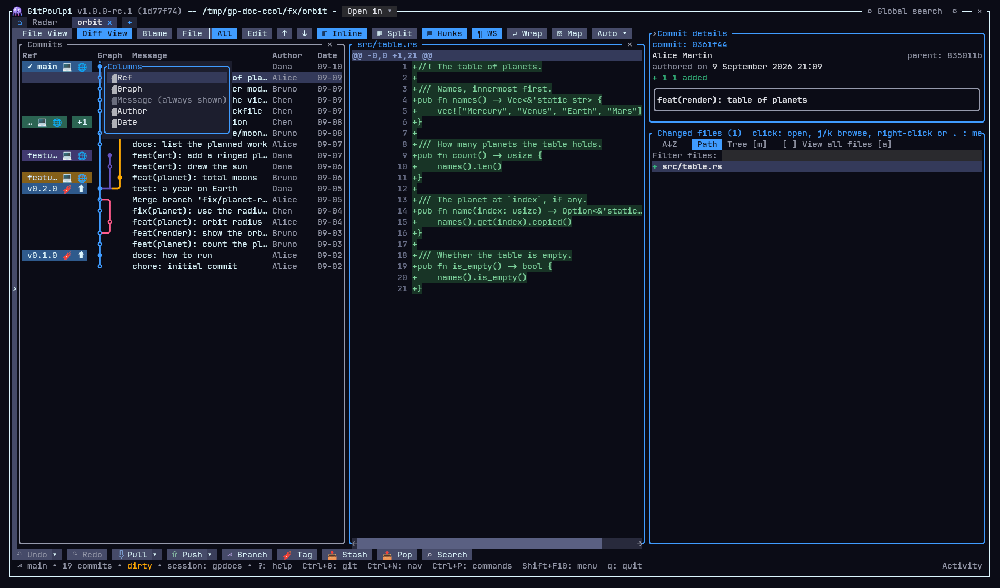

[English](../interface-tour.md) · [Čeština](../cs/interface-tour.md) · [Deutsch](../de/interface-tour.md) · [Español](../es/interface-tour.md) · [Français](../fr/interface-tour.md) · [Italiano](../it/interface-tour.md) · [日本語](../ja/interface-tour.md) · [한국어](../ko/interface-tour.md) · [Nederlands](../nl/interface-tour.md) · [Polski](../pl/interface-tour.md) · [Português (Brasil)](../pt-BR/interface-tour.md) · **Português (Portugal)** · [Русский](../ru/interface-tour.md) · [Svenska](../sv/interface-tour.md) · [Türkçe](../tr/interface-tour.md) · [Українська](../uk/interface-tour.md) · [简体中文](../zh-CN/interface-tour.md)

# Visita guiada à interface

Esta página nomeia todas as áreas da janela do GitPoulpi, de cima para baixo. As
outras páginas usam os mesmos nomes. As imagens usam um pequeno repositório de
demonstração com autores inventados.

## A moldura

### Barra de título

A margem superior da janela lê-se
`🐙 GitPoulpi vX.Y.Z -- <caminho do repositório>` (o nome da sessão está na barra de estado, em baixo).

- **🐙** abre a janela **Acerca do GitPoulpi**: versão, funcionalidades da compilação,
  licença, ligações e os crates de terceiros. Num terminal que desenha imagens, o polvo
  é o logótipo em píxeis, na cor do seu logótipo (nos outros fica o emoji). Paleta:
  `Ajuda: acerca do GitPoulpi`; teclas: `Ctrl+N` e depois `A`. Em Acerca, as pupilas do
  polvo seguem o ponteiro do rato. Clique no logótipo (ou prima `Space`) para o fazer
  rodar até à cor seguinte. Clique com o botão direito no logótipo (ou prima `c`) para
  ver a lista de cores. O GitPoulpi guarda a sua escolha em `ui.logo_color`. As ligações
  abrem com um clique ou com a tecla de acesso respetiva (`s` código-fonte, `d`
  documentação, `i` licença), e `l` lista os crates de terceiros com as versões e as
  licenças (uma lista deslizante; `Esc` ou `l` volta atrás, tal como um clique no título dela).
  Cada crate da lista tem uma ligação para a sua página (o repositório ou, na falta dele, a página no crates.io): clique na linha, ou escolha-a com `↑` `↓` e prima `Enter`, para a abrir no navegador. `t` (ou o comando da paleta `Ajuda: licenças e créditos`) mostra os avisos de licença e os créditos de tudo o que o programa traz incorporado, num texto deslizante (`Up` / `Down`, `PgUp` / `PgDn`, `Home` / `End`; `Esc` ou `t` para voltar). Num script, `gitpoulpi licenses` imprime o mesmo texto.
- A **versão** (`v1.0.0`, ou `vX.Y.Z disponível` quando existe uma versão mais recente)
  fica entre o nome e o caminho: um clique abre o painel de atualizações quando existe
  uma versão mais recente (ou uma atualização em curso), e o separador **Notas de versão** nos outros casos, ver
  [Atualizações](updates.md).
- **Abrir em ▾**, logo a seguir ao caminho, abre a pasta do separador num terminal,
  num editor, num multiplexador ou no gestor de ficheiros (`Alt+O`). Consulte
  [Abrir em](open-in.md).
- **⌕ Pesquisa global** (uma lupa e a sua etiqueta), logo à esquerda da roda dentada, abre a [pesquisa global](search.md) (`Ctrl+Alt+F`). É a primeira coisa a ceder quando a barra de título fica demasiado estreita: primeiro sai a etiqueta (a lupa fica), depois o botão.
- A **roda dentada** (`⚙`), logo à esquerda do **×**, abre as **Definições** (`Ctrl+,`).
- **×** na extremidade direita sai, como `q`.

### Barra de estado

Por predefinição é a última linha da janela; **Definições > Aspeto > Posição da barra de estado** leva-a para o topo, acima dos separadores de repositório.

A margem inferior mostra a branch atual, o número de commits carregados,
`modificado` ou `limpo`, o nome da sessão, e as teclas mais úteis: `?` ajuda,
`Ctrl+G` ações git, `Ctrl+N` navegação, `Ctrl+P` comandos, `Shift+F10`
menu, `q` sair. Numa janela estreita, as teclas menos úteis são omitidas. A
barra de estado mostra também mensagens de estado e progresso. As teclas que mostra são sempre
as teclas em vigor, incluindo as que alterou (consulte
[Definições](settings.md#teclado-e-rato)).

A contagem de commits aparece como `500 / 48213 commits` enquanto ainda há histórico mais antigo por carregar (`500 / … commits` enquanto o total está a ser contado) e apenas como `2500 commits` quando tudo está carregado. Num checkout parcial (sparse), uma etiqueta `parcial` segue-se ao nome da sessão. A forma de contar o total é uma definição: **Contar o total de commits com** (ver [Definições](settings.md#log-e-grafo)).

Na extremidade direita, o botão **Atividade** abre o Registo de atividade: um separador
Operações Git (as operações com o tempo que demoraram, mensagens e erros), um separador
Aplicação (o registo da aplicação, com uma caixa de nível e um botão **Limpar registo**) e uma
caixa Âmbito que restringe ambos a este repositório, a uma área de trabalho ou a todos os repositórios. Um número no
botão conta os erros que ainda não viu. Quando uma operação falha, a barra de estado di-lo a vermelho; um clique abre a entrada
no Registo de atividade, com o motivo, um passo seguinte e um
Copiar para uma IA. Tudo isto é descrito em
[Quando algo falha](troubleshooting.md#quando-algo-falha).

No separador **Aplicação**, **Limpar registo** (`x`) esvazia os ficheiros do registo da aplicação depois de uma confirmação. À esquerda do botão **Atividade**, o indicador de tarefas mostra uma tarefa em segundo plano com um `[x]` para a cancelar. O separador Início tem a mesma barra de estado, com o botão **Atividade** no canto inferior direito (abre em Todos os repositórios).

### Sobreposições

A paleta de comandos, a ajuda, os menus de contexto, as janelas de diálogo, os popups e as
Definições abrem por cima da janela. Cada um tem um `✕` no canto superior direito
da borda; `Esc` ou um clique no `✕` fecha-o, e um clique fora fecha um diálogo, um
popup ou um painel (veja [Fechar janelas e diálogos](mouse-and-gestures.md#fechar-janelas-e-diálogos)).

## Linha de separadores

O separador **Início** (o ícone da casa) fica na extremidade esquerda, seguido da
[etiqueta da área de trabalho](workspaces.md) (assim que tiver uma área de trabalho), do separador
**Radar** afixado (fecha-se como qualquer separador; veja [o Radar](radar.md)) e do separador
**Áreas de trabalho** depois de o abrir (`Alt+J`; fecha-se como qualquer separador). Depois vem
um separador por repositório aberto. O `x` que fecha um separador só aparece no separador ativo
e no que está sob o ponteiro. A linha de separadores só contém separadores (o botão da
[pesquisa global](search.md) está na barra de título).

**Definições > Aspeto > Posição da barra de separadores** move esta linha para o fim da janela (abaixo da barra de estado) ou transforma-a numa coluna na margem esquerda: um separador por linha, primeiro Início, depois a etiqueta da área de trabalho, o Radar, o separador Áreas de trabalho, os separadores (um nome longo termina em `…`) e o `+`. Quando há mais separadores do que linhas, uma linha `…` mostra quantos estão ocultos acima (`▲`) e abaixo (`▼`) e abre a lista de separadores; a roda desloca a coluna. Junto a uma barra de ferramentas em coluna, os separadores ficam por fora. Uma janela com menos de 80 colunas mantém os separadores no topo. Cliques, a cruz de fecho, clique do meio, o menu do clique direito, arrastar para reordenar e o teclado funcionam da mesma forma em qualquer posição.

- O **+** logo a seguir ao último separador abre um pequeno menu: **Novo separador** (`Alt+T`,
  **Separador: novo separador** na paleta) e, enquanto os respetivos separadores estão fechados,
  **Radar** e **Áreas de trabalho** (`Alt+J`), que abrem esses separadores; o comando **Separador: novo...**
  da paleta abre o mesmo menu. Um **Novo separador** é a vista Início com o campo de pesquisa pronto, pelo
  que escrever filtra logo os seus repositórios. Escolha um (ou Procurar, Clonar, Iniciar)
  e o seu separador aparece no fim da barra; um repositório que já está aberto limita-se a
  ser ativado. `Esc` na pesquisa vazia, `Ctrl+W`, o seu `x` ou um clique com o botão do
  meio fecha o Novo separador e volta ao separador em que estava. Nunca é guardado na sua
  sessão.

  
- Clique com o botão direito num separador, ou prima `Ctrl+T`, para o menu do separador: **Novo separador**, **Fechar separador**,
  **Fechar outros separadores...**, **Fechar separadores à direita...**, **Adicionar aos favoritos** (ou
  **Remover dos favoritos**), **Adicionar à área de trabalho** (ou **Remover da área de
  trabalho**, quando tem áreas de trabalho), **Copiar caminho**, **Abrir em ›**,
  **Chave SSH...** e **Checkout parcial...**.
- `Ctrl+PageUp` e `Ctrl+PageDown` mudam de separador. `Ctrl+W` fecha o separador
  atual. Um clique com o botão do meio num separador também o fecha (com a mesma
  pergunta).
- `t` (ou `Ctrl+N t`) abre o seletor de separadores, uma lista pesquisável dos separadores
  abertos.
- **Reordenar separadores:** prima um separador de repositório e arraste-o para o lado (uma sombra do
  separador segue o ponteiro e uma barra mostra onde vai ficar; `Esc` cancela),
  ou arraste uma linha do seletor de separadores, prima `Alt+Cima` / `Alt+Baixo` na linha
  realçada do seletor, ou execute **Separador: mover para a esquerda** / **Separador: mover para
  a direita** a partir da paleta. A ordem é guardada com a sessão. Um simples clique
  sem movimento continua a selecionar o separador. A casa, a etiqueta da área de trabalho e o
  `+` nunca se movem.
- **Sair e cd aqui** aparece à direita dos separadores quando iniciou o
  GitPoulpi através do wrapper de shell `gp` e o separador não é a pasta em que
  iniciou. Consulte [Seguir a pasta do separador](following-the-tab-folder.md).
- A **etiqueta da área de trabalho** logo a seguir à casa (um ponto colorido e um nome,
  ou «Sem área de trabalho») muda de [área de trabalho](workspaces.md): clique nela ou
  prima `Alt+W`. Aparece assim que tiver uma área de trabalho.

Com **Lembrar separadores** ativo (a predefinição), os seus separadores regressam no próximo
arranque. Um worktree abre no seu próprio separador. Esse separador fecha quando o worktree é
removido.

O separador de um worktree fica logo a seguir ao do seu repositório, e um separador de worktree arrastado para longe volta para lá (**Agrupar os separadores dos worktrees** em Definições > Geral, ativado por predefinição).

### Início

O separador Início é o gestor de repositórios. Tem quatro secções: **Repositórios
abertos**, **Favoritos**, **Repositórios recentes** e **Todos os
repositórios**. Cada linha mostra a branch, as contagens de commits à frente e atrás e o
número de alterações. Cada linha tem uma estrela (favorito), **Abrir** ou **Ir**,
**Fechar** ou **Remover**, e um menu `⋮`.

No topo: **Procurar**, **Clonar**, **Init**, uma caixa de pesquisa, **Recolher tudo**
e **Expandir tudo**. Uma pasta que já não existe sai de *Recentes* e de *Todos*
por si. Um favorito em falta fica, com um botão **Remover**. **Remover**
nunca elimina nada no disco.

Teclas: `Enter` abrir, `f` favorito, `x` fechar ou remover, `.` menu, `/` pesquisar,
`Space` recolher uma secção, `Esc` voltar ao seu separador.
`Ctrl+N` mostra um selo no campo de pesquisa, em cada secção e em cada botão: prima o carácter de um selo para o focar ou acionar (veja [Selos](keybindings.md#selos)).

Um único campo de pesquisa filtra tudo o que está abaixo, incluindo os favoritos: um repositório fica se o nome, a branch ou o caminho contiver o texto. As áreas de trabalho têm um separador próprio e não são uma página do separador Início: abra-o pelo menu do `+`, com `Alt+J` ou pela paleta, e feche-o com o seu `x`: veja [Áreas de trabalho](workspaces.md).

**Clonar** lista, para cada perfil ligado (GitHub, GitLab, Gitea, Forgejo, Azure DevOps, Bitbucket, Gerrit), os repositórios a que
tem acesso, uma secção por proprietário: os seus primeiro, depois uma por organização ou
grupo (por ordem alfabética), cada uma sob um cabeçalho. Um cadeado marca um repositório
privado. A caixa de pesquisa filtra todas as secções; uma secção sem correspondências
desaparece. `Up` e `Down` saltam os cabeçalhos, e `Home`, `End`, `PgUp` e `PgDn`
funcionam na lista.

## Barra de ferramentas

Por predefinição, uma linha por baixo dos painéis e acima da barra de estado. **Definições > Aspeto > Posição da barra de ferramentas** coloca-a no topo (por baixo dos separadores), no fundo, ou numa coluna à esquerda ou à direita dos painéis (uma janela com menos de 80 colunas desenha a coluna como uma linha no fundo). Os botões ficam no início da linha ou da coluna; **Definições > Aspeto > Alinhamento dos botões da barra de ferramentas** centra-os ou leva-os para o fim. Cada botão tem a sua própria cor de ícone, definida pelo tema (consulte [Temas](themes.md)). Quando não há espaço para todos, os botões menos importantes passam para trás de um `⋯`. Numa coluna, cada botão ocupa uma linha, com o seu `▾` no fim da linha, e o seu menu abre ao lado da coluna; o menu de uma barra de ferramentas no fundo abre para cima.

| Botão | O que faz |
|---|---|
| **Desfazer**, **Refazer** | Desfazem ou refazem a última operação (`Ctrl+Z`, `Ctrl+Y`). Ocultos quando Desfazer está desativado. Consulte [Desfazer e refazer](undo-redo.md). |
| **Pull** `▾` | Faz pull como diz **Definições > Git e codificação > Botão Pull**. A lista `▾` tem **Fetch All**, **Pull (fast-forward se possível)**, **Pull (só fast-forward)** e **Pull (rebase)**. Um item da lista executa uma vez e não altera o botão. |
| **Push** `▾` | Faz push da branch em checkout. A lista `▾` faz push uma vez para o remoto que escolher. |
| **Branch** | Cria uma branch no commit em checkout. |
| **Tag** | Cria uma tag no commit em checkout. |
| **Stash**, **Pop** | Faz stash de todas as alterações. Faz pop do último stash. |
| **LFS** `▾` | Ações do Git LFS: fetch, checkout, pull, push, prune (`Ctrl+G l`). Oculto quando o Git LFS está desativado. Consulte [Git LFS](lfs.md). |
| **Flow** `▾` | O menu do fluxo de trabalho de branches (iniciar, concluir, sincronizar, promover; `Ctrl+G Shift+W`). Só num repositório que tem um fluxo de trabalho. Consulte [Fluxos de trabalho de branches](branching-workflows.md). |
| **Pesquisar** | Abre a barra de pesquisa de commits sobre o Log (`f`). |

No extremo (à direita numa linha, no fundo numa coluna), quando o repositório está ligado a um host, um **chip** mostra o pull request da branch em checkout (por exemplo `GH #12` ou `GL !53`), ou um `+ PR` esbatido. **Definições > Aspeto > Fixar o botão de pull request no fim** (ativado por predefinição) mantém-no aí; desativado, segue os outros botões e o alinhamento deles. Consulte [Alojamento e gestores de issues](hosting-integration.md). Numa coluna, a caixa combinada de perfil ocupa a última linha.

Na extremidade direita, quando tem dois ou mais [perfis](settings.md#perfis), a
**caixa combinada de perfil** escolhe a identidade de commit deste repositório. A
primeira linha, *Predefinido*, segue **Definições > Perfis**. Depois de escolher um
perfil, o GitPoulpi pergunta se também deve escrever o nome e o e-mail dele na
configuração git do repositório (`user.name`, `user.email`). **Escrever na config do git**
escreve-os. `Esc` mantém a escolha apenas no GitPoulpi. Paleta:
`Repositório: alterar perfil...`.

Cada botão tem um comando da paleta e um atalho.

## Avisos

Um aviso por cima do Log avisa quando o repositório está num estado especial. Tem
botões para seguir em frente. Cada botão é também um comando da paleta.

| Aviso | Botões |
|---|---|
| Um merge, cherry-pick ou revert parou por conflitos | **Resolver conflitos...**, **Commit** ou **Continuar**, **Abortar** |
| Um rebase em curso | **Resolver conflitos...**, **Continuar**, **Saltar**, **Abortar** |
| **A aplicar patches (git am)** | **Resolver conflitos**, **Continuar**, **Saltar**, **Abortar** |
| Um `index.lock` esquecido bloqueia todas as alterações | **Remover index.lock** (pergunta primeiro) |
| Um auto-stash não foi reposto | **Pop agora**, **Mostrar stash**, **Recomeçar**, **Drop** (as opções dependem do estado) |

Consulte [Resolver conflitos de merge](merge-conflicts.md) e
[Resolução de problemas](troubleshooting.md).

## Barra lateral Refs (esquerda)

Uma árvore de tudo o que nomeia um commit. Cada secção tem uma contagem no seu
título, uma seta para a recolher e a sua própria posição de deslocação. Arraste a margem
entre duas secções para as redimensionar.

- Caixa **Filtro** no topo (`/`): filtra todas as secções por nome.
- **LOCAL**: as suas branches, em pastas separadas por `/` (`feature/`, `fix/`). Um
  visto mostra a branch em checkout. Pode desligar as pastas nas
  Definições.
- **REMOTO**: cada remoto, com as suas branches por baixo.
- **WORKTREES**: worktrees ligados, quando existem. Faça clique duplo num para
  o abrir no seu próprio separador.
- **STASHES**: os seus stashes. Clique com o botão direito num para **Pop**, **Apply** e
  **Drop**.
- **TAGS**: as suas tags, em pastas separadas por `/` como as branches (`releases/`, `backups/`). Uma seta significa que a tag está também no remoto.
- **PULL REQUESTS** e **ISSUES**: depois de ligar uma conta de alojamento e
  ligar o repositório.
- **SUBMÓDULOS**: os submódulos e o seu estado, quando existem. Consulte
  [Submódulos](submodules.md).

**Mostrar ou ocultar uma secção:** clique com o botão direito no cabeçalho de uma secção, ou na parte vazia do painel, para uma lista de verificação das secções (a última visível permanece). A escolha é mantida por repositório, entre arranques; ver [Secções do painel esquerdo](mouse-and-gestures.md#secções-do-painel-esquerdo).

Passe o rato por cima de uma linha para mostrar os seus botões: ocultar ou mostrar a ref no Log, e **Solo**
(mostrar apenas os commits dessa ref). Faça clique duplo numa branch local ou numa tag para
fazer checkout. Clique com o botão direito numa linha para o seu menu. O `‹` no título da barra lateral recolhe
a barra lateral (`Ctrl+N h`).

Os dois painéis laterais (a barra lateral Refs, `Ctrl+N h`, e o painel direito,
`Ctrl+N l`) pertencem ao Log: mostrar ou recolher um deles com um diff, uma vista
de ficheiro ou um editor aberto aplica-se só a essa vista. Um diff ou uma vista de
ficheiro também recolhe por si a barra lateral Refs, para dar espaço ao conteúdo.
De volta ao Log, os dois painéis ficam como os deixou lá, e é esse o estado
guardado para o próximo arranque.

## O Log (centro)

Uma linha por commit, o mais recente primeiro. Clique com o botão direito no cabeçalho para mostrar ou ocultar
colunas. Arraste a margem entre dois cabeçalhos para redimensionar uma coluna. Arraste um cabeçalho
para mover a coluna.

O painel não tem título: os cabeçalhos das colunas dizem o que ele é. Num commit sem ref, a linha sob o ponteiro mostra uma pílula esbatida com o nome da branch a que pertence (desative com **Mostrar uma branch fantasma no commit sob o rato** em Definições > Log e grafo).

| Coluna | Mostra |
|---|---|
| **Ref** | Pílulas coloridas das branches e tags no commit: um ícone de portátil para local, um globo para remoto, um ícone de etiqueta para tags, `+N` quando mais refs apontam para aí. As tags são desenhadas onde estão, nunca como fantasma. Num commit sem ref, a linha sob o ponteiro mostra uma pílula esbatida com o nome da branch a que pertence; se essa branch foi eliminada, uma pílula riscada mostra o nome lido do commit de merge que a integrou (desative com **Mostrar uma branch fantasma no commit sob o rato** em Definições > Log e grafo). |
| **Grafo** | As faixas das branches, merges e pontos de ramificação. Desenhado como imagens no kitty, Ghostty, WezTerm e iTerm2 (e também Windows Terminal e foot, através de sixel), e como carateres noutros terminais. As cores das faixas vêm do tema ou de uma paleta que escolher (consulte [Temas](themes.md)). Na sua largura mínima (um ponto de commit), a coluna fica compacta: todos os commits numa só faixa, sem linhas de branch nem de merge. |
| **Mensagem** | O resumo do commit. |
| **Autor** | O autor, com um avatar opcional. |
| **Data** | A data do autor, no formato que escolher. |
| **Alterações** | Opcional: ficheiros alterados e linhas `+adicionadas -removidas`. |
| **SHA** | O hash curto. |

Linhas especiais:

- **A linha de alterações em curso** (linha WIP) no topo: um círculo tracejado,
  `// WIP` ou a sua mensagem de rascunho, e as contagens de ficheiros modificados e adicionados.
  Clique nela para fazer stage e commit no painel direito.
- **Linhas de stash**: um pequeno quadrado numa faixa, junto ao commit sobre o qual o stash foi
  feito.
- Durante uma pesquisa, as linhas que não correspondem ficam esbatidas.

Passe o rato por cima de uma célula para ver uma dica com o texto completo. Clique com o botão direito numa linha para o
[menu do commit](log-and-history.md#o-menu-do-commit).

## O painel direito

O painel direito segue a seleção no Log.

**Alterações em curso** (a linha WIP está selecionada):

- Um título como `4 alterações de ficheiros em main`. Durante um merge com conflitos acrescenta
  o número de ficheiros em conflito. Um `[✖]` vermelho à esquerda descarta todas as
  alterações (pergunta primeiro). Com a IA ativa, um `[✦]` à direita explica as
  alterações.
- **Caminho** ou **Árvore** (uma lista plana ou pastas, `m`), **Recolher tudo** e
  **Ver todos os ficheiros** (`a`).
- **Ficheiros unstaged** e **Ficheiros staged**, cada um com uma contagem e um
  botão **Stage tudo** ou **Unstage tudo**. Passe o rato por cima de uma linha para ver
  o seu botão **Stage ficheiro** ou **Unstage ficheiro**.
- O **formulário de commit** em baixo: **Amend do commit anterior**, **Compor
  commits com IA** (com a IA ativa), o **Resumo** com um contador de carateres
  e o botão `✦`, a **Descrição**, e o botão **Commit das alterações em N ficheiros**.

**Detalhes do commit** (um commit está selecionado), de cima para baixo: o hash completo, o
autor com avatar e data, o hash do pai e as contagens de alterações, e depois a mensagem
(resumo e descrição; arraste a sua margem inferior para a redimensionar). O painel
**Ficheiros alterados** por baixo começa com os seus próprios controlos: o botão de ordenação,
**Caminho** / **Árvore**, **Ver todos os ficheiros** e uma caixa **Filtrar ficheiros**, fixos por
cima da lista, que é a única parte que se desloca. Clique num ficheiro para abrir o seu diff.
Numa janela baixa, a mensagem cede primeiro (até uma linha) e depois a lista.
A vista das alterações em curso mantém a sua linha **Caminho** / **Árvore** / **Ver todos os
ficheiros** no topo das listas de ficheiros, por cima das listas Unstaged e Staged.

Cada lista de ficheiros tem menus em ficheiros, pastas e na parte vazia, e vários ficheiros podem ser selecionados de uma vez (**Ctrl+clique**, **Shift+clique**); veja [Stage e commit](staging-and-committing.md).

Consulte [Staging e commits](staging-and-committing.md).

## O painel central quando um ficheiro está aberto

Clique num ficheiro alterado e a sua vista substitui o Log. `Esc` traz o Log
de volta. Uma barra de botões percorre o topo:

| Botão | O que faz |
|---|---|
| **Ficheiro**, **Diff**, **Blame** | Escolhem o que o painel mostra para o ficheiro. |
| **Histórico │ Todos** | Escolhe a lista da [coluna de commits](#a-coluna-de-commits) ao lado da vista e mostra a coluna. |
| **Editar** | Abre o editor integrado na cópia de trabalho. |
| `↑` `↓` | Hunk anterior ou seguinte. |
| **Inline**, **Dividido** | Uma coluna, ou lado a lado. |
| **Hunks** | Apenas os hunks alterados, ou o ficheiro todo. |
| **EB** | Mostrar ou ocultar alterações só de espaços em branco. |
| **Quebra** | Quebrar linhas longas. |
| **Mapa** | Um minimapa do ficheiro todo ao lado da barra de deslocação. |
| **Codificação** | A codificação com que o ficheiro é lido (**Auto** primeiro). |

Num diff da árvore de trabalho, cada hunk tem os botões **Stage hunk** e **Descartar
hunk**. Prima `v` para selecionar linhas e depois faça stage ou descarte apenas essas
linhas.

As duas vistas estão descritas em [Blame](log-and-history.md#blame) e [Histórico do ficheiro](log-and-history.md#histórico-do-ficheiro).

O **editor** integrado tem cores de sintaxe, números de linha, desfazer, pesquisa, e uma
barra de estado com a linha, coluna, fim de linha, indentação e linguagem.

Um ficheiro de imagem é mostrado como imagem: antes e depois no diff, ou o
próprio ficheiro na vista de Ficheiro. Consulte [Imagens](image-view.md).

Um ficheiro binário que não é uma imagem (um PDF, um documento, um arquivo comprimido) mostra um botão **Abrir em** quando o sistema conhece aplicações para o seu tipo: veja [Abrir em](open-in.md).

## A coluna de commits

Uma coluna pode ficar à esquerda do Diff, da vista de ficheiro ou do Blame de um ficheiro de um commit (nunca ao lado do editor integrado, que edita a cópia de trabalho: a coluna desaparece quando o editor abre e volta quando ele fecha sobre o diff). Tem três estados:

- **Histórico**: os commits desse único ficheiro, duas linhas cada (o [Histórico do ficheiro](log-and-history.md#histórico-do-ficheiro)). O lado direito mostra a versão do ficheiro no commit selecionado.
- **Todos**: uma lista compacta dos commits do Log com o seu grafo, descrita abaixo.
- **Oculta**: uma barra fina com `›` à esquerda da vista traz a coluna de volta (a dica indica a tecla).

A barra de botões da vista ocupa sempre toda a largura por cima da coluna, por isso nenhum botão se move quando a coluna abre, fecha ou muda de lista. Nela, o seletor **`Histórico │ Todos`** (dois segmentos de um mesmo controlo, sempre com a mesma largura) escolhe a lista: um clique num segmento mostra essa lista e abre a coluna se estava oculta; um clique no segmento já selecionado, com a coluna visível, oculta-a. O segmento da lista no ecrã fica aceso; enquanto a coluna está oculta, aquele com que vai voltar fica sublinhado e a lista é mantida. A dica indica o clique, o segundo clique no segmento selecionado e `Alt+C`. O Histórico do ficheiro abre-se também pelos sítios que sempre o abriram (menus de ficheiro, `Histórico do ficheiro: ...` na paleta).

- **Mostrar ou ocultar**: `Alt+C` (na paleta `Ver: alternar a coluna de commits`), um clique no segmento selecionado do seletor, o ✕ da coluna ou a barra `›`. Na paleta, `Ver: coluna de commits: ocultar`, `... : histórico do ficheiro` e `... : todos os commits` escolhem um estado. A escolha, com a lista que tinha, é memorizada com as outras definições da coluna. Sem escolha, a largura do terminal decide para a lista Todos: aparece a partir de 140 colunas. A coluna não é desenhada quando a vista ao lado ficaria com menos de 30 colunas, nem o grafo de Todos para um diff da árvore de trabalho ou uma comparação (o histórico do ficheiro aparece na mesma: não precisa de commit).
- **Largura**: arraste a borda direita (a borda acesa acompanha o ponteiro), ou use `Ver: alargar a coluna de commits` e `Ver: estreitar a coluna de commits`. Pode ocupar até 70% da coluna central (o resto fica para a vista, que nunca fica com menos de 30 colunas). É memorizada com os outros tamanhos.
- **Escolher um commit**: clique nele, ou dê o teclado à coluna (`Ctrl+N` e o selo da coluna, ou `Ver: focar a coluna de commits`) e use `Cima` / `Baixo`, `PageUp` / `PageDown`, `Home` / `End`. `Enter` ou `Direita` passa à lista de ficheiros do commit, `Esc` devolve o teclado à vista. O painel direito acompanha a escolha: detalhes do commit e os seus ficheiros alterados, para abrir outro ficheiro dele.
- **O que a vista faz**: o ficheiro aberto continua aberto. Se o commit escolhido o alterou, a vista mostra o diff dele nesse commit. Se não, mostra o ficheiro como era então, com "sem alterações neste commit" no título. Se o commit não tem esse ficheiro, a vista di-lo e continua utilizável. Um Blame continua a ser Blame, até ao commit escolhido.

A lista Todos fica sob um cabeçalho (os nomes das colunas do próprio Log). Um commit por linha: as faixas do grafo, o título (a mensagem), o nome próprio do autor e uma data curta e, se a ativar, as etiquetas de branch e de tag. É a própria lista do Log, com os mesmos commits pela mesma ordem, e carrega os mais antigos ao deslocar. As faixas são desenhadas como na coluna Grafo do Log: num terminal que mostra imagens (consulte [Escolher um terminal](terminals.md)), como faixas ligadas com marcadores redondos e, com a definição de avatares no Grafo, as imagens dos autores nos círculos; nos outros, como carateres. Por predefinição, as faixas ocupam o espaço de que precisam e o título conserva sempre algumas palavras: numa coluna estreita, o autor e depois a data cedem o lugar antes de as faixas serem cortadas. Reduzida à sua largura mínima, um ponto de commit, a parte Grafo fica compacta, como no Log: todos os commits numa só faixa, sem linhas de branch nem de merge. Uma parte cortada pelo painel (a linha deslocada para os lados, ou uma parte Grafo mais larga do que o espaço) conserva as suas imagens e avatares, cortados na margem. A roda desloca a lista sob o ponteiro.

- **Dicas e menu**: parar o ponteiro numa linha mostra a dica do Log para a parte sob o ponteiro (a mensagem inteira no título, o nome e o e-mail do autor, a data completa). Um clique com o botão direito numa linha (ou a tecla de menu, `Shift+F10`, quando a coluna tem o teclado; `Ver: coluna de commits: menu da linha selecionada` na paleta) abre o seu menu: *Mostrar no Log*, o diff do ficheiro nesse commit, o ficheiro como era nesse commit, o blame do ficheiro nesse commit e depois o próprio menu do Log para esse commit (copiar, cherry-pick, branch e, abaixo de um separador, as linhas que reescrevem coisas, como o revert). Cada uma das quatro primeiras linhas tem também uma entrada na paleta (`Ver: coluna de commits: mostrar ...`). Na lista Histórico, as linhas têm o próprio menu do Histórico do ficheiro e as mesmas dicas.
- **Dimensionar as partes e deslocar para os lados**: arraste um limite do cabeçalho para dimensionar a parte à sua esquerda: as faixas, a mensagem, o autor, a data, as refs, as alterações ou o SHA. A última parte também tem um limite: a célula logo a seguir (a própria margem da coluna quando a linha preenche o espaço), acesa da mesma forma, que dimensiona essa última parte. Como no Log (`ui.column_resize`), o limite é por predefinição a célula separadora entre duas partes, onde termina o tom de linha do Grafo (o tom atravessa-a, pelo que nenhuma célula simples fica entre ela e a parte seguinte): uma marca fica nela no cabeçalho e é desenhada uma linha fina ao longo da coluna enquanto o ponteiro está nela ou a arrasta, e um arrastamento a partir de qualquer ponto da linha redimensiona; com `header` é a primeira letra do nome seguinte, que se acende enquanto o ponteiro está nela (nenhuma linha é desenhada, o cabeçalho é o único ponto de onde se arrasta). Enquanto não dimensionar nada, a mensagem fica com o que as outras deixam; o primeiro arrastamento fixa cada parte na largura que tem, a mensagem incluída, pelo que dimensionar uma parte move as partes seguintes e não altera nenhuma outra largura. Uma parte que dimensionou é mantida e nunca cede o seu espaço: quando a linha fica mais larga do que a coluna, desloca-se para os lados com Shift+roda, uma roda horizontal ou `Shift+Esquerda` / `Shift+Direita` quando a coluna tem o teclado, e uma barra de deslocação na margem inferior mostra onde está. Pelo teclado: `Tab` escolhe a parte (entre as mostradas), `]` alarga-a, `[` estreita-a, `0` volta a pôr todas as partes em automático (a paleta tem `Ver: coluna de commits: dimensionar a parte seguinte`, `... alargar a parte`, `... estreitar a parte`, `... repor as larguras das partes`, `... deslocar para a esquerda` e `... deslocar para a direita`). As larguras são memorizadas. Enquanto as faixas estão cortadas por uma deslocação, são desenhadas como carateres, mesmo num terminal que mostra imagens.
- **Escolher as partes**: um clique com o botão direito no cabeçalho abre um menu com uma caixa de verificação por parte, todas as colunas que o Log oferece: Ref, Grafo, Mensagem, Autor, Data, Alterações e SHA. A Mensagem está sempre visível. **Ref**, **Alterações** e **SHA** vêm desativadas por predefinição; mostradas, a Ref traz as etiquetas de branch e de tag do commit, as Alterações os seus ficheiros e as linhas `+adicionadas -removidas` e o SHA o seu hash curto, tudo como as colunas do próprio Log. Tal como a Ref, as Alterações e o SHA nunca cedem o seu espaço: a linha desloca-se para os lados. Pelo teclado, `Ver: coluna de commits: escolher as colunas` abre o mesmo menu (setas e `Enter` escolhem uma linha) e `Ver: coluna de commits: alternar Ref`, `... alternar Grafo`, `... alternar Autor`, `... alternar Data`, `... alternar Alterações` e `... alternar SHA` alternam logo uma parte. As partes mostradas, a sua ordem e as suas larguras pertencem só à coluna: são gravadas em `config.toml` (`ui.commit_column_columns_visible`, `ui.commit_column_columns_order`, `ui.commit_column_columns_widths`), à parte das colunas do próprio Log, que nunca mudam com elas, nem o contrário.
- **Mover as partes**: arraste um nome do cabeçalho para cima de outro para mover essa parte para lá, como no Log (a linha acompanha o ponteiro; com `ui.column_resize = "header"` a primeira letra de um nome é o limite de redimensionamento, por isso prima no resto do nome). Qualquer parte pode ir para qualquer lado, incluindo as faixas e as etiquetas Ref. Pelo teclado, `Tab` escolhe a parte e `<` / `>` movem-na um lugar para a esquerda ou para a direita entre as mostradas (a paleta tem `Ver: coluna de commits: mover a parte para a esquerda` e `... mover a parte para a direita`). A ordem é memorizada.

  

Os gestos do rato estão também listados em [Rato e gestos](mouse-and-gestures.md#a-coluna-de-commits-lista-todos).

## Os tamanhos são memorizados

O GitPoulpi guarda todos os tamanhos que arrastar, entre mudanças de separador e reinícios. Os
tamanhos são os mesmos para todos os repositórios. Isto abrange os divisores entre a
barra lateral Refs, o Log e o painel direito, a altura de cada secção Refs,
o bloco da mensagem de commit, as larguras das colunas do Log, os painéis do editor de merge,
e o divisor do seletor de pastas. Os tamanhos são guardados como frações da janela, por isso
uma disposição feita num terminal largo também serve num estreito.

Para repor todos os tamanhos, execute o comando da paleta `Navegação: repor a disposição`. Alguns
tamanhos têm também a sua própria reposição: `Navegação: repor os tamanhos das secções Refs`,
`Detalhes do commit: repor o tamanho da mensagem`, e no editor de merge um clique duplo
num divisor ou `Alt+0`.

## Sobreposições e ecrãs especiais

- **Paleta de comandos** (`Ctrl+P`): uma caixa de filtro sobre todos os comandos. Cada linha
  mostra o seu atalho. Um comando que não pode executar agora fica a cinzento, e o motivo
  é mostrado em baixo. Os comandos têm um prefixo de grupo como `Git:`,
  `Refs:`, `Navegação:`, `Diff:`, `Alterações:`, `Commit:`, `Mostrar:`,
  `Repositório:`, `Separador:`, `LFS:`, `Pull Requests:`, `Issues:` ou `IA:`. Escreva
  um prefixo para ver o seu grupo.
- **Seletores**: alguns comandos da paleta abrem uma segunda lista, por exemplo
  `Aplicação: mudar tema...`, `Aplicação: mudar idioma...` e
  `Aplicação: mudar tema de cores do grafo...`. A janela mostra cada escolha em direto
  enquanto se move pela lista. `Enter` mantém-na. `Esc` repõe a escolha
  antiga. A lista de temas tem os filtros **Todos**, **Escuros**, **Claros** e
  **Coloridos**. Consulte [Temas](themes.md).
- **Ajuda** (`?`): separadores. **Teclas** lista cada tecla e gesto; os outros separadores (Início, Log, Alterações, Refs, Alojamento, Definições, IA e CLI) são guias curtos das ações, com a forma de chegar a cada uma. Mude de separador com `Tab` / `Shift+Tab`, `Left` / `Right`, `Alt+1`..`Alt+8` ou um clique. Escreva para filtrar o separador atual. `Ctrl+D`, ou um clique na ligação no rodapé, abre a página de documentação do separador em que está.

  

  
- **Barra de pesquisa** (`f`): em cima à direita no Log. Mostra `n de N`
  correspondências.
- **Menus de contexto**: clique com o botão direito, ou prima `.` na linha selecionada. Uma linha
  com `›` abre um submenu.
- **Diálogos**: confirmações, o nome de uma branch ou tag, Clonar, Init, Criar Pull
  Request, as opções depois de um push rejeitado, e outros. `Enter` aceita,
  `Esc` cancela.
- O **rebase interativo** e o **compositor de commits** substituem o Log por um
  ecrã de revisão. Consulte
  [Trabalhar com o Log](log-and-history.md#rebase-interativo) e
  [Staging e commits](staging-and-committing.md#o-compositor-de-commits-dividir-as-alterações-em-commits).

  

- **Definições** (`Ctrl+,` ou a roda dentada): uma lista de páginas à esquerda e as
  opções da página à direita. Consulte [Definições](settings.md).

  

- **Popups** para respostas longas, como o popup **Explicar alterações** da IA
  (`↑` `↓` deslocam, `c` copia, `Esc` fecha).

  

Todas as listas nos popups funcionam da mesma forma. Consulte
[Atalhos de teclado](keybindings.md) e [Rato e gestos](mouse-and-gestures.md).

## Palavras usadas nesta documentação

| Palavra | Significado |
|---|---|
| Painel | Uma das três colunas: barra lateral Refs, Log (ou o ficheiro aberto), painel direito. |
| Pílula | Uma etiqueta de branch ou tag na coluna Ref. |
| Linha WIP | A linha de alterações em curso no topo do Log. |
| Hunk | Um bloco de linhas alteradas num diff. |
| Compositor | O formulário de commit, e a revisão da IA que divide as alterações em commits. |
| Acorde | Uma tecla seguida de outra tecla, como `Ctrl+G` e depois `s`. |
| Prefixo | `Ctrl+G` (ações git) ou `Ctrl+N` (navegação). |
| Distintivo | A letra que `Ctrl+N` mostra junto de um controlo. Prima-a para focar esse controlo. |
