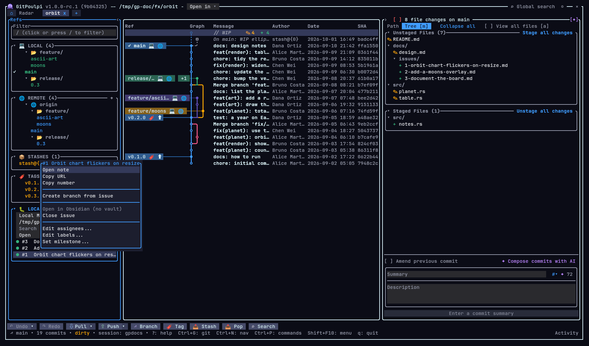

[English](../local-issues.md) · [Čeština](../cs/local-issues.md) · [Deutsch](../de/local-issues.md) · [Español](../es/local-issues.md) · [Français](../fr/local-issues.md) · [Italiano](../it/local-issues.md) · [日本語](../ja/local-issues.md) · [한국어](../ko/local-issues.md) · [Nederlands](../nl/local-issues.md) · [Polski](../pl/local-issues.md) · [Português (Brasil)](../pt-BR/local-issues.md) · **Português (Portugal)** · [Русский](../ru/local-issues.md) · [Svenska](../sv/local-issues.md) · [Türkçe](../tr/local-issues.md) · [Українська](../uk/local-issues.md) · [简体中文](../zh-CN/local-issues.md)

# Issues locais e Obsidian

Guarde as suas issues como uma pasta de notas Markdown: sem conta, sem token, sem rede. A pasta pode estar dentro do
repositório (`docs/issues/`, com commit junto ao código) ou em qualquer sítio do disco, por exemplo uma subpasta de um
cofre do [Obsidian](https://obsidian.md). O GitPoulpi lê e escreve as notas. O Obsidian, qualquer editor ou uma shell podem
editá-las ao mesmo tempo, e as listas acompanham.



## Configurar

1. **Definições > Integrações > Gestores de issues > Markdown local > Adicionar perfil.** Escreva a pasta, ou prima
   **Procurar...** e escolha-a. Uma pasta relativa (`docs/issues`) é lida em relação a cada repositório a que estiver ligada; uma
   absoluta (`/home/me/Vault/Projects/Issues`) é a mesma em todo o lado. Não há nenhum token a introduzir.
   - CLI: `gitpoulpi hosting integrations add --kind local_markdown --path docs/issues`.
2. Num repositório, abra a secção **ISSUES** da barra lateral e escolha o fornecedor **Markdown local - <nome>** (a pasta
   é escolhida com ele; a lista de repositórios mostra a pasta e as suas subpastas diretas, se quiser outra).
   - CLI: `gitpoulpi hosting link issues --id <perfil>` (a pasta do perfil é o `--project` predefinido).

Nada fica ligado por si só: como qualquer origem de issues, é opcional por repositório.

## Comentários numa nota

`Enter` na linha de uma nota na secção ISSUES, ou no seu cartão, abre a sua conversa: o texto da nota e depois os
comentários. Os comentários ficam no próprio ficheiro da nota, numa secção final `## Comments`, uma entrada
`### <autor> - <hora UTC>` cada (uma editada acrescenta `(edited <hora>)`). Nada acima desse título é alguma vez tocado,
por isso o Obsidian e uma shell leem e editam o mesmo ficheiro. Pode escrever, editar e eliminar os comentários do autor
local (o `local.me` do perfil, senão o utilizador ligado, o nome que *Atribuídos a mim* usa); os de mais ninguém. A caixa
é a habitual caixa de texto Markdown com prévia, e *A escrever como <nome> (nota local)* nomeia o autor. Nada passa pela
rede. Uma nota com um título `## Comments` que escreveu à mão é lida como tal.

## As notas

Uma nota por issue, com o nome `<id>-<slug>.md` (`12-crash-on-empty-name.md`), com um bloco de frontmatter:

```yaml
---
id: 12
title: Crash on empty name
status: todo
assignees: [kai]
labels: [bug]
milestone: v0.1
created: 2026-10-14
updated: 2026-10-14T09:30:00
---
Free Markdown. GitPoulpi never rewrites the body.
```

- As novas issues recebem `max(id) + 1`.
- O GitPoulpi só escreve as propriedades que lhe pertencem (`title`, `status`, `assignees`, `labels`, `milestone`, `updated`).
  **Todas as outras propriedades, o corpo, as terminações de linha e a ordem das chaves são mantidos byte a byte.** As escritas são
  atómicas (um ficheiro temporário e depois uma mudança de nome).
- A leitura é tolerante: uma nota sem `id` toma-o do nome do ficheiro, uma nota sem `status` é `todo`, uma nota
  sem frontmatter toma o título do primeiro `# título`. Um ficheiro que não é uma issue (`readme.md`) é ignorado.
- Um estado é texto livre. **Aberta** significa «não está no estado de concluída».

### Comentários numa nota

Um comentário numa nota é escrito na própria nota, numa última secção `## Comments` (sem rede, e lê-se bem no
Obsidian):

```markdown
(o texto da nota)

## Comments

### kai - 2026-11-15T10:00:00Z
Primeiro comentário, **qualquer Markdown**.

### ann - 2026-11-15T11:30:00Z (edited 2026-11-15T12:00:00Z)
Segundo.
```

- Uma entrada começa numa linha que é exatamente `### <autor> - <hora UTC>`, com ` (edited <hora UTC>)` depois de uma
  edição; o seu texto vai até à entrada seguinte. A secção é o último título `## Comments` fora de um bloco de código
  delimitado e vai até ao fim do ficheiro, por isso não escreva nada depois dela.
- Uma linha de comentário que se leria como uma entrada ou como o título é guardada com uma barra invertida à frente
  (`\### ...`, que o Markdown mostra como o mesmo texto) e lida de volta sem ela.
- Publicar acrescenta no fim e deixa tudo o que está acima byte a byte (fins de linha incluídos); uma edição ou uma
  eliminação reescreve só a secção. Uma publicação também move o `updated` da nota (uma nota sem frontmatter não recebe
  nenhum).
- O autor é o autor local do perfil (o "eu" das definições de issues locais). Só pode editar ou eliminar os seus próprios
  comentários; o id de um comentário é a sua hora e autor, e duas publicações no mesmo segundo distinguem-se avançando a
  segunda um segundo.
- Não há respostas, nem comentários internos, nem histórico de eventos para uma nota.

## O que pode fazer

| Na secção ISSUES | Teclado / paleta |
|---|---|
| Nova issue (o `+`, ou `n`): título, descrição, estado, responsáveis, etiquetas, marco | `Alojamento: nova issue...` |
| Editar responsáveis / etiquetas / marco no menu da linha. Escolha entre o que a pasta já usa, ou **escreva uma etiqueta ou um login novo** e aceite a linha `Adicionar "..."` | `Alojamento: editar etiquetas...` e companhia |
| **Fechar issue** / **Reabrir issue** (define o estado de concluída, ou o primeiro outro) | `Issues locais: fechar issue...` / `reabrir issue...` |
| **Abrir nota** (o seu programa predefinido para `.md`) | `Integrações: abrir issue...` |
| **Abrir no Obsidian** (só quando a pasta está dentro de um cofre, isto é, há uma pasta `.obsidian/` acima dela) | `Issues locais: abrir no Obsidian...` |
| Filtros: Abertas / Fechadas / Todas, «Atribuídas a mim» | a lista de filtros |

«Atribuídas a mim» corresponde à definição `me` do perfil, senão ao nome ligado, senão ao nome do perfil.

As branches e os commits funcionam como no GitHub: «Criar branch a partir da issue» dá `12-crash-on-empty-name`, e `#12` numa
mensagem de commit ou `12-...` no nome de uma branch é reconhecido.

As alterações feitas fora do GitPoulpi (Obsidian, uma shell, um `git pull`) aparecem em cerca de um segundo: os nomes dos ficheiros
da pasta e as datas de modificação são verificados numa thread em segundo plano, nunca na thread de desenho.

## Ficheiro de configuração

Em `config.toml`, junto ao perfil (todas as chaves são opcionais):

```toml
[[integrations]]
id = "vault"
kind = "local_markdown"
url = "/home/me/Vault/Projects/Issues"
token_ref = "integration:vault"

[integrations.local]
statuses = ["todo", "doing", "review", "done"]   # a ordem das colunas do quadro
done_status = "done"                            # fecha uma issue
reference_prefix = "LOC"                         # mostrado como LOC-12 em vez de #12
me = "kai"                                       # o que significa «atribuídas a mim»
```

Os estados usados pelas notas mas não listados em `statuses` vêm a seguir aos listados. `statuses` é a ordem das colunas do
[quadro](#o-quadro-kanban) (`gitpoulpi hosting issue options` imprime-a).

## O quadro Kanban


Se trabalha sozinho, ou numa equipa que guarda as issues junto ao código, a pasta é também um quadro Kanban.
**Cabeçalho ISSUES > Quadro**, ou **Issues: abrir quadro** da paleta, abre-o por cima da janela; `Esc` fecha-o.

- As **colunas** são os estados: primeiro os listados em `statuses`, por essa ordem, e depois qualquer outro estado que uma nota use.
  Uma coluna vazia continua a ser mostrada. Cada cabeçalho traz a sua contagem de cartões.
- Os **cartões** mostram o número da issue, o título (duas linhas), os responsáveis como iniciais, as etiquetas e o marco.
  Quando as colunas não cabem todas, o quadro desloca-se para o lado (a barra por baixo, a roda com `Shift`, ou as setas).
- **Mova um cartão** arrastando-o para outra coluna (a coluna acende-se sob o ponteiro), com
  `Shift+Left` / `Shift+Right`, ou com **Quadro: mover cartão para...** (`m`), uma lista de colunas. O cartão move-se de
  imediato; o `status` da nota é reescrito como em [a secção das notas](#as-notas), nada mais no ficheiro. Se a escrita
  falhar o cartão volta atrás e o erro aparece na barra de estado.
- **Abra** um cartão com `Enter` ou um clique duplo: a [conversa](conversations.md) da nota abre-se na janela, com o texto da nota e os seus comentários (**Abrir nota** no menu do cartão abre o ficheiro no seu programa predefinido para `.md`). `e` edita os seus
  responsáveis, etiquetas ou marco, `.` ou um clique com o botão direito abre o menu do cartão, `n` inicia uma nova issue na coluna
  selecionada (o formulário volta ao quadro quando fecha).
- **Filtre** por responsável (`a`), etiqueta (`l`), marco (`M`) ou texto (`/`); `x` limpa-os. Os filtros são
  listas: escreva para restringir, `Enter` escolhe.
- **Em direto**: uma nota alterada a partir do Obsidian ou de uma shell move o seu cartão em menos de um segundo.

Cada gesto do rato tem uma tecla e um comando da paleta (**Quadro: ...**, listados na página de
[atalhos de teclado](keybindings.md)).

## Bases do Obsidian

**Paleta: `Issues locais: criar Base do Obsidian`** (CLI: `gitpoulpi hosting issue base`) escreve `issues.base` junto às
notas, uma só vez: uma vista de *tabela* e uma vista *kanban* agrupada por `status`, pela ordem de `statuses`. Abra-o no Obsidian para
ver aí as mesmas issues como um quadro. O GitPoulpi nunca edita um ficheiro `.base` existente (seu ou de uma execução anterior): recusa
e di-lo. O formato segue a sintaxe das Bases do Obsidian
(<https://obsidian.md/help/bases/syntax>); a vista kanban precisa de um Obsidian recente.

## CLI e MCP

Funcionam sobre ela os mesmos comandos que sobre qualquer origem de issues: `hosting issues`, `hosting issue create [--list <estado>]`,
`hosting issue edit <n> --add-label ...`, `hosting open issue <n>`, `hosting refs`. Mais quatro são para notas:
`hosting issue close <n>`, `hosting issue reopen <n>`, `hosting issue move <n> --status <s>` e `hosting issue base`.
Ver a [referência da CLI](cli-reference.md).

## Limites

- Não se pode escrever um **marco** novo no seletor (escolha um que a pasta já use), mas `milestone:` numa nota pode
  ser qualquer coisa e aparece assim que é guardado.
- Só as notas diretamente na pasta são issues (não as subpastas).
- Não há eliminar: remova a nota no seu gestor de ficheiros ou no Obsidian (o lixo dele é seu).
