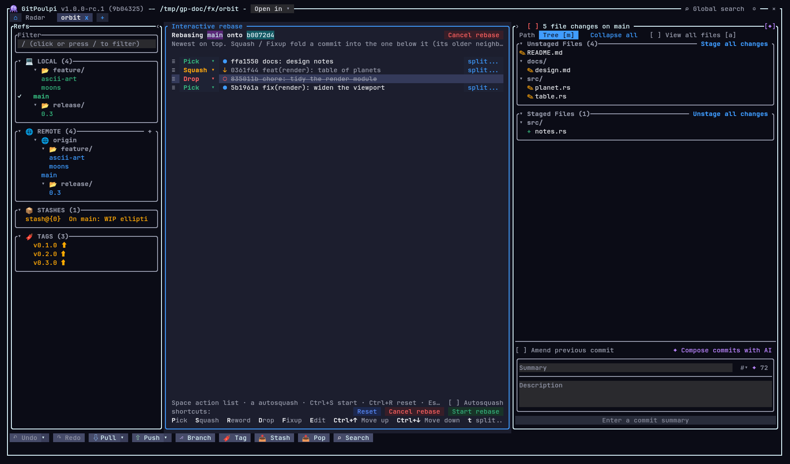

[English](../log-and-history.md) · [Čeština](../cs/log-and-history.md) · [Deutsch](../de/log-and-history.md) · [Español](../es/log-and-history.md) · [Français](../fr/log-and-history.md) · [Italiano](../it/log-and-history.md) · [日本語](../ja/log-and-history.md) · [한국어](../ko/log-and-history.md) · [Nederlands](../nl/log-and-history.md) · [Polski](../pl/log-and-history.md) · [Português (Brasil)](../pt-BR/log-and-history.md) · **Português (Portugal)** · [Русский](../ru/log-and-history.md) · [Svenska](../sv/log-and-history.md) · [Türkçe](../tr/log-and-history.md) · [Українська](../uk/log-and-history.md) · [简体中文](../zh-CN/log-and-history.md)

# Trabalhar com o Log

O Log é o centro do GitPoulpi: todo o histórico como um grafo, com cada
branch, tag e stash nele. Esta página explica como lê-lo, como procurar coisas
nele e tudo o que pode fazer com commits e refs. As zonas têm nome no
[visita guiada à interface](interface-tour.md); as teclas exatas estão em
[Atalhos de teclado](keybindings.md) e os gestos do rato em
[Rato e gestos](mouse-and-gestures.md).

Pelo teclado, `Shift+C` (ou o comando da paleta `Ver: coluna do Log: Escolher uma coluna para mover ou redimensionar`) escolhe uma coluna e a célula do seu cabeçalho acende-se. Depois `Tab` / `Shift+Tab` escolhem outra coluna, `<` / `>` movem-na um lugar para a esquerda ou para a direita entre as colunas mostradas (o equivalente de arrastar o cabeçalho), `]` / `[` alargam-na ou estreitam-na (o equivalente de arrastar a sua margem; a última coluna move a sua margem esquerda), `0` repõe todas as larguras no automático, e `Esc` ou `Enter` saem. Entretanto, as setas continuam a percorrer os commits. A ordem e as larguras são memorizadas como as de um arrasto e são próprias do Log: a coluna de commits ao lado de um diff mantém uma lista própria.

*Ajustar ao conteúdo.* Um **duplo clique** na margem de uma coluna ajusta a coluna à sua esquerda ao seu conteúdo visível mais largo e ao seu cabeçalho (caracteres largos e emojis contados pelas células que ocupam). Na disposição ajustada o Log preenche sempre o painel, por isso uma coluna pára no que o painel comporta depois de **Mensagem** manter a sua parte e cada outra coluna a sua largura mínima: a linha de estado diz então `Autor precisa de 34 células, cabem 20.` O mesmo pelo teclado: com uma coluna escolhida (`Shift+C`, `Tab`), `=` ajusta-a e `+` ajusta todas as colunas; a paleta tem `Ver: coluna do Log: Ajustar a coluna ao conteúdo` e `... Ajustar todas as colunas ao conteúdo`; o seletor do botão direito lista `Ajustar <coluna> ao conteúdo` (a coluna sob o ponteiro), `Ajustar todas as colunas ao conteúdo` e `Repor as larguras das colunas` abaixo das suas caixas. **Mensagem** é a coluna flexível e não tem largura própria para ajustar: ocupa o espaço que as outras deixam.

*Deslocamento lateral.* Por predefinição todas as colunas cabem no painel. Na disposição **scroll** (a caixa `Deslocamento lateral (as colunas mantêm a largura)` do seletor, Definições > Log e grafo > Disposição das colunas, `Ver: Log: alternar o deslocamento lateral das colunas` na paleta, ou `s` com uma coluna escolhida) as colunas mantêm a largura, **Mensagem** incluída (tem aí uma largura própria, e ajustá-la usa o seu resumo mais largo), nada é cedido quando a janela é estreita, e a tabela pode ser mais larga do que o painel. Uma barra na margem inferior desloca-a: arraste o cursor, prima a pista livre para trazer o cursor para debaixo do ponteiro, ou use as setas das pontas. Pelo teclado, `Shift+Esquerda` / `Shift+Direita` deslocam quatro células (a paleta tem `Ver: Log: deslocar as colunas para a esquerda` / `direita`); a roda horizontal ou `Shift`+roda sobre a tabela fazem o mesmo, e escolher uma coluna (`Shift+C`, `Tab`) traz-a para a vista. Uma tabela mais estreita do que o painel deixa espaço em branco à direita, e a faixa de uma linha selecionada vai até à margem. Cada disposição guarda as suas larguras (`ui.log_column_widths` e `ui.log_column_widths_scroll`); o primeiro arrasto, tecla ou ajuste na disposição scroll guarda cada coluna na largura que tem, por isso só a que alterar se move. Na disposição ajustada, um ajuste que não cabe no painel di-lo e aponta para esta disposição.

*A pega da última coluna.* A última coluna também tem uma pega, na sua última célula (não na margem do painel, que continua a redimensionar os painéis): um arrasto move-a conforme a distância percorrida pelo ponteiro, com **Mensagem** a absorver a diferença. **SHA** tem 8 células de largura por predefinição (os 7 dígitos e essa célula da pega).


## Ler o grafo

Cada linha é um commit, do mais recente para o mais antigo. Um ponto fica na
faixa do commit; as linhas ligam um commit aos seus pais; um merge mostra duas
linhas a juntarem-se. As pílulas à esquerda dão o nome às branches e tags desse
commit, na cor da faixa, com uma linha fina até ao ponto. Um ícone de portátil
marca uma branch local, um globo uma remota e `✓` a branch em checkout. `+N`
significa que há mais refs a apontar para esse commit; passe o ponteiro por
cima para as listar, ou use o menu abaixo.

A primeira linha são as **alterações em curso** (um círculo tracejado: o seu
trabalho por commitar, ligado ao commit em que assenta). Os stashes aparecem
como pequenos quadrados numa faixa ao lado do commit em que foram feitos.

### Cores, tom da linha e avatares

As cores das faixas vêm do tema. *Definições > Aspeto > Tema de cores do grafo*
combina qualquer tema com qualquer paleta de faixas, e o seletor *Aplicação:
mudar tema de cores do grafo...* da paleta (`Ctrl+N Shift+T`) pré-visualiza cada
paleta em direto; veja [Temas](themes.md). *Fundo das faixas do grafo* em
**Tom da linha** pinta uma banda ténue da cor da faixa por trás da coluna do
grafo e uma barra fina na sua margem. *Intensidade do tom da linha* (**Forte**,
**Média** (predefinição), **Subtil**) define quão esbatida fica a banda.

| Paleta de faixas Serie com tom da linha | Paleta de faixas Material com tom da linha |
|---|---|
|  |  |

Os *Avatares dos autores* (uma imagem no ponto do grafo ou na coluna Autor)
vêm desativados por predefinição. Ao ativá-los, é enviado ao Gravatar um hash do
e-mail de cada autor, e é consultado o seu fornecedor de alojamento. *Fontes de
avatar* e *Avatar alternativo*, na mesma página, escolhem de onde vêm as imagens
e o que se desenha quando não há nenhuma.

Se o seu terminal não consegue mostrar imagens, o grafo é desenhado com
carateres. *Renderizador do grafo* e *Protocolo de imagem* forçam uma ou outra
opção; veja [Resolução de problemas](troubleshooting.md).

O realce da linha selecionada ou sob o ponteiro começa no círculo do commit. As
faixas à sua esquerda mantêm o fundo normal.

### Colunas

Clique com o botão direito no cabeçalho para escolher as colunas: **Ref**,
**Grafo**, **Mensagem** (sempre ativa), **Autor**, **Data**, **Alterações** e
**SHA**. A coluna opcional **Alterações** mostra, para cada commit,
`n files +added -removed`. Arraste a margem entre dois cabeçalhos para
redimensionar uma coluna; a escolha é memorizada, em células do terminal. Com a predefinição `ui.column_resize = "line"`, a margem é o espaço de uma célula no fim de uma coluna: uma pequena marca fica nele na linha do cabeçalho e, enquanto o ponteiro está no espaço (no cabeçalho ou em qualquer ponto da tabela), é desenhada uma linha fina de destaque em toda a altura da tabela e um arrastamento a partir de qualquer ponto dela redimensiona (o ponteiro passa a ser um ponteiro de redimensionamento nos terminais que o suportam). Com `"header"` não há marca nem linha: o primeiro carácter da célula de cabeçalho a seguir à margem acende-se ao passar o ponteiro e o arrastamento começa nele, só na linha do cabeçalho (Definições > Log e grafo > Redimensionamento das colunas). As linhas têm o mesmo aspeto nos dois modos: o espaço faz parte da coluna à sua esquerda, pelo que a seleção e os tons das linhas o atravessam. Ref,
Grafo e as outras colunas mantêm a largura quando a janela é redimensionada ou
maximizada: só a **Mensagem** cresce ou encolhe (numa janela muito estreita as
outras colunas cedem temporariamente, o Grafo primeiro, e voltam às suas larguras
quando a janela volta a crescer). Arraste a coluna Grafo até à sua largura mínima, um ponto de commit, e o grafo fica compacto: todos os commits numa só faixa, um debaixo do outro, sem linhas de branch nem de merge. Uma célula mais larga e a árvore volta. Com as imagens dos autores nos círculos dos commits (Definições > Aspeto > Avatares dos autores: grafo), o círculo ocupa duas células, pelo que a coluna pára uma célula antes (três células) e nunca corta uma imagem.

Arrastar um cabeçalho mostra uma sombra do seu nome a seguir o ponteiro e uma barra de destaque onde a coluna ficaria; a ordem muda ao largar e `Esc` cancela. O seletor aberto pelo clique com o botão direito é uma lista de verificação (`[x]` / `[ ]`) com um ✕ no título; também se chega a ele pela paleta (`Ver: Log: escolher as colunas a mostrar`), move-se com as setas e alterna-se com `Espaço` / `Enter`.


### Autores e `.mailmap`

Quando o repositório tem um `.mailmap` (o ficheiro do git que dá um só nome e
e-mail a uma pessoa que fez commits sob vários), a coluna **Autor** do Log, os
detalhes do commit, o Blame e o Histórico do ficheiro mostram a identidade
**canónica**, como o `git log` faz. Os próprios commits não são tocados. A
definição `log.use_mailmap` (Definições > Log e grafo, ativa por predefinição)
desliga-o para mostrar os nomes guardados. Pesquisar por autor corresponde ao
nome e e-mail tal como são mostrados, por isso uma pesquisa pelo nome canónico
encontra todos os commits da pessoa. O separador **Identidades** do painel de
reescrita do histórico lista os nomes e e-mails do histórico e escreve por si
as linhas do `.mailmap`, veja `history-rewrite.md`; a partir de um terminal:
`gitpoulpi mailmap list|check|add`.

## Encontrar coisas

- **Pesquisa** (`f`, o botão **Pesquisar** da barra de ferramentas, ou
  *Navegação: pesquisar commits...* da paleta): corresponde a toda a mensagem do
  commit, ao nome e e-mail do autor, ao hash e aos nomes das refs. Esbate o que
  não corresponde e mantém a forma do grafo. `Enter` / `Shift+Enter` saltam para
  a correspondência seguinte / anterior.
- **Filtro de refs** (`/` na barra lateral): restringe por nome as listas de
  branches, tags e remotos.
- **Solo** (a tecla `o`, ou o menu da ref, numa ref, pasta ou remoto): mostra
  apenas os commits das refs em solo; ponha várias em solo para ver a sua
  união. `Shift+O` pára o solo.
- **Ocultar** uma ref (o seu menu) para a retirar do grafo: a sua pílula sai e
  também os commits que só ela alcança (o commit em checkout fica sempre, com
  a linha da árvore de trabalho). *Ocultas n* no título de Refs conta-as,
  **Mostrar tudo** (`Shift+H`) devolve-as. O total da linha de estado conta o
  histórico visível.

## Branches, tags e a barra lateral Refs

Faça clique duplo numa branch local ou numa tag para fazer checkout. Clique com
o botão direito numa ref (na barra lateral, ou na sua pílula no Log) para ver o
seu menu. As entradas mais úteis:

| Entrada | Faz |
|---|---|
| Mostrar no grafo | Desloca o Log até ao commit da ref (carregando antes o histórico mais antigo, se necessário) e faz a linha piscar; a seleção mantém-se. Um único clique numa ref faz o mesmo, a menos que *Clicar numa ref mostra-a no grafo* esteja desativado em Definições. Uma ref oculta do grafo (ou por Solo) avisa disso na barra de estado em vez disso |
| Checkout | Muda para a branch ou desanexa na tag |
| Merge, Rebase sobre | Faz merge desta ref na branch em checkout, ou rebase da branch em checkout sobre ela |
| Fast-forward `<branch>` até `<current>` / `<current>` até `<branch>` | Avança uma branch quando isso é um fast-forward; caso contrário fica a cinzento com o motivo (`divergiram, não é um fast-forward`) |
| Criar worktree a partir de... | Abre um worktree ligado no seu próprio separador |
| Pull, Push, Fetch, Remotos de <branch>... | Operações de rede nessa branch (Remotos de <branch>... define o upstream, mais uma caixa Push e uma Pull também por remoto) |
| Ocultar / Mostrar no grafo, Solo | Apenas visualização; ocultam ou põem em solo uma ref (ocultar também retira os commits que só essa ref alcança) sem tocar no repositório |
| Renomear, Eliminar | Eliminar pergunta primeiro; a gémea remota também pode ser eliminada |
| Copiar nome da branch, Copiar ligação da branch no remoto | Para a área de transferência |

**Onde vive uma tag.** Uma tag pode estar neste computador, num remoto, ou em ambos, e
as linhas TAGS da barra lateral (e a pílula da tag no Log) dizem qual com um marcador
a seguir ao nome. Passe o ponteiro por uma tag para o ler por extenso.

| Marcador | Significado |
|---|---|
| seta para cima | Só aqui: nenhum remoto a tem. O seu menu oferece *Push* |
| seta esquerda-direita | Aqui e num remoto, no mesmo commit |
| seta para baixo (linha esbatida) | Só num remoto: não está neste repositório (nunca obtida, ou eliminada aqui). O seu menu oferece *Fetch `<tag>` de `<remote>`* e *Eliminar `<tag>` em `<remote>`...*; `Git: Fetch da Tag selecionada` na paleta |
| seta cima-baixo | Também num remoto, mas noutro commit (um push seria recusado) |

O git não guarda refs de acompanhamento remoto para tags, por isso o GitPoulpi fica a saber o que cada remoto
tem pelo seu último **fetch** (qualquer fetch, incluindo o automático) e pelos
seus próprios envios e eliminações de tags. Nada consulta a rede enquanto navega; se
outra pessoa alterou as tags de um remoto, faça fetch para o ver. A mesma informação está
em `gitpoulpi tag list` (campos `local`, `remote`, `differs_on`, `where`).

**Eliminar uma tag.** Quando um remoto tem a tag, o botão vermelho **Eliminar** abre um diálogo
com três linhas numeradas (`1`-`9`, ou Cima/Baixo e `Enter`; `Esc` cancela), e
a linha realçada explica-se por baixo:

1. **Eliminar localmente**: remove-a só deste repositório. Executa-se logo e
   a mensagem avisa que o remoto ainda a tem. **O próximo fetch traz-a de volta**
   (o git segue as tags do remoto), a menos que a elimine também no remoto.
2. **Eliminar em `<remote>`**: remove-a aí para todos (`git push <remote>
   --delete`). Pede uma confirmação que nomeia o remoto. A sua tag local
   fica. Não se pode desfazer.
3. **Eliminar localmente e em `<remote>`**: as duas, depois da mesma confirmação, para que um
   fetch não a possa trazer de volta. **Desfazer repõe só a tag local** (o mesmo objeto
   de tag); fica então outra vez só local e *Push* volta a pô-la no remoto.


Com vários remotos, cada um tem as suas linhas. Uma tag só aqui mantém a confirmação
simples; uma tag só num remoto vai direta para a confirmação desse remoto.
CLI: `gitpoulpi tag delete <name> [--local | --remote <r> | --both [--remote <r>]]`.

**Fetch e tags.** Um fetch também atualiza o que cada remoto tem (os marcadores) e
o seguimento de tags do próprio git continua a aplicar-se: uma tag eliminada só aqui é obtida de novo.
Uma tag que alguém **eliminou no remoto** desaparece do lado do remoto no
marcador depois de qualquer fetch, mas continua aqui como a sua tag local (agora *só aqui*),
porque por omissão o git não faz prune de tags. **Definições > Sincronização > Poda
automática de tags** (desativada por predefinição; `gitpoulpi fetch --prune-tags`) também elimina uma tag
local dessas, mas só uma que tenha estado no remoto: uma tag que nunca enviou, ou uma que
moveu, nunca é tocada. Precisa do git 2.41 ou mais recente para saber o que foi podado.

**Nova branch ou tag.** Os botões **Branch** e **Tag** da barra de ferramentas,
`Ctrl+G b` e `Ctrl+G t`, ou *Criar branch aqui...* de um commit pedem o nome
numa caixa em linha na coluna Ref, na linha do commit de destino. `Enter` cria,
`Esc` cancela, e um nome que o git recusaria é assinalado a vermelho sem fechar
a caixa.

Num commit sem ref, passar o ponteiro na linha mostra também, na coluna Ref, uma pílula esbatida com o nome da branch a que pertence (senão a branch remota), deduzido do histórico; uma branch eliminada depois de um merge aparece riscada, com o nome lido do assunto do commit de merge; as tags nunca são fantasma; passar o ponteiro na pílula mostra o tipo. Não cria nada: use o comando de criar branch acima. **Mostrar uma branch fantasma no commit sob o rato** em Definições > Log e grafo desativa-a; nada é desenhado onde a coluna Ref é estreita demais.

**Remotos.** O `+` no título REMOTO adiciona um; clique com o botão direito no
nome de um remoto para fazer fetch, copiar a sua ligação web, torná-lo o remoto
predefinido, ocultá-lo do grafo, editar os seus URLs ou removê-lo. **Ocultar um
remoto** (o ⊙ da sua linha, *Ocultar remoto do grafo* no menu, ou `Remoto: ocultar
remoto no grafo...` na paleta) oculta todas as branches que ele tem agora ou venha a ter, e os
commits que só ele alcança saem do Log: a forma de percorrer um histórico sem o histórico de
um remoto de arquivo sem relação; volte a mostrá-lo com *Mostrar remoto no grafo*. Mostrar um
remoto também mostra as branches dele que tinham sido ocultadas uma a uma. Uma branch de um
remoto oculto di-lo na linha de estado se o seu ⊙ for usado: mostre primeiro o remoto.

**Stashes.** **Stash** faz stash de tudo (ficheiros não acompanhados incluídos);
`Ctrl+G m` pede primeiro uma mensagem (com a IA ativa, `Ctrl+G` dentro dessa
caixa sugere uma). Clique com o botão direito numa linha de stash, no Log ou na
secção STASHES, para **Pop**, **Apply** (mantém o stash) ou **Drop**.

**Worktrees.** *Criar worktree a partir de...* (numa branch, tag ou commit)
abre um diálogo que propõe uma pasta ao lado do repositório, um nome opcional
de nova branch e "Abrir o novo worktree como separador". Os worktrees aparecem
na secção WORKTREES; faça clique duplo num para o abrir, e o seu separador fecha
sozinho quando o worktree é removido. A funcionalidade completa (abrir noutra ferramenta,
fazer o merge da branch de um worktree, remover) está em [Worktrees](worktrees.md); a secção
SUBMÓDULOS do mesmo painel está em [Submódulos](submodules.md).

## Arrastar refs para cima de commits

Pode premir uma branch (na barra lateral ou na sua
pílula no Log) e arrastá-la. Uma etiqueta fantasma segue o ponteiro e os
destinos válidos acendem-se; largue para obter um menu:

- uma branch local **sobre outra branch local**: Merge, Rebase, Rebase
  interativo, Fast-forward;
- uma branch local **sobre uma branch remota**: Push para esse remoto;
- uma branch remota **sobre uma branch local**: Merge, Rebase, Fast-forward,
  Pull.

`Esc` cancela um arrastamento. O equivalente de teclado é o comando da paleta
*Refs: largar a ref selecionada na branch em checkout...*.

**Merge ou fast-forward.** Quando o destino não tem nenhum commit próprio (a branch arrastada está apenas à frente dele), um
merge podia simplesmente mover o destino para a frente. Por predefinição (Definições > Git > **Fast-forward do merge** = *never*,
ou a escolha própria de um repositório na sua página Opções de merge) a linha do menu diz *Merge de x em y (commit de merge)* e faz um
verdadeiro commit de merge, para que o histórico guarde a branch; use a linha separada *Fast-forward de y até x* quando quiser a simples
movimentação (para uma linha reta, use antes *Rebase*). Com *allowed* a linha de Merge diz *(avança por fast-forward)* e com *only*
*(apenas fast-forward)*, a cinzento e com o motivo quando as branches divergiram. As mesmas linhas e etiquetas estão no menu
da própria branch, e `gitpoulpi merge --ff | --no-ff | --ff-only` escolhe para cada merge.

## O menu do commit

Clique com o botão direito num commit (ou prima `.` sobre ele) para ver o seu
menu:


| Entrada | Faz |
|---|---|
| **Cherry-pick em `<branch>`** | Reaplica o commit na branch em checkout |
| **Revert do commit...** | Cria um commit que o desfaz. Num commit de merge, um menu pergunta primeiro qual pai é a linha principal (o lado que fica; o pai 1 é a branch em que o merge foi feito) e depois vem a confirmação habitual. Desfazer repõe o estado anterior |
| **Reset de `<branch>` para este commit** | Um submenu para o tipo de reset; um reset hard pede confirmação |
| **Editar mensagem do commit...** | Veja abaixo |
| **Alterar...** | Muda a mensagem, o nome, o e-mail e a data do autor do commit num único diálogo; veja [Alterar um commit](#alterar-um-commit-mensagem-autor-datas) |
| **Dividir commit...** | Parte o commit em vários; veja [Dividir um commit](#dividir-um-commit) |
| **Dividir commit (IA)...** | O mesmo, com um agrupamento proposto pelo modelo; só quando a [IA](ai.md) está ativa |
| **Explicar alterações (IA)** | Um popup com uma explicação da IA; só quando a [IA](ai.md) está ativa |
| **Rebase interativo a partir daqui...** | Veja abaixo |
| **Criar branch aqui...**, **Criar tag aqui...**, **Criar tag anotada aqui...** | Caixa de nome em linha |
| **Checkout deste commit**, **Criar worktree aqui...** | HEAD desanexado, ou um worktree |
| **Criar patch a partir deste commit...**, **a partir daqui até `<branch>`...** | Escreve ficheiros `.patch`; *Aplicar patch* está no menu de uma ref |
| **Copiar ligação do commit no remoto**, **Copiar** > | Para a área de transferência (hash, mensagem e mais) |

## Editar a mensagem de um commit (reword)

*Editar mensagem do commit...* (ou `Ctrl+G e`) abre a mensagem completa: um
resumo de uma linha com contador, uma descrição por baixo, **Cancelar** e
**Atualizar mensagem**. Qualquer commit da branch em checkout pode ser
reformulado (HEAD ou um antecessor); os commits por cima dele são recriados com
as suas próprias árvores, autores e datas, os merges continuam a ser merges, e
as suas alterações staged e não staged ficam intactas. Se o commit já foi
enviado por push, o popup avisa a âmbar que vai precisar de um force push (com
lease), e pede uma segunda confirmação. `Ctrl+Z` (o Desfazer da barra de
ferramentas) desfaz o reword; veja [Desfazer e refazer](undo-redo.md). A linha de
estado também indica o topo anterior.

Um commit que não está na branch em checkout (vive noutra branch) não pode ser reformulado nem alterado onde está, pelo
que *Editar mensagem do commit...* e *Alterar...* abrem antes **Editar um commit de outra branch**, uma lista de
escolhas (`Up` / `Down` ou `Ctrl+J` / `Ctrl+K` movem, `Enter` ou um clique escolhe, `Esc`, a cruz ou **Cancelar (C)**
fecha-a):

- **Fazer checkout de `<branch>` e editar (1)**: uma linha por branch local cujo histórico contém o commit (`1` a `8`,
  as primeiras oito, as restantes são contadas). É feito checkout da branch da forma habitual e depois a edição abre-se
  nela. A história de desfazer é a das duas ações: `Ctrl+Z` desfaz a edição, o checkout é um checkout.
- **Editar com reescrita avançada do histórico (R)**: abre o [painel de reescrita do histórico](history-rewrite.md)
  sobre esse commit, nas compilações que o têm.
- **Criar uma branch aqui... (B)**: só quando nenhuma branch local contém o commit (está só numa branch remota, por
  exemplo); abre a caixa de nome para uma branch nele.

## Alterar um commit (mensagem, autor, datas)

*Alterar...* no menu do commit (ou `Ctrl+G Shift+E`, ou *Commit: alterar...* na paleta) abre um único diálogo com as propriedades do commit: o resumo, a descrição e o nome, o e-mail e a data do autor, cada um preenchido com os valores do commit. Mude o que quiser e prima **Aplicar**; só os campos alterados são enviados. Uma data escreve-se `YYYY-MM-DD HH:MM:SS +HH:MM` e aparece em UTC enquanto não a editar. O committer é você, agora (como num reword). Qualquer commit da branch atual pode ser alterado, com as mesmas regras, o mesmo aviso de commit já enviado e a mesma segunda confirmação de *Editar mensagem do commit...*; os commits por cima são recriados com os seus próprios autores e datas, e as suas alterações preparadas e não preparadas ficam como estão. `Ctrl+Z` (Desfazer da barra de ferramentas) desfaz a operação. Nas compilações com reescrita do histórico, **Modificar o histórico mais a fundo...** (`Alt+H`), em baixo à esquerda do diálogo, fecha-o sem aplicar nada e abre o [painel de reescrita do histórico](history-rewrite.md) com o âmbito deste commit até ao mais recente; se editou um campo, pergunta antes (`Esc` confirma). `Ctrl+N` mostra um selo em cada campo e botão do diálogo; prima-o para pôr o cursor nesse campo ou acionar esse botão (consulte [Selos](keybindings.md#selos)).

Todas as formas de abrir o diálogo o abrem completo, com todos os campos visíveis e editáveis; só muda o cursor. No painel de detalhes do commit (à direita), clique com o botão direito no resumo, na descrição ou no bloco do autor e escolha *Alterar o resumo...*, *Alterar a descrição...* ou *Alterar o autor...*, ou faça clique duplo no resumo, na descrição, no autor ou na data de autoria: o diálogo abre com o cursor nesse campo. Os equivalentes de teclado funcionam a partir do Log e do painel de detalhes: `Ctrl+G Shift+E` (todos os campos), `Ctrl+G Shift+A` (o autor) e, na paleta, *Commit: alterar...*, *Commit: alterar autor...*, *Commit: alterar resumo...* e *Commit: alterar descrição...*. Os dois atalhos podem ser reatribuídos (`git_prefix.amend`, `git_prefix.edit_author`; veja [Atalhos de teclado](keybindings.md)). Num script ou agente: `gitpoulpi amend <commit>` com `--message` (ou `--summary` / `--description`), `--author-name`, `--author-email`, `--author-date` e as opções `--committer-*` correspondentes (a ferramenta MCP é `amend`).

## Dividir um commit

*Dividir commit...* no menu do commit (ou na paleta: *Git: dividir o commit
selecionado...*) parte um commit em dois ou mais, do mais antigo para o mais
recente. Qualquer commit que não seja de merge da branch em checkout pode ser
dividido (HEAD ou um antecessor, também um commit raiz). O editor de divisão tem
dois painéis: os **Novos commits** à esquerda (uma mensagem para cada) e as
**Alterações** do commit à direita, uma linha por ficheiro e hunk, cada uma com
um campo `[N v]` que indica o novo commit que fica com ela.

| Tecla | Rato | Faz |
|---|---|---|
| `Up` / `Down` (`k` / `j`) | clicar numa linha | percorrer as alterações (`Shift+Up` / `Shift+Down` estende a seleção) |
| `1`-`9` | o campo `[N v]` da linha, depois uma escolha | dar a alteração selecionada a esse novo commit; `0` deixa-a por atribuir |
| `Enter` / `m` | o campo `[N v]` | abrir a lista de commits para a alteração selecionada |
| `n` | `+ Novo commit` | pôr a alteração selecionada num novo commit |
| `v` | | **modo de linhas**: dividir um hunk linha a linha (arraste sobre as linhas para selecionar um intervalo) |
| `Tab` | clicar num painel | alternar entre os commits e as alterações |
| `e` / `Enter` (no painel dos commits) | o lápis | editar a mensagem desse commit |
| `d` / `Delete` | a cruz | remover um novo commit (as suas alterações ficam por atribuir) |
| `Alt+Up` / `Alt+Down` | as setas | mover um novo commit para cima ou para baixo |
| `s` | a caixa de seleção | assinar os novos commits |
| `Shift+R` | `Repor` | voltar ao plano inicial |
| `Ctrl+S` | `Dividir em N` | dividir |
| `Esc` | a cruz, `Cancelar` | sair; com edições pendentes, uma segunda pressão confirma |

Cada alteração tem de ir para exatamente um commit; o editor conta o que ainda está
*Por atribuir* e o botão fica recusado até ser zero. Um ficheiro binário, que só muda
de modo, que é novo ou eliminado no commit, que é um submódulo ou um ficheiro LFS só
pode ser dado por inteiro. O primeiro commit começa com a mensagem original; dê uma
mensagem a cada um dos novos. Um novo commit mantém o autor e a data originais; o
committer é o utilizador, agora.

**Nada no repositório muda, exceto a branch.** O último novo commit tem exatamente o
conteúdo do commit original, por isso os commits por cima dele são recriados com as
mesmas árvores, autores e mensagens (os merges continuam a ser merges), e as suas
alterações staged e não staged ficam intactas: uma árvore de trabalho suja não é
problema e não pode haver conflito. Os hooks não são executados. Uma divisão fica
bloqueada enquanto houver um auto-stash pendente.

**Assinatura.** A caixa *Assinar commits* parte do `commit.gpgSign` do repositório.
Desmarcada, as assinaturas dos commits reescritos (os novos e os que estão por cima
deles) são descartadas, e o editor di-lo por baixo da caixa. Marcada, são todos
assinados; se a assinatura falhar, nada é alterado.

**Desfazer.** Um só `Ctrl+Z` (o Desfazer da barra de ferramentas) repõe o commit
original, também com a árvore de trabalho suja; veja [Desfazer e refazer](undo-redo.md).
Um commit que já foi enviado precisa depois de um force push (com lease).

**A partir do rebase interativo.** Cada linha da revisão do rebase tem um pequeno
botão **dividir...** (`t` na linha): abre o mesmo editor para esse commit e, quando a
divisão termina (ou cancela), volta ao ecrã de revisão, já sobre o novo histórico. Se
tiver editado o plano, prima dividir uma segunda vez para confirmar que essas edições
se perdem.

Para scripts e agentes: `split-source` e `split-commit` na
[referência da CLI](cli-reference.md); um agente também pode abrir este editor já
preenchido para si, para rever (`ui propose split`, veja [MCP e agentes](mcp-and-agents.md)).

## Rebase interativo

Escolha **Rebase interativo a partir daqui...** num commit que seja antecessor
da branch em checkout, ou arraste uma branch para cima de outra e escolha
*Rebase interativo*. O Log é substituído por um ecrã de revisão: uma linha por
commit, o mais recente em cima, cada uma com uma pega de arrastar e uma lista de
ações.



| Ação | Tecla | Efeito |
|---|---|---|
| Pick | `p` | Manter o commit |
| Reword | `r` | Mantê-lo com uma nova mensagem |
| Squash | `s` | Fundi-lo no commit abaixo, combinando as mensagens |
| Fixup | `f` | Fundi-lo no commit abaixo, descartando a sua mensagem |
| Drop | `d` | Deixá-lo de fora |
| Edit | `e` | Parar aí para o poder alterar com amend |

Arraste uma linha (ou `Ctrl+Up` / `Ctrl+Down`) para reordenar. `a`
pré-visualiza o autosquash (os commits `squash!` e `fixup!` passam para junto
dos seus alvos). Nada acontece até premir **Iniciar rebase** (`Ctrl+S`);
**Repor** repõe o plano e **Cancelar rebase** (`Esc`) sai sem alterar nada.
Quando um passo pára num conflito ou num `edit`, um aviso por cima do Log
oferece **Continuar**, **Saltar** e **Abortar**. Um intervalo que contenha um
commit de merge não pode ser reorganizado com rebase interativo; a entrada do
menu diz porquê.

## Cherry-pick de vários commits

`Ctrl+clique` alterna um commit, `Shift+clique` (ou `Alt+clique`) seleciona um intervalo, `Space`
alterna o atual, `Esc` limpa. Clique com o botão direito num commit selecionado
para **Cherry-pick de N commits em `<branch>`...**: abre-se o mesmo ecrã de
revisão, com as mesmas ações e reordenação, e **Iniciar cherry-pick** reaplica-os
por ordem.

## Copiar commits como Mermaid gitGraph


Selecione commits no Log (`Ctrl+clique`, `Shift+clique`, `Space`; ou deixe apenas o cursor num)
e abra **Copiar como Mermaid gitGraph...**: `Shift+Y` no Log, o submenu **Copiar**
do menu do commit, ou na paleta `Log: copiar como Mermaid gitGraph...`. Um popup mostra o
script [Mermaid](https://mermaid.js.org/syntax/gitgraph.html) gerado, em direto e com deslocação; `Enter`
(ou o botão **Copiar**) coloca exatamente esse texto na área de transferência. Cole-o num README, na descrição de um pull
request ou em [mermaid.live](https://mermaid.live).

O popup tem três caixas combinadas, uma caixa de seleção e a pré-visualização (`Tab` move entre elas; cada
caixa combinada abre com `Enter`, `Space` ou `Down`):

- **Commits**: a seleção ou, quando um commit está selecionado e o HEAD descende dele, **Da
  seleção até HEAD**, a sequência de commits entre eles (respondida a partir da parte carregada do Log).
- **Detalhe**: `structure` (commits, branches e merges; os ids são SHAs curtos), `refs` (acrescenta os nomes
  reais das branches como branches do Mermaid, as tags como `tag:` e o commit HEAD como `type: HIGHLIGHT`),
  `subjects` (o id do commit passa a `<sha> <assunto>`, com escape e cortado em `ui.mermaid_subject_width`
  carateres) e `full` (acrescenta o autor e a data UTC ao id).
- **Direção**: da esquerda para a direita (`gitGraph LR:`) ou de cima para baixo (`gitGraph TB:`).
- **Incluir o delimitador ```mermaid** envolve o script num bloco de código Markdown.

O detalhe, a direção e o delimitador ficam memorizados (`ui.mermaid_detail`, `ui.mermaid_orientation`,
`ui.mermaid_fence`). O mesmo gerador corre a partir da linha de comandos:
`gitpoulpi log --format mermaid [--detail structure|refs|subjects|full] [--orientation lr|tb] [--fence]
[--range A..B | --limit N]` (ver a [referência da CLI](cli-reference.md)); o servidor MCP expõe-no como
o argumento `format` da ferramenta `log`.

O `gitGraph` do Mermaid é uma linguagem de repetição (commit, branch, checkout, merge), não uma descrição
de grafo, por isso o gerador faz algumas escolhas que vale a pena conhecer:

- Um commit continua a branch do seu primeiro pai selecionado; os outros filhos abrem uma nova
  branch com o nome de uma branch real nela (`b1`, `b2`... em `structure`). A primeira branch é `main`
  (ou o nome real, através de um cabeçalho `mainBranchName`) e segue a cadeia de primeiros pais do HEAD.
- Um merge junta a branch do outro pai. Quando essa branch avançou depois do pai, o
  gerador bifurca uma pequena branch ponteiro (`<branch>-<sha>`) no pai e faz merge dela, de modo que o
  merge continua a apontar para o commit certo.
- Um pai fora da seleção é ignorado: um commit que fica sem nenhum pai selecionado inicia uma linha
  própria, por isso as lacunas numa seleção aparecem como linhas desligadas.
- Um merge octopus (três ou mais pais) torna-se merges sequenciais; os intermédios levam o
  sufixo ` (octopus 1/2)`, o último leva o commit real.
- Os cherry-picks não são detetados; as aspas duplas nos assuntos passam a apóstrofos (o Mermaid não
  as consegue escapar).

## Comparar commits

Selecione duas ou mais linhas do Log: `Ctrl+clique` alterna uma
linha, `Shift+clique` (ou `Alt+clique`, `Shift+Up/Down`, `Alt+Up/Down`) seleciona um
intervalo, `Space` alterna a linha atual. Podem selecionar-se commits, a linha **WIP**
e as linhas de **stash**. O painel direito passa a ser um painel **Comparar**:

- o cabeçalho tem um botão **Trocar** e, por baixo, cada linha selecionada é listada
  pela ordem do Log (a mais recente primeiro) como um **cartão** de duas linhas: o avatar do autor (conforme as definições de avatar
  do Log: uma imagem nos terminais que mostram imagens, iniciais nos outros), o nome, há
  quanto tempo, o id curto e o resumo. A linha **WIP** é «Árvore de trabalho / Alterações
  não commitadas», um stash mostra o glifo de stash, `stash@{n}` e a mensagem. A
  extremidade mais antiga leva uma etiqueta **De** e a mais recente uma etiqueta **Até**
  (Trocar move-as); com três ou mais linhas, uma nota diz que as alterações são
  combinadas. A lista de cartões ocupa no máximo um terço do painel e depois desliza
  (roda do rato, barra de deslocação, ou arraste o divisor por baixo para
  redimensionar);
- clique num cartão para levar o cursor do Log até essa linha e fazê-la piscar no
  grafo; a seleção não muda, por isso `Space` retira depois essa linha dela;
- por baixo, a lista habitual de ficheiros alterados (vista por caminho ou árvore,
  filtro, ordenação) lista os ficheiros que diferem entre elas. Clique num ficheiro, ou
  prima `Enter`, para abrir o diff dele ao centro, nas mesmas disposições unificada ou
  dividida, com o Blame, o Histórico do ficheiro e a vista do ficheiro na extremidade
  mais recente.


O que é comparado depende da seleção:

| Seleção | Comparado |
|---|---|
| dois commits (ou um stash e um commit) | o mais antigo com o mais recente, pela ordem do Log, qualquer que seja a ordem dos cliques |
| a linha WIP e um commit ou stash | esse commit com a árvore de trabalho: alterações em stage e fora dele dos ficheiros acompanhados (os ficheiros não acompanhados não fazem parte de um diff) |
| três ou mais commits | as alterações combinadas deles: desde mesmo antes do mais antigo até ao mais recente (os merges seguem o primeiro pai) |

Um ficheiro renomeado ou movido aparece como um só ficheiro, com o nome antigo e a semelhança no topo do seu diff. **Trocar** (`x`)
inverte as extremidades de uma comparação de duas linhas; com a linha WIP, que é sempre
a extremidade mais recente, ou com um intervalo de três ou mais, não há nada a trocar.
Uma comparação com a linha WIP acompanha a árvore de trabalho à medida que guarda
ficheiros.

Teclado: `v` (ou **Log: comparar a seleção** na paleta de comandos) leva o foco para a
lista de ficheiros da comparação; `x` (ou **Log: trocar as extremidades da comparação**)
troca; `n` (ou **Log: ir para a próxima linha comparada**) é o equivalente de teclado de
clicar num cartão: o cursor do Log vai para a próxima linha selecionada, voltando ao
início no fim. `Esc` ou um clique simples numa linha volta ao commit único. A entrada
**Cherry-pick** só conta os commits da seleção; a linha WIP e os stashes são ignorados aí.

As mesmas listas estão disponíveis para scripts e agentes:
`gitpoulpi diff --from <rev> [--to <rev|worktree>] [--name-only]` (a CLI e a ferramenta
MCP `diff`; `--to` é a árvore de trabalho por predefinição).

## Conflitos e outros avisos

Quando um merge, rebase, cherry-pick ou revert pára num conflito, aparece um
aviso por cima do Log e os ficheiros em conflito levam um `!` vermelho no painel
Status. Resolva-os no editor de merge e depois use **Continuar** ou **Commit do
merge** do aviso, ou **Abortar** para recuar. Veja
[Resolver conflitos de merge](merge-conflicts.md).

Outros avisos por cima do Log:

| Aviso | Botões | Paleta |
|---|---|---|
| *Rebase de `<branch>` sobre `<commit>` · passo/total · parado em ...* | **Continuar**, **Saltar**, **Abortar** | *Rebase: continuar / saltar / abortar* |
| *A aplicar patches (git am) · patch n de m* (um `git am` que parou) | **Resolver conflitos...** (quando um patch tem conflito), **Continuar**, **Saltar**, **Abortar** (pergunta primeiro) | *git am: continuar / Saltar este patch / Abortar* |
| *Um index.lock deixado para trás (n s) bloqueia qualquer alteração neste repositório* (um comando git morreu e deixou `.git/index.lock`) | **Remover index.lock** (pergunta primeiro; só é oferecido quando o ficheiro tem pelo menos 10 segundos) | *Repositório: remover index.lock obsoleto* |
| *Auto-stash pendente: ...* | Veja [Auto-stash](#auto-stash) | *Aviso: ...* |

## Blame

O Blame mostra o ficheiro inteiro com números de linha e cores de sintaxe, e uma coluna de anotações à **direita** do código (`ui.blame_side = "left"` passa-a para a esquerda). Abra-o pela barra de um ficheiro (`Blame`), pelo menu do ficheiro, pela paleta ou a partir de uma linha do histórico (`b`). A partir da árvore de trabalho, as linhas ainda sem commit aparecem à parte (veja Faixas).

- **Hunks.** Uma sequência de linhas consecutivas cuja última alteração é de um mesmo commit é um hunk. A primeira linha mostra o avatar do autor (uma imagem onde o terminal desenha imagens, senão o emblema de iniciais, nada se *Avatares dos autores* estiver desativado), o autor, há quanto tempo e o resumo do commit; as restantes linhas mostram só a barra de cor do autor. Uma linha fina separa os hunks. Quando um hunk começa acima do ecrã, a sua anotação repete-se na primeira linha visível.
- **Faixas.** Ao lado da anotação, a barra de cor do autor e uma **faixa de calor de idade**: quente para linhas recentes, fria para antigas, relativa à linha mais antiga e à mais recente do próprio ficheiro (a legenda está no título). As linhas sem commit são pontilhadas e dizem "Not committed yet".
- **Cartão.** Deixe o ponteiro um instante sobre uma anotação, ou prima `i`, para ver o cartão de detalhe do hunk: ID completo do commit, autor e e-mail, data, resumo e as suas ações. O hunk selecionado fica tingido.

  
- **Ações** (linhas do cartão, menu de contexto num hunk, teclas e `Blame: ...` na paleta): mostrar o commit no Log (`Enter`), copiar o seu ID (`Shift+Y`), mostrar o diff do commit para este ficheiro (`d`), Blame no pai do commit (`b`, seguindo mudanças de nome), abrir o Histórico do ficheiro (`Shift+H`).
- **Mover-se.** `j` / `k`, PageUp/PageDown, Home, `Shift+G` e a roda como em todo o lado; `n` / `p` hunk seguinte / anterior, `Shift+N` / `Shift+P` hunk seguinte / anterior do mesmo commit, `g` ir para um número de linha.
- **Hunks altos.** Sob o resumo, um hunk de três ou mais linhas mostra o ID curto do commit e a data completa (esbatidos), para a coluna não ficar vazia.
- **Minimapa.** Com `ui.minimap` ligado (o botão `Mapa`, `M`), o minimapa do ficheiro fica ao lado do código, colorido com o mesmo calor de idade da faixa; clique ou arraste ao longo dele para deslocar.
- **Largura.** Arraste a margem da coluna de anotações ou prima `>` / `<`; a largura é guardada como `ui.blame_width`.

## Histórico do ficheiro

Abra-o pelo segmento `Histórico` do seletor `Histórico │ Todos` da barra do diff, por um menu de ficheiro ou pela paleta (`Histórico do ficheiro: ...`). O centro divide-se em dois: à esquerda os commits do ficheiro, do mais recente para o mais antigo, seguindo mudanças de nome; à direita o diff do ficheiro no commit selecionado, com todos os modos da vista Diff (hunks / ficheiro inteiro, em linha / dividido, diff por palavra, minimapa, quebra de linha).

- **A lista.** Duas linhas por commit. A primeira: a letra da alteração (A adicionado, M modificado, D eliminado, R renomeado), o resumo e os `+adicionadas -removidas` coloridos. A segunda, esbatida: o avatar do autor (exatamente o que a coluna Autor do Log mostra consoante *Avatares dos autores*), o autor, a data relativa, o ID curto do commit e `antigo -> novo` no commit que mudou o nome do ficheiro. Uma lista estreita deixa cair primeiro a mudança de nome, depois o ID, depois o fim do nome do autor, mas nunca o autor nem a data. As páginas de 100 carregam à medida que se aproxima do fim; entretanto aparece uma linha `a carregar mais...`.
- **Mover-se.** `j` / `k`, setas, PageUp/PageDown, Home / End, a roda e um clique; o diff acompanha logo (os diffs são lidos em segundo plano, guardados por linha, e uma tecla mantida pede só um). Uma linha anterior a uma mudança de nome é comparada com o nome que o ficheiro tinha então.
- **Diff / Ficheiro / Blame.** Os botões **Ficheiro**, **Diff** e **Blame** da própria barra da vista escolhem o que o lado direito mostra para o commit selecionado: a sua **vista Diff**, a **vista Ficheiro** (o ficheiro como era nesse commit) ou o seu **Blame**, tudo dentro da divisão, com a lista à esquerda e o segmento `Histórico` do seletor da coluna aceso. O modo escolhido mantém-se ao mudar de linha e o lado direito acompanha a seleção. Teclas `Alt+1` / `Alt+2` / `Alt+3` (na lista também `d` / `o` / `b`), de qualquer metade, e as linhas `Histórico do ficheiro: ...` da paleta fazem o mesmo; `Esc` volta ao Diff.
- **A coluna.** A lista é a *coluna de commits* a mostrar a lista **Histórico**: ocultar, mostrar, os tamanhos e o seletor `Histórico │ Todos` estão descritos uma só vez em [A coluna de commits](interface-tour.md#a-coluna-de-commits). Um clique em `Todos` sai do Histórico do ficheiro e mantém a vista no commit selecionado.

  

  
- **Comparar dois commits.** `Shift+Up` / `Shift+Down` ou `Shift+clique` selecionam um intervalo; o lado direito mostra o diff do ficheiro entre as duas pontas, cada uma com o seu caminho. `Esc` descarta o intervalo.
- **Foco.** `Tab` (ou um clique) dá o teclado ao diff e devolve-o; o diff mantém as suas próprias teclas.
- **Ações** (menu de contexto, teclas e `Histórico do ficheiro: ...` na paleta): mostrar no Log (`Enter`, clique duplo; o Log carrega até onde for preciso), copiar o ID (`y`) ou o resumo (`Shift+Y`), mostrar o diff (`d`), o ficheiro nesse commit (`o`) ou o seu blame (`b`) à direita, comparar com a árvore de trabalho (`c`, outra vez para sair), restaurar o ficheiro para essa versão (`Shift+R`, com confirmação).
- **Desfazer.** Restaurar uma versão é um passo registado: Desfazer (`Ctrl+Z`) devolve os bytes antigos do ficheiro.
- **Divisor.** Arraste a margem entre as metades, ou `Alt+Right` / `Alt+Left`, `Alt+0` para repor; a largura é lembrada por sessão.

## Fetch, pull e push

- **Pull** (`Ctrl+G p`) faz pull da forma que *Definições > Git e codificação >
  Botão Pull* indicar (`git.pull_mode`: merge, só fast-forward, rebase; uma
  definição por repositório). O seu `▾` executa *Fetch All*, *Pull (fast-forward
  se possível)*, *Pull (só fast-forward)* ou *Pull (rebase)* uma vez, sem mudar o
  botão. O modo é sempre passado ao git de forma explícita, pelo que o
  `pull.rebase` da sua configuração do git não o pode surpreender.
- **Push** (`Ctrl+G Shift+P`) envia a branch em checkout para o remoto
  predefinido, definindo o upstream na primeira vez. O seu `▾` faz push uma vez
  para outro remoto à sua escolha. Se o remoto tiver commits que não existem localmente,
  um diálogo oferece **Pull (merge) e depois push**, **Force push (com
  lease)...** (nunca um `--force` simples) ou **Cancelar**.
- `Ctrl+G f` faz fetch de todos os remotos. Em *Definições > Sincronização*,
  *Auto-prune* decide se os fetches fazem prune, e *Intervalo do auto-fetch
  (minutos)* faz fetch em segundo plano.

Tudo isto também está disponível como `gitpoulpi fetch`, `pull` e `push` na
[CLI](cli-reference.md).

## Auto-stash

Quando alterações por commitar bloqueiam um checkout, pull, merge ou rebase, o
GitPoulpi pode pô-las de lado por si: faz stash delas, executa a operação e
depois faz pop do stash. *Definições > Sincronização > Auto-stash antes de
checkout, pull, merge ou rebase* (`general.auto_stash`):

- **ask** (predefinição): um diálogo oferece *Fazer stash das alterações e continuar*, *Fazer sempre stash automaticamente* (o mesmo, e define `general.auto_stash = "always"` para não voltar a ser perguntado; Definições > Sincronização repõe-no) ou *Cancelar*.
  A CLI e o MCP falham em vez disso e indicam `--autostash`.
- **always**: feito sem perguntar. **never**: a operação é recusada.

*Incluir ficheiros não acompanhados no auto-stash* também leva os ficheiros não
acompanhados. Uma árvore limpa nunca vê um stash. O stash, a operação e o pop
são cada um desfazíveis.

Se o stash não puder ser reposto (entra em conflito com o resultado, ou um merge
ou rebase parou nos seus próprios conflitos), fica na lista de stashes. Um
**aviso por cima do Log** diz *Auto-stash pendente: as suas alterações de antes
do checkout estão em stash@{n}*. Os seus botões:

| Botão | Faz |
|---|---|
| **Resolver conflitos...** | Abre o editor de merge (só depois de um pop com conflitos) |
| **Manter resultado** | Mantém a cópia de trabalho como está e descarta a cópia do stash (só depois de um pop com conflitos, quando já nenhum ficheiro está em conflito) |
| **Pop agora** (**Tentar pop de novo** depois de um pop falhado) | Repõe o stash |
| **Mostrar stash** | Mostra as alterações do stash |
| **Recomeçar** | Veja abaixo |
| **Drop** | Descarta o stash (pergunta primeiro) |

Cada botão tem um comando da paleta (*Aviso: pop do auto-stash pendente*,
*Aviso: recomeçar...*, ...). Nada é repetido nem descartado por si.

**Recomeçar** pergunta primeiro. Depois:

1. guarda uma cópia do estado atual dos ficheiros em stash em
   `refs/gitpoulpi-backup/autostash-start-over-<time>`;
2. descarta as alterações apenas nesses ficheiros (recusa, e nomeia-os, se
   outros ficheiros tiverem alterações locais que se poderiam perder);
3. desfaz a operação que fez o auto-stash, através do diário do desfazer (por
   isso essa operação tem de ser a mais recente);
4. faz pop do stash de volta no commit original e limpa o aviso.

Se um passo falhar, pára com o stash intacto e diz onde. Enquanto o aviso se
mostra e a operação mais recente é a que fez o auto-stash, **Desfazer**
(`Ctrl+Z`, `gitpoulpi undo`) faz o mesmo, após uma confirmação. Os scripts usam
`gitpoulpi autostash start-over [--dry-run] [--yes]` (código de saída 3 sem
`--yes`).

**Enquanto um auto-stash estiver pendente, as operações que movem o histórico
são recusadas:** checkout de uma branch ou commit, merge, rebase (também o
interativo), pull, fast-forward, cherry-pick, revert, reword, composição de
commits com IA e refazer. A janela põe estes botões e entradas da paleta a
cinzento e dá o motivo. A CLI e o MCP recebem um erro `PendingAutoStash` (código
de saída 1). Tudo o resto continua permitido: leituras, staging, descartar,
commit, branches, tags, remotos, fetch, push, continuar / saltar / abortar o
rebase, resolução de conflitos, `stash push`, `reset` e `stash pop` / `apply` /
`drop`. Desfazer também é permitido.

Quando o auto-stash espera por um merge ou rebase que parou em conflitos, é
feito pop automaticamente assim que essa operação termina (no GitPoulpi, ou com
git simples seguido de uma atualização).
