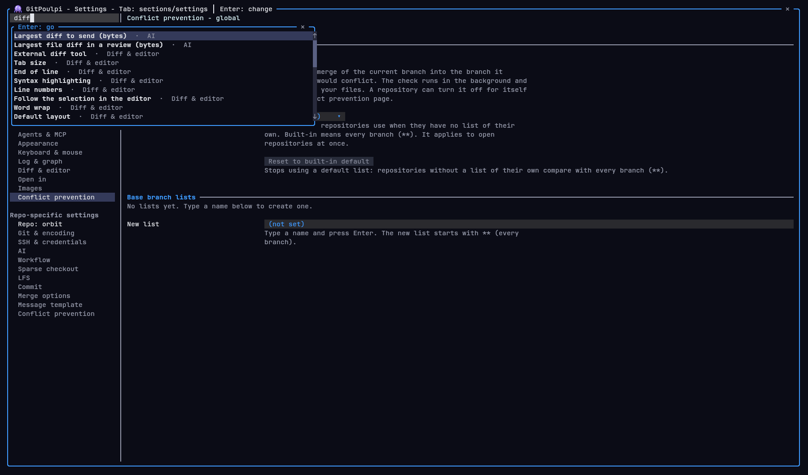
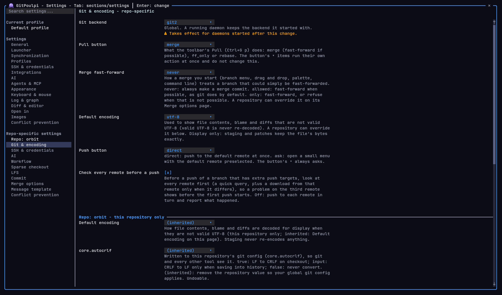

[English](../settings.md) · [Čeština](../cs/settings.md) · [Deutsch](../de/settings.md) · [Español](../es/settings.md) · [Français](../fr/settings.md) · [Italiano](../it/settings.md) · [日本語](../ja/settings.md) · [한국어](../ko/settings.md) · [Nederlands](../nl/settings.md) · [Polski](../pl/settings.md) · [Português (Brasil)](../pt-BR/settings.md) · **Português (Portugal)** · [Русский](../ru/settings.md) · [Svenska](../sv/settings.md) · [Türkçe](../tr/settings.md) · [Українська](../uk/settings.md) · [简体中文](../zh-CN/settings.md)

# Definições

Abra as Definições com `Ctrl+,`, `Ctrl+N` e depois `,`, a roda dentada na
barra de título (à esquerda do `×`), ou `Ctrl+P` > *Definições*. O ecrã
das Definições substitui a janela enquanto está aberto. Feche-o com o `✕` no canto
superior direito, com `Esc` ou com `q`. Só pergunta antes quando fechar fizesse
perder alguma coisa (veja [Fechar as Definições](#fechar-as-definições)).

As alterações são guardadas de imediato em `config.toml`. A
[referência de configuração](config-reference.md) descreve cada chave, o seu
valor predefinido e a sua variável de ambiente. Esta página descreve o ecrã das
Definições.

## Usar o ecrã das Definições

| Para | Faça |
|---|---|
| Passar entre a lista de páginas e as opções | `Tab` / `Shift+Tab`, ou clique. |
| Mover | `j` / `k` ou as setas. |
| Alterar uma opção | `Enter` ou `Space`, ou clique no seu valor. Veja abaixo. |
| Fechar | Clique em `✕`, ou prima `Esc` ou `q`. Enquanto um campo, uma lista pendente ou uma confirmação está aberto, `Esc` fecha apenas isso. |

O que `Enter` ou `Space` faz depende da linha:

- Uma caixa de verificação alterna.
- Uma lista pendente abre. As setas escolhem, `Enter` aceita.
- Um campo de texto ou numérico começa a ser editado. As setas, `Home`, `End`,
  `Backspace` e `Delete` funcionam, e um clique coloca o cursor. `Enter`, `Tab`,
  `Up`, `Down` ou um clique noutro sítio guarda o valor. `Esc` cancela. Um valor
  recusado fica no campo, a vermelho, e a barra de estado dá o motivo.
- Uma linha de botões (**Criar**, **Remover**, **Testar**...) mostra apenas os
  botões que se aplicam agora. `Left` / `Right` escolhem um, `Enter` prime-o, ou
  clique nele. Um botão que apaga alguma coisa pergunta primeiro.

Em todas as páginas os valores começam numa só coluna, de modo que as etiquetas
ficam alinhadas à esquerda e os campos à direita. Um texto ou número é uma faixa
com cor, uma escolha é uma faixa que termina em `▾`, uma caixa de verificação é
`[x]`. Uma etiqueta comprida quebra em vez de ser cortada e, numa janela estreita,
o valor passa para baixo da sua etiqueta.

Uma linha a cinzento diz porque está inativa. Por exemplo, **Intensidade do tom
da linha** fica a cinzento enquanto **Fundo das faixas do grafo** está
**Desativado**.

### Listas

As páginas que editam vários itens do mesmo tipo (Perfis, IA, Fluxo de trabalho,
Abrir em, Imagens) mostram-nos como uma **lista à esquerda e os campos do item
selecionado à direita**. Numa janela estreita, a lista fica por cima dos campos. A
lista tem a mesma forma em todo o lado:

- A marca de uma linha indica o seu estado: `●` o perfil ativo, `★` a entrada
  predefinida, `⚠` um item por acabar (um perfil sem e-mail), com o motivo no sítio
  dos detalhes.
- Por baixo da lista: **+ Adicionar**, **Duplicar**, **Remover**, `↑` e `↓`. Um botão
  que não se aplica agora (`↑` na primeira linha) fica esbatido. **+ Adicionar ▾**
  abre uma lista pendente quando a página oferece predefinições ou tipos.
- **Remover** pergunta primeiro, exceto para um item que acabou de adicionar e não
  editou.
- Arraste uma linha para a mover; uma barra mostra onde vai ficar, e `Esc` cancela o
  arrasto. Um duplo clique passa para os campos do item.

| Tecla | Faz |
|---|---|
| `Up` / `Down`, `Home` / `End`, `PageUp` / `PageDown` | Selecionar um item. |
| `Insert` | Adicionar um item (abre a lista pendente quando há uma). |
| `Ctrl+D` | Duplicar o item. |
| `Delete` | Remover o item, depois de uma confirmação. |
| `Alt+Up` / `Alt+Down` | Mover o item para cima ou para baixo. |
| `Enter` ou `Right` | Ir para os campos do item. |
| `Left` | Voltar à lista de páginas. |
| `Alt+Left` / `Alt+Right` | Alternar entre o separador Geral e o separador da lista (em qualquer ponto da página). |

Cada uma destas páginas tem dois **subseparadores** sob o título, para que uma definição da página nunca seja confundida com uma propriedade do item selecionado: **Geral**, as definições da própria página (o perfil ativo, a entrada predefinida, as instruções que cada ação de IA recebe, o modelo de fluxo...), e um separador com o nome dos itens (**Perfis**, **Perfis (ligações)**, **Entradas**, **Editores**, **Regras**) que contém a lista e os campos do item selecionado. Uma página abre em **Geral**; as definições lembram o separador em que deixou cada página até fechar a aplicação, tal como a posição de deslocamento e a linha selecionada de cada página (e separador). Clique num separador ou prima `Alt+Left` / `Alt+Right`. A pesquisa, as linhas de definições da paleta de comandos e as ligações que dizem «defina nas definições» abrem o separador onde a definição está.
[Teclado e rato](#teclado-e-rato) tem os mesmos dois separadores (**Geral**, **Atalhos de teclado**).

As teclas podem ser reatribuídas em **Teclado e rato** (contexto *preferences*,
veja [Atalhos de teclado](keybindings.md)).

### Editores de várias linhas

As definições que guardam várias linhas (como as pastas do checkout parcial, a descrição do modelo de commit, as branches base da prevenção de conflitos e os hooks do fluxo de trabalho) abrem num pequeno editor com `Enter` ou um clique; `Ctrl+S` mantém o texto e `Esc` descarta-o. O rato funciona aí como em qualquer caixa de texto:

- Um clique coloca o cursor onde clicou.
- Arrastar seleciona o texto; a roda desloca.
- Um duplo clique seleciona a palavra sob o ponteiro.
- `Shift` + clique alarga a seleção do cursor até ao ponteiro.

O teclado oferece o mesmo: `Shift` com as setas seleciona, `Ctrl` com as setas salta de palavra em palavra, `Ctrl+A` seleciona tudo, `Ctrl+C` e `Ctrl+X` copiam e cortam.

### Fechar as Definições

O `✕`, `Esc` e `q` fazem o mesmo. As Definições aplicam cada alteração de imediato,
pelo que na maior parte das vezes limitam-se a fechar. Só perguntam **Fechar as
Definições?** quando alguma coisa se perderia:

- a página **Fluxo de trabalho** tem alterações por guardar;
- o modelo de mensagem de commit tem alterações por guardar;
- um perfil não tem e-mail de autor (os commits que faz não podem ser atribuídos a
  si).

A caixa oferece **Ir para lá** (abre essa página), **Descartar e fechar** ou
**Fechar mesmo assim**, e **Cancelar**. Os pequenos editores dentro das Definições
(um texto de instruções de IA, um hook do fluxo de trabalho, os caminhos do
checkout parcial) têm o seu próprio `✕` e só perguntam **Descartar alterações?**
quando o texto foi editado.

### Janelas flutuantes sobre as Definições

A linha do título mostra o polvo e o nome da aplicação, como a janela principal.
Clique no polvo para abrir o Acerca de.

Algumas janelas flutuantes de toda a janela abrem sobre as Definições e devolvem-nas
como estavam (a página, a posição de deslocamento e quaisquer alterações por guardar
do Workflow ou dos modelos mantêm-se):

- a paleta de comandos (`Ctrl+P`),
- o seletor de tema (`Ctrl+N y`, **Aplicação: mudar tema...**), que pré-visualiza cada
  tema nas próprias Definições; `Esc` repõe o tema anterior,
- os seletores de idioma e de cores do grafo (`Ctrl+N` e depois as mesmas letras da janela principal),
- a pesquisa na área de trabalho (`Ctrl+Alt+F`),
- o Acerca de (`Ctrl+N a`, o polvo, ou **Ajuda: acerca do GitPoulpi**) e a sobreposição de ajuda (`?`).

Feche cada uma com `Esc`, com o seu próprio `✕`, ou com um clique fora dela. Os comandos
que atuam sobre o que as Definições cobrem (um separador, uma branch, um diff...) aparecem
na paleta mas esbatidos, com "feche primeiro as Definições", e os atalhos `Ctrl+N` para eles
mostram essa linha na borda inferior das Definições: feche as Definições e execute-os.

`Ctrl+N` mostra um selo em cada controlo da página: a caixa de pesquisa, a lista de páginas (um só selo, na página atual), os subseparadores, a lista e os respetivos botões, cada campo no ecrã e o ✕ de fechar. Prima o caráter de um selo e acontece o mesmo que com um clique nesse controlo: um campo de texto abre para edição, uma caixa de seleção é assinalada, uma lista pendente abre-se, um botão é acionado. `Esc` cancela. Um campo deslocado para fora do ecrã não tem selo. Enquanto escreve num campo, ou há uma lista pendente, um editor ou a pesquisa aberta, `Ctrl+N` pertence-lhes. Veja [Selos](keybindings.md#selos).

### A caixa de pesquisa

A caixa no topo da lista de páginas pesquisa o nome e a descrição de cada opção
de todas as páginas. Clique nela, ou prima `/` ou `Ctrl+F`, e escreva. Abre-se
uma lista de correspondências. Cada correspondência mostra a opção e a sua
página. `Up` / `Down` escolhem, `Enter` vai para a opção, `Esc` fecha a lista.

## Definições a partir da paleta de comandos

A maioria das definições pode ser alterada sem abrir este ecrã: escreva `Definições:` ou `Settings:` na paleta de comandos (`Ctrl+P`). As linhas são geradas a partir dos campos das páginas, por isso uma definição nova aparece nos dois sítios.

- Uma caixa de verificação é **Definições: alternar ...**. Alterna logo, e a linha mostra `[x]` ou `[ ]`.
- Uma lista pendente é **Definições: ...**. `Enter` reduz a paleta aos seus valores, com o atual marcado como `atual`; `Enter` num valor escolhe-o.
- Um número ou um texto abre um campo preenchido com o valor atual. Um valor que a página recusaria (não é número, fora do intervalo) é recusado da mesma maneira, e o campo fica aberto.
- Uma definição que precisa da página (uma lista, um combo cujas opções são descobertas na execução) abre as Definições nela.

Um valor é guardado em `config.toml` e aplicado exatamente como a página faz. As palavras inglesas da chave da definição (`remember tabs`) encontram a linha em qualquer idioma.

## As páginas

A lista de páginas tem dois grupos:

- **Definições**: definições globais.
- **Definições do repositório**: definições do repositório do separador
  ativo. Só aparecem enquanto um repositório está aberto.

### Geral

| Opção | O que faz |
|---|---|
| **Idioma** | O idioma da interface: **Auto** (o idioma do seu sistema, senão inglês), English, Français, Español, Português (Brasil), Português (Portugal), Italiano, Deutsch, 简体中文, 日本語, 한국어, Русский, Українська, Polski, Čeština, Nederlands, Svenska, Türkçe. Aplica-se de imediato, sem reiniciar. Os nomes dos meses e as datas do Log seguem-no. A variável de ambiente `GITPOULPI_LANG` (por exemplo `GITPOULPI_LANG=fr`) tem prioridade sobre esta escolha. A saída da CLI e do MCP continua em inglês. |
| **Traduzir termos do git** | Desligado por predefinição: commit, push, pull, stash, tag e os outros termos do git ficam em inglês em todos os idiomas. Ligado: é usado o vocabulário git do próprio idioma (francês: *Tirer*, *Pousser*, *Remiser*, *Étiquette*). Aplica-se de imediato. |
| **Palavras git em inglês** | Apenas para japonês, coreano e chinês: mostra *stage*, *unstage*, *staged* como palavras inglesas em vez da sua transcrição. Sem efeito enquanto **Traduzir termos do git** está ligado. |
| **Lembrar separadores** | Reabre os separadores da última sessão no arranque. Desativado, um arranque dentro de um repositório abre apenas esse repositório, e um arranque fora de um repositório começa em Início sem nenhum separador de repositório. Precisa de reinício. |
| **Ativar o Radar** | Ativado por predefinição (`general.radar_enabled`). Desativado oculta o separador do Radar, os seus comandos da paleta e `Alt+R`, e nada é obtido para ele em segundo plano. Aplica-se de imediato. Ver [o Radar](radar.md#fechar-o-separador-ou-desligar-o-radar). Não aparece numa compilação sem Radar. |
| **Separador inicial dentro de um repositório** | O separador em que um arranque abre quando a pasta de onde parte está dentro de um repositório (`general.startup_tab_in_repo`): **Repositório atual** (predefinido, o separador desse repositório, aberto se necessário), **Último separador** (o separador ativo no último encerramento), **Início**, **Radar**. Um repositório indicado com `--repo` abre sempre o próprio separador. **Último separador** passa a Início se **Lembrar separadores** estiver desativado ou não houver nada lembrado; **Radar** passa a Início se o Radar estiver desativado ou fora da compilação. Lido uma vez no arranque; exige reinício. |
| **Separador inicial fora de um repositório** | O separador em que um arranque abre quando a pasta de onde parte não é um repositório (uma pasta de utilizador, por exemplo) (`general.startup_tab_outside_repo`): **Início** (predefinido), **Último separador**, **Radar**. **Último separador** passa a Início se **Lembrar separadores** estiver desativado ou não houver nada lembrado; **Radar** passa a Início se o Radar estiver desativado ou fora da compilação. Lido uma vez no arranque; exige reinício. |
| **Separador inicial pelo lançador** | O separador em que um arranque abre quando o GitPoulpi é iniciado pelo atalho do ambiente de trabalho ou do menu Iniciar que ele criou (passam `--launcher`), seja qual for a pasta (`general.startup_tab_launcher`): **Último separador** (predefinido), **Início**, **Radar**. Tem prioridade sobre as duas definições acima. **Último separador** passa a Início se **Lembrar separadores** estiver desativado ou não houver nada lembrado; **Radar** passa a Início se o Radar estiver desativado ou fora da compilação. Os atalhos de uma versão antiga recebem a opção no arranque seguinte. Lido uma vez no arranque; exige reinício. No Windows, uma cópia que afixou na barra de tarefas também é reescrita no arranque seguinte, e um arranque sem shell à volta (clique duplo, o próprio exe afixado) conta como arranque pelo lançador. |
| **Agrupar os separadores dos worktrees** | Ativado por predefinição (`general.group_worktree_tabs`). Os separadores dos worktrees associados de um repositório ficam logo a seguir ao separador do repositório, e um separador de worktree arrastado para longe volta para lá. Desativado deixa os separadores onde os colocar. Ativar reagrupa os separadores abertos. |
| **Pasta de clonagem predefinida** | Onde o diálogo Clonar começa. Vazio: `%USERPROFILE%\source\repos` no Windows, `~/src` nos restantes. |
| **Pasta de navegação predefinida** | Onde Procurar abre. Vazio: a última pasta que usou, senão a sua pasta pessoal. |
| **Local dos dados do repositório** | Onde o GitPoulpi guarda os dados de cada repositório (`session.per_repo_state_dir`): **Dentro de .git** (predefinição: nada aparece na sua árvore de trabalho e todos os worktrees o partilham), **Na árvore de trabalho** (uma pasta `.gitpoulpi`; necessária para fazer commit de um `workflow.toml` da equipa) ou **Na minha pasta de dados do utilizador** (fora do repositório). Uma pasta `.gitpoulpi` deixada por uma versão mais antiga é movida para o novo local na primeira vez que for precisa, e removida quando fica vazia; um ficheiro que o git acompanha (um `workflow.toml` com commit feito) nunca é movido nem eliminado e continua legível. |
| **Nome da branch predefinida** | A primeira branch de um repositório que cria com Init. Vazio: o git decide. Não renomeia nenhuma branch existente. |
| **Ativar a deteção proativa de conflitos** | Ativada por predefinição (`general.conflict_detection`). Avisa no Log quando a integração da branch atual na branch de que partiu daria conflito, antes de a tentar. Um repositório pode desativá-la para si na sua página **Prevenção de conflitos**. Veja [Resolver conflitos de merge](merge-conflicts.md#prevenção-de-conflitos). Aplica-se quando as Definições fecham. |
| **Nível do registo**, **Manter os ficheiros de registo**, **Tamanho máximo de um ficheiro de registo** | O registo da aplicação por trás do Registo de atividade: a linha mais detalhada registada (`log.level`), durante quanto tempo se mantêm os ficheiros (um número inteiro e uma unidade, dias, semanas, meses ou anos, na mesma linha: clique no número para o escrever, Cima e Baixo mudam-no, Tab passa à unidade e Enter abre a sua lista; no máximo 10 anos, predefinição 1 semana, `log.retention_days` e `log.retention_unit`) e o tamanho em que o ficheiro de um dia é rodado (um número e MiB ou GiB, de 1 MiB a 1 GiB, `log.max_file_mb` e `log.max_file_unit`). |
| **Mostrar a duração das operações**, **Registo alargado** | O separador Operações Git do Registo de atividade: a duração de cada operação (`log.timings`, ligado por predefinição) e também o trabalho em segundo plano, atualização e auto-fetch (`log.extended`, desligado por predefinição). Veja [Quando algo falha](troubleshooting.md#o-registo-de-atividade). |
| **Desfazer ativado**, **Profundidade do histórico de desfazer**, **Registar alterações feitas fora do GitPoulpi** | O grupo **Histórico de desfazer**. Ativa ou desativa o Desfazer, e define quantas operações guarda (predefinição 100, `0` significa ilimitado). Desativar o Desfazer apaga o histórico de desfazer, após uma confirmação. A última opção regista também o que uma shell ou um agente faz às branches, tags, stashes e a HEAD. Veja [Desfazer e refazer](undo-redo.md). |

#### Lançador (integração no ambiente de trabalho)

O grupo **Lançador**, no fim de Geral, cria um atalho que inicia o GitPoulpi a
partir do lançador do sistema operativo, no terminal escolhido.

| Linha | O que faz |
|---|---|
| **Terminal dos atalhos** | `ui.launch_terminal`: **Automático**, **Predefinição do sistema** ou um dos terminais encontrados neste computador (a mesma deteção de **Abrir em**). Automático: Windows Terminal no Windows (senão WezTerm, Alacritty, a consola simples), `xdg-terminal-exec` no Linux (Omarchy; senão o primeiro terminal encontrado), Terminal no macOS, a menos que o iTerm2, o Ghostty, o WezTerm ou o kitty estejam instalados. |
| **Reabrir nesse terminal com clique duplo** | Apenas Windows (`ui.relaunch_in_terminal`). Um clique duplo no exe abre a consola predefinida, que desenha mal as imagens: o GitPoulpi reabre-se no terminal escolhido e a primeira janela fecha. Não acontece quando foi iniciado a partir de um terminal. |
| **Mostrar a janela aberta ao clicar** | `ui.reuse_window` (ativado por predefinição). Um clique num atalho do GitPoulpi (`gitpoulpi launch`) mostra a janela de um GitPoulpi que já está aberto, em vez de iniciar outro. Só é iniciado um novo terminal quando não há nenhum aberto, a definição está desativada ou a janela não consegue passar para primeiro plano. Passa para primeiro plano no Windows, no WezTerm e no Hyprland; noutros ambientes de trabalho Linux o clique continua a iniciar uma nova janela. Para abrir outra janela de propósito, mantenha **Shift** premido ao clicar (Windows, também no ícone afixado na barra de tarefas) ou use a ação **Nova janela** da entrada do lançador no Linux (clique com o botão direito no ícone); `gitpoulpi launch --new-window` faz o mesmo a partir de um script. Não é usada no macOS (o Dock já o faz). |
| **Alias de comando** | `ui.command_alias`: uma lista com **Nenhum** e `gp`, ou escreva qualquer nome (letras, dígitos, `-`, `_`, `.`; sem espaços nem separadores de caminho). O botão **Criar**, na própria linha, faz com que esse nome inicie o GitPoulpi (passa a **Remover** quando o alias existe, e remove todos os alias que o GitPoulpi criou). Mostra-se um aviso sob a linha quando o nome já executa outra coisa no seu PATH e, no Windows, quando o PowerShell tem um alias incorporado com esse nome (aí `gp` é `Get-ItemProperty`, e prevalece sobre qualquer ficheiro). Um alias ou uma função da shell não se vê a partir daqui: o oh-my-zsh define o próprio `gp` e este prevalece sobre o nosso. |
| **Alias de novo separador** | `ui.command_alias_add`: um segundo comando, por exemplo `gpa`, que abre a pasta atual num novo separador do GitPoulpi que já está aberto (`gitpoulpi --add`), em vez de iniciar outro; se nenhum estiver aberto, inicia o GitPoulpi normalmente, e se houver vários pergunta a qual juntar-se. Uma lista com **Nenhum**, `gpa` e o nome do alias seguido de `a`, ou escreva qualquer nome (as mesmas regras acima). O único botão **Criar** cria os dois comandos, **Remover** remove todos os comandos que o GitPoulpi criou; cada um tem a sua linha de estado. No Linux e no macOS é um script de duas linhas, no Windows um `.cmd`. Veja a [referência da CLI](cli-reference.md#adicionar-uma-pasta-à-janela-aberta). |
| **Adicionar o GitPoulpi ao PATH** | Coloca no PATH, para os novos terminais, a pasta de onde o GitPoulpi corre e a pasta do alias. O botão da linha diz **Adicionar** ou **Remover**, e **Remover** retira exatamente o que foi adicionado. As pastas que já estão no PATH ficam como estão (a linha diz então **já está no PATH**). |
| **Linux: Lançador de aplicações** | Grava `~/.local/share/applications/gitpoulpi.desktop` (respeita `XDG_DATA_HOME`) e o ícone em `~/.local/share/icons/hicolor/256x256/apps`. No Omarchy a entrada é a que o `omarchy-tui-install` cria (`xdg-terminal-exec --app-id=TUI.tile -e <exe>`); para os outros terminais, o comando correspondente (`kitty --class gitpoulpi`, `wezterm start --class gitpoulpi --`, `alacritty --class gitpoulpi -e`, `foot --app-id=gitpoulpi`, ...). Cada entrada executa o seu comando através de `gitpoulpi launch --`, que mostra um GitPoulpi que já esteja aberto (veja **Mostrar a janela aberta ao clicar**). |
| **Linux: Ambiente de trabalho** | A mesma entrada na sua pasta do ambiente de trabalho, se existir. |
| **Windows: Menu Iniciar** | `GitPoulpi.lnk` em `%APPDATA%\Microsoft\Windows\Start Menu\Programs`. Uma cópia afixada na barra de tarefas acompanha sozinha as alterações de ícone e de cor; se o ícone continuar antigo, desafixe e afixe novamente (clique com o botão direito na entrada do menu Iniciar e **Afixar à barra de tarefas**). |
| **Windows: Ambiente de trabalho** | `GitPoulpi.lnk` no ambiente de trabalho. |
| **macOS: Pasta Aplicações** | `~/Applications/GitPoulpi.app`, um pequeno pacote que abre o terminal a executar o GitPoulpi. |

Cada linha mostra o seu estado: **não criado**, **criado**, **desatualizado**
(o exe mudou de sítio ou foi escolhido outro terminal; o GitPoulpi volta a gravá-lo sozinho
em menos de um segundo, por isso raramente o verá) ou **existe um ficheiro que não é do
GitPoulpi** (existe um ficheiro com esse nome que não foi criado pelo GitPoulpi, por isso
nunca é alterado). **Remover** elimina apenas ficheiros criados pelo GitPoulpi (têm o
marcador `X-GitPoulpi=1`). O ícone é o polvo na cor do seu logótipo (Acerca de > cor); no
Linux cada cor tem o seu próprio nome de ícone, por isso um lançador que guarda os ícones
em cache mostra a cor nova. Depois de criado, um atalho mantém-se atualizado sozinho:
quando muda a cor, o terminal ou o exe muda de sítio, o GitPoulpi volta a gravar os atalhos
que criou (nunca um que não criou, e sem nunca criar um novo), no arranque e enquanto
corre. Não há botão Atualizar; apenas **Criar** (para um atalho que ainda não existe) e
**Remover**.

**Agrupamento na barra de tarefas e no dock.** O GitPoulpi corre dentro de uma janela de terminal, pelo que a barra de tarefas normalmente o mostra sob o ícone do terminal, sem o ponto de “em execução” sob o ícone afixado do GitPoulpi. Windows: os atalhos levam o AppUserModelID `GitPoulpi.GitPoulpi`, e um GitPoulpi iniciado por um deles dá à janela do seu terminal o mesmo ID e o seu ícone (encontra a janela dando-lhe por instantes um título único e depois repõe o título), de modo que a janela fica sob o ícone afixado do GitPoulpi. Uma janela de terminal com vários separadores move-se como um todo: todos os seus separadores se agrupam sob o ícone do GitPoulpi enquanto o GitPoulpi corre nela. Os atalhos e os itens afixados na barra de tarefas criados antes são reescritos pela mesma sincronização; se um item afixado ainda mostrar o ícone do terminal, desafixe-o e afixe-o de novo. Linux: kitty, foot, Alacritty, WezTerm e Ghostty são iniciados com a classe de janela `gitpoulpi` e a entrada `.desktop` indica-a (`StartupWMClass`), pelo que um dock agrupa a janela sob o ícone do lançador; os outros terminais mantêm o seu próprio ícone. macOS: nada a fazer, o Dock agrupa por aplicação.

##### Alias de comando e PATH, por sistema

| Sistema | Alias | PATH |
|---|---|---|
| Linux, macOS | Uma ligação simbólica `~/.local/bin/<nome>` para `gitpoulpi-tui`. Uma ligação não pode guardar um marcador, por isso conta como nossa quando o seu destino é um ficheiro chamado `gitpoulpi-tui`; um ficheiro normal, ou uma ligação para outra coisa, **não é nosso** e nunca é substituído nem removido. | Um bloco entre `# >>> GitPoulpi PATH (X-GitPoulpi=1) >>>` e `# <<< GitPoulpi PATH <<<` em `~/.bashrc` e `~/.zshrc` (os que existirem; `~/.zshrc` no macOS e `~/.bashrc` nos restantes quando nenhum existe), e `~/.config/fish/conf.d/gitpoulpi-path.fish` quando o fish está configurado. Remover apaga o bloco (ou o ficheiro do fish) e mais nada. |
| Windows | `%LOCALAPPDATA%\Programs\GitPoulpi\bin\<nome>.cmd`, um atalho de duas linhas com `REM X-GitPoulpi=1`. | O PATH do utilizador em `HKCU\Environment`, escrito através do PowerShell, seguido de uma difusão `WM_SETTINGCHANGE` para que os novos programas o vejam. O valor `GitPoulpiPathAdded` regista o que foi adicionado, e Remover retira apenas isso. |

Os novos terminais veem a alteração do PATH, não os que já estão abertos. Nenhuma das ações fica no registo de desfazer: não há Desfazer para elas, **Remover** é o caminho de volta.

A paleta tem as mesmas ações (**Lançador: criar atalho**, **Lançador: criar atalho do ambiente
de trabalho**, **Lançador: remover atalhos**, **Lançador: criar alias de comando**, **Lançador: remover alias de comando**, **Lançador: adicionar ao PATH**, **Lançador: remover do PATH**), e `gitpoulpi desktop shortcut
status|install|remove [--where launcher|desktop|startmenu]` faz o mesmo a partir de um script.

O comando da paleta **Aplicação: mudar idioma...** (`Ctrl+N g`) abre a mesma
lista de idiomas. Aí, o idioma realçado é pré-visualizado em direto; `Enter`
mantém-no e `Esc` restaura o anterior.

### Sincronização

Como o GitPoulpi mantém um repositório em sintonia com os seus remotos, e o que
faz entretanto com as suas alterações locais.

| Opção | O que faz |
|---|---|
| **Intervalo do auto-fetch** | Faz fetch de todos os remotos em segundo plano a este intervalo, um número e uma unidade (minutos ou horas) na mesma linha. Predefinição 5 minutos, máximo 60 minutos (1 hora), `0` desliga. `general.auto_fetch_interval_minutes` continua em minutos; `general.auto_fetch_interval_unit` só regista como é mostrado. Precisa de reinício. |
| **Fetch ao abrir um separador** | Executa Fetch All em segundo plano quando um separador de repositório abre. Ligado por predefinição. Um repositório que tenha feito fetch nos últimos 60 segundos não volta a fazê-lo. |
| **Auto-prune** | Os fetches removem também as branches de acompanhamento remoto que já não existem no remoto. Desligado por predefinição. |
| **Poda automática de tags** | Os fetches eliminam também as tags locais que o remoto eliminou. Só são afetadas as tags que estiveram no remoto: uma tag que nunca enviou (push) é mantida. Desligado por predefinição, como no git. Precisa de git 2.41 ou posterior. CLI: `gitpoulpi fetch --prune-tags`; chave de configuração `general.auto_prune_tags`. Consulte [Branches, tags e a barra lateral Refs](log-and-history.md#branches-tags-e-a-barra-lateral-refs). |
| **Manter submódulos atualizados** | Depois de um checkout ou de um pull, atualiza os submódulos para os commits que o repositório regista. Veja [Submódulos](submodules.md). |
| **Eliminar ficheiros ".orig" após o merge** | Depois de um merge terminar, elimina os ficheiros de cópia `*.orig`. Desligado por predefinição. |
| **Auto-stash antes de checkout, pull, merge ou rebase** | O que fazer quando alterações locais bloqueiam uma destas operações: **perguntar** (um diálogo oferece-se para fazer stash das alterações, executar a operação e restaurar o stash), **sempre** (fazê-lo sem perguntar) ou **nunca** (recusar). |
| **Incluir ficheiros não acompanhados no auto-stash** | O stash automático também leva os ficheiros não acompanhados. |

Também nesta página, em **Atualizações**:

| Opção | O que faz |
|---|---|
| **Procurar atualizações** | Uma lista (`updates.mode`): **Notificar** (predefinição) verifica uma vez por dia em segundo plano e mostra `vX.Y.Z disponível` na barra de título; **Auto** também transfere a atualização em segundo plano quando o GitPoulpi foi instalado a partir de um arquivo de versão (continua a ser você a escolher quando reiniciar); **Desativado** nunca faz um pedido. Aplica-se de imediato. Veja [Atualizações](installation.md#atualizações). |
| **Canal de atualização** | Uma lista (`updates.channel`): **Estável** (predefinição) ou **Pré-lançamento** (também versões candidatas). Aplica-se de imediato. |

Também nesta página, em **Reescrita do histórico**, os limites de tempo dos scripts externos (ver [Reescrita do histórico](history-rewrite.md)):

| Opção | O que faz |
|---|---|
| **Tempo limite de resposta do script** | Quanto tempo um script externo tem para responder a um commit, um número e uma unidade (milissegundos ou segundos) na mesma linha. Predefinição 5 segundos, de 1 milissegundo a 10 minutos (`rewrite.script_timeout_ms`, `rewrite.script_timeout_unit`). Num timeout, o processo inteiro é interrompido e a reescrita falha sem nada movido. |
| **Tempo limite do script por passagem** | Quanto tempo pode demorar uma passagem completa de um script externo, um número e uma unidade (segundos, minutos ou horas). Predefinição 1 hora, até 24 horas (`rewrite.script_total_timeout_s`, `rewrite.script_total_timeout_unit`). |

### Perfis

Perfis de identidade de commit: o nome e o e-mail usados nos commits feitos a
partir do GitPoulpi. O separador **Geral** contém a lista pendente **Perfil ativo**; o
separador **Perfis** é uma [lista](#listas) (adicionar, duplicar, remover, reordenar) com os
campos do perfil selecionado. Cada perfil tem um **ID do perfil**, um **Nome do perfil**, um
**Nome do autor** e um **E-mail do autor**. Um perfil sem e-mail mostra `⚠` na
lista. Sem perfil ativo, ou com um perfil com nome ou e-mail em branco, aplicam-se
o `user.name` e o `user.email` do próprio repositório.

Com dois ou mais perfis, a barra de ferramentas mostra uma caixa combinada de
perfil na sua extremidade direita. Define o perfil apenas para o repositório
ativo. Depois de escolher, um diálogo oferece-se para escrever também a
identidade na configuração desse repositório. O comando da paleta é
**Repositório: alterar perfil...**.

Estes perfis não são os perfis de alojamento da página Integrações, nem os
perfis de IA da página IA.

### SSH e credenciais

O SSH usa o `ssh` do seu sistema, pelo que o seu ssh-agent e a sua configuração
ssh continuam a funcionar. O GitPoulpi nunca lê material de chaves.

| Opção | O que faz |
|---|---|
| **Caminho da chave privada** | Quando definido, fetch, pull, push e clone executam o git com `GIT_SSH_COMMAND=ssh -i "<key>" -o IdentitiesOnly=yes`, pelo que o ssh oferece apenas essa chave. Vazio: o agente e a sua configuração ssh aplicam-se inalterados. |
| **Caminho da chave pública** | Usado apenas quando o caminho da chave privada está vazio: o ssh escolhe a chave correspondente guardada no ssh-agent (ou uma chave de hardware). |
| **Tipo de chave** | O tipo que **Gerar par de chaves** cria: `ed25519`, `rsa` (4096 bits) ou `ecdsa` (NIST P-256). |
| **Credenciais HTTPS** | Como fetch, pull, push e clone se autenticam por HTTPS: **credential_helper** (o helper do próprio git, a predefinição), **prompt** (ignorar helpers; o git pergunta num terminal) ou **none** (sem credenciais, apenas remotos públicos). |
| **Esquecer todos os utilizadores e palavras-passe** | Remove todos os tokens que o GitPoulpi guardou no seu credential helper. Pede confirmação primeiro. |
| **Gerar par de chaves** | Cria um par de chaves do **Tipo de chave** em `~/.ssh/gitpoulpi_<type>`, sem frase-passe, e regista os seus dois caminhos. Nunca substitui um ficheiro. |

Os caminhos das chaves aplicam-se à transferência seguinte. Um prefixo `~/`
significa a sua pasta pessoal.

Uma definição feita noutro sítio ganha sempre a estes caminhos. A ordem, da
maior prioridade para a menor:

1. `GIT_SSH_COMMAND` ou `GIT_SSH` no ambiente em que o GitPoulpi corre.
2. `core.sshCommand` na configuração git do repositório ou na sua configuração
   git global. O item *Chave SSH...* do menu do separador escreve isto para um
   repositório.
3. Os dois caminhos de chaves desta página.
4. Os valores predefinidos do próprio ssh e o agente.

Uma chave também pode pertencer a uma conta de alojamento; veja
[Alojamento e gestores de issues](hosting-integration.md#chave-ssh-por-perfil).

### Integrações

Liga as suas contas. O grupo **Alojamento** tem GitHub, GitHub Enterprise,
GitLab, GitLab Self-Managed, Azure DevOps, Azure DevOps Server, Bitbucket, Bitbucket Data Center, Gitea, Forgejo e Gerrit. O grupo **Gestores de issues** tem Jira Cloud, Jira Data Center, Trello, Linear, YouTrack, Redmine e Local Markdown. Cada fornecedor tem **Ligar**, um campo de token, os âmbitos de
que o token precisa e uma ligação para a página de tokens do anfitrião. Esta página
tem o seu próprio guia: [Alojamento e gestores de issues](hosting-integration.md).

Duas opções ficam por cima dos fornecedores. Prima `Up` no primeiro fornecedor
para lá chegar.

| Opção | O que faz |
|---|---|
| **Atualização de Pull Requests e issues** | Com que frequência as listas da barra lateral e o chip da barra de ferramentas se atualizam, um número e uma unidade (minutos ou horas). Predefinição 5 minutos, até 2 horas, `0` desliga o temporizador (`general.hosting_refresh_minutes`, `general.hosting_refresh_unit`). |
| **Terminologia de pedido de revisão** | A palavra usada para as revisões alojadas: **Auto (por host)**, **Pull Request** ou **Merge Request**. |
| **Ocultar o chip do pull request quando está fechado ou com merge feito** | Ativado por predefinição (`ui.hide_finished_pr_chip`; no GitLab diz "merge request"). O chip da barra de ferramentas mostra o pedido mais recente da branch em checkout; quando esse pedido é fechado ou o merge é feito, fica oculto e aparece em seu lugar o chip esbatido **+ PR** (iniciar um novo pedido), como se a branch não tivesse nenhum. Desativado, o chip mostra sempre o pedido mais recente, seja qual for o estado. Aplica-se de imediato. |

### IA

No separador **Geral**: o interruptor que liga a IA, o perfil predefinido, as instruções
que todas as ações recebem, e um perfil e instruções para cada ação. O separador
**Perfis (ligações)** é uma [lista](#listas) dos perfis de IA com uma tabela em linha
para as variáveis de ambiente de um perfil. O bloco *Revisão de código* do separador Geral
contém também as predefinições do [contexto da revisão](ai.md#contexto-da-revisão): **Executar o agente no repositório**
(*Definição do perfil*, *Sim*, *Não*), **Incluir CLAUDE.md**, **Incluir AGENTS.md** e **Ficheiro extra** (um caminho ou uma
ligação; vazio não junta nenhum, com um botão **Procurar...** por baixo que abre um seletor de ficheiros; `Enter` no botão
é a sua forma de teclado). Esta página tem o seu próprio guia: [Assistência de IA](ai.md).

### Agentes e MCP

O que os agentes de IA podem fazer nesta janela, e se o servidor MCP pode
funcionar. As duas linhas MCP só aparecem em compilações que incluem o
servidor; veja [MCP e agentes](mcp-and-agents.md).

| Opção | O que faz |
|---|---|
| **Servidor MCP** | Ativado (predefinição): um agente pode iniciar o servidor (`gitpoulpi mcp serve`). Desativado: recusa-se a arrancar. Guardado em `mcp.enabled`. Uma alteração aplica-se da próxima vez que um agente iniciar o servidor; um servidor já em execução mantém as suas definições. |
| **Porta do servidor MCP** | A porta em que `--http` escuta quando nenhum endereço é indicado, de 1 a 65535 (predefinição 8808). Guardada na porta de `mcp.bind`; a parte do anfitrião é mantida (`127.0.0.1` quando vazia). Aplica-se da próxima vez que um agente iniciar o servidor. |
| **Permitir que agentes de IA controlem a vista** | Deixa os agentes mostrar-lhe um commit, um ficheiro ou um aviso nesta janela (`ui show`). Desligado: nenhum agente chega à janela. |
| **Deixar agentes de IA proporem alterações para eu confirmar** | Deixa os agentes abrir diálogos de Reword, commit, branch ou tag já preenchidos, que o utilizador confirma. Desligado por predefinição. Veja [MCP e agentes](mcp-and-agents.md#permissões). |
| **Abrir uma janela para agentes**, **Comando de abertura (custom)** | Se um agente pode abrir uma janela do GitPoulpi quando nenhuma está aberta, e com que terminal ou multiplexador. Desligado por predefinição. |

### Aspeto

| Opção | O que faz |
|---|---|
| **Tema** | **Sistema (segue o terminal)**, um tema incluído, ou um dos seus próprios ficheiros de tema. O tema realçado é pré-visualizado em direto: `Enter` mantém-no, `Esc` restaura o anterior. A faixa **Cores** por baixo da linha mostra as cores em vigor. Veja [Temas](themes.md). |
| **Avatares dos autores** | **desativado** (predefinição, sem rede), **grafo** (no ponto do commit) ou **autor** (na coluna Autor). Quando ligado, é enviado ao Gravatar e ao seu fornecedor de alojamento um hash do e-mail de cada autor. |
| **Fontes de avatar**, **Avatar alternativo** | Onde as imagens são procuradas, e por que ordem. Para autores sem imagem: **identicon** (um padrão gerado) ou **iniciais**. |
| **Cor dos campos**, **Cor personalizada dos campos** | O fundo dos campos de texto: **Seguir o tema** (predefinição), uma cor escura fixa, ou o seu próprio `#rrggbb`. |
| **Profundidade de cor** | **auto** (predefinição), **truecolor**, **256** ou **16**. Veja [Temas](themes.md). |
| **Tema de cores do grafo** | **Seguir o tema** (predefinição: as cores de faixa do próprio tema) ou qualquer paleta de faixas. Cada paleta mostra algumas das suas cores. Aplica-se quando as Definições se fecham. O comando da paleta **Aplicação: mudar tema de cores do grafo...** (`Ctrl+N Shift+Y`) pré-visualiza cada paleta em direto. |
| **Fundo das faixas do grafo** | **Desativado** (transparente) ou **Tom da linha**: uma banda ténue da cor da faixa por trás da coluna do grafo, com uma barra fina na sua margem. |
| **Intensidade do tom da linha** | Quão esbatida fica a banda do Tom da linha: **Forte**, **Média** (predefinição) ou **Subtil**. A barra da margem mantém a sua cor total. |
| **Posição da barra de ferramentas** | `ui.toolbar_position`: Onde fica a barra de ferramentas: Topo, Fundo (predefinição), Esquerda ou Direita. Esquerda e Direita formam uma coluna junto aos painéis; uma janela com menos de 80 colunas desenha-a no fundo. Aplica-se de imediato. |
| **Alinhamento dos botões da barra de ferramentas** | `ui.toolbar_align`: Onde ficam os botões ao longo da barra: Início (predefinição), Centro ou Fim. O início é a esquerda de uma linha e o topo de uma coluna; o fim é a direita e o fundo. Aplica-se de imediato. |
| **Fixar o botão de pull request no fim** | `ui.toolbar_pr_pinned`: Ativado (predefinição), o botão de pull request fica na extremidade da barra de ferramentas (à direita, ou no fundo numa coluna), seja qual for o alinhamento. Desativado, segue os outros botões e alinha com eles. Aplica-se de imediato. |
| **Posição da barra de estado** | `ui.statusbar_position`: Onde fica a barra de estado (branch, contagens, mensagens, atalhos): Topo, acima dos separadores de repositório, ou Fundo (predefinição). O separador Início mantém a sua própria barra de estado no fundo. Aplica-se de imediato. |
| **Posição da barra de separadores** | `ui.tabs_position`: Onde ficam os separadores de repositório: Topo (predefinição), Fundo ou Esquerda, uma lista com um separador por linha na margem esquerda da janela. Uma janela com menos de 80 colunas desenha-os no topo. Junto a uma barra de ferramentas em coluna, os separadores ficam por fora. Aplica-se de imediato. |
| **Localidade de data/hora** | **sistema** (predefinição): nomes dos meses e dos dias da semana no idioma da interface. **english**: sempre nomes em inglês. |
| **Formato de data**, **Formato de data/hora**, **Formato de data detalhado** | Os padrões de data da coluna de data do Histórico do ficheiro e do Blame, da coluna Data do Log, e dos detalhes do commit. Cada um mostra uma pré-visualização em direto. Veja a [Referência de configuração](config-reference.md#ui) para os tokens. |

### Log e grafo

Como o grafo de commits é desenhado e quantos commits o Log carrega. As cores do
grafo estão na página **Aspeto**.

| Opção | O que faz |
|---|---|
| **Renderizador do grafo** | **auto** desenha uma imagem onde o terminal o suporta, e carateres nos outros casos. **image** força a imagem, **text** força carateres. Precisa de reinício. |
| **Protocolo de imagem** | Como as imagens chegam ao terminal: **auto**, **kitty**, **iterm2**, **sixel** ou **none**. Precisa de reinício. |
| **Mostrar stashes no grafo** | Uma linha por cada stash no Log. Desligado: os stashes só aparecem na barra lateral. |
| **Mostrar uma branch fantasma no commit sob o rato** | Ativado por predefinição (`ui.graph_ghost_ref`). Na coluna Ref, o commit sob o rato que não tem ref própria mostra uma pílula esbatida com o nome da branch a que pertence (senão a branch remota), deduzido do histórico, onde a coluna tem espaço. Uma branch eliminada depois de um merge continua a aparecer, riscada, sob o nome do assunto do commit de merge (`Merge branch 'x'`, `Merge pull request #N from owner/x`, ...); squash merges, rebases e fast-forwards não deixam esse rasto. As tags nunca são mostradas como fantasma. Passar o rato na pílula mostra o tipo. Clicar não faz nada de especial; o comando da paleta `Git: criar branch no commit selecionado...` cria uma branch. |
| **Redimensionamento das colunas** | `ui.column_resize`, aplicado de imediato ao Log, ao Radar e à coluna de commits das vistas de diff, de ficheiro e de blame. **Linha** (a predefinição): cada fronteira de coluna é um espaço de uma célula com uma pequena marca no cabeçalho, é desenhada uma linha fina de destaque ao longo de toda a tabela enquanto o ponteiro está na fronteira, e arrastar em qualquer ponto dela redimensiona. **Cabeçalho**: sem marca, o primeiro carácter da célula de cabeçalho a seguir à fronteira acende-se e é o único ponto de onde se arrasta. As teclas de dimensionamento (`Shift+C` no Log, `C` no Radar, `Tab` na coluna de commits) fazem o mesmo nos dois. |
| **Conector ref-commit** | Uma linha fina da etiqueta de uma ref até ao ponto do seu commit. |
| **Mostrar contagens de alterações do WIP na mensagem quando a coluna Alterações está oculta** | Mostra as contagens de alterações (`✎ 3  + 2  − 1`) na mensagem da linha WIP. Quando a coluna Alterações está visível, as contagens vão para lá. |
| **Árvore de pastas de branches** | Agrupa as branches e as tags em `/` em pastas na barra lateral. `y` no painel Refs alterna-a. |
| **Secções do painel esquerdo** | A quem pertence a escolha das secções mostradas ou ocultas do painel esquerdo: **por repositório** (a predefinição; cada repositório guarda o seu conjunto, e o global é o ponto de partida) ou **global** (um só conjunto para todos os repositórios). Mudar de uma para a outra mantém os dois conjuntos. Veja [rato e gestos](mouse-and-gestures.md). (`ui.sidebar_sections_scope`) |
| **Clicar numa ref mostra-a no grafo** | Um único clique numa ref no painel Refs desloca o Log até onde ela aponta e faz a linha piscar (a seleção de commits e o painel direito não mudam). Desativado: um clique só seleciona a linha da barra lateral. **Mostrar no grafo** funciona nos dois casos. |
| **Propostas do compositor** | Se o compositor de commits com IA abre com os ficheiros de cada proposta **expandido** ou **recolhido**. |
| **Commits iniciais no grafo** | Quantos commits o Log carrega quando um repositório abre. Predefinição 5000, mínimo 500. Valores maiores tornam mais lentos os repositórios grandes. |
| **Carregar commits a pedido no grafo** | Ligado: mais commits carregam em segundo plano quando se desloca até ao commit mais antigo carregado. Desligado: o Log pára nos commits iniciais. |
| **Commits por página a pedido** | Quantos commits uma carga em segundo plano obtém. |
| **Máximo de commits no grafo** | O carregamento a pedido pára neste número. `0` significa sem limite. Cada commit usa cerca de 300 bytes de memória. |
| **Contar o total de commits com** | Como a barra de estado obtém o total em `carregados / total` (`log.commit_count`, uma lista, aplica-se de imediato): **git do sistema** executa um processo `git rev-list --count` (predefinição, normalmente o mais rápido); **libgit2** conta dentro do GitPoulpi e não inicia nenhum processo, para máquinas onde um antivírus analisa cada comando e deixa cada chamada ao git lenta; **Desativado** nunca conta e mostra só os commits carregados. |
| **Mostrar autores através do .mailmap** | O Log, o blame e o histórico de um ficheiro mostram cada autor como o `.mailmap` do repositório o nomeia (`log.use_mailmap`, um interruptor, ativo por predefinição, aplica-se de imediato). Os commits guardados nunca são alterados. Desativado, mostra os nomes tal como foram commitados. Veja `history-rewrite.md`, *O separador Identidades*. |

### Diff e editor

| Opção | O que faz |
|---|---|
| **Tamanho da tabulação** | Colunas por paragem de tabulação, 1 a 8 (predefinição 4). |
| **Fim de linha** | O que o editor escreve ao guardar: **Auto (manter o do ficheiro)**, **LF** ou **CRLF**. |
| **Realce de sintaxe** | Cores da linguagem no editor. |
| **Números de linha** | A coluna de números de linha do editor e do diff. |
| **Seguir a seleção no editor** | Com o editor aberto, selecionar outro ficheiro no painel direito também o abre no editor, depois de perguntar se as alterações por guardar devem ser guardadas. Um ficheiro que não pode ser editado abre na vista habitual. Só para as alterações de trabalho: um ficheiro escolhido num commit sai do editor para o diff desse commit. |
| **Quebra de linha** | Quebra as linhas compridas do diff. |
| **Layout predefinido**, **Só hunks**, **Mostrar alterações só de espaços em branco**, **Minimapa** | O estado inicial da vista diff. A barra da vista diff altera-os e guarda-os. |
| **Anotações do blame**, **Largura das anotações do blame** | Que lado da vista Blame tem a coluna de anotações (avatar, autor, idade, resumo): **right** (a predefinição) ou **left**, e a sua largura em células (24 a 90). Arrastar a margem da coluna na vista Blame, ou as teclas `>` / `<`, guarda a largura aqui (`ui.blame_side`, `ui.blame_width`). Veja [Blame](log-and-history.md#blame). |
| **Editor de merge: lado a lado a partir de (colunas)** | A partir desta largura, o editor de merge mostra A e B lado a lado. Predefinição 100, mínimo 40, `0` significa sempre. Abaixo dela, A e B são separadores. Veja [Resolver conflitos de merge](merge-conflicts.md). |
| **Editor externo** | O comando do item *Abrir no editor* de um ficheiro. `{file}` é o caminho. Vazio: o VS Code se estiver instalado, senão o predefinido do sistema. |
| **Ferramenta de diff externa** | O comando de *Abrir na ferramenta de diff externa*. `{local}` e `{remote}` são as duas versões. Vazio: `git difftool`. |
| **Ferramenta de merge externa** | O comando de *Abrir na ferramenta de merge* num cartão de conflito. `{base}`, `{local}`, `{remote}` e `{merged}` são os ficheiros. Vazio: `git mergetool`. |
| **Explorador de ficheiros** | O comando de *Mostrar na pasta*. `{path}` é o ficheiro, `{dir}` é a sua pasta. |

### Abrir em

Edita a lista do botão **Abrir em** da barra de título. O separador **Geral** contém
os botões **Sair e cd aqui** da pasta, a **Entrada predefinida** e **Repor predefinições
detetadas**. O separador **Entradas** é uma [lista](#listas) (uma etiqueta e um comando
cada): **+ Adicionar ▾** oferece as predefinições e **Personalizada**, e a entrada
predefinida está marcada com `★`. Os campos da entrada selecionada incluem um botão
**Testar**. Veja [Abrir em](open-in.md).

A primeira linha, **Seguir a pasta do separador ativo**, tem dois valores:

- **botões** (predefinição): a linha de separadores mostra **Sair e cd aqui**
  quando o separador ativo não é a pasta onde o GitPoulpi foi iniciado.
- **auto**: sem botão. Cada saída muda a pasta da sua shell para o separador
  ativo, e abrir um novo separador executa a entrada Abrir em predefinida.

Veja [Seguir a pasta do separador ativo](following-the-tab-folder.md).

### Imagens

Como os ficheiros de imagem são mostrados, e que programa **Editar em** usa.
Veja [Imagens](image-view.md). O separador **Geral** contém as opções do visualizador
abaixo, a **Entrada predefinida** e **Repor predefinições detetadas**; o separador
**Editores** é a lista de editores de imagens. Uma compilação sem pré-visualização de
imagens não tem opções do visualizador.

| Opção | O que faz |
|---|---|
| **Pré-visualizar imagens** | Mostra um ficheiro de imagem como imagem na vista Diff e na vista de ficheiro. Desligado: o aviso binário simples. Ligado por predefinição. |
| **Sem protocolo de imagem** | Num terminal sem protocolo de imagem em linha: **Cores de meio bloco** (a predefinição) ou **Só a ficha de informações**. |
| **Tamanho máximo da pré-visualização** | As imagens maiores não são descodificadas; aparece a ficha de informações. Um número e MiB ou GiB, predefinição 32 MiB, até 1 GiB (`ui.image_view_max_mib`, `ui.image_view_max_unit`). |
| **Zoom pixelizado a partir de** | `1x`, `2x` (predefinição) ou `never`: a partir deste zoom, a imagem mostra píxeis quadrados em vez de uma imagem suavizada. |
| **Sincronizar zoom e deslocação antes/depois** | Os dois painéis de um diff de imagens partilham um zoom e uma posição de deslocação. Ligado por predefinição. |

O separador **Editores** é uma [lista](#listas) como a de [Abrir em](open-in.md):
por editor, uma **Etiqueta**, um **Comando**, os chips
de variável `${file}` `${dir}` `${name}` `${repo}` e **Testar com uma imagem de
exemplo**; **+ Adicionar ▾** oferece predefinições e **Personalizada**, e
**Repor predefinições detetadas** repõe a lista. Até a editar, a lista contém os editores instalados neste computador e a aplicação predefinida
do sistema. Cada alteração aplica-se de imediato.

### Teclado e rato

**Definições > Teclado e rato** tem dois separadores (clique, ou `Alt+Left` / `Alt+Right`).
**Geral** contém o protocolo de teclado e as definições do rato; **Atalhos de teclado**
lista todos os atalhos por contexto, com uma caixa de pesquisa (`/`) e filtros. Numa linha:

| Tecla | Ação |
|---|---|
| `Enter` ou clique duplo | Captura uma nova tecla. Os conflitos e avisos do terminal aparecem enquanto a prime. |
| `a` | Adiciona uma tecla alternativa. |
| `u` | Retira a tecla da ação. |
| `r` | Repõe a linha na sua predefinição. |
| `R` | Repõe todos os atalhos, após uma confirmação. |
| `c` ou um clique no `!` da linha | Mostra a ação com todas as ações com que a tecla dela entra em conflito; `Esc` mostra tudo de novo. Uma tecla em conflito com a de outra ação fica vermelha, um aviso só sobre a tecla (o terminal não a consegue enviar) laranja. |

Use-a para resolver choques com o tmux, o AutoHotkey, o herdr ou o seu terminal.
As mesmas definições vivem na tabela `[keybindings]` do `config.toml`; veja a
[referência de configuração](config-reference.md#keybindings) e
[Atalhos de teclado](keybindings.md).

Três opções estão no separador **Geral**.

| Opção | O que faz |
|---|---|
| **Protocolo de teclado do Kitty** | **auto** pede ao terminal o protocolo de teclado do kitty, para que `Ctrl+,`, `Ctrl+Enter` e `Ctrl+Shift+N` cheguem. **off** nunca pede; use-o se um terminal se portar mal. Precisa de reinício. |
| **Rato ativado** | Desligado deixa o rato e a seleção de texto ao seu terminal. Precisa de reinício. |
| **Linhas da roda do rato** | Quantas linhas um passo da roda move no Log. Precisa de reinício. |

### Específico do repositório: Git e codificação

| Opção | O que faz |
|---|---|
| **Backend do git** | `git2` (libgit2, a predefinição) ou `system` (o seu `git` instalado). Global. Vale para daemons iniciados depois da alteração. |
| **Botão Pull** | O que o botão Pull faz: merge (fast-forward se possível), só fast-forward, ou rebase. Global. Os itens do `▾` não o alteram. |
| **Botão Push** | **direto** faz push de imediato; **perguntar** mostra primeiro o menu de remotos. Global. |
| **Codificação predefinida** | A codificação usada para mostrar texto que **não é UTF-8 válido**: conteúdo de ficheiros, blame, diffs e mensagens de commit. A página tem uma linha global e uma linha para este repositório; a do repositório ganha. O UTF-8 válido nunca é redecodificado, e o staging nunca recodifica nada. |
| **core.autocrlf**, **core.eol** | As definições git próprias deste repositório. A linha escreve `core.autocrlf` ou `core.eol` na configuração git do repositório. **(herdado)** remove o valor do repositório, pelo que se aplica a sua configuração git global. `Ctrl+Z` restaura o valor anterior. O equivalente na CLI é `gitpoulpi repo-config`. |
| **Git LFS** | Mostra o Git LFS na interface. Veja [Git LFS](lfs.md). |
| **Instalar os filtros LFS antes de pull e push** | Antes de um pull ou de um push, executa `git lfs install --local` quando o repositório usa LFS e os seus filtros estão em falta. |
| **Programa git-lfs** | O programa `git-lfs` detetado (só de leitura). |
| **Inicializar o LFS neste repositório** | Executa `git lfs install --local` agora. |

### Específico do repositório: Checkout parcial

Os mesmos controlos do diálogo Checkout parcial (`Repositório: checkout parcial...`), como página das definições deste repositório
(`gitpoulpi ui show settings sparse-checkout`).

| Opção | O que faz |
|---|---|
| **Estado** | Se esta árvore de trabalho é um checkout parcial. |
| **Pastas a manter** | Uma pasta por linha, relativa à raiz do repositório. `Enter` (ou um clique) abre um editor de várias linhas: `Ctrl+S` mantém o texto, `Esc` descarta-o. Enquanto o checkout parcial está ativado, o campo mostra as pastas atuais. O modo cone do git só conhece pastas (nada de padrões nem ficheiros isolados), os ficheiros da raiz são sempre extraídos e uma lista vazia é recusada. |
| **Iniciar checkout parcial** | Extrai apenas as pastas listadas. Depois de ativado, o mesmo botão passa a **Aplicar lista de pastas** e aplica a lista editada: uma pasta que saiu da lista é removida da sua árvore de trabalho. Fica a cinzento enquanto a lista está vazia. |
| **Parar checkout parcial** | Volta ao checkout completo: todos os ficheiros regressam (depois de uma confirmação). Fica a cinzento enquanto o checkout parcial está desativado. |
| **Atualizar checkout parcial** | Aplica de novo a lista atual (por exemplo depois de um script ou outra ferramenta ter extraído ficheiros fora dela). Envia as pastas atuais, não o texto por enviar do campo. Fica a cinzento enquanto o checkout parcial está desativado. |

Os botões correm como ações normais em segundo plano (a página mostra "a aplicar o checkout parcial..." enquanto uma corre). Tal como
o diálogo, não estão na pilha do Desfazer: nada se perde, e **Parar** traz todos os ficheiros de volta.

### Específico do repositório: LFS

O estado do LFS deste repositório (`gitpoulpi ui show settings lfs`; não existe numa compilação sem LFS).

- **Não configurado:** "O Git LFS não está configurado em `<repositório>`" e o botão **Configurar o LFS aqui**,
  que executa `git lfs install --local` (os filtros e os hooks deste repositório, nunca a sua configuração global; requer
  `git-lfs`). Quando o `.gitattributes` do repositório já encaminha ficheiros pelo LFS mas os seus hooks faltam, a
  página di-lo.
- **Configurado:** "O Git LFS está configurado em `<repositório>`", e os padrões acompanhados em `.gitattributes`
  (`filter=lfs`).

O LFS conta como **inicializado** quando este repositório tem os seus próprios hooks LFS (o hook `pre-push` ou `post-checkout` que
`git lfs install --local` escreve). Os filtros sozinhos não contam: `git lfs install` ao nível do utilizador define-os para todos os
repositórios, pelo que todos os repositórios pareceriam inicializados.

O botão **`LFS ▾`** da barra de ferramentas segue o mesmo estado: só aparece num repositório onde o LFS está inicializado ou
onde o `.gitattributes` já o usa, e fica oculto num repositório simples (e até a primeira leitura LFS de um
repositório ter chegado, pelo que pode aparecer um instante depois de o repositório abrir). Inicializar a partir desta página faz com que
apareça. Os comandos `LFS:` da paleta continuam disponíveis em todo o lado, incluindo **LFS: inicializar neste repositório**.

### Específico do repositório: Commit

Como se comporta um commit feito neste repositório (`gitpoulpi ui show settings commit`). Ambas as opções estão **desativadas** por
predefinição e são guardadas apenas para este repositório (`[preferences]` em
[`repo-state.toml`](config-reference.md#definições-por-repositório-gitpoulpirepo-statetoml)).

| Opção | O que faz |
|---|---|
| **Push em cada commit** | Depois de um commit bem-sucedido, faz push da branch em checkout para o seu upstream, como o push habitual (uma transferência acompanhada, com o texto em curso "a fazer commit e depois push..."). Uma branch sem upstream fica com o commit feito mas sem push, e o aviso di-lo: o primeiro push de uma branch nova continua a ser do botão **Push**, que define o upstream. Um push rejeitado abre o cartão habitual de push rejeitado; o commit fica. |
| **Contornar por predefinição os hooks do git em cada commit** | A caixa **Ignorar hooks** do formulário de commit (junto a **Amend do commit anterior**; `Shift+H` no painel Status, ou **Commit: alternar ignorar hooks** na paleta) começa assinalada, pelo que os hooks `pre-commit` e `commit-msg` não correm (`git commit --no-verify`). Continua a ser uma escolha feita a cada commit: depois de um commit, volta a esta predefinição. |

Sem a predefinição, os hooks de commit de um repositório correm em todos os commits, seja qual for o backend que o GitPoulpi usa (um repositório
com hooks de commit faz o commit através do `git` do sistema, porque a libgit2 não executa nenhum). Um hook que falha mostra a sua
saída na sua entrada do Registo de atividade (a barra de estado diz que o commit falhou) e nada fica com commit feito.

### Específico do repositório: Opções de merge

Uma só opção, **Squash** (desativada por predefinição). Quando ativada, fazer merge de uma branch local (o menu da branch, arrastar e largar, `Merge`
na paleta) coloca as alterações da branch em stage sem criar um commit de merge (`git merge --squash`): o commit fica a seu cargo.
O formulário de commit abre com a mensagem de squash do git (`SQUASH_MSG`, sem as linhas de comentário), uma vez por
squash. Depois disso nada fica em curso (sem `MERGE_HEAD`), por isso **Abortar** não se aplica: para recuar, descarte as
alterações em stage. Um squash que pára em conflitos deixa-os no painel Status como qualquer merge em conflito.
As alterações em stage não são uma entrada do Desfazer (nenhuma ref se moveu, por isso não há nada a restaurar); o
`gitpoulpi merge <branch> --squash` da CLI faz o mesmo, seja qual for a opção.

### Específico do repositório: Modelo de mensagem

Uma mensagem com que o formulário de commit começa (`gitpoulpi ui show settings commit-template`).

- **Preencher um painel de commit vazio com o modelo**: um formulário de commit *vazio* é preenchido com o modelo, uma vez por commit
  (se o limpar à mão, isso é respeitado até ao commit seguinte).
- **Descartar linhas de comentário ao fazer um commit**: quando o commit é feito, as linhas que começam por `#` (ou pelo
  `core.commentChar` do repositório) são removidas da mensagem, como faria `git commit --cleanup=strip`. O GitPoulpi faz commit com
  `-m`, que o git não limpa, por isso fá-lo ele próprio. Com a opção desativada, uma linha `#` fica no commit.
- **Resumo** (a etiqueta conta as 72 colunas que restam, e quantas passam do limite) e uma **Descrição** de várias linhas
  (`Enter` ou um clique abre o editor, `Ctrl+S` mantém-na).
- **Guardar modelo** grava o modelo em `commit-template.txt` na pasta de dados do repositório (veja
  `session.per_repo_state_dir`) e define o `commit.template` deste repositório para esse ficheiro, para que `git commit` na
  linha de comandos e outras ferramentas o usem também. Se `commit.template` já apontar para outro ficheiro, a página mostra o caminho desse
  ficheiro, edita *esse ficheiro* e deixa a definição como está.

### Específico do repositório: Prevenção de conflitos

`gitpoulpi ui show settings conflict-prevention`. A página da deteção proativa de conflitos deste repositório
(veja [Resolver conflitos de merge](merge-conflicts.md#prevenção-de-conflitos)):

- **Ativar a deteção proativa de conflitos com a branch de destino**: ativada por predefinição. Desmarcá-la desativa a deteção
  apenas para este repositório; o interruptor global é **Ativar a deteção proativa de conflitos** na página Geral.
  Os dois têm de estar ativados.
- **Branches base** (`**` por predefinição): as branches de que a branch atual pode ter partido, um padrão por linha
  (`Enter` ou um clique abre o editor, `Ctrl+S` mantém-no). A tabela de padrões por baixo é a referência:

  | Padrão | Corresponde a |
  |---|---|
  | `origin/main` | só essa branch |
  | `origin/**` | todas as branches do remoto `origin` |
  | `origin/feature/**` | as branches de `origin` que começam por `feature/` |
  | `!origin/abc` | exclui essa branch |

  Uma branch local é o seu nome simples (`main`), uma de acompanhamento remoto tem o remoto à frente (`origin/main`). `*` e `?`
  ficam dentro de um segmento do caminho, `**` atravessa-os. As linhas em branco e os comentários `#` são ignorados; uma lista só de exclusões
  significa apenas "todas as branches menos estas". É guardado em `repo-state.toml` e relido quando as Definições fecham.

### Específico do repositório: IA

O perfil de IA deste repositório e as instruções para cada ação, e as
*Instruções do repositório* que se aplicam a todas as ações neste repositório.
Os campos vazios usam as definições de IA globais. Veja
[Assistência de IA](ai.md#instruções). O seu bloco *Revisão de código* repete as
quatro linhas do contexto da revisão: cada escolha começa em *Usar o global (valor)*, que mostra o valor global, e um
campo **Ficheiro extra** vazio mostra o global a cinzento (e tem o mesmo botão **Procurar...**; o seletor começa na
raiz do repositório e um ficheiro dentro do repositório é guardado com caminho relativo a ela); o interruptor
**Nenhum ficheiro extra** desliga o ficheiro extra global para este repositório, enquanto um campo vazio continua a
segui-lo; **Voltar ao global** (mostrado quando o repositório já tem valores próprios) repõe-nos todos. São guardados
no `repo-state.toml` deste repositório.

### Específico do repositório: Fluxo de trabalho

`gitpoulpi ui show settings workflow`. O fluxo de branches deste repositório (modelo, deteção, branch base) tem um guia próprio: [Fluxos de branches](branching-workflows.md#definições--fluxo-de-trabalho).
O separador **Geral** contém o que não é uma regra (modelo, deteção, hooks, fluxo de issues, onde é guardado);
o separador **Regras** é uma [lista](#listas) por grupos (**Branches base**, **Tipos de tópico**, **Regras de conclusão**);
**+ Adicionar ▾** escolhe o tipo e os itens movem-se dentro do seu grupo. Ao contrário das outras páginas,
guarda um rascunho (a barra está nos dois separadores): uma barra fixa no fundo da página mostra **● Por guardar** (ou **Sem alterações**)
com **Guardar no ficheiro partilhado**, **Só para mim** e **Descartar alterações**, e fechar as Definições
com um rascunho por guardar pergunta primeiro.

## Ficheiros, variáveis de ambiente e a CLI

- O ficheiro de definições é o `config.toml` na pasta de configuração do seu SO.
  `gitpoulpi config path` imprime a sua localização.
- O estado por repositório vive em `.gitpoulpi/repo-state.toml` dentro do
  repositório.
- `gitpoulpi config get <key>` e `gitpoulpi config set <key> <value>` leem e
  escrevem todas as definições.
- As variáveis de ambiente e as opções da linha de comandos têm prioridade sobre
  o ficheiro.

A [referência de configuração](config-reference.md) dá os pormenores.
