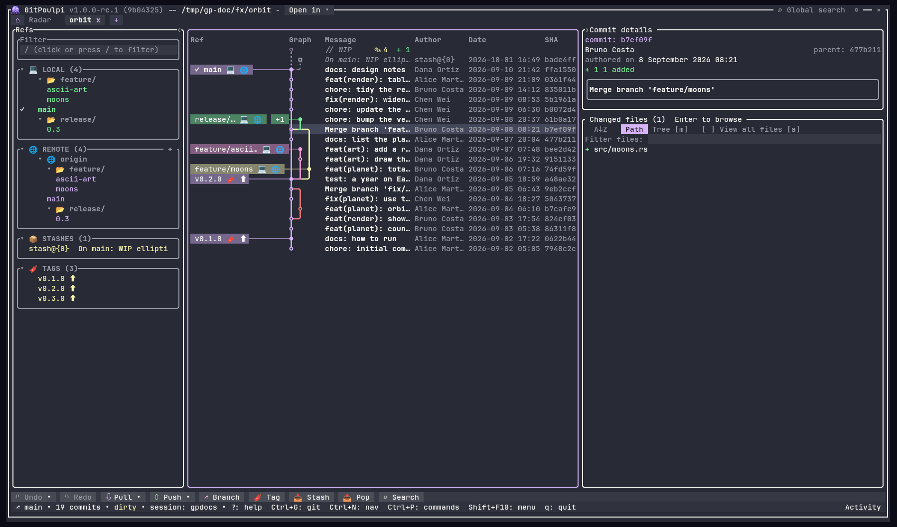
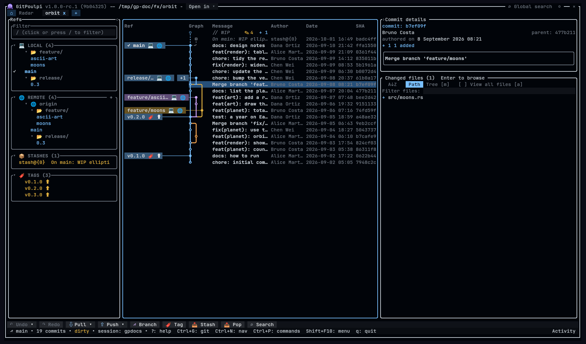
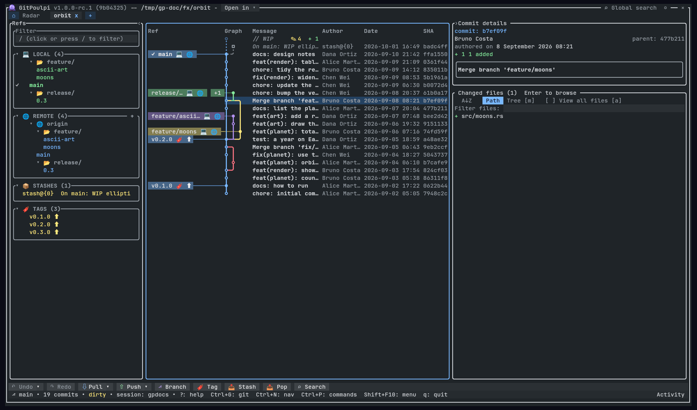
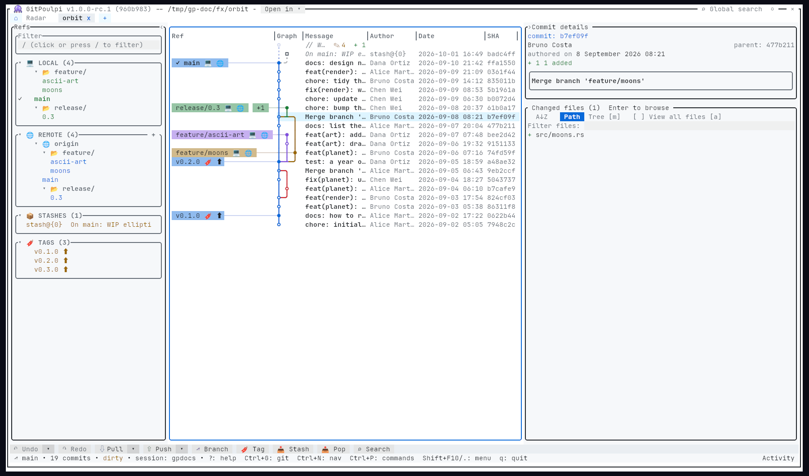
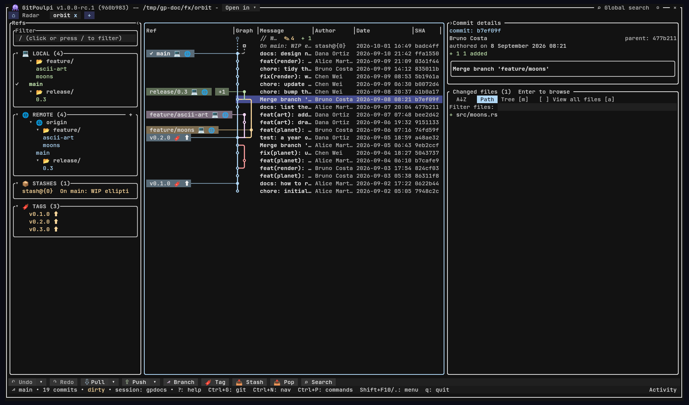
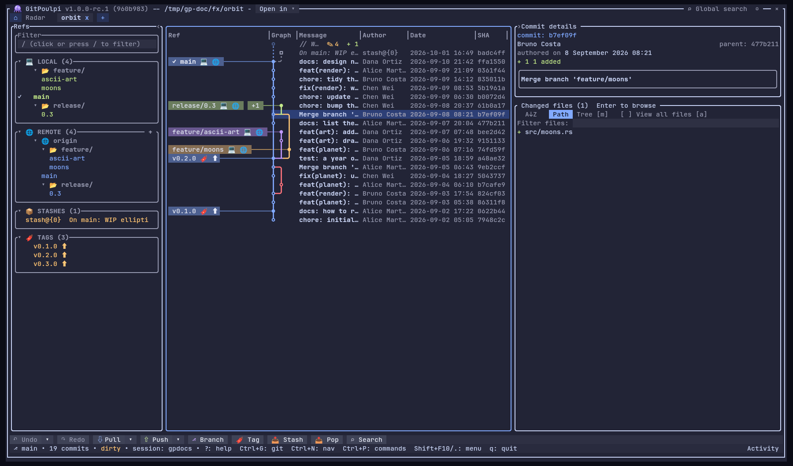
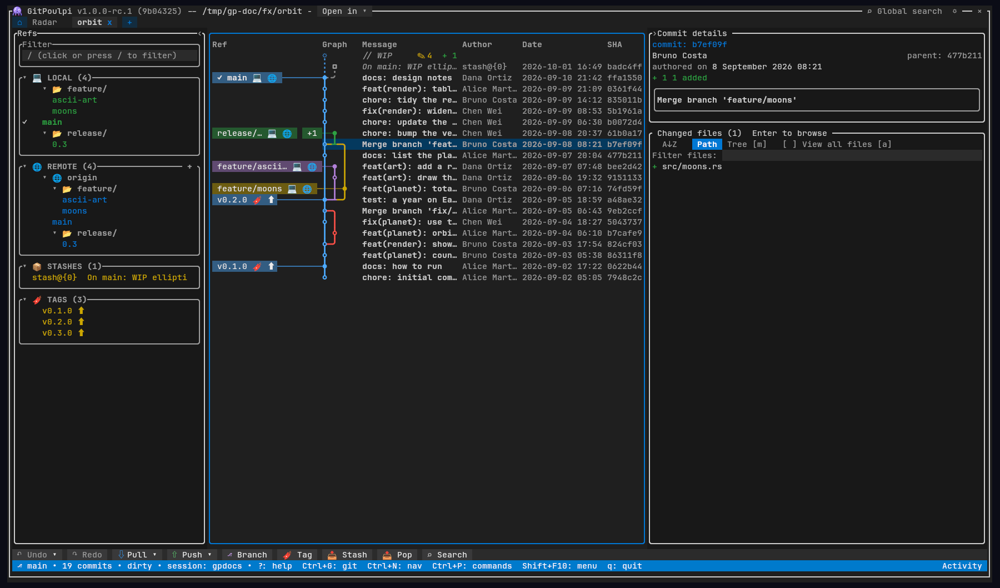
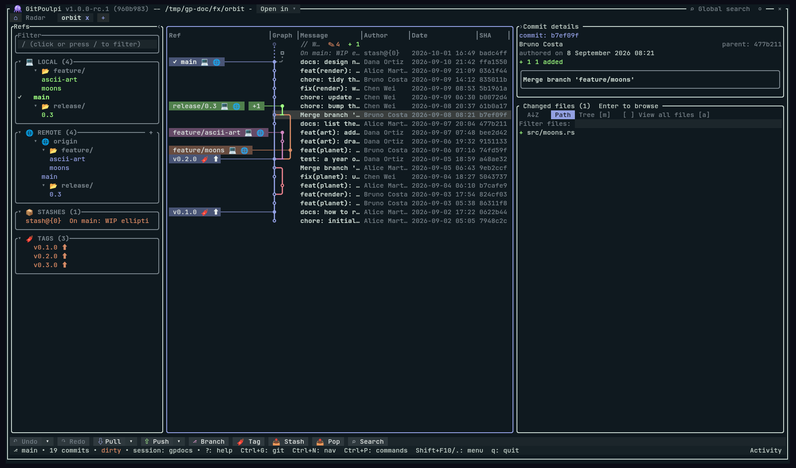
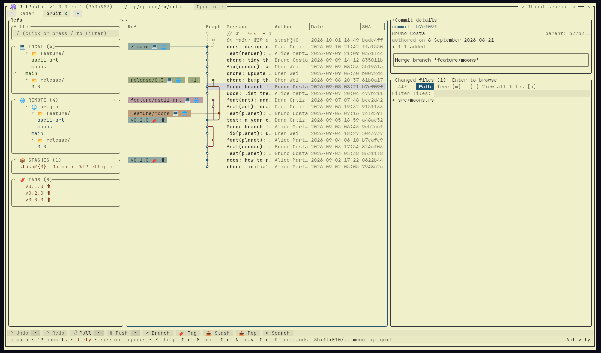
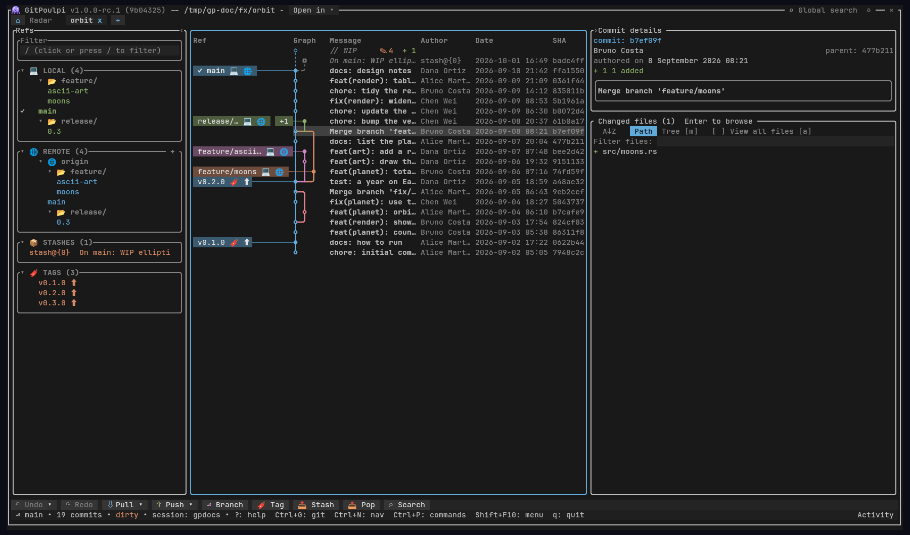

[English](../themes.md) · [Čeština](../cs/themes.md) · [Deutsch](../de/themes.md) · [Español](../es/themes.md) · [Français](../fr/themes.md) · [Italiano](../it/themes.md) · [日本語](../ja/themes.md) · [한국어](../ko/themes.md) · [Nederlands](../nl/themes.md) · [Polski](../pl/themes.md) · [Português (Brasil)](../pt-BR/themes.md) · **Português (Portugal)** · [Русский](../ru/themes.md) · [Svenska](../sv/themes.md) · [Türkçe](../tr/themes.md) · [Українська](../uk/themes.md) · [简体中文](../zh-CN/themes.md)

# Temas

Um tema define todas as cores que o GitPoulpi pinta: texto, painéis, seleção,
botões, as vistas de diff e de merge, o editor, os ícones da barra de
ferramentas e as cores das faixas do grafo do Log. Mude de tema em
**Definições > Aspeto > Tema**, ou com `gitpoulpi config set ui.theme <slug>`. Para ver o aspeto de cada um, vá diretamente para a [galeria](#galeria).

## Predefinições incluídas

`gitpoulpi theme list` imprime as da sua compilação, pela ordem em que a lista
das Definições as mostra: **GitPoulpi Dark** (`dark`, pintado sobre o fundo do
seu próprio terminal) e **GitPoulpi Light** (`light`) primeiro, depois todas as
outras predefinições por ordem alfabética da etiqueta. `ui.theme = "system"` (a
predefinição) segue o seu terminal: Light num fundo de terminal claro, Dark caso
contrário (veja "Deteção do sistema" abaixo); o antigo `default` é o mesmo que
`system`. A lista de paletas de faixas usa a mesma ordem.

| Slug | Etiqueta | Origem das cores |
|---|---|---|
| `system` (predefinição) | Sistema | não é uma paleta: GitPoulpi Light com fundo de terminal claro, GitPoulpi Dark caso contrário |
| `dark` | GitPoulpi Dark | tema original do GitPoulpi, pintado sobre o fundo do próprio terminal |
| `light` | GitPoulpi Light | tema original do GitPoulpi |
| `catppuccin-latte` / `catppuccin-frappe` / `catppuccin-macchiato` / `catppuccin-mocha` | Catppuccin Latte / Frappé / Macchiato / Mocha | [github.com/catppuccin/palette](https://github.com/catppuccin/palette) |
| `cyberpunk` | Cyberpunk | [iTerm2-Color-Schemes](https://github.com/mbadolato/iTerm2-Color-Schemes) "Cyberpunk" |
| `dracula` | Dracula | [draculatheme.com/contribute](https://draculatheme.com/contribute) |
| `everforest-dark` | Everforest Dark | [github.com/sainnhe/everforest/blob/master/palette.md](https://github.com/sainnhe/everforest/blob/master/palette.md) |
| `fire` / `fire-light` | Fire / Fire Light | temas originais do GitPoulpi: Fire é brasa sobre um fundo laranja queimado com laranja-chama; Fire Light é o gémeo claro dele, sobre um fundo laranja a sério |
| `github-dark` / `github-light` | GitHub Dark / GitHub Light | Os temas Primer do GitHub, [github.com/primer/github-vscode-theme](https://github.com/primer/github-vscode-theme) com @primer/primitives (`canvas.default`, `canvas.inset` como a barra lateral, `fg.*`, `accent.fg`); nenhum valor ajustado |
| `gruvbox-dark` / `gruvbox-light` | Gruvbox Dark / Light | [github.com/morhetz/gruvbox#palette](https://github.com/morhetz/gruvbox#palette) |
| `kanagawa` / `kanagawa-lotus` | Kanagawa (wave) / Kanagawa Lotus | [github.com/rebelot/kanagawa.nvim](https://github.com/rebelot/kanagawa.nvim) |
| `matrix` | Matrix | [iTerm2-Color-Schemes](https://github.com/mbadolato/iTerm2-Color-Schemes) "Matrix" (sem vermelho no esquema: `danger` é `#ff5555`) |
| `monokai` | Monokai | a paleta original do Monokai ([monokai.nl](https://monokai.nl/)) |
| `nord` | Nord | [www.nordtheme.com](https://www.nordtheme.com) |
| `one-dark` / `one-light` | One Dark / One Light | Atom One Dark / One Light ([One Dark](https://github.com/atom/one-dark-syntax), [One Light](https://github.com/atom/one-light-syntax)) |
| `rose-pine` / `rose-pine-moon` / `rose-pine-dawn` | Rosé Pine / Moon / Dawn | [rosepinetheme.com/palette](https://rosepinetheme.com/palette/) |
| `solarized-dark` / `solarized-light` | Solarized Dark / Light | O Solarized de Ethan Schoonover ([ethanschoonover.com/solarized](https://ethanschoonover.com/solarized/)) |
| `sunset` | Sunset | tema original do GitPoulpi: crepúsculo índigo com coral e dourado |
| `terminal` | Terminal (16 colors) | usa apenas as 16 cores do seu próprio terminal |
| `tokyo-night` / `tokyo-night-day` | Tokyo Night (night) / Tokyo Night Day | [github.com/folke/tokyonight.nvim](https://github.com/folke/tokyonight.nvim) (o primeiro plano do Day é escurecido para passar nas regras de contraste) |
| `vesper` | Vesper | [github.com/raunofreiberg/vesper](https://github.com/raunofreiberg/vesper) (sem azul nem roxo na paleta: o destaque é pêssego) |
| `vscode-dark` / `vscode-light` | VS Code Dark / VS Code Light | Dark Modern / Light Modern predefinidos do VS Code, [github.com/microsoft/vscode/tree/main/extensions/theme-defaults/themes](https://github.com/microsoft/vscode/tree/main/extensions/theme-defaults/themes) (`dark_modern.json`, `light_modern.json`, mais as cores predefinidas do VS Code para a seleção de listas e os destaques ANSI/gráficos; o cinzento esbatido do Light é `616161`) |

### Importados de terminalcolors.com

Importados das paletas de terminal de terminalcolors.com; cada esquema pertence
aos seus autores. 90 predefinições são construídas a partir do fundo, do primeiro
plano, da seleção e das 16 cores ANSI da paleta (accent = azul, success = verde,
warning = amarelo, danger = vermelho, AI = magenta, muted = preto brilhante),
por uma derivação partilhada por todas; uma cor que falhe as regras de contraste
do GitPoulpi é clareada ou escurecida até passar. A tabela é gerada por
`scripts/gen-terminalcolors.py` em
`crates/gitpoulpi-config/src/theme/terminalcolors_data.rs`. Os slugs são
`<família>-<variante>` (`default` omitido); as etiquetas estão por ordem
alfabética na lista, como as outras.

| Família | Slugs |
|---|---|
| [Apprentice](https://terminalcolors.com/themes/apprentice/) | `apprentice` |
| [Ayu](https://terminalcolors.com/themes/ayu/) | `ayu-dark`, `ayu-light`, `ayu-mirage` |
| [Cobalt2](https://terminalcolors.com/themes/cobalt2/) | `cobalt2` |
| [Deus](https://terminalcolors.com/themes/deus/) | `deus` |
| [Dracula](https://terminalcolors.com/themes/dracula/) | `dracula-soft` |
| [Everforest](https://terminalcolors.com/themes/everforest/) | `everforest-light` |
| [GitHub](https://terminalcolors.com/themes/github/) | `github-dark-colorblind`, `github-dark-dimmed`, `github-dark-high-contrast`, `github-dark-legacy`, `github-light-colorblind`, `github-light-high-contrast`, `github-light-legacy` |
| [Gotham](https://terminalcolors.com/themes/gotham/) | `gotham` |
| [Gruvbox](https://terminalcolors.com/themes/gruvbox/) | `gruvbox-dark-hard-contrast`, `gruvbox-dark-soft-contrast`, `gruvbox-light-hard-contrast`, `gruvbox-light-soft-contrast` |
| [Iceberg](https://terminalcolors.com/themes/iceberg/) | `iceberg-dark`, `iceberg-light` |
| [Jellybeans](https://terminalcolors.com/themes/jellybeans/) | `jellybeans` |
| [Kanagawa](https://terminalcolors.com/themes/kanagawa/) | `kanagawa-dragon` |
| [Lucario](https://terminalcolors.com/themes/lucario/) | `lucario` |
| [Miasma](https://terminalcolors.com/themes/miasma/) | `miasma` |
| [Moonfly](https://terminalcolors.com/themes/moonfly/) | `moonfly` |
| [Night](https://terminalcolors.com/themes/night-owl/) | `night-owl-dark`, `night-owl-light` |
| [Nightfly](https://terminalcolors.com/themes/nightfly/) | `nightfly` |
| [Nightfox](https://terminalcolors.com/themes/nightfox/) | `nightfox`, `nightfox-carbonfox`, `nightfox-dawnfox`, `nightfox-dayfox`, `nightfox-duskfox`, `nightfox-nordfox`, `nightfox-terafox` |
| [Noctis](https://terminalcolors.com/themes/noctis/) | `noctis`, `noctis-azureus`, `noctis-bordo`, `noctis-hibernus`, `noctis-lilac`, `noctis-lux`, `noctis-minimus`, `noctis-obscuro`, `noctis-sereno`, `noctis-uva`, `noctis-viola` |
| [Nordic](https://terminalcolors.com/themes/nordic/) | `nordic` |
| [One](https://terminalcolors.com/themes/one-half/) | `one-half-dark`, `one-half-light` |
| [Panda](https://terminalcolors.com/themes/panda/) | `panda` |
| [Posterpole](https://terminalcolors.com/themes/posterpole/) | `posterpole`, `posterpole-gray` |
| [Seoul256](https://terminalcolors.com/themes/seoul256/) | `seoul256-dark`, `seoul256-light` |
| [Shades](https://terminalcolors.com/themes/shades-of-purple/) | `shades-of-purple`, `shades-of-purple-super-dark` |
| [Sonokai](https://terminalcolors.com/themes/sonokai/) | `sonokai`, `sonokai-andromeda`, `sonokai-atlantis`, `sonokai-espresso`, `sonokai-maia`, `sonokai-shusia` |
| [Srcery](https://terminalcolors.com/themes/srcery/) | `srcery` |
| [Tender](https://terminalcolors.com/themes/tender/) | `tender` |
| [Tokyo](https://terminalcolors.com/themes/tokyo-night/) | `tokyo-night-moon`, `tokyo-night-storm` |
| [Tomorrow](https://terminalcolors.com/themes/tomorrow/) | `tomorrow`, `tomorrow-night`, `tomorrow-night-blue`, `tomorrow-night-bright`, `tomorrow-night-eighties` |
| [Zenbones](https://terminalcolors.com/themes/zenbones/) | `zenbones-duckbones`, `zenbones-forestbones-dark`, `zenbones-forestbones-light`, `zenbones-kanagawabones`, `zenbones-neobones-dark`, `zenbones-neobones-light`, `zenbones-nordbones`, `zenbones-rosebones-dark`, `zenbones-rosebones-light`, `zenbones-seoulbones-dark`, `zenbones-seoulbones-light`, `zenbones-tokyobones-dark`, `zenbones-tokyobones-light`, `zenbones-vimbones`, `zenbones-zenburned`, `zenbones-zenwritten-dark`, `zenbones-zenwritten-light` |

`ui.side_bg` é o fundo do painel Refs e do painel direito (detalhes do commit,
alterações em curso, listas de ficheiros), como o GitHub e o VS
Code pintam as suas barras laterais. O Catppuccin
(o seu `mantle`), o GitHub e o VS Code definem-no; para todas as outras
predefinições é `default`, o que significa o mesmo que `ui.bg`. Um ficheiro de
tema pode definir `side_bg` em `[ui]` (`gitpoulpi theme export` imprime-o).

Mais três papéis em `[ui]` colorem o chrome, como o GitHub e o VS Code fazem:

| Papel | Onde pinta |
|---|---|
| `ui.toolbar_bg` | A linha da barra de ferramentas, e o **separador de repositório selecionado**, para que o separador pareça ligado à barra de ferramentas. Os chips dos botões da barra de ferramentas mantêm o seu próprio `chrome.toolbar_bg`. |
| `ui.statusbar_bg` | A barra de estado (em baixo, salvo se `ui.statusbar_position` disser em cima). |
| `ui.statusbar_fg` | O texto da barra de estado. O texto que não se leria sobre esse preenchimento é repintado com ela; o texto de aviso e de erro que se lê mantém a sua cor. |

As predefinições definem-nos para combinar com a sua aplicação: o VS Code
Dark e Light a barra de estado azul (`#007acc`) com texto branco e os cinzentos
da barra de título do VS Code para a barra de ferramentas; o GitHub os tons do
seu cabeçalho. Todas as outras predefinições (incluindo as paletas de terminal
importadas) derivam uma barra de ferramentas um passo afastada de `bg` e uma
barra de estado um pouco afastada dela, com `text` por cima, e as regras de
contraste mantêm o texto legível. `dark` (GitPoulpi Dark) e `terminal` usam o
fundo do próprio terminal, pelo que os três são `default` aí: nada é pintado e o
separador selecionado mantém a cor de seleção. Um ficheiro de tema que os omita
herda os valores da sua base; `default` significa sem tom (a barra de estado
segue então `side_bg`).

Quando o cinzento de comentário ou esbatido de um esquema é demasiado escuro
para se ler, é clareado até passar nas regras de contraste do GitPoulpi; os tons
de painel e de seleção que ao esquema faltam são derivados do seu fundo.

### Galeria

Todos os temas incluídos, no mesmo repositório com um commit de merge
selecionado (`scripts/docs-screenshots.sh` volta a tirá-las).

| **GitPoulpi Dark** (`dark`) | **GitPoulpi Light** (`light`) | **Apprentice** (`apprentice`) |
|---|---|---|
|  |  |  |
| **Ayu Dark** (`ayu-dark`) | **Ayu Light** (`ayu-light`) | **Ayu Mirage** (`ayu-mirage`) |
|  |  |  |
| **Catppuccin Frappé** (`catppuccin-frappe`) | **Catppuccin Latte** (`catppuccin-latte`) | **Catppuccin Macchiato** (`catppuccin-macchiato`) |
|  |  |  |
| **Catppuccin Mocha** (`catppuccin-mocha`) | **Cobalt2** (`cobalt2`) | **Cyberpunk** (`cyberpunk`) |
|  |  |  |
| **Deus** (`deus`) | **Dracula** (`dracula`) | **Dracula Soft** (`dracula-soft`) |
|  |  |  |
| **Everforest Dark** (`everforest-dark`) | **Everforest Light** (`everforest-light`) | **Fire** (`fire`) |
|  |  |  |
| **Fire Light** (`fire-light`) | **GitHub Dark** (`github-dark`) | **GitHub Dark Colorblind** (`github-dark-colorblind`) |
|  |  |  |
| **GitHub Dark Dimmed** (`github-dark-dimmed`) | **GitHub Dark High Contrast** (`github-dark-high-contrast`) | **GitHub Dark Legacy** (`github-dark-legacy`) |
|  |  |  |
| **GitHub Light** (`github-light`) | **GitHub Light Colorblind** (`github-light-colorblind`) | **GitHub Light High Contrast** (`github-light-high-contrast`) |
|  |  |  |
| **GitHub Light Legacy** (`github-light-legacy`) | **Gotham** (`gotham`) | **Gruvbox Dark** (`gruvbox-dark`) |
|  |  |  |
| **Gruvbox Dark Hard Contrast** (`gruvbox-dark-hard-contrast`) | **Gruvbox Dark Soft Contrast** (`gruvbox-dark-soft-contrast`) | **Gruvbox Light** (`gruvbox-light`) |
|  |  |  |
| **Gruvbox Light Hard Contrast** (`gruvbox-light-hard-contrast`) | **Gruvbox Light Soft Contrast** (`gruvbox-light-soft-contrast`) | **Iceberg Dark** (`iceberg-dark`) |
|  |  |  |
| **Iceberg Light** (`iceberg-light`) | **Jellybeans** (`jellybeans`) | **Kanagawa** (`kanagawa`) |
|  |  |  |
| **Kanagawa Dragon** (`kanagawa-dragon`) | **Kanagawa Lotus** (`kanagawa-lotus`) | **Lucario** (`lucario`) |
|  |  |  |
| **Matrix** (`matrix`) | **Miasma** (`miasma`) | **Monokai** (`monokai`) |
|  |  |  |
| **Moonfly** (`moonfly`) | **Night Owl Dark** (`night-owl-dark`) | **Night Owl Light** (`night-owl-light`) |
|  |  |  |
| **Nightfly** (`nightfly`) | **Nightfox** (`nightfox`) | **Nightfox Carbonfox** (`nightfox-carbonfox`) |
|  |  |  |
| **Nightfox Dawnfox** (`nightfox-dawnfox`) | **Nightfox Dayfox** (`nightfox-dayfox`) | **Nightfox Duskfox** (`nightfox-duskfox`) |
|  |  |  |
| **Nightfox Nordfox** (`nightfox-nordfox`) | **Nightfox Terafox** (`nightfox-terafox`) | **Noctis** (`noctis`) |
|  |  |  |
| **Noctis Azureus** (`noctis-azureus`) | **Noctis Bordo** (`noctis-bordo`) | **Noctis Hibernus** (`noctis-hibernus`) |
|  |  |  |
| **Noctis Lilac** (`noctis-lilac`) | **Noctis Lux** (`noctis-lux`) | **Noctis Minimus** (`noctis-minimus`) |
|  |  |  |
| **Noctis Obscuro** (`noctis-obscuro`) | **Noctis Sereno** (`noctis-sereno`) | **Noctis Uva** (`noctis-uva`) |
|  |  |  |
| **Noctis Viola** (`noctis-viola`) | **Nord** (`nord`) | **Nordic** (`nordic`) |
|  |  |  |
| **One Dark** (`one-dark`) | **One Half Dark** (`one-half-dark`) | **One Half Light** (`one-half-light`) |
|  |  |  |
| **One Light** (`one-light`) | **Panda** (`panda`) | **Posterpole** (`posterpole`) |
|  |  |  |
| **Posterpole Gray** (`posterpole-gray`) | **Rosé Pine** (`rose-pine`) | **Rosé Pine Dawn** (`rose-pine-dawn`) |
|  |  |  |
| **Rosé Pine Moon** (`rose-pine-moon`) | **Seoul256 Dark** (`seoul256-dark`) | **Seoul256 Light** (`seoul256-light`) |
|  |  |  |
| **Shades of Purple** (`shades-of-purple`) | **Shades of Purple Super Dark** (`shades-of-purple-super-dark`) | **Solarized Dark** (`solarized-dark`) |
|  |  |  |
| **Solarized Light** (`solarized-light`) | **Sonokai** (`sonokai`) | **Sonokai Andromeda** (`sonokai-andromeda`) |
|  |  |  |
| **Sonokai Atlantis** (`sonokai-atlantis`) | **Sonokai Espresso** (`sonokai-espresso`) | **Sonokai Maia** (`sonokai-maia`) |
|  |  |  |
| **Sonokai Shusia** (`sonokai-shusia`) | **Srcery** (`srcery`) | **Sunset** (`sunset`) |
|  |  |  |
| **Tender** (`tender`) | **Terminal (16 colors)** (`terminal`) | **Tokyo Night** (`tokyo-night`) |
|  |  |  |
| **Tokyo Night Day** (`tokyo-night-day`) | **Tokyo Night Moon** (`tokyo-night-moon`) | **Tokyo Night Storm** (`tokyo-night-storm`) |
|  |  |  |
| **Tomorrow** (`tomorrow`) | **Tomorrow Night** (`tomorrow-night`) | **Tomorrow Night Blue** (`tomorrow-night-blue`) |
|  |  |  |
| **Tomorrow Night Bright** (`tomorrow-night-bright`) | **Tomorrow Night Eighties** (`tomorrow-night-eighties`) | **Vesper** (`vesper`) |
|  |  |  |
| **VS Code Dark** (`vscode-dark`) | **VS Code Light** (`vscode-light`) | **Zenbones Duckbones** (`zenbones-duckbones`) |
|  |  |  |
| **Zenbones Forestbones Dark** (`zenbones-forestbones-dark`) | **Zenbones Forestbones Light** (`zenbones-forestbones-light`) | **Zenbones Kanagawabones** (`zenbones-kanagawabones`) |
|  |  |  |
| **Zenbones Neobones Dark** (`zenbones-neobones-dark`) | **Zenbones Neobones Light** (`zenbones-neobones-light`) | **Zenbones Nordbones** (`zenbones-nordbones`) |
|  |  |  |
| **Zenbones Rosebones Dark** (`zenbones-rosebones-dark`) | **Zenbones Rosebones Light** (`zenbones-rosebones-light`) | **Zenbones Seoulbones Dark** (`zenbones-seoulbones-dark`) |
|  |  |  |
| **Zenbones Seoulbones Light** (`zenbones-seoulbones-light`) | **Zenbones Tokyobones Dark** (`zenbones-tokyobones-dark`) | **Zenbones Tokyobones Light** (`zenbones-tokyobones-light`) |
|  |  |  |
| **Zenbones Vimbones** (`zenbones-vimbones`) | **Zenbones Zenburned** (`zenbones-zenburned`) | **Zenbones Zenwritten Dark** (`zenbones-zenwritten-dark`) |
|  |  |  |
| **Zenbones Zenwritten Light** (`zenbones-zenwritten-light`) |
|  |

## Qualquer tema com qualquer paleta de faixas

Cada tema traz as suas próprias cores de faixa para o grafo do Log, mas pode
combinar qualquer tema com qualquer paleta: **Definições > Aspeto > Tema de
cores do grafo** oferece **Seguir o tema** (a predefinição) mais todas as
paletas de faixas de todos os temas (GitPoulpi Dark, GitPoulpi Light, depois
Material, Serie, ... e o `graph_palette` dos seus próprios ficheiros de
tema, listados depois das predefinições sob o nome do tema). Um tema personalizado aparece
da próxima vez que a lista abre (os ficheiros são então relidos), e escolher um guarda o
nome do seu ficheiro em `ui.graph_color_theme` (para a instalação principal em `[ui]`, para
as outras na sua própria entrada `[installation.settings.<id>]`, como o tema). Um ficheiro
de tema sem `graph_palette` tem as cores de faixa da sua `base` (a predefinição quando não
nomeia nenhuma), a mesma herança de todas as outras cores do ficheiro. Um tema personalizado
com o nome de uma paleta de faixas incorporada (por exemplo `gruvbox`) substitui essa paleta
na lista. Se o nome configurado já não existe (o ficheiro foi apagado ou renomeado), o grafo
usa as cores de faixa do tema ativo, e as Definições mostram o nome marcado *não encontrado*
até escolher outro. 

No `config.toml`:

```toml
[ui]
theme = "nord"
graph_color_theme = "material"   # ou "theme" para seguir o tema
```

`ui.input_color` é o mesmo tipo de substituição para os campos de texto: o
`theme` predefinido segue as cores de campo do tema; `gray`, `blue`, `slate`,
`dark` e `custom` forçam um fundo (são cores escuras, por isso escolha `theme`
num tema claro).

## Os seus próprios temas

Ponha um ficheiro `.toml` na pasta `themes/` do diretório de configuração
(`gitpoulpi config path` imprime o seu pai; a pasta é `${config}/themes/`). O
nome do ficheiro sem `.toml` é o slug do tema, que é o que `ui.theme` aceita.
Um ficheiro não pode reutilizar o slug de uma predefinição (é ignorado com um
aviso).

Comece por um ficheiro completo:

```
gitpoulpi theme export nord > "$(dirname "$(gitpoulpi config path)")/themes/mine.toml"
```

Depois mantenha apenas o que altera. Um ficheiro é um conjunto de **substituições
parciais** sobre uma `base` (uma predefinição, ou outro tema de utilizador; as
cadeias têm no máximo 4 de profundidade e os ciclos são rejeitados; sem `base`
significa `dark`):

```toml
name = "My Nord"            # a etiqueta na lista; predefinição = nome do ficheiro
base = "nord"
light = false               # herdado quando em falta
syntax = "base16-ocean.dark"
graph_palette = ["#88c0d0", "#a3be8c"]

[ui]
bg = "#2e3440"              # "default" | "#rrggbb" | "ansi:N"
accent = "#88c0d0"
toolbar_bg = "#3b4252"      # linha da barra de ferramentas e separador selecionado
statusbar_bg = "#5e81ac"    # status line
statusbar_fg = "#eceff4"

[diff]
add_bg = "#2f3b2f"
```

### Palavras alteradas num diff (`diff.add_emph_bg`, `diff.del_emph_bg`)

Os fundos mais fortes que a vista Diff pinta nas palavras que diferem dentro de
uma linha alterada, sobre `diff.add_bg` (linhas adicionadas) e `diff.del_bg` (linhas
removidas); o texto mantém `diff.add_fg` e `diff.del_fg`. Todas as predefinições definem ambos.
Um ficheiro de tema que define `diff.add_bg` ou `diff.del_bg` mas não a ênfase
correspondente recebe uma derivada dele (30% do caminho para a cor do texto
desse lado), para que um fundo personalizado nunca fique com a ênfase do
tema base. Um valor `default` (a predefinição Terminal), ou um terminal cuja
profundidade de cor desenharia os dois fundos iguais, marca antes as palavras a negrito e
sublinhado. Veja [Palavras alteradas num diff](interface-tour.md#palavras-alteradas-num-diff).

As cores são `"#rrggbb"`, `"ansi:N"` (a entrada N da paleta do terminal) ou
`"default"` (a cor do próprio terminal). Os grupos e as chaves são os de
`gitpoulpi theme export <slug>`. Nada é fatal: uma chave desconhecida ou uma cor
inválida é ignorada, uma `base` desconhecida recua para `dark`, e
`gitpoulpi theme list` comunica cada problema em `warnings` (a aplicação mostra-os
uma vez na barra de estado).

Os ficheiros são relidos quando a lista Tema abre e quando as Definições se
fecham. Uma janela em execução também repara quando o `config.toml` (um
`gitpoulpi config set ui.theme ...` feito a partir de uma shell) ou o ficheiro do
tema ativo são reescritos, e aplica as novas cores em cerca de um segundo, sem
reiniciar.

### `ui.border_focused`

A moldura do painel que tem o foco do teclado: o Log, a barra lateral Refs, os
painéis Staged e Unstaged, os detalhes do commit, os painéis de histórico, de
revisão e de reescrita, e as molduras do diff, dos ficheiros e do editor. Pinta
apenas bordas; o texto, as etiquetas e os ícones (a etiqueta «commit :», o ícone
de Início, os botões dos separadores) continuam a usar `ui.accent`. Assim, um
tema pode emoldurar o painel ativo com uma cor que seria ilegível como texto, por
exemplo um amarelo vivo num tema claro. Quando um tema não a define, segue
`ui.accent` (também num ficheiro do utilizador: um ficheiro que altera só o
`accent` dá esse destaque às suas molduras com foco), pelo que todos os temas
incorporados ficam como estavam. Os diálogos e as janelas pop-up mantêm uma
moldura com a cor de destaque.

```toml
[ui]
accent = "#1f5fbf"
border_focused = "#ffd700"
```

## Deteção do sistema

Com `ui.theme = "system"`, o GitPoulpi pergunta ao terminal a sua cor de fundo
**uma só vez, no arranque** (a consulta OSC 11, respondida por kitty, WezTerm,
Alacritty, foot, iTerm2, Windows Terminal, tmux e a maioria dos outros) e escolhe
Light para um fundo claro, Dark caso contrário. A espera é de cerca de 100 ms no
máximo, e um terminal que não conheça a consulta não custa nada: a resposta é
sempre lida antes de a interface arrancar, pelo que nada é impresso e nenhuma
tecla é engolida. Sem resposta (e sempre no Windows, que não envia a consulta)
lê `COLORFGBG` e depois recua para Dark. Um terminal cujo fundo muda enquanto o
GitPoulpi corre não é acompanhado; reinicie-o, ou escolha Light ou Dark
explicitamente.

## Profundidade de cor

Os temas são truecolor (`#rrggbb`). `ui.color_depth` (Definições > Aspeto >
Profundidade de cor, aplica-se de imediato) decide como isso chega ao terminal:

| Valor | Efeito |
|---|---|
| `auto` (predefinição) | Truecolor, exceto onde se sabe que não funciona: o Terminal da Apple (`TERM_PROGRAM=Apple_Terminal`) usa 256 cores, a consola Linux (`TERM=linux`) 16, e um terminal `*-256color` que não define `COLORTERM` (e não é WezTerm, kitty nem Windows Terminal) 256. `COLORTERM=truecolor` significa sempre truecolor. |
| `truecolor` | Sempre cor de 24 bits. |
| `256` | Cada cor RGB passa a ser a entrada xterm-256 mais próxima. |
| `16` | A mais próxima das 16 cores ANSI; a paleta do próprio terminal define a tonalidade exata. |

Use `256` ou `16` se um tema aparecer com cores erradas por ssh ou num
multiplexador antigo. A predefinição Terminal não precisa de nada disto. O
truecolor não custa nada; a passagem de mapeamento corre sobre o ecrã uma vez por
frame, apenas quando está ativa.

O tema é por instalação: várias instalações do GitPoulpi que partilham uma configuração mantêm cada uma o seu, por isso escolher um numa instalação nunca recolore as outras.

## Pré-visualização em direto

Em Definições > Aspeto, a lista Tema mostra **Sistema (segue o terminal)**, as
predefinições, depois os seus próprios ficheiros de tema. Mover o realce aplica
esse tema de imediato, pelo que todo o ecrã das Definições se repinta debaixo de
si; **Enter** mantém-no (fica guardado), **Esc** ou um clique fora restaura o
anterior e não guarda nada. A entrada da paleta **Aplicação: tema...**
(`Ctrl+P`) abre as Definições nessa linha.

### Mudar de tema a partir da paleta

**Aplicação: mudar tema...** (`Ctrl+P`, ou `Ctrl+N t`; a tecla pode ser
reatribuída como `nav_prefix.change_theme`) abre uma lista dos mesmos temas sem
passar pelas Definições: **Sistema (segue o terminal)**, as predefinições,
depois os seus próprios ficheiros de tema, cada um com quatro pequenos chips de
cor. O tema atual está assinalado. Escreva para restringir a lista; mover o
realce pré-visualiza o tema de imediato, **Enter** aplica-o e guarda `ui.theme`
no `config.toml`, **Esc** (ou um clique fora da lista) repõe o tema anterior e
não guarda nada.

Por baixo do campo de filtro, um pré-filtro segmentado restringe a lista:
**Todos**, **Escuros**, **Claros** e **Coloridos**, mais **Personalizados** quando tem ficheiros de tema
seus (clique num segmento, `Tab` / `Shift+Tab`, ou `Alt+1`..`Alt+5`). Escuros e Claros vêm do brilho do `ui.bg` do
tema; **Coloridos** mantém os temas cujo fundo é claramente tingido (azul,
violeta, amarelo, verde...) e deixa de fora brancos, quase-brancos, pretos e
cinzentos quase pretos, pelo que Solarized Dark, Dracula ou Nord são coloridos
enquanto GitHub Dark e One Light não são. Um tema colorido também aparece em
Escuros ou Claros. **Sistema** e os temas transparentes (sem fundo próprio) só
aparecem em Todos. **Personalizados** mantém só os ficheiros de tema da sua pasta `themes/` (um tema personalizado
continua a ser Escuro, Claro ou Colorido para esses botões); o botão não é desenhado nem
alcançável pelo teclado enquanto essa pasta não tiver nenhum tema. O pré-filtro combina
com o que escreve. Os seletores do tema
de cores do grafo e do idioma pré-visualizam da mesma forma: as faixas do Log e
toda a interface mudam à medida que o realce se move.


Por baixo da lista, uma faixa de chips de cor mostra o tema em vigor (fundo,
texto, esbatido, destaque, seleção, perigo, diff adicionado, diff removido, e
depois as primeiras seis cores de faixa), e acompanha a pré-visualização. A
lista **Tema de cores do grafo** em **Aspeto** mostra algumas cores de faixa
junto a cada paleta, e as escolhas aplicam-se quando as Definições se fecham.

Um tema com fundo próprio (Light e as outras predefinições pintadas) preenche a
janela inteira, incluindo as Definições e as vistas de página inteira, e dá ao
texto que não tem cor própria a cor de texto do tema; Dark e Terminal deixam em
paz as cores do seu terminal.

## A partir da linha de comandos

| Comando | Saída |
|---|---|
| `gitpoulpi theme list` | JSON `{themes: [{slug, label, source, light, lane_palette}], warnings}`; `source` é `preset` ou `user`. |
| `gitpoulpi theme export <slug>` | O ficheiro de tema completo em TOML no stdout (JSON: `{slug, toml}`); volta a ser lido como o mesmo tema. |
| `gitpoulpi config set ui.theme <slug>` | Validado contra as predefinições e a sua pasta `themes/`; um nome desconhecido é um erro que lista os válidos. `system` e `default` são aceites. |
| `gitpoulpi config set ui.graph_color_theme <name>` | `theme` (seguir o tema) ou qualquer nome de paleta de faixas; um nome desconhecido lista os válidos. |

O servidor MCP oferece `theme_list` e `theme_export` como ferramentas só de
leitura.
