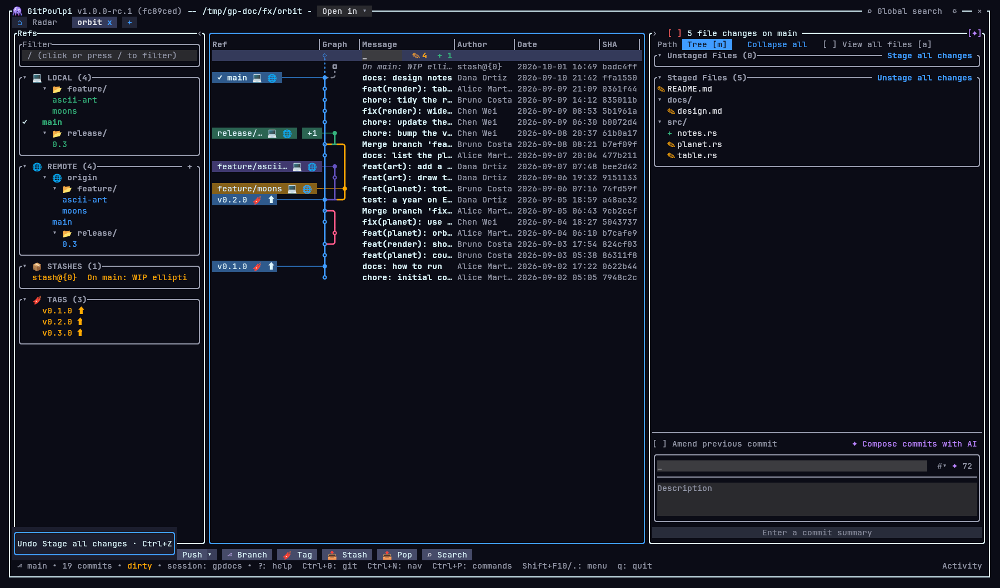

[English](../undo-redo.md) · [Čeština](../cs/undo-redo.md) · [Deutsch](../de/undo-redo.md) · [Español](../es/undo-redo.md) · [Français](../fr/undo-redo.md) · [Italiano](../it/undo-redo.md) · [日本語](../ja/undo-redo.md) · [한국어](../ko/undo-redo.md) · [Nederlands](../nl/undo-redo.md) · [Polski](../pl/undo-redo.md) · [Português (Brasil)](../pt-BR/undo-redo.md) · **Português (Portugal)** · [Русский](../ru/undo-redo.md) · [Svenska](../sv/undo-redo.md) · [Türkçe](../tr/undo-redo.md) · [Українська](../uk/undo-redo.md) · [简体中文](../zh-CN/undo-redo.md)

# Desfazer e refazer

**Pode sempre voltar atrás.** Cada alteração que o GitPoulpi faz ao seu
repositório fica registada (até 100 ações por predefinição,
`general.undo_depth`), tal como cada posição por onde uma branch passou,
incluindo os movimentos feitos por outros programas. Se cometer um erro, uma
destas vias traz o trabalho de volta:

| Quer | Use |
|---|---|
| desfazer a última coisa | `Ctrl+Z` (refazer: `Ctrl+Y` ou `Ctrl+Shift+Z`), ou os botões **Desfazer** e **Refazer** da barra de ferramentas |
| desfazer várias coisas de uma vez, ou uma só de há muito tempo | o **Histórico de desfazer** (`Alt+Z`, a seta ao lado de Desfazer, `Editar: histórico de desfazer...`) |
| recuperar uma branch, tag, stash, ficheiro ou hunk que removeu há várias ações, **sem desfazer o que fez entretanto** | **Restaurar só esta** no Histórico de desfazer |
| pôr uma branch onde estava, mesmo que outro programa a tenha movido | o **Reflog** da branch (menu da ref, `Reflog...`) |
| encontrar commits que já nenhuma branch alcança | **Trabalho perdido** (`Editar: recuperar commits perdidos...`) |
| desfazer o que uma shell ou um **agente de IA** fez a branches, tags, stashes ou HEAD | o mesmo `Ctrl+Z`: essas alterações também estão no histórico, marcadas como **externas** (veja [Alterações feitas fora do GitPoulpi](#alterações-feitas-fora-do-gitpoulpi)) |

Depois de cada ação que destrói algo e pode ser desfeita (descartar, eliminar um
ficheiro, eliminar uma branch ou tag, reset hard, descartar um stash, remover um
remoto), a barra de estado di-lo: "descartar concluído - Ctrl+Z para desfazer",
com a tecla tal como a tem atribuída. A dica do botão Desfazer diz quantas ações
pode recuar.

`Ctrl+Z` desfaz a última coisa que o GitPoulpi fez ao seu repositório. `Ctrl+Y`
(ou `Ctrl+Shift+Z`) volta a pô-la. A barra de ferramentas tem os botões
**Desfazer** e **Refazer**, a paleta tem `Editar: desfazer` e `Editar: refazer`,
e a dica de cada botão diz o que ele desfaria ("Desfazer Commit \"fix typo\"
(a81b9e4)").



Refazer nunca volta a executar a operação. Restaura o estado que foi registado,
pelo que um commit refeito é exatamente o mesmo commit, com o mesmo id e a mesma
data e hora.

`Ctrl+Z` fica inerte enquanto um campo de texto tem o teclado (a mensagem do
commit, a caixa de filtro, o editor, que mantém o seu próprio desfazer de
texto).

## O Histórico de desfazer

`Alt+Z` (reatribuível), a seta ao lado do botão Desfazer ou `Editar: Histórico de
desfazer...` abre um painel com todas as ações registadas, da mais recente para a
mais antiga: um ícone do tipo de ação (commit, branch, tag, stash, reset,
merge e afins, descartar, stage, configuração, alteração externa), o que fez no
seu idioma, há quanto tempo, e o seu estado (**restaurável**, **bloqueada** com
o motivo, ou **desfeita** e pronta a refazer). Quando as entradas abrangem vários
dias, um título fino (Hoje, Ontem, depois a data) abre cada dia. O cabeçalho
conta-as ("12 ações podem ser desfeitas (até 100)").

As ações que desfez ficam **acima** da ação mais recente, sob um separador
("desfeitas - Refazer repõe-nas"), esbatidas, com a que o Refazer repõe a seguir
mais perto do separador. A seleção começa na ação mais recente, não nelas. As
setas movem a seleção (os títulos e o separador são saltados), `Tab` alterna
entre as três vistas e `Esc` fecha. Para a linha selecionada:

- **Desfazer até aqui** (`u`): desfaz essa ação e todas as mais recentes, da mais
  recente para a mais antiga, depois de uma única confirmação que as lista todas.
  Um passo que o daemon considere arriscado volta a perguntar antes de correr.
- **Restaurar só esta** (`r`): repõe o que essa ação removeu e mantém tudo o que
  foi feito depois dela. Uma branch ou tag eliminada volta no commit que tinha
  (se o nome entretanto foi ocupado, é-lhe pedido outro, com um livre já
  preenchido); um stash descartado volta ao topo da lista de stashes; um ficheiro
  descartado ou eliminado é escrito de novo no mesmo sítio se não foi tocado
  desde então, caso contrário ao lado dele como `nome.restored` (nada é alguma
  vez substituído); um remoto, um upstream, uma linha de ignorar ou uma linha de
  atributos removidos são acrescentados de novo. Um reset, amend, rebase, merge
  ou commit gera uma branch `restore/<branch>-<sha>` na ponta antiga - a sua
  branch atual e os seus ficheiros nunca se movem. A confirmação mostra
  exatamente o que vai fazer, e o restauro é uma nova ação: `Ctrl+Z` desfaz-o.
- **Refazer até aqui** (`y`) numa linha desfeita.
- **Restaurar main para onde Commit a deixou** (`o`, ou `Alt+Shift+Z` /
  `Editar: restaurar a branch para onde a ação bloqueada a deixou` fora do
  painel): quando outro programa moveu a branch e bloqueou o Desfazer, o reflog
  continua a saber onde a ação a deixou.

Clique com o botão direito numa linha (ou prima `.`) para as mesmas ações num
menu.


## O Reflog

O menu da ref de uma branch local tem **Reflog...**; `Editar: Reflog...` mostra o
do HEAD, e o Histórico de desfazer tem um separador para ele. Lista as posições
por onde a branch passou, da mais recente para a mais antiga: SHA curto, o motivo
registado, há quanto tempo, quem - incluindo os movimentos feitos numa shell. A
mensagem e os ficheiros alterados da posição selecionada aparecem ao lado da
lista.

O reflog é lido 200 posições de cada vez. Um mais longo continua por si: mover o
cursor (ou deslocar) perto do fim da lista obtém a página seguinte, e a última
linha diz **... Carregar mais** enquanto houver outra. **Carregar mais** (`m`, ou
`Reflog: carregar mais` na paleta) obtém-na logo e diz «posições carregadas: N» na
barra de estado. Os repositórios que usam o formato reftable do git são lidos como
quaisquer outros.


**Mostrar no Log** (`s`), **Criar branch aqui** (`b`) e **Restaurar
`<branch>` para esta posição** (`r`). O restauro é desfazível. Quando a branch
está em checkout e tem alterações locais que ela não consegue mover sem as
substituir, uma lista pergunta o que fazer com elas: manter as minhas alterações,
soft, mixed ou hard. Hard descarta as alterações nos seus ficheiros, mas guarda-as
primeiro, pelo que `Ctrl+Z` ainda as traz de volta (di-lo a vermelho).

## Trabalho perdido

`Editar: recuperar commits perdidos...` (também no menu de commit do Log) encontra
commits que nenhuma branch, tag ou stash alcança: os que um reflog ainda nomeia
(os commits de uma branch eliminada), os que só um pin do desfazer mantém, e os
soltos. A lista aparece de imediato e a pesquisa mais lenta de commits soltos vai
preenchendo enquanto um indicador de progresso roda; nunca bloqueia a interface.


**Criar branch aqui** (`b`) recupera um commit com um nome à sua escolha,
**Cherry-pick** (`c`) aplica-o à branch atual e **Mostrar no Log** (`s`) funciona
para os que ainda são alcançáveis.

## A partir da paleta de comandos

Cada ação de linha das três vistas é também uma linha da paleta de comandos, pelo que
o painel não precisa de rato nem de letras para decorar. Prima `Ctrl+P` com o painel
aberto: a paleta abre por cima dele e as suas linhas **Histórico de desfazer:**,
**Reflog:** e **Trabalho perdido:** atuam sobre a linha selecionada da vista que está
no ecrã.

| Vista | Linhas da paleta |
|---|---|
| Histórico de desfazer | `Histórico de desfazer: desfazer até aqui...`, `refazer até aqui...`, `restaurar só esta...`, `restaurar a branch para onde estava...`, `atualizar`, `fechar` |
| Reflog | `Reflog: mostrar no Log`, `criar branch aqui...`, `restaurar para esta posição...`, `carregar mais`, `atualizar` |
| Trabalho perdido | `Trabalho perdido: mostrar no Log`, `criar branch aqui...`, `Cherry-pick`, `procurar de novo` |

As linhas ficam a cinzento (com o motivo) enquanto a sua vista não está aberta; as três
de abertura, `Editar: histórico de desfazer...`, `Editar: Reflog...` e `Editar:
recuperar commits perdidos...`, também mudam um painel aberto para a sua vista. Uma
linha que a seleção não pode executar diz porquê na barra de estado em vez de não fazer
nada: «esta ação já foi desfeita: use Refazer até aqui», o motivo por que uma entrada
não pode ser restaurada isoladamente, «só uma branch ou HEAD pode ser movida para
trás», e assim por diante. As linhas com `...` abrem a mesma confirmação ou o mesmo
pedido de nome que o botão.

## O que pode ser desfeito

| Área | Operações |
|---|---|
| Commits | commit, amend, reword, o compositor de commits com IA (todos os seus commits como um só passo) |
| Branches e tags | criar, eliminar, renomear, definir ou retirar o upstream, criar uma branch de acompanhamento, criar / eliminar / anotar uma tag, fast-forward, fazer checkout de um pull request como branch |
| Movimento | checkout de uma branch ou de um commit (incluindo um HEAD desanexado) |
| Histórico | merge (fast-forward ou commit de merge), rebase (simples e interativo, depois de terminado), cherry-pick, revert, reset (soft, mixed e hard), a parte local de um pull |
| Alterações em curso | stage e unstage (ficheiro, pasta, hunk, linhas, tudo), descartar (ficheiro, pasta, hunk, linhas, um checkout de ficheiro), aplicar um patch, **eliminar um ficheiro do disco**, **ignorar** (ficheiro, extensão ou pasta: a linha do `.gitignore`) |
| Stashes | push, apply, pop, drop |
| Remotos e configuração | adicionar, remover, renomear, alterar o URL ou o URL de push de um remoto, track e untrack do Git LFS |
| Num servidor | **eliminar uma branch ou uma tag num remoto** (a partir do menu da ref, da paleta, `branch delete-remote`, `tag delete-remote`, `tag delete --both`, ou de um fim de fluxo que elimina a branch remota): veja abaixo |

Enquanto um merge, cherry-pick ou revert está parado em conflitos, **Guardar e
marcar resolvido**, o stage e o unstage também são desfazíveis (cada um é
desfeito antes do que está por baixo), e **Abortar merge** (ou cherry-pick,
revert) é desfazível: desfazê-lo traz de volta toda a operação parada, com os
seus conflitos (as três versões de cada ficheiro por resolver), os ficheiros já
resolvidos e staged, os marcadores de conflito na árvore de trabalho e a
mensagem do merge; refazer aborta de novo. O stage e as resoluções deixam de ser
desfazíveis quando a operação termina (commitada ou abortada). *Unstage* e
*Unstage tudo* nunca tocam num ficheiro que ainda está em conflito: não tem
nenhuma alteração staged para desfazer.

Tudo o que um descartar ou um reset hard deita fora é guardado antes, pelo que
desfazê-lo traz de volta os bytes exatos, incluindo ficheiros não acompanhados,
bits de execução e ligações simbólicas. Desfazer um stash descartado devolve o
mesmo stash, com o mesmo id de commit (fica no topo da lista de stashes, como
`stash@{0}`, não na sua posição antiga). Desfazer a remoção de um remoto devolve
as suas branches de acompanhamento remoto, o seu alias `origin/HEAD` e as
definições de upstream das branches que o acompanhavam.

### Eliminar uma branch ou tag num remoto

Antes da eliminação, o GitPoulpi pergunta ao servidor o que a branch ou a tag contém
nesse momento e regista-o: o remoto, o nome e o commit exato (numa tag anotada, o
próprio objeto da tag, para que a anotação se mantenha). A eliminação só é feita se o
servidor ainda tiver esse valor.

**Desfazer volta a enviá-la** com o mesmo nome, no mesmo commit, sem nunca forçar.
Como é uma alteração num servidor que outras pessoas veem, o Desfazer **pergunta
sempre primeiro** e di-lo («Desfazer isto volta a criar a branch topic em origin em
3f2a1c0...»); os passos da entrada di-lo também (`gitpoulpi undo --dry-run`). Usa as
mesmas credenciais que um push. A branch de acompanhamento remoto volta com ela.
**Refazer** elimina-a de novo, com a mesma segurança.

O Desfazer recusa, sem alterar nada, quando:

- a branch ou a tag foi **criada de novo no remoto** entretanto, ou movida: está num
  commit diferente do registado, e enviar sobrescreveria o trabalho de outra pessoa
  (a recusa nomeia os dois commits);
- o commit (ou o objeto da tag) **já não está no seu repositório** (foi removido pela
  limpeza de lixo): o desfazer não pode ser feito.

«Eliminar localmente e no remoto» é **uma só entrada**: o Desfazer restaura em
conjunto a branch ou tag local e a remota, o Refazer elimina ambas de novo. Eliminar
só a branch remota deixa a local em paz; desfazê-lo faz o mesmo. Um fim de fluxo que
também elimina a branch remota é desfazível como um todo.

## O que não pode ser desfeito, e porquê

- **A maior parte do que acontece num servidor**: push, fazer push de uma tag, push
  de LFS, bloquear e desbloquear, abrir um pull request. Esse estado é partilhado
  com outras pessoas; desfazer um push seria um force push ou uma eliminação do
  lado delas, e o GitPoulpi não o fará por si. (Eliminar uma branch ou tag remota é
  a exceção: o desfazer só repõe o que o servidor tinha, e recusa se algo mudou
  lá.) O Desfazer também nunca fica bloqueado por uma operação dessas.
- **Fetch**: só move refs de acompanhamento remoto, que espelham o servidor. O
  fetch seguinte voltaria a fazê-lo.
- **Abortar um rebase**: o desfazer não é oferecido para ele (um rebase move
  branches e mantém o seu próprio estado; o abortar é em si o caminho de volta).
  Abortar um **merge, cherry-pick ou revert** *é* registado, veja acima.
- **Criar um worktree**, **criar um ficheiro de patch**, clone, init, ações de
  alojamento (pull requests, issues) e chamadas de IA: não fazem parte do
  histórico do repositório.
- **Criar um novo ficheiro vazio** a partir do menu de ficheiro, a remoção
  automática de ficheiros `*.orig` depois de um merge, e guardar um ficheiro no
  editor integrado não são registados. Nem mudar o **comando SSH**
  (`core.sshCommand`), nem mudar o **checkout parcial** (nada se perde; *Desativar* traz todos os
  ficheiros de volta).
- **Escrever em `.git/info/exclude` ou `.git/info/attributes`** (a opção «apenas este clone» das listas de ignorar e de tratar como binário/texto): esses ficheiros ficam fora da árvore de trabalho, por isso não são registados.
- **As edições a ficheiros da árvore de trabalho feitas fora do GitPoulpi** (um
  editor, um script, um agente de IA a escrever código) nunca são capturadas:
  não existe cópia delas, pelo que um `git reset --hard` ou `git checkout --
  ficheiro` feito numa shell perde para sempre as edições não commitadas. O que
  *é* capturado do trabalho de uma shell é o que vive nas refs: veja a secção
  seguinte.

## Alterações feitas fora do GitPoulpi

Quando trabalha com um agente de IA (ou com uma shell ao lado do GitPoulpi), a
maior parte do trabalho git passa-se fora da janela: commits, novas branches e
worktrees, branches eliminadas, resets, rebases, stashes. O GitPoulpi vê-os
também. O daemon guarda as últimas refs que viu (branches locais, tags, HEAD, a
lista de stashes, a lista de worktrees) e, sempre que o repositório mudou e não
foi obra do próprio GitPoulpi, regista **uma entrada por alteração coerente** no
Histórico de desfazer, marcada como **externa**, com o motivo que o git
registou (`commit: fix login`, `rebase (finish)`, `reset: moving to HEAD~1`,
`checkout: moving from a to b`) e o nome que o git guardou para quem a fez. O
GitPoulpi não distingue uma shell de um agente de IA e nunca adivinha; a entrada
diz apenas que foi feita fora.

- **Uma rajada é uma entrada.** Vinte commits feitos entre duas observações são
  uma entrada, do primeiro valor ao último; um rebase é uma entrada, registada
  quando termina (nada é registado enquanto um rebase ou merge está parado).
- **As refs eliminadas ficam fixadas.** Uma branch, tag ou stash que desapareceu
  é mantida viva em `refs/gitpoulpi/undo/` no seu commit antigo antes que
  alguma coisa a possa podar, pelo que **Restaurar só esta** (ou `Ctrl+Z`) traz
  de volta a branch que o agente eliminou, mesmo depois do reflog e de uma
  recolha de lixo.
- **Enquanto o GitPoulpi estava fechado.** O instantâneo é guardado junto do
  diário (`.git/gitpoulpi/refs-snapshot.json`), pelo que o que aconteceu sem
  nenhum GitPoulpi a correr é encontrado no arranque seguinte e marcado
  "enquanto o GitPoulpi estava fechado".
- **`Ctrl+Z` funciona nelas como em qualquer entrada**: as refs voltam atrás,
  uma branch eliminada é recriada, um stash descartado é guardado de novo, um
  checkout externo volta a fazer checkout da branch antiga. Uma branch com
  checkout volta atrás como `git reset --keep`: os ficheiros acompanham-na e,
  quando uma alteração local sua está no caminho, **recusa e não altera nada**.
  O Refazer volta a aplicá-la. **Restaurar só esta** também funciona: uma branch
  eliminada volta e as ações posteriores ficam; uma branch movida volta como
  `restore/<branch>-<sha>`.
- **A barra de estado di-lo uma vez**: "alteração externa registada - Ctrl+Z
  para desfazer" quando chega uma nova entrada externa e a janela está em
  primeiro plano.
- Como a alteração externa passa a ser a entrada mais recente, a antiga recusa
  "bloqueada por uma alteração externa" quase desaparece: desfaz-se primeiro a
  alteração externa.

O que não é registado: movimentos só de fetch das branches de acompanhamento
remoto (espelham o servidor), as refs ocultas do próprio GitPoulpi, uma worktree
que foi adicionada ou removida sem qualquer alteração de branch (a entrada da
branch que ela transporta diz "worktree adicionada <caminho>"; desfazer move só
refs, não remove a worktree) e tudo o que está dentro de ficheiros.
`general.journal_outside = false` (Definições > Geral, "Registar alterações
feitas fora do GitPoulpi") desliga isto: nada de externo é registado e uma
alteração feita fora bloqueia a entrada mais recente, como antes.

## Quando o desfazer recusa

Antes de agir, o GitPoulpi verifica que tudo o que a operação tocou continua
exatamente como a operação o deixou. Se não, **não altera nada** e diz o que se
moveu:

- `main` está em 3f2a1c0, não em a81b9e4 onde o Commit a deixou (um commit feito
  numa shell, por exemplo);
- um ficheiro, o índice, um stash ou uma secção da configuração foi alterado
  entretanto;
- um merge, rebase ou cherry-pick está em curso;
- a operação nunca terminou porque o GitPoulpi foi parado enquanto ela corria (a
  entrada fica marcada como *interrompida*, nunca é desfeita automaticamente, e
  `gitpoulpi undo --list` mostra o que ela estava prestes a alterar para o poder
  corrigir à mão).

O desfazer é estritamente o último a entrar, o primeiro a sair: uma entrada mais
recente bloqueada bloqueia também as mais antigas, porque desfazer uma operação
antiga por baixo de uma mais nova que continua em vigor seria adivinhar. Se
repuser manualmente as coisas, a entrada volta a ser válida. As alterações que não
tocam em nada do que uma entrada tocou (um commit na shell noutra branch, um
fetch) não bloqueiam nada.

### Uma entrada bloqueada que não consegue limpar: Esquecer

Quando a entrada mais recente está presa de vez (o repositório avançou fora do
GitPoulpi, ou a entrada nunca terminou), nada por baixo dela pode ser desfeito
também. A dica do Desfazer e a recusa dizem-no e indicam a saída: **Editar:
Esquecer a entrada de desfazer bloqueada** na paleta (pergunta primeiro), ou
`gitpoulpi undo-forget` na linha de comandos. Esquecer apenas remove essa
entrada do diário; o repositório nunca é tocado, e a entrada deixa de poder ser
desfeita ou refeita. A entrada por baixo passa então a ser a mais recente.

Dois casos resolvem-se sozinhos:

- um merge ou rebase em conflito que conclui com git simples: a entrada é
  fechada da próxima vez que o GitPoulpi lê o estado do repositório;
- os ficheiros de um pop ou apply de stash em conflito que resolve com **Guardar
  e marcar resolvido**: o Desfazer repõe o conflito enquanto o ficheiro
  resolvido continua staged e por commitar.

## Confirmações

O Desfazer só pergunta quando é arriscado:

- o commit (ou merge, rebase, cherry-pick, revert) que está a desfazer já está no
  upstream da branch: desfazê-lo reescreve histórico que publicou, e teria de
  fazer force push do resultado;
- tem alterações por commitar e o desfazer move a árvore de trabalho: as suas
  alterações são mantidas, mas o desfazer pára, sem alterar nada, se uma delas
  estiver num ficheiro que ele tem de reescrever;
- a entrada eliminou uma branch ou tag num remoto: desfazê-lo **volta a enviá-la
  para o servidor** (veja acima), por isso pergunta sempre, tal como o refazer que
  a elimina lá de novo.

Refazer, e todo o desfazer de um movimento só de refs, nunca pergunta: a outra
direção está à distância de uma tecla.

## Até onde recua

`general.undo_depth` (Definições > Geral) é o número de operações guardadas. A
predefinição é **100**; `0` significa ilimitado. Baixá-lo esquece de imediato as
entradas mais antigas. Começar uma nova operação depois de um desfazer descarta o
que poderia ter refeito, como em qualquer editor.

O histórico é guardado por worktree (um worktree ligado tem o seu), no
diretório git (`.git/gitpoulpi/journal.json`), pelo que sobrevive ao fecho do
programa e nunca faz parte do `git status` nem de um commit.

## Desligá-lo

`general.undo_enabled = false` (Definições > Geral, "Desfazer ativado") desliga
toda a funcionalidade (e com ela o registo das alterações externas). Nada é registado nem guardado, pelo que o stage, o
descartar e o commit ficam um pouco mais rápidos. Os botões Desfazer e Refazer
desaparecem e `Ctrl+Z` diz "Desfazer está desativado (Definições > Geral)".

**Desligá-lo apaga o histórico**: o ficheiro do diário e as refs ocultas
descritas abaixo são eliminados, na primeira vez que qualquer pedido chega ao
daemon enquanto está desligado. Voltar a ligá-lo começa de um histórico vazio.

## O que fica guardado

Para garantir que um desfazer nunca pode perder dados, cada commit, objeto de
tag, stash ou instantâneo de que uma entrada possa precisar é mantido vivo por
uma ref oculta em `refs/gitpoulpi/undo/` enquanto a entrada estiver no
histórico. Ficam fora das listagens do próprio GitPoulpi, mas um
`git log --all` ou `git for-each-ref` numa shell mostra-as, e `git push --mirror` enviá-las-ia (use antes `git push --all`). São eliminadas quando a sua
entrada sai do histórico ou quando o desfazer é desligado. Nada mais é alguma
vez eliminado.

## A partir da linha de comandos e do MCP

```
gitpoulpi undo [--dry-run] [--expect <id>] [--yes]
gitpoulpi redo [--dry-run] [--expect <id>] [--yes]
gitpoulpi undo --list [--all]
gitpoulpi undo-forget [--dry-run] [--redo] [--expect <id>] [--yes]
```

- `--dry-run` descreve os passos e não altera nada.
- `--list` imprime o diário, a mais recente em último (`--all` acrescenta as
  entradas que já não são refazíveis mas ainda estão guardadas), com o id e o
  estado de cada entrada.
- `--expect <id>` faz a chamada recusar como *obsoleta* a menos que essa entrada
  ainda seja a mais recente: um script (ou uma segunda janela) nunca desfaz algo
  diferente do que viu.
- `undo-forget` retira do diário a entrada mais recente bloqueada (`--redo`: a
  entrada de refazer mais recente). Recusa quando essa entrada não está
  bloqueada, e sai com **3** sem `--yes`. É uma mutação para o MCP, mas não
  destrutiva: o repositório não é tocado.
- Código de saída **0** feito, **2** recusado (o JSON nomeia o motivo, por exemplo
  `RemoteRefMoved` quando uma branch remota eliminada foi criada de novo), **3**
  arriscado e precisa de `--yes` (desfazer a eliminação de uma branch ou tag
  remota, que envia para o servidor).

Voltar atrás sem desfazer tudo o que veio depois:

```
gitpoulpi undo-restore <id> [--name N] [--dry-run]      (também: undo restore <id>)
gitpoulpi reflog [<ref>] [--skip N] [--limit N]
gitpoulpi reflog-restore <ref> <oid> [--mode keep|soft|mixed|hard] [--dry-run]   (também: reflog restore ...)
gitpoulpi lost-commits [--skip N] [--limit N] [--no-deep] [--budget-ms MS]
```

- `undo --list` mostra, para cada entrada, o que **restaurar só esta** poderia
  repor (`restore.items`) ou porque é que nada (`restore.not_restorable`), e
  quem a fez: `"source": "gitpoulpi"`, ou `"source": "outside"` com
  `outside.message` (o motivo do git) e `outside.committer` para uma alteração
  feita por uma shell ou por um agente de IA. `undo`, `redo` e `undo-restore`
  tratam as entradas externas como quaisquer outras.
- `undo-restore <id>` repõe o que essa entrada removeu (uma branch ou tag
  eliminada, um stash descartado, um ficheiro descartado ou eliminado, um remoto
  removido com as suas branches de acompanhamento e upstreams, uma linha de
  ignorar) e mantém todas as operações posteriores. Nunca substitui nada: um
  ficheiro que mudou desde então recebe a versão guardada ao lado, como
  `<nome>.restored`; um nome de branch ocupado é uma recusa (saída 2) que sugere
  um livre, indique-o com `--name`; depois de um reset, amend ou rebase cria uma
  nova branch na ponta antiga e nunca move a sua branch. O restauro é uma única
  entrada do diário, pelo que `gitpoulpi undo` o desfaz.
- `reflog` lista onde estiveram o `HEAD` ou uma branch, com o motivo do git,
  incluindo o que uma shell fez. `reflog-restore` move uma branch (ou o `HEAD`)
  para uma dessas posições; uma branch em checkout com alterações por commitar
  precisa de `--mode`. Também é registado no diário.
- `lost-commits` lista os commits que nenhuma branch, tag, remoto ou stash
  alcança.
- Quando um movimento feito numa shell bloqueia a entrada mais recente, a recusa
  traz a posição do reflog que contém o que a entrada espera
  (`reason.RefMoved.restore`), para passar a `reflog-restore`.

Existem dois comandos para que as ações acima sejam desfazíveis a partir de todas
as superfícies: `gitpoulpi rm-file <paths>` (eliminar ficheiros da árvore de
trabalho) e `gitpoulpi ignore <pattern> [--file <path/.gitignore>]` (acrescentar
uma linha a um `.gitignore`; nada acontece quando a linha já lá está; o
desfazer repõe o ficheiro como estava, ou remove-o se o comando o criou, e
recusa se o ficheiro foi editado entretanto).

O servidor MCP tem uma ferramenta por comando, pelo que `undo`, `redo`,
`rm-file` e `ignore` também são ferramentas. `undo`, `redo` e `rm-file` são
classificados como destrutivos (controlados como o `reset`, veja
[MCP e agentes](mcp-and-agents.md)); `ignore` é uma mutação normal. O diário é
um ficheiro no repositório, pelo que `gitpoulpi undo` numa shell desfaz o que a
janela fez, e a janela pode desfazer o que um script fez.
