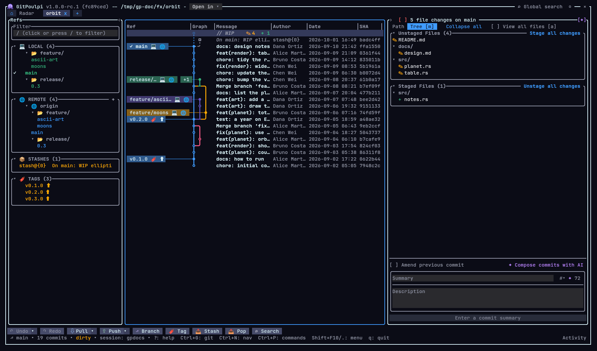

[English](../README.md) · [Čeština](../cs/README.md) · [Deutsch](../de/README.md) · [Español](../es/README.md) · [Français](../fr/README.md) · [Italiano](../it/README.md) · [日本語](../ja/README.md) · [한국어](../ko/README.md) · [Nederlands](../nl/README.md) · [Polski](../pl/README.md) · [Português (Brasil)](../pt-BR/README.md) · [Português (Portugal)](../pt-PT/README.md) · **Русский** · [Svenska](../sv/README.md) · [Türkçe](../tr/README.md) · [Українська](../uk/README.md) · [简体中文](../zh-CN/README.md)

# Документация пользователя GitPoulpi

GitPoulpi - Git-клиент для терминала с интерактивным графом commit'ов, палитрой
команд, интеграцией с хостингами и трекерами задач, необязательной помощью ИИ,
а также CLI и MCP-сервером, которые умеют всё, что умеет интерфейс. Страницы
идут в порядке чтения: начните сверху и переходите к справочным страницам, когда
они понадобятся.

## С чего начать

1. **[Установка](installation.md)**: что понадобится, архивы релизов,
   менеджеры пакетов, сборка из исходников. Для исполняемого файла поменьше см.
   **[Пользовательские сборки](custom-builds.md)**. Как GitPoulpi сам поддерживает
   себя в актуальном состоянии (значок версии, панель обновлений, возврат):
   **[Обновления](updates.md)**. Запуск в контейнере: **[Запуск в Docker](docker.md)**.
   Для администраторов, внутренние репозитории, зеркала и политика обновлений:
   **[Корпоративное распространение](enterprise-distribution.md)**.
2. **[Начало работы](getting-started.md)**: ваши первые пять минут, от запуска
   до первого commit'а.
3. **[Обзор интерфейса](interface-tour.md)**: названия всех областей окна, с
   картинками.

## Найти нужную возможность

| Я хочу... | Страница | Как добраться до этого в приложении |
|---|---|---|
| Работать над двумя ветками одновременно | [Worktree](worktrees.md) | Раздел **РАБОЧИЕ ДЕРЕВЬЯ** боковой панели Refs (`+` создаёт worktree; скрыт, пока нет ни одного: палитра **Левая панель: показать раздел Worktrees**); палитра **Refs: создать worktree...** |
| Работать с вложенными репозиториями | [Подмодули](submodules.md) | Раздел **ПОДМОДУЛИ** боковой панели Refs; палитра **Git: обновить все подмодули**, **Refs: обновить подмодуль (выбранный)** |
| Разрешить конфликт слияния | [Разрешение конфликтов слияния](merge-conflicts.md) | `Enter` на строке с `!` в панели Status, кнопка баннера **Разрешить конфликты...** или `Shift+E` в виде Diff; палитра **Конфликты: открыть редактор merge** |
| Проверить pull или merge request | [Ревью pull request](review.md) | `Enter` на строке раздела **PULL REQUESTS**, `e` на строке Radar, `Alt+R` в поиске по рабочему пространству; палитра **Хостинг: ревью запроса...** |
| Просматривать, создавать и вести pull request'ы и задачи | [Pull request'ы и задачи](pull-requests-and-issues.md) | Разделы **PULL REQUESTS** и **ЗАДАЧИ** боковой панели Refs (`n` создаёт); палитра **Pull requests: создать pull request...**, **Хостинг: новая задача...**. Сначала подключите учётную запись: [Хостинги и трекеры задач](hosting-integration.md) |
| Читать и отвечать в обсуждении задачи или запроса | [Беседы](conversations.md) | `Enter` на строке задачи, карточке доски или строке Radar; палитра **Хостинг: открыть беседу задачи...** |
| Видеть свои задачи доской | [Доска задач](pull-requests-and-issues.md#доска-задач) | Кнопка **Доска** в заголовке ЗАДАЧИ; палитра **Задачи: открыть доску** |
| Вести задачи как заметки Markdown, без токена | [Локальные задачи и Obsidian](local-issues.md) | Раздел ЗАДАЧИ, провайдер `Local Markdown - <имя>`; палитра **Локальные задачи: открыть в Obsidian...** |
| Переписать авторов, даты, сообщения или файлы во многих commit'ах | [Переписывание истории](history-rewrite.md) | `Ctrl+G Shift+H`; палитра **Переписывание: окно истории** |
| Отменить (или повторить) операцию | [Отмена и повтор](undo-redo.md) | `Ctrl+Z` / `Ctrl+Y`; `Alt+Z` открывает историю отмен; палитра **Правка: отмена** |
| Отслеживать большие файлы через Git LFS | [Git LFS](lfs.md) | Палитра **LFS: отслеживать шаблон...**, **LFS: инициализировать для этого репозитория** |
| Найти ветку, commit, pull request или задачу во всех репозиториях | [Поиск](search.md) | `Ctrl+Alt+F` или кнопка «Глобальный поиск» в строке заголовка; `f` ищет в графе commit'ов текущего репозитория |
| Увидеть в одном списке всё, что ждёт меня | [Radar](radar.md) | `Alt+R`; палитра **Radar: открыть** |
| Сгруппировать репозитории и выполнять fetch или pull вместе | [Рабочие пространства](workspaces.md) | `Alt+W` переключает, `Alt+J` открывает вкладку «Рабочие пространства»; палитра **Рабочее пространство: управление...** |
| Получить помощь ИИ (сообщения commit'ов, объяснения, описания) | [Помощь ИИ](ai.md) | `Ctrl+,` > **ИИ** > **Включить ИИ**, затем `Ctrl+G i` пишет сообщение commit'а; палитра **ИИ: ...** |
| Найти любую команду или клавишу | [Сочетания клавиш](keybindings.md) | `?` в приложении показывает клавиши, `Ctrl+P` находит любую команду |

## Повседневная работа

4. **[Работа с Log](log-and-history.md)**: чтение графа, поиск, ветки, tag'и,
   stash, перетаскивание ссылок, rebase, cherry-pick, reword и amend, баннеры,
   pull и push, auto-stash.
5. **[Индекс и commit'ы](staging-and-committing.md)**: рабочие изменения, diff,
   добавление в индекс блоков и отдельных строк, написание commit'ов, композитор
   commit'а, blame, история файла и встроенный редактор.
6. **[Изображения](image-view.md)**: изображения в виде Diff и в просмотре
   файла, до и после, масштаб, Править в.
7. **[Разрешение конфликтов слияния](merge-conflicts.md)**: редактор слияния (A и
   B рядом над Результатом), выбор строк и блоков, карточки для конфликтов
   двоичных файлов, LFS, удаления, символических ссылок и подмодулей, и как
   агент предлагает решение.
8. **[Worktree](worktrees.md)**: вторая папка с другой веткой: раздел
   РАБОЧИЕ ДЕРЕВЬЯ, создание, открытие, слияние и удаление связанных worktree.
9. **[Подмодули](submodules.md)**: раздел ПОДМОДУЛИ, их обновление и
   синхронизация с checkout и pull.
10. **[Отмена и повтор](undo-redo.md)**: `Ctrl+Z` / `Ctrl+Y`, что можно и что
    нельзя отменить, когда отказывает или спрашивает, как далеко заходит,
    как выключить.
11. **[Git LFS](lfs.md)**: большие файлы, отслеживание, блокировки и что
    происходит без установленного `git-lfs`.
12. **[Темы](themes.md)**: встроенные темы, любая тема с любой палитрой веток,
    живой предпросмотр, ваши собственные файлы тем, `gitpoulpi theme`.
13. **[Рабочие пространства](workspaces.md)**: именованные группы репозиториев
    со своими вкладками и необязательным профилем commit'ов по умолчанию, значок
    на панели вкладок, вкладка «Рабочие пространства»,
    fetch все, pull все, клонирование отсутствующих.
14. **[Поиск](search.md)**: один нечёткий поиск (`Ctrl+Alt+F`) по веткам, tag'ам,
    worktree, stash'ам, commit'ам, pull/merge request и задачам всех
    репозиториев рабочего пространства или открытых вкладок.
15. **[Radar](radar.md)**: pull/merge request, задачи и работа в процессе
    рабочего пространства (или ваших открытых вкладок) в одном списке: фильтры,
    закрепление, откладывание и что умеет каждая строка.
16. **[Pull request'ы и задачи](pull-requests-and-issues.md)**: разделы PULL
    REQUESTS и ЗАДАЧИ боковой панели, доска задач, создание pull request'а или
    задачи, значок на панели инструментов, ссылки в сообщениях commit'ов.
17. **[Беседы](conversations.md)**: чтение и ответы в обсуждении задачи или
    запроса внутри окна, публикация от имени, чего не может каждый хостинг.
18. **[Ревью pull request](review.md)**: окно ревью с обсуждениями кода,
    неотправленным ревью и «Одобрить» / «Запросить изменения».
19. **[Открыть в](open-in.md)**: список в строке заголовка, открывающий папку
    активной вкладки в терминале, мультиплексоре, редакторе или файловом
    менеджере.
20. **[Следование папке активной вкладки](following-the-tab-folder.md)**:
    «Выйти и cd сюда» и обёртка `gitpoulpi shell-init` (`gp`) для bash, zsh,
    fish и PowerShell.
    Какой терминал лучше всего показывает GitPoulpi: **[Выбор терминала](terminals.md)**.
    Что проходит через tmux, zellij, screen, herdr и панели терминалов:
    **[Мультиплексоры](multiplexers.md)**.

Также: **[Несколько remote для одной ветки](multiple-remotes.md)**: цели push и источники pull,
диалог Remote, Push во все remote или в выбранные, разбор remote, который ушёл вперёд, «Продолжить»
после конфликта, CLI и алиас на обычном git.

**[Рабочие процессы ветвления](branching-workflows.md)** - шаблоны Git Flow, GitHub Flow, GitLab Flow и
Trunk-based или собственные базовые ветки, шаблоны имён веток и типы веток (`gitpoulpi flow ...`).

**[Переписывание истории](history-rewrite.md)**: окно переписывания (`Ctrl+G Shift+H`),
которое переписывает авторов, даты, сообщения и содержимое файлов во многих commit'ах, с
предпросмотром, Lua-скриптами и одной отменой.

## Клавиатура и мышь

21. **[Сочетания клавиш](keybindings.md)**: каждая клавиша по областям и каждая
    команда палитры. В программе `?` показывает тот же список, а `Ctrl+P`
    находит любую команду.
22. **[Мышь и жесты](mouse-and-gestures.md)**: щелчки, перетаскивание,
    выделение и копирование, полосы прокрутки и отклик при наведении.

## Настройки и интеграции

23. **[Настройки](settings.md)**: каждая страница и параметр экрана настроек,
    поле поиска, профили и как переназначить сочетания клавиш.
24. **[Помощь ИИ](ai.md)**: собственный ИИ GitPoulpi (по умолчанию выключен):
    локальный агент вроде `claude -p`, Anthropic, OpenAI, OpenRouter, Ollama
    или LM Studio; инструкции; сообщения commit'ов, объяснения, описания pull
    request и композитор commit'а; конфиденциальность и устранение неполадок.
25. **[Хостинги и трекеры задач](hosting-integration.md)**: GitHub, GitLab, Gitea и Forgejo,
    Azure DevOps, Bitbucket, Gerrit и трекеры задач:
    токены и их права, подключение,
    привязка репозитория, SSH-ключи, известные ограничения. Также
    **[Локальные задачи и Obsidian](local-issues.md)**: папка заметок Markdown
    как источник задач, без токена, с Obsidian Base.

## Автоматизация

26. **[Справочник по CLI](cli-reference.md)**: каждая команда `gitpoulpi` с
    `--json` для скриптов.
27. **[MCP и агенты](mcp-and-agents.md)**: пусть внешний агент (Claude Code,
    Cursor, Codex, ...) управляет GitPoulpi: регистрация сервера, `.mcp.json`,
    переключатели разрешений и их значения по умолчанию, каждый инструмент и как
    агент показывает вам что-то в вашем окне. Готовый навык для агента -
    [`skills/gitpoulpi/SKILL.md`](../../../skills/gitpoulpi/SKILL.md).

## Справочник и помощь

28. **[Справочник по конфигурации](config-reference.md)**: каждый ключ
    `config.toml`, его значение по умолчанию и действие, настройки отдельных
    репозиториев, переменные окружения.
29. **[Устранение неполадок и FAQ](troubleshooting.md)**: значки, отрисовка
    графа, клавиши, которые не доходят, зависшие демоны, скорость, указатели LFS.

## Скриншоты

Каждая картинка на этих страницах - настоящий снимок релизной сборки на
небольшом демонстрационном репозитории с вымышленными авторами. Картинки лежат
в [`images/`](../images/). `scripts/docs-screenshots.sh` создаёт демонстрационные
репозитории и снимает их заново. Снимки сделаны в терминале `kitty`, который
рисует граф commit'ов и аватары авторов как изображения. Терминалы без графического
протокола показывают вместо этого символьный граф.

## Для участников разработки

[CLAUDE.md](../../../CLAUDE.md), [обзор архитектуры](../../architecture/overview.md)
и [дорожная карта](../../roadmap.md) описывают устройство и планы;
[CHANGELOG.md](../../../CHANGELOG.md) перечисляет изменения в каждом релизе.

---

GitKraken является товарным знаком его владельца. GitPoulpi - независимый проект, не связанный с этим владельцем, не одобренный и не спонсируемый им; название упоминается только для описания совместимости и источника вдохновения.
