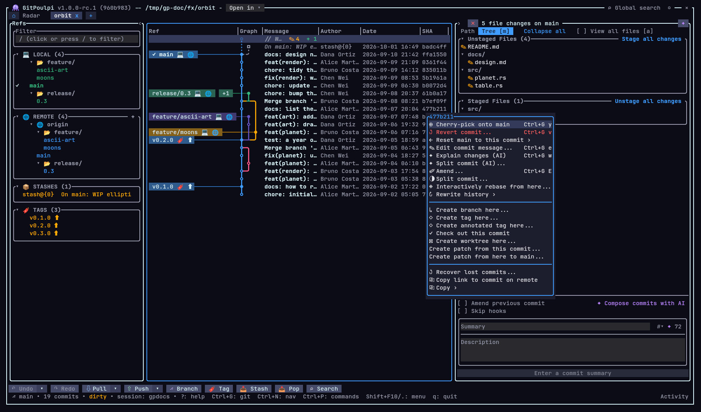

[English](../log-and-history.md) · [Čeština](../cs/log-and-history.md) · [Deutsch](../de/log-and-history.md) · [Español](../es/log-and-history.md) · [Français](../fr/log-and-history.md) · [Italiano](../it/log-and-history.md) · [日本語](../ja/log-and-history.md) · [한국어](../ko/log-and-history.md) · [Nederlands](../nl/log-and-history.md) · [Polski](../pl/log-and-history.md) · [Português (Brasil)](../pt-BR/log-and-history.md) · [Português (Portugal)](../pt-PT/log-and-history.md) · **Русский** · [Svenska](../sv/log-and-history.md) · [Türkçe](../tr/log-and-history.md) · [Українська](../uk/log-and-history.md) · [简体中文](../zh-CN/log-and-history.md)

# Работа с Log

Log - центр GitPoulpi: вся история в виде графа, со всеми ветками, tag'ами и
stash'ами на нём. Эта страница о том, как его читать, как в нём искать и что можно
делать с commit'ами и ссылками. Области названы в [обзоре интерфейса](interface-tour.md);
точные клавиши - в [Клавишах](keybindings.md), жесты мыши - в
[Мыши и жестах](mouse-and-gestures.md).


## Как читать граф

Каждая строка - commit, новые сверху. Точка стоит на дорожке commit'а; линии
соединяют commit с его родителями; слияние показывает две сходящиеся линии. Плашки
слева называют ветки и tag'и на этом commit'е цветом дорожки, с тонкой линией к
точке. Значок ноутбука отмечает локальную ветку, глобус - remote, а `✓` - ветку, на
которую вы переключились. `+N` означает, что на этот commit указывает больше ссылок;
наведите курсор, чтобы увидеть их список, или воспользуйтесь меню ниже.

Первая строка - **рабочие изменения** (пунктирный круг: ваша незафиксированная
работа, соединённая с commit'ом, на котором она лежит). Stash'и показываются
маленькими квадратами на дорожке рядом с commit'ом, на котором они сделаны.

### Цвета, подсветка строк и аватары

Цвета дорожек берутся из темы. *Настройки > Внешний вид > Цветовая тема графа*
сочетает любую тему с любой палитрой дорожек, а выбор в палитре
*Приложение: сменить цветовую тему графа...* (`Ctrl+N Shift+Y`) сразу показывает
каждую палитру; см. [Темы](themes.md). Если *Фон полос графа* установлен в **Подсветка строки**, за колонкой графа рисуется слабая полоса цвета дорожки и тонкая планка у её
края. *Насыщенность подсветки строки* (**Сильная**, **Средняя** (по умолчанию), **Слабая**)
задаёт, насколько бледна эта полоса.

| Палитра дорожек Serie с подсветкой строк | Палитра дорожек Material с подсветкой строк |
|---|---|
|  |  |

*Аватары авторов* (картинка в точке графа или в колонке «Автор») по умолчанию
выключены. Их включение отправляет Gravatar хеш адреса e-mail каждого автора и
обращается к вашему хостинг-провайдеру. *Источники аватаров* и *Запасной аватар* на
той же странице выбирают, откуда берутся картинки и что рисуется, когда её нет.

Если ваш терминал не умеет показывать картинки, граф рисуется символами.
*Отрисовка графа* и *Протокол изображений* принудительно выбирают тот или другой
вариант; см. [Устранение неполадок](troubleshooting.md).

Подсветка выбранной строки или строки под курсором начинается с кружка commit'а.
Дорожки слева от него сохраняют обычный фон.

### Колонки

Правый щелчок по заголовку выбирает колонки: **Ref**, **Граф**, **Сообщ.** (всегда
включена), **Автор**, **Дата**, **Измен.** и **SHA**. Необязательная колонка
**Измен.** показывает для каждого commit'а `n файлов +добавлено -удалено`. Перетащите
границу между двумя заголовками, чтобы изменить ширину колонки; выбор запоминается, ширина задаётся в ячейках терминала. При `ui.column_resize = "line"` (по умолчанию) граница - промежуток в одну ячейку в конце колонки: в нём на строке заголовка лежит небольшая метка, а пока указатель на промежутке (в заголовке или в любом месте таблицы), поверх всей высоты таблицы рисуется тонкая линия акцентного цвета, и перетаскивание из любой её точки меняет размер (в терминалах, которые это поддерживают, указатель становится указателем изменения размера). При `"header"` нет ни метки, ни линии: при наведении подсвечивается первый символ ячейки заголовка после границы, и перетаскивание начинается с него, только на строке заголовка (Настройки > Журнал и граф > Изменение размера колонок). Строки выглядят одинаково в обоих режимах: промежуток входит в колонку слева от него, поэтому выделение и подкраска строки проходят через него. Ref, Граф и остальные колонки сохраняют ширину при изменении или разворачивании окна: растёт и сжимается только **Сообщ.** (в очень узком окне остальные колонки временно уступают место, первым - Граф, и возвращаются к вашей ширине, когда окно снова расширяется). Если сузить Граф до наименьшей ширины, одной точки commit'а, граф становится компактным: все commit'ы лежат на одной дорожке друг под другом, без линий веток и слияний. На одну ячейку шире, и дерево возвращается. С портретами авторов в кружках commit'ов (Настройки > Внешний вид > Аватары: Граф) кружок занимает две ячейки, поэтому колонка останавливается на одну ячейку раньше (три ячейки) и никогда не обрезает портрет.

С клавиатуры `Shift+C` (или команда палитры `Вид: колонка Log: выбрать колонку для сдвига или изменения ширины`) выбирает колонку, и ячейка её заголовка подсвечивается. Затем `Tab` / `Shift+Tab` выбирают другую колонку, `<` / `>` сдвигают её на одно место влево или вправо среди показанных колонок (клавиатурный аналог перетаскивания заголовка), `]` / `[` расширяют или сужают её (аналог перетаскивания её границы; у последней колонки двигается левый край), `0` возвращает автоматическую ширину всем колонкам, а `Esc` или `Enter` выходит. Стрелки при этом по-прежнему перемещаются по commit'ам. Порядок и ширина запоминаются так же, как после перетаскивания, и принадлежат только Log: колонка commit'ов рядом с diff хранит свой список.

Перетаскивание заголовка показывает призрачную подпись его названия, следующую за указателем, и полосу акцентного цвета там, куда встанет колонка; порядок меняется, когда вы отпускаете кнопку, а `Esc` отменяет. Список, который открывает правый щелчок, - это список с флажками (`[x]` / `[ ]`) и значком ✕ в заголовке; он доступен и из палитры (`Вид: Log: выбрать колонки для показа`), перемещение по нему - стрелками, переключение - `Space` / `Enter`.

*Подгонка под содержимое.* **Двойной щелчок** по границе колонки подгоняет колонку слева от неё под самое широкое видимое содержимое и заголовок (широкие символы и emoji считаются по занимаемым ячейкам). В раскладке «по размеру панели» Log всегда заполняет свою панель, поэтому колонка останавливается на том, что допускает панель, когда **Сообщ.** сохраняет свою долю, а каждая другая колонка - наименьшую ширину: тогда строка состояния сообщает `Автор: нужно 34 яч., умещается 20.` То же с клавиатуры: при выбранной колонке (`Shift+C`, `Tab`) `=` подгоняет её, а `+` подгоняет все колонки; в палитре есть `Вид: колонка Log: подогнать колонку под содержимое` и `... подогнать все колонки под содержимое`; список колонок по правому щелчку содержит под флажками `Подогнать <колонка> под содержимое` (колонка под указателем), `Подогнать все колонки под содержимое` и `Сбросить ширину колонок`. **Сообщ.** - гибкая колонка, у неё нет собственной ширины для подгонки: она занимает место, которое оставляют остальные.

*Прокрутка вбок.* По умолчанию каждая колонка умещается в панель. В раскладке **прокрутки** (флажок списка `Прокрутка вбок (колонки сохраняют ширину)`, Настройки > Журнал и граф > Раскладка колонок, команда палитры `Вид: Log: переключить прокрутку колонок вбок` или `s` при выбранной колонке) колонки сохраняют ширину, **Сообщ.** тоже (здесь у неё есть своя ширина, а подгонка берёт её самую длинную сводку), ничто не уступает место в узком окне, и таблица может быть шире панели. Тогда полоса на нижней границе прокручивает её: перетащите ползунок, щёлкните по пустой дорожке, чтобы ползунок встал под указатель, или используйте стрелки на её концах. С клавиатуры `Shift+Left` / `Shift+Right` прокручивают на четыре ячейки (в палитре есть `Вид: Log: прокрутить колонки влево` / `вправо`); то же делают горизонтальное колесо или `Shift`+колесо над таблицей, а выбор колонки (`Shift+C`, `Tab`) прокручивает её в видимую область. Таблица уже панели оставляет пустое место справа, а полоса выбранной строки доходит до границы. У каждой раскладки свои ширины (`ui.log_column_widths` и `ui.log_column_widths_scroll`); первое перетаскивание, клавиша или подгонка в раскладке прокрутки сохраняют каждую колонку с её текущей шириной, так что двигается только изменяемая. В раскладке «по размеру панели» подгонка, которая не умещается в панель, сообщает об этом и указывает на эту раскладку.

*Рукоятка последней колонки.* У последней колонки тоже есть рукоятка, на её собственной последней ячейке (не на границе панели, которая по-прежнему меняет размер панелей): перетаскивание сдвигает её на расстояние, пройденное указателем, а разницу берёт на себя **Сообщ.** **SHA** по умолчанию занимает 8 ячеек (7 цифр и ячейка рукоятки).


### Авторы и `.mailmap`

Если в репозитории есть `.mailmap` (файл git, который задаёт одно имя и email для
человека, коммитившего под несколькими), колонка **Автор** в Log, сведения о commit'е,
Blame и история файла показывают **каноническую** личность, как и `git log`. Сами
commit'ы не затрагиваются. Параметр `log.use_mailmap` (Настройки > Журнал и граф,
по умолчанию включён) отключает это и показывает сохранённые имена. Поиск по автору
сопоставляется с именем и email в том виде, как они показаны, поэтому поиск по
каноническому имени находит все commit'ы этого человека. Вкладка **Авторы** окна
переписывания истории перечисляет имена и email из истории и сама пишет строки
`.mailmap`, см. `history-rewrite.md`; из терминала: `gitpoulpi mailmap list|check|add`.

## Поиск

- **Поиск** (`f`, кнопка **Поиск** на панели инструментов или команда палитры
  *Навигация: поиск commit'ов...*): сопоставляет с полным сообщением commit'а, именем и
  e-mail автора, хешем и именами ссылок. То, что не подходит, приглушается, форма
  графа сохраняется. `Enter` / `Shift+Enter` переходят к следующему / предыдущему
  совпадению.
- **Фильтр Refs** (`/` на боковой панели): сужает списки веток, tag'ов и remote по
  имени.
- **Solo** (клавиша `o` или меню ссылки, на ссылке, папке или remote): показывает
  только commit'ы ссылок в solo; включите solo для нескольких, чтобы увидеть их
  объединение. `Shift+O` снимает solo.
- **Скрыть** ссылку (её меню), чтобы убрать её из графа: её пилюля исчезает, как и
  commit'ы, до которых достаёт только она (commit с checkout остаётся всегда, вместе
  со строкой рабочего дерева). *Скрыто n* в заголовке Refs считает их, **Показать все**
  (`Shift+H`) возвращает их. Общее число в строке состояния считает видимую историю.

## Ветки, tag'и и боковая панель Refs

Двойной щелчок по локальной ветке или tag'у переключает на неё. Правый щелчок по
ссылке (на боковой панели или по её плашке в Log) открывает её меню. Самые полезные
пункты:

| Пункт | Что делает |
|---|---|
| Показать в графе | Прокручивает Log к commit'у ссылки (при необходимости сначала подгрузив более старую историю) и подсвечивает строку; выбор остаётся. Одиночный щелчок по ссылке делает то же, если в Настройках не выключено *Щелчок по ссылке показывает её в графе*. Ссылка, скрытая в графе (или режимом Solo), сообщает об этом в строке состояния |
| Checkout | Переключает на ветку или отсоединяет HEAD на tag'е |
| Merge, Rebase на | Сливает её в текущую ветку или делает rebase текущей ветки на эту ссылку |
| Fast-forward `<ветка>` до `<текущая>` / `<текущая>` до `<ветка>` | Двигает ветку вперёд, когда это fast-forward; иначе пункт серый с причиной (`истории разошлись, это не fast-forward`) |
| Создать worktree из... | Открывает связанный worktree в своей вкладке |
| Pull, Push, Fetch, Remote ветки <branch>... | Сетевые операции над этой веткой (Remote ветки <branch>... задаёт upstream, плюс флажки Push и «и Pull» для каждого remote) |
| Скрыть / Показать в графе, Solo | Только отображение; скрывают ссылку (скрытие убирает и commit'ы, до которых достаёт только эта ссылка) или включают для неё solo, не затрагивая репозиторий |
| Переименовать, Удалить | Удаление сначала спрашивает; можно удалить и парную удалённую ветку |
| Копировать (имя), Копировать ссылку на ветку на remote | В буфер обмена |

**Где живёт tag.** Tag может быть на этом компьютере, на remote или и там, и там, и
строки TAGS на боковой панели (и плашка tag'а в Log) показывают это маркером после
имени. Наведите на tag, чтобы увидеть то же словами.

| Маркер | Значение |
|---|---|
| стрелка вверх | Только здесь: ни на одном remote его нет. В его меню есть *Push* |
| стрелка влево-вправо | Здесь и на remote, на том же commit'е |
| стрелка вниз (строка приглушена) | Только на remote: в этом репозитории его нет (никогда не загружался или удалён здесь). В его меню есть *Fetch `<tag>` с `<remote>`* и *Удалить `<tag>` на `<remote>`...*; в палитре `Git: Fetch выбранный tag` |
| стрелка вверх-вниз | Есть и на remote, но на другом commit'е (push был бы отклонён) |

У git нет remote-tracking ссылок для tag'ов, поэтому GitPoulpi узнаёт, что есть на
каждом remote, из вашего последнего **fetch** (любого, включая автоматический) и из
собственных отправок и удалений tag'ов. Пока вы просматриваете, к сети никто не
обращается; если кто-то изменил tag'и remote, сделайте fetch, чтобы это увидеть. Та же
информация есть в `gitpoulpi tag list` (поля `local`, `remote`, `differs_on`, `where`).

**Удаление tag'а.** Когда tag есть на remote, красная кнопка **Удалить** открывает диалог
с тремя пронумерованными строками (`1`-`9`, либо Вверх/Вниз и `Enter`; `Esc` отменяет), а
выделенная строка поясняет себя под списком:

1. **Удалить локально**: убирает tag только из этого репозитория. Выполняется сразу, а
   сообщение говорит, что на remote он ещё есть. **Следующий fetch вернёт его** (git
   следует за tag'ами remote), если вы не удалите его и на remote.
2. **Удалить на `<remote>`**: убирает его там у всех (`git push <remote> --delete`).
   Просит подтверждения, где назван remote. Ваш локальный tag остаётся. Это нельзя
   отменить.
3. **Удалить локально и на `<remote>`**: и то и другое, после того же подтверждения,
   поэтому fetch не сможет его вернуть. **Отмена восстанавливает только локальный tag**
   (тот же объект tag'а); он снова существует только локально, и *Push* возвращает его на
   remote.


Если remote несколько, у каждого свои строки. Tag, существующий только здесь,
сохраняет обычное подтверждение; tag, существующий только на одном remote, сразу ведёт
к подтверждению для этого remote. CLI: `gitpoulpi tag delete <name> [--local | --remote <r> | --both [--remote <r>]]`.

**Fetch и tag'и.** Fetch заодно обновляет то, что есть на каждом remote (маркеры), а
собственное следование git за tag'ами по-прежнему действует: tag, удалённый только
здесь, загружается снова. Tag, который кто-то **удалил на remote**, после любого fetch
исчезает с remote-стороны маркера, но остаётся здесь как ваш локальный tag (теперь
*только здесь*), потому что git по умолчанию не очищает tag'и. **Настройки >
Синхронизация > Автоочистка tag'ов** (по умолчанию выключено; `gitpoulpi fetch
--prune-tags`) удаляет и такой локальный tag, но только тот, что был на remote: tag,
который вы никогда не отправляли или который вы переместили, не затрагивается никогда.
Чтобы узнать, что было очищено, нужен git 2.41 или новее.

**Новая ветка или tag.** Кнопки **Ветка** и **Tag** на панели инструментов,
`Ctrl+G b` и `Ctrl+G t` или пункт commit'а *Создать ветку здесь...* спрашивают имя
во встроенном поле в колонке Ref, в строке целевого commit'а. `Enter` создаёт,
`Esc` отменяет, а имя, которое git отклонил бы, сообщается красным без закрытия
поля.

У commit'а без ref наведение указателя на его строку показывает ещё и бледную пилюлю в столбце Ref с названием ветки, к которой он относится (иначе удалённой ветки), выведенным из истории; tag никогда не показывается как призрак. Ветка, удалённая после слияния, всё равно показывается, зачёркнутой, под именем из темы merge-commit'а (`Merge branch 'x'`, `Merge pull request #N from owner/x`...); squash-слияния, rebase и fast-forward такого следа не оставляют. При наведении на пилюлю видно её тип. Она ничего не создаёт: используйте команду создания ветки выше. Параметр **Показывать призрачную ветку на наведённом commit'е** в Настройки > Журнал и граф её отключает; там, где столбец Ref слишком узкий, она не рисуется.

**Remote'ы.** `+` в заголовке REMOTE добавляет remote; правый щелчок по имени
remote позволяет сделать fetch, скопировать его веб-ссылку, сделать его remote по
умолчанию, скрыть его из графа, изменить его URL или удалить его. **Скрытие remote** (⊙ в его строке, пункт меню *Скрыть remote из графа* или `Remote: скрыть remote в графе...` в палитре) скрывает каждую его ветку, существующую сейчас или появившуюся позже, а commit'ы, до которых достаёт только он, уходят из Log: так можно просматривать одну историю без истории постороннего архивного remote; верните его пунктом *Показать remote в графе*. Показ remote также показывает его ветки, скрытые по отдельности. Если нажать на ⊙ ветки скрытого remote, строка состояния скажет об этом: сначала покажите remote.

**Stash'и.** **Stash** прячет всё (включая неотслеживаемые файлы); `Ctrl+G m` сначала
спрашивает сообщение (при включённом ИИ `Ctrl+G` внутри этого запроса предлагает
его). Правый щелчок по строке stash'а, в Log или в разделе STASHES, даёт **Pop**,
**Apply** (оставить stash) или **Drop**.

**Worktree.** *Создать worktree из...* (на ветке, tag'е или commit'е) открывает
диалог, предлагающий папку рядом с репозиторием, необязательное имя новой ветки и
«Открыть новый worktree во вкладке». Worktree появляются в разделе WORKTREES;
двойной щелчок открывает один из них, а его вкладка закрывается сама, когда
worktree удаляется.

## Перетаскивание ссылок на commit'ы

Можно нажать на ветку (на боковой панели или на её плашке в Log)
и потащить её. За курсором следует призрачная подпись, допустимые цели
подсвечиваются; отпустите, чтобы получить меню:

- локальная ветка **на другую локальную ветку**: Merge, Rebase, Интерактивный
  rebase, Fast-forward;
- локальная ветка **на удалённую ветку**: Push в этот remote;
- удалённая ветка **на локальную ветку**: Merge, Rebase, Fast-forward, Pull.

`Esc` отменяет перетаскивание. Клавиатурный эквивалент - команда палитры
*Refs: перетащить выбранную ссылку на текущую ветку...*.

**Merge или fast-forward.** Если в целевой ветке нет собственных commit'ов (перетаскиваемая ветка просто впереди), merge мог бы просто сдвинуть цель вперёд. По умолчанию (Настройки > Git > **Fast-forward при merge** = *never* либо собственный выбор репозитория на его странице «Настройки merge») строка меню выглядит как *Merge x в y (merge-commit)* и создаёт настоящий merge-commit, так что история сохраняет ветку; для простого сдвига используйте отдельную строку *Fast-forward y до x* (а если нужна прямая линия, для этого есть *Rebase*). При *allowed* строка Merge получает пометку *(fast-forward)*, а при *only* - *(только fast-forward)* и недоступна с указанием причины, если ветки разошлись. Те же строки и подписи есть в собственном меню ветки, а `gitpoulpi merge --ff | --no-ff | --ff-only` выбирает поведение для одного merge.

## Меню commit'а

Правый щелчок по commit'у (или `.` на нём) открывает его меню:



| Пункт | Что делает |
|---|---|
| **Cherry-pick на `<ветка>`** | Воспроизводит commit на текущей ветке |
| **Revert commit'а...** | Создаёт commit, отменяющий его. Для commit'а слияния сначала выпадающий список спрашивает, какой родитель - основная линия (сторона, которая остаётся; родитель 1 - ветка, в которой было сделано слияние), затем обычное подтверждение. Отмена возвращает прежнее состояние |
| **Reset `<ветка>` к этому commit'у** | Подменю с видом reset; hard reset просит подтверждения |
| **Изменить сообщение commit'а...** | См. ниже |
| **Изменить...** | Меняет сообщение, имя, email и дату автора commit'а в одном окне; см. [Изменение commit'а](#изменение-commitа-сообщение-автор-даты) |
| **Разделить commit...** | Разбивает commit на несколько; см. [Разделение commit'а](#разделение-commitа) |
| **Разделить commit (ИИ)...** | То же, но с группировкой, которую предлагает модель; только когда [ИИ](ai.md) включён |
| **Объяснить изменения (ИИ)** | Всплывающее окно с объяснением ИИ; только когда [ИИ](ai.md) включён |
| **Интерактивный rebase отсюда...** | См. ниже |
| **Создать ветку здесь...**, **Создать tag здесь...**, **Создать аннотированный tag здесь...** | Встроенное поле имени |
| **Checkout этого commit'а**, **Создать worktree здесь...** | Отсоединённый HEAD или worktree |
| **Создать патч из этого commit'а...**, **Создать патч отсюда до `<ветка>`...** | Записывает файлы `.patch`; *Применить патч* находится в меню ссылки |
| **Копировать ссылку на commit на remote**, **Копировать** > | В буфер обмена (хеш, сообщение и другое) |

## Изменение сообщения commit'а (reword)

*Изменить сообщение commit'а...* (или `Ctrl+G e`) открывает полное сообщение:
однострочный заголовок со счётчиком, под ним описание, кнопки **Отмена** и
**Обновить сообщение**. Можно переписать сообщение любого commit'а текущей ветки
(HEAD или предка); лежащие поверх него commit'ы пересоздаются со своими деревьями,
авторами и датами, слияния остаются слияниями, а ваши изменения в индексе и вне него
остаются нетронутыми. Если commit уже отправлен, окно предупреждает янтарным цветом,
что понадобится force push (с lease), и просит второе подтверждение. `Ctrl+Z`
(Отмена на панели инструментов) возвращает reword; см. [Отмена и повтор](undo-redo.md).
Строка состояния также называет прежнюю вершину.

Commit, которого нет в текущей ветке (он лежит в другой), нельзя переписать или
изменить там, где вы находитесь, поэтому *Изменить сообщение commit'а...* и
*Изменить...* открывают вместо этого окно **Изменение commit'а из другой ветки**,
список вариантов (`Вверх` / `Вниз` или `Ctrl+J` / `Ctrl+K` перемещают, `Enter` или
щелчок выбирает, `Esc`, крестик или **Отмена (О)** закрывают его):

- **Переключиться на `<ветка>` и изменить (1)**: по одной строке на каждую локальную
  ветку, в истории которой есть этот commit (`1`...`8`, первые восемь, остальные
  считаются). Переключение на ветку выполняется как обычно, затем на ней открывается
  правка. История отмены - у двух действий своя: `Ctrl+Z` возвращает правку, а
  переключение остаётся переключением.
- **Изменить через переписывание истории (П)**: открывает
  [окно переписывания истории](history-rewrite.md) на этом commit'е, в сборках,
  где оно есть.
- **Создать здесь ветку... (В)**: только когда ни одна локальная ветка не содержит
  commit (например, он есть лишь в удалённой ветке); открывает поле имени для
  ветки на нём.

## Изменение commit'а (сообщение, автор, даты)

Пункт *Изменить...* в меню commit'а (или `Ctrl+G Shift+E`, или *Commit: изменить...* в палитре) открывает одно окно со свойствами commit'а: заголовок, описание, имя, email и дата автора, каждое поле заполнено значениями самого commit'а. Измените что нужно и нажмите **Применить**; отправляются только изменённые поля. Дата записывается как `YYYY-MM-DD HH:MM:SS +HH:MM` и показывается в UTC, пока вы её не правите. Коммиттером становитесь вы, с текущей датой (как при reword). Можно изменить любой commit текущей ветки: правила, предупреждение об уже отправленном commit'е и второе подтверждение те же, что у *Изменить сообщение commit'а...*; commit'ы выше пересоздаются с их собственными авторами и датами, а ваши проиндексированные и непроиндексированные изменения не затрагиваются. `Ctrl+Z` (Отмена на панели инструментов) возвращает всё назад. В сборках с переписыванием истории кнопка **Изменить историю глубже...** (`Alt+H`) внизу слева в окне закрывает его, ничего не применяя, и открывает [окно переписывания истории](history-rewrite.md) с областью от этого commit'а до самого нового; если вы изменили поле, сначала спрашивает (`Esc` подтверждает). `Ctrl+N` показывает значок на каждом поле и каждой кнопке окна; нажмите его, чтобы поставить курсор в это поле или нажать эту кнопку (см. [Значки](keybindings.md#значки)).

Любой способ открывает окно целиком, со всеми полями, доступными для правки; отличается только положение курсора. В панели сведений о commit'е (справа) щёлкните правой кнопкой по заголовку, описанию или блоку автора и выберите *Изменить заголовок...*, *Изменить описание...* или *Изменить автора...*, либо дважды щёлкните по заголовку, описанию, автору или дате авторства: окно откроется с курсором в этом поле. Клавиатурные эквиваленты работают из Log и из панели сведений: `Ctrl+G Shift+E` (все поля), `Ctrl+G Shift+A` (автор), а в палитре: *Commit: изменить...*, *Commit: изменить автора...*, *Commit: изменить заголовок...* и *Commit: изменить описание...*. Оба сочетания можно переназначить (`git_prefix.amend`, `git_prefix.edit_author`; см. [Сочетания клавиш](keybindings.md)). Из скрипта или от агента: `gitpoulpi amend <commit>` с `--message` (или `--summary` / `--description`), `--author-name`, `--author-email`, `--author-date` и соответствующими `--committer-*` (инструмент MCP называется `amend`).

## Разделение commit'а

*Разделить commit...* в меню commit'а (или команда палитры *Git: разделить выбранный commit...*)
разбивает один commit на два или больше, от старого к новому. Можно разделить любой
не-merge commit извлечённой ветки (HEAD или его предка, в том числе корневой commit). В
редакторе разделения две панели: слева **Новые commit'ы** (у каждого своё сообщение), справа
**Изменения** commit'а, по строке на файл и hunk, у каждой поле `[N v]` с номером нового
commit'а, который его получит.

| Клавиша | Мышь | Действие |
|---|---|---|
| `Up` / `Down` (`k` / `j`) | щелчок по строке | перемещение по изменениям (`Shift+Up` / `Shift+Down` расширяет выделение) |
| `1`-`9` | поле `[N v]` строки, затем выбор | отдать выбранное изменение этому новому commit'у; `0` оставляет его без назначения |
| `Enter` / `m` | поле `[N v]` | открыть список commit'ов для выбранного изменения |
| `n` | `+ Новый commit` | поместить выбранное изменение в новый commit |
| `v` | | **режим строк**: делить hunk по строкам (протяните мышью по строкам, чтобы выбрать диапазон) |
| `Tab` | щелчок по панели | переключение между commit'ами и изменениями |
| `e` / `Enter` (на панели commit'ов) | карандаш | изменить сообщение этого commit'а |
| `d` / `Delete` | крестик | убрать новый commit (его изменения становятся неназначенными) |
| `Alt+Up` / `Alt+Down` | стрелки | переместить новый commit вверх или вниз |
| `s` | флажок | подписать новые commit'ы |
| `Shift+R` | `Сброс` | вернуться к исходному плану |
| `Ctrl+S` | `Разделить на N` | разделить |
| `Esc` | крестик, `Отмена` | выйти; если есть несохранённые правки, нужно нажать повторно |

Каждое изменение должно попасть ровно в один commit; редактор считает, сколько ещё
*Не назначено*, и пока это число не станет нулём, кнопка отказывает. Файл, который
двоичный, меняет только режим, в этом commit'е новый или удалённый, является подмодулем
или файлом LFS, можно отдать только целиком. Первый commit начинается с исходного
сообщения; новым commit'ам нужно дать сообщения. Новый commit сохраняет исходного автора
и дату; коммитером становитесь вы, с текущим временем.

**В репозитории не меняется ничего, кроме ветки.** Последний новый commit содержит ровно
то же, что исходный, поэтому commit'ы поверх него пересоздаются с теми же деревьями,
авторами и сообщениями (merge остаются merge), а ваши изменения в индексе и вне его
не затрагиваются: грязное рабочее дерево не мешает, и конфликт невозможен. Хуки не
запускаются. Пока ожидается auto-stash, разделение заблокировано.

**Подпись.** Флажок *Подписывать commit'ы* берёт начальное значение из `commit.gpgSign`
репозитория. Если он снят, подписи переписанных commit'ов (новых и лежащих поверх них)
отбрасываются, и редактор сообщает об этом под флажком. Если отмечен, подписываются все;
при сбое подписи ничего не меняется.

**Отмена.** Один `Ctrl+Z` (Отмена на панели инструментов) возвращает исходный
commit, в том числе при грязном рабочем дереве; см. [Отмена и повтор](undo-redo.md).
Для уже отправленного commit'а затем нужен force push (с lease).

**Из интерактивного rebase.** У каждой строки обзора rebase есть маленькая кнопка
**разделить...** (`t` на строке): она открывает тот же редактор для этого commit'а, а когда
разделение завершено (или вы отменили его), вы возвращаетесь на экран обзора, уже на новой
истории. Если вы правили план, нажмите «разделить» второй раз, чтобы подтвердить потерю
этих правок.

Для скриптов и агентов: `split-source` и `split-commit` в
[справочнике CLI](cli-reference.md); агент может также открыть этот редактор заранее
заполненным, чтобы вы его проверили (`ui propose split`, см. [MCP и агенты](mcp-and-agents.md)).

## Интерактивный rebase

Выберите **Интерактивный rebase отсюда...** на commit'е, который является предком
текущей ветки, либо перетащите ветку на другую и выберите *Интерактивный rebase*.
Log заменяется экраном обзора: одна строка на commit, новые сверху, у каждой есть
ручка перетаскивания и выпадающий список действий.


| Действие | Клавиша | Эффект |
|---|---|---|
| Pick | `p` | Оставить commit |
| Reword | `r` | Оставить с новым сообщением |
| Squash | `s` | Влить в commit ниже, объединив сообщения |
| Fixup | `f` | Влить в commit ниже, отбросив его сообщение |
| Drop | `d` | Исключить |
| Edit | `e` | Остановиться здесь, чтобы вы могли сделать amend |

Перетащите строку (или `Ctrl+Up` / `Ctrl+Down`), чтобы изменить порядок. `a` показывает
предпросмотр autosquash (commit'ы `squash!` и `fixup!` перемещаются к своим целям).
Ничего не происходит, пока вы не нажмёте **Начать rebase** (`Ctrl+S`); **Сброс**
возвращает план, а **Отменить rebase** (`Esc`) выходит без изменений. Когда шаг
останавливается на конфликте или `edit`, баннер над Log предлагает **Продолжить**,
**Пропустить** и **Прервать**. Диапазон, содержащий commit слияния, нельзя
перебазировать интерактивно; пункт меню объясняет почему.

## Cherry-pick нескольких commit'ов

`Ctrl+щелчок` переключает commit, `Shift+щелчок` (или `Alt+щелчок`) выбирает диапазон, `Space`
переключает текущий, `Esc` снимает выбор. Правый щелчок по выбранному commit'у даёт
**Cherry pick выбранных commit'ов (N) на `<ветка>`...**: открывается тот же экран обзора с теми
же действиями и изменением порядка, а **Начать cherry-pick** воспроизводит их по
порядку.

## Копирование commit'ов как Mermaid gitGraph


Выберите commit'ы в Log (`Ctrl+щелчок`, `Shift+щелчок`, `Space`; или просто оставьте курсор на одном) и откройте
**Копировать как Mermaid gitGraph...**: `Shift+Y` в Log, подменю **Копировать** меню commit'а или строка палитры
`Log: копировать как Mermaid gitGraph...`. Окно показывает созданный скрипт
[Mermaid](https://mermaid.js.org/syntax/gitgraph.html) вживую, с прокруткой; `Enter` (или кнопка **Копировать**) кладёт
в буфер обмена именно этот текст. Вставьте его в README, описание pull request или на
[mermaid.live](https://mermaid.live).

В окне три списка, флажок и просмотр (`Tab` переходит между ними; каждый список открывается клавишами `Enter`,
`Space` или `Down`):

- **Commits**: выделение или - когда выбран один commit и HEAD происходит от него - **От выбранного до HEAD**,
  цепочка commit'ов между ними (определяется по загруженной части Log).
- **Детализация**: `structure` (commit'ы, ветки и слияния; id - короткие SHA), `refs` (добавляет настоящие имена веток
  как ветки Mermaid, tag'и как `tag:` и commit HEAD как `type: HIGHLIGHT`), `subjects` (id commit'а становится
  `<sha> <заголовок>`, с экранированием и обрезкой до `ui.mermaid_subject_width` символов) и `full` (добавляет к id
  автора и дату в UTC).
- **Направление**: слева направо (`gitGraph LR:`) или сверху вниз (`gitGraph TB:`).
- **Добавить ограждение ```mermaid** оборачивает скрипт в блок кода Markdown.

Детализация, направление и ограждение запоминаются (`ui.mermaid_detail`, `ui.mermaid_orientation`,
`ui.mermaid_fence`). Тот же генератор работает из командной строки:
`gitpoulpi log --format mermaid [--detail structure|refs|subjects|full] [--orientation lr|tb] [--fence]
[--range A..B | --limit N]` (см. [справочник по CLI](cli-reference.md)); сервер MCP предоставляет его как аргумент
`format` инструмента `log`.

`gitGraph` в Mermaid - это язык воспроизведения (commit, branch, checkout, merge), а не описание графа, поэтому
генератор делает несколько выборов, о которых стоит знать:

- Commit продолжает ветку своего первого выбранного родителя; остальные потомки открывают новую ветку с именем
  настоящей ветки на нём (`b1`, `b2`... на уровне `structure`). Первая ветка - `main` (или настоящее имя через
  заголовок `mainBranchName`) и идёт по цепочке первых родителей HEAD.
- Слияние присоединяет ветку другого родителя. Если эта ветка ушла вперёд после родителя, генератор отводит от
  родителя маленькую ветку-указатель (`<ветка>-<sha>`) и сливает её, чтобы слияние всё равно указывало на нужный
  commit.
- Родитель вне выделения отбрасывается: commit, у которого не осталось выбранных родителей, начинает собственную
  линию, поэтому пропуски в выделении видны как несвязанные линии.
- Осьминог (слияние с тремя и более родителями) превращается в последовательные слияния; промежуточные получают
  суффикс ` (octopus 1/2)`, последнее несёт настоящий commit.
- Cherry-pick'и не определяются; двойные кавычки в заголовках становятся апострофами (Mermaid не умеет их
  экранировать).

## Сравнение commit'ов

Выделите две строки Log или больше: `Ctrl+щелчок` переключает строку, `Shift+щелчок` (или `Alt+щелчок`, `Shift+Up/Down`, `Alt+Up/Down`) берёт диапазон, `Space` переключает текущую строку. Выделять можно commit'ы, строку **WIP** и строки **stash**. Правая панель превращается в панель **Сравнение**:

- в заголовке есть кнопка **Поменять**, а под ней каждая выделенная строка перечислена в порядке Log (сначала новейшая) в виде двухстрочной **карточки**: аватар автора (по настройкам аватаров Log: изображение в терминалах, которые умеют изображения, иначе инициалы), имя, как давно, короткий id и краткое описание. Строка **WIP** - «Рабочее дерево / Незафиксированные изменения», stash показывает значок stash, `stash@{n}` и своё сообщение. Самый старый конец несёт метку **От**, самый новый - метку **До** (Поменять меняет их местами); при трёх и более строках заметка сообщает, что изменения объединены. Список карточек занимает не больше трети панели, затем прокручивается (колесо, полоса прокрутки или перетащите разделитель под ним, чтобы изменить размер);
- щёлкните карточку, чтобы перенести курсор Log на эту строку и заставить её мигнуть в графе; выделение не затрагивается, так что `Space` потом убирает эту строку из него;
- ниже обычный список изменённых файлов (вид путей или дерева, фильтр, сортировка) перечисляет файлы, которыми они различаются. Щёлкните файл или нажмите `Enter`, чтобы открыть его diff в центре, в тех же раскладках «Единый» или «Рядом», с Blame, историей файла и видом файла на более новом конце.


Что сравнивается, зависит от выделения:

| Выделение | Сравнивается |
|---|---|
| два commit'а (или stash и commit) | более старый с более новым, в порядке Log, независимо от порядка щелчков |
| строка WIP и commit или stash | этот commit с рабочим деревом: проиндексированные и непроиндексированные изменения отслеживаемых файлов (неотслеживаемые файлы в diff не входят) |
| три commit'а или больше | их объединённые изменения: от момента перед самым старым до самого нового (слияния идут по первому родителю) |

Переименованный или перемещённый файл показан одним файлом, со старым именем и сходством над его diff. **Поменять** (`x`) меняет концы сравнения двух строк; со строкой WIP, которая всегда новейший конец, или с диапазоном из трёх и более строк менять нечего. Сравнение со строкой WIP следует за рабочим деревом по мере сохранения файлов.

С клавиатуры: `v` (или **Log: Сравнить выбранное** в палитре команд) переводит фокус в список файлов сравнения; `x` (или **Log: Поменять стороны сравнения**) меняет концы; `n` (или **Log: к следующей сравниваемой строке**) - клавиатурный близнец щелчка по карточке: курсор Log переходит к следующей выделенной строке, с переходом по кругу. `Esc` или простой щелчок по строке возвращает к одному commit'у. Пункт **Cherry pick** считает только commit'ы выделения; строка WIP и stash там игнорируются.

Те же списки доступны скриптам и агентам: `gitpoulpi diff --from <rev> [--to <rev|worktree>] [--name-only]` (CLI и инструмент MCP `diff`; `--to` по умолчанию рабочее дерево).

## Конфликты и другие баннеры

Когда merge, rebase, cherry-pick или revert останавливается на конфликте, над Log
появляется баннер, а файлы с конфликтами получают красный `!` в панели Status.
Разрешите их в редакторе слияния, затем нажмите **Продолжить** или **Commit merge** на
баннере либо **Прервать**, чтобы отказаться. См.
[Разрешение конфликтов слияния](merge-conflicts.md).

Другие баннеры над Log:

| Баннер | Кнопки | Палитра |
|---|---|---|
| *Rebase `<ветка>` на `<commit>` · шаг/всего · остановлен на ...* | **Продолжить**, **Пропустить**, **Прервать** | *Rebase: продолжить*, *Rebase: пропустить*, *Rebase: прервать* |
| *Применение патчей (git am) · патч n из m* (остановившийся `git am`) | **Разрешить конфликты...** (когда патч конфликтует), **Продолжить**, **Пропустить**, **Прервать** (сначала спрашивает) | *git am: Продолжить*, *git am: Пропустить этот патч*, *git am: Прервать* |
| *Оставшийся index.lock (возраст n с) блокирует любые изменения в этом репозитории* (команда git умерла и оставила `.git/index.lock`) | **Удалить index.lock** (сначала спрашивает; предлагается, только когда файлу не меньше 10 секунд) | *Репозиторий: удалить устаревший index.lock* |
| *Ожидает auto-stash: ...* | См. [Auto-stash](#auto-stash) | *Баннер: ...* |

## Blame

Blame показывает весь файл с номерами строк и подсветкой синтаксиса и колонку аннотаций **справа** от кода (`ui.blame_side = "left"` переносит её влево). Откройте его из панели файла (`Blame`), меню файла, палитры или из строки истории (`b`). Из рабочего дерева ещё не зафиксированные строки показываются отдельно (см. Полосы).

- **Hunk'и.** Серия подряд идущих строк, последний раз изменённых одним commit'ом, - это hunk. Его первая строка показывает аватар автора (картинку там, где терминал рисует изображения, иначе значок с инициалами, ничего - если *Аватары авторов* выключены), автора, как давно и краткое описание commit'а; остальные строки показывают только цветную полосу автора. Тонкая линия разделяет hunk'и. Если hunk начинается выше экрана, его аннотация повторяется в первой видимой строке.
- **Полосы.** Рядом с аннотацией: цветная полоса автора и **полоса «тепла» возраста**: тёплая для свежих строк, холодная для старых, относительно самой старой и самой новой строки самого файла (легенда в заголовке). Ещё не зафиксированные строки пунктирные и подписаны «Ещё не зафиксировано».
- **Карточка.** Задержите указатель на аннотации или нажмите `i`, чтобы увидеть карточку hunk'а: полный ID commit'а, автор и e-mail, дата, описание и действия над ним. Выбранный hunk подкрашен.

  
- **Действия** (строки карточки, контекстное меню на hunk'е, клавиши и `Blame: ...` в палитре): показать commit в Log (`Enter`), скопировать его ID (`Shift+Y`), показать diff commit'а для этого файла (`d`), Blame на родителе commit'а (`b`, с учётом переименований), открыть «Историю файла» (`Shift+H`).
- **Перемещение.** `j` / `k`, PageUp/PageDown, Home, `Shift+G` и колесо как везде; `n` / `p` следующий / предыдущий hunk, `Shift+N` / `Shift+P` следующий / предыдущий hunk того же commit'а, `g` перейти к номеру строки.
- **Высокие hunk'и.** Под описанием hunk из трёх и более строк показывает короткий ID commit'а и полную дату (приглушённо), чтобы колонка не пустовала.
- **Миникарта.** При включённом `ui.minimap` (кнопка `Карта`, `M`) миникарта файла стоит рядом с кодом и окрашена тем же «теплом» возраста, что и полоса; щёлкайте или тяните вдоль неё для прокрутки.
- **Ширина.** Потяните границу колонки аннотаций или нажмите `>` / `<`; ширина сохраняется как `ui.blame_width`.

## История файла

Откройте её сегментом `История` переключателя `История │ Все` на панели diff, из меню файла или из палитры (`История файла: ...`). Центр делится на две половины: слева commit'ы файла, новые сверху, с учётом переименований; справа diff файла для выбранного commit'а со всеми режимами вида Diff (hunk'и / весь файл, в строке / рядом, пословный diff, миникарта, перенос).

- **Список.** Две строки на commit. Первая: буква изменения (A добавлен, M изменён, D удалён, R переименован), описание и цветные `+добавлено -удалено`. Вторая, приглушённая: аватар автора (ровно то, что показывает колонка «Автор» в Log согласно настройке *Аватары авторов*), автор, относительная дата, короткий ID commit'а и `старое -> новое` у commit'а, переименовавшего файл. Узкий список сначала отбрасывает переименование, затем ID, затем конец имени автора, но никогда автора и дату. Страницы по 100 подгружаются при приближении к концу; пока идёт загрузка, виден ряд `подгрузка...`.
- **Перемещение.** `j` / `k`, стрелки, PageUp/PageDown, Home / End, колесо и щелчок; diff следует сразу (diff читаются в фоне, кэшируются по строкам, а удерживаемая клавиша запрашивает только один). Строка до переименования сравнивается под тем именем, которое файл носил тогда.
- **Diff / Файл / Blame.** Кнопки **Файл**, **Diff** и **Blame** на панели вида выбирают, что правая сторона показывает для выбранного commit'а: его **Diff**, **Файл** (файл таким, каким был в этом commit'е) или его **Blame**, всё внутри разделения, список остаётся слева, а сегмент `История` переключателя колонки остаётся подсвеченным. Выбранный режим сохраняется при смене строки, правая сторона следует за выделением. Клавиши `Alt+1` / `Alt+2` / `Alt+3` (в списке также `d` / `o` / `b`), из любой половины, и строки палитры `История файла: ...` делают то же; `Esc` возвращает к Diff.
- **Колонка.** Список - это *колонка commit'ов* со списком **История**: скрытие, показ, размеры и переключатель `История │ Все` описаны в одном месте, в разделе [Колонка commit'ов](interface-tour.md#колонка-commitов). Щелчок по `Все` покидает «Историю файла» и оставляет вид на выбранном commit'е.

  

  
- **Сравнение двух commit'ов.** `Shift+Up` / `Shift+Down` или `Shift+щелчок` выделяют диапазон; справа diff файла между двумя концами, у каждого свой путь. `Esc` сбрасывает диапазон.
- **Фокус.** `Tab` (или щелчок) передаёт клавиатуру diff и обратно; у diff остаются свои клавиши.
- **Действия** (контекстное меню, клавиши и `История файла: ...` в палитре): показать в Log (`Enter`, двойной щелчок; Log подгружается настолько далеко, насколько нужно), скопировать ID (`y`) или описание (`Shift+Y`), показать diff (`d`), файл в этом commit'е (`o`) или его blame (`b`) справа, сравнить с рабочим деревом (`c`, ещё раз - выйти), восстановить файл до этой версии (`Shift+R`, с подтверждением).
- **Отмена.** Восстановление версии - один записанный в журнал шаг: Отмена (`Ctrl+Z`) возвращает прежние байты файла.
- **Разделитель.** Потяните границу между половинами или `Alt+Right` / `Alt+Left`, `Alt+0` для сброса; ширина запоминается для сеанса.

## Fetch, pull и push

- **Pull** (`Ctrl+G p`) выполняет pull так, как сказано в *Настройки > Git и
  кодировка > Кнопка Pull* (`git.pull_mode`: merge, только fast-forward, rebase;
  настройка для каждого репозитория). Его `▾` один раз выполняет *Fetch All*,
  *Pull (fast-forward, если возможно)*, *Pull (только fast-forward)* или *Pull
  (rebase)*, не меняя кнопку. Режим всегда передаётся git явно, поэтому `pull.rebase`
  из вашей git-конфигурации не преподнесёт сюрпризов.
- **Push** (`Ctrl+G Shift+P`) отправляет текущую ветку в remote по умолчанию,
  впервые задавая upstream. Его `▾` один раз делает push в другой выбранный вами
  remote. Если на remote есть commit'ы, которых у вас нет, диалог предлагает **Pull
  (merge), затем push**, **Force push (с lease)...** (никогда не голый `--force`)
  или **Отмена**.
- `Ctrl+G f` делает fetch со всех remote. В *Настройки > Синхронизация* *Автоочистка
  (prune)* решает, будет ли fetch чистить ссылки, а *Интервал auto-fetch (мин.)*
  загружает в фоне.

Всё это доступно и как `gitpoulpi fetch`, `pull` и `push` в [CLI](cli-reference.md).

## Auto-stash

Когда незафиксированные изменения блокируют checkout, pull, merge или rebase,
GitPoulpi может убрать их за вас: прячет их в stash, выполняет операцию, затем
возвращает stash. *Настройки > Синхронизация > Auto-stash перед checkout, Pull, Merge
или Rebase* (`general.auto_stash`):

- **спрашивать** (по умолчанию): диалог предлагает *Спрятать изменения (stash) и продолжить*,
  *Всегда делать stash автоматически* (то же, плюс он задаёт `general.auto_stash =
  "always"`, чтобы вас больше не спрашивали; Настройки > Синхронизация возвращают
  это обратно) или *Отмена*. CLI и MCP вместо этого завершаются ошибкой и называют
  `--autostash`.
- **всегда**: выполняется без вопросов. **никогда**: операция отклоняется.

*Включать неотслеживаемые файлы в auto-stash* берёт и неотслеживаемые файлы. Чистое
дерево никогда не видит stash. Stash, операцию и pop можно отменить по отдельности.

Если stash не удаётся вернуть (он конфликтует с результатом или merge либо rebase
остановился на собственном конфликте), он остаётся в списке stash'ей. **Баннер над
Log** сообщает *Ожидает auto-stash: ваши изменения до операции (checkout) лежат в stash@{n}*. Его
кнопки:

| Кнопка | Что делает |
|---|---|
| **Разрешить конфликты...** | Открывает редактор слияния (только после pop с конфликтом) |
| **Оставить результат** | Оставляет рабочее дерево как есть и удаляет копию stash'а (только после pop с конфликтом, когда конфликтов в файлах уже нет) |
| **Pop сейчас** (**Повторить pop** после неудачного pop) | Возвращает stash |
| **Показать stash** | Показывает изменения stash'а |
| **Начать заново** | См. ниже |
| **Drop** | Удаляет stash (сначала спрашивает) |

У каждой кнопки есть команда палитры (*Баннер: pop ожидающего auto-stash'а*, *Баннер:
Начать заново...*, ...). Ничего не повторяется и не удаляется за вас.

**Начать заново** сначала спрашивает. Затем:

1. сохраняет копию текущего состояния файлов из stash'а под
   `refs/gitpoulpi-backup/autostash-start-over-<time>`;
2. отбрасывает изменения только в этих файлах (отказывает и называет их, если у
   других файлов есть локальные изменения, которые можно потерять);
3. отменяет операцию, сделавшую auto-stash, через журнал отмены (поэтому эта операция
   должна быть последней);
4. возвращает stash на исходный commit и убирает баннер.

Если шаг не удался, процесс останавливается с нетронутым stash'ем и говорит где.
Пока баннер показан, а последняя операция - та, что сделала auto-stash, **Отмена**
(`Ctrl+Z`, `gitpoulpi undo`) делает то же самое после подтверждения. Скрипты
используют `gitpoulpi autostash start-over [--dry-run] [--yes]` (код выхода 3 без
`--yes`).

**Пока ожидает auto-stash, операции, двигающие историю, отклоняются:** checkout
ветки или commit'а, merge, rebase (в том числе интерактивный), pull, fast-forward,
cherry-pick, revert, reword, составление commit'ов ИИ и повтор. Окно делает эти кнопки
и пункты палитры серыми и называет причину. CLI и MCP получают ошибку
`PendingAutoStash` (код выхода 1). Всё остальное разрешено: чтение, индексация,
отбрасывание, commit, ветки, tag'и, remote'ы, fetch, push, продолжение / пропуск /
прерывание rebase, разрешение конфликтов, `stash push`, `reset` и `stash pop` /
`apply` / `drop`. Отмена тоже разрешена.

Когда auto-stash ждёт merge или rebase, остановившийся на конфликтах, он
возвращается сам, как только эта операция заканчивается (в GitPoulpi или обычным git
с последующим обновлением).
