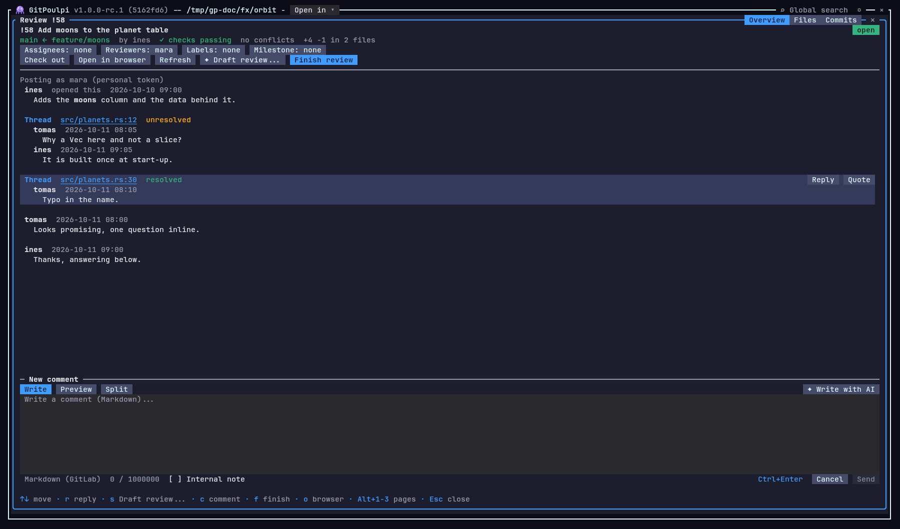

[English](../review.md) · [Čeština](../cs/review.md) · [Deutsch](../de/review.md) · [Español](../es/review.md) · [Français](../fr/review.md) · [Italiano](../it/review.md) · [日本語](../ja/review.md) · [한국어](../ko/review.md) · [Nederlands](../nl/review.md) · [Polski](../pl/review.md) · [Português (Brasil)](../pt-BR/review.md) · [Português (Portugal)](../pt-PT/review.md) · **Русский** · [Svenska](../sv/review.md) · [Türkçe](../tr/review.md) · [Українська](../uk/review.md) · [简体中文](../zh-CN/review.md)

# Ревью pull или merge request

Делайте ревью pull request (GitHub, Gitea, Forgejo), merge request (GitLab) или изменения Gerrit (см. [Gerrit](#gerrit))
**не выходя из окна репозитория**. Вид ревью показывает описание, беседу, изменённые файлы с обсуждениями под их
строками и commit'ы, и именно в нём вы пишете само ревью: комментарии, одобрение и запросы изменений. Нужен профиль
одного из этих хостингов (см. [Хостинги и трекеры задач](hosting-integration.md)) и привязанный к нему репозиторий;
другие провайдеры ревью не предлагают. Ограничения хостинга соблюдаются: в GitLab нет решения *Запросить изменения*, и
он принимает одну строку на комментарий. На этой странице всё это вместе называется *запросом*.

## Как открыть ревью

Все пути ведут в один и тот же вид:

- список **PULL REQUESTS** на боковой панели: выберите строку и нажмите **Enter** или щёлкните её правой кнопкой и
  выберите **Ревью...**;
- **Radar**: меню строки, **Ревью...**, или клавиша `e` (откроется репозиторий, а вместе с ним и ревью;
  для запроса из неклонированного репозитория спросят, клонировать его или вести ревью через API,
  см. [Ревью без клона](#ревью-без-клона));
- **поиск по рабочему пространству** (`Ctrl+Alt+F`): выделите pull или merge request и нажмите **`Alt+R`**;
- палитра: `Хостинг: ревью запроса...` показывает список запросов на выбор.

Вид занимает окно поверх репозитория (это режим вкладки репозитория, а не отдельное окно). **`Esc`** или `✕` в его
углу закрывает вид. Пока он открывается, запрос читается с хостинга, а его код загружается через git в фоне; если это
занимает больше мгновения, появляется индикатор.

## Заголовок

Всегда на виду: номер и название, состояние (Open, Draft, Merged, Closed), ветки (`main ← feature/moons`), автор,
проверки (`✓ проверки пройдены`, `✗ проверки не пройдены`, `● проверки выполняются`), сливается ли запрос чисто или
есть конфликты, размер и **`3 неотправленных комментария`**, если вы их написали.

Четыре кнопки метаданных - **Исполнители**, **Рецензенты**, **Метки**, **Этап** - открывают те же выборщики, что и
боковая панель (см. [Исполнители, рецензенты, метки и этап](hosting-integration.md#исполнители-рецензенты-метки-и-этап));
заголовок показывает результат, как только его принял хостинг. Кнопки действий: **Checkout** (обычный checkout ветки
запроса, который заодно закрывает вид), **Открыть в браузере**, **Обновить** (**`F5`**) и **Завершить ревью**.

## Три страницы

Сегментированный переключатель в верхней рамке меняет страницу: **Обзор**, **Файлы**, **Commits**
(**`Alt+1`**, **`Alt+2`**, **`Alt+3`** или щелчок).

### Обзор

Описание (простая Markdown-разметка показывается как есть: жирный, курсив, `код`, ссылки как их текст, маркированные
и нумерованные списки, заголовки, цитаты и блоки кода), затем беседа: комментарии не к коду и уже отправленные
ревью, от старых к новым, у каждого со своим решением (`одобрено`, `запрошены изменения`, `прокомментировано`,
`отклонено`). В GitLab решения - это его одобрения. Под ней поле ответа: щёлкните его или нажмите **`c`**, чтобы
написать комментарий к беседе. **Он публикуется сразу**, и поле об этом сообщает.

### Файлы

Слева изменённые файлы (буква состояния, `+добавлено -удалено`, счётчик `●n` открытых обсуждений, счётчик `✎n` ваших
неотправленных комментариев), справа diff выбранного файла. Diff берётся из git: head запроса загружается в
`refs/gitpoulpi/pr/<n>` (это не ветка, ничего не переключается) и сравнивается с merge base, так что номера строк на
полях - именно те, что используют комментарии.

- **`[ ]` перед файлом**: отметить его как *просмотренный* (щелчок или **`v`** / `Space` в списке). Заголовок их
  считает. Отметки хранятся для каждого репозитория и переживают перезапуск.
- **Обсуждения** лежат прямо под своей строкой: первый комментарий, ответы и кнопки **Ответить** и
  **Разрешить** / **Открыть снова**. Разрешённое обсуждение сворачивается в одну строку; **`z`** (или `Enter` на нём,
  или щелчок по `▾`) сворачивает и разворачивает любое обсуждение.
- **Устаревшие обсуждения** и обсуждения строк, которых diff не показывает, перечислены после hunk'ов под заголовком
  *Комментарии вне показанных строк* со значком `устарело`, когда код под ними изменился.
- **`c`** комментирует строку под курсором (маленький `+` в начале строки делает то же мышью). **`Shift+Вверх` /
  `Shift+Вниз`** (или протяжка по строкам) сначала выделяют несколько строк, и комментарий охватывает диапазон.
  GitLab принимает одну строку на комментарий, и вид говорит об этом вместо выделения.
- **`r`** отвечает в обсуждении под курсором, **`x`** разрешает его или открывает снова. Оба действия отправляются
  на хостинг **сразу**.
- Клавиши: `Вверх` / `Вниз` / `PgUp` / `PgDn` / `Home` / `End` перемещают; `Tab`, `Вправо` и `Enter` переходят из
  списка файлов в diff, `Влево` и `Tab` - обратно; `]` и `[` переходят к следующему и предыдущему файлу.

### Параметры отображения diff

Панель diff на страницах **Файлы** и **Commits** - та же, что в [Diff](staging-and-committing.md), с той же панелью в
первой строке и теми же запоминаемыми выборами (это одна настройка: то, что вы выбрали здесь, открывается и в
Diff, и наоборот):

- **Единый / Рядом**: одна колонка или «до» и «после» рядом. В режиме «Рядом» обсуждение, неотправленный комментарий
  или предложение стоит под той половиной, к которой относится: комментарий к удалённой строке - под левой, к
  добавленной или неизменной - под правой. Щёлкните нужную половину, прежде чем нажимать **`c`** на строке с
  удалением и добавлением; клавиатура комментирует новую сторону.
- **Hunk'и**: только изменения с контекстом или весь файл с изменениями на месте. В режиме всего файла обсуждение
  строки вне изменений стоит под своей строкой, а не в *Комментарии вне показанных строк*. Текст файла читается в
  фоне; пока он не придёт, hunk'и остаются на экране со строкой об этом (на странице Commits так читаются до 40
  файлов commit'а).
- **WS**: показывать или игнорировать изменения, отличающиеся только пробелами.
- **Перенос**: переносить длинные строки.
- **Стрелки вверх / вниз**: предыдущий и следующий hunk.
- **Карта** (**`M`**): миникарта у полосы прокрутки, одна настройка с Diff. Щёлкните или перетащите по ней,
  чтобы прокрутить.
- **Авто** (**`E`** или `Ревью: выбрать кодировку...`): кодировка, в которой читается файл, как в Diff:
  автоопределение или одна из кодировок списка, выбранная для файла, который показывает панель (на странице Commits -
  для файла под курсором). Обе стороны файла перечитываются в этой кодировке в фоне, а выбор общий с Diff для того
  же пути. Файл, который так прочитать нельзя, объясняет причину над своим diff.
- **`⋯`**: когда панель слишком узка для всех кнопок, те, что не поместились, прячутся за `⋯` в конце панели; его
  список выполняет каждую, как будто по ней щёлкнули. Их клавиши и строки палитры работают как обычно.

Линейка полосы прокрутки показывает, где что находится: изменения (только в режиме всего файла, как в Diff), точка
`●` для каждого обсуждения, неотправленного комментария и предложения, и курсор.

Длинные строки обрезаются по краю панели (включите **Перенос**, чтобы увидеть их целиком) и прокручиваются вбок:
**`Вправо`** и **`Влево`** в diff (`Влево` у левого края возвращает к списку файлов), боковое колесо или `Shift` с
колесом, полоса прокрутки вдоль нижней рамки или `Ревью: прокрутить diff влево` / `вправо`.

### Выделение текста и строк

Место начала протяжки определяет, что она выделяет. Протяжка, начатая **в коде**, выделяет текст, как в Diff
(двойной щелчок выделяет слово); **`Ctrl+C`** (или `Ревью: копировать выделенное или строку`) копирует ровно эти
символы, без номеров строк и маркеров, а без выделения текста копирует строку под курсором. Протяжка, начатая **в
желобе** (номера строк, маркер, `+`), выделяет строки, чтобы прокомментировать их, как раньше, а двойной щелчок в
желобе по-прежнему начинает комментарий к этой строке.

Клавиши Diff `n`, `p`, `m`, `w`, `s` в ревью заняты своим, поэтому переключатели ревью - заглавные буквы: **`V`**
раскладка, **`H`** hunk'и или весь файл, **`S`** пробелы, **`W`** перенос, **`J`** / **`K`** следующий и предыдущий
hunk, **`E`** кодировка, **`M`** миникарта. У каждого есть строка палитры (`Ревью: вид «единый» или «рядом»`, ...).

### Commits

Только commit'ы запроса (не история за ним), новые сверху, и diff выбранного (его изменения относительно родителя),
со всеми его файлами друг под другом и теми же параметрами отображения.

## Как писать ревью

Комментарий к коду **неотправлен**: он хранится на вашем компьютере (в файле состояния репозитория, так что
переживает перезапуск) и учитывается в заголовке. Ничего не отправляется, пока вы не завершите ревью.
Неотправленный комментарий показывается под своей строкой со значком `Не отправлено - строка 12` и двумя кнопками:
**`e`** (Править) и **`d`** (Удалить).

**Завершить ревью** (**`f`**, кнопка или палитра) открывает небольшую форму: сводка (необязательно) и список
**Решение**: *Комментарий*, *Одобрить*, *Запросить изменения*. Перечислено только то, что позволяет хостинг: в GitLab
нет *Запросить изменения*. **Отправить ревью** (`Ctrl+S`) отправляет сводку, решение и все неотправленные
комментарии за один раз. **Отменить ревью...** после подтверждения выбрасывает неотправленные комментарии.

Сразу, не дожидаясь ревью, отправляются: ответы, разрешение и повторное открытие обсуждений и комментарии к беседе.
Поле комментария говорит, какого он рода (*Этот комментарий публикуется сразу* или *Этот комментарий попадёт в ваше
неотправленное ревью*). Если хостинг отклоняет ответ, поле открывается снова с вашими словами.

Если после написания неотправленных комментариев в запросе появились новые commit'ы, вид предупреждает, что их
строки могли сместиться (GitHub и GitLab привязывают комментарий к commit'у, который вы читали; ревью старого head
отклоняется).

## Gerrit

Сервер Gerrit подключается как остальные хостинги (см. [Хостинги и трекеры задач](hosting-integration.md): URL
сервера, имя пользователя, HTTP-пароль) и привязывается в **PULL REQUESTS** к *проекту*. Его изменения перечислены
как pull request (`#7`, значок `GR`) и просматриваются в том же виде, со своими отличиями Gerrit:

- **Наборы патчей.** У изменения есть пронумерованные наборы патчей (каждая загрузка commit'а - один набор). В
  заголовке на верхней рамке рядом с вкладками страниц есть список **`Набор патчей N`** (**`P`** или строка палитры
  `Ревью: выбрать набор патчей...`). Он начинается с последнего; выбор другого читает файлы и код этого набора, а
  обсуждения, написанные на других наборах, перечисляются как *устаревшие*. Ревью, которое вы завершаете, отправляется
  на показанный набор патчей.
- **Сравнение с другим набором патчей.** Второй список слева от него, **`Сравнение: база`** (**`D`** или
  `Ревью: сравнить наборы патчей...`), перечисляет базу и каждый набор патчей старше показанного. Выберите набор
  патчей 1, пока показан набор 3, и страница «Файлы» перечислит и покажет в diff только то, что набор 3 изменил
  относительно набора 1 (собственная разница сервера, поэтому перебазирование на более новую цель не выглядит как
  изменения); страница commit'ов показывает эту одну разницу. Оба набора патчей загружаются в
  `refs/gitpoulpi/pr/<n>` и `refs/gitpoulpi/pr/<n>-ps<k>`. Обсуждения, написанные на других наборах патчей, чем
  показанный, - *устаревшие*. Если выбрать для чтения набор патчей старше сравниваемого, сравнение сбрасывается на
  базу. Двойник в CLI - `review show|fetch --compare-with K`.
- **Влить и отозвать.** Когда сервер сообщает, что изменение можно влить (нужные голоса и проверки есть), к кнопкам
  заголовка добавляется кнопка **Влить**; **Отозвать** есть, пока вы вправе отозвать изменение. Оба действия (клавиши
  **`U`** и **`Q`**, палитра `Ревью: влить изменение...` / `Ревью: отозвать изменение...`) сначала спрашивают, в окне,
  где сказано, что действие происходит на сервере и **GitPoulpi не может его отменить** (влитое изменение остаётся
  влитым; отозванное можно восстановить в веб-интерфейсе Gerrit). Отказ ничего не отправляет; при успехе вид читает
  изменение заново. Двойники в CLI - `gitpoulpi hosting review submit-change <n>` и
  `hosting review abandon <n> [--message M]`.
- **Голоса вместо решения.** **Завершить ревью** показывает по одному списку на каждую метку, за которую вы можете
  голосовать, - `Code-Review` (от -2 до +2) и `Verified`, если он есть в проекте, - и перечисляет только значения,
  которые сервер разрешает **для этого изменения и вам** (разработчик без прав не может выбрать +2). Он начинается с
  вашего текущего голоса; отправляется только изменённый голос. Сводка и неотправленные комментарии идут тем же
  вызовом. Черновики, которые вы сохранили в веб-интерфейсе Gerrit, публикуются вместе с ревью.
- **Обсуждения** - это цепочки комментариев Gerrit. Обсуждение разрешено, когда в его новейшем комментарии
  `unresolved: false`; **разрешить** отправляет ответ `Done`, который это делает, **открыть снова** - ответ
  `Reopened`. Ответы и разрешение уходят на сервер сразу, как на других хостингах.
- **Push на ревью.** Gerrit создаёт изменение, когда вы делаете push в `refs/for/<ветка>`. Когда раздел PULL REQUESTS
  привязан к проекту Gerrit, кнопка **`+`** раздела и строка палитры `Хостинг: push на ревью...` спрашивают целевую
  ветку и отправляют `HEAD` в `refs/for/<ветка>` (тему можно задать в командной строке). Этот push нельзя отменить из
  GitPoulpi (отмените изменение в Gerrit); сообщение об этом говорит. Двойник в CLI - `gitpoulpi hosting review push`.
- Кнопки метаданных для Gerrit только для чтения (рецензенты показаны), решения *Запросить изменения* нет (голос -1
  или -2 - то же самое), а значок проверок - это метка `Verified`.

## ✦ Черновик ревью ИИ

При включённом ИИ (*Настройки > ИИ*, см. [Помощь ИИ](ai.md)) в заголовке есть кнопка **`✦ Черновик ревью...`** (а
также **`s`** и строка палитры `Ревью: ✦ составить черновик ревью...`). Она открывает [параметры ревью](#параметры-ревью), и
**`Enter`** там обращается к модели. Это единственное, что обращается к модели: открытие ревью
этого никогда не делает. Модель читает название и описание запроса, уже существующие комментарии (чтобы не повторять
их) и diff, а отвечает **черновиком ревью**: текстом для отправки, рекомендуемым решением (Одобрить, Запросить изменения или Комментарий), общей сводкой и списком предложенных комментариев. Длинный diff для модели обрезается - по
файлу и в целом - и в Обзоре сказано, сколько файлов сокращено или исключено. Пока она работает, строка состояния
через мгновение показывает индикатор, а **`Esc`** (или та же кнопка) отменяет запрос. Действуют инструкции *Код-ревью*
[четырёх уровней](ai.md#инструкции), так что команда или рабочее пространство могут описать, каким должно быть хорошее
ревью.

### Параметры ревью

`s` открывает диалог **✦ Параметры ревью**, заполненный значениями по умолчанию репозитория (глобальными,
если у репозитория своих нет). `Enter` (или кнопка **Запустить**) начинает запуск с тем, что показывает диалог; `Esc`, **Отмена**
или крестик закрывают его и ничего не запрашивают.

| Элемент | Что делает |
|---|---|
| **Запускать агента в репозитории** | *Настройка профиля* (решает рабочая папка профиля ИИ), *Да* или *Нет*. Недоступен, с причиной под ним, для HTTP-профиля (у него нет рабочей папки) и когда ревью запроса ведётся через API без клона. |
| **CLAUDE.md**, **AGENTS.md** | Передают модели этот файл репозитория, прочитанный в ветке, на которую нацелен запрос. Когда агент запущен в репозитории, он читает их сам, и диалог об этом говорит. |
| **Дополнительный файл** | Ещё один файл: путь в репозитории, абсолютный путь или ссылка на файл на хостинге кода. **Обзор...** (`Ctrl+B` или `Enter` на кнопке) открывает выбор файла, который начинается в корне репозитория (или рядом с уже указанным файлом); файл внутри репозитория записывается путём относительно корня, файл вне его - абсолютным путём. Ввод в поле работает как раньше. |
| **Без дополнительного файла** | Без дополнительного файла для этого запуска, даже если его называет глобальная настройка или репозиторий; ввод файла или выбор через **Обзор...** снимает флажок. Вместе с **Сохранить как значения по умолчанию для этого репозитория** он становится переключателем репозитория *Без дополнительного файла*. Пустое поле здесь считается как «нет», потому что диалог начинается с того, что запуск унаследовал бы. |
| **Сохранить как значения по умолчанию для этого репозитория** | Сохраняет значения и для следующих ревью: в файле состояния репозитория или в `remote-reviews.toml` для неклонированного репозитория. Сохраняется только значение, отличающееся от глобального, остальные продолжают следовать *Настройки > ИИ*. |

Всё достижимо через `Tab`, `Space` переключает флажок, а поле пути - обычное текстовое поле. Те же
четыре настройки есть в *Настройки > ИИ* (*Код-ревью*) и в *Настройки репозитория > ИИ*; см.
[Контекст ревью](ai.md#контекст-ревью). То, что не удалось передать модели (отсутствующий или
нечитаемый дополнительный файл), и любой файл, сокращённый до лимитов, перечислены на карточке черновика.

Предложения - **не комментарии**. Они показываются в двух местах:

- **Под своей строкой в Файлах**, как призрачные комментарии с пометкой `✦` и важностью (`инфо`, `предупреждение`,
  `проблема`) и тремя кнопками: **Принять**, **Править** и **Отклонить**. Предложение о строке, которой нет в diff,
  не пропадает: оно перечислено после hunk'ов под заголовком *Предложения ИИ ко всему файлу* и после принятия
  попадает на первую изменённую строку файла со словами *(о строке N)* в начале.
- **В Обзоре**, под описанием: сводка, затем список с теми же кнопками и **Принять все** / **Отклонить все**.

**Принять** (`y`) превращает предложение в обычный **неотправленный комментарий** (его всё ещё можно править или
удалить); **Править** (`w`) открывает поле комментария со словами модели и принимает то, что вы оставите;
**Отклонить** (`n`) отбрасывает его. **Принять все** (`A`) тоже лишь наполняет список неотправленных. На странице
Файлы клавиши действуют на предложение под курсором, в Обзоре - на первое в списке. **Взять сводку ИИ** (`i` или
кнопка в форме завершения ревью) вставляет сводку модели в текст ревью; сама она никогда не вставляется.
**Ничего не отправляется на хостинг, пока вы не отправите ревью.**

В Обзоре черновик показан карточкой над предложениями: чип решения, текст ревью и три
кнопки.

- **✦ Использовать черновик...** (`u`) принимает каждое открытое предложение как неотправленный комментарий и открывает *Завершение ревью*, уже
  заполненное текстом и решением черновика. Вы по-прежнему читаете его, меняете и отправляете сами; отмена
  формы сохраняет черновик. Ограничения хостинга соблюдаются: в GitLab нет *Запросить изменения*, поэтому форма так и говорит и
  переключается на *Комментарий*; в Gerrit решение становится голосом Code-Review +1 или -1, только если
  сервер разрешает вам это значение (иначе голос не ставится, и форма об этом говорит).
- **Изменить текст...** (`t`) меняет текст ревью черновика до его использования.
- **Отбросить черновик** (`N`) отбрасывает текст, решение и оставшиеся предложения.

Черновик хранится для каждого запроса, поэтому он остаётся, когда вы закрываете и снова открываете ревью. Если
head запроса сдвинулся после того, как модель написала черновик, на карточке написано *Запрос изменился с тех пор, как был написан этот черновик.*
Отправка ревью расходует черновик.

## У всего есть клавиша и строка палитры

| Действие | Клавиша | Палитра |
|---|---|---|
| Обзор / Файлы / Commits | `Alt+1` / `Alt+2` / `Alt+3` | `Ревью: показать обзор`, `показать файлы`, `показать commits` |
| Комментарий к строке или диапазону | `c` | `Ревью: комментарий к строке...` |
| Комментарий к беседе | `c` в Обзоре, `C` | `Ревью: комментарий к беседе...` |
| Ответить в обсуждении | `r` | `Ревью: ответить в обсуждении...` |
| Разрешить или открыть снова | `x` | `Ревью: разрешить обсуждение или открыть снова` |
| Свернуть или развернуть обсуждение | `z` | `Ревью: свернуть или развернуть обсуждение` |
| Править / удалить неотправленный комментарий | `e` / `d` | `Ревью: изменить неотправленный комментарий...`, `удалить неотправленный комментарий` |
| Отметить файл как просмотренный | `v` | `Ревью: отметить файл как просмотренный` |
| Единый / Рядом | `V` | `Ревью: вид «единый» или «рядом»` |
| Весь файл / только hunk'и | `H` | `Ревью: весь файл или только hunk'и` |
| Изменения только пробелов | `S` | `Ревью: изменения только пробелов` |
| Перенос строк | `W` | `Ревью: перенос строк` |
| Следующий / предыдущий hunk | `J` / `K` | `Ревью: следующий hunk`, `предыдущий hunk` |
| Следующий / предыдущий файл | `]` / `[` | `Ревью: следующий файл`, `предыдущий файл` |
| Завершить / отменить ревью | `f` | `Ревью: завершить ревью...`, `отменить неотправленное ревью...` |
| Обновить | `F5`, `Ctrl+R` | `Ревью: обновить` |
| Открыть в браузере / checkout | `o` / `b` | `Ревью: открыть в браузере`, `переключиться на ветку` |
| Исполнители / рецензенты / метки / этап | `a` / `p` / `l` / `m` | `Ревью: изменить исполнителей...` и три её соседки |
| Выбрать набор патчей (Gerrit) | `P` | `Ревью: выбрать набор патчей...` |
| Сравнить со старым набором патчей (Gerrit) | `D` | `Ревью: сравнить наборы патчей...` |
| Влить / отозвать изменение (Gerrit) | `U` / `Q` | `Ревью: влить изменение...`, `Ревью: отозвать изменение...` |
| ✦ Черновик ревью... (ИИ включён; открывает параметры ревью) | `s` | `Ревью: ✦ составить черновик ревью...` |
| Принять / изменить и принять / отклонить предложение | `y` / `w` / `n` | `Ревью: принять предложение`, `изменить и принять предложение...`, `отклонить предложение` |
| Принять / отклонить все предложения | `A` / `N` | `Ревью: принять все предложения`, `отклонить все предложения` |
| Взять сводку ИИ в текст ревью | `i` | `Ревью: взять сводку ИИ в текст ревью` |
| Использовать ✦ черновик (заполняет завершение ревью) | `u` | `Ревью: ✦ использовать черновик...` |
| Изменить текст черновика | `t` | `Ревью: изменить текст черновика ✦...` |
| Отбросить ✦ черновик | `N` | `Ревью: отбросить черновик ✦` |
| Закрыть | `Esc` | `Ревью: закрыть` |

Откройте палитру (`Ctrl+P`), пока вид открыт: её строки работают с ним и объясняют, почему какая-то сейчас ничего не
делает («сначала поставьте курсор на строку кода»).

## Ревью без клона

Запрос из репозитория, которого нет на вашем компьютере, тоже можно просмотреть. В Radar **Ревью**
(`e`) в его строке спрашивает, как (см. [Radar](radar.md#ревью-запроса)); **Ревью через API** открывает
этот же вид в окне «Главной», поверх Radar. Всё на этой странице работает так же, со следующими
отличиями:

- Код (изменённые файлы, diff каждого файла, commit'ы запроса, diff commit'а, файл целиком)
  читается из API хостинга, поэтому первый взгляд на большой запрос занимает некоторое время, а файл, для
  которого хостинг не присылает diff (бинарный или очень большой), так и сообщает вместо показа diff.
- Ваши неотправленные комментарии хранятся в `remote-reviews.toml` в папке конфигурации, под хостингом
  и проектом (`host/project`), а не в собственном состоянии репозитория. Они остаются, когда вы
  закрываете и снова открываете ревью, а отправка ревью их расходует.
- Выбора кодировки нет (*Недоступно без клона*) и нет **Переключиться на ветку** (сказано сначала клонировать
  репозиторий).
- `Esc` или `✕` в углу покидает вид и возвращает Radar. Палитра (`Ctrl+P`) открывает
  строки вида так же, как во вкладке репозитория.

Чтобы вместо этого получить клон, выберите **Клонировать, затем ревью** (или строку палитры *Radar: клонировать и сделать ревью...*):
диалог клонирования откроется на подключённом аккаунте запроса с выбранным репозиторием, а ревью
откроется во вкладке нового репозитория, когда клон будет готов.

## Из командной строки и для агентов

То же ревью доступно как `gitpoulpi hosting review show|threads|comment|reply|resolve|submit|fetch|suggest` (и
инструменты MCP, сделанные из них): см. [Справочник по CLI](cli-reference.md). `threads` также перечисляет уже
отправленные решения (`reviews`). `suggest <n>` обращается к модели (ИИ включён) и выводит её `verdict`, `body`, сводку и предложения в
виде JSON, ничего не публикуя, так что скрипт или агент может выбрать комментарии для передачи в
`submit --comment`.

Ничего из этого не требует клона: `--project owner/name` (с `--id`, если настроено несколько интеграций)
запускает `show`, `threads`, `comment`, `reply`, `resolve`, `submit` и `suggest` для проекта, о котором текущая
папка ничего не знает. `hosting review diff <n>` выводит diff с hunk'ами (`--api` читает его с
хостинга даже внутри клона), а `hosting file <path> --project P [--ref R]` читает файл в заданной ревизии, например
`CLAUDE.md` проекта. Оба читают API хостинга: GitHub, GitLab, Gitea, Forgejo и Gerrit.
