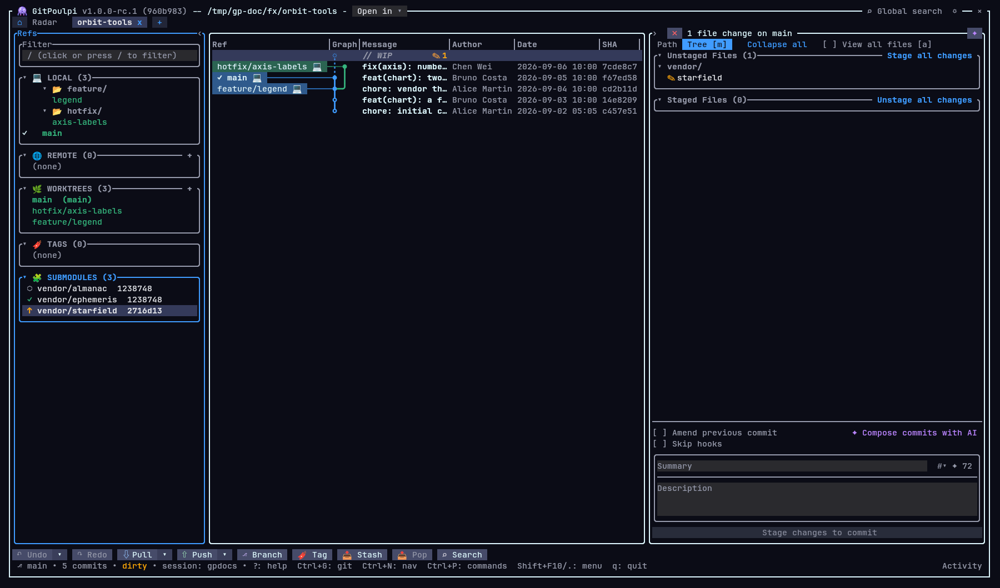

[English](../submodules.md) · [Čeština](../cs/submodules.md) · [Deutsch](../de/submodules.md) · [Español](../es/submodules.md) · [Français](../fr/submodules.md) · [Italiano](../it/submodules.md) · [日本語](../ja/submodules.md) · [한국어](../ko/submodules.md) · [Nederlands](../nl/submodules.md) · [Polski](../pl/submodules.md) · [Português (Brasil)](../pt-BR/submodules.md) · [Português (Portugal)](../pt-PT/submodules.md) · **Русский** · [Svenska](../sv/submodules.md) · [Türkçe](../tr/submodules.md) · [Українська](../uk/submodules.md) · [简体中文](../zh-CN/submodules.md)

# Подмодули

Подмодуль - это другой репозиторий, вложенный в ваш на фиксированном commit'е. GitPoulpi перечисляет их в боковой панели Refs, обновляет из интерфейса, CLI или палитры команд и может синхронизировать их с commit'ом, который вы переключаете.

## Раздел ПОДМОДУЛИ

Когда у репозитория есть `.gitmodules`, в боковой панели Refs появляется раздел **ПОДМОДУЛИ** (под остальными; если подмодулей нет, его нет). По строке на подмодуль: метка состояния, его путь и короткий commit.

| Метка | Состояние | Значение |
|---|---|---|
| `✓` | актуален | переключён на commit, записанный в репозитории |
| `↑` | изменён | переключён на другой commit (он ушёл вперёд или вы сменили ветку, не обновив его) |
| `○` | не клонирован | объявлен в `.gitmodules` и записан, но его папка пуста: обновите его, чтобы клонировать |
| `✗` | конфликт | в репозитории есть конфликты слияния по подмодулю |



| Действие | Мышь | Клавиатура |
|---|---|---|
| Открыть подмодуль в отдельной вкладке | двойной щелчок по строке | выбрать, `Enter` (палитра: `Refs: открыть подмодуль во вкладке`) |
| Меню: **Обновить (клонировать при необходимости)**, **Инициализировать**, **Открыть в новой вкладке** | правый щелчок по строке | выбрать, клавиша контекстного меню (по умолчанию `.`) |
| Обновить выбранный подмодуль (при необходимости сначала клонирует его) | меню | `Ctrl+P`: `Refs: обновить подмодуль (выбранный)` |
| Зарегистрировать его в `.git/config` без клонирования | меню | `Ctrl+P`: `Refs: инициализировать подмодуль (выбранный)` |
| Обновить все подмодули | | `Ctrl+P`: `Git: обновить все подмодули` |
| Перейти к разделу | щёлкнуть его заголовок | `Ctrl+P`: `Навигация: фокус на Refs > Подмодули` |


Обновление может загружать данные с remote подмодуля, поэтому оно подчиняется **Настройки > SSH и учётные данные > Учётные данные HTTPS** как любая другая передача. У неклонированного подмодуля нечего открывать во вкладке; строка состояния сообщает об этом и указывает на «Обновить».

## Поддержание подмодулей в актуальном состоянии

**Настройки > Синхронизация > Обновлять подмодули** (`general.keep_submodules_up_to_date`, по умолчанию выключено). Когда параметр включён, за успешным **checkout** или **pull** следует `git submodule update --init --recursive`. Он выполняется, только если подмодуль расходится с тем, что теперь записано в репозитории, поэтому репозиторий без подмодулей не замедляется. Если это обновление завершается ошибкой, checkout или pull всё равно состоялся, и сообщение об ошибке говорит об этом.

## Из командной строки

```
gitpoulpi submodule list                       # путь, состояние, url (--json: полный список)
gitpoulpi submodule init [<path>...]           # зарегистрировать, не клонировать
gitpoulpi submodule update [<path>...] [--init] [--recursive]
```

Без путей берутся все подмодули. Те же три команды доступны как инструменты MCP (`submodule_list` - чтение; `init` и `update` - изменения и подчиняются `allow_mutations` из `[mcp]`).

## Примечания

- Перечисляется только верхний уровень; подмодули самого подмодуля видны, когда вы открываете его во вкладке (или используйте `--recursive` для их обновления).
- Новые версии git отказываются клонировать подмодуль с *локальным путём* по транспорту `file`, если `protocol.file.allow` этого не разрешает. Это важно только для подмодулей, URL которых - локальная папка; задайте параметр в глобальной конфигурации git, если вы ими пользуетесь.
