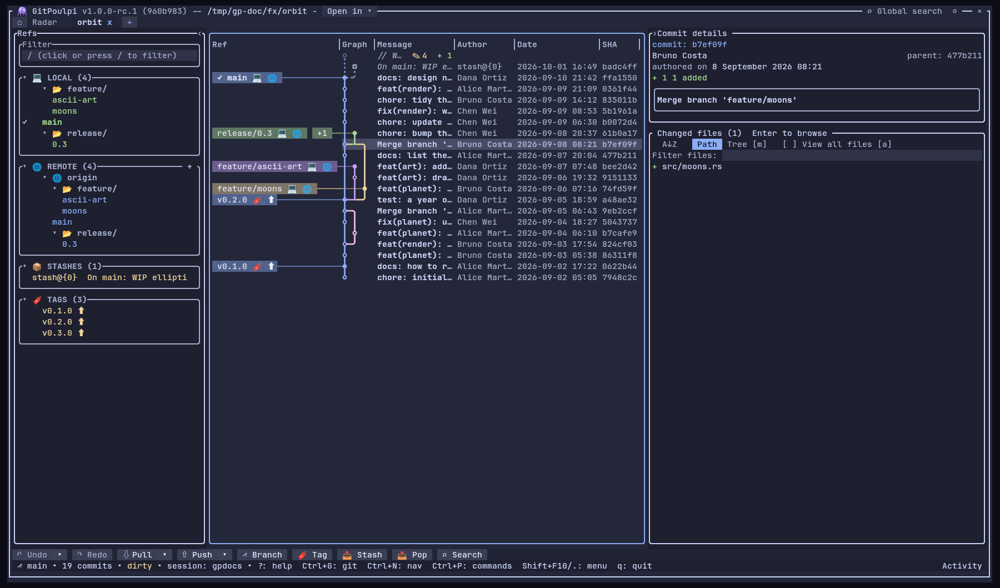
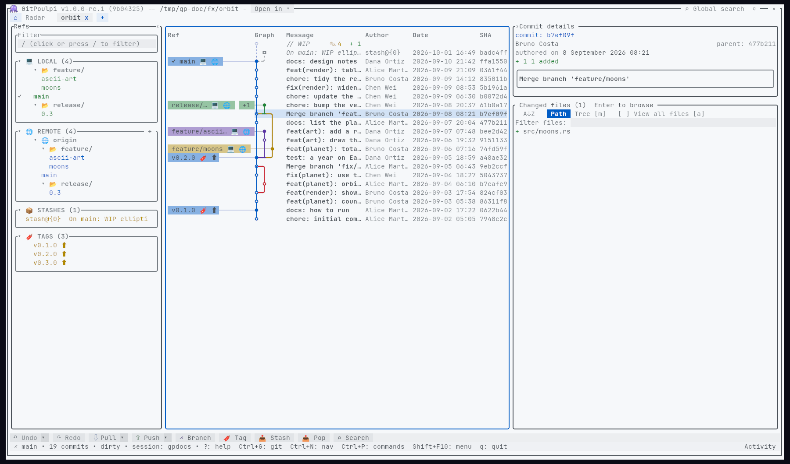
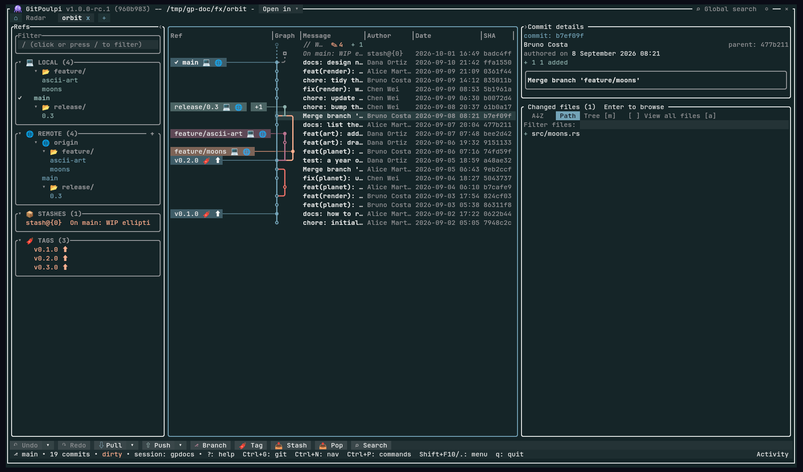
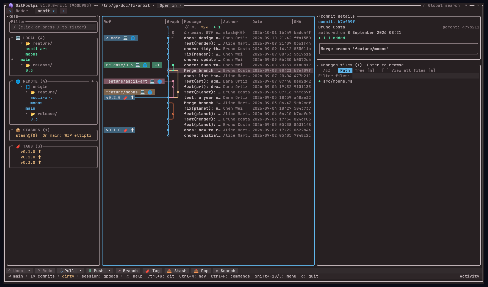
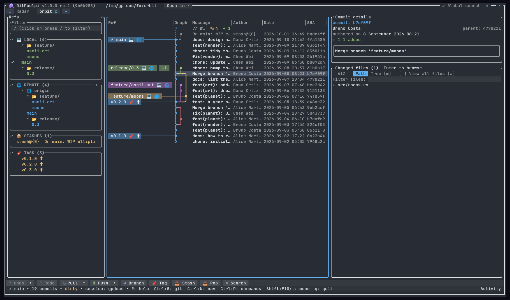
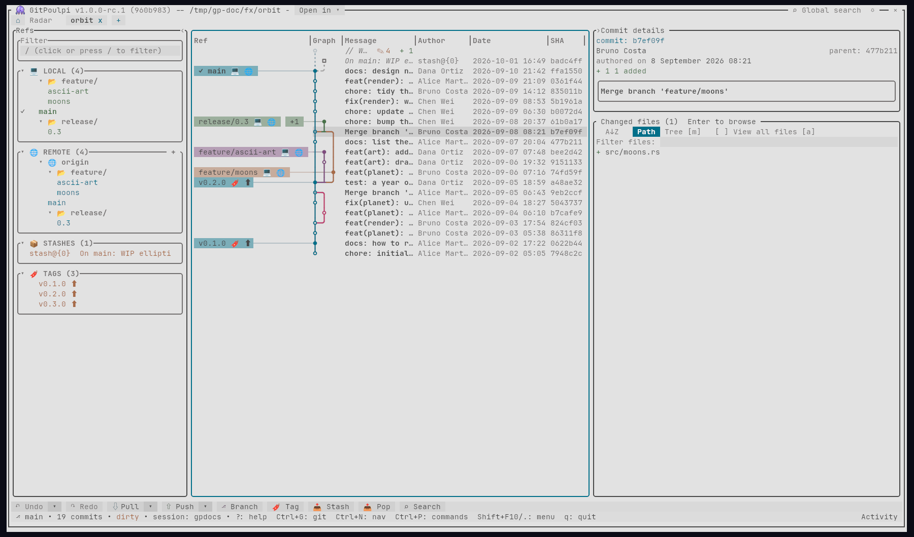

[English](../themes.md) · [Čeština](../cs/themes.md) · [Deutsch](../de/themes.md) · [Español](../es/themes.md) · [Français](../fr/themes.md) · [Italiano](../it/themes.md) · [日本語](../ja/themes.md) · [한국어](../ko/themes.md) · [Nederlands](../nl/themes.md) · [Polski](../pl/themes.md) · [Português (Brasil)](../pt-BR/themes.md) · [Português (Portugal)](../pt-PT/themes.md) · **Русский** · [Svenska](../sv/themes.md) · [Türkçe](../tr/themes.md) · [Українська](../uk/themes.md) · [简体中文](../zh-CN/themes.md)

# Темы

Тема задаёт каждый цвет, который рисует GitPoulpi: текст, панели, выделение, кнопки,
виды diff и слияния, редактор, значки панели инструментов и цвета полос графа Log.
Темы переключаются в **Настройки > Внешний вид > Тема** или командой
`gitpoulpi config set ui.theme <slug>`. Чтобы увидеть, как выглядит каждая из них, перейдите в [галерею](#галерея).

## Встроенные шаблоны

`gitpoulpi theme list` выводит шаблоны вашей сборки в том порядке, в каком их показывает
список в настройках: сначала **GitPoulpi Dark** (`dark`, рисуется
поверх собственного фона вашего терминала) и **GitPoulpi Light** (`light`),
затем все остальные шаблоны по алфавиту названий. `ui.theme = "system"` (значение по
умолчанию) следует терминалу: Light на светлом фоне терминала, иначе Dark
(см. «Определение системной темы» ниже); прежнее значение `default` равно
`system`. Список палитр полос использует тот же порядок.

| Slug | Название | Источник цветов |
|---|---|---|
| `system` (по умолчанию) | Система | не палитра: GitPoulpi Light на светлом фоне терминала, иначе GitPoulpi Dark |
| `dark` | GitPoulpi Dark | оригинальная тема GitPoulpi, рисуется поверх собственного фона вашего терминала |
| `light` | GitPoulpi Light | оригинальная тема GitPoulpi |
| `catppuccin-latte` / `catppuccin-frappe` / `catppuccin-macchiato` / `catppuccin-mocha` | Catppuccin Latte / Frappé / Macchiato / Mocha | [github.com/catppuccin/palette](https://github.com/catppuccin/palette) |
| `cyberpunk` | Cyberpunk | [iTerm2-Color-Schemes](https://github.com/mbadolato/iTerm2-Color-Schemes) «Cyberpunk» |
| `dracula` | Dracula | [draculatheme.com/contribute](https://draculatheme.com/contribute) |
| `everforest-dark` | Everforest Dark | [github.com/sainnhe/everforest/blob/master/palette.md](https://github.com/sainnhe/everforest/blob/master/palette.md) |
| `fire` / `fire-light` | Fire / Fire Light | оригинальные темы GitPoulpi: Fire - тлеющие угли на жжёно-оранжевом фоне с пламенно-оранжевым; Fire Light - его светлый близнец на настоящем оранжевом фоне |
| `github-dark` / `github-light` | GitHub Dark / GitHub Light | темы Primer от GitHub, [github.com/primer/github-vscode-theme](https://github.com/primer/github-vscode-theme) с @primer/primitives (`canvas.default`, `canvas.inset` для боковой панели, `fg.*`, `accent.fg`); ни одно значение не изменено |
| `gruvbox-dark` / `gruvbox-light` | Gruvbox Dark / Light | [github.com/morhetz/gruvbox#palette](https://github.com/morhetz/gruvbox#palette) |
| `kanagawa` / `kanagawa-lotus` | Kanagawa (wave) / Kanagawa Lotus | [github.com/rebelot/kanagawa.nvim](https://github.com/rebelot/kanagawa.nvim) |
| `matrix` | Matrix | [iTerm2-Color-Schemes](https://github.com/mbadolato/iTerm2-Color-Schemes) «Matrix» (в схеме нет красного: `danger` - `#ff5555`) |
| `monokai` | Monokai | оригинальная палитра Monokai ([monokai.nl](https://monokai.nl/)) |
| `nord` | Nord | [www.nordtheme.com](https://www.nordtheme.com) |
| `one-dark` / `one-light` | One Dark / One Light | Atom One Dark / One Light ([One Dark](https://github.com/atom/one-dark-syntax), [One Light](https://github.com/atom/one-light-syntax)) |
| `rose-pine` / `rose-pine-moon` / `rose-pine-dawn` | Rosé Pine / Moon / Dawn | [rosepinetheme.com/palette](https://rosepinetheme.com/palette/) |
| `solarized-dark` / `solarized-light` | Solarized Dark / Light | Solarized Итана Шунховера (Ethan Schoonover) ([ethanschoonover.com/solarized](https://ethanschoonover.com/solarized/)) |
| `sunset` | Sunset | оригинальная тема GitPoulpi: индиговые сумерки с кораллом и золотом |
| `terminal` | Terminal (16 цветов) | использует только собственные 16 цветов вашего терминала |
| `tokyo-night` / `tokyo-night-day` | Tokyo Night (night) / Tokyo Night Day | [github.com/folke/tokyonight.nvim](https://github.com/folke/tokyonight.nvim) (передний план Day затемнён, чтобы пройти правила контраста) |
| `vesper` | Vesper | [github.com/raunofreiberg/vesper](https://github.com/raunofreiberg/vesper) (в палитре нет синего и фиолетового: акцент персиковый) |
| `vscode-dark` / `vscode-light` | VS Code Dark / VS Code Light | Dark Modern / Light Modern из VS Code по умолчанию, [github.com/microsoft/vscode/tree/main/extensions/theme-defaults/themes](https://github.com/microsoft/vscode/tree/main/extensions/theme-defaults/themes) (`dark_modern.json`, `light_modern.json`, плюс значения цветов VS Code по умолчанию для выделения в списках и акцентов ANSI/диаграмм; приглушённый серый Light - `616161`) |

### Импортированные с terminalcolors.com

Импортированы из терминальных палитр terminalcolors.com; каждая схема принадлежит её авторам. 90 шаблонов строятся из фона, переднего плана, выделения и 16 цветов ANSI палитры (акцент = синий, success = зелёный, warning = жёлтый, danger = красный, ИИ = пурпурный, muted = яркий чёрный) единым выводом, общим для всех; цвет, не проходящий правила контраста GitPoulpi, осветляется или затемняется, пока не пройдёт. Таблица генерируется скриптом `scripts/gen-terminalcolors.py` в `crates/gitpoulpi-config/src/theme/terminalcolors_data.rs`. Значения slug имеют вид `<family>-<variant>` (`default` опускается); названия в списке идут по алфавиту, как и остальные.

| Семейство | Slug |
|---|---|
| [Apprentice](https://terminalcolors.com/themes/apprentice/) | `apprentice` |
| [Ayu](https://terminalcolors.com/themes/ayu/) | `ayu-dark`, `ayu-light`, `ayu-mirage` |
| [Cobalt2](https://terminalcolors.com/themes/cobalt2/) | `cobalt2` |
| [Deus](https://terminalcolors.com/themes/deus/) | `deus` |
| [Dracula](https://terminalcolors.com/themes/dracula/) | `dracula-soft` |
| [Everforest](https://terminalcolors.com/themes/everforest/) | `everforest-light` |
| [GitHub](https://terminalcolors.com/themes/github/) | `github-dark-colorblind`, `github-dark-dimmed`, `github-dark-high-contrast`, `github-dark-legacy`, `github-light-colorblind`, `github-light-high-contrast`, `github-light-legacy` |
| [Gotham](https://terminalcolors.com/themes/gotham/) | `gotham` |
| [Gruvbox](https://terminalcolors.com/themes/gruvbox/) | `gruvbox-dark-hard-contrast`, `gruvbox-dark-soft-contrast`, `gruvbox-light-hard-contrast`, `gruvbox-light-soft-contrast` |
| [Iceberg](https://terminalcolors.com/themes/iceberg/) | `iceberg-dark`, `iceberg-light` |
| [Jellybeans](https://terminalcolors.com/themes/jellybeans/) | `jellybeans` |
| [Kanagawa](https://terminalcolors.com/themes/kanagawa/) | `kanagawa-dragon` |
| [Lucario](https://terminalcolors.com/themes/lucario/) | `lucario` |
| [Miasma](https://terminalcolors.com/themes/miasma/) | `miasma` |
| [Moonfly](https://terminalcolors.com/themes/moonfly/) | `moonfly` |
| [Night](https://terminalcolors.com/themes/night-owl/) | `night-owl-dark`, `night-owl-light` |
| [Nightfly](https://terminalcolors.com/themes/nightfly/) | `nightfly` |
| [Nightfox](https://terminalcolors.com/themes/nightfox/) | `nightfox`, `nightfox-carbonfox`, `nightfox-dawnfox`, `nightfox-dayfox`, `nightfox-duskfox`, `nightfox-nordfox`, `nightfox-terafox` |
| [Noctis](https://terminalcolors.com/themes/noctis/) | `noctis`, `noctis-azureus`, `noctis-bordo`, `noctis-hibernus`, `noctis-lilac`, `noctis-lux`, `noctis-minimus`, `noctis-obscuro`, `noctis-sereno`, `noctis-uva`, `noctis-viola` |
| [Nordic](https://terminalcolors.com/themes/nordic/) | `nordic` |
| [One](https://terminalcolors.com/themes/one-half/) | `one-half-dark`, `one-half-light` |
| [Panda](https://terminalcolors.com/themes/panda/) | `panda` |
| [Posterpole](https://terminalcolors.com/themes/posterpole/) | `posterpole`, `posterpole-gray` |
| [Seoul256](https://terminalcolors.com/themes/seoul256/) | `seoul256-dark`, `seoul256-light` |
| [Shades](https://terminalcolors.com/themes/shades-of-purple/) | `shades-of-purple`, `shades-of-purple-super-dark` |
| [Sonokai](https://terminalcolors.com/themes/sonokai/) | `sonokai`, `sonokai-andromeda`, `sonokai-atlantis`, `sonokai-espresso`, `sonokai-maia`, `sonokai-shusia` |
| [Srcery](https://terminalcolors.com/themes/srcery/) | `srcery` |
| [Tender](https://terminalcolors.com/themes/tender/) | `tender` |
| [Tokyo](https://terminalcolors.com/themes/tokyo-night/) | `tokyo-night-moon`, `tokyo-night-storm` |
| [Tomorrow](https://terminalcolors.com/themes/tomorrow/) | `tomorrow`, `tomorrow-night`, `tomorrow-night-blue`, `tomorrow-night-bright`, `tomorrow-night-eighties` |
| [Zenbones](https://terminalcolors.com/themes/zenbones/) | `zenbones-duckbones`, `zenbones-forestbones-dark`, `zenbones-forestbones-light`, `zenbones-kanagawabones`, `zenbones-neobones-dark`, `zenbones-neobones-light`, `zenbones-nordbones`, `zenbones-rosebones-dark`, `zenbones-rosebones-light`, `zenbones-seoulbones-dark`, `zenbones-seoulbones-light`, `zenbones-tokyobones-dark`, `zenbones-tokyobones-light`, `zenbones-vimbones`, `zenbones-zenburned`, `zenbones-zenwritten-dark`, `zenbones-zenwritten-light` |

`ui.side_bg` - фон панели Refs и правой панели (сведения о commit'е, рабочие
изменения, списки файлов), как рисуют свои боковые панели GitHub и
VS Code. Его задают Catppuccin (его `mantle`), GitHub
и VS Code; у всех остальных шаблонов он `default`, то есть равен
`ui.bg`. Файл темы может задать `side_bg` в `[ui]` (его выводит `gitpoulpi theme export`).

Ещё три роли в `[ui]` красят обрамление интерфейса, как в GitHub и VS Code:

| Роль | Что рисует |
|---|---|
| `ui.toolbar_bg` | Строку панели инструментов и **выбранную вкладку репозитория**, чтобы вкладка выглядела прикреплённой к панели инструментов. Кнопки панели инструментов сохраняют свой `chrome.toolbar_bg`. |
| `ui.statusbar_bg` | Строку состояния (внизу, если `ui.statusbar_position` не задаёт верх). |
| `ui.statusbar_fg` | Текст строки состояния. Текст, который не читается на этой заливке, перекрашивается ею; текст предупреждений и ошибок, который читается, сохраняет свой цвет. |

Шаблоны задают их под своё приложение: у VS Code Dark и Light синяя (`#007acc`) строка состояния
с белым текстом и серые тона заголовка окна VS Code для панели инструментов; у GitHub -
тона его шапки. Все остальные шаблоны (включая импортированные терминальные палитры)
выводят панель инструментов на один шаг от `bg`, а строку состояния чуть дальше от него,
с `text` на ней, и правила контраста сохраняют читаемость текста. `dark` (GitPoulpi Dark) и `terminal`
используют собственный фон терминала, поэтому у них все три значения `default`: ничего
не рисуется, а выбранная вкладка сохраняет цвет выделения. Файл темы, в котором их нет,
наследует значения своей базы; `default` означает отсутствие оттенка (строка состояния
тогда следует `side_bg`).

Если комментарий или приглушённый серый схемы слишком тусклый для чтения, он
осветляется, пока не пройдёт правила контраста GitPoulpi; оттенки панелей и выделения,
которых в схеме нет, выводятся из её фона.

### Галерея

Все встроенные темы на одном и том же репозитории с выбранным commit'ом слияния (`scripts/docs-screenshots.sh` снимает их заново).

| **GitPoulpi Dark** (`dark`) | **GitPoulpi Light** (`light`) | **Apprentice** (`apprentice`) |
|---|---|---|
|  |  |  |
| **Ayu Dark** (`ayu-dark`) | **Ayu Light** (`ayu-light`) | **Ayu Mirage** (`ayu-mirage`) |
|  |  |  |
| **Catppuccin Frappé** (`catppuccin-frappe`) | **Catppuccin Latte** (`catppuccin-latte`) | **Catppuccin Macchiato** (`catppuccin-macchiato`) |
|  |  |  |
| **Catppuccin Mocha** (`catppuccin-mocha`) | **Cobalt2** (`cobalt2`) | **Cyberpunk** (`cyberpunk`) |
|  |  |  |
| **Deus** (`deus`) | **Dracula** (`dracula`) | **Dracula Soft** (`dracula-soft`) |
|  |  |  |
| **Everforest Dark** (`everforest-dark`) | **Everforest Light** (`everforest-light`) | **Fire** (`fire`) |
|  |  |  |
| **Fire Light** (`fire-light`) | **GitHub Dark** (`github-dark`) | **GitHub Dark Colorblind** (`github-dark-colorblind`) |
|  |  |  |
| **GitHub Dark Dimmed** (`github-dark-dimmed`) | **GitHub Dark High Contrast** (`github-dark-high-contrast`) | **GitHub Dark Legacy** (`github-dark-legacy`) |
|  |  |  |
| **GitHub Light** (`github-light`) | **GitHub Light Colorblind** (`github-light-colorblind`) | **GitHub Light High Contrast** (`github-light-high-contrast`) |
|  |  |  |
| **GitHub Light Legacy** (`github-light-legacy`) | **Gotham** (`gotham`) | **Gruvbox Dark** (`gruvbox-dark`) |
|  |  |  |
| **Gruvbox Dark Hard Contrast** (`gruvbox-dark-hard-contrast`) | **Gruvbox Dark Soft Contrast** (`gruvbox-dark-soft-contrast`) | **Gruvbox Light** (`gruvbox-light`) |
|  |  |  |
| **Gruvbox Light Hard Contrast** (`gruvbox-light-hard-contrast`) | **Gruvbox Light Soft Contrast** (`gruvbox-light-soft-contrast`) | **Iceberg Dark** (`iceberg-dark`) |
|  |  |  |
| **Iceberg Light** (`iceberg-light`) | **Jellybeans** (`jellybeans`) | **Kanagawa** (`kanagawa`) |
|  |  |  |
| **Kanagawa Dragon** (`kanagawa-dragon`) | **Kanagawa Lotus** (`kanagawa-lotus`) | **Lucario** (`lucario`) |
|  |  |  |
| **Matrix** (`matrix`) | **Miasma** (`miasma`) | **Monokai** (`monokai`) |
|  |  |  |
| **Moonfly** (`moonfly`) | **Night Owl Dark** (`night-owl-dark`) | **Night Owl Light** (`night-owl-light`) |
|  |  |  |
| **Nightfly** (`nightfly`) | **Nightfox** (`nightfox`) | **Nightfox Carbonfox** (`nightfox-carbonfox`) |
|  |  |  |
| **Nightfox Dawnfox** (`nightfox-dawnfox`) | **Nightfox Dayfox** (`nightfox-dayfox`) | **Nightfox Duskfox** (`nightfox-duskfox`) |
|  |  |  |
| **Nightfox Nordfox** (`nightfox-nordfox`) | **Nightfox Terafox** (`nightfox-terafox`) | **Noctis** (`noctis`) |
|  |  |  |
| **Noctis Azureus** (`noctis-azureus`) | **Noctis Bordo** (`noctis-bordo`) | **Noctis Hibernus** (`noctis-hibernus`) |
|  |  |  |
| **Noctis Lilac** (`noctis-lilac`) | **Noctis Lux** (`noctis-lux`) | **Noctis Minimus** (`noctis-minimus`) |
|  |  |  |
| **Noctis Obscuro** (`noctis-obscuro`) | **Noctis Sereno** (`noctis-sereno`) | **Noctis Uva** (`noctis-uva`) |
|  |  |  |
| **Noctis Viola** (`noctis-viola`) | **Nord** (`nord`) | **Nordic** (`nordic`) |
|  |  |  |
| **One Dark** (`one-dark`) | **One Half Dark** (`one-half-dark`) | **One Half Light** (`one-half-light`) |
|  |  |  |
| **One Light** (`one-light`) | **Panda** (`panda`) | **Posterpole** (`posterpole`) |
|  |  |  |
| **Posterpole Gray** (`posterpole-gray`) | **Rosé Pine** (`rose-pine`) | **Rosé Pine Dawn** (`rose-pine-dawn`) |
|  |  |  |
| **Rosé Pine Moon** (`rose-pine-moon`) | **Seoul256 Dark** (`seoul256-dark`) | **Seoul256 Light** (`seoul256-light`) |
|  |  |  |
| **Shades of Purple** (`shades-of-purple`) | **Shades of Purple Super Dark** (`shades-of-purple-super-dark`) | **Solarized Dark** (`solarized-dark`) |
|  |  |  |
| **Solarized Light** (`solarized-light`) | **Sonokai** (`sonokai`) | **Sonokai Andromeda** (`sonokai-andromeda`) |
|  |  |  |
| **Sonokai Atlantis** (`sonokai-atlantis`) | **Sonokai Espresso** (`sonokai-espresso`) | **Sonokai Maia** (`sonokai-maia`) |
|  |  |  |
| **Sonokai Shusia** (`sonokai-shusia`) | **Srcery** (`srcery`) | **Sunset** (`sunset`) |
|  |  |  |
| **Tender** (`tender`) | **Terminal (16 colors)** (`terminal`) | **Tokyo Night** (`tokyo-night`) |
|  |  |  |
| **Tokyo Night Day** (`tokyo-night-day`) | **Tokyo Night Moon** (`tokyo-night-moon`) | **Tokyo Night Storm** (`tokyo-night-storm`) |
|  |  |  |
| **Tomorrow** (`tomorrow`) | **Tomorrow Night** (`tomorrow-night`) | **Tomorrow Night Blue** (`tomorrow-night-blue`) |
|  |  |  |
| **Tomorrow Night Bright** (`tomorrow-night-bright`) | **Tomorrow Night Eighties** (`tomorrow-night-eighties`) | **Vesper** (`vesper`) |
|  |  |  |
| **VS Code Dark** (`vscode-dark`) | **VS Code Light** (`vscode-light`) | **Zenbones Duckbones** (`zenbones-duckbones`) |
|  |  |  |
| **Zenbones Forestbones Dark** (`zenbones-forestbones-dark`) | **Zenbones Forestbones Light** (`zenbones-forestbones-light`) | **Zenbones Kanagawabones** (`zenbones-kanagawabones`) |
|  |  |  |
| **Zenbones Neobones Dark** (`zenbones-neobones-dark`) | **Zenbones Neobones Light** (`zenbones-neobones-light`) | **Zenbones Nordbones** (`zenbones-nordbones`) |
|  |  |  |
| **Zenbones Rosebones Dark** (`zenbones-rosebones-dark`) | **Zenbones Rosebones Light** (`zenbones-rosebones-light`) | **Zenbones Seoulbones Dark** (`zenbones-seoulbones-dark`) |
|  |  |  |
| **Zenbones Seoulbones Light** (`zenbones-seoulbones-light`) | **Zenbones Tokyobones Dark** (`zenbones-tokyobones-dark`) | **Zenbones Tokyobones Light** (`zenbones-tokyobones-light`) |
|  |  |  |
| **Zenbones Vimbones** (`zenbones-vimbones`) | **Zenbones Zenburned** (`zenbones-zenburned`) | **Zenbones Zenwritten Dark** (`zenbones-zenwritten-dark`) |
|  |  |  |
| **Zenbones Zenwritten Light** (`zenbones-zenwritten-light`) |
|  |

## Любая тема с любой палитрой полос

Каждая тема приносит свои цвета полос для графа Log, но любую тему можно
сочетать с любой палитрой: **Настройки > Внешний вид > Цветовая тема графа** предлагает
**Как в теме** (по умолчанию) и каждую палитру полос каждой темы (GitPoulpi Dark,
GitPoulpi Light, затем Material, Serie, ... и `graph_palette` ваших собственных файлов тем).


В `config.toml`:

```toml
[ui]
theme = "nord"
graph_color_theme = "material"   # или "theme", чтобы следовать теме
```

`ui.input_color` - такое же переопределение для текстовых полей: значение по умолчанию
`theme` следует цветам полей ввода темы; `gray`, `blue`, `slate`, `dark` и
`custom` принудительно задают фон (это тёмные цвета, поэтому для светлой
темы выбирайте `theme`).

## Собственные темы

Положите файл `.toml` в папку `themes/` каталога конфигурации
(`gitpoulpi config path` выводит её родителя; папка - `${config}/themes/`).
Имя файла без `.toml` - это slug темы, именно его принимает `ui.theme`.
Файл не может повторять slug шаблона (он пропускается с предупреждением).

Начните с полного файла:

```
gitpoulpi theme export nord > "$(dirname "$(gitpoulpi config path)")/themes/mine.toml"
```

Затем оставьте только то, что меняете. Файл - это набор **частичных переопределений**
поверх `base` (шаблона или другой пользовательской темы; цепочки не длиннее 4,
циклы отвергаются; без `base` берётся `dark`):

```toml
name = "My Nord"            # название в списке; по умолчанию имя файла
base = "nord"
light = false               # наследуется, если не указано
syntax = "base16-ocean.dark"
graph_palette = ["#88c0d0", "#a3be8c"]

[ui]
bg = "#2e3440"              # "default" | "#rrggbb" | "ansi:N"
accent = "#88c0d0"
toolbar_bg = "#3b4252"      # строка панели инструментов и выбранная вкладка
statusbar_bg = "#5e81ac"    # строка состояния
statusbar_fg = "#eceff4"

[diff]
add_bg = "#2f3b2f"
```

Цвета задаются как `"#rrggbb"`, `"ansi:N"` (запись N палитры терминала) или
`"default"` (собственный цвет терминала). Группы и ключи - те, что выводит
`gitpoulpi theme export <slug>`. Ничто не фатально: неизвестный ключ или неверный
цвет игнорируется, неизвестная `base` заменяется на `dark`, а
`gitpoulpi theme list` сообщает о каждой проблеме в `warnings` (приложение показывает
их один раз в строке состояния).

Файлы перечитываются, когда открывается список тем и когда закрываются настройки.
Работающее окно также замечает, что `config.toml` (например, после
`gitpoulpi config set ui.theme ...` из оболочки) или файл активной темы был
перезаписан, и применяет новые цвета примерно за секунду, без перезапуска.

### `ui.border_focused`

Рамка панели, у которой фокус клавиатуры: Log, боковая панель Refs, панели Staged и
Unstaged, сведения о commit'е, панели истории, проверки и перезаписи, рамки diff,
файлов и редактора. Она красит только рамки; текст, подписи и значки (подпись
«commit :», значок Home, кнопки вкладок) по-прежнему используют `ui.accent`. Благодаря
этому тема может обводить активную панель цветом, который был бы нечитаем как цвет
текста, например ярко-жёлтым на светлой теме. Если тема его не задаёт, он следует за
`ui.accent` (и в пользовательском файле тоже: файл, меняющий только `accent`, даёт этот
акцент и рамкам панелей с фокусом), поэтому все встроенные темы выглядят как раньше.
Диалоги и всплывающие окна сохраняют рамку цвета акцента.

```toml
[ui]
accent = "#1f5fbf"
border_focused = "#ffd700"
```

## Определение системной темы

При `ui.theme = "system"` GitPoulpi спрашивает у терминала цвет его фона
**один раз, при запуске** (запрос OSC 11, на него отвечают kitty, WezTerm,
Alacritty, foot, iTerm2, Windows Terminal, tmux и большинство других) и выбирает
Light для светлого фона, иначе Dark. Ожидание - не более примерно
100 мс, а терминал, не знающий запроса, ничего не стоит: ответ
всегда читается до запуска интерфейса, поэтому ничего не печатается и клавиши
не проглатываются. Без ответа (и всегда в Windows, где запрос не отправляется)
читается `COLORFGBG`, затем берётся Dark. Если фон терминала меняется, пока
работает GitPoulpi, это не отслеживается; перезапустите программу или выберите
Light или Dark явно.

## Глубина цвета

Темы - truecolor (`#rrggbb`). `ui.color_depth` (**Настройки > Внешний вид >
Глубина цвета**, применяется сразу) решает, как это доходит до терминала:

| Значение | Действие |
|---|---|
| `auto` (по умолчанию) | Truecolor, кроме мест, где это заведомо не работает: Apple Terminal (`TERM_PROGRAM=Apple_Terminal`) использует 256 цветов, консоль Linux (`TERM=linux`) - 16, а терминал `*-256color` без `COLORTERM` (и не WezTerm, kitty или Windows Terminal) - 256. `COLORTERM=truecolor` всегда означает truecolor. |
| `truecolor` | Всегда 24-битный цвет. |
| `256` | Каждый цвет RGB становится ближайшей записью xterm-256. |
| `16` | Ближайший из 16 цветов ANSI; точный оттенок задаёт собственная палитра терминала. |

Используйте `256` или `16`, если тема показывает неверные цвета по ssh или в старом
мультиплексоре. Шаблону Terminal всё это не нужно. Truecolor ничего не стоит;
проход сопоставления выполняется один раз на кадр и только когда он включён.

## Предпросмотр на лету

В **Настройки > Внешний вид** список тем содержит **Системная (как в терминале)**,
шаблоны, затем ваши файлы тем. Перемещение выделения применяет тему
сразу, так что весь экран настроек перекрашивается на ваших глазах; **Enter** оставляет её
(она сохраняется), **Esc** или щелчок в стороне возвращает прежнюю и ничего
не сохраняет. Команда палитры `Приложение: тема...` (`Ctrl+P`) открывает настройки на этой
строке.

### Смена темы из палитры

Команда `Приложение: сменить тему...` (`Ctrl+P` или `Ctrl+N t`; клавишу можно переназначить как
`nav_prefix.change_theme`) открывает список тех же тем без перехода
в настройки: **Системная (как в терминале)**, шаблоны, затем ваши файлы
тем, у каждой по четыре маленьких цветовых плашки. Текущая тема отмечена галочкой.
Введите текст, чтобы сузить список; перемещение выделения сразу показывает тему,
**Enter** применяет её и сохраняет `ui.theme` в `config.toml`, **Esc** (или щелчок
вне списка) возвращает прежнюю тему и ничего не сохраняет.

Под полем фильтра сегментный префильтр сужает список: **Все**,
**Тёмные**, **Светлые** и **Цветные** (щёлкните сегмент, `Tab` / `Shift+Tab` или
`Alt+1`..`Alt+4`). Тёмные и Светлые определяются по яркости `ui.bg` темы;
**Цветные** оставляют темы, фон которых явно подкрашен (синий,
фиолетовый, жёлтый, зелёный...), и исключают белые, почти белые, чёрные и
почти чёрные серые, поэтому Solarized Dark, Dracula или Nord цветные, а GitHub
Dark и One Light - нет. Цветная тема показывается и среди Тёмных или Светлых.
**Системная** и прозрачные темы (без собственного фона) показываются только в
Все. Префильтр сочетается с тем, что вы вводите. Выборы цветовой темы графа
и языка предпросматриваются так же: полосы Log и весь интерфейс
меняются по мере перемещения выделения.


Под списком полоска цветовых плашек показывает действующую тему (фон,
текст, приглушённый, акцент, выделение, danger, добавлено в diff, удалено в diff, затем первые
шесть цветов полос), и она следует за предпросмотром. Список **Цветовая тема графа** на странице
**Внешний вид** показывает несколько цветов полос рядом с каждой палитрой, а выбор
применяется при закрытии настроек.

Тема со своим фоном (Light и остальные закрашенные шаблоны) заливает всё
окно, включая настройки и полностраничные виды, и придаёт тексту без
собственного цвета цвет текста темы; Dark и Terminal не трогают цвета вашего
терминала.

## Из командной строки

| Команда | Вывод |
|---|---|
| `gitpoulpi theme list` | JSON `{themes: [{slug, label, source, light, lane_palette}], warnings}`; `source` - `preset` или `user`. |
| `gitpoulpi theme export <slug>` | Полный файл темы в TOML на stdout (JSON: `{slug, toml}`); разбирается обратно в ту же тему. |
| `gitpoulpi config set ui.theme <slug>` | Проверяется по шаблонам и вашей папке `themes/`; неизвестное имя - ошибка со списком допустимых. `system` и `default` принимаются. |
| `gitpoulpi config set ui.graph_color_theme <name>` | `theme` (как в теме) или любое имя палитры полос; неизвестное имя выводит список допустимых. |

Сервер MCP предлагает `theme_list` и `theme_export` как инструменты только для чтения.
