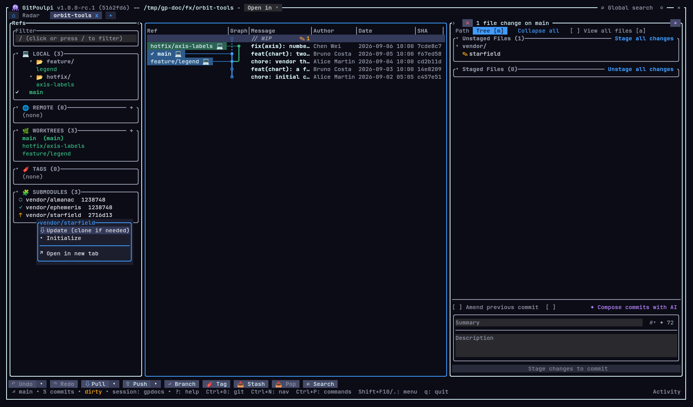

**English** · [Čeština](cs/submodules.md) · [Deutsch](de/submodules.md) · [Español](es/submodules.md) · [Français](fr/submodules.md) · [Italiano](it/submodules.md) · [日本語](ja/submodules.md) · [한국어](ko/submodules.md) · [Nederlands](nl/submodules.md) · [Polski](pl/submodules.md) · [Português (Brasil)](pt-BR/submodules.md) · [Português (Portugal)](pt-PT/submodules.md) · [Русский](ru/submodules.md) · [Svenska](sv/submodules.md) · [Türkçe](tr/submodules.md) · [Українська](uk/submodules.md) · [简体中文](zh-CN/submodules.md)

# Submodules

A submodule is another repository nested inside yours at a fixed commit. GitPoulpi lists them in the Refs sidebar, updates them from the UI, the CLI or the command palette, and can keep them in step with the commit you check out.

## The SUBMODULES section

When a repository has a `.gitmodules`, the Refs sidebar gets a **SUBMODULES** section (below the others; it is absent when there are none). One row per submodule: a state mark, its path and a short commit.

| Mark | State | Meaning |
|---|---|---|
| `✓` | up to date | checked out at the commit the repository records |
| `↑` | modified | checked out at another commit (it moved on, or you switched branches without updating it) |
| `○` | not cloned | declared in `.gitmodules` and recorded, but its folder is empty: update it to clone it |
| `✗` | conflicted | the repository has merge conflicts on the submodule |


| Do | Mouse | Keyboard |
|---|---|---|
| Open the submodule as a tab of its own | double-click the row | select it, `Enter` (palette: `Refs: Submodule Open in Tab`) |
| Menu: **Update**, **Initialize**, **Open in new tab** | right-click the row | select it, the context-menu key (default `.`) |
| Update the selected submodule (clones it first when needed) | menu | `Ctrl+P`: `Refs: Submodule Update (Selected)` |
| Register it in `.git/config` without cloning | menu | `Ctrl+P`: `Refs: Submodule Init (Selected)` |
| Update every submodule | | `Ctrl+P`: `Git: Update All Submodules` |
| Jump to the section | click its header | `Ctrl+P`: `Navigation: Focus Refs > Submodules` |



An update may fetch from the submodule's remote, so it follows **Settings > SSH & credentials > HTTPS credentials** like any other transfer. A submodule that is not cloned has nothing to open as a tab; the status line says so and points to Update.

## Keeping submodules up to date

**Settings > Synchronization > Keep submodules up to date** (`general.keep_submodules_up_to_date`, off by default). When it is on, a successful **checkout** or **pull** is followed by `git submodule update --init --recursive`. This runs only if a submodule is out of step with what the repository now records, so a repository without submodules is not slowed down. If that update fails, the checkout or pull still happened and the error says so.

## From the command line

```
gitpoulpi submodule list                       # path, state, url (--json: the full list)
gitpoulpi submodule init [<path>...]           # register, do not clone
gitpoulpi submodule update [<path>...] [--init] [--recursive]
```

No paths means every submodule. The same three are MCP tools (`submodule_list` is a read; `init` and `update` are mutations and follow `[mcp]`'s `allow_mutations`).

## Notes

- Only the top level is listed; a submodule's own submodules show when you open it as a tab (or use `--recursive` to update them).
- Newer git refuses to clone a *local path* submodule over the `file` transport unless `protocol.file.allow` permits it. That only matters for submodules whose URL is a local folder; set it in your global git config if you use them.
