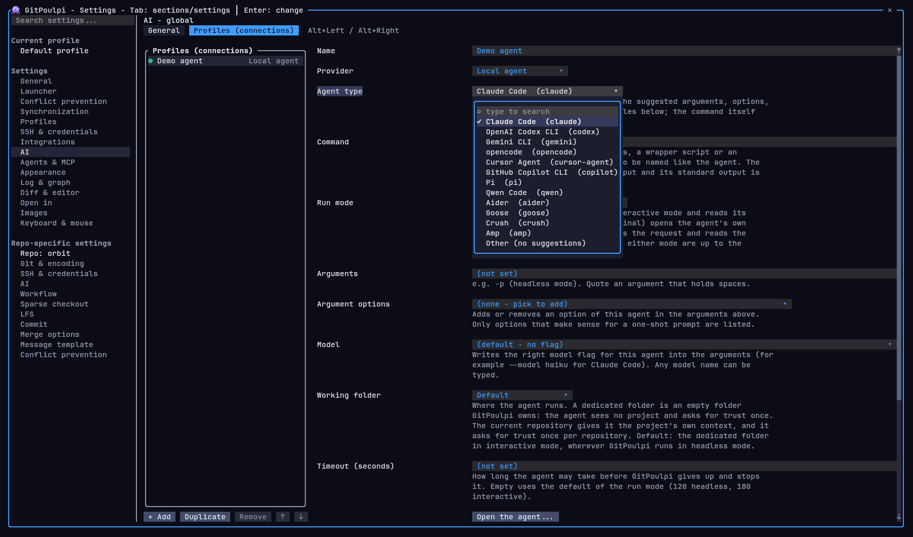

[English](../ai.md) · [Čeština](../cs/ai.md) · [Deutsch](../de/ai.md) · [Español](../es/ai.md) · [Français](../fr/ai.md) · [Italiano](../it/ai.md) · [日本語](../ja/ai.md) · [한국어](../ko/ai.md) · [Nederlands](../nl/ai.md) · [Polski](../pl/ai.md) · [Português (Brasil)](../pt-BR/ai.md) · [Português (Portugal)](../pt-PT/ai.md) · [Русский](../ru/ai.md) · **Svenska** · [Türkçe](../tr/ai.md) · [Українська](../uk/ai.md) · [简体中文](../zh-CN/ai.md)

# AI-hjälp

GitPoulpi behöver aldrig något konto, och **AI är avstängt som standard**. När AI är på
kan det skriva commit- och stash-meddelanden, förklara ändringar, skriva
beskrivningar av pull requests, föreslå lösningar på merge-konflikter och dela upp
dina lokala ändringar i flera commits. Modellen är din: en API-nyckel som du själv äger,
en lokal server eller en agent-CLI som redan är installerad (som `claude -p`).

Varje AI-kontroll visar det lila `✦`. Medan AI är avstängt:

- Skickas ingenting någonstans.
- Visas ingen AI-kontroll: ingen `✦`-knapp, inget `AI:`-palettkommando, ingen AI-menyrad
  och ingen AI-tangenthint. AI-tangenterna gör ingenting.
- Visar repositoryts AI-sida bara ”AI är avstängd (Inställningar > AI)”.
- Listar MCP-servern inte verktygen `ai_*`. CLI-kommandona `gitpoulpi ai ...`
  vägrar med samma meddelande.

**Aktivera AI** gäller direkt. Du behöver inte starta om.

Det finns två sätt att använda AI med GitPoulpi:

| | Inbyggd AI (den här sidan) | En extern agent |
|---|---|---|
| Vad | GitPoulpi ber en modell om ett commit-meddelande, en förklaring, ... | Claude Code, Cursor, Codex... styr GitPoulpi som ett verktyg |
| Ställs in i | Inställningar > AI (`[ai]`) | agentens MCP-konfiguration, gränser i `[mcp]` |
| Guide | nedan | [MCP och agenter](mcp-and-agents.md) |

## Konfigurera AI

1. `Ctrl+,` > **AI** > bocka i **Aktivera AI**.
2. Profilerna är listan på fliken **Profiler (anslutningar)**, till vänster på sidan (ovanför i en smal terminal): välj
   en för att redigera den till höger (`Enter` går in i dess rader; palettens **AI:
   Redigera profil...** hoppar till listan). **+ Lägg till** skapar en till,
   **Duplicera** kopierar den valda (utan dess nyckel) och **Ta bort** frågar först.
   Välj **Leverantör** och fyll i dess fält:

   | Leverantör | Fält | Standardvärden |
   |---|---|---|
   | **Lokal agent** (ingen nyckel, inget eget konto) | **Agenttyp** (vilken agent det är), **Kommando** (det exakta programmet: i din `PATH`, ett alias eller omslagsskript, eller en full sökväg), **Argument** som gör den icke-interaktiv och valfria **Miljövariabler**. Prompten skickas på dess stdin, svaret läses från stdout. | Claude Code: `claude`, `-p --model haiku` |
   | **Anthropic** | **API-nyckel**, valfri **Modell** och **Bas-URL** | `claude-sonnet-5`, `https://api.anthropic.com/v1` |
   | **OpenAI** | **API-nyckel**, Modell, Bas-URL | `gpt-5`, `https://api.openai.com/v1` |
   | **OpenRouter** | **API-nyckel**, Modell, Bas-URL | `openai/gpt-5`, `https://openrouter.ai/api/v1` |
   | **OpenAI-kompatibel** (Ollama, LM Studio, vLLM, en företagsgateway) | **Bas-URL** (`.../v1`), **Modell**, valfri nyckel | `http://localhost:11434/v1` (Ollama; LM Studio är `http://localhost:1234/v1`), `llama3` |

   **Förinställningar** (du kan alltid skriva ett annat värde):

   

   - **Lokal agent > Agenttyp** är en rullgardinslista med de vanliga agent-CLI:erna, de
     mest använda först: Claude Code, OpenAI Codex CLI, Gemini CLI, opencode,
     Cursor Agent, GitHub Copilot CLI, Pi, Qwen Code, Aider, Goose, Crush, Amp,
     eller *Annan (inga förslag)*. Typen är **skild från kommandot**: den
     väljer bara vilka förslag du får. Att välja en förifyller **Kommando**
     (så länge det fortfarande är den förra typens standard) och **Argument**
     med det headless-anrop som hör till (`claude -p`, `codex exec -`,
     `gemini -p ...`, ...). **Kommando** är fri text: skriv `/opt/bin/work-claude`,
     ett omslagsskript eller ett alias-mål och typen, med sina alternativ,
     modelllista och variabler, finns kvar. När **Agenttyp** är tom härleder
     GitPoulpi den från kommandot.
   - **Argumentalternativ** lägger till eller tar bort alternativ som passar
     GitPoulpis engångsanvändning, vart och ett med en enradig anledning: inga
     verktyg, ingen sparad session, utdata som ren text, lite resonemang,
     skrivskyddat läge, inga behörighetsfrågor, ingen uppdateringskontroll eller
     analys. Listan skiljer sig mellan agenter eftersom agenterna skiljer sig åt
     (bara vissa kan stänga av verktyg från kommandoraden; för opencode är det en
     miljövariabel). **Modell** listar den agentens modeller och skriver rätt
     flagga (`--model haiku` för Claude Code, `-m gpt-6-luna` för Codex,
     `--model provider/model` för opencode); *(standard - ingen flagga)* tar bort
     den. Amp har ingen modellflagga. `aider` läser sin prompt från
     `/dev/stdin`, så den fungerar bara på Linux och macOS.
   - **Miljövariabler** sätts bara för den agentens process, aldrig för
     GitPoulpi eller andra profiler. **Lägg till en miljövariabel** erbjuder de
     dokumenterade variabler som spelar roll för den här agenten, var och en med
     vad den gör (stänga av telemetri och uppdateringskontroller, ansträngningsnivå,
     konfigurationskatalog, API-nyckel, bas-URL eller lokal värd, ...); du kan
     också skriva `NAME` eller `NAME=value`. Varje variabel får sedan sin egen
     rad **Env NAME**: dess värde som en knapp (tryck på den för att skriva ett nytt;
     det sparas när du lämnar fältet) och en knapp **[x]** som raderar variabeln. Ett värde kan vara `${env:NAME}` för att låna en
     av GitPoulpis egna variabler (praktiskt för API-nycklar, så att de inte
     skrivs till `config.toml`). Värden som ser ut som hemligheter (namn som
     slutar på `_KEY`, `_TOKEN`, `_SECRET`, ... eller välkända nyckelprefix) visas
     som punkter och skrivs från början. Värden loggas aldrig.
   - **HTTP-leverantörer > Leverantörsförinställning** fyller i bas-URL och en
     modell för OpenAI, Anthropic, OpenRouter, Google Gemini, xAI, DeepSeek,
     Mistral, Groq, Together, Fireworks, Cerebras, Perplexity, Moonshot, Qwen
     (DashScope), Zhipu (GLM) och de lokala servrarna Ollama, LM Studio,
     llama.cpp, vLLM, Jan och LocalAI. **Modell** är en rullgardinslista med den
     leverantörens modeller, fri text tillåten.

3. Tryck på **Testa anslutning**: *Senaste test* visar `ansluten: modellen svarade`
   eller `misslyckades: <orsak>`.
4. Med flera profiler väljer du **Standardprofil** längst ned; varje åtgärd kan
   fortfarande ange sin egen.


**API-nycklar** skrivs in med `Enter` på raden **API-nyckel** och lagras i din
credential helper (Git Credential Manager, libsecret / `pass`, Keychain) under
`ai:<profile id>`, aldrig i `config.toml`. Utan helper säger GitPoulpi det i
stället för att låtsas spara den. *Inställningar > SSH & inloggning > Glöm alla
användarnamn och lösenord* tar bort dem.

Samma sak i `config.toml` (allt annat finns i [konfigurationsreferensen](config-reference.md#ai-inbyggd-ai-av-som-standard)):

```toml
[ai]
enabled = true
default_profile = "claude-code"

[[ai.profiles]]
id = "claude-code"
name = "Claude Code"
kind = "local_agent"      # open_ai | anthropic | open_router | open_ai_compatible | local_agent
command = "claude"        # fritt: ett alias, ett omslagsskript, en absolut sökväg
harness = "claude"        # vilken agent det är; tomt = härleds från `command`
args = ["-p", "--model", "haiku"]

[ai.profiles.env]         # bara den här agentens process; ${env:NAME} lånar vår
CLAUDE_CODE_DISABLE_NONESSENTIAL_TRAFFIC = "1"
ANTHROPIC_API_KEY = "${env:ANTHROPIC_API_KEY}"
```

## Körläge: headless eller virtuell terminal

En lokal agentprofil kör sin agent på ett av två sätt, valt med **Körläge**
(visas för Claude Code, OpenAI Codex CLI och Gemini CLI):

- **Headless (icke-interaktivt)**, standard: agentens engångsläge
  (`claude -p`), prompten på stdin, svaret på stdout.
- **Interaktivt (virtuell terminal)**: GitPoulpi startar agentens egen skärm
  i en dold terminal, skriver in förfrågan som en person skulle göra, väntar
  på svaret och stänger agenten. Vissa agenter fakturerar eller begränsar sitt
  headless-läge annorlunda än sitt interaktiva; vilket som gäller dig, och vad
  leverantörens villkor säger om något av dem, avgörs av leverantören, så
  kontrollera deras.

Varje läge behåller sina egna **Argument**, **Argumentalternativ** och
**Modell**: du förlorar inget när du byter läge, och det interaktiva läget
erbjuder bara de alternativ som passar utan headless-flaggan. Ytterligare två
rader gäller för båda lägena:

- **Arbetsmapp**: *Dedikerad mapp* är en tom mapp som GitPoulpi äger, så
  agenten ser inget projekt och ber dig lita på den en gång. *Aktuellt
  repository* ger agenten projektets eget sammanhang (till exempel dess
  `CLAUDE.md`), och den ber om förtroende en gång per repository. *Standard*
  är den dedikerade mappen i interaktivt läge och, i headless-läge, den mapp
  GitPoulpi körs i, som förut.
- **Tidsgräns (sekunder)**: hur länge agenten får ta innan GitPoulpi ger upp
  och stoppar den. Tomt betyder 120 sekunder i headless-läge och 180 i
  interaktivt.

**Frågorna vid första körningen är dina att besvara.** En agent som aldrig har
körts i en mapp frågar något först (lita på mappen, logga in, välj ett tema).
GitPoulpi besvarar dem aldrig åt dig: förfrågan stoppas med ett meddelande, och
**Öppna agenten...** (på profilen, eller *AI: Öppna agenten* i
kommandopaletten) öppnar agenten en gång, i en synlig terminal, i den
arbetsmapp den kommer att använda. Besvara frågan, stäng agenten och försök
igen; svaret kommer agenten ihåg.

Svaret läses från agentens sessionstranskript för Claude Code (dess exakta
text, raderad efteråt) och från skärmen mellan två markeringsrader som
förfrågan ber om, för Codex och Gemini. Högst två körningar i virtuell
terminal pågår samtidigt, och Esc under en förfrågan stoppar agenten.

```toml
[[ai.profiles]]
id = "claude-terminal"
kind = "local_agent"
command = "claude"
harness = "claude"
args = ["-p"]                       # headless-uppsättningen, bevarad
run_mode = "terminal"               # headless (standard) | terminal
terminal_args = ["--effort", "low"] # den interaktiva uppsättningen
workdir = "dedicated"               # default | dedicated | repository
timeout_secs = 180                  # 0 eller utelämnad: 120 headless, 180 terminal
```

## Instruktioner

Text du lägger till i det modellen får veta. Varje åtgärds inbyggda prompt (som
fastställer svarets format) kommer alltid först och kan inte redigeras; därefter
fyra nivåer, från den mest allmänna till den mest specifika, var och en bara när
den inte är tom:

1. **Globala instruktioner** (varje åtgärd). Redigerarens chips under *Snabbinfogning*
   infogar vanliga meningar: *Svara på `<språk>`*, *Håll svaren korta*,
   *Använd imperativ*, *Teknisk ton*, *Ledig ton*.
2. **Arbetsyteinstruktioner** (varje åtgärd, varje repository i
   [arbetsytan](workspaces.md#ai-instruktioner-för-en-arbetsyta)): för alla åtgärder,
   och eventuellt per åtgärd. Redigeras i arbetsytans formulär Redigera.
3. **Repositoryinstruktioner** (varje åtgärd, bara det här repositoryt), med
   *Kombinera med globala*: **Lägg till i globala** (efter dem) eller
   **Ersätt globala** (i stället för dem).
4. **Instruktioner för åtgärden** (*Generering av commit-meddelande*, *Förklara
   ändringar*, *Generering av stash-meddelande*, *Pull request*, *Commit-composer*,
   *Konfliktlösning*, *Kodgranskning*), varje
   block med egna chips i sin redigerare (t.ex. *Conventional commits-format*,
   *Max 50 tecken*) och en egen rullgardin **Profil** (`Standard (<namn>)` följer
   standardprofilen).

`Enter` på en rad *Egna instruktioner* öppnar en redigerare med flera rader
(`Ctrl+S` sparar, `Esc` avbryter). Ovanför texten finns raden *Snabbinfogning* med
avsnittets chips: klicka på ett för att infoga dess mening vid markören. Med
tangentbordet flyttar `Tab` till raden, `Left`/`Right` väljer chip, `Enter` eller
`Space` infogar det och går tillbaka till texten (`Tab` eller `Esc` går tillbaka
utan att infoga). Ett chip vars mening redan finns i instruktionerna är dämpat,
och att infoga det igen gör ingenting. Texten är en fullständig redigerare: ett
klick placerar markören, ett drag eller `Shift`+piltangenter markerar, `Ctrl+A`
markerar allt, `Ctrl+C` / `Ctrl+X` kopierar och klipper ut markeringen,
`Ctrl`+piltangenter hoppar ord, och `Home` / `End`, `PageUp` / `PageDown` och
mushjulet rör sig genom lång text. Själva sidan visar bara en förhandsvisning av
varje instruktion.


**Per repository**: *Inställningar > Repo-specifika inställningar > AI* (medan ett
repository är öppet) innehåller repositoryinstruktionerna och, per åtgärd, en
profil och instruktioner som åsidosätter de globala. Ett tomt fält använder den
globala inställningen (visas nedtonad i det); **Återställ till globala** tar bort en
åsidosättning. Sparas i repositoryts `.gitpoulpi/repo-state.toml` och respekteras
också av CLI:t.


### Hur nivåerna kombineras

Ordningen som skickas är: inbyggd prompt, **global**, **arbetsyta**, **repository**,
sedan åtgärdens egna instruktioner. En nivås läge avgör vad som händer med
de ovanför:

- **Lägg till** (standard): nivåns text läggs till efter de mer allmänna.
- **Ersätt**: nivåns text används *i stället för* varje mer allmän nivå
  (global, och arbetsytan när repositoryt ersätter). En nivå utan text
  ersätter aldrig något.

Åtgärdens egna instruktioner följer samma idé: de globala för den åtgärden,
sedan arbetsytans för den åtgärden (tillagda efter dem, eller ersättande
dem), och ett repositorys egen åsidosättning för åtgärden vinner över båda. Arbetsytan
som används är fönstrets aktiva arbetsyta när den innehåller
repositoryt, annars den första arbetsytan som innehåller det; på kommandoraden
är det den i `GITPOULPI_WORKSPACE`, annars den första.

För att se exakt vad som skickas, nivå för nivå, kör
`gitpoulpi ai prompt --action <åtgärd> --repo .` (`base`, `global`, `workspace`,
`repository`, `task` och den slutliga `system_prompt`). Den anropar ingen modell och
fungerar med AI avstängd. Ange en arbetsytas instruktioner från ett skript med
`gitpoulpi workspace set-ai-instructions <id> [--action <a>] [--mode
append|replace] --text ...` (eller `--clear`).

### Promptvariabler

Varje instruktionstext (global, arbetsyta, repository, per åtgärd) får innehålla
`${name}`-variabler. De ersätts med sitt värde precis innan prompten skickas (den
sparade texten behåller `${...}`). Ett namn som inte finns i tabellen skickas som
det står och redigeraren varnar för det; skriv `$${` för en bokstavlig `${`.

| Variabel | Expanderas till | Exempel |
|---|---|---|
| `${uilang}` | Gränssnittsspråket, med sitt engelska namn | `French` |
| `${repo}` | Repositoryts mappnamn | `gitpoulpi` |
| `${branch}` | Aktuell gren | `main` |
| `${ref}` / `${commit}` | Kort sha för den commit åtgärden gäller (*Förklara*), annars HEAD | `4c0443d` |
| `${commit_subject}` | Ämnesraden för den commiten | `feat: add search` |
| `${date}` | Lokalt datum, ISO | `2026-10-03` |
| `${time}` | Lokal tid, `HH:MM` | `14:05` |
| `${datetime}` | Lokalt datum och tid | `2026-10-03 14:05` |
| `${user}` / `${email}` | `git config user.name` / `user.email` | `Ada Lovelace` |
| `${remote}` | Standardremoten (`origin`, annars den första) | `origin` |
| `${host}` | `github`, `gitlab`, `other` (en annan värd) eller `none` | `github` |
| `${files}` | Antal filer i åtgärdens diff | `3` |
| `${action}` | Åtgärden som körs | `commit_message` |

I instruktionsredigeraren: skriv `${` så listar en popup de matchande variablerna
(`Up`/`Down` väljer, `Enter` eller `Tab` infogar, `Esc` stänger den); eller använd
rullgardinslistan **Variabler** längst ned till vänster (`Ctrl+T`, eller *AI: Infoga
promptvariabel* i kommandopaletten), som infogar vid markören. Varje post har en
beskrivning, som visas i rullgardinen och på raden ovanför knapparna medan du
hovrar eller markerar den.

## Vad den kan göra

| Åtgärd | I fönstret | CLI |
|---|---|---|
| **Commit-meddelande** | Stagea ändringar, tryck på `✦` till höger om fältet Sammanfattning, `Ctrl+G i`, eller palettens `AI: Generera commit-meddelande`. Sammanfattning och beskrivning fylls i så att du kan redigera dem; ingenting commitas. | `ai commit-message` (skriver ut), `commit --ai` (commitar) |
| **Förklara ändringar** | `[✦]` uppe till höger i rutan för lokala ändringar (`Ctrl+G w`: den valda commiten, annars de lokala ändringarna), eller en commits menyval *Förklara ändringar (AI)*. En popup: piltangenter rullar, `c` kopierar, `Esc` stänger. | `ai explain [rev] [--wip]` |
| **Stash-meddelande** | `Ctrl+G m` öppnar stash-prompten; `Ctrl+G` i den frågar modellen. Palettens `AI: Generera stash-meddelande` gör båda. | `stash push --ai` |
| **Titel och beskrivning av pull request** | *Generera titel och beskrivning* i formuläret Skapa pull request (grenens commits och diff läses lokalt). | |
| **Lösning av merge-konflikter** | I merge-konfliktredigeraren: verktygsfältsknappen `✦ Föreslå`, en konflikts högerklicksmeny *✦ Föreslå lösning (AI)*, `Alt+I`, eller palettens `AI: Föreslå lösning på merge-konflikt`. Förslaget ersätter den *aktuella konfliktens* område i Resultat som en enda redigering (markerad som redigerad, ett steg i Ångra); ingenting sparas eller stageas förrän du sparar. | `ai resolve-conflict <path> [--conflict N]` (skriver ut) |
| **Kodgranskning** | I [granskningen av en pull eller merge request](review.md#-ai-granskningsutkast): knappen `✦ Granskningsutkast...`, `s`, eller palettens `Granskning: ✦ Granskningsutkast...` (den öppnar granskningsalternativen, `Enter` kör). Modellen läser begärans diff, beskrivning och befintliga kommentarer (och som standard projektets `CLAUDE.md` och `AGENTS.md`: se [Granskningskontext](#granskningskontext)) och föreslår kommentarer; du godtar, redigerar eller avfärdar var och en. Inget når värden förrän du skickar granskningen. | `hosting review suggest <n>` (skriver ut JSON, publicerar inget), `ai review-context` (standardvärdena) |
| **Dela upp en commit** | En commits meny *Dela upp commit (AI)...*, eller palettens `AI: Dela upp vald commit...`. Uppdelningsredigeraren öppnas med modellens gruppering ifylld; se nedan. | `ai split-plan <rev>` (skriver ut) |
| **Skript för historikomskrivning** | I [omskrivningsvyn](history-rewrite.md#skriv-ett-skript-med-ai): knappen `✦ Skriv med AI...` i skriptredigeraren, eller palettens `Omskrivning: Skriv ett skript med AI...`. En dialog visar exakt vad som skickas; skriptet hamnar i redigeraren, markerat, och körs eller tillämpas aldrig åt dig. | `ai rewrite-script "<instruktion>" [--sample N]` (skriver ut) |
| **Regler för historikomskrivning** | I [omskrivningsvyn](history-rewrite.md#skapa-regler-med-ai): knappen `✦ Skapa regler med AI...`, `Alt+I`, eller palettens `Omskrivning: Skapa regler med AI...`. En dialog med flera rader visar exakt vad som skickas; reglerna och inställningarna hamnar i omskrivningsvyn, och ingenting förhandsgranskas eller tillämpas åt dig. | `ai rewrite-rules "<beskrivning>" [--context]` (skriver ut) |
| **Commit-composer** | WIP-radens menyval *Komponera commits (AI)...*, `Ctrl+G C`, palettens `AI: Komponera commits från ändringar...` | |

`Esc` avbryter en pågående förfrågan (en lokal agents process dödas).

### Lösning av merge-konflikter

Modellen får filens sökväg och språk, konfliktens base-, current- (A) och
incoming-block (B) med de etiketter redigeraren visar, upp till 20 rader redan
sammanslagen text före och efter den, och dina instruktioner (globala,
repository, och *Konfliktlösning*-instruktionerna i Inställningar > AI). Den
svarar med den lösta texten för just den konflikten i ett kodblock; ett svar med
konfliktmarkörer eller strunttext i stället för kod skickas tillbaka en gång och
vägras sedan. En konflikt över 40 KB (`ai.limits.conflict_bytes`, *Inställningar >
AI > Gränser*) hålls tillbaka bakom en varning som anger dess storlek och gränsen,
med *Skicka ändå* (bara den här begäran, fortfarande rensad av integritetskontrollerna),
*Öppna inställningen* och *Avbryt*; gränsen är GitPoulpis eget skydd, så höj den när
din modell har utrymme. Kontrollerna är dolda
medan AI är avstängt, och ett förslag sparar, stagear eller löser aldrig något:
granska Resultat, redigera det och spara som vanligt.


### Commit-composern

Modellen delar upp de lokala ändringarna i flera commits (varje ändrad fil i exakt en;
en ogiltig plan skickas tillbaka en gång och vägras sedan). Så länge filer
fortfarande har konflikter frågas ingenting: en dialog listar dem och öppnar
konfliktlösningsvyn, eftersom composern behöver ett träd utan konflikter. Du
granskar planen innan något commitas:


| Tangent | Mus | Gör |
|---|---|---|
| `Up` / `Down` (`k` / `j`) | klicka på en rad | flytta över commits och filer |
| `Alt+Up` / `Alt+Down` (`K` / `J`), `m` | pilarna, dra och släpp | flytta en commit; flytta en fil till en annan commit |
| `Right` / `Left`, `*` | radens pil | fäll ut / fäll ihop en commit, alla (`ui.composer_files` anger utgångsläget) |
| `e` / `Enter` | pennan | redigera meddelandet |
| `d` / `Delete` | `drop` / `återställ` | lämna en commit utanför (dess filer förblir ocommittade) |
| `n` | `+ egen commit` | flytta en fil till en egen commit |
| `r` | `Återställ` | tillbaka till modellens plan |
| `Ctrl+S` / `a` | `Skapa N commits` | skapa dem, i ordning |
| `Esc` | `Avbryt` | lämna, inget gjort |

Att skapa stagear varje commits filer och commitar dem i tur och ordning;
arbetskatalogen rörs aldrig. En fil som bara delvis är stagead commitas hel. Om ett
steg misslyckas stannar det och säger hur många commits som gjordes.

### Dela upp en commit

Modellen läser commitens ändringar, numrerade så som [uppdelningsredigeraren](log-and-history.md#dela-upp-en-commit)
numrerar dem, och föreslår flera commits med ett meddelande vardera; den kan gruppera hunks och
enstaka rader. Ett svar som utelämnar en ändring, tilldelar en två gånger eller nämner något
som inte finns avvisas. Uppdelningsredigeraren öppnas i vilket fall som helst: med förslaget
ifyllt eller, när modellen misslyckades, med orsaken i en notis så att du kan dela upp för hand.
Inget delas upp förrän du trycker på **Dela upp** (`Ctrl+S`); flytta ändringar, byt namn på commits eller lägg till
en först om grupperingen inte stämmer. Profilen och instruktionerna är de för *Dela upp en commit* under Inställningar > AI.

### Ett skript för historikomskrivning

Du beskriver vad omskrivningen ska göra (”flytta varje commit som gjorts på natten
till nästa morgon”, ”byt ut min gamla e-postadress mot den nya, men bara före
2024”) och modellen skriver ett [Lua-skript](history-rewrite.md#lua-skript) för
skriptregeln, med huvudet, `rewrite_commit(c, ctx)` och sandlådans
hjälpfunktioner. Daemonen kompilerar svaret; när det inte kompilerar går felet
tillbaka till modellen en gång. Det som blir kvar visas i redigeraren: läs det,
testa det och förhandsgranska sedan. Detaljer och dialogen finns i
[Skriva om historiken](history-rewrite.md#skriv-ett-skript-med-ai). Profilen och
instruktionerna är de för *Skript för historikomskrivning* under Inställningar > AI.

### Regler för historikomskrivning

Du beskriver med dina egna ord hur historiken ska skrivas om (”ersätt min gamla
e-postadress a@b.org med c@d.org”, ”ta bort secrets.txt ur hela historiken”) och
modellen föreslår ett omfång, några inställningar och en lista med
[omskrivningsregler](history-rewrite.md#skapa-regler-med-ai) i omskrivningsvyns
egen vokabulär. **Den förbereder bara**: svaret fyller omskrivningsvyn, ingenting
förhandsgranskas eller tillämpas, och en post som inte går att använda listas med
orsaken medan de giltiga behålls. En skriptregel skapas aldrig på det här sättet.
Om du vill följer omfånget, namnen på grenar och taggar och författarna till de
nyaste commits med (en ruta, av som standard, som syns i rutan ”det som
skickas”). Profilen och instruktionerna är de för *Regler för historikomskrivning*
under Inställningar > AI.

## Vart nyckeln tar vägen

En API-nyckel (OpenAI, Anthropic, OpenRouter, en OpenAI-kompatibel server) är bunden till adressen den lagrades för: ursprunget för profilens bas-URL, registrerat i `trust.toml` i den privata datamappen som bara användaren kan läsa. Om bas-URL:en senare pekar någon annanstans nekas begäran innan något skickas och nyckeln stannar där den är. Kör `gitpoulpi ai trust <profile> --accept-origin <url>` (eller godta det i appen) för att flytta nyckeln till den nya adressen med flit.

- Vanlig `http://` tillåts på den här datorn (Ollama, LM Studio på `localhost`); överallt annars krävs `gitpoulpi ai trust <profile> --allow-insecure-http on`.
- En självhostad server vars certifikat inte leder till en känd utfärdare godtas bara för det nyckelfingeravtryck du fäster med `--accept-certificate <sha256>`; TLS-handskakningen bevisar fortfarande att servern har den nyckeln.
- En profil som redan hade en nyckel innan den här kontrollen fanns registreras tyst, från sin nuvarande bas-URL, första gången den används.
- En lokal agent (`claude -p` och liknande) har ingen nyckel och inget HTTP, så det finns inget att binda.

## Granskningskontext

Ett kodgranskningsutkast (`✦`, eller `hosting review suggest`) läser begärans diff, titel, beskrivning och
befintliga kommentarer. Det kan också få projektets egna konventioner, i ett block som heter **Project
conventions** placerat före diffen, och en lokal agent kan arbeta inuti repositoryt. Standardvärdena är:

| Inställning | Standard | Betydelse |
|---|---|---|
| `run_in_repository` | `profile` | `profile`: AI-profilens *Arbetsmapp* avgör. `yes`: en lokal agent körs i repositoryt för granskningen, oavsett vad profilen säger. `no`: inte där (en profil inställd på *Repository* använder den dedikerade mappen i stället). HTTP-profiler har ingen arbetsmapp, så det ändrar inget för dem. |
| `include_claude_md` | på | Ge modellen repositoryts `CLAUDE.md`. |
| `include_agents_md` | på | Ge modellen repositoryts `AGENTS.md`. |
| `extra_file` | ingen | En fil till: en sökväg relativt repositoryts rot, en absolut sökväg eller en länk. |

De läggs i lager som instruktionerna, där det mest specifika vinner fält för fält: den globala
`[ai.review]`-tabellen, sedan repositoryts egna värden (ett fält som lämnas osatt ärver), sedan valen för en
enskild körning. Ett repository som inte är klonat har sina egna värden per `host/project` i
`remote-reviews.toml`, bredvid sina granskningsutkast.

Ett repository kan också stänga **av** den globala extra filen: dess `no_extra_file = true` (kryssrutan **Ingen extra
fil** i *Repo-specifikt > AI*, i dialogen ✦ Granskningsalternativ och flaggan `--no-extra-file` för
`ai review-context`) betyder "ingen extra fil för det här repositoryt", oavsett vad `[ai.review]` anger. Ett **tomt**
fält **Extra fil** är inte samma sak: det ärver den globala filen. En fil för repositoryt och
omkopplaren utesluter varandra (att sätta den ena rensar den andra), och omkopplaren vinner om en handredigerad fil innehåller båda.
En äldre `extra_file = ""` för ett repository betyder fortfarande ingen.

Varifrån filerna kommer:

- `CLAUDE.md`, `AGENTS.md` och en relativ extra fil läses från repositoryts **rot** på den gren
  begäran riktar sig mot, aldrig från arbetskatalogen (som kan stå på en annan gren eller ha lokala
  ändringar). Med en klon från begärans bas-commit, utan klon från värdens API.
- En absolut sökväg läses från den här datorn.
- En länk till en fil hos en kodvärd (GitHub `.../blob/<branch>/<path>`, GitLab `.../-/blob/<branch>/<path>`,
  Gitea och Forgejo `.../src/branch/<branch>/<path>`, eller en rå länk) läses via den integrationsprofil
  vars värd matchar, så ett privat repository fungerar med den token du redan gett. En länk som ingen
  profil matchar, eller vilken annan adress som helst, hämtas anonymt. Ett grennamn med snedstreck kan inte
  läsas från en länk: använd en sökväg, eller en länk på en gren utan snedstreck.
- En saknad `CLAUDE.md` eller `AGENTS.md` hoppas över tyst; en saknad extra fil rapporteras
  (`context.problems` i CLI:ts JSON).
- Varje fil kapas vid **8 KB** och filerna tillsammans vid **16 KB**, med en synlig
  `[CLAUDE.md cut: showing ... of ... bytes]`-notering i det modellen läser.

När en lokal agent körs i repositoryt säger prompten åt den att de utcheckade filerna kanske inte stämmer med
begärans head och att diffen är auktoritativ.

I granskningsvyn öppnar `s` dialogen **✦ Granskningsalternativ** med de här värdena ifyllda: repositoryts över
de globala. Ändra dem bara för den här körningen, eller kryssa i *Spara som detta repositorys standardvärden* för att behålla dem (se
[Granskningsalternativ](review.md#granskningsalternativ)). Standardvärdena kan också redigeras i *Inställningar > AI* (blocket *Kodgranskning*,
fyra rader) och per repository i *Repo-specifika inställningar > AI*, där varje rad kan *använda det globala värdet*
och en knapp *Återställ till globala* släpper repositoryts egna värden; sökningen i Inställningar hittar dem (`Ta med
AGENTS.md`, `Extra fil`). Allt som modellen inte kunde få (en saknad extra fil) eller som kortades ned för att rymmas
visas på utkastkortet.

Från kommandoraden:

```sh
gitpoulpi ai review-context                      # de globala standardvärdena och vad en granskning får
gitpoulpi ai review-context --agents-md off      # spara ett globalt standardvärde
gitpoulpi --repo ~/work/app ai review-context --claude-md off --context-file docs/REVIEW.md
gitpoulpi ai review-context --project github.com/acme/app --context-file https://github.com/acme/rules/blob/main/review.md
gitpoulpi ai review-context --repo ~/work/app --reset   # följ de globala standardvärdena igen
gitpoulpi hosting review suggest 12 --claude-md off --context-file docs/REVIEW.md --run-in-repo no
```

`ai review-context` kräver ingen modell och fungerar med AI avstängd. `ai prompt --action code_review` skriver ut
det gällande sammanhanget som `review_context`. Samma fyra inställningar är `ai.review.*` i
`config.toml` ([referens](config-reference.md#ai-inbyggd-ai-av-som-standard)).

## Gränser för indata

Varje indata som GitPoulpi lägger i en begäran har en storleksgräns, en inställning
under `[ai.limits]` (*Inställningar > AI > Gränser*). Gränserna är GitPoulpis eget
skydd (en modells kontextfönster skiljer sig mellan modeller): höj dem när din
modell har utrymme, sänk dem för att hålla begäranden små.

| Inställning (`ai.limits.`) | Standard | Vad den begränsar |
|---|---|---|
| `conflict_bytes` | 40000 | Base-, current- och incoming-blocken i en merge-konflikt |
| `diff_bytes` | 60000 | Diffen för ett meddelande till en commit, en förklaring, ett stash-namn, en beskrivning av en pull request, en commit-plan eller en uppdelning; hela diffen i en kodgranskning |
| `review_file_bytes` | 12000 | En fils diff i en kodgranskning |
| `review_text_bytes` | 4000 | Beskrivningen av den granskade pull requesten |
| `review_threads_bytes` | 6000 | De granskningskommentarer som redan finns |
| `review_context_file_bytes` | 8192 | En kontextfil för projektet i en granskning (`CLAUDE.md`, `AGENTS.md`, den extra filen) |
| `review_context_bytes` | 16384 | Alla kontextfiler i en granskning tillsammans |

**Ingenting klipps av i det tysta.** När en indata överskrider sin gräns väntar
begäran och *Över AI-gränsen* listar vad som överskrider: vilken del (diffen, en
fil, beskrivningen, en kontextfil), dess storlek, gränsen och inställningen. En
granskning listar alla delar som överskrider i en enda dialog. Knapparna, var och en
med sin tangent:

- *Skicka allt* (`A`): bara den här begäran, ingenting klipps av. Den går fortfarande
  genom integritetskontrollerna (hemligheter ersätts, känsliga filer utelämnas) och,
  när den är på, rutan *Granska vad som skickas*, som kommer härnäst.
- *Skicka avkortat* (`K`): det som överskrider sin gräns klipps av, som det alltid
  gjorts; varje rad i dialogen säger vad som utelämnas (slutet av diffen, de sista
  hunkarna, filerna som inte ryms).
- *Öppna inställningen* (`O`): avbryter begäran och öppnar *Inställningar > AI >
  Gränser* vid den första gränsen i listan. Fokus börjar här: Enter skickar aldrig.
- *Avbryt* (`B`, `Esc`, korset eller ett klick utanför): skickar ingenting.

En konflikt är undantaget: den klipps aldrig. *Skicka ändå* (`S`) skickar den hel en gång.

Inget startar en AI-begäran av sig självt, så det finns ingen körning i bakgrunden
som kunde fråga: varje begäran är en du startade. En körning som inte kan fråga
(CLI och MCP) trunkerar som förut och säger det; se nedan.

**På kommandoraden** kan inget svara på en dialog, så en indata över sin gräns
trunkeras som förut och svaret anger vad som klipptes av:
`truncated: [{part, detail?, bytes, limit, setting}]` (finns bara när något
klipptes av; `part` är en av `diff`, `split_hunks`, `review_diff`, `review_file`,
`review_text`, `review_threads`, `context_file`, `context_total`). `--send-all`
(alias `--no-truncate`) skickar i stället allt hel: på `ai` (alla dess
kommandon, inklusive `ai resolve-conflict`, där en konflikt över sin gräns
annars vägras), på `commit --ai`, på `stash push --ai` och på
`hosting review suggest`. MCP-verktygen har samma argument `send_all` och samma
fält `truncated`.

## Integritet

- Ingenting skickas förrän du trycker på en knapp eller kör ett kommando. Ingen
  AI i bakgrunden, ingen telemetri, inget GitPoulpi-konto.
- Det som skickas: prompten (den inbyggda, sedan dina instruktioner) och den diff
  du frågade om; för en pull request också grenens commit-ämnesrader. En diff
  över 60 KB (`ai.limits.diff_bytes`) klipps aldrig av i det tysta: se
  [Gränser för indata](#gränser-för-indata).
- Det går bara till den profil som valts för den åtgärden: den API-värden, eller
  stdin för ditt lokala agentkommando (som sedan gör vad den agenten nu gör).
- API-nycklar används av själva `gitpoulpi`-processen och når aldrig daemonen,
  fönstrets andra klienter eller en MCP-klient.
- En begäran om ett omskrivningsskript skickar din instruktion och det fasta
  skriptkontraktet (sandlådans API). Författare, datum och ämne för upp till 20
  commits följer med **bara** om du markerar *Skicka ett urval* i dialogen (av som
  standard; CLI:t kräver `--sample N`). Filinnehåll och hemliga värden skickas aldrig.
- Genererad text commitas, pushas eller tillämpas aldrig av sig själv.

### Vad som rensas bort ur en begäran

Varje begäran, oavsett vilken åtgärd som skickar den och vilken leverantör som tar emot den (ett
hostat API eller en lokal agent), går först genom samma rensningssteg:

- **Hemligheter maskeras** (`[ai.privacy] redact_secrets`, på som standard). En token
  med ett känt prefix, ett block med en privat nyckel, en JWT, ett lösenord i en URL och en
  rad `password = value` vars värde ser slumpmässigt ut ersätts med
  `[REDACTED:<rule>]`. Det är inte uttömmande: det hittar de vanliga formerna (samma
  skanner som `rewrite scan-secrets`).
- **Känsliga filer utelämnas** (`[ai.privacy] exclude_sensitive_files`, på som
  standard). Diffen för en fil som matchar `[privacy] sensitive_patterns` (`.env`
  och `.env.*` utom filerna `.example`, `.sample` och `.template`, `*.pem`,
  `*.key`, privata SSH-nycklar, `*.p12`, `*.pfx`, `*.jks`, `*.keystore`, `*.crt`,
  `*.cer`, `*.der`, `*.kdbx`) ingår inte i begäran. En delad del eller en
  composer-fillista som namnger en sådan fil kapas på samma sätt, så en plan för den
  kan nekas som ofullständig: stagea eller dela den filen själv.

Att stänga av någon av dem är ett val, och Inställningar > AI visar en röd rad under den så
länge den är av.

**Det som skickas, innan det skickas.** Innan en begäran lämnar datorn visar TUI:t
dialogen **Det som skickas**: instruktionerna och begäran efter rensning (samma
ruta som i dialogerna för historikomskrivning, rullningsbar, `Alt+W` visar eller döljer den), hur
många hemligheter som ersattes och vilka filer som utelämnades (en regel och en maskerad
förhandsvisning som `ghp_****abcd`, aldrig ett värde), en ruta **Visa inte igen för
<åtgärd>**, och **Skicka** / **Avbryt** (`Esc`, stängningskorset och ett klick
utanför avbryter; ingenting lämnar datorn förrän Skicka). Rutan skriver
`[ai.sent_preview] <action> = false`; Inställningar > AI > *Visa vad som skickas
före...* har ett reglage per åtgärd och **Visa alla igen**. De två dialogerna för
historikomskrivning visar redan sin begäran, så de har inget reglage.

**På kommandoraden** bär varje `ai ...`-svar (och `hosting review suggest`)
`privacy: {redactions: N, excluded_files: [...]}`, och `--print-sent`
skriver ut den rensade system- och användartexten, som `{sent: [{system, user}], privacy,
dry_run: true}`, utan att anropa modellen (det kräver `ai.enabled = true`, ingen nyckel
och inget nätverk).

**En gräns.** En lokal agent vars arbetsmapp är repositoryt
(`workdir = repository`, eller *Kör agenten i repositoryt* för en granskning) kan
läsa filerna själv: rensningen gäller det GitPoulpi skickar till den, inte det den
öppnar på egen hand. Använd den `dedicated` arbetsmappen för att hålla den utanför
repositoryt.

## Felsökning

| Symptom | Åtgärd |
|---|---|
| Ingen `✦` någonstans | AI är avstängt: *Inställningar > AI > Aktivera AI*. |
| `✦` är grå | Ingenting är stageat (commit-meddelande). |
| *Testa anslutning*: kommandot hittades inte | Den lokala agentens **Kommando** finns inte i den `PATH` GitPoulpi ser: starta GitPoulpi där `claude --version` fungerar, eller ange den fullständiga sökvägen. |
| En lokal agent hänger sig eller visar en interaktiv skärm | I körläget *Headless*: lägg till dess headless-flagga (`-p` för Claude Code) i **Argument**, eller välj dess **Agenttyp** igen för att återställa headless-anropet. Den interaktiva skärmen är vad körläget *Interaktivt (virtuell terminal)* är till för. |
| "Use "Open the agent"..." | Agenten ställde en fråga vid första körningen (lita på mappen, logga in). Använd **Öppna agenten...** på profilen, besvara den, stäng agenten och försök igen. |
| En förfrågan i virtuell terminal överskrider tidsgränsen | Meddelandet slutar med de sista raderna på agentens skärm: en behörighetsfråga, en inloggning eller en uppdateringsfråga syns där. Besvara den med **Öppna agenten...**, eller höj **Tidsgränsen**. |
| `misslyckades:` 401 | Fel nyckel, eller en nyckel för en annan leverantör: skriv in den igen. |
| `misslyckades:` 404 | **Modellen** finns inte där: töm den för att använda standardmodellen. |
| `misslyckades:` anslutningsfel (Ollama, LM Studio) | Servern körs inte, eller **Bas-URL** har fel port eller saknar `/v1`. |
| Nyckeln visar `(inte satt)` efter att du skrivit den | Ingen credential helper: konfigurera en (`git config --global credential.helper ...`) och skriv in den igen. |
| *Över AI-gränsen* | En indata i begäran överskrider en gräns i `[ai.limits]`: välj *Skicka allt*, *Skicka avkortat*, *Öppna inställningen* eller *Avbryt* (se [Gränser för indata](#gränser-för-indata)). |
| "Konflikten är större än gränsen" | Konflikten överskrider `ai.limits.conflict_bytes` (40000 som standard). *Skicka ändå* skickar den en gång; *Öppna inställningen* går till gränsen i Inställningar > AI > Gränser. |
| Fel språk eller stil | Lägg till instruktioner; redigerarens chips under Snabbinfogning gör det snabbt. |
| Composern säger att planen är ogiltig | Modellen hoppade över eller upprepade en fil: försök igen eller använd en starkare modell. |

## Äldre konfigurationsfiler

En äldre `config.toml` med `[[ai.presets]]` och `[ai.defaults]` laddas fortfarande:

- Varje åtgärds standardförinställning blir dess `[ai.actions.<action>]`
  (`system_prompt` blir `instructions`).
- Varje gammal förinställning behålls i `[[ai.legacy_presets]]`. Inställningar >
  AI visar dem under *Gamla förinställningar*, med *Radera arkivet*.
- Det gamla `[preferences.ai_presets]` för ett repository blir en
  repositoryåsidosättning.

Den inbyggda prompten kommer nu alltid först. Om en gammal prompt kopierade en
inbyggd prompt, ta bort den kopierade delen och behåll bara det du vill lägga
till.
