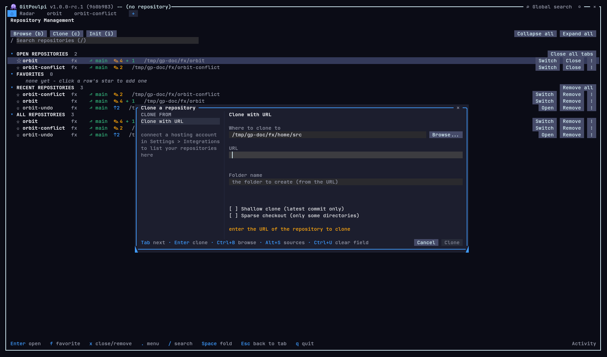

[English](../getting-started.md) · [Čeština](../cs/getting-started.md) · [Deutsch](../de/getting-started.md) · [Español](../es/getting-started.md) · [Français](../fr/getting-started.md) · [Italiano](../it/getting-started.md) · [日本語](../ja/getting-started.md) · [한국어](../ko/getting-started.md) · [Nederlands](../nl/getting-started.md) · [Polski](../pl/getting-started.md) · [Português (Brasil)](../pt-BR/getting-started.md) · [Português (Portugal)](../pt-PT/getting-started.md) · [Русский](../ru/getting-started.md) · **Svenska** · [Türkçe](../tr/getting-started.md) · [Українська](../uk/getting-started.md) · [简体中文](../zh-CN/getting-started.md)

# Komma igång

Den här sidan tar dig från en ny installation till din första commit.
[Rundturen i gränssnittet](interface-tour.md) namnger varje område i fönstret.
[Inställningar](settings.md) listar varje alternativ.

## 1. Installera och starta

Följ [Installation](installation.md). Öppna sedan en terminal i ett
Git-repository och kör:

```
gitpoulpi-tui
```

`gitpoulpi` utan underkommando gör samma sak. GitPoulpi öppnar det repository som
innehåller den aktuella mappen. Utanför ett repository öppnas fliken **Hem**,
där du kan bläddra, klona eller initiera ett repository (se
[steg 7](#7-öppna-klona-och-initiera-repositories)).

Ikonerna kräver ett Nerd Font eller ett typsnitt med emoji. Om du ser rutor, läs
[Felsökning](troubleshooting.md).


## 2. Tre tangenter som öppnar allt annat

| Tangent | Öppnar |
|---|---|
| `?` | **Hjälpen**: varje tangent och musgest. Skriv för att filtrera den. `Ctrl+D` öppnar den här dokumentationen i din webbläsare. |
| `Ctrl+P` | **Kommandopaletten**: skriv för att hitta ett kommando, `Enter` kör det. Varje rad visar sin genväg. |
| `Ctrl+,` | **Inställningar**. Kugghjulet i titelraden, till vänster om ×, öppnar dem också. |

Du kan göra allt med tangentbordet eller med musen. Paletten når varje
kommando. Se [Kortkommandon](keybindings.md) och
[Mus och gester](mouse-and-gestures.md).


## 3. Titta på historiken

Mitten av fönstret är **Log**: en rad per commit, den nyaste först. Den visar
grenar och tags som färgade pills, grafen, meddelandet, författaren, datumet
och den korta hashen.

- Klicka på en commit. Dess detaljer och ändrade filer visas till höger.
- Klicka på en ändrad fil. Dess diff öppnas i mitten. `Esc` stänger den.
- `j` / `k` eller piltangenterna flyttar markeringen. `f` söker i commits.
- Högerklicka på en commit för dess meny.


## 4. Gör en ändring och stagea den

Redigera en fil i din redigerare. **Översta raden i Log** visar nu
de lokala ändringarna: en streckad rad med antalet ändrade filer. Klicka på den.
Den högra rutan visar **Unstaged-filer** och **Staged-filer**.

- Peka med musen på en fil och klicka på dess knapp **Stage fil**. Eller klicka på
  **Stage alla ändringar**.
- Klicka på ett filnamn för att öppna dess diff. Där kan du stagea en **hunk**
  (**Stage hunk**) eller en **rad**.

Se [Stage och commit](staging-and-committing.md).


## 5. Commit

Skriv en sammanfattning, och eventuellt en beskrivning, i commit-formuläret längst ned
till höger. Klicka sedan på den gröna knappen **Commita ändringar i N filer**
eller tryck `Ctrl+Enter` (eller `Ctrl+G Enter`, varifrån som helst). Kryssa i **Amend föregående commit** för att lägga
till dina ändringar i den senaste committen i stället.

Om du slog på [AI](ai.md) skriver knappen `✦` bredvid sammanfattningen ett meddelande
från de stageade ändringarna. GitPoulpi committar aldrig innan du klickar på
**Commita ändringar i N filer**.

## 6. Dela ditt arbete

Verktygsfältet har knapparna **Pull** och **Push**, var och en med en `▾`-lista.
Från tangentbordet trycker du `Ctrl+G` och sedan en bokstav: `Ctrl+G p` pullar,
`Ctrl+G Shift+P` pushar. Efter `Ctrl+G` listar statusraden bokstäverna.

GitPoulpi använder den autentisering din `git` redan använder (credential
helper, ssh-agent). Den behöver inget eget konto. För att se och skapa pull
requests, anslut ett värdkonto en gång. Se
[Värdtjänster och ärendehantering](hosting-integration.md).

## 7. Öppna, klona och initiera repositories

Klicka på husikonen längst till vänster i flikraden, eller tryck `Ctrl+O`.
Fliken **Hem** listar dina öppna, favorit- och senaste repositories, med
knapparna **Bläddra**, **Klona** och **Init**. Varje repository öppnas i en egen
flik. `Ctrl+W` stänger den aktuella fliken.


**Klona** frågar efter en URL och en mapp, eller låter dig välja ett repository från ett anslutet konto (GitHub, GitLab, Gitea, Forgejo, Azure DevOps, Bitbucket, Gerrit; se [Klona från ett anslutet konto](hosting-integration.md#klona-från-ett-anslutet-konto)). **Init** gör en mapp till ett nytt
repository.
I alla tre dialogerna (och i mappväljaren de öppnar) visar `Ctrl+N` ett märke på varje fält och varje knapp: tryck på tecknet för att sätta markören i fältet eller trycka på knappen.

|  |  |
|---|---|

### Delvis utcheckning

Ett stort repository behöver inte hamna på disken i sin helhet. Kryssa i dialogrutan Klona för **Delvis utcheckning (bara vissa kataloger)** och skriv de kataloger du vill ha, avgränsade med mellanslag eller kommatecken (`src docs/guide`). Bara de katalogerna och filerna i repositoryts rot checkas ut; hela historiken laddas ändå ner, så Log, blame och grenar fungerar som vanligt. Minst en katalog krävs så länge rutan är ikryssad.


Vilket repository som helst kan växlas senare: öppna kommandopaletten (`Ctrl+P`) och kör **Repository: Delvis utcheckning...**, eller använd **Delvis utcheckning...** i repositoryflikens meny. Dialogrutan listar de kataloger som just nu är utcheckade i ett enda fält: lägg till eller ta bort namn och tryck på **Tillämpa** (`Enter`), eller på **Stäng av (fullständig utcheckning)** för att få tillbaka alla filer. Så länge en arbetskatalog är delvis utcheckad visar statusraden ett litet märke `delvis`. Samma kontroller finns som en sida i *Inställningar > Delvis utcheckning* (en lista med sökvägar, en per rad, med knapparna **Starta**, **Stoppa** och **Uppdatera**).

Observera:

- Det är gits cone-läge (kataloger, inte mönster); `*`, `..` och absoluta sökvägar avvisas.
- Att ändra urvalet registreras inte av Ångra: inget går förlorat, och **Stäng av** återställer alla filer. Git kan vägra släppa en katalog som innehåller ändringar du inte har committat (felet visas på statusraden); committa eller stasha dem först.
- Samma sak från skript och agenter: `gitpoulpi clone <url> --sparse src docs` och `gitpoulpi sparse-checkout status | set | add | disable` (se [CLI-referensen](cli-reference.md)); MCP-servern har samma verktyg.

## Vidare

- [Rundtur i gränssnittet](interface-tour.md): namnet på allt du ser.
- [Arbeta med Log](log-and-history.md) och
  [Stage och commit](staging-and-committing.md): det dagliga arbetet.
- [Teman](themes.md) och [Inställningar](settings.md).
- [AI-hjälp](ai.md) och [Värdtjänster och ärendehantering](hosting-integration.md):
  de två valfria integrationerna.
- [CLI-referens](cli-reference.md) och [MCP och agenter](mcp-and-agents.md):
  samma operationer från skript och agenter.
- [Felsökning](troubleshooting.md).
