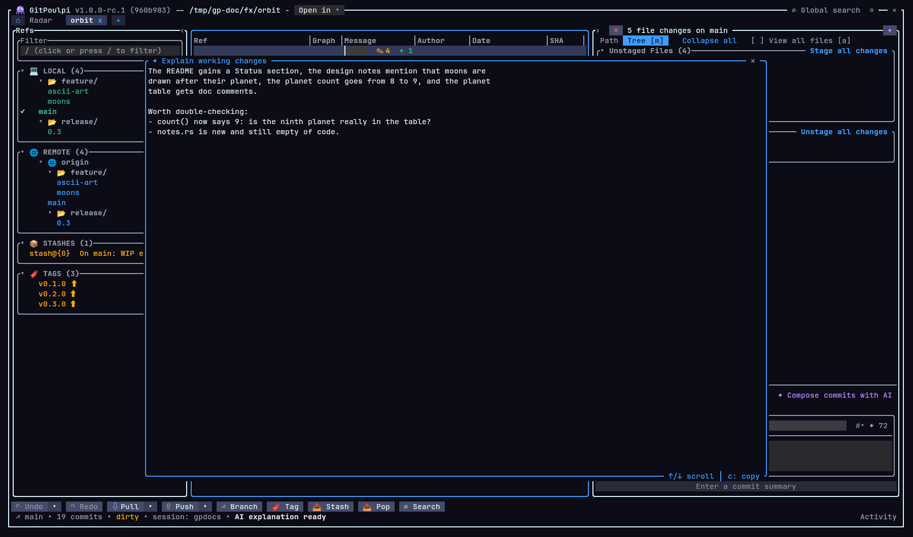

[English](../interface-tour.md) · [Čeština](../cs/interface-tour.md) · [Deutsch](../de/interface-tour.md) · [Español](../es/interface-tour.md) · [Français](../fr/interface-tour.md) · [Italiano](../it/interface-tour.md) · [日本語](../ja/interface-tour.md) · [한국어](../ko/interface-tour.md) · [Nederlands](../nl/interface-tour.md) · [Polski](../pl/interface-tour.md) · [Português (Brasil)](../pt-BR/interface-tour.md) · [Português (Portugal)](../pt-PT/interface-tour.md) · [Русский](../ru/interface-tour.md) · **Svenska** · [Türkçe](../tr/interface-tour.md) · [Українська](../uk/interface-tour.md) · [简体中文](../zh-CN/interface-tour.md)

# Rundtur i gränssnittet

Den här sidan namnger varje område i GitPoulpis fönster, uppifrån och ned. De
andra sidorna använder samma namn. Bilderna använder ett litet demo-repository
med påhittade författare.

## Ramen

### Titelrad

Fönstrets överkant lyder
`🐙 GitPoulpi vX.Y.Z -- <repositorysökväg>` (sessionens namn står på statusraden, längst ned som standard).

- **🐙** öppnar fönstret **Om GitPoulpi**: version, byggfunktioner, licens, länkar,
  en kort notis om att GitPoulpi är ett oberoende projekt, tredjepartscraten samt
  licenserna och erkännandena. På en terminal som ritar bilder är bläckfisken
  pixellogotypen, i din logotypfärg (annars förblir den en emoji). Palett:
  `Hjälp: Om GitPoulpi`; tangenter: `Ctrl+N` och sedan `A`. I Om-fönstret följer
  bläckfiskens pupiller muspekaren. Klicka på logotypen (eller tryck `Space`) för
  att snurra den till nästa färg. Högerklicka på logotypen (eller tryck `c`) för
  listan med färger. GitPoulpi sparar ditt val i `ui.logo_color`. Länkarna öppnas
  med ett klick eller sin åtkomsttangent (`s` källkod, `d` dokumentation, `i`
  licens), och `l` listar tredjepartscraten med versioner och licenser (en
  rullningsbar lista; `Esc` eller `l` går tillbaka, liksom ett klick på rubriken).
  Varje crate i listan har en länk till sin sida (dess repository, annars dess
  sida på crates.io): klicka på raden, eller välj den med `Up` / `Down` och tryck
  på `Enter`, för att öppna den i webbläsaren. `t` (eller palettens
  `Hjälp: Licenser och erkännanden`) visar licensmeddelandena och erkännandena för
  allt som ingår i programmet, som en rullningsbar text (`Up` / `Down`,
  `PgUp` / `PgDn`, `Home` / `End`; tillbaka med `Esc` eller `t`). I ett skript
  skriver `gitpoulpi licenses` ut samma text.
- **Versionen** (`v1.0.0`, eller `vX.Y.Z tillgänglig` när en nyare version finns)
  står mellan namnet och sökvägen: ett klick öppnar uppdateringspanelen när en nyare version
  finns, annars fliken **Versionsanteckningar**. Se [Uppdateringar](updates.md).
- **Öppna i ▾**, direkt efter sökvägen, öppnar flikens mapp i en terminal, en
  redigerare, en multiplexer eller filhanteraren (`Alt+O`). Se
  [Öppna i](open-in.md).
- **⌕ Global sökning** (ett förstoringsglas och dess etikett), precis till vänster om kugghjulet, öppnar den [globala sökningen](search.md) (`Ctrl+Alt+F`). Det är det första som får ge vika när titelraden är för smal: först försvinner etiketten (förstoringsglaset blir kvar), sedan knappen.
- **Kugghjulet** (`⚙`), precis till vänster om **×**, öppnar **Inställningar** (`Ctrl+,`).
- **×** längst till höger avslutar, som `q`.

### Statusrad

Statusraden är som standard fönstrets sista rad (**Inställningar > Utseende > Statusradens position** flyttar den överst, ovanför repositoryflikarna). Den visar aktuell gren, de inlästa commits
(`500 / 48213 commits` så länge äldre historik återstår att läsa in, med `...` i
stället för totalen medan den räknas; bara `2500 commits` när hela historiken är
inläst), `ändrad` eller `ren`, sessionens namn, ett märke `delvis` i en delvis
utcheckning och de mest användbara tangenterna: `?` hjälp, `Ctrl+G` git,
`Ctrl+N` nav, `Ctrl+P` kommandon, `Shift+F10` meny, `q` avsluta. I ett smalt
fönster utelämnas de minst användbara tangenterna. Statusraden visar också
statusmeddelanden och förlopp. Tangenterna den visar är alltid de som gäller
just nu, även de du har ändrat (se
[Inställningar](settings.md#tangentbord--mus)). Hur totalen räknas är en
inställning (**Räkna det totala antalet commits med**, se
[Inställningar](settings.md#log--graf)).

Längst till höger öppnar knappen **Aktivitet** aktivitetsloggen: en flik Git-åtgärder (åtgärderna med hur lång tid de tog, meddelanden och fel), en flik Program (programloggen, med en nivåruta och en knapp **Rensa loggen**) och en ruta Omfång som begränsar båda till det här repositoryt, en arbetsyta eller alla repositories. Ett tal på knappen räknar de fel du ännu inte har tittat på. Till vänster om den visar jobbindikatorn ett pågående bakgrundsjobb med en `[x]` för att avbryta det. Fliken **Hem** har samma statusrad, med knappen Aktivitet nere till höger (den öppnas på Alla repositories). När en åtgärd misslyckas säger statusraden det i rött; ett klick på meddelandet öppnar aktivitetsloggen på den posten, med orsaken, ett nästa steg, detaljerna och en Kopiera för en AI. Båda beskrivs i [När något misslyckas](troubleshooting.md#när-något-misslyckas).

### Överlägg

Kommandopaletten, hjälpen, kontextmenyer, dialoger, popuper och Inställningar
öppnas över fönstret. Var och en har ett `✕` uppe till höger i ramen; `Esc` eller ett
klick på `✕` stänger den, och ett klick utanför stänger en dialogruta, popup eller
panel (se [Stänga fönster och dialogrutor](mouse-and-gestures.md#stänga-fönster-och-dialogrutor)).

## Flikraden

Fliken **Hem** (husikonen) ligger längst till vänster, följd av
[arbetsytechipet](workspaces.md) (när du har en arbetsyta), den fästa fliken
**Radar** (den stängs som vilken flik som helst; se [Radar](radar.md)) och fliken
**Arbetsytor** när du har öppnat den (`Alt+J`; den stängs som vilken flik som
helst). Sedan kommer en flik per öppet repository. Krysset `x` som stänger en
flik visas bara på den aktiva fliken och på fliken under pekaren. Flikraden
bär bara flikar (knappen för den [globala sökningen](search.md) sitter i titelraden).

När repositoryflikarna inte ryms rullar raden i stället för att krympa dem:
flikarna sitter mellan två pilknappar, `‹` till vänster och `›` till höger.
En pil är dämpad när ingen flik är dold på dess sida. Klicka på en pil för att visa
en flik till på den sidan (håll nere för att fortsätta rulla), eller använd hjulet över
raden (uppåt eller åt vänster visar de tidigare flikarna). Varje gång den aktiva fliken
byts (du växlar flik från tangentbordet, flikväljaren eller paletten, öppnar eller
stänger en flik, eller ändrar fönstrets storlek) rullar raden precis så mycket att
fliken syns helt. När det finns plats öppnar en `…`-knapp efter högerpilen
flikväljaren. Om du drar en flik till en pil rullar raden så länge du håller den där,
så att du kan släppa den bortom flikarna som syns. `Ctrl+N` sätter en bricka på varje
aktiv pil.

**Inställningar > Utseende > Flikradens position** flyttar den här raden till fönstrets nederkant (under statusraden) eller gör den till en kolumn vid vänsterkanten: en flik per rad, först Hem, sedan arbetsytechipet, Radarn, fliken Arbetsytor, flikarna (ett långt namn slutar med `…`) och `+`. När flikarna är fler än raderna visar en `…`-rad hur många som är dolda ovanför (`▲`) och nedanför (`▼`) och öppnar fliklistan; hjulet rullar kolumnen. Bredvid ett verktygsfält som kolumn ligger flikarna ytterst. Ett fönster smalare än 80 kolumner behåller flikarna överst. Klick, stängningskorset, mittenklick, högerklicksmenyn, dra för att ändra ordning och tangentbordet fungerar likadant på varje position.

- **+** direkt efter den sista fliken öppnar en liten meny: **Ny flik** (`Alt+T`,
  paletten **Flik: Ny flik**) och, medan deras flikar är stängda, **Radar** och
  **Arbetsytor** (`Alt+J`), som öppnar de flikarna; paletten **Flik: Ny...**
  öppnar samma meny. En **Ny flik** är Hem-vyn med sökfältet redo, så att det du
  skriver filtrerar dina repositories direkt. Välj ett (eller Bläddra, Klona,
  Init) så dyker dess flik upp sist i raden; ett repository som redan är öppet
  växlas bara till. `Esc` i det tomma sökfältet, `Ctrl+W`, dess `x` eller ett
  mittenklick stänger den nya fliken och för dig tillbaka till fliken du var på.
  Den sparas aldrig i din session.

  
- Högerklicka på en flik, eller tryck `Ctrl+T`, för flikmenyn: **Ny flik**, **Stäng
  fliken**, **Stäng övriga flikar...**, **Stäng flikar till höger...**, **Lägg till i
  favoriter** (eller **Ta bort från favoriter**), **Lägg till i arbetsytan** (eller
  **Ta bort från arbetsytan**, när du har arbetsytor), **Kopiera sökväg**, **Öppna
  i ›**, **SSH & inloggning...** och **Delvis utcheckning...**.
- `Ctrl+PageUp` och `Ctrl+PageDown` byter flik. `Ctrl+W` stänger den aktuella
  fliken. Ett mittenklick på en flik stänger den också (med samma fråga).
- `t` (eller `Ctrl+N t`) öppnar flikväljaren, en sökbar lista över de öppna
  flikarna.
- **Ändra flikarnas ordning:** tryck på en repositoryflik och dra den i sidled (ett
  spöke av fliken följer pekaren och ett streck visar var den hamnar; `Esc` avbryter),
  eller dra en rad i flikväljaren, tryck `Alt+Upp` / `Alt+Ned` på den
  markerade raden i väljaren, eller kör **Flik: Flytta åt vänster** / **Flik: Flytta åt
  höger** från paletten. Ordningen sparas med sessionen. Ett vanligt klick
  utan rörelse markerar fortfarande fliken. Huset, arbetsyte-chipet och
  `+` flyttas aldrig.
- **Avsluta, cd hit** visas till höger om flikarna när du startade GitPoulpi
  via skalomslaget `gp` och fliken inte är mappen du startade i. Se
  [Följa den aktiva flikens mapp](following-the-tab-folder.md).
- **Arbetsyte-chipet** direkt efter huset (en färgad punkt och ett namn, eller
  ”Ingen arbetsyta”) byter [arbetsyta](workspaces.md): klicka på det eller
  tryck `Alt+W`. Det visas så snart du har en arbetsyta.

Med **Kom ihåg flikar** på (standard) kommer dina flikar tillbaka vid nästa
start. En worktree öppnas i en egen flik, direkt efter sitt repositorys flik
(**Gruppera worktree-flikar** under Inställningar > Allmänt, på som standard).
Den fliken stängs när worktreen tas bort.

### Hem

Fliken Hem är repositoryhanteraren. Den har fyra avsnitt: **ÖPPNA
REPOSITORIES**, **FAVORITER**, **SENASTE REPOSITORIES** och **ALLA
REPOSITORIES**. Varje rad visar grenen, antalet ahead och behind och antalet
ändringar. Varje rad har en stjärna (favorit), **Öppna** eller **Växla**,
**Stäng** eller **Ta bort**, och en `⋮`-meny.

Överst: **Bläddra**, **Klona**, **Init**, en sökruta, **Fäll ihop alla** och
**Fäll ut alla**. En mapp som inte längre finns försvinner av sig själv från
*Senaste* och *Alla*. En saknad favorit blir kvar, med en knapp **Ta bort**.
**Ta bort** raderar aldrig något på disk.

Tangenter: `Enter` öppna, `f` favorit, `x` stäng eller ta bort, `.` meny, `/`
sök, `Space` fäll ett avsnitt, `Esc` tillbaka till din flik.
`Ctrl+N` visar ett märke på sökfältet, varje avsnitt och varje knapp: tryck på märkets tecken för att fokusera eller trycka på det (se [Märken](keybindings.md#märken)).

Ett enda sökfält filtrerar allt under det, favoriterna inräknade: ett repository finns kvar om namnet, grenen eller sökvägen innehåller texten. Arbetsytorna har en egen flik och är ingen sida i fliken Hem: öppna den från menyn vid `+`, med `Alt+J` eller från paletten, och stäng den med dess `x`: se [Arbetsytor](workspaces.md).

**Klona** listar, för varje ansluten profil (GitHub, GitLab, Gitea, Forgejo, Azure DevOps, Bitbucket, Gerrit), de repositories du har åtkomst till, en sektion per ägare: dina egna först, sedan en per organisation eller grupp (alfabetiskt), var och en under en rubrik. Ett lås markerar ett privat repository. Sökrutan filtrerar över alla sektioner; en sektion utan träff försvinner. `Up` och `Down` hoppar över rubrikerna, och `Home`, `End`, `PgUp` och `PgDn` fungerar i listan.

## Verktygsfält

Som standard är det en rad under panelerna och ovanför statusraden. **Inställningar > Utseende > Verktygsfältets position** lägger det överst (under flikarna), nederst eller som en kolumn till vänster eller höger om panelerna (ett fönster smalare än 80 kolumner ritar kolumnen som en rad nederst). Knapparna sitter i början av raden eller kolumnen; **Inställningar > Utseende > Justering av verktygsfältets knappar** centrerar dem eller flyttar dem till slutet. Varje knapp har sin egen ikonfärg, som temat bestämmer (se [Teman](themes.md)). När det inte finns plats för alla flyttas de minst viktiga knapparna bakom en `⋯`. I en kolumn tar varje knapp en rad, med sin `▾` i radens slut, och menyn öppnas bredvid kolumnen; menyn från ett verktygsfält nederst öppnas uppåt.

| Knapp | Vad den gör |
|---|---|
| **Ångra**, **Gör om** | Tar tillbaka eller återställer den senaste operationen (`Ctrl+Z`, `Ctrl+Y`). Dold när Ångra är av. Se [Ångra och gör om](undo-redo.md). |
| **Pull** `▾` | Gör pull som **Inställningar > Git & kodning > Pull-knapp** säger. Listan under `▾` har **Fetch All**, **Pull (fast-forward om möjligt)**, **Pull (bara fast-forward)** och **Pull (rebase)**. Ett listalternativ körs en gång och ändrar inte knappen. |
| **Push** `▾` | Pushar den utcheckade grenen. Listan under `▾` pushar en gång till den remote du väljer. |
| **Gren** | Skapar en gren vid den utcheckade commiten. |
| **Tag** | Skapar en tag vid den utcheckade commiten. |
| **Stash**, **Pop** | Stashar alla ändringar. Poppar den senaste stashen. |
| **LFS** `▾` | Git LFS-åtgärder: fetch, checkout, pull, push, prune (`Ctrl+G l`). Dold när Git LFS är av. Se [Git LFS](lfs.md). |
| **Flow** `▾` | Menyn för grenarbetsflödet (starta, slutför, synka, befordra; `Ctrl+G Shift+W`). Bara i ett repository som har ett arbetsflöde. Se [Grenarbetsflöden](branching-workflows.md). |
| **Sök** | Öppnar commit-sökfältet över Log (`f`). |

Längst bort (höger i en rad, nederst i en kolumn) visar en **chip**, när repositoryt är kopplat till en värdtjänst, pull requesten för den utcheckade grenen (till exempel `GH #12` eller `GL !53`), eller ett nedtonat `+ PR`. **Inställningar > Utseende > Fäst pull request-knappen i slutet** (på som standard) håller den där; av, flödar den med de andra knapparna och följer deras justering. Se [Värdtjänster och ärendehantering](hosting-integration.md).

Bredvid den (i en kolumn, på dess sista rad) väljer **profilrullgardinen**, när du har två eller fler
[profiler](settings.md#profiler), commit-identiteten för det här repositoryt.
Första raden, *Standard*, följer **Inställningar > Profiler**. När du har valt
en profil frågar GitPoulpi om den också ska skriva profilens namn och e-post i
repositoryts git-konfiguration (`user.name`, `user.email`). **Skriv till
git-konfigurationen** skriver dem. `Esc` behåller valet bara i GitPoulpi.
Palett: `Repository: Byt profil...`.

Varje knapp har ett palettkommando och en genväg.

## Banners

En remsa ovanför Log talar om när repositoryt är i ett särskilt tillstånd. Den
har knappar för vägen framåt. Varje knapp är också ett palettkommando.

| Banner | Knappar |
|---|---|
| En merge, cherry-pick eller revert stannade på konflikter | **Lös konflikter...**, **Commit merge** eller **Fortsätt**, **Avbryt** |
| En rebase pågår | **Lös konflikter...**, **Fortsätt**, **Hoppa över**, **Avbryt** |
| **Tillämpar patchar (git am)** | **Lös konflikter...**, **Fortsätt**, **Hoppa över**, **Avbryt** |
| En kvarlämnad `index.lock` blockerar alla ändringar | **Ta bort index.lock** (frågar först) |
| En auto-stash lades inte tillbaka | **Poppa nu**, **Visa stash**, **Börja om**, **Drop** (valen beror på tillståndet) |

Se [Lösa merge-konflikter](merge-conflicts.md) och
[Felsökning](troubleshooting.md).

## Refs-sidofältet (vänster)

Ett träd över allt som namnger en commit. Varje avsnitt har ett antal i sin
rubrik, en vinkel för att fälla ihop det och sin egen rullningsposition. Dra i
gränsen mellan två avsnitt för att ändra deras storlek.

- Rutan **Filter** överst (`/`): filtrerar varje avsnitt efter namn.
- **LOKALA**: dina grenar, i mappar uppdelade på `/` (`feature/`, `fix/`). En
  bockmarkering visar den utcheckade grenen. Du kan stänga av mapparna i
  Inställningar.
- **REMOTE**: varje remote, med sina grenar under sig.
- **WORKTREES**: länkade worktrees, när det finns några (eller när du har visat
  avsnittet). **+** på rubriken skapar en; dubbelklicka på en worktree för att
  öppna den i en egen flik, högerklicka på den för Öppna i, Merge och Ta bort.
  Se [Worktrees](worktrees.md).
- **STASHES**: dina stashes. Högerklicka på en för **Pop (återställ och ta
  bort)**, **Apply (behåll stash)** och **Drop**.
- **TAGS**: dina tags, i mappar delade på `/` som grenarna (`releases/`, `backups/`). En pil betyder att taggen också finns på remote.
- **PULL REQUESTS** och **ÄRENDEN**: efter att du kopplat ett värdkonto och
  länkat repositoryt.
- **SUBMODULER**: submodulerna och deras tillstånd, när det finns några. Se
  [Submoduler](submodules.md).

**Visa eller dölja en sektion:** högerklicka på en sektionsrubrik, eller på den tomma delen av panelen, för en kryssruteslista över sektionerna (den sista synliga blir kvar). Valet sparas per repository, mellan starter; se [Sektioner i vänsterpanelen](mouse-and-gestures.md#vänsterpanelens-avsnitt).

Håll muspekaren över en rad för att visa dess knappar: dölj eller visa reffen i
Log, och **Solo** (visa bara den reffens commits). Dubbelklicka på en lokal gren
eller en tag för att checka ut den. Högerklicka på en rad för dess meny. `‹` i
sidofältets rubrik fäller ihop sidofältet (`Ctrl+N h`).

De två sidopanelerna (Refs-sidofältet, `Ctrl+N h`, och högerpanelen, `Ctrl+N l`) tillhör Log: att visa eller fälla ihop någon av dem medan en diff, filvy eller redigerare är öppen gäller bara den vyn. En diff eller filvy fäller också ihop Refs-sidofältet av sig själv för att ge innehållet plats. Tillbaka i Log är båda panelerna som du lämnade dem där, och det är det läget som sparas till nästa start.

## Log (mitten)

En rad per commit, nyaste först. Högerklicka på rubriken för att visa eller dölja
kolumner. Dra i gränsen mellan två rubriker för att ändra en kolumns bredd. Dra
en rubrik för att flytta kolumnen.

Panelen har ingen titel: kolumnrubrikerna säger vad den är. På en commit utan ref visar den pekade raden ett bleknat piller med namnet på den gren den tillhör (stängs av med **Visa en spökgren/tag på den commit som pekas på** under Inställningar > Log & graf).

| Kolumn | Visar |
|---|---|
| **Ref** | Färgade pills för grenarna och taggarna på commiten: en laptopikon för lokal, en jordglob för remote, en taggikon för tags, `+N` när fler refs pekar dit. Taggar ritas där de finns, aldrig som spöke. På en commit utan ref visar raden under muspekaren ett bleknat piller med namnet på den gren den tillhör; om den grenen har tagits bort visar ett genomstruket piller namnet som lästs ur den merge-commit som slog ihop den (stäng av det med **Visa en spökgren vid commit under muspekaren** i Inställningar > Log & graf). |
| **Graf** | Grenspåren, merges och förgreningspunkter. Ritas som bilder i kitty, Ghostty, WezTerm, Rio och iTerm2 (och även Windows Terminal, foot och Tabby, via sixel), och som tecken i andra terminaler. Spårfärgerna kommer från temat eller en palett du väljer (se [Teman](themes.md)). På sin minsta bredd (en enda commitprick) är kolumnen kompakt: varje commit på ett enda spår, inga gren- eller mergelinjer. |
| **Meddelande** | Commitens sammanfattning. |
| **Författare** | Författaren, med en valfri avatar. |
| **Datum** | Författardatumet, i det format du väljer. |
| **Ändringar** | Valfri: ändrade filer och `+tillagda -borttagna` rader. |
| **SHA** | Den korta hashen. |

Särskilda rader:

- **Raden med lokala ändringar** (WIP-raden) överst: en streckad cirkel,
  `// WIP` eller ditt utkast till meddelande, och antalet ändrade och tillagda
  filer. Klicka på den för att stagea och commita i högerpanelen.
- **Stash-rader**: en liten ruta på ett spår, bredvid commiten stashen gjordes
  på.
- Under en sökning tonas rader som inte matchar ned.

Håll muspekaren över en cell för ett verktygstips med hela texten. Högerklicka
på en rad för [commit-menyn](log-and-history.md#commit-menyn).

## Högerpanelen

Högerpanelen följer markeringen i Log.

**Lokala ändringar** (WIP-raden är markerad):

- En rubrik som `4 filändringar på main`. Under en merge med konflikter lägger
  den till antalet filer i konflikt. Ett rött `✖` till vänster förkastar alla
  ändringar (frågar först). När AI är på förklarar ett `✦` till höger
  ändringarna.
- **Sökväg** eller **Träd** (en platt lista eller mappar, `m`), **Fäll ihop
  alla** och **Visa alla filer** (`a`).
- **Unstaged-filer** och **Staged-filer**, var och en med ett antal och en knapp
  **Stage alla ändringar** eller **Unstage alla ändringar**. Håll pekaren över en
  rad för dess knapp **Stage fil** eller **Unstage fil**.
- **Commit-formuläret** nederst: **Amend föregående commit**, **Komponera
  commits med AI** (när AI är på), **Sammanfattning** med en teckenräknare och
  `✦`-knappen, **Beskrivning** och knappen **Commita ändringar i N filer**.

**Commit-detaljer** (en commit är markerad), uppifrån och ned: hela hashen,
författaren med avatar och datum, föräldrahashen och ändringsantalen, sedan
meddelandet (sammanfattning och beskrivning; dra i dess nedre kant för att ändra
storlek). Rutan **Ändrade filer** nedanför börjar med sina egna reglage:
sorteringsväxeln, **Sökväg** / **Träd**, **Visa alla filer** och en ruta
**Filtrera filer**, fasta ovanför listan, som är den enda delen som rullar.
Klicka på en fil för att öppna dess diff. I ett lågt fönster viker meddelandet
undan först (ned till en rad), sedan listan. Vyn för lokala ändringar behåller
sin rad **Sökväg** / **Träd** / **Visa alla filer** överst i fillistorna,
ovanför listorna Unstaged och Staged.

**Länkar i ett meddelande.** En webbadress som skrivits i meddelandet (`https://...`,
eller målet i en markdown-länk `[text](https://...)`) är understruken, visar handpekaren
och frågar vid ett klick **Öppna den här länken?** med hela adressen innan något
öppnas: texten i ett meddelande är inte betrodd. **Öppna** (`P`) startar webbläsaren,
**Avbryt** (`A`, `Esc`, krysset) gör ingenting. Bara `http`- och `https`-adresser
erbjuds. Tangentbordsmotsvarigheten är palettkommandot `Commit-detaljer: Öppna länk i
meddelandet...`, som frågar om meddelandets första adress och går vidare till de
andra med **Nästa** (`N`). Vissa terminaler ritar en egen understrykning under en
adress under pekaren och öppnar den själva vid ett klick med modifierartangent
(ofta Shift+klick); det är terminalens funktion, inte GitPoulpis.

Varje fillista har menyer för filer, mappar och den tomma delen, och flera filer kan markeras samtidigt (**Ctrl+klick**, **Shift+klick**); se [Stage och commit](staging-and-committing.md).

## Mittrutan när en fil är öppen

Klicka på en ändrad fil och dess vy ersätter Log. `Esc` tar tillbaka Log. En rad
med knappar löper längs överkanten:

| Knapp | Vad den gör |
|---|---|
| **Filvy**, **Diff-vy**, **Blame** | Väljer vad rutan visar för filen. |
| **Fil │ Alla** | Väljer listan i [commit-kolumnen](#commit-kolumnen) bredvid vyn och visar kolumnen. |
| **Redigera** | Öppnar den inbyggda redigeraren på arbetskatalogen. |
| `↑` `↓` | Föregående eller nästa hunk. |
| **Inline**, **Split** | En kolumn, eller sida vid sida. |
| **Hunks** | Bara de ändrade hunks, eller hela filen. |
| **WS** | Visa eller dölj ändringar som bara rör blanksteg. |
| **Bryt** | Bryt långa rader. |
| **Karta** | En minikarta över hela filen bredvid rullningslisten. |
| **Teckenkodning** | Teckenkodningen som filen läses i (**Auto** först). |

I en diff av arbetskatalogen har varje hunk knapparna **Stage hunk** och **Förkasta
hunk**. Tryck `v` för att markera rader, och stagea eller förkasta sedan bara de
raderna.

Båda vyerna beskrivs i [Blame](log-and-history.md#blame) och [Filhistorik](log-and-history.md#filhistorik).

Den inbyggda **redigeraren** har syntaxfärger, radnummer, ångra, sök och en
statusrad med rad, kolumn, radslut, indrag och språk.

En bildfil visas som en bild: före och efter i diffen, eller själva filen i
Filvyn. Se [Bilder](image-view.md).

En binärfil som inte är en bild (en PDF, ett dokument, ett arkiv) visar en knapp **Öppna i** när systemet känner till appar för typen: se [Öppna i](open-in.md).

## Commit-kolumnen

En kolumn kan stå till vänster om en commits fildiff, Filvy eller Blame (aldrig bredvid den inbyggda redigeraren, som redigerar arbetskopian: kolumnen försvinner när redigeraren öppnas och kommer tillbaka när den stängs till diffen). Den har tre lägen:

- **Fil**: den enskilda filens commits, två rader var ([Filhistorik](log-and-history.md#filhistorik)). Högra sidan visar den valda commitens version av filen.
- **Alla**: en kompakt lista över Logs commits med dess graf, beskriven nedan.
- **Dold**: en tunn remsa med ett `›` till vänster om vyn tar tillbaka kolumnen (dess verktygstips anger tangenten).

Vyns knapprad sträcker sig alltid över hela bredden ovanför kolumnen, så ingen knapp flyttas när kolumnen öppnas, stängs eller byter lista. På den väljer väljaren **`Fil │ Alla`** (två delar av samma reglage, alltid lika breda) listan: ett klick på en del visar den listan och öppnar kolumnen om den var dold; ett klick på den del som redan är vald döljer kolumnen medan den visas. Delen för listan som visas är tänd; medan kolumnen är dold är den som den kommer tillbaka med understruken, och listan behålls. Dess verktygstips anger klicket, det andra klicket på den valda delen och `Alt+C`. Filhistoriken öppnas också från de platser som alltid har öppnat den (filmenyer, `Filhistorik: ...` i paletten).

- **Visa eller dölja**: `Alt+C` (paletten `Vy: Växla commit-kolumnen`), ett klick på väljarens valda del, ✕ på kolumnen eller remsan `›`. I paletten väljer `Vy: Commit-kolumnen: dölj`, `... : filens historik` och `... : alla commits` ett läge. Valet, med listan den hade, sparas med kolumnens andra inställningar. Utan något val avgör terminalens bredd för listan Alla: den visas från 140 kolumners bredd. Kolumnen ritas inte när vyn bredvid skulle få under 30 kolumner, och grafen i Alla ritas inte för en diff av arbetskatalogen eller en jämförelse (filhistoriken visas ändå, den behöver ingen commit).
- **Bredd**: dra i dess högra kant (den tända kanten följer pekaren), eller använd `Vy: Bredda commit-kolumnen` och `Vy: Smalna av commit-kolumnen`. Den kan ta upp till 70 % av mittkolumnen (resten förblir vyns, som aldrig lämnas under 30 kolumner). Den sparas med de andra storlekarna.
- **Välja en commit**: klicka på den, eller ge kolumnen tangentbordet (`Ctrl+N` och sedan kolumnens märke, eller `Vy: Fokusera commit-kolumnen`) och använd `Up` / `Down`, `PageUp` / `PageDown`, `Home` / `End`. `Enter` eller `Right` går vidare till commitens fillista, `Esc` ger tillbaka tangentbordet till vyn. Högerpanelen följer valet: commitens detaljer och dess ändrade filer, så att du kan öppna en annan av dess filer.
- **Vad vyn gör**: den öppna filen förblir öppen. Om den valda commiten ändrade den visar vyn dess diff i den commiten. Annars visar den filen som den var då, med ”oförändrad i denna commit” i titeln. Om commiten inte har filen säger vyn det och går ändå att använda. En Blame förblir en Blame, som den var vid den valda commiten.

Listan Alla står under en rubrikrad (Logs egna kolumnnamn). En commit per rad: grafens spår, titeln (meddelandet), författarens förnamn och ett kort datum och, om du slår på det, grenarnas och taggarnas etiketter. Det är Logs egen lista, med samma commits i samma ordning, och den läser in äldre allt eftersom du rullar. Spåren ritas som i Logs kolumn Graf: på en terminal som visar bilder (se [Välja terminal](terminals.md)) som sammanhängande spår med runda markörer och, med avatarinställningen på Graf, författarnas bilder i cirklarna; annars som tecken. Som standard tar spåren det utrymme de behöver, och titeln behåller alltid några ord: i en smal kolumn viker författaren och sedan datumet undan innan spåren kapas. Nedkrympt till sin minsta bredd, en enda commitprick, är delen Graf kompakt, som i Log: varje commit på ett enda spår utan gren- eller mergelinjer. En del som kapas av rutan (raden rullad i sidled, eller en del Graf som är bredare än utrymmet) behåller sina bilder och avatarer, klippta i kanten. Hjulet rullar listan under pekaren.

- **Hovring och menyn**: när pekaren vilar på en rad visas Logs verktygstips för delen under pekaren (hela meddelandet på titeln, författarens namn och e-post, hela datumet). Ett högerklick på en rad (eller menytangenten, `Shift+F10`, när kolumnen har tangentbordet; `Vy: Commit-kolumnen: meny för den valda raden` i paletten) öppnar dess meny: *Visa i Log*, commitens diff av filen, filen som den var vid den commiten, filens blame vid den commiten och sedan Logs egen meny för den commiten (kopiera, cherry-pick, gren och, under ett streck, raderna som skriver om saker, som revert). Var och en av de fyra första raderna har också ett palettkommando (`Vy: Commit-kolumnen: visa ...`). I listan Fil har raderna Filhistorikens egen meny och samma verktygstips.
- **Storleken på delarna och rullning i sidled**: dra i en gräns i rubrikraden för att ändra storlek på delen till vänster om den: spåren, meddelandet, författaren, datumet, refs, ändringarna eller SHA. Den sista delen har också en gräns: cellen direkt efter den (kolumnens egen ram när raden fyller utrymmet), tänd på samma sätt, som ändrar storlek på just den sista delen. Som i Log (`ui.column_resize`) är gränsen som standard separatorcellen mellan två delar, där Grafens radfärgton slutar (färgtonen går genom den, så ingen vanlig cell ligger mellan den och nästa del): en markering vilar i den på rubrikraden och en tunn linje ritas nedåt kolumnen medan pekaren är på den eller drar i den, och en dragning från vilken punkt som helst på linjen ändrar storlek; med `header` är det första bokstaven i nästa namn, som tänds medan pekaren är på den (ingen linje ritas, rubriken är det enda stället att dra från). Tills du ändrar storlek på något tar meddelandet det som de andra lämnar; det första draget fäster varje del vid den bredd den har, meddelandet inräknat, så att ändrad storlek på en del flyttar delarna efter den och ingen annan bredd. En del du har ändrat storlek på behålls och ger aldrig upp sitt utrymme: när raden då är bredare än kolumnen rullar den i sidled med Shift+hjul, ett horisontellt hjul eller `Shift+Left` / `Shift+Right` när kolumnen har tangentbordet, och en rullningslist i dess nedre kant visar var du är. Från tangentbordet: `Tab` väljer delen (bland de visade), `]` breddar den, `[` smalnar av den, `0` återställer alla delar till automatisk bredd (paletten har `Vy: Commit-kolumnen: välj nästa del`, `... bredda delen`, `... smalna av delen`, `... återställ delarnas bredder`, `... rulla åt vänster` och `... rulla åt höger`). Bredderna sparas. Så länge spåren kapas av en rullning ritas de som tecken, även på en terminal som visar bilder.
- **Välja delar**: ett högerklick på rubriken öppnar en meny med en kryssruta per del, varje kolumn som Log erbjuder: Ref, Graf, Meddelande, Författare, Datum, Ändringar och SHA. Meddelande visas alltid. **Ref**, **Ändringar** och **SHA** är av som standard; visade bär Ref commitens grenar och taggar, Ändringar dess filer och rader som `+tillagda -borttagna` och SHA dess korta hash, alla som Logs egna kolumner gör. Liksom Ref ger Ändringar och SHA aldrig upp sitt utrymme: raden rullar i sidled i stället. Från tangentbordet öppnar `Vy: Commit-kolumnen: välj kolumner` samma meny (piltangenter och `Enter` väljer en rad) och `Vy: Commit-kolumnen: växla Ref`, `... växla Graf`, `... växla Författare`, `... växla Datum`, `... växla Ändringar` och `... växla SHA` slår på eller av en del direkt. De visade delarna, deras ordning och deras bredder tillhör bara kolumnen: de sparas i `config.toml` (`ui.commit_column_columns_visible`, `ui.commit_column_columns_order`, `ui.commit_column_columns_widths`), skilda från Logs egna kolumner, som aldrig ändras av dem, och inte heller tvärtom.
- **Flytta delarna**: dra ett namn i rubriken över ett annat för att flytta den delen dit, som i Log (raden följer pekaren; med `ui.column_resize = "header"` är första bokstaven i ett namn gränsen för ändrad storlek, så tryck på resten av namnet). Vilken del som helst kan hamna var som helst, även spåren och Ref-etiketterna. Från tangentbordet väljer `Tab` delen och `<` / `>` flyttar den en plats åt vänster eller höger bland de visade (paletten har `Vy: Commit-kolumnen: flytta delen åt vänster` och `... flytta delen åt höger`). Ordningen sparas.

  

Musgesterna listas också i [Mus och gester](mouse-and-gestures.md#commit-kolumnen-listan-alla).

## Storlekar sparas

GitPoulpi behåller varje storlek du drar, över flikbyten och omstarter.
Storlekarna är desamma för alla repositories. Det gäller avdelarna mellan
Refs-sidofältet, Log och högerpanelen, höjden på varje Refs-avsnitt,
commit-meddelandeblocket, Log-kolumnernas bredd, merge-redigerarens rutor och
avdelaren i mappväljaren. Storlekarna lagras som delar av fönstret, så en layout
gjord på en bred terminal passar också en smal.

Kör palettkommandot `Navigering: Återställ layouten` för att återställa alla
storlekar. Vissa storlekar har också en egen återställning: `Navigering:
Återställ Refs-avsnittens storlek`, `Commit-detaljer: Återställ meddelandets
storlek`, och i merge-redigeraren ett dubbelklick på en avdelare eller `Alt+0`.

## Överlägg och särskilda skärmar

- **Kommandopalett** (`Ctrl+P`): en filterruta över varje kommando. Varje rad
  visar sin genväg. Ett kommando som inte kan köras nu är nedtonat, och orsaken
  visas längst ned. Kommandona har ett grupprefix som `Git:`, `Refs:`,
  `Navigering:`, `Diff:`, `Lokala ändringar:`, `Commit:`, `Vy:`, `Repository:`,
  `Flik:`, `LFS:`, `Pull requests:`, `Ärenden:` eller `AI:`. Skriv ett prefix för
  att se dess grupp.
- **Väljare**: vissa palettkommandon öppnar en andra lista, till exempel
  `App: Byt tema...`, `App: Byt språk...` och `App: Byt färgtema för grafen...`.
  Fönstret visar varje val direkt medan du rör dig i listan. `Enter` behåller
  det. `Esc` sätter tillbaka det gamla valet. Temalistan har filtren **Alla**,
  **Mörka**, **Ljusa** och **Färgade**. Se [Teman](themes.md).
- **Hjälp** (`?`): flikar. **Tangenter** listar varje tangent och gest; de andra
  flikarna (Start, Log, Ändringar, Refs, Hosting, Inställn., AI & CLI) är korta
  guider till åtgärderna, med hur du når var och en. Byt flik med `Tab` /
  `Shift+Tab`, `Left` / `Right`, `Alt+1`..`Alt+8` eller ett klick. Skriv för att
  filtrera den aktuella fliken. `Ctrl+D`, eller ett klick på länken längst ned,
  öppnar dokumentationssidan för fliken du står på.

  

  
- **Sökfält** (`f`): uppe till höger i Log. Det visar `n av N` träffar.
- **Kontextmenyer**: högerklicka, eller tryck `.` på den markerade raden. En rad
  med `›` öppnar en undermeny.
- **Dialoger**: bekräftelser, ett namn på gren eller tag, Klona, Init, Skapa pull
  request, valen efter en avvisad push, med mera. `Enter` godkänner, `Esc`
  avbryter.
- **Interaktiv rebase** och **commit-composern** ersätter Log med en
  granskningsskärm. Se
  [Arbeta med Log](log-and-history.md#interaktiv-rebase) och
  [Stage och commit](staging-and-committing.md#commit-composern-dela-upp-dina-ändringar-i-commits).

  

- **Inställningar** (`Ctrl+,` eller kugghjulet): en lista med sidor till vänster
  och sidans alternativ till höger. Se [Inställningar](settings.md).

  

- **Popuper** för långa svar, som AI-popupen **Förklara ändringar** (`↑` `↓`
  rullar, `c` kopierar, `Esc` stänger).

  

Alla listor i popuper fungerar på samma sätt. Se
[Kortkommandon](keybindings.md) och [Mus och gester](mouse-and-gestures.md).

## Ord som används i den här dokumentationen

| Ord | Betydelse |
|---|---|
| Ruta | En av de tre kolumnerna: Refs-sidofältet, Log (eller den öppna filen), högerpanelen. |
| Pill | En gren- eller tag-etikett i kolumnen Ref. |
| WIP-rad | Raden med lokala ändringar överst i Log. |
| Hunk | Ett block ändrade rader i en diff. |
| Composer | Commit-formuläret, och AI-granskningen som delar upp ändringar i commits. |
| Tangentföljd | En tangent följd av en annan, som `Ctrl+G` och sedan `s`. |
| Prefix | `Ctrl+G` (git-åtgärder) eller `Ctrl+N` (navigering). |
| Märke | Bokstaven som `Ctrl+N` visar bredvid en kontroll. Tryck på den för att ge kontrollen fokus. |
