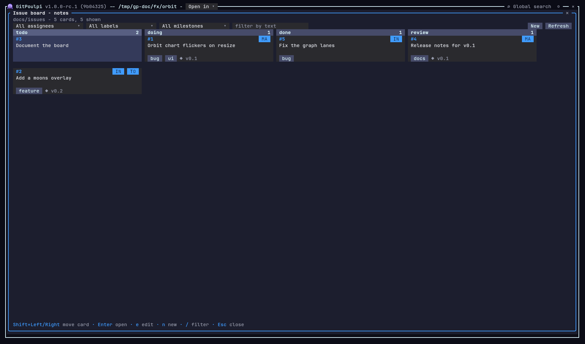

[English](../local-issues.md) · [Čeština](../cs/local-issues.md) · [Deutsch](../de/local-issues.md) · [Español](../es/local-issues.md) · [Français](../fr/local-issues.md) · [Italiano](../it/local-issues.md) · [日本語](../ja/local-issues.md) · [한국어](../ko/local-issues.md) · [Nederlands](../nl/local-issues.md) · [Polski](../pl/local-issues.md) · [Português (Brasil)](../pt-BR/local-issues.md) · [Português (Portugal)](../pt-PT/local-issues.md) · [Русский](../ru/local-issues.md) · **Svenska** · [Türkçe](../tr/local-issues.md) · [Українська](../uk/local-issues.md) · [简体中文](../zh-CN/local-issues.md)

# Lokala ärenden och Obsidian

Förvara dina ärenden som en mapp med Markdown-anteckningar: inget konto, ingen token, inget nätverk. Mappen kan ligga i
repositoryt (`docs/issues/`, incheckad med koden) eller var som helst på disken, till exempel en undermapp i ett
[Obsidian](https://obsidian.md)-valv. GitPoulpi läser och skriver anteckningarna. Obsidian, vilken editor som helst eller ett skal kan redigera
dem samtidigt, och listorna följer med.


## Ställ in det

1. **Inställningar > Integrationer > Issue trackers > Local Markdown > Lägg till profil.** Skriv mappen, eller tryck
   **Bläddra...** och välj den. En relativ mapp (`docs/issues`) läses mot varje repository den är länkad till; en
   absolut (`/home/me/Vault/Projects/Issues`) är densamma överallt. Det finns ingen token att ange.
   - CLI: `gitpoulpi hosting integrations add --kind local_markdown --path docs/issues`.
2. Öppna sidofältets avsnitt **ÄRENDEN** i ett repository och välj leverantören **Local Markdown - <namn>** (mappen
   väljs med den; repositorylistan visar mappen och dess direkta undermappar om du vill ha en annan).
   - CLI: `gitpoulpi hosting link issues --id <profil>` (profilens mapp är standard för `--project`).

Ingenting länkas av sig självt: som varje ärendekälla är det något man väljer in per repository.

## Anteckningarna

En anteckning per ärende, med namnet `<id>-<slug>.md` (`12-crash-on-empty-name.md`), och ett frontmatter-block:

```yaml
---
id: 12
title: Crash on empty name
status: todo
assignees: [kai]
labels: [bug]
milestone: v0.1
created: 2026-10-14
updated: 2026-10-14T09:30:00
---
Fri Markdown. GitPoulpi skriver aldrig om innehållet.
```

- Nya ärenden får `max(id) + 1`.
- GitPoulpi skriver bara egenskaperna det äger (`title`, `status`, `assignees`, `labels`, `milestone`, `updated`).
  **Varje annan egenskap, innehållet, radslut och nycklarnas ordning behålls byte för byte.** Skrivningar är
  atomära (en temporär fil, sedan en namnändring).
- Läsningen är tolerant: en anteckning utan `id` tar det från sitt filnamn, en anteckning utan `status` är `todo`, en anteckning
  utan frontmatter tar sin titel från den första `# rubriken`. En fil som inte är ett ärende (`readme.md`) ignoreras.
- En status är fri text. **Öppet** betyder ”inte klar-statusen”.

## Vad du kan göra

| I avsnittet ÄRENDEN | Tangentbord / palett |
|---|---|
| Nytt ärende (`+`, eller `n`): titel, beskrivning, status, tilldelade, etiketter, milstolpe | `Hosting: Nytt ärende...` |
| Redigera tilldelade / etiketter / milstolpe från radmenyn. Välj bland det mappen redan använder, eller **skriv en ny etikett eller ett nytt login** och ta raden `Lägg till ”...”` | `Hosting: Redigera etiketter...` med flera |
| **Stäng ärende** / **Öppna ärende igen** (anger klar-statusen, eller den första andra) | `Lokala ärenden: Stäng ärende...` / `Öppna ärende igen...` |
| **Öppna anteckning** (ditt standardprogram för `.md`) | `Integrationer: Öppna ärende...` |
| **Öppna i Obsidian** (bara när mappen ligger i ett valv, det vill säga en mapp `.obsidian/` ovanför) | `Lokala ärenden: Öppna i Obsidian...` |
| Filter: Öppna / Stängda / Alla, ”Tilldelade mig” | filterlistan |

”Tilldelade mig” matchar profilens inställning `me`, annars det anslutna namnet, annars profilnamnet.

Grenar och commits fungerar som för GitHub: ”Skapa gren från ärende” ger `12-crash-on-empty-name`, och `#12` i ett commit-
meddelande eller `12-...` i ett grennamn känns igen.

Ändringar gjorda utanför GitPoulpi (Obsidian, ett skal, en `git pull`) dyker upp inom ungefär en sekund: mappens filnamn
och ändringstider granskas på en bakgrundstråd, aldrig på renderingstråden.

## Konfigurationsfil

I `config.toml`, bredvid profilen (varje nyckel är valfri):

```toml
[[integrations]]
id = "vault"
kind = "local_markdown"
url = "/home/me/Vault/Projects/Issues"
token_ref = "integration:vault"

[integrations.local]
statuses = ["todo", "doing", "review", "done"]   # tavlans kolumnordning
done_status = "done"                            # stänger ett ärende
reference_prefix = "LOC"                         # visas som LOC-12 i stället för #12
me = "kai"                                       # vem ”tilldelade mig” betyder
```

Statusar som anteckningar använder men som inte listas i `statuses` följer efter de listade. `statuses` är
ordningen på [tavlans](#kanban-tavlan) kolumner (`gitpoulpi hosting issue options` skriver ut den).

## Kanban-tavlan



Om du arbetar ensam, eller i ett team som håller sina ärenden bredvid koden, är mappen också en Kanban-tavla.
**ÄRENDEN-huvudet > Tavla**, eller paletten **Ärenden: Öppna tavlan**, öppnar den över fönstret; `Esc` stänger den.

- **Kolumner** är statusarna: de som listas i `statuses` först, i den ordningen, sedan varje annan status en anteckning använder.
  En tom kolumn visas ändå. Varje rubrik bär sitt antal kort.
- **Kort** visar ärendenumret, titeln (två rader), de tilldelade som initialer, etiketterna och milstolpen.
  När kolumnerna inte alla får plats rullar tavlan i sidled (listen under den, hjulet med `Shift`, eller piltangenterna).
- **Flytta ett kort** genom att dra det till en annan kolumn (kolumnen lyser upp under pekaren), med
  `Shift+Left` / `Shift+Right`, eller med **Tavla: Flytta kort till...** (`m`), en lista med kolumnerna. Kortet flyttas
  direkt; anteckningens `status` skrivs om som i [avsnittet om anteckningarna](#anteckningarna), inget annat i filen. Om skrivningen
  misslyckas går kortet tillbaka och felet visas på statusraden.
- **Öppna** ett kort med `Enter` eller ett dubbelklick (anteckningen öppnas i ditt standardprogram för `.md`). `e` redigerar dess
  tilldelade, etiketter eller milstolpe, `.` eller ett högerklick öppnar kortmenyn, `n` startar ett nytt ärende i den
  valda kolumnen (formuläret återvänder till tavlan när det stängs).
- **Filtrera** på tilldelad (`a`), etikett (`l`), milstolpe (`M`) eller text (`/`); `x` rensar dem. Filtren är
  listor: skriv för att begränsa, `Enter` väljer.
- **Live**: en anteckning som ändras från Obsidian eller ett skal flyttar sitt kort inom en sekund.

Varje musgest har en tangent och ett palettkommando (**Tavla: ...**, listade på sidan
[Kortkommandon](keybindings.md)).

## Obsidian Bases

**Paletten: `Lokala ärenden: Skapa Obsidian Base`** (CLI: `gitpoulpi hosting issue base`) skriver `issues.base` bredvid
anteckningarna, en gång: en *tabell*-vy och en *kanban*-vy grupperad efter `status`, i ordningen för `statuses`. Öppna den i Obsidian för att
se samma ärenden som en tavla där. GitPoulpi redigerar aldrig en befintlig `.base`-fil (din eller en tidigare): den
vägrar och säger det. Formatet följer Obsidians Bases-syntax
(<https://obsidian.md/help/bases/syntax>); kanban-vyn kräver en ny Obsidian.

## CLI och MCP

Samma kommandon som för varje ärendekälla fungerar på den: `hosting issues`, `hosting issue create [--list <status>]`,
`hosting issue edit <n> --add-label ...`, `hosting open issue <n>`, `hosting refs`. Fyra till är till för anteckningar:
`hosting issue close <n>`, `hosting issue reopen <n>`, `hosting issue move <n> --status <s>` och `hosting issue base`.
Se [CLI-referensen](cli-reference.md).

## Begränsningar

- En ny **milstolpe** kan inte skrivas i väljaren (välj en mappen redan använder), men `milestone:` i en anteckning kan
  vara vad som helst och dyker upp så fort den sparas.
- Bara anteckningarna direkt i mappen är ärenden (inte undermappar).
- Det finns ingen borttagning: ta bort anteckningen i din filhanterare eller Obsidian (dess papperskorg är din).
