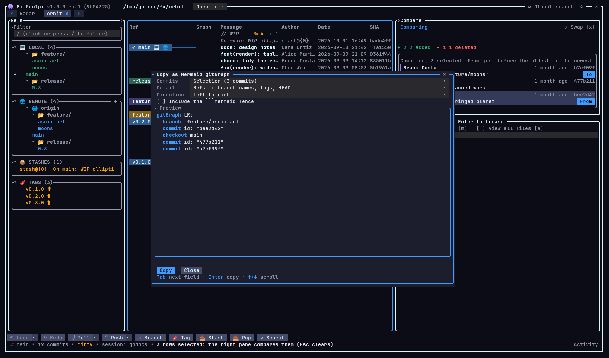

[English](../log-and-history.md) · [Čeština](../cs/log-and-history.md) · [Deutsch](../de/log-and-history.md) · [Español](../es/log-and-history.md) · [Français](../fr/log-and-history.md) · [Italiano](../it/log-and-history.md) · [日本語](../ja/log-and-history.md) · [한국어](../ko/log-and-history.md) · [Nederlands](../nl/log-and-history.md) · [Polski](../pl/log-and-history.md) · [Português (Brasil)](../pt-BR/log-and-history.md) · [Português (Portugal)](../pt-PT/log-and-history.md) · [Русский](../ru/log-and-history.md) · **Svenska** · [Türkçe](../tr/log-and-history.md) · [Українська](../uk/log-and-history.md) · [简体中文](../zh-CN/log-and-history.md)

# Arbeta med Log

Log är mittpunkten i GitPoulpi: hela historiken som en graf, med varje gren, tag
och stash på den. Den här sidan går igenom hur du läser den, hittar saker i den
och allt du kan göra med commits och refs. Områdena har sina namn i
[rundturen i gränssnittet](interface-tour.md); de exakta tangenterna finns i
[Kortkommandon](keybindings.md) och musgesterna i
[Mus och gester](mouse-and-gestures.md).


## Läsa grafen

Varje rad är en commit, nyaste först. En punkt sitter på commitens spår; linjer
binder ihop en commit med dess föräldrar; en merge visar två linjer som möts.
Pills till vänster namnger grenarna och tagsen på den commiten, i spårets
färg, med en tunn linje till punkten. En laptopikon markerar en lokal gren, en
jordglob en remote-gren och `✓` grenen du har utcheckad. `+N` betyder att fler
refs pekar på den commiten; håll pekaren över det för att lista dem, eller
använd menyn nedan.

Första raden är de **lokala ändringarna** (en streckad cirkel: ditt ocommittade
arbete, förbundet med commiten det ligger på). Stashes visas som små rutor på
ett spår bredvid commiten de gjordes på.

### Färger, radfärg och avatarer

Spårfärgerna kommer från temat. *Inställningar > Utseende > Färgtema för
grafen* kombinerar vilket tema som helst med vilken spårpalett som helst, och
palettens väljare *App: Byt färgtema för grafen...* (`Ctrl+N Shift+Y`)
förhandsvisar varje palett direkt; se [Teman](themes.md). *Bakgrund för
grafspår* inställd på **Radfärg** målar ett svagt band i spårfärgen bakom
grafkolumnen och en tunn stapel vid dess kant. *Styrka på radfärgning*
(**Stark**, **Medel** (standard), **Svag**) bestämmer hur blekt bandet är.

| Spårpaletten Serie med radfärg | Spårpaletten Material med radfärg |
|---|---|
|  |  |

*Författaravatarer* (en bild i grafens punkt eller i kolumnen Författare) är av
som standard. Att slå på dem skickar en hash av varje författares e-postadress
till Gravatar, och frågar din värdtjänst. *Avatarkällor* och *Avatarreserv* på
samma sida väljer varifrån bilderna kommer och vad som ritas när det saknas en.

Om din terminal inte kan visa bilder ritas grafen med tecken. *Grafritare* och
*Bildprotokoll* tvingar fram det ena eller det andra; se
[Felsökning](troubleshooting.md).

Markeringen av den valda raden, eller raden under pekaren, börjar vid commitens cirkel.
Spåren till vänster om den behåller den vanliga bakgrunden.

### Kolumner

Högerklicka på rubriken för att välja kolumner: **Ref**, **Graf**,
**Meddelande** (alltid på), **Författare**, **Datum**, **Ändringar** och **SHA**.
Den valfria kolumnen **Ändringar** visar, för varje commit, `n filer
+tillagda -borttagna`. Dra i gränsen mellan två rubriker för att ändra en
kolumns bredd; valet kommer ihåg, i terminalceller. Med standardvärdet `ui.column_resize = "line"` är gränsen mellanrummet på en cell i slutet av en kolumn: en liten markering vilar i det på rubrikraden, och medan pekaren står på mellanrummet (på rubriken eller var som helst nedåt i tabellen) ritas en tunn accentlinje över tabellens hela höjd och en dragning från var som helst längs den ändrar storlek (pekaren blir en storleksändringspekare i terminaler som stöder det). Med `"header"` finns ingen markering och ingen linje: första tecknet i rubrikcellen efter gränsen lyses upp när pekaren är på det och dragningen börjar där, bara på rubrikraden (Inställningar > Log & graf > Kolumnstorlek). Raderna ser likadana ut i båda lägena: mellanrummet hör till kolumnen till vänster, så markeringen och radens färgton går igenom det. Ref, Graf och de andra kolumnerna behåller sin bredd när fönstret ändrar storlek eller maximeras: bara **Meddelande** växer eller krymper (i ett mycket smalt fönster viker sig de andra kolumnerna tillfälligt, Graf först, och återgår till dina bredder när fönstret växer igen). Dra kolumnen Graf ned till sin minsta bredd, en enda commitprick, så blir grafen kompakt: varje commit ligger på ett enda spår, den ena under den andra, utan gren- eller mergelinjer. En cell bredare och trädet är tillbaka. Med författarnas bilder i incheckningscirklarna (Inställningar > Log & graf > Författaravatarer: graph) är cirkeln två celler bred, så kolumnen stannar en cell tidigare (tre celler) och klipper aldrig en bild.

Att dra i en rubrik visar ett spöke av dess namn som följer pekaren och en accentstapel där kolumnen skulle hamna; ordningen ändras när du släpper, och `Esc` avbryter. Väljaren som öppnas med högerklicket är en checklista (`[x]` / `[ ]`) med ett ✕ i titeln; den nås också från paletten (`Vy: Log: välj vilka kolumner som visas`), flyttas med piltangenterna och växlas med `Space` / `Enter`.

Från tangentbordet väljer `Shift+C` (eller paletten med `Vy: Log-kolumn: välj en kolumn att flytta eller ändra bredd på`) en kolumn, och dess rubrikcell lyser upp. Sedan väljer `Tab` / `Shift+Tab` en annan kolumn, `<` / `>` flyttar den ett steg åt vänster eller höger bland de visade kolumnerna (tangentbordsmotsvarigheten till att dra i rubriken), `]` / `[` gör den bredare eller smalare (motsvarigheten till att dra i gränsen; den sista kolumnen flyttar sin vänstra kant), `0` ger alla bredder automatiskt värde igen och `Esc` eller `Enter` avslutar. Piltangenterna flyttar under tiden fortfarande mellan commits. Ordningen och bredderna sparas som efter en dragning och gäller bara Log: commit-kolumnen bredvid en diff har en egen lista.

*Anpassa efter innehållet.* Ett **dubbelklick** på en kolumns gräns anpassar kolumnen till vänster om den efter dess bredaste synliga innehåll och dess rubrik (breda tecken och emoji räknas efter de celler de tar). I layouten fit fyller Log alltid sin ruta, så en kolumn stannar vid det som rutan har plats för när **Meddelande** behåller sin andel och varje annan kolumn sin minsta bredd: statusraden säger då `Författare behöver 34 celler, 20 ryms.` Samma sak från tangentbordet: med en kolumn vald (`Shift+C`, `Tab`) anpassar `=` den och `+` anpassar alla kolumner; paletten har `Vy: Log-kolumn: anpassa kolumnen efter innehållet` och `... anpassa alla kolumner efter innehållet`; högerklicksväljaren listar `Anpassa <column> efter innehållet` (kolumnen under pekaren), `Anpassa alla kolumner efter innehållet` och `Återställ kolumnbredder` under sina kryssrutor. **Meddelande** är den flexibla kolumnen och har ingen egen bredd att anpassa: den tar det utrymme de andra lämnar.

*Rulla i sidled.* Som standard ryms varje kolumn i rutan. I layouten **scroll** (väljarens ruta `Rulla i sidled (kolumnerna behåller sina bredder)`, Inställningar > Log & graf > Kolumnlayout, paletten `Vy: Log: växla rullning i sidled för kolumnerna`, eller `s` medan en kolumn är vald) behåller kolumnerna sina bredder, **Meddelande** inräknad (den har en egen bredd där, och att anpassa den tar dess bredaste sammanfattning), inget ges upp när fönstret är smalt, och tabellen kan vara bredare än rutan. En stapel på nedre kanten rullar den då: dra i handtaget, tryck på det bara spåret för att föra handtaget under pekaren, eller använd dess ändpilar. Från tangentbordet rullar `Shift+Vänster` / `Shift+Höger` fyra celler (paletten har `Vy: Log: rulla kolumnerna åt vänster` / `höger`); det horisontella hjulet eller `Shift`+hjul över tabellen gör detsamma, och att välja en kolumn (`Shift+C`, `Tab`) rullar den till synlig. En tabell som är smalare än rutan lämnar tomt utrymme till höger, och en markerad rads band löper till kanten. Varje layout behåller sina egna bredder (`ui.log_column_widths` och `ui.log_column_widths_scroll`); första dragningen, tangenten eller anpassningen i layouten scroll lagrar varje kolumn med den bredd den har, så bara den du ändrar flyttas. I layouten fit säger en anpassning som inte ryms i rutan det och pekar på den här layouten.

*Sista kolumnens grepp.* Sista kolumnen har också ett grepp, på sin egen sista cell (inte rutans kant, som fortfarande ändrar storlek på rutorna): en dragning flyttar den lika långt som pekaren färdades, och **Meddelande** tar mellanskillnaden. **SHA** är som standard 8 celler bred (de 7 siffrorna och greppcellen).

### Författare och `.mailmap`

När repositoryt har en `.mailmap` (gits fil som ger en person som har committat
under flera namn ett enda namn och en enda e-postadress) visar Logs kolumn
**Författare**, commitdetaljerna, Blame och Filhistorik den **kanoniska**
identiteten, precis som `git log`. Själva commits rörs inte. Inställningen
`log.use_mailmap` (Inställningar > Log & graf, på som standard) stänger av det
så att de lagrade namnen visas. Att söka efter författare matchar namn och
e-postadress som de visas, så en sökning på det kanoniska namnet hittar varje
commit av personen. Fliken **Identiteter** i omskrivningsvyn listar historikens
namn och e-postadresser och skriver `.mailmap`-rader åt dig, se
`history-rewrite.md`; från en terminal: `gitpoulpi mailmap list|check|add`.


## Hitta saker

- **Sök** (`f`, verktygsfältets knapp **Sök**, eller palettens *Navigering: Sök
  commits...*): matchar hela commit-meddelandet, författarens namn och e-post,
  hashen och refnamnen. Det tonar ned det som inte matchar och behåller grafens
  form. `Enter` / `Shift+Enter` hoppar till nästa / föregående träff.
- **Refs-filter** (`/` i sidofältet): begränsar listorna över grenar, tags och
  remotes efter namn.
- **Solo** (tangenten `o`, eller refens meny, på en ref, mapp eller remote):
  visar bara commits för de soloade refsen; solo flera för att se deras union.
  `Shift+O` slutar solo.
- **Dölj** en ref (dess meny) för att ta bort den ur grafen: dess piller försvinner och
  likaså commits som bara den når (den utcheckade commiten stannar alltid, med
  arbetsträdsraden). *Dolda n* i Refs-rubriken räknar dem, **Visa alla**
  (`Shift+H`) tar tillbaka dem. Statusradens summa räknar den synliga historiken.

## Grenar, tags och Refs-sidofältet

Dubbelklicka på en lokal gren eller tag för att checka ut den. Högerklicka på en
ref (i sidofältet, eller dess pill i Log) för dess meny. De mest användbara
posterna:

| Post | Gör |
|---|---|
| Visa i grafen | Rullar Log till refens commit (och läser först in äldre historik vid behov) och blinkar till på raden; markeringen blir kvar. Ett enkelt klick på en ref gör detsamma om inte *Klick på en ref visar den i grafen* är av i Inställningar. En ref som är dold i grafen (eller av Solo) säger det på statusraden i stället |
| Checka ut | Byter till grenen eller kopplar från HEAD vid taggen |
| Merge, Rebase på | Mergar den in i, eller gör rebase av, den utcheckade grenen på den här reffen |
| Fast-forward `<gren>` till `<aktuell>` / `<aktuell>` till `<gren>` | Flyttar en gren framåt när det är en fast-forward; annars nedtonad med orsaken (`divergerat, ingen fast-forward`) |
| Skapa worktree från... | Öppnar en länkad worktree i en egen flik |
| Pull, Push, Fetch, Ange upstream... | Nätverksoperationer på den grenen |
| Dölj / Visa i grafen, Solo | Bara visning; de döljer eller soloar en ref (att dölja tar också bort commits som bara den refen når) utan att röra repositoryt |
| Byt namn på, Ta bort | Ta bort frågar först; en remote-tvilling kan också tas bort |
| Kopiera grennamn, Kopiera länk till grenen på remote | Till urklipp |

**Var en tag finns.** En tag kan finnas på den här datorn, på en remote eller på
båda, och sidopanelens rader under TAGS (och tagens pill i Log) visar vilket med
en markör efter namnet. Håll pekaren över en tag för samma sak i ord.

| Markör | Betydelse |
|---|---|
| uppåtpil | Bara här: ingen remote har den. Dess meny erbjuder *Push* |
| vänster-högerpil | Här och på en remote, på samma commit |
| nedåtpil (raden dämpad) | Bara på en remote: finns inte i det här repositoryt (aldrig hämtad, eller borttagen här). Dess meny erbjuder *Fetch `<tag>` från `<remote>`* och *Ta bort `<tag>` på `<remote>`...*; `Git: Fetch vald tag` i paletten |
| upp-ned-pil | Finns också på en remote, men på en annan commit (en push skulle avvisas) |

git sparar inga remote-spårande refs för tags, så GitPoulpi får veta vad varje
remote har från din senaste **fetch** (vilken som helst, även den automatiska)
och från sina egna tag-pushar och borttagningar. Ingenting frågar nätverket medan
du bläddrar; om någon annan har ändrat en remotes tags, gör en fetch för att se
det. Samma information finns i `gitpoulpi tag list` (fälten `local`, `remote`,
`differs_on`, `where`).

**Ta bort en tag.** När en remote har taggen öppnar den röda knappen **Ta bort**
en dialog med tre numrerade rader (`1`-`9`, eller Upp/Ned och `Enter`; `Esc`
avbryter), och den markerade raden förklarar sig själv under listan:

1. **Ta bort lokalt**: tar bara bort den från det här repositoryt. Det sker direkt,
   och meddelandet säger att remoten fortfarande har den. **Nästa fetch tar
   tillbaka den** (git följer remotens tags), om du inte också tar bort den på
   remoten.
2. **Ta bort på `<remote>`**: tar bort den där för alla (`git push <remote>
   --delete`). Det ber om en bekräftelse som nämner remoten. Din lokala tag finns
   kvar. Det går inte att ångra.
3. **Ta bort lokalt och på `<remote>`**: båda, efter samma bekräftelse, så att en
   fetch inte kan ta tillbaka den. **Ångra återställer bara den lokala taggen**
   (samma tag-objekt); den är då bara lokal igen och *Push* lägger tillbaka den på
   remoten.


Med flera remotes får var och en sina egna rader. En tag som bara finns här behåller
den vanliga bekräftelsen; en tag som bara finns på en remote går direkt till den
remotens bekräftelse. CLI: `gitpoulpi tag delete <name> [--local | --remote <r> | --both [--remote <r>]]`.

**Fetch och tags.** En fetch uppdaterar också vad varje remote har (markörerna) och
gits egen tag-följning gäller fortfarande: en tag som bara tagits bort här hämtas
igen. En tag som någon **tagit bort på remoten** försvinner från remotens sida av
markören efter vilken fetch som helst, men finns kvar här som din lokala tag (nu
*bara här*), eftersom gits standard är att inte rensa tags. **Inställningar >
Synkronisering > Auto-prune tags** (av som standard; `gitpoulpi fetch
--prune-tags`) tar också bort en sådan lokal tag, men bara en som hade funnits
på remoten: en tag du aldrig pushat, eller en du flyttat, rörs aldrig. Kräver git
2.41 eller nyare för att få veta vad som rensades.

**Ny gren eller tag.** Verktygsfältets knappar **Gren** och **Tag**, `Ctrl+G b`
och `Ctrl+G t`, eller en commits *Skapa gren här...* frågar efter namnet i en
inline-ruta i kolumnen Ref, på målcommitens rad. `Enter` skapar den, `Esc`
avbryter, och ett namn som git skulle vägra rapporteras i rött utan att rutan
stängs.

På en commit utan ref visar det också ett bleknat piller i kolumnen Ref med namnet på den gren den tillhör (annars fjärrgrenen), härlett ur historiken, när du pekar på raden; taggar visas aldrig som spöke. En gren som tagits bort efter en sammanslagning visas ändå, genomstruken, under namnet i den merge-commitens ämnesrad (`Merge branch 'x'`, `Merge pull request #N from owner/x`...); squash-merge, rebase och fast-forward lämnar inget sådant spår. När du pekar på pillret visas dess typ. Det skapar inget: använd kommandot för att skapa gren ovan. **Visa en spökgren vid commit under muspekaren** under Inställningar > Log & graf stänger av det; inget ritas där kolumnen Ref är för smal.

**Remotes.** `+` i rubriken REMOTE lägger till en; högerklicka på en remotes
namn för att göra fetch på den, kopiera dess webblänk, göra den till
standard-remote, dölja den i grafen, ändra dess URL:er eller ta bort den. **Att dölja en remote**
(radens öga, menyns *Dölj remote i grafen* eller `Remote: Dölj remote i grafen...` i
paletten) döljer varje gren den har nu eller får senare, och commits som bara den
når lämnar Log: sättet att bläddra i en historik utan historiken från en orelaterad
arkiv-remote; ta tillbaka den med *Visa remote i grafen*. Att visa en
remote visar också grenarna i den som dolts en och en. En gren i en
dold remote säger det på statusraden om dess öga används: visa remoten
först.

**Stashes.** **Stash** stashar allt (inklusive ospårade filer); `Ctrl+G m`
frågar först efter ett meddelande (med AI på föreslår `Ctrl+G` i den frågan
ett). Högerklicka på en stash-rad, i Log eller i avsnittet STASHES, för **Pop
(återställ och ta bort)**, **Apply (behåll stash)** eller **Drop**.

**Worktrees.** *Skapa worktree från...* (på en gren, tag eller commit) öppnar en
dialog som föreslår en mapp bredvid repositoryt, ett valfritt nytt grennamn och
”Öppna den nya worktree som flik”. Worktrees visas i avsnittet WORKTREES;
dubbelklicka på en för att öppna den, och dess flik stängs av sig själv när
worktreen tas bort.

## Dra refs till commits

Du kan trycka på en gren (i sidofältet eller dess pill i Log)
och dra den. En flytande etikett följer pekaren och giltiga mål lyser upp; släpp för
att få en meny:

- en lokal gren **på en annan lokal gren**: Merge, Rebase, Interaktiv rebase,
  Fast-forward;
- en lokal gren **på en remote-gren**: Push till den remoten;
- en remote-gren **på en lokal gren**: Merge, Rebase, Fast-forward, Pull.

`Esc` avbryter ett drag. Tangentbordsmotsvarigheten är palettkommandot *Refs:
Släpp vald ref på utcheckad gren...*.

**Merge eller fast-forward.** När målet inte har någon egen commit (den dragna grenen ligger bara före det) kan en
merge helt enkelt flytta målet framåt. Som standard (Inställningar > Git > **Fast-forward vid merge** = *never*, eller ett repositorys
eget val på dess sida Alternativ för merge) lyder menyraden *Merge x i y (merge-commit)* och gör en riktig merge-commit, så att
historiken behåller grenen; använd den separata raden *Fast-forward y till x* när du vill ha den rena flytten (för en rak linje, använd
*Rebase* i stället). Med *allowed* lyder Merge-raden *(gör fast-forward)* och med *only* *(bara fast-forward)*, nedtonad med orsaken när
grenarna har divergerat. Samma rader och etiketter finns i en grens egen meny, och `gitpoulpi merge --ff | --no-ff | --ff-only`
väljer per merge.

## Commit-menyn

Högerklicka på en commit (eller tryck `.` på den) för dess meny:


| Post | Gör |
|---|---|
| **Cherry-pick på `<gren>`** | Spelar upp commiten på den utcheckade grenen |
| **Revertera commit...** | Skapar en commit som ångrar den. På en merge-commit frågar en rullgardinsmeny först vilken förälder som är huvudlinjen (sidan som blir kvar; förälder 1 är grenen som mergen gjordes på), sedan den vanliga bekräftelsen. Ångra återställer det tidigare tillståndet |
| **Reset `<gren>` till den här commiten** | En undermeny för typen av reset; en hard reset ber om bekräftelse |
| **Redigera commit-meddelande...** | Se nedan |
| **Ändra...** | Ändrar commitens meddelande samt författarens namn, e-post och datum i en dialog; se [Ändra en commit](#ändra-en-commit-meddelande-författare-datum) |
| **Dela upp commit...** | Dela upp commiten i flera; se [Dela upp en commit](#dela-upp-en-commit) |
| **Dela upp commit (AI)...** | Samma sak, med en gruppering som modellen föreslår; bara när [AI](ai.md) är på |
| **Förklara ändringar (AI)** | En popup med en AI-förklaring; bara när [AI](ai.md) är på |
| **Interaktiv rebase härifrån...** | Se nedan |
| **Skapa gren här...**, **Skapa tag här...**, **Skapa annoterad tag här...** | Inline-namnruta |
| **Checka ut den här commiten**, **Skapa worktree här...** | Frånkopplad HEAD, eller en worktree |
| **Skapa patch från den här commiten...**, **Skapa patch härifrån till `<gren>`...** | Skriver `.patch`-filer; *Tillämpa patch* finns i en refs meny |
| **Kopiera länk till commiten på remote**, **Kopiera** > | Till urklipp (hash, meddelande och mer) |

## Redigera ett commit-meddelande (reword)

*Redigera commit-meddelande...* (eller `Ctrl+G e`) öppnar hela meddelandet: en
sammanfattning på en rad med en räknare, en beskrivning under den, **Avbryt** och
**Uppdatera meddelande**. Vilken commit som helst på den utcheckade grenen kan
skrivas om (HEAD eller en förfader); commits ovanpå den skapas om med sina egna
träd, författare och datum, merges förblir merges, och dina stageade och
unstageade ändringar lämnas ifred. Om commiten redan är pushad varnar popupen i
gult för att du kommer att behöva en force push (med lease), och ber om en
andra bekräftelse. `Ctrl+Z` (verktygsfältets Ångra) tar tillbaka omskrivningen;
se [Ångra och gör om](undo-redo.md). Statusraden namnger också den tidigare
toppen.

## Ändra en commit (meddelande, författare, datum)

*Ändra...* i commit-menyn (eller `Ctrl+G Shift+E`, eller *Commit: Ändra...* i paletten) öppnar en enda dialog för commitens egenskaper: sammanfattning, beskrivning samt författarens namn, e-post och datum, var och en ifylld med commitens egna värden. Ändra vad du vill och tryck på **Tillämpa**; bara de ändrade fälten skickas. Ett datum skrivs `YYYY-MM-DD HH:MM:SS +HH:MM` och visas i UTC tills du redigerar det. Committern är du, nu (som vid en reword). Vilken commit som helst på den utcheckade grenen kan ändras, med samma regler, samma varning för en redan pushad commit och samma andra bekräftelse som *Redigera commit-meddelande...*; commits ovanpå den skapas om med sina egna författare och datum, och dina stageade och unstageade ändringar lämnas ifred. `Ctrl+Z` (Ångra i verktygsfältet) tar tillbaka det. I byggen med historikomskrivning stänger **Ändra historiken djupare...** (`Alt+H`) längst ned till vänster i dialogen den utan att tillämpa något och öppnar [omskrivningsvyn](history-rewrite.md) med omfånget från den här commiten till den nyaste; om du har ändrat ett fält frågar den först (`Esc` bekräftar). `Ctrl+N` visar ett märke på varje fält och varje knapp i dialogen; tryck på det för att sätta markören i fältet eller trycka på knappen (se [Märken](keybindings.md#märken)).

Alla vägar in i dialogen öppnar den komplett, med alla fält synliga och redigerbara; bara markören skiljer sig. I commitens detaljruta (till höger) högerklickar du på sammanfattningen, beskrivningen eller författarblocket och väljer *Ändra sammanfattning...*, *Ändra beskrivning...* eller *Ändra författare...*, eller dubbelklickar på sammanfattningen, beskrivningen, författaren eller författardatumet: dialogen öppnas med markören i det fältet. Tangentbordsmotsvarigheterna fungerar från Log och från detaljrutan: `Ctrl+G Shift+E` (alla fält), `Ctrl+G Shift+A` (författaren) och i paletten *Commit: Ändra...*, *Commit: Ändra författare...*, *Commit: Ändra sammanfattning...* och *Commit: Ändra beskrivning...*. Båda tangentföljderna kan bindas om (`git_prefix.amend`, `git_prefix.edit_author`; se [Kortkommandon](keybindings.md)). Från ett skript eller en agent: `gitpoulpi amend <commit>` med `--message` (eller `--summary` / `--description`), `--author-name`, `--author-email`, `--author-date` och motsvarande `--committer-*` (MCP-verktyget heter `amend`).

## Dela upp en commit

*Dela upp commit...* i commit-menyn (eller paletten: *Git: Dela upp vald commit...*)
delar en commit i två eller fler, äldst först. Varje commit som inte är en merge på den
utcheckade grenen kan delas upp (HEAD eller en förfader, även en rotcommit).
Uppdelningsredigeraren har två rutor: **Nya commits** till vänster (ett meddelande
vardera) och commitens **Ändringar** till höger, en rad per fil och hunk, var och en
med ett fält `[N v]` som anger vilken ny commit den hamnar i.

| Tangent | Mus | Gör |
|---|---|---|
| `Up` / `Down` (`k` / `j`) | klicka på en rad | flytta över ändringarna (`Shift+Up` / `Shift+Down` utvidgar en markering) |
| `1`-`9` | radens fält `[N v]`, sedan ett val | ge den valda ändringen till den nya commiten; `0` lämnar den otilldelad |
| `Enter` / `m` | fältet `[N v]` | öppna listan med commits för den valda ändringen |
| `n` | `+ Ny commit` | lägg den valda ändringen i en ny commit |
| `v` | | **radläge**: dela upp en hunk rad för rad (dra över rader för att välja ett intervall) |
| `Tab` | klicka på en ruta | växla mellan commits och ändringar |
| `e` / `Enter` (i commit-rutan) | pennan | redigera den commitens meddelande |
| `d` / `Delete` | korset | ta bort en ny commit (dess ändringar blir otilldelade) |
| `Alt+Up` / `Alt+Down` | pilarna | flytta en ny commit upp eller ned |
| `s` | kryssrutan | signera de nya commits |
| `Shift+R` | `Återställ` | tillbaka till ursprungsplanen |
| `Ctrl+S` | `Dela upp i N` | dela upp |
| `Esc` | korset, `Avbryt` | lämna; med väntande ändringar bekräftar ett andra tryck |

Varje ändring måste gå till exakt en commit; redigeraren räknar det som fortfarande är
*Ej tilldelat*, och knappen förblir avvisad tills det är noll. En fil som är binär,
bara ändrar sitt läge, är ny eller borttagen i commiten, är en submodul eller en LFS-fil
kan bara ges som en helhet. Den första commiten börjar med det ursprungliga meddelandet;
ge varje ny ett meddelande. En ny commit behåller den ursprungliga författaren och
datumet; den som checkar in är du, nu.

**Inget i ditt repository ändras utom grenen.** Den sista nya commiten har exakt den
ursprungliga commitens innehåll, så commits ovanpå den skapas om med samma träd,
författare och meddelanden (merges förblir merges), och dina stageade och unstageade
ändringar lämnas ifred: en smutsig arbetskatalog går bra och ingen konflikt kan uppstå.
Hooks körs inte. En uppdelning blockeras medan en auto-stash väntar.

**Signering.** Kryssrutan *Signera commits* utgår från repositoryts `commit.gpgSign`.
Avkryssad tas signaturerna på de omskrivna commits (de nya och de ovanpå dem) bort, och
redigeraren säger det under kryssrutan. Ikryssad signeras alla; om signeringen
misslyckas ändras ingenting.

**Ångra.** Ett `Ctrl+Z` (verktygsfältets Ångra) lägger tillbaka den ursprungliga
commiten, även med en smutsig arbetskatalog; se [Ångra och gör om](undo-redo.md). En
commit som redan var pushad behöver en force push (med lease) efteråt.

**Från den interaktiva rebasen.** Varje rad i rebase-granskningen har en liten knapp
**dela upp...** (`t` på raden): den öppnar samma redigerare för den commiten, och när
uppdelningen är klar (eller du avbryter) är du tillbaka på granskningsskärmen, på den nya
historiken. Om du hade ändrat planen trycker du på dela upp en gång till för att
bekräfta att de ändringarna går förlorade.

För skript och agenter: `split-source` och `split-commit` i
[CLI-referensen](cli-reference.md); en agent kan också öppna den här redigeraren ifylld åt
dig att granska (`ui propose split`, se [MCP och agenter](mcp-and-agents.md)).

## Interaktiv rebase

Välj **Interaktiv rebase härifrån...** på en commit som är en förfader till den
utcheckade grenen, eller dra en gren på en annan och välj *Interaktiv rebase*.
Log ersätts av en granskningsskärm: en rad per commit, nyaste överst, var och en
med ett dragfäste och en åtgärdsrullgardin.


| Åtgärd | Tangent | Effekt |
|---|---|---|
| Pick | `p` | Behåll commiten |
| Reword | `r` | Behåll den med ett nytt meddelande |
| Squash | `s` | Slå ihop den med commiten under, och kombinera meddelandena |
| Fixup | `f` | Slå ihop den med commiten under, och släng dess meddelande |
| Drop | `d` | Utelämna den |
| Edit | `e` | Stanna där så att du kan göra amend |

Dra en rad (eller `Ctrl+Up` / `Ctrl+Down`) för att ändra ordningen. `a` förhandsvisar
autosquash (`squash!`- och `fixup!`-commits flyttas intill sina mål). Inget
händer förrän du trycker **Starta rebase** (`Ctrl+S`); **Återställ** sätter
tillbaka planen och **Avbryt rebase** (`Esc`) lämnar utan att något ändrats. När
ett steg stannar på en konflikt eller ett `edit` erbjuder en banner ovanför Log
**Fortsätt**, **Hoppa över** och **Avbryt**. Ett intervall som innehåller en
merge-commit kan inte rebasas interaktivt; menyposten säger varför.

## Cherry-picka flera commits

`Ctrl+klick` växlar en commit, `Shift+klick` (eller `Alt+klick`) markerar ett intervall, `Space`
växlar den aktuella, `Esc` rensar. Högerklicka på en markerad commit för
**Cherry-pick N commits på `<gren>`...**: samma granskningsskärm öppnas, med
samma åtgärder och omordning, och **Starta cherry-pick** spelar upp dem i
ordning.

## Kopiera commits som en Mermaid gitGraph



Markera commits i Log (`Ctrl+klick`, `Shift+klick`, `Space`; eller lämna bara markören på en)
och öppna **Kopiera som Mermaid gitGraph...**: `Shift+Y` i Log, commitmenyns undermeny
**Kopiera**, eller paletten `Log: Kopiera som Mermaid gitGraph...`. En popup visar det genererade
[Mermaid](https://mermaid.js.org/syntax/gitgraph.html)-skriptet, live och rullbart; `Enter`
(eller knappen **Kopiera**) lägger exakt den texten i urklipp. Klistra in den i en README, en pull
request-beskrivning eller [mermaid.live](https://mermaid.live).

Popupen har tre kombinationsrutor, en kryssruta och förhandsvisningen (`Tab` flyttar mellan dem; varje
kombinationsruta öppnas med `Enter`, `Space` eller `Down`):

- **Commits**: markeringen, eller - när en commit är markerad och HEAD härstammar från den - **Från
  markeringen till HEAD**, raden av commits mellan dem (besvaras från den inlästa delen av Log).
- **Detaljnivå**: `structure` (commits, grenar och merges; id:n är korta SHA), `refs` (lägger till de riktiga
  grennamnen som Mermaid-grenar, tags som `tag:` och HEAD-commiten som `type: HIGHLIGHT`),
  `subjects` (commit-id:t blir `<sha> <ämnesrad>`, maskerat och kortat till `ui.mermaid_subject_width`
  tecken) och `full` (lägger till författaren och UTC-datumet i id:t). I popupen heter nivåerna
  Struktur, Refs, Ämnesrader och Allt.
- **Riktning**: vänster till höger (`gitGraph LR:`) eller uppifrån och ned (`gitGraph TB:`).
- **Ta med kodblocket ```mermaid** omger skriptet med ett Markdown-kodblock.

Detaljnivå, riktning och kodblock kommer ihåg (`ui.mermaid_detail`, `ui.mermaid_orientation`,
`ui.mermaid_fence`). Samma generator körs från kommandoraden:
`gitpoulpi log --format mermaid [--detail structure|refs|subjects|full] [--orientation lr|tb] [--fence]
[--range A..B | --limit N]` (se [CLI-referensen](cli-reference.md)); MCP-servern exponerar den som
`log`-verktygets argument `format`.

Mermaids `gitGraph` är ett uppspelningsspråk (commit, branch, checkout, merge), inte en grafbeskrivning,
så generatorn gör några val som är bra att känna till:

- En commit fortsätter grenen för sin första markerade förälder; de andra barnen öppnar en ny
  gren uppkallad efter en riktig gren på den (`b1`, `b2`... vid `structure`). Den första grenen är `main`
  (eller det riktiga namnet, genom ett `mainBranchName`-huvud) och följer HEADs första-förälder-kedja.
- En merge ansluter den andra förälderns gren. När den grenen gått vidare efter föräldern
  skapar generatorn en liten pekargren (`<branch>-<sha>`) vid föräldern och mergar den, så att
  mergen ändå pekar på rätt commit.
- En förälder utanför markeringen släpps: en commit som blir utan markerad förälder startar en egen
  linje, så att luckor i en markering visas som frånkopplade linjer.
- En octopus-merge (tre eller fler föräldrar) blir sekventiella merges; de mellanliggande får
  suffixet ` (octopus 1/2)`, den sista bär den riktiga commiten.
- Cherry-picks upptäcks inte; dubbla citattecken i ämnesrader blir apostrofer (Mermaid kan inte
  maskera dem).

## Jämföra commits

Markera två eller fler rader i Log: `Ctrl+klick` växlar en rad, `Shift+klick` (eller `Alt+klick`, `Shift+Up/Down`, `Alt+Up/Down`) markerar ett intervall, `Space` växlar den aktuella raden. Commits, raden **WIP** och **stash**-rader kan alla markeras. Högerpanelen blir en ruta **Jämför**:

- huvudet har en knapp **Byt plats**, och under den listas varje markerad rad i Log-ordning (nyast först) som ett tvåradigt **kort**: författarens avatar (enligt Logs avatarinställningar: en bild på terminaler som klarar bilder, annars initialer), namn, hur länge sedan, kort id och sammanfattning. Raden **WIP** är ”Arbetskatalog / Ocommittade ändringar”, en stash visar stash-symbolen, `stash@{n}` och sitt meddelande. Den äldsta änden bär en etikett **Från** och den nyaste en etikett **Till** (Byt plats flyttar dem); med tre eller fler rader säger en notering att ändringarna är kombinerade. Kortlistan tar högst en tredjedel av rutan och rullar sedan (hjul, rullningslist, eller dra delaren under den för att ändra storlek);
- klicka på ett kort för att flytta Log-markören till den raden och få den att blinka i grafen; markeringen rörs inte, så `Space` tar sedan bort den raden ur den;
- under den listar den vanliga listan över ändrade filer (sökvägs- eller trädvy, filter, sortering) de filer som skiljer sig mellan dem. Klicka på en fil, eller tryck `Enter`, för att öppna dess diff i mitten, i samma unified- eller split-layouter, med Blame, Filhistorik och filvyn på den nyare änden.


Vad som jämförs beror på markeringen:

| Markering | Jämförs |
|---|---|
| två commits (eller en stash och en commit) | den äldre med den nyare, i Log-ordning, oavsett i vilken ordning du klickade |
| raden WIP och en commit eller stash | den commiten med arbetskatalogen: stageade och unstageade ändringar i spårade filer (ospårade filer ingår inte i en diff) |
| tre eller fler commits | deras kombinerade ändringar: från strax före den äldsta till den nyaste (merges följer sin första förälder) |

En namnändring visas som en borttagning plus ett tillägg. **Byt plats** (`x`) byter ändarna på en jämförelse av två rader; med raden WIP, som alltid är den nyare änden, eller ett intervall av tre eller fler rader finns det inget att byta. En jämförelse med raden WIP följer arbetskatalogen medan du sparar filer.

Tangentbord: `v` (eller **Log: Jämför markeringen** i kommandopaletten) flyttar fokus till jämförelsens fillista; `x` (eller **Log: Byt plats på jämförelsens ändar**) byter plats; `n` (eller **Log: gå till nästa jämförda rad**) är tangentbordets motsvarighet till att klicka på ett kort: Log-markören går till nästa markerade rad och börjar om från början efter den sista. `Esc` eller ett vanligt klick på en rad går tillbaka till den enskilda commiten. Posten **Cherry-pick** räknar bara commits i markeringen; raden WIP och stashar ignoreras där.

Samma listor finns för skript och agenter: `gitpoulpi diff --from <rev> [--to <rev|worktree>] [--name-only]` (CLI:t och MCP-verktyget `diff`; `--to` är som standard arbetskatalogen).

## Konflikter och andra banners

När en merge, rebase, cherry-pick eller revert stannar på en konflikt visas en
banner ovanför Log och filerna i konflikt får ett rött `!` i Status-rutan. Lös
dem i merge-redigeraren, och använd sedan bannerns **Fortsätt** eller **Commit
merge**, eller **Avbryt** för att backa. Se
[Lösa merge-konflikter](merge-conflicts.md).

Andra banners ovanför Log:

| Banner | Knappar | Palett |
|---|---|---|
| *Gör rebase av `<gren>` på `<commit>` · steg/totalt · stoppad vid ...* | **Fortsätt**, **Hoppa över**, **Avbryt** | *Rebase: Fortsätt / Hoppa över / Avbryt* |
| *Tillämpar patchar (git am) · patch n av m* (en `git am` som stannade) | **Lös konflikter...** (när en patch ger konflikt), **Fortsätt**, **Hoppa över**, **Avbryt** (frågar först) | *git am: Fortsätt / Hoppa över den här patchen / Avbryt* |
| *En kvarlämnad index.lock (n s gammal) blockerar alla ändringar i det här repositoryt* (ett git-kommando dog och lämnade kvar `.git/index.lock`) | **Ta bort index.lock** (frågar först; erbjuds bara när filen är minst 10 sekunder gammal) | *Repository: Ta bort föråldrad index.lock* |
| *Auto-stash väntar: ...* | Se [Auto-stash](#auto-stash) | *Banner: ...* |

## Blame

Blame visar hela filen med radnummer och syntaxfärger, och en annoteringskolumn till **höger** om koden (`ui.blame_side = "left"` flyttar den till vänster). Öppna den från en fils fält (`Blame`), filmenyn, paletten eller från en historikrad (`b`). Från arbetskatalogen visas rader som ännu inte är committade för sig (se Remsor).

- **Hunks.** En följd av rader som senast ändrades av en och samma commit är en hunk. Dess första rad visar författarens avatar (en bild där terminalen ritar bilder, annars initialmärket, ingenting om *Författaravatarer* är av), författaren, hur länge sedan och commitens sammanfattning; övriga rader visar bara författarens färgstapel. En tunn linje skiljer hunks åt. Börjar en hunk ovanför skärmen upprepas dess annotering på första synliga raden.
- **Remsor.** Intill annoteringen: författarens färgstapel och en **åldersvärmeremsa**: varm för nya rader, kall för gamla, relativt filens äldsta och nyaste rad (förklaringen står i rubriken). Rader som inte är committade är prickade och säger ”Inte committad ännu”.
- **Kort.** Låt pekaren vila en stund på en annotering, eller tryck `i`, för hunkens detaljkort: fullständigt commit-ID, författare och e-post, datum, sammanfattning och dess åtgärder. Den valda hunken är tonad.

  
- **Åtgärder** (kortets rader, högerklicksmeny på en hunk, tangenter och `Blame: ...` i paletten): visa commiten i Log (`Enter`), kopiera dess ID (`Shift+Y`), visa commitens diff för filen (`d`), Blame på commitens förälder (`b`, följer namnbyten), öppna filens Filhistorik (`Shift+H`).
- **Röra sig.** `j` / `k`, PageUp/PageDown, Home, `Shift+G` och hjulet som överallt; `n` / `p` nästa / föregående hunk, `Shift+N` / `Shift+P` nästa / föregående hunk i samma commit, `g` gå till radnummer.
- **Höga hunks.** Under sammanfattningen visar en hunk på tre rader eller fler commitens korta ID och fullständiga datum (dämpade), så att kolumnen inte står tom.
- **Minimap.** Med `ui.minimap` på (knappen `Karta`, `M`) sitter filens minimap bredvid koden, färgad med samma åldersvärme som remsan; klicka eller dra längs den för att rulla.
- **Bredd.** Dra annoteringskolumnens kant, eller tryck `>` / `<`; bredden sparas som `ui.blame_width`.

## Filhistorik

Öppna den från delen `Fil` i diff-fältets väljare `Fil │ Alla`, en filmeny eller paletten (`Filhistorik: ...`). Mitten delas i två: till vänster filens commits, nyaste först, med namnbyten; till höger filens diff för den valda commiten, med alla lägen i Diff-vyn (hunks / hela filen, infogat / delat, orddiff, minimap, radbrytning).

- **Listan.** Två rader per commit. Den första: ändringsbokstaven (A tillagd, M ändrad, D borttagen, R omdöpt), sammanfattningen och de färgade `+tillagda -borttagna`. Den andra, dämpad: författarens avatar (exakt det som Logs författarkolumn visar enligt *Författaravatarer*), författaren, relativt datum, commitens korta ID och `gammalt -> nytt` på den commit som döpte om filen. En smal lista släpper först namnbytet, sedan ID:t, sedan slutet av författarnamnet, men aldrig författaren eller datumet. Sidor om 100 läses in när du närmar dig slutet; under tiden visas en rad `läser in fler...`.
- **Röra sig.** `j` / `k`, piltangenter, PageUp/PageDown, Home / End, hjulet och ett klick; diffen följer direkt (diffar hämtas i bakgrunden, cachas per rad, och en hållen tangent begär bara en). En rad före ett namnbyte jämförs under det namn filen hade då.
- **Diff / Fil / Blame.** Fältets egna knappar **Filvy**, **Diff-vy** och **Blame** väljer vad högra sidan visar för den valda commiten: dess **Diff-vy**, **Filvy** (filen som den var vid den commiten) eller dess **Blame**, allt inom delningen med listan kvar till vänster, och delen `Fil` i kolumnens väljare förblir tänd. Det valda läget behålls när du byter rad och högra sidan följer markeringen. Tangenterna `Alt+1` / `Alt+2` / `Alt+3` (i listan även `d` / `o` / `b`), från båda halvorna, och paletten (`Filhistorik: ...`) gör detsamma; `Esc` går tillbaka till Diff.
- **Kolumnen.** Listan är *commit-kolumnen* när den visar sin lista **Fil**: att dölja, visa, storlekar och väljaren `Fil │ Alla` beskrivs på ett ställe, i [Commit-kolumnen](interface-tour.md#commit-kolumnen). Ett klick på `Alla` lämnar Filhistorik och låter vyn stå kvar på den valda commiten.

  

  
- **Jämföra två commits.** `Shift+Up` / `Shift+Down` eller `Shift+klick` markerar ett intervall; högra sidan visar filens diff mellan de två ändarna, var och en med sin egen sökväg. `Esc` släpper intervallet.
- **Fokus.** `Tab` (eller ett klick) ger tangentbordet till diffen och tillbaka; diffen behåller sina egna tangenter.
- **Åtgärder** (högerklicksmeny, tangenter och `Filhistorik: ...` i paletten): visa i Log (`Enter`, dubbelklick; Log läser så långt tillbaka som behövs), kopiera ID (`y`) eller sammanfattning (`Shift+Y`), visa diffen (`d`), filen vid den commiten (`o`) eller dess blame (`b`) till höger, jämföra med arbetskatalogen (`c`, igen för att lämna), återställa filen till den versionen (`Shift+R`, med bekräftelse).
- **Ångra.** Att återställa en version är ett journalfört steg: Ångra (`Ctrl+Z`) ger tillbaka filens gamla byte.
- **Delare.** Dra kanten mellan halvorna, eller `Alt+Right` / `Alt+Left`, `Alt+0` för att återställa; bredden minns per session.

## Fetch, pull och push

- **Pull** (`Ctrl+G p`) gör pull som *Inställningar > Git & kodning >
  Pull-knapp* säger (`git.pull_mode`: merge, fast-forward only, rebase; en
  inställning per repository). Dess `▾` kör *Fetch All*, *Pull (fast-forward om
  möjligt)*, *Pull (bara fast-forward)* eller *Pull (rebase)* en gång, utan att
  ändra knappen. Läget skickas alltid uttryckligen till git, så din
  git-konfigurations `pull.rebase` kan inte överraska dig.
- **Push** (`Ctrl+G Shift+P`) skickar den utcheckade grenen till
  standard-remoten och ställer in upstream första gången. Dess `▾` pushar en
  gång till en annan remote du väljer. Om remoten har commits som du inte har
  erbjuder en dialog **Pull (merge), sedan push**, **Force push (med lease)...**
  (aldrig en naken `--force`) eller **Avbryt**.
- `Ctrl+G f` gör fetch på varje remote. I *Inställningar > Synkronisering*
  avgör *Auto-prune* om fetch ska prune:a, och *Intervall för automatisk fetch
  (minuter)* gör fetch i bakgrunden.

Allt detta finns också som `gitpoulpi fetch`, `pull` och `push` i
[CLI](cli-reference.md).

## Auto-stash

När ocommittade ändringar blockerar en checkout, pull, merge eller rebase kan
GitPoulpi flytta undan dem åt dig: den stashar dem, kör operationen och poppar
sedan stashen. *Inställningar > Synkronisering > Auto-stash före checkout, pull,
merge eller rebase* (`general.auto_stash`):

- **ask** (standard): en dialog erbjuder *Stasha ändringar och fortsätt*, *Stasha alltid automatiskt* (samma sak, och den sätter `general.auto_stash = "always"` så att du inte tillfrågas igen; Inställningar > Synkronisering slår på det igen) eller *Avbryt*.
  CLI och MCP misslyckas i stället och namnger `--autostash`.
- **always**: görs utan att fråga. **never**: operationen vägras.

*Ta med ospårade filer i auto-stash* tar också med ospårade filer. En ren
arbetskatalog berörs aldrig av en stash. Stashen, operationen och poppen kan var och en
ångras.

Om stashen inte kan läggas tillbaka (den ger konflikt med resultatet, eller en
merge eller rebase stannade på sin egen konflikt) blir den kvar i stash-listan.
En **banner över Log** säger *Auto-stash väntar: dina ändringar från före
checkouten ligger i stash@{n}*. Dess knappar:

| Knapp | Gör |
|---|---|
| **Lös konflikter...** | Öppnar merge-redigeraren (bara efter en pop med konflikt) |
| **Behåll resultatet** | Behåller arbetskatalogen som den är och släpper stash-kopian (bara efter en pop med konflikt, när ingen fil längre är i konflikt) |
| **Poppa nu** (**Försök pop igen** efter en misslyckad pop) | Lägger tillbaka stashen |
| **Visa stash** | Visar stashens ändringar |
| **Börja om** | Se nedan |
| **Drop** | Släpper stashen (frågar först) |

Varje knapp har ett palettkommando (*Banner: Pop väntande auto-stash*, *Banner:
Börja om...*, ...). Ingenting görs om eller släpps åt dig.

**Börja om** frågar först. Sedan:

1. behåller den en kopia av de stashade filernas nuvarande tillstånd under
   `refs/gitpoulpi-backup/autostash-start-over-<tid>`;
2. förkastar den ändringarna på just de filerna (den vägrar, och namnger dem, om
   andra filer har lokala ändringar som kan gå förlorade);
3. ångrar den operationen som auto-stashade, via ångrajournalen (så den
   operationen måste vara den senaste);
4. poppar den stashen tillbaka på den ursprungliga commiten och rensar bannern.

Om ett steg misslyckas stannar den med stashen intakt och säger var. Medan
bannern visas och den senaste operationen är den som auto-stashade gör **Ångra**
(`Ctrl+Z`, `gitpoulpi undo`) samma sak, efter en bekräftelse. Skript använder
`gitpoulpi autostash start-over [--dry-run] [--yes]` (slutkod 3 utan `--yes`).

**Medan en auto-stash väntar vägras operationer som flyttar historiken:**
checkout av en gren eller commit, merge, rebase (även interaktiv), pull,
fast-forward, cherry-pick, revert, reword, AI-commit-komposition och gör om.
Fönstret tonar ned dessa knappar och palettkommandon och anger orsaken. CLI och MCP får
ett `PendingAutoStash`-fel (slutkod 1). Allt annat är fortfarande tillåtet:
läsning, staging, förkastande, commit, grenar, tags, remotes, fetch, push,
rebase continue / skip / abort, konfliktlösning, `stash push`, `reset` och
`stash pop` / `apply` / `drop`. Ångra är också tillåtet.

När auto-stashen väntar på en merge eller rebase som stannade på konflikter
poppas den av sig själv så snart den operationen tar slut (i GitPoulpi, eller med
vanlig git följt av en uppdatering).
