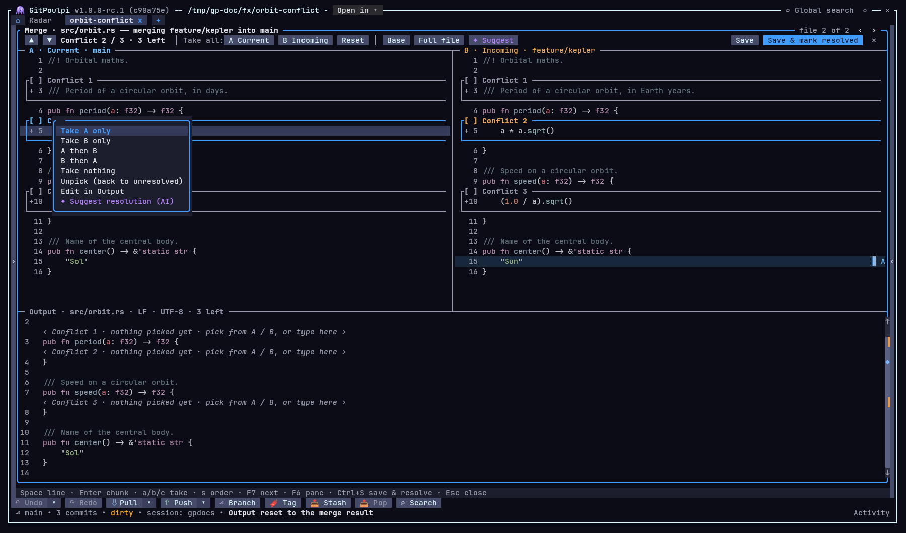
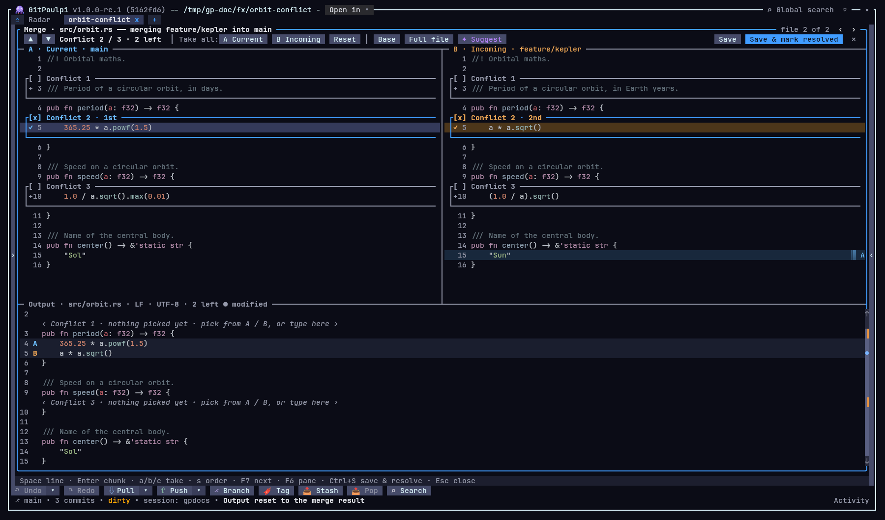
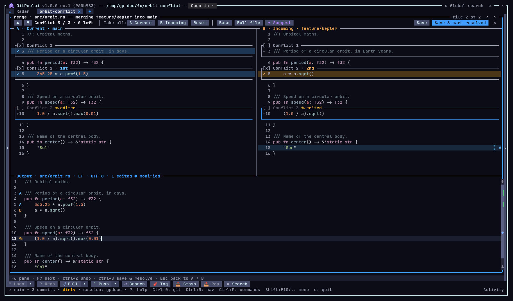
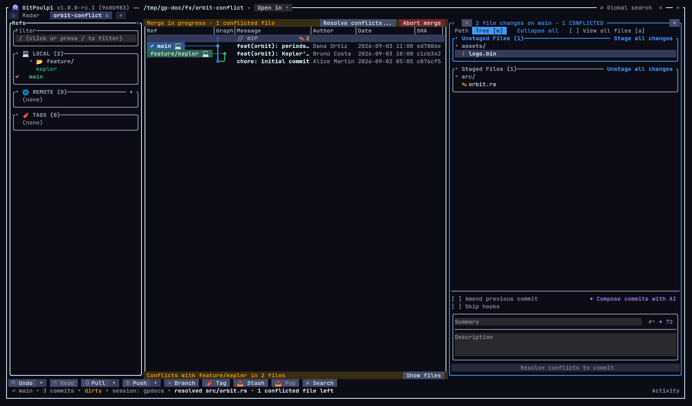
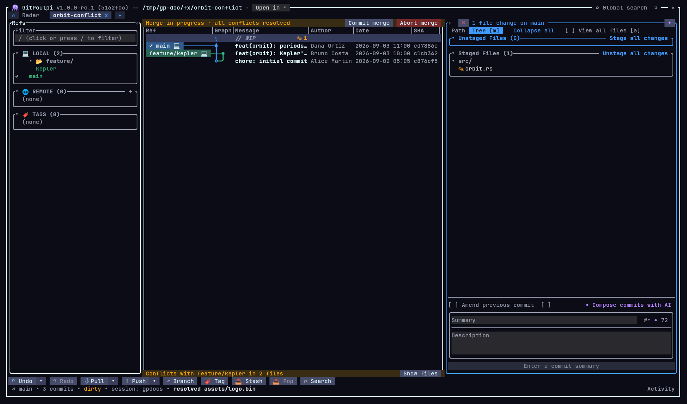
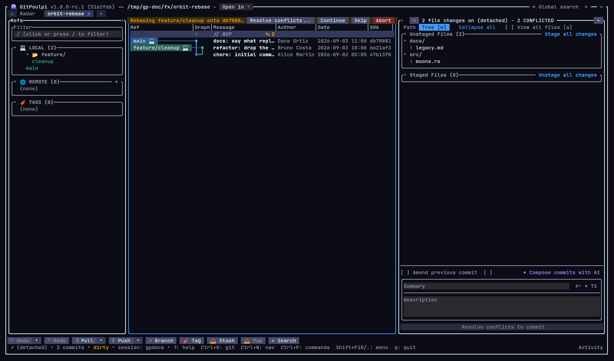
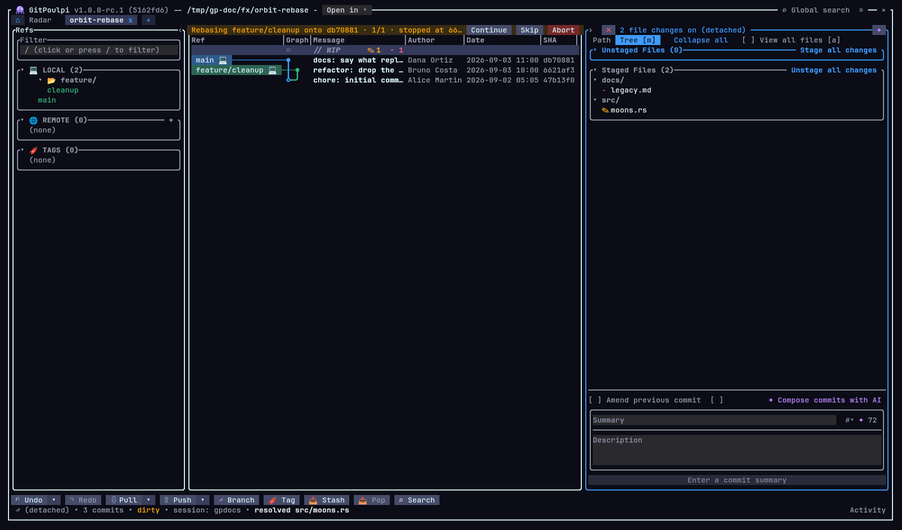
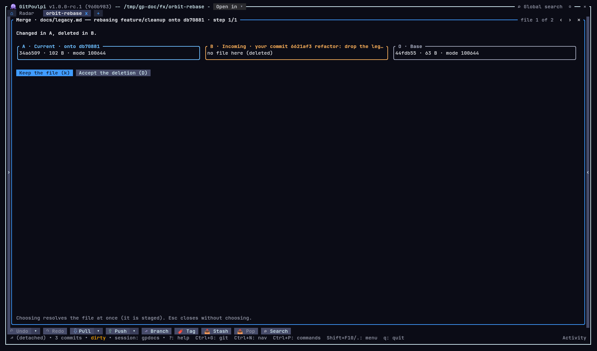

[English](../merge-conflicts.md) · [Čeština](../cs/merge-conflicts.md) · [Deutsch](../de/merge-conflicts.md) · [Español](../es/merge-conflicts.md) · [Français](../fr/merge-conflicts.md) · [Italiano](../it/merge-conflicts.md) · [日本語](../ja/merge-conflicts.md) · [한국어](../ko/merge-conflicts.md) · [Nederlands](../nl/merge-conflicts.md) · [Polski](../pl/merge-conflicts.md) · [Português (Brasil)](../pt-BR/merge-conflicts.md) · [Português (Portugal)](../pt-PT/merge-conflicts.md) · [Русский](../ru/merge-conflicts.md) · **Svenska** · [Türkçe](../tr/merge-conflicts.md) · [Українська](../uk/merge-conflicts.md) · [简体中文](../zh-CN/merge-conflicts.md)

# Lösa merge-konflikter

När en merge, cherry-pick, revert eller rebase stannar på konflikter visar Log en
banner (*Merge pågår · feature i main · 2 filer med konflikt*) och filerna med
konflikt visas i Status-rutan med ett rött `!`. Öppna en i **merge-redigeraren**:
A (den nuvarande sidan) och B (den inkommande sidan) sida vid sida, med
**Resultat**, filen du skriver, under. Den här sidan är den korta versionen;
hela tangentlistan finns i [Kortkommandon](keybindings.md).

## Öppna den

- `Enter`, eller dubbelklick, på en `!`-rad i Status-rutan; dess högerklicksmeny
  börjar med **Öppna i merge-redigeraren**.
- Bannerns knapp **Lös konflikter...** (den öppnar den första filen med konflikt).
- Diff-vyn för en fil med konflikt: knappen **Merge-redigerare** (`Shift+E`).
- Paletten: **Konflikter: Öppna merge-redigeraren**.

Ingenting öppnas av sig självt: en stoppad operation visar bara bannern och
`!`-raderna.

Redigeraren tar hela fönsterbredden: sidopanelen Refs och
högerpanelen är dolda medan den är öppen och kommer tillbaka när du stänger den
(`F9` visar eller döljer dem under tiden). A och B ligger sida vid sida så snart
redigeraren är minst `merge.side_by_side_min_width` kolumner bred (100 som
standard, Inställningar > Diff & redigerare; `0` betyder alltid); smalare får du
en sida i taget bakom flikar. Långa rader rullas i sidled, A och B tillsammans
(`Shift+←` / `Shift+→`, Shift+hjul eller ett sidohjul), de bryts aldrig.

## Välja

Varje konflikt är ett inramat block i A och i B, med en kryssruta på rubriken och
ett `+` / `✓` framför varje rad. Högerklicka på ett block för valen för den konflikten:

| För att... | Tangent | Mus |
|---|---|---|
| ta raden under markören (fokuserad sida) | `Space` | klicka på raden |
| ta hela blocket på den fokuserade sidan | `Enter` | klicka på `[ ]` på dess rubrik |
| ta bara A / bara B för den här konflikten | `a` / `b` | högerklicka på blocket |
| ta båda, A sedan B / B sedan A | `c` / `Shift+C` | högerklicka på blocket |
| ta ingenting | `x` | högerklicka på blocket |
| byta ordning på två valda sidor | `s` | klicka på märket `1:a` / `2:a` |
| ta allt från A / allt från B (varje konflikt) | `Shift+A` / `Shift+B` | verktygsfältet |
| ångra valet för den här konflikten (tillbaka till olöst) | `u` i A / B, `Alt+U` var som helst | högerklicka på blocket, **Ångra val** |
| återställa hela filen till de ursprungliga konflikterna (frågar först när du skrivit i Resultat; `Ctrl+Z` hämtar tillbaka det) | `Shift+U` i A / B, `Alt+R` var som helst | **Återställ** bredvid Ta alla |
| nästa / föregående konflikt | `F7` / `Shift+F7`, `Alt+Down` / `Alt+Up` (`n` / `Shift+N` i A / B) | `▼` / `▲`, eller klicka på en markering i en rullningslist |
| ett antal upprepar en rörelse | `3j`, `2k`, `2n`, `3N` (i A / B) | |
| nästa / föregående fil med konflikt | `Alt+PageDown` / `Alt+PageUp` | `›` / `‹` i rubriken |
| visa eller dölja Bas-rutan (gemensam förfader) | `Alt+D` (`d` i A / B) | `Bas` |
| visa hela filen i A och B (**Hela filen**) | `Alt+F` (`f` i A / B) | `Hela filen` |
| ge A eller B mer bredd / tillbaka till lika bredd | `Alt+Right` / `Alt+Left`, `Alt+0` | dra avdelaren; dubbelklicka på den |
| rulla A / B / Bas i sidled | `Shift+←` / `Shift+→` (`Shift+H` / `Shift+L`) | Shift+hjul, sidohjul |
| visa eller dölja panelerna Refs och Status | `F9` | |
| fokusera A, B, Resultat | `F6` / `Shift+F6` | klicka |
| hoppa till en ruta, på den konflikt du står på | `Alt+1` A, `Alt+2` B, `Alt+3` Resultat, `Alt+4` Bas; eller `Ctrl+N` sedan `1` / `2` / `3` | |
| flytta till grannrutan (A, Bas, B, Resultat), samma konflikt | `h` / `l` eller `←` / `→` i A / B | |
| växla Resultats höjd | `z` | dra dess titel |
| ångra / gör om (val och inmatning, en stack) | `Ctrl+Z` / `Ctrl+Y` | |
| skriva filen, behålla den i konflikt | `Alt+S` | **Spara** |
| skriva filen och markera den som löst | `Ctrl+S` | **Spara och markera löst** |
| stänga | `Esc` | `✕` |

Varje rullningslist (A / B / Bas och Resultat) har en markering per konflikt:
orange så länge den behöver ett val, grön när den är hanterad, blå för den
aktuella. Ett klick på en markering hoppar till den konflikten (en markering
under rullningslistens handtag syns redan på skärmen, så där drar klicket i
handtaget).

Att ta båda (**A sedan B**) skriver A:s rader och sedan B:s under konfliktens markering i Resultat, var och en märkt med sin sida; märkena `1st` / `2nd` på de två blocken anger ordningen, och `s` byter den:

**Hela filen** visar hela filen i A och B med varje skillnad färgad, inte bara konflikterna:

Resultat är en riktig redigerare: klicka i den och skriv, markera, klipp ut och
klistra in, sök med `Ctrl+F`. Ett val på en konflikt som du har redigerat för hand
ersätter din ändring (`Ctrl+Z` hämtar tillbaka den). Att spara med en konflikt
som inget valts för, eller med en rad som fortfarande ser ut som en
konfliktmarkör, frågar först.

### ✦ Föreslå en lösning (AI)

Med AI påslaget (Inställningar > AI; se [AI-hjälp](ai.md)) har verktygsfältet en
knapp **✦ Föreslå**, en konflikts högerklicksmeny har *Föreslå lösning (AI)*, och
`Alt+I` och paletten (`AI: Föreslå lösning på merge-konflikt`) gör detsamma. Det
verkar bara på den aktuella konflikten och körs bara när du ber om det. Svaret
ersätter den konfliktens del av Resultat som en enda ändring, markerad som
redigerad (`✎`), så `Ctrl+Z` sätter tillbaka konflikten som den var. Det sparas
eller stageas aldrig åt dig. Medan det körs visar tipsraden den förflutna tiden;
`Esc` avbryter, och ett fel visas också där. Med AI av finns ingen av
kontrollerna.

Efter **Spara och markera löst** är filen stagead och listan över filer med
konflikt är tillbaka; öppna nästa fil själv. `Ctrl+Z` (eller
knappen Ångra) tar tillbaka det senaste ”markera löst”.

När ingen fil är kvar
erbjuder bannern **Commit merge** (eller **Fortsätt** för en cherry-pick, en
revert eller en rebase) och **Avbryt merge**, som frågar först: den sätter
tillbaka HEAD, indexet och arbetskatalogen som de var.

En rebase stannar på samma sätt, steg för steg. Dess banner nämner grenen och vad den rebasas på, och har **Lös konflikter...**, **Fortsätt**, **Hoppa över** och **Avbryt**:

När den sista filen är löst är samma banner redo att **Fortsätta**:

En merge vars resultat är lika med HEAD (du tog vår sida överallt) har inget
stageat och ingen ändrad fil, men kan ändå avslutas: **Commit merge** öppnar
commit-prompten med merge-meddelandet, och committen har båda föräldrarna. På
samma sätt är composerns Commit-knapp aktiv utan något stageat medan en merge
är stoppad.

En tom cherry-pick eller revert (ändringen är redan tillämpad) kan inte
commitas: git vägrar, och **Fortsätt** säger det och pekar på **Hoppa över**.
**Hoppa över** (bannerknapp, palettkommandot *Git: Hoppa över cherry-pick eller
revert*, CLI `conflicts skip`) frågar först och avslutar sedan operationen utan
att något registreras för den; HEAD, indexet och arbetskatalogen är tillbaka vid
HEAD. Hoppa över går inte att ångra (inget går förlorat som inte avsiktligt
givits upp); en merge har inget att hoppa över.

## Konflikter som inte är text

En binärfil, en Git LFS-pekare, en fil över 8 MiB, en fil borttagen på ena
sidan, en kvarlämning efter ett namnbyte, en symlänk, en lägesändring eller en
submodul har inga rader att välja. Redigeraren visar ett **kort** med vad varje
sida innehåller och en knapp per val; ett val löser och stagear filen direkt.

| Kort | Val |
|---|---|
| Binärfil, LFS-pekare, för stor | **Behåll A** (`a`), **Ta B** (`b`), **Ta bas** (`o`, när det finns en), **Öppna i merge-verktyg** (`m`) |
| Borttagen på ena sidan, ändrad på den andra | **Behåll filen** (`k`), **Godta borttagningen** (`Shift+D`) |
| Kvarlämnad av namnbyte (sökvägen finns bara på ena sidan) | **Behåll filen** (`k`), **Ta bort filen** (`Shift+D`) |
| Symlänk, submodul, fillägen | **Behåll A**, **Ta B**, **Ta bas** |

När filen är en bild (PNG, JPEG, GIF, WebP, BMP, ICO) visar rutorna också
bilderna för A, B och Bas, anpassade och skrivskyddade, i ett fönster som är
brett nog för dem; se [Bilder](image-view.md#i-merge-redigeraren).

`Esc` stänger kortet utan att välja. Det externa merge-verktyget är
`general.external_merge_tool` i Inställningar > Diff & redigerare (`{base}`, `{local}` = A,
`{remote}` = B, `{merged}`; tomt betyder `git mergetool`); filen stageas när
verktyget avslutas utan fel.

## Konfliktförebyggande

GitPoulpi kan varna dig *innan* du gör en merge. När grenen du står på skulle ge konflikter med grenen den startade från
(dess **bas**) visas en remsa på Logs översta kantrad: **Konflikt med origin/main i 2 filer**, med en
knapp **Visa filer**. Den tar nästa lediga kantrad efter banners för operationer som pågår, så medan någon
av dem visas kan den få vänta på plats. Ingenting slås ihop: daemon gör en merge i minnet av de två commits
(libgit2, eller `git merge-tree --write-tree` med git 2.38 eller senare; en äldre git stänger av funktionen med en rad
i loggen), så dina filer, ditt index och dina refs rörs inte.

- **Basen** är målgrenen för grenens pull request när GitPoulpi redan känner till den (cachen som sektionen
  Pull requests håller; inget nätverksanrop görs för detta), annars den gren bland mönstren för **Basgrenar**
  (Inställningar > Konfliktförebyggande) som har minst commits sedan förgreningspunkten. Vid oavgjort vinner grenen vars
  spets ligger närmast förgreningspunkten, sedan en remote-spårande gren framför en lokal, sedan namnet. Själva grenen och
  dess egen remote-kopia är aldrig basen.
- **Popupen** (klicka på remsan, eller paletten **Konflikter: Visa förutsedda konflikter**, som fungerar från
  tangentbordet) listar filerna och har **Förhandsgranska merge** och **Rebase på basen**. De är basgrenens
  egna menyrader (*Merge <bas> i <gren>*, *Rebase <gren> på <bas>*) som körs åt dig: journalförda, så `Ctrl+Z` tar tillbaka dem, och en
  merge som ger konflikter stannar i merge-redigeraren som vilken annan som helst. Vänster och Höger flyttar mellan knapparna, Enter
  trycker på en, Esc stänger.
- **När den körs**: i bakgrunden, ungefär 2 sekunder efter att repositoryt blivit tyst (en commit, en checkout, en
  fetch som flyttade en gren, en rebase), en gång per par `(HEAD, bas)`. Remsan döljs så snart HEAD flyttas och kommer
  tillbaka, eller inte, med det nya svaret. En frånkopplad HEAD kontrolleras inte.
- **Listor över basgrenar**: var ett repositorys Basgrenar kommer från är ett val på dess sida **Konfliktförebyggande**.
  **Standard** följer den globala standarden (den inbyggda `**`, varje gren, tills du väljer en annan lista i
  Inställningar > Konfliktförebyggande); **Lista: <namn>** följer en av dina namngivna listor; **Egen lista** är en
  lista för repositoryt själv. Listor delas: redigera en så använder varje repository som följer den ändringen vid nästa
  kontroll, utan omstart. **Spara som lista...** gör ett repositorys egna mönster till en namngiven lista, **Återställ till
  standard** tar bort repositoryts val. Att ta bort en lista som ett repository följer gör att det använder standarden.
- **Av**: **Aktivera proaktiv konfliktdetektering** i Inställningar > Konfliktförebyggande, eller för ett repository på dess sida
  **Konfliktförebyggande**. Från ett skript skriver `gitpoulpi conflicts check` ut samma svar som JSON
  ([CLI-referens](cli-reference.md)).

## Agenter

En agent kan visa en konflikt för dig (`gitpoulpi ui show conflict <path> [--conflict
N]`: redigeraren öppnas på den, inget väljs) eller **föreslå** en lösning
(`gitpoulpi ui propose resolution <path> --pick 1=a,2=ba` eller `--content-file F`,
kräver *Låt AI-agenter föreslå ändringar som jag bekräftar*). Ett förslag öppnar
redigeraren med valen (eller hela texten) redan i Resultat och en lila banner
*✦ Föreslagen av claude-code*. Granska det, ändra det du vill och tryck
`Ctrl+S`: först då skrivs eller stageas något. Att stänga redigeraren avvisar
förslaget. Se [MCP och agenter](mcp-and-agents.md).

Från ett skript är samma operationer `gitpoulpi conflicts list | show | resolve |
unresolve | state | abort` ([CLI-referens](cli-reference.md)); `conflicts check` förutsäger dem före en merge.
