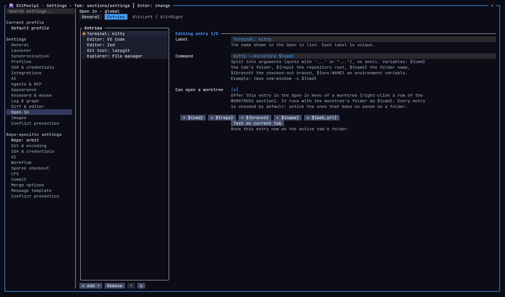
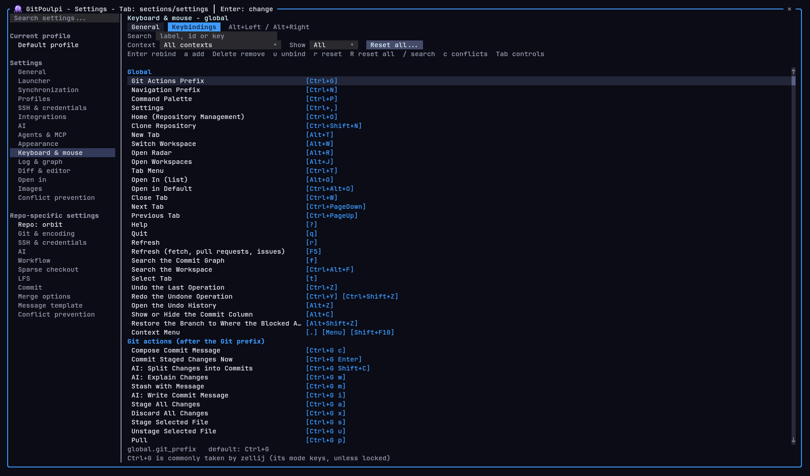
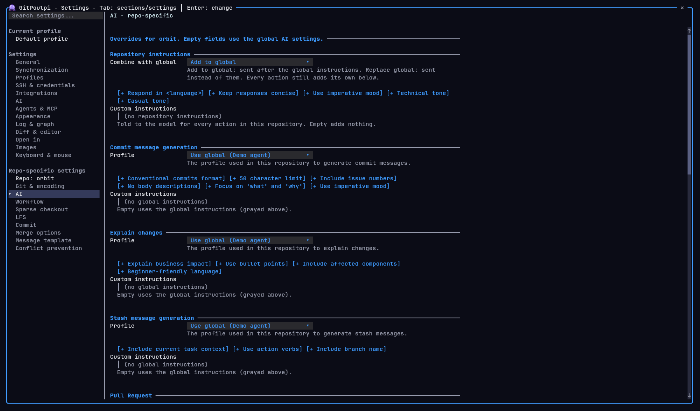

[English](../settings.md) · [Čeština](../cs/settings.md) · [Deutsch](../de/settings.md) · [Español](../es/settings.md) · [Français](../fr/settings.md) · [Italiano](../it/settings.md) · [日本語](../ja/settings.md) · [한국어](../ko/settings.md) · [Nederlands](../nl/settings.md) · [Polski](../pl/settings.md) · [Português (Brasil)](../pt-BR/settings.md) · [Português (Portugal)](../pt-PT/settings.md) · [Русский](../ru/settings.md) · **Svenska** · [Türkçe](../tr/settings.md) · [Українська](../uk/settings.md) · [简体中文](../zh-CN/settings.md)

# Inställningar

Öppna Inställningar med `Ctrl+,`, `Ctrl+N` och sedan `,`, kugghjulet i
titelraden (till vänster om `×`), eller `Ctrl+P` > *Inställningar*. Inställningsskärmen ersätter
fönstret medan den är öppen. Stäng den med `✕` uppe till höger, `Esc` eller `q`. Den frågar först bara när en stängning skulle förlora något (se [Stänga Inställningar](#stänga-inställningar)).

Ändringar sparas direkt i `config.toml`. [Konfigurationsreferensen](config-reference.md)
beskriver varje nyckel, dess standardvärde och dess miljövariabel. Den här sidan
beskriver inställningsskärmen.

## Använda inställningsskärmen

| För att | Gör så här |
|---|---|
| Flytta mellan sidlistan och alternativen | `Tab` / `Shift+Tab`, eller klicka. |
| Flytta | `j` / `k` eller piltangenterna. |
| Ändra ett alternativ | `Enter` eller `Space`, eller klicka på dess värde. Se nedan. |
| Stänga | Klicka på `✕`, eller tryck `Esc` eller `q`. Medan ett fält, en rullgardinslista eller en bekräftelse är öppen stänger `Esc` bara den. |

Vad `Enter` eller `Space` gör beror på raden:

- En kryssruta växlar.
- En rullgardinslista öppnas. Piltangenterna väljer, `Enter` godtar.
- Ett text- eller talfält börjar redigeras. Piltangenterna, `Home`, `End`,
  `Backspace` och `Delete` fungerar, och ett klick placerar markören. `Enter`,
  `Tab`, `Up`, `Down` eller ett klick någon annanstans sparar värdet. `Esc`
  avbryter. Ett avvisat värde stannar kvar i fältet, i rött, och statusraden
  anger orsaken.
- En rad med knappar (**Skapa**, **Ta bort**, **Testa**...) visar bara de knappar som gäller
  just nu. `Left` / `Right` väljer en, `Enter` trycker på den, eller klicka på den. En knapp
  som tar bort något frågar först.

På varje sida börjar värdena i en gemensam kolumn, så etiketterna står på rad till vänster
och fälten på rad till höger. En text eller ett tal är ett tonat band, ett val är ett band
som slutar med `▾`, en kryssruta är `[x]`. En lång etikett radbryts i stället för att kapas,
och i ett smalt fönster flyttas värdet under sin etikett.

En nedtonad rad säger varför den är inaktiv. Till exempel är **Styrka på radfärgning**
nedtonad medan **Bakgrund för grafspår** är **Av**.

### Listor

Sidor som redigerar flera objekt av samma slag (Profiler, AI, Arbetsflöde, Öppna i,
Bilder) visar dem som en **lista till vänster och det valda objektets fält till höger**.
I ett smalt fönster ligger listan ovanför fälten. Listan ser likadan ut överallt:

- En rads märke visar dess tillstånd: `●` den aktiva profilen, `★` standardposten, `⚠`
  ett objekt som inte är klart (en profil utan e-post), med orsaken där detaljerna annars
  skulle stå.
- Under listan: **+ Lägg till**, **Duplicera**, **Ta bort**, `↑` och `↓`. En knapp som inte
  går att använda just nu (`↑` på första raden) är nedtonad. **+ Lägg till ▾** öppnar en
  rullgardinslista där sidan erbjuder förinställningar eller slag.
- **Ta bort** frågar först, utom för ett objekt du nyss lagt till och inte ändrat.
- Dra en rad för att flytta den; ett streck visar var den hamnar och `Esc` avbryter
  dragningen. Ett dubbelklick går in i objektets fält.

| Tangent | Gör |
|---|---|
| `Up` / `Down`, `Home` / `End`, `PageUp` / `PageDown` | Välj ett objekt. |
| `Insert` | Lägg till ett objekt (öppnar rullgardinslistan när det finns en). |
| `Ctrl+D` | Duplicera objektet. |
| `Delete` | Ta bort objektet, efter en bekräftelse. |
| `Alt+Up` / `Alt+Down` | Flytta objektet upp eller ned. |
| `Enter` eller `Right` | Gå till objektets fält. |
| `Left` | Tillbaka till sidlistan. |
| `Alt+Left` / `Alt+Right` | Växlar mellan fliken Allmänt och listfliken (var som helst på sidan). |

Varje sådan sida har två **underflikar** under rubriken, så att en inställning för sidan aldrig förväxlas med en egenskap hos det valda objektet: **Allmänt**, sidans egna inställningar (den aktiva profilen, standardposten, instruktionerna som varje AI-åtgärd får, arbetsflödesmallen ...), och en flik uppkallad efter objekten (**Profiler**, **Profiler (anslutningar)**, **Poster**, **Redigerare**, **Regler**) med listan och det valda objektets fält. En sida öppnas på **Allmänt**; inställningarna minns fliken du lämnade varje sida på tills du avslutar, och likaså rullningspositionen och den markerade raden på varje sida (och flik). Klicka på en flik eller tryck `Alt+Left` / `Alt+Right`. Sökrutan, inställningsraderna i kommandopaletten och länkarna som säger ”ställ in i inställningarna” öppnar fliken där inställningen finns.
[Tangentbord & mus](#tangentbord--mus) har samma två flikar (**Allmänt**, **Tangentbindningar**).

Tangenterna kan bindas om under **Tangentbord & mus** (kontexten *preferences*, se
[Kortkommandon](keybindings.md)).

### Redigerare med flera rader

Inställningar som innehåller flera rader (till exempel sökvägarna för delvis utcheckning, beskrivningen i commitmallen, basgrenarna för konfliktförebyggande och arbetsflödeshookarna) öppnas i en liten redigerare med `Enter` eller ett klick; `Ctrl+S` behåller texten och `Esc` kastar den. Musen fungerar där som i vilket textfält som helst:

- Ett klick placerar markören där du klickade.
- Att dra markerar text; hjulet rullar.
- Ett dubbelklick markerar ordet under pekaren.
- `Shift` + klick utvidgar markeringen från markören till pekaren.

Tangentbordet erbjuder samma sak: `Shift` med piltangenterna markerar, `Ctrl` med piltangenterna hoppar ord för ord, `Ctrl+A` markerar allt, `Ctrl+C` och `Ctrl+X` kopierar och klipper ut.

### Stänga Inställningar

`✕`, `Esc` och `q` gör samma sak. Inställningar tillämpar varje ändring direkt, så oftast
stängs de bara. De frågar **Stänga Inställningar?** först när något skulle gå förlorat:

- sidan **Arbetsflöde** har ändringar som inte är sparade;
- meddelandemallen för commits har ändringar som inte är sparade;
- en profil saknar författarens e-post (commits den gör kan inte tillskrivas dig).

Rutan erbjuder **Gå dit** (öppnar den sidan), **Förkasta och stäng** eller **Stäng ändå**,
och **Avbryt**. De små redigerarna inuti Inställningar (en AI-instruktionstext, en
arbetsflödeshook, sökvägarna för delvis utcheckning) har egna `✕` och frågar
**Förkasta ändringar?** bara när deras text har ändrats.

### Popuper över Inställningar

Rubrikraden visar programmets bläckfisk och namn, som huvudfönstrets. Klicka på
bläckfisken för att öppna Om.

Några fönstergemensamma popuper öppnas över Inställningar och lämnar tillbaka
dem som de var (sidan, rullningsläget och osparade ändringar i Arbetsflöde eller
mallar finns kvar):

- kommandopaletten (`Ctrl+P`),
- temaväljaren (`Ctrl+N y`, **App: Byt tema...**), som förhandsvisar varje tema
  på Inställningar själva; `Esc` sätter tillbaka det förra temat,
- språk- och grafikfärgsväljarna (`Ctrl+N` och sedan samma bokstäver som i
  huvudfönstret),
- arbetsytesökningen (`Ctrl+Alt+F`),
- Om (`Ctrl+N a`, bläckfisken eller **Hjälp: Om GitPoulpi**) och hjälpöverlägget
  (`?`).

Stäng var och en med `Esc`, dess egen `✕` eller ett klick utanför. Kommandon som
verkar på det Inställningar täcker (en flik, en gren, en diff...) listas i
paletten men är nedtonade med ”stäng Inställningar först”, och `Ctrl+N`-
kortkommandona för dem visar den raden på Inställningars nedre kant: stäng
Inställningar och kör dem sedan.

`Ctrl+N` visar ett märke på varje kontroll på sidan: sökrutan, sidlistan (ett enda märke, på den aktuella sidan), underflikarna, listan och dess knappar, varje fält på skärmen och stängningskorset. Tryck på märkets tecken så händer detsamma som vid ett klick på kontrollen: ett textfält öppnas för redigering, en kryssruta kryssas, en rullgardinslista öppnas, en knapp körs. `Esc` avbryter. Ett fält som rullats utom synhåll har inget märke. Medan du skriver i ett fält, eller en rullgardinslista, en redigerare eller sökningen är öppen, tillhör `Ctrl+N` den. Se [Märken](keybindings.md#märken).

### Sökrutan

Rutan överst i sidlistan söker i namnet och beskrivningen på varje alternativ på
varje sida. Klicka på den, eller tryck `/` eller `Ctrl+F`, och skriv. En lista med
träffar fälls ned. Varje träff visar alternativet och dess sida. `Up` / `Down`
väljer, `Enter` går till alternativet, `Esc` stänger listan.

## Inställningar från kommandopaletten

De flesta inställningar kan ändras utan att öppna den här skärmen: skriv `Inställningar:` eller `Settings:` i kommandopaletten (`Ctrl+P`). Raderna skapas från sidornas egna fält, så en ny inställning dyker upp på båda ställena.

- En kryssruta är **Inställningar: växla ...**. Den växlar direkt och raden visar `[x]` eller `[ ]`.
- En rullgardinslista är **Inställningar: ...**. `Enter` begränsar paletten till dess värden, det nuvarande markeras `nuvarande`; `Enter` på ett värde väljer det.
- Ett tal eller en text öppnar en inmatning med det nuvarande värdet. Ett värde som sidan skulle neka (inget tal, utanför intervallet) nekas på samma sätt och inmatningen förblir öppen.
- En inställning som behöver sin sida (en lista, en kombination med alternativ som upptäcks vid körning) öppnar Inställningar på den.

Ett värde sparas i `config.toml` och tillämpas precis som sidan gör. De engelska orden i inställningens nyckel (`remember tabs`) hittar raden på alla språk.

## Sidorna

Sidlistan har två grupper:

- **Inställningar**: globala inställningar.
- **Repo-specifika inställningar**: inställningar för den aktiva flikens
  repository. De visas bara medan ett repository är öppet.

### Allmänt

| Alternativ | Vad det gör |
|---|---|
| **Språk** | Gränssnittsspråket: **Auto** (ditt systemspråk, annars engelska), English, Français, Español, Português (Brasil), Português (Portugal), Italiano, Deutsch, 简体中文, 日本語, 한국어, Русский, Українська, Polski, Čeština, Nederlands, Svenska, Türkçe. Det gäller direkt, utan omstart. Månadsnamn och datum i Log följer det. Miljövariabeln `GITPOULPI_LANG` (till exempel `GITPOULPI_LANG=fr`) åsidosätter det här valet. Utdata från CLI och MCP förblir på engelska. |
| **Översätt git-termer** | Av som standard: commit, push, pull, stash, tag och de andra git-termerna förblir engelska på alla språk. På: språkets egna git-vokabulär används (franska: *Tirer*, *Pousser*, *Remiser*, *Étiquette*). Gäller direkt. |
| **Engelska git-ord** | Bara för japanska, koreanska och kinesiska: visar *stage*, *unstage*, *staged* som engelska ord i stället för deras transkription. Ingen effekt medan **Översätt git-termer** är på. |
| **Kom ihåg flikar** | Öppnar den senaste sessionens flikar igen vid start. När den är av öppnar en start i ett repository bara det repositoryt, och en start utanför ett repository börjar på Hem utan repositoryflik. Kräver omstart. |
| **Aktivera Radar** | På som standard (`general.radar_enabled`). Av döljer Radar-fliken, dess palettkommandon och `Alt+R`, och inget hämtas för den i bakgrunden. Gäller direkt. Se [Radar](radar.md#stänga-fliken-eller-stänga-av-radar). Visas inte i ett bygge utan Radar. |
| **Startflik i ett repository** | Fliken som en start öppnar på när mappen den startar i ligger i ett repository (`general.startup_tab_in_repo`): **Aktuellt repository** (standard, det repositoryts flik, öppnad vid behov), **Senaste fliken** (fliken som var aktiv vid senaste avslutet), **Hem**, **Radar**. Ett repository som anges med `--repo` öppnar alltid sin egen flik. **Senaste fliken** blir Hem när **Kom ihåg flikar** är av eller inget är sparat; **Radar** blir Hem när Radar är av eller saknas i bygget. Läses en gång vid start; kräver omstart. |
| **Startflik utanför ett repository** | Fliken som en start öppnar på när mappen den startar i inte är ett repository (till exempel en användarmapp) (`general.startup_tab_outside_repo`): **Hem** (standard), **Senaste fliken**, **Radar**. **Senaste fliken** blir Hem när **Kom ihåg flikar** är av eller inget är sparat; **Radar** blir Hem när Radar är av eller saknas i bygget. Läses en gång vid start; kräver omstart. |
| **Startflik från startaren** | Fliken som en start öppnar på när GitPoulpi startas från genvägen på skrivbordet eller i Startmenyn som det skapade (den skickar `--launcher`), oavsett mapp (`general.startup_tab_launcher`): **Senaste fliken** (standard), **Hem**, **Radar**. Har företräde framför de två inställningarna ovan. **Senaste fliken** blir Hem när **Kom ihåg flikar** är av eller inget är sparat; **Radar** blir Hem när Radar är av eller saknas i bygget. Genvägar från en äldre version får flaggan vid nästa start. Läses en gång vid start; kräver omstart. På Windows skrivs även en kopia som du fäst i aktivitetsfältet om vid nästa start, och en start utan skal runt sig (dubbelklick, själva exe-filen fäst i aktivitetsfältet) räknas som en start från startaren. |
| **Gruppera worktree-flikar** | På som standard (`general.group_worktree_tabs`). Flikarna för ett repos länkade worktrees står direkt efter repots flik, och en bortdragen worktree-flik hoppar tillbaka dit. Av lämnar flikarna där du lägger dem. Att slå på det grupperar de öppna flikarna på nytt. |
| **Standardmapp för kloning** | Där Klona-dialogen börjar. Tomt: `%USERPROFILE%\source\repos` på Windows, `~/src` annars. |
| **Standardmapp för bläddring** | Där Bläddra öppnas. Tomt: den senaste mappen du använde, annars din hemmapp. |
| **Plats för repositorydata** | Var GitPoulpi lagrar sina data per repository (`session.per_repo_state_dir`): **Inuti .git** (standard: inget dyker upp i din arbetskatalog och alla worktrees delar det), **I arbetskatalogen** (en mapp `.gitpoulpi`; krävs för att checka in en `workflow.toml` för teamet) eller **I min användardatamapp** (utanför repositoryt). En mapp `.gitpoulpi` som en äldre version lämnat flyttas till den nya platsen första gången den behövs och tas bort när den är tom; en fil som git spårar (en incheckad `workflow.toml`) flyttas eller raderas aldrig och förblir läsbar. |
| **Standardnamn på gren** | Den första grenen i ett repository du skapar med Init. Tomt: git bestämmer. Den byter inte namn på någon befintlig gren. |
| **Aktivera proaktiv konfliktdetektering** | På som standard (`general.conflict_detection`). Varnar i Log när en merge av den aktuella grenen i grenen den startade från skulle ge konflikter, innan du försöker. Ett repository kan stänga av den för sig själv på sidan **Konfliktförebyggande**. Se [Lösa merge-konflikter](merge-conflicts.md#konfliktförebyggande). Gäller när Inställningar stängs. |
| **Loggnivå**, **Behåll loggfiler**, **Största storlek för en loggfil** | Programloggen bakom aktivitetsloggen: den mest utförliga nivån som spelas in (`log.level`), hur länge filer sparas (ett heltal och en enhet, dagar, veckor, månader eller år, på en rad: klicka på talet för att skriva det, Upp och Ned stegar det, Tab går till enheten och Enter öppnar dess lista; högst 10 år, standard 1 vecka, `log.retention_days` och `log.retention_unit`) och storleken då en dags fil roteras (ett tal och MiB eller GiB, 1 MiB till 1 GiB, `log.max_file_mb` och `log.max_file_unit`). |
| **Visa hur lång tid åtgärder tar**, **Utökad loggning** | Fliken Git-åtgärder i aktivitetsloggen: varje åtgärds tid (`log.timings`, på som standard) och även bakgrundsarbetet, uppdatering och auto-fetch (`log.extended`, av som standard). Se [När något misslyckas](troubleshooting.md#aktivitetsloggen). |
| **Ångra aktiverat**, **Djup på ångrahistoriken**, **Spela in ändringar gjorda utanför GitPoulpi** | Gruppen **Ångrahistorik**. Slår på eller av Ångra och anger hur många operationer det behåller (standard 100, `0` betyder obegränsat). Att stänga av Ångra raderar ångrahistoriken, efter en bekräftelse. Den sista inställningen spelar också in vad ett skal eller en agent gör med grenar, taggar, stashar och HEAD. Se [Ångra och gör om](undo-redo.md). |

#### Startare (skrivbordsintegration)

Gruppen **Startare**, den sista på sidan Allmänt, skapar en genväg som startar GitPoulpi från
operativsystemets startare, i den terminal du väljer.

| Rad | Vad den gör |
|---|---|
| **Terminal för genvägar** | `ui.launch_terminal`: **Automatiskt**, **Systemets standard** eller en av terminalerna som hittats på den här datorn (samma identifiering som för **Öppna i**). Automatiskt: Windows Terminal på Windows (annars WezTerm, Alacritty, den vanliga konsolen), `xdg-terminal-exec` på Linux (Omarchy; annars den första terminal som hittas), Terminal på macOS, om inte iTerm2, Ghostty, WezTerm eller kitty är installerad. |
| **Öppna igen i den terminalen vid dubbelklick** | Endast Windows (`ui.relaunch_in_terminal`). Ett dubbelklick på exe-filen öppnar standardkonsolen, som ritar bilder dåligt: GitPoulpi öppnar sig då igen i den valda terminalen och det första fönstret stängs. Görs inte när programmet startades från en terminal. |
| **Visa det öppna fönstret vid klick** | `ui.reuse_window` (på som standard). Ett klick på en GitPoulpi-genväg (`gitpoulpi launch`) visar fönstret för en GitPoulpi som redan är öppen i stället för att starta en till. En ny terminal startas bara om ingen är öppen, inställningen är av eller fönstret inte kan komma fram. Det kommer fram i Windows, i WezTerm och i Hyprland; på andra Linux-skrivbord startar klicket fortfarande ett nytt fönster. Används inte i macOS (Dock gör redan det). Håll ned **Shift** när du klickar (Windows) eller använd startarens åtgärd **Nytt fönster** (Linux) för att medvetet öppna ett till fönster; `gitpoulpi launch --new-window` gör det från ett skript. |
| **Kommandoalias** | `ui.command_alias`: en rullgardinslista med **Inget** och `gp`, eller skriv ett eget namn (bokstäver, siffror, `-`, `_`, `.`; inga mellanslag eller sökvägstecken). Knappen **Skapa** på raden gör att namnet startar GitPoulpi (den blir **Ta bort** när aliaset finns, och tar bort varje alias som GitPoulpi har skapat). En varning visas under raden när namnet redan kör något annat i din PATH, och i Windows när PowerShell har ett inbyggt alias med det namnet (`gp` är `Get-ItemProperty` där, och det går före varje fil). Ett skalalias eller en skalfunktion syns inte härifrån: oh-my-zsh definierar `gp` själv och det går före vårt. |
| **Alias för ny flik** | `ui.command_alias_add`: ett andra kommando, till exempel `gpa`, som öppnar den aktuella mappen som en ny flik i den GitPoulpi som redan körs (`gitpoulpi --add`) i stället för att starta en till; om ingen körs startar det GitPoulpi som vanligt, och om flera körs frågar det vilken som ska få fliken. En rullgardinslista med **Inget**, `gpa` och aliasnamnet följt av `a`, eller skriv ett eget namn (samma regler som ovan). Den enda knappen **Skapa** gör båda kommandona, **Ta bort** tar bort varje kommando som GitPoulpi har skapat; var och en har en egen statusrad. I Linux och macOS är det ett skript på två rader, i Windows en `.cmd`. Se [CLI-referensen](cli-reference.md#lägg-till-en-mapp-i-det-öppna-fönstret). |
| **Lägg till GitPoulpi i PATH** | Lägger mappen som GitPoulpi körs från och aliasmappen i din PATH, för nya terminaler. Radens knapp heter **Lägg till** eller **Ta bort**, och **Ta bort** tar bort exakt det som lades till. Mappar som redan finns i PATH lämnas orörda (raden säger då **finns redan i PATH**). |
| **Linux: Appstartare** | Skriver `~/.local/share/applications/gitpoulpi.desktop` (följer `XDG_DATA_HOME`) och ikonen i `~/.local/share/icons/hicolor/256x256/apps`. På Omarchy är posten densamma som `omarchy-tui-install` skapar (`xdg-terminal-exec --app-id=TUI.tile -e <exe>`); för andra terminaler motsvarande kommando (`kitty`, `wezterm start --`, `alacritty -e`, `ghostty -e`, `foot`, ...). |
| **Linux: Skrivbord** | Samma post i din skrivbordsmapp, om du har en. |
| **Windows: Startmenyn** | `GitPoulpi.lnk` i `%APPDATA%\Microsoft\Windows\Start Menu\Programs`. En kopia som fästs i aktivitetsfältet följer själv ändringar av ikon och färg; om ikonen ändå förblir gammal, lossa den och fäst den igen (högerklicka på posten i Startmenyn, sedan **Fäst i aktivitetsfältet**). |
| **Windows: Skrivbord** | `GitPoulpi.lnk` på ditt skrivbord. |
| **macOS: Mappen Program** | `~/Applications/GitPoulpi.app`, ett litet paket som öppnar terminalen med GitPoulpi. |

Varje rad visar sitt tillstånd: **inte skapad**, **skapad**, **föråldrad, uppdateras...**
(exe-filen har flyttats eller en annan terminal har valts; GitPoulpi skriver om den själv inom en sekund, så du ser det sällan) eller **en fil som inte är från GitPoulpi finns där** (en fil
med det namnet finns och skapades inte av GitPoulpi, så den rörs aldrig).
**Ta bort** raderar bara filer som GitPoulpi skapat (de har markeringen `X-GitPoulpi=1`).
Ikonen är bläckfisken i din logotypfärg (Om GitPoulpi > färg); på Linux har varje färg sitt eget ikonnamn, så en startare som cachar ikoner visar den nya färgen. När en genväg väl är skapad håller den sig uppdaterad av sig själv: ändrar du färgen eller flyttas terminalen eller exe-filen skriver GitPoulpi om de genvägar det skapat (aldrig en det inte skapat, och det skapar aldrig en ny), vid start och medan det körs. Det finns ingen knapp Uppdatera; bara **Skapa** (för en genväg som inte finns än) och **Ta bort**.

**Gruppering i aktivitetsfältet och dockan.** GitPoulpi körs i ett terminalfönster, så aktivitetsfältet visar det normalt under terminalens ikon, utan punkten ”körs” under den fästa GitPoulpi-ikonen. Windows: genvägarna bär AppUserModelID `GitPoulpi.GitPoulpi`, och en GitPoulpi som startats från en av dem ger sitt terminalfönster samma ID och sin ikon (den hittar fönstret genom att ge det en unik titel en stund och återställer sedan titeln), så fönstret hamnar under den fästa GitPoulpi-ikonen. Ett terminalfönster med flera flikar flyttas som en helhet: alla dess flikar grupperas under GitPoulpis ikon så länge GitPoulpi körs i det. Genvägar och fästa objekt i aktivitetsfältet som gjorts tidigare skrivs om av samma synkronisering; visar ett fäst objekt fortfarande terminalens ikon, lossa det och fäst det igen. Linux: kitty, foot, Alacritty, WezTerm och Ghostty startas med fönsterklassen `gitpoulpi` och `.desktop`-posten anger den (`StartupWMClass`), så en dock grupperar fönstret under startarens ikon; andra terminaler behåller sin egen ikon. macOS: inget att göra, Dock grupperar per app.

##### Kommandoalias och PATH, per system

| System | Alias | PATH |
|---|---|---|
| Linux, macOS | En symbolisk länk `~/.local/bin/<namn>` till `gitpoulpi-tui`. En länk kan inte bära en markering, så den räknas som vår när dess mål är en fil som heter `gitpoulpi-tui`; en vanlig fil, eller en länk till något annat, är **inte vår** och ersätts eller tas aldrig bort. | Ett block mellan `# >>> GitPoulpi PATH (X-GitPoulpi=1) >>>` och `# <<< GitPoulpi PATH <<<` i `~/.bashrc` och `~/.zshrc` (de som finns; `~/.zshrc` i macOS, annars `~/.bashrc` när ingen av dem finns), och `~/.config/fish/conf.d/gitpoulpi-path.fish` när fish är konfigurerat. Ta bort raderar blocket (eller fish-filen) och inget annat. |
| Windows | `%LOCALAPPDATA%\Programs\GitPoulpi\bin\<namn>.cmd`, ett skal på två rader som innehåller `REM X-GitPoulpi=1`. | Användarens PATH i `HKCU\Environment`, skriven via PowerShell, följd av ett `WM_SETTINGCHANGE`-meddelande så att nya program ser den. Värdet `GitPoulpiPathAdded` registrerar vad som lades till, och Ta bort tar bara bort det. |

Nya terminaler ser ändringen av PATH, inte de som redan är öppna. Ingen av åtgärderna journalförs: det finns inget Ångra för dem, **Ta bort** är vägen tillbaka.

Paletten har samma åtgärder (**Startare: Skapa genväg**, **Startare: Skapa
skrivbordsgenväg**, **Startare: Ta bort genvägar**, **Startare: Skapa kommandoalias**, **Startare: Ta bort kommandoalias**, **Startare: Lägg till i PATH**, **Startare: Ta bort från PATH**), och
`gitpoulpi desktop shortcut status|install|remove [--where launcher|desktop|startmenu]`
gör det från ett skript.

Palettkommandot **App: Byt språk...** (`Ctrl+N g`) öppnar samma språklista. Där
förhandsvisas det markerade språket live; `Enter` behåller det och `Esc`
återställer det förra.

### Synkronisering

Hur GitPoulpi håller ett repository i takt med sina remotes, och vad det gör med
dina lokala ändringar under tiden.

| Alternativ | Vad det gör |
|---|---|
| **Intervall för automatisk fetch** | Fetchar varje remote i bakgrunden med det här intervallet, ett tal och en enhet (minuter eller timmar) på en rad. Standard 5 minuter, högst 60 minuter (1 timme), `0` stänger av det. `general.auto_fetch_interval_minutes` förblir i minuter; `general.auto_fetch_interval_unit` noterar bara hur det visas. Kräver omstart. |
| **Fetch när en flik öppnas** | Kör Fetch All i bakgrunden när en repositoryflik öppnas. På som standard. Ett repository som fetchats under de senaste 60 sekunderna fetchas inte igen. |
| **Auto-prune** | Fetch tar också bort remote-spårande grenar som inte längre finns på remoten. Av som standard. |
| **Auto-prune tags** | Fetch tar också bort lokala tags som remoten har tagit bort. Bara tags som fanns på remoten berörs: en tag du aldrig har publicerat (push) behålls. Av som standard, precis som i git. Kräver git 2.41 eller senare. CLI: `gitpoulpi fetch --prune-tags`; konfigurationsnyckel `general.auto_prune_tags`. Se [Grenar, tags och Refs-sidofältet](log-and-history.md#grenar-tags-och-refs-sidofältet). |
| **Håll submoduler uppdaterade** | Efter en checkout eller en pull uppdateras submodulerna till de commits repositoryt registrerar. Se [Submoduler](submodules.md). |
| **Ta bort ”.orig”-filer efter merge** | När en merge är klar tas säkerhetskopiorna `*.orig` bort. Av som standard. |
| **Auto-stash före checkout, pull, merge eller rebase** | Vad som görs när lokala ändringar blockerar någon av de här operationerna: **fråga** (en dialog erbjuder att stasha ändringarna, köra operationen och återställa stashen), **alltid** (gör det utan att fråga) eller **aldrig** (vägra). |
| **Ta med ospårade filer i auto-stash** | Den automatiska stashen tar också ospårade filer. |

På samma sida, under **Uppdateringar**:

| Alternativ | Vad det gör |
|---|---|
| **Sök efter uppdateringar** | En rullgardinslista (`updates.mode`): **Meddela** (standard) söker en gång per dygn i bakgrunden och visar `vX.Y.Z tillgänglig` i titelraden; **Auto** laddar dessutom ned uppdateringen i bakgrunden när GitPoulpi installerades från ett releasearkiv (du väljer själv när det startas om); **Av** gör aldrig någon förfrågan. Gäller direkt. Se [Uppdateringar](installation.md#uppdateringar). |
| **Uppdateringskanal** | En rullgardinslista (`updates.channel`): **Stabil** (standard) eller **Förhandsversion** (även release candidates). Gäller direkt. |

På samma sida, under **Omskrivning av historiken**, tidsgränserna för externa skript (se [Skriva om historiken](history-rewrite.md)):

| Alternativ | Vad det gör |
|---|---|
| **Tidsgräns för skriptsvar** | Hur lång tid ett externt skript får på sig att svara för en commit, ett tal och en enhet (millisekunder eller sekunder) på en rad. Standard 5 sekunder, 1 millisekund till 10 minuter (`rewrite.script_timeout_ms`, `rewrite.script_timeout_unit`). Vid en timeout stoppas hela processen och omskrivningen misslyckas utan att något flyttats. |
| **Tidsgräns för skript per genomgång** | Hur lång tid en hel genomgång med ett externt skript får ta, ett tal och en enhet (sekunder, minuter eller timmar). Standard 1 timme, högst 24 timmar (`rewrite.script_total_timeout_s`, `rewrite.script_total_timeout_unit`). |

### Profiler

Profiler för commit-identitet: namnet och e-posten som används för commits gjorda
från GitPoulpi. Fliken **Allmänt** innehåller rullgardinslistan **Aktiv profil**;
fliken **Profiler** är en [lista](#listor) (lägg till, duplicera, ta bort, ordna om)
med fälten för den valda. Varje profil har ett **Profil-ID**, ett **Profilnamn**, ett **Författarens namn** och
en **Författarens e-post**. En profil utan e-post visar `⚠` i listan. Utan aktiv
profil, eller med en profil med tomt namn eller tom e-post, gäller repositoryts egna
`user.name` och `user.email`.

Med två eller fler profiler visar verktygsfältet en profilkombinationsruta längst
till höger. Den anger profilen bara för det aktiva repositoryt. När du har valt
erbjuder en dialog att också skriva identiteten i det repositoryts konfiguration.
Palettkommandot är **Repository: Byt profil...**.

De här profilerna är inte hostingprofilerna på sidan Integrationer, och inte
AI-profilerna på sidan AI.

### SSH & inloggning

SSH använder ditt systems `ssh`, så din ssh-agent och din ssh-konfiguration
fortsätter fungera. GitPoulpi läser aldrig nyckelmaterial.

| Alternativ | Vad det gör |
|---|---|
| **Sökväg till privat nyckel** | När den är satt kör fetch, pull, push och clone git med `GIT_SSH_COMMAND=ssh -i "<key>" -o IdentitiesOnly=yes`, så att ssh bara erbjuder den nyckeln. Tomt: agenten och din ssh-konfiguration gäller oförändrade. |
| **Sökväg till publik nyckel** | Används bara när sökvägen till den privata nyckeln är tom: ssh väljer den matchande nyckeln som ssh-agent håller (eller en hårdvarunyckel). |
| **Nyckeltyp** | Typen som **Generera nyckelpar** skapar: `ed25519`, `rsa` (4096 bitar) eller `ecdsa` (NIST P-256). |
| **HTTPS-uppgifter** | Hur fetch, pull, push och clone autentiserar över HTTPS: **credential_helper** (gits egen helper, standard), **prompt** (ignorera helpers; git frågar i en terminal) eller **none** (inga uppgifter, bara publika remotes). |
| **Glöm alla användarnamn och lösenord** | Tar bort varje token GitPoulpi lagrat i din credential helper. Det frågar först. |
| **Generera nyckelpar** | Skapar ett nyckelpar av **Nyckeltyp** i `~/.ssh/gitpoulpi_<type>`, utan lösenfras, och registrerar dess två sökvägar. Skriver aldrig över en fil. |

Nyckelsökvägarna gäller nästa överföring. Ett prefix `~/` betyder din hemmapp.

En inställning som gjorts någon annanstans vinner alltid över de här sökvägarna.
Ordningen, högst först:

1. `GIT_SSH_COMMAND` eller `GIT_SSH` i miljön GitPoulpi körs i.
2. `core.sshCommand` i repositoryts git-konfiguration eller din globala
   git-konfiguration. Flikmenyns post *SSH-nyckel...* skriver den för ett repository.
3. De två nyckelsökvägarna på den här sidan.
4. ssh:s egna standardvärden och agenten.

En nyckel kan också tillhöra ett hostingkonto; se
[Värdtjänster och ärendehantering](hosting-integration.md#ssh-nyckel-per-profil).

### Integrationer

Ansluter dina konton. Gruppen **Hosting** har GitHub, GitHub Enterprise, GitLab,
GitLab Self-Managed, Azure DevOps, Azure DevOps Server, Bitbucket, Bitbucket Data Center, Gitea, Forgejo och Gerrit. Gruppen **Ärendehantering** har Jira Cloud, Jira Data Center, Trello, Linear, YouTrack, Redmine och Local Markdown. Varje leverantör har **Anslut**, ett tokenfält, de scopes som token
behöver och en länk till värdens tokensida. Den här sidan har en egen guide:
[Värdtjänster och ärendehantering](hosting-integration.md).

Två alternativ finns ovanför leverantörerna. Tryck `Up` på första leverantören
för att nå dem.

| Alternativ | Vad det gör |
|---|---|
| **Uppdatering av pull requests och ärenden** | Hur ofta sidopanelens listor och verktygsfältets chip uppdateras, ett tal och en enhet (minuter eller timmar). Standard 5 minuter, högst 2 timmar, `0` stänger av timern (`general.hosting_refresh_minutes`, `general.hosting_refresh_unit`). |
| **Terminologi för granskningsbegäran** | Ordet som används för granskningar hos värden: **Auto (per värd)**, **Pull request** eller **Merge request**. |
| **Dölj pull request-chipet när den är stängd eller mergad** | På som standard (`ui.hide_finished_pr_chip`; på GitLab står det ”merge request”). Chipet i verktygsfältet visar den senaste begäran för den utcheckade grenen; när den är stängd eller mergad döljs chipet och det nedtonade chipet **+ PR** (starta en ny begäran) visas i stället, som om grenen inte hade någon. Av: chipet visar alltid den senaste begäran, oavsett status. Gäller direkt. |

### AI

På fliken **Allmänt**: strömbrytaren som slår på AI, standardprofilen, instruktionerna
som varje åtgärd får, och en profil och instruktioner för varje åtgärd. Fliken
**Profiler (anslutningar)** är en [lista](#listor) med AI-profilerna, med en inbyggd
tabell för en profils miljövariabler. Blocket *Kodgranskning* på fliken Allmänt
innehåller också standardvärdena för [granskningskontexten](ai.md#granskningskontext): **Kör agenten i repositoryt**
(*Profilinställning*, *Ja*, *Nej*), **Ta med CLAUDE.md**, **Ta med AGENTS.md** och **Extra fil** (en sökväg eller en
länk; tomt lägger inte till någon, med en knapp **Bläddra...** under som öppnar en filväljare; `Enter` på knappen är
dess tangentbordsform). Den här sidan har en egen guide: [AI-hjälp](ai.md).

### Agenter & MCP

Vad AI-agenter får göra i det här fönstret, och om MCP-servern får köras. De
två MCP-raderna visas bara i byggen som innehåller servern; se
[MCP och agenter](mcp-and-agents.md).

| Alternativ | Vad det gör |
|---|---|
| **MCP-server** | På (standard): en agent kan starta servern (`gitpoulpi mcp serve`). Av: den vägrar starta. Sparas som `mcp.enabled`. En ändring gäller nästa gång en agent startar servern; en server som redan körs behåller sina inställningar. |
| **MCP-serverns port** | Porten som `--http` lyssnar på när ingen adress anges, 1 till 65535 (standard 8808). Sparas i porten i `mcp.bind`; värddelen behålls (`127.0.0.1` när den är tom). Gäller nästa gång en agent startar servern. |
| **Låt AI-agenter styra vyn** | Låter agenter visa dig en commit, en fil eller ett meddelande i det här fönstret (`ui show`). Av: ingen agent når fönstret. |
| **Låt AI-agenter föreslå ändringar som jag bekräftar** | Låter agenter öppna förifyllda dialoger för reword, commit, gren eller tag som du bekräftar. Av som standard. Se [MCP och agenter](mcp-and-agents.md#behörigheter). |
| **Öppna ett fönster för agenter**, **Startkommando (custom)** | Om en agent får öppna ett GitPoulpi-fönster när inget är öppet, och med vilken terminal eller multiplexer. Av som standard. |

### Utseende

| Alternativ | Vad det gör |
|---|---|
| **Tema** | **System (följer terminalen)**, ett inbyggt tema eller en av dina egna temafiler. Det markerade temat förhandsvisas live: `Enter` behåller det, `Esc` återställer det förra. Remsan **Färger** under raden visar färgerna som gäller. Se [Teman](themes.md). |
| **Författaravatarer** | **av** (standard, inget nätverk), **graf** (i commit-pricken) eller **författare** (i kolumnen Författare). När det är på skickas en hash av varje författares e-post till Gravatar och till din hostingleverantör. |
| **Avatarkällor**, **Avatarreserv** | Var bilder slås upp, och i vilken ordning. För författare utan bild: **identicon** (ett genererat mönster) eller **initialer**. |
| **Inmatningsfärg**, **Egen inmatningsfärg** | Bakgrunden på textfält: **Följ temat** (standard), en fast mörk färg eller din egen `#rrggbb`. |
| **Färgdjup** | **auto** (standard), **truecolor**, **256** eller **16**. Se [Teman](themes.md). |
| **Färgtema för grafen** | **Följ temat** (standard: temats egna spårfärger) eller valfri spårpalett. Varje palett visar några av sina färger. Det gäller när Inställningar stängs. Palettkommandot **App: Byt färgtema för grafen...** (`Ctrl+N Shift+Y`) förhandsvisar varje palett live. |
| **Bakgrund för grafspår** | **Av** (transparent) eller **Radfärg**: ett svagt band av spårfärgen bakom grafkolumnen, med en tunn list i kanten. |
| **Styrka på radfärgning** | Hur blekt Radfärg-bandet är: **Stark**, **Medel** (standard) eller **Svag**. Kantlisten behåller sin fulla färg. |
| **Verktygsfältets position** | `ui.toolbar_position`: Var verktygsfältet sitter: Överst, Nederst (standard), Vänster eller Höger. Vänster och Höger gör det till en kolumn bredvid panelerna; i ett fönster smalare än 80 kolumner ritas det nederst. Gäller direkt. |
| **Justering av verktygsfältets knappar** | `ui.toolbar_align`: Var knapparna sitter längs fältet: Början (standard), Mitten eller Slutet. Början är vänster i en rad och överst i en kolumn; slutet är höger och nederst. Gäller direkt. |
| **Fäst pull request-knappen i slutet** | `ui.toolbar_pr_pinned`: På (standard): pull request-knappen sitter längst bort i verktygsfältet (höger, i en kolumn nederst) oavsett justering. Av: den flödar med de andra knapparna och justeras med dem. Gäller direkt. |
| **Statusradens position** | `ui.statusbar_position`: Var statusraden (gren, antal, meddelanden, tangenttips) sitter: Överst, ovanför repositoryfliken, eller Nederst (standard). Fliken Hem behåller sin egen statusrad nederst. Gäller direkt. |
| **Flikradens position** | `ui.tabs_position`: Var repositorieflikarna sitter: Överst (standard), Nederst eller Vänster, en lista med en flik per rad vid fönstrets vänsterkant. I ett fönster smalare än 80 kolumner ritas de överst. Bredvid ett verktygsfält som kolumn ligger flikarna ytterst. Gäller direkt. |
| **Språk för datum/tid** | **system** (standard): månads- och veckodagsnamn på gränssnittsspråket. **english**: alltid engelska namn. |
| **Datumformat**, **Datum-/tidsformat**, **Utförligt datumformat** | Datummönstren för datumkolumnen i Filhistorik och Blame, för kolumnen Datum i Log och för commitdetaljerna. Var och en visar en live-förhandsvisning. Se [Konfigurationsreferens](config-reference.md#ui) för tecknen. |

### Log & graf

Hur commit-grafen ritas och hur många commits Log läser in. Grafens färger
finns på sidan **Utseende**.

| Alternativ | Vad det gör |
|---|---|
| **Grafritare** | **auto** ritar en bild där terminalen stöder det, och tecken annars. **image** tvingar bilden, **text** tvingar tecken. Kräver omstart. |
| **Bildprotokoll** | Hur bilder når terminalen: **auto**, **kitty**, **iterm2**, **sixel** eller **none**. Kräver omstart. |
| **Visa stashes i grafen** | En rad för varje stash i Log. Av: stashes visas bara i sidopanelen. |
| **Visa en spökgren vid commit under muspekaren** | På som standard (`ui.graph_ghost_ref`). I kolumnen Ref visar en commit under muspekaren som saknar egen ref en blekt pill med namnet på grenen den tillhör (annars remote-grenen), härlett ur historiken, där kolumnen har plats. En gren som togs bort efter en sammanslagning visas ändå, genomstruken, under namnet i merge-commitens ämnesrad (`Merge branch 'x'`, `Merge pull request #N from owner/x`, ...); squash-merge, rebase och fast-forward lämnar inget sådant spår. Taggar visas aldrig som spöke. Pekar du på pillen visas dess typ. Ett klick gör inget särskilt; palettkommandot `Git: Skapa gren vid vald commit...` skapar en gren. |
| **Koppling mellan ref och commit** | En tunn linje från en ref-etikett till dess commit-prick. |
| **Kolumnlayout** | `ui.log_columns_layout`, gäller direkt för Log. **Anpassa efter rutan** (standard): varje kolumn ryms exakt i rutan och bara Meddelande är flexibel. **Rulla i sidled**: kolumnerna behåller sina bredder, Meddelande också, och tabellen rullar i sidled när den är bredare än rutan (`Shift+Vänster` / `Shift+Höger`, det horisontella hjulet, en stapel på nedre kanten). Samma växel finns i Logs kolumnväljare och i paletten. |
| **Kolumnstorlek** | `ui.column_resize`, gäller direkt för Log, Radar och commit-kolumnen i diff-, fil- och blame-vyerna. **line** (standard): varje kolumngräns är ett mellanrum på en cell med en liten markering i rubriken, en tunn accentlinje ritas nedåt hela tabellen medan pekaren står på gränsen, och en dragning var som helst längs den ändrar storlek. **header**: ingen markering, första tecknet i rubrikcellen efter gränsen lyses upp och är det enda stället att dra från. Storlekstangenterna (`Shift+C` i Log, `C` i Radar, `Tab` i commit-kolumnen) gör detsamma i båda. |
| **Visa WIP-antal i meddelandet när kolumnen Ändringar är dold** | Visar ändringsantalen (`✎ 3  + 2  − 1`) i WIP-radens meddelande. När kolumnen Ändringar visas hamnar antalen där i stället. |
| **Mappträd för grenar** | Grupperar grenar och taggar på `/` i mappar i sidopanelen. `y` i Refs-panelen växlar det. |
| **Avsnitt i sidopanelen** | Vems val de visade och dolda avsnitten i sidopanelen är: **Per repository** (standard; varje repository behåller sin egen uppsättning, den globala är utgångspunkten) eller **Global** (en uppsättning för alla repositories). Att växla fram och tillbaka behåller båda uppsättningarna. Se [Mus och gester](mouse-and-gestures.md). (`ui.sidebar_sections_scope`) |
| **Klick på en ref visar den i grafen** | Ett enkelt klick på en ref i Refs-panelen rullar Log till dit den pekar och blinkar till på raden (commit-markeringen och högerpanelen ligger kvar). Av: ett klick markerar bara sidopanelens rad. **Visa i grafen** fungerar i båda fallen. |
| **Composer-förslag** | Om AI-commit-composern öppnas med filerna för varje förslag **expanderad** eller **hopfälld**. |
| **Första commits i grafen** | Hur många commits Log läser in när ett repository öppnas. Standard 5000, minst 500. Högre värden gör stora repositories långsammare. |
| **Lazy loading av commits i grafen** | På: fler commits läses in i bakgrunden när du rullar till den äldsta inlästa committen. Av: Log stannar vid de första commits. |
| **Commits per lazy-sida** | Hur många commits en bakgrundsinläsning hämtar. |
| **Max antal commits i grafen** | Lazy loading stannar vid det här antalet. `0` betyder ingen gräns. Varje commit använder ungefär 300 byte minne. |
| **Räkna det totala antalet commits med** | Hur statusraden får fram totalen i `inlästa / totalt` (`log.commit_count`, en rullgardinslista, gäller direkt): **System git** kör en enda `git rev-list --count`-process (standard, normalt snabbast); **libgit2** räknar inuti GitPoulpi och startar ingen process, för datorer där ett antivirusprogram skannar varje kommando och gör varje git-anrop långsamt; **Av** räknar aldrig och visar bara de inlästa commits. |
| **Visa författare via .mailmap** | Log, blame och filhistorik visar varje författare med de namn som repositoryts `.mailmap` anger (`log.use_mailmap`, en strömbrytare, på som standard, gäller direkt). De lagrade commits ändras aldrig. Av visar namnen som de committades. Se `history-rewrite.md`, *Fliken Identiteter*. |

### Diff & redigerare

| Alternativ | Vad det gör |
|---|---|
| **Tabbstorlek** | Kolumner per tabbstopp, 1 till 8 (standard 4). |
| **Radslut** | Vad redigeraren skriver vid sparning: **Auto (behåll filens)**, **LF** eller **CRLF**. |
| **Syntaxmarkering** | Språkfärger i redigeraren. |
| **Radnummer** | Radnummerkolumnen i redigeraren och diffen. |
| **Följ markeringen i redigeraren** | Medan redigeraren är öppen öppnas en annan fil som markeras i högerpanelen även i redigeraren, efter att du fått frågan om osparade ändringar ska sparas. En fil som inte kan redigeras öppnas i sin vanliga vy. Gäller bara arbetskatalogens ändringar: en fil som väljs från en commit lämnar redigeraren för den commitens diff. |
| **Radbrytning** | Bryter långa diffrader. |
| **Standardlayout**, **Bara hunks**, **Visa ändringar som bara rör blanksteg**, **Minikarta** | Diffvyns begynnelsetillstånd. Diffvyns fält ändrar och sparar dem. |
| **Blame-annoteringar**, **Bredd på blame-annoteringar** | Vilken sida av Blame-vyn som har annoteringskolumnen (avatar, författare, ålder, sammanfattning): **right** (standard) eller **left**, och dess bredd i celler (24 till 90). Att dra kolumnens kant i Blame-vyn, eller tangenterna `>` / `<`, sparar bredden här (`ui.blame_side`, `ui.blame_width`). Se [Blame](log-and-history.md#blame). |
| **Merge-redigerare: sida vid sida från (kolumner)** | Från den här bredden visar merge-redigeraren A och B sida vid sida. Standard 100, minst 40, `0` betyder alltid. Under den är A och B flikar. Se [Lösa merge-konflikter](merge-conflicts.md). |
| **Extern redigerare** | Kommandot för en fils post *Öppna i redigerare*. `{file}` är sökvägen. Tomt: VS Code om det är installerat, annars systemets standard. |
| **Externt diff-verktyg** | Kommandot för *Öppna i externt diff-verktyg*. `{local}` och `{remote}` är de två versionerna. Tomt: `git difftool`. |
| **Externt merge-verktyg** | Kommandot för *Öppna i externt merge-verktyg* på ett konfliktkort. `{base}`, `{local}`, `{remote}` och `{merged}` är filerna. Tomt: `git mergetool`. |
| **Filutforskare** | Kommandot för *Visa i mapp*. `{path}` är filen, `{dir}` är dess mapp. |

### Öppna i

Redigerar listan för knappen **Öppna i** i titelraden. Fliken **Allmänt** innehåller
mappknapparna **Avsluta, cd hit**, **Standardpost** och **Återställ identifierade
standardvärden**. Fliken **Poster** är en [lista](#listor) (en etikett och ett
kommando vardera): **+ Lägg till ▾** erbjuder förinställningarna och **Egen**, och
standardposten är markerad med `★`. Fälten för den valda posten innehåller en knapp
**Testa**. Se [Öppna i](open-in.md).

Den första raden, **Följ aktiv fliks mapp**, har två värden:

- **knappar** (standard): flikraden visar **Avsluta, cd hit** när den aktiva
  fliken inte är mappen GitPoulpi startades i.
- **auto**: ingen knapp. Varje avslut byter ditt skals mapp till den aktiva
  fliken, och när du öppnar en ny flik körs standardposten i Öppna i.

Se [Följa den aktiva flikens mapp](following-the-tab-folder.md).

### Bilder

Hur bildfiler visas, och vilket program **Redigera i** använder. Se
[Bilder](image-view.md). Fliken **Allmänt** innehåller visningsalternativen nedan,
**Standardpost** och **Återställ identifierade standardvärden**; fliken
**Redigerare** är listan med bildredigerare. Ett bygge utan bildförhandsvisning har
inga visningsalternativ.

| Alternativ | Vad det gör |
|---|---|
| **Förhandsvisa bilder** | Visar en bildfil som en bild i Diff-vyn och Filvyn. Av: den vanliga binärnotisen. På som standard. |
| **Utan bildprotokoll** | På en terminal utan inline-bildprotokoll: **Halvblocksfärger** (standard) eller **Bara infokort**. |
| **Max förhandsvisningsstorlek** | Större bilder avkodas inte; infokortet visas i stället. Ett tal och MiB eller GiB, standard 32 MiB, högst 1 GiB (`ui.image_view_max_mib`, `ui.image_view_max_unit`). |
| **Pixlad zoom från** | `1x`, `2x` (standard) eller `never`: från den här zoomen visar bilden fyrkantiga pixlar i stället för en utjämnad bild. |
| **Synka zoom och rullning före/efter** | De två rutorna i en bilddiff delar en zoom och en rullningsposition. På som standard. |

Fliken **Redigerare** är en [lista](#listor) som den under [Öppna i](open-in.md):
per redigerare en **Etikett**, ett **Kommando**,
variabelchipsen `${file}` `${dir}` `${name}` `${repo}` och **Testa med en
exempelbild**; **+ Lägg till ▾** erbjuder förinställningar och **Egen**, och
**Återställ identifierade standardvärden** återställer listan. Tills du redigerar den
innehåller listan redigerarna som är installerade på den här datorn och systemets
standardapp. Varje ändring gäller direkt.

### Tangentbord & mus

**Inställningar > Tangentbord & mus** har två flikar (klicka, eller `Alt+Left` / `Alt+Right`).
**Allmänt** innehåller tangentbordsprotokollet och musinställningarna; **Tangentbindningar**
listar varje kortkommando per kontext, med en sökruta (`/`) och filter. På en rad:

| Tangent | Åtgärd |
|---|---|
| `Enter` eller dubbelklick | Fångar upp en ny tangent. Konflikter och terminalvarningar visas medan du trycker. |
| `a` | Lägger till en alternativ tangent. |
| `u` | Tar bort bindningen för åtgärden. |
| `r` | Återställer raden till sitt standardvärde. |
| `R` | Återställer varje kortkommando, efter en bekräftelse. |
| `c` eller ett klick på radens `!` | Visar åtgärden med alla åtgärder som dess tangent krockar med; `Esc` visar alla igen. En tangent som krockar med en annan åtgärds är röd, en varning om bara tangenten (terminalen kan inte skicka den) orange. |

Använd den för att lösa krockar med tmux, AutoHotkey, herdr eller din terminal.
Samma inställningar finns i tabellen `[keybindings]` i `config.toml`; se
[konfigurationsreferensen](config-reference.md#keybindings) och
[Kortkommandon](keybindings.md).

Tre alternativ finns på fliken **Allmänt**.

| Alternativ | Vad det gör |
|---|---|
| **Kitty-tangentbordsprotokoll** | **auto** ber terminalen om kitty-tangentbordsprotokollet, så att `Ctrl+,`, `Ctrl+Enter` och `Ctrl+Shift+N` kommer fram. **off** ber aldrig; använd det om en terminal beter sig fel. Kräver omstart. |
| **Mus aktiverad** | Av lämnar musen och textmarkeringen åt din terminal. Kräver omstart. |
| **Rader per musskroll** | Hur många rader ett hjulsteg flyttar i Log. Kräver omstart. |

### Repo-specifikt: Git & kodning

| Alternativ | Vad det gör |
|---|---|
| **Git-backend** | `git2` (libgit2, standard) eller `system` (ditt installerade `git`). Global. Gäller för daemons som startas efter ändringen. |
| **Pull-knapp** | Vad Pull-knappen gör: merge (fast-forward om möjligt), bara fast-forward, eller rebase. Global. Posterna under `▾` ändrar den inte. |
| **Push-knapp** | **direkt** pushar genast; **fråga** visar remote-menyn först. Global. |
| **Standardkodning** | Kodningen som används för att visa text som **inte är giltig UTF-8**: filinnehåll, blame, diffar och commit-meddelanden. Sidan har en global rad och en rad för det här repositoryt; repositoryraden vinner. Giltig UTF-8 avkodas aldrig om, och staging omkodar aldrig något. |
| **core.autocrlf**, **core.eol** | Det här repositoryts egna git-inställningar. Raden skriver `core.autocrlf` eller `core.eol` i repositoryts git-konfiguration. **(ärvd)** tar bort repositoryvärdet, så din globala git-konfiguration gäller. `Ctrl+Z` återställer föregående värde. CLI-motsvarigheten är `gitpoulpi repo-config`. |
| **Git LFS** | Visar Git LFS i gränssnittet. Se [Git LFS](lfs.md). |
| **Installera LFS-filter före pull och push** | Före en pull eller en push körs `git lfs install --local` när repositoryt använder LFS och dess filter saknas. |
| **Programmet git-lfs** | Det identifierade programmet `git-lfs` (skrivskyddat). |
| **Initiera LFS för det här repositoryt** | Kör `git lfs install --local` nu. |

### Repo-specifikt: Delvis utcheckning

Samma kontroller som dialogen Delvis utcheckning (`Repository: Delvis utcheckning...`), som en sida bland det här
repositoryts inställningar (`gitpoulpi ui show settings sparse-checkout`).

| Alternativ | Vad det gör |
|---|---|
| **Status** | Om den här arbetskatalogen är en delvis utcheckning. |
| **Kataloger att behålla** | En katalog per rad, relativt repositoryts rot. `Enter` (eller ett klick) öppnar en redigerare med flera rader: `Ctrl+S` behåller texten, `Esc` kastar den. När delvis utcheckning är på visar fältet de aktuella katalogerna. Gits cone-läge känner bara kataloger (inga mönster, inga enskilda filer), filerna i roten är alltid utcheckade och en tom lista avvisas. |
| **Starta delvis utcheckning** | Checkar bara ut de listade katalogerna. När delvis utcheckning väl är på heter samma knapp **Tillämpa kataloglistan** och tillämpar den ändrade listan: en katalog som har tagits bort från listan tas bort ur din arbetskatalog. Gråad medan listan är tom. |
| **Stoppa delvis utcheckning** | Tillbaka till full utcheckning: alla filer kommer tillbaka (efter en bekräftelse). Gråad medan delvis utcheckning är av. |
| **Uppdatera delvis utcheckning** | Tillämpar den nuvarande listan igen (till exempel efter att ett skript eller ett annat verktyg har checkat ut filer utanför den). Den skickar de nuvarande katalogerna, inte fältets osända text. Gråad medan delvis utcheckning är av. |

Knapparna körs som vanliga bakgrundsåtgärder (sidan visar ”tillämpar delvis utcheckning...” medan en pågår). Precis som
dialogen finns de inte på Ångra-stacken: inget går förlorat, och **Stoppa** tar tillbaka alla filer.

### Repo-specifikt: LFS

LFS-läget för det här repositoryt (`gitpoulpi ui show settings lfs`; finns inte i ett bygge utan LFS).

- **Inte initierat:** ”Git LFS är inte konfigurerat i `<repository>`” och knappen **Konfigurera LFS här**, som kör
  `git lfs install --local` (det här repositoryts filter och hooks, aldrig din globala konfiguration; kräver
  `git-lfs`). När repositoryts `.gitattributes` redan skickar filer genom LFS men dess hooks saknas säger sidan det.
- **Initierat:** ”Git LFS är konfigurerat i `<repository>`”, och mönstren som spåras i `.gitattributes`
  (`filter=lfs`).

LFS räknas som **initierat** när det här repositoryt har egna LFS-hooks (hooken `pre-push` eller `post-checkout` som
`git lfs install --local` skriver). Enbart filter räcker inte: `git lfs install` på användarnivå ställer in dem för varje
repository, så varje repository skulle se initierat ut.

Verktygsfältets knapp **`LFS ▾`** följer samma läge: den visas bara i ett repository där LFS är initierat eller där
`.gitattributes` redan använder det, och är dold i ett vanligt repository (och tills den första LFS-läsningen för ett
repository har kommit in, så den kan dyka upp en kort stund efter att repositoryt öppnats). Att initiera från den här
sidan gör att den visas. Palettkommandona `LFS:` finns kvar överallt, även **LFS: Initiera för det här repositoryt**.

### Repo-specifikt: Commit

Hur en commit gjord i det här repositoryt beter sig (`gitpoulpi ui show settings commit`). Båda reglagen är **av** som
standard och sparas bara för det här repositoryt (`[preferences]` i
[`repo-state.toml`](config-reference.md)).

| Inställning | Vad den gör |
|---|---|
| **Push vid varje commit** | Efter en lyckad commit pushas den utcheckade grenen till sin upstream, som en vanlig push (en spårad överföring, med texten ”checkar in, sedan push...”). En gren utan upstream checkas in men pushas inte, och aviseringen säger det: den första pushen av en ny gren förblir **Push**-knappens, som sätter upstream. En avvisad push öppnar det vanliga kortet för avvisad push; commiten finns kvar. |
| **Kringgå git-hooks som standard för varje commit** | Kryssrutan **Hoppa över hooks** i commit-formuläret (bredvid **Amend föregående commit**; `Shift+H` i Status-rutan, eller **Commit: Växla att hoppa över hooks** i paletten) är ikryssad från början, så hookarna `pre-commit` och `commit-msg` körs inte (`git commit --no-verify`). Det förblir ett val för varje commit: efter en commit går det tillbaka till den här standarden. |

Utan standarden körs ett repositorys commit-hooks vid varje commit, oavsett vilken backend GitPoulpi använder (ett
repository med commit-hooks checkas in via systemets `git`, eftersom libgit2 inte kör några). En hook som misslyckas visar
sin utdata i sin post i aktivitetsloggen (statusraden säger att commiten misslyckades) och ingenting checkas in.

### Repo-specifikt: Alternativ för merge

Ett enda reglage, **Squash** (av som standard). När det är på läggs ändringarna från en lokal gren (grenens meny, dra och
släpp, `Merge` i paletten) i indexet utan att göra en merge-commit (`git merge --squash`): commiten överlåts åt dig.
Commit-formuläret öppnas med gits squash-meddelande (`SQUASH_MSG`, kommentarsraderna borttagna), en gång per
squash. Efteråt pågår ingenting (ingen `MERGE_HEAD`), så **Avbryt** gäller inte: för att backa ut, förkasta de
stagade ändringarna. En squash som stoppas av konflikter lämnar dem i Status-rutan som vilken merge med konflikter som helst.
De stagade ändringarna är inte en Ångra-post (ingen ref flyttades, så det finns inget att återställa); CLI:ts
`gitpoulpi merge <gren> --squash` gör detsamma, oavsett inställning.

### Repo-specifikt: Meddelandemall

Ett meddelande som commit-formuläret börjar med (`gitpoulpi ui show settings commit-template`).

- **Fyll i en tom commit-panel med mallen**: ett *tomt* commit-formulär fylls i med mallen, en gång per commit
  (att tömma det för hand respekteras till nästa commit).
- **Ta bort kommentarsrader när en commit görs**: när commiten görs tas rader som börjar med `#` (eller repositoryts
  `core.commentChar`) bort ur meddelandet, som `git commit --cleanup=strip` skulle göra. GitPoulpi checkar in med
  `-m`, som git inte rensar, så det gör det själv. Med reglaget av blir en `#`-rad kvar i commiten.
- **Sammanfattning** (etiketten räknar de 72 kolumnerna som är kvar, och hur många som är över) och en **Beskrivning** med
  flera rader (`Enter` eller ett klick öppnar redigeraren, `Ctrl+S` behåller den).
- **Spara mall** skriver mallen till `commit-template.txt` i repositoryts datamapp (se
  `session.per_repo_state_dir`) och ställer in det här repositoryts `commit.template` på den filen, så att `git commit` på
  kommandoraden och andra verktyg också använder den. Om `commit.template` redan pekar på en annan fil visar sidan den
  filens sökväg, redigerar *den filen* och lämnar inställningen orörd.

### Repo-specifikt: Konfliktförebyggande

`gitpoulpi ui show settings conflict-prevention`. Sidan för proaktiv konfliktdetektering i det här repositoryt
(se [Lösa merge-konflikter](merge-conflicts.md#konfliktförebyggande)):

- **Aktivera proaktiv konfliktdetektering med målgren**: på som standard. Att avmarkera den stänger av detekteringen
  bara för det här repositoryt; det globala reglaget är **Aktivera proaktiv konfliktdetektering** på sidan Allmänt.
  Båda måste vara på.
- **Basgrenar** (`**` som standard): grenarna som den aktuella grenen kan ha startat från, ett mönster per rad
  (`Enter` eller ett klick öppnar redigeraren, `Ctrl+S` behåller den). Mönstertabellen under fältet är referensen:

  | Mönster | Matchar |
  |---|---|
  | `origin/main` | bara den grenen |
  | `origin/**` | varje gren på remoten `origin` |
  | `origin/feature/**` | grenarna på `origin` som börjar med `feature/` |
  | `!origin/abc` | utesluter den grenen |

  En lokal gren är bara sitt namn (`main`), en remote-spårande har sin remote framför (`origin/main`). `*` och `?`
  stannar inom ett sökvägssegment, `**` korsar dem. Tomma rader och `#`-kommentarer ignoreras; en lista med enbart
  uteslutningar betyder ”varje gren utom dessa”. Den lagras i `repo-state.toml` och läses in igen när Inställningar stängs.

### Repo-specifikt: AI

Det här repositoryts AI-profil och instruktioner för varje åtgärd, och
*Repositoryinstruktioner* som gäller för varje åtgärd i det här repositoryt.
Tomma fält använder de globala AI-inställningarna. Se [AI-hjälp](ai.md#instruktioner). Dess block *Kodgranskning* upprepar de
fyra raderna för granskningskontext: varje val börjar på *Använd globala (värde)*, som visar det globala värdet, och en tom
**Extra fil** visar den globala nedtonad (och har samma knapp **Bläddra...**; väljaren startar i
repositoryts rot och en fil i repositoryt lagras relativt den); omkopplaren **Ingen extra fil** stänger av den
globala extra filen för det här repositoryt, medan ett tomt fält fortsätter följa den; **Återställ till globala** (visas när repositoryt har egna värden)
sätter tillbaka alla. De lagras i det här repositoryts `repo-state.toml`.

### Repo-specifikt: Arbetsflöde

`gitpoulpi ui show settings workflow`. Grenarbetsflödet för det här repot (mall, identifiering, basgren) har en egen guide: [Grenarbetsflöden](branching-workflows.md#inställningar--arbetsflöde). Fliken **Allmänt**
innehåller det som inte är en regel (mall, identifiering, hooks, ärendeflöde, var den sparas); fliken **Regler** är en
[lista](#listor) i grupper (**Basgren**, **Grentyp**, **Slutföranderegel**); **+ Lägg till ▾** väljer slag
och objekt flyttas inom sin grupp. Till skillnad från de andra sidorna har den ett utkast (fältet finns på båda flikarna): ett fält som sitter fast
längst ned på sidan visar **● Osparat** (eller **Inga ändringar**) med **Spara i .gitpoulpi/workflow.toml (delad)**,
**Spara bara för mig** och **Förkasta ändringarna**, och att stänga Inställningar med ett osparat utkast frågar först.

## Filer, miljövariabler och CLI

- Inställningsfilen är `config.toml` i operativsystemets konfigurationsmapp.
  `gitpoulpi config path` skriver ut dess plats.
- Tillstånd per repository finns i `.gitpoulpi/repo-state.toml` inuti
  repositoryt.
- `gitpoulpi config get <key>` och `gitpoulpi config set <key> <value>` läser och
  skriver varje inställning.
- Miljövariabler och kommandoradsflaggor åsidosätter filen.

[Konfigurationsreferensen](config-reference.md) ger detaljerna.
