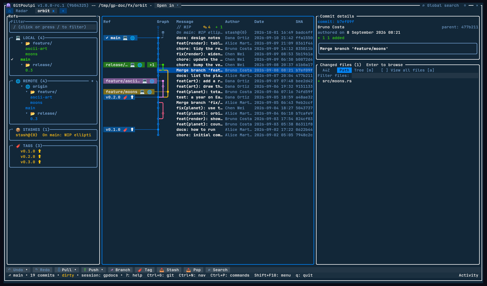
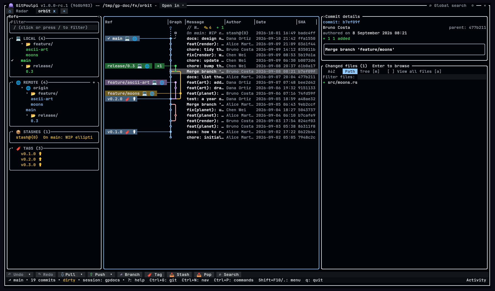
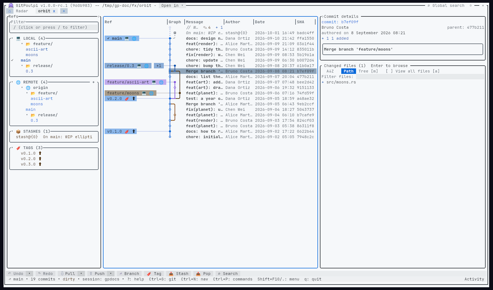
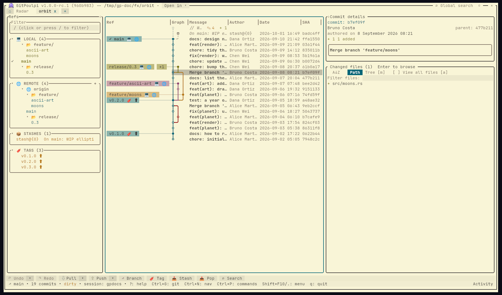
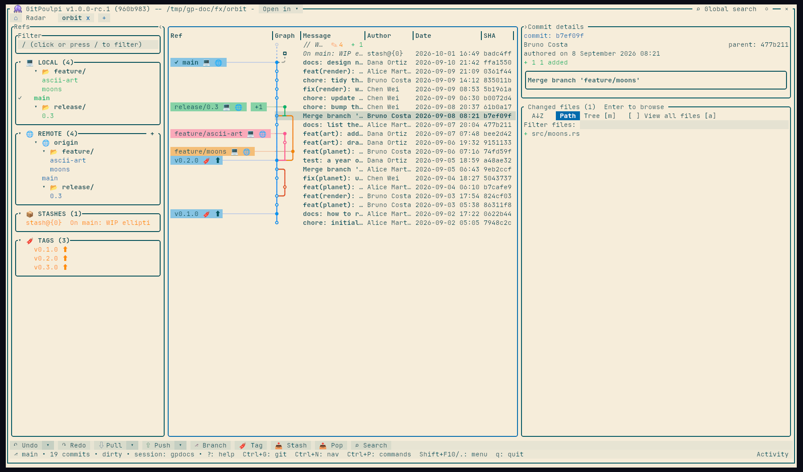
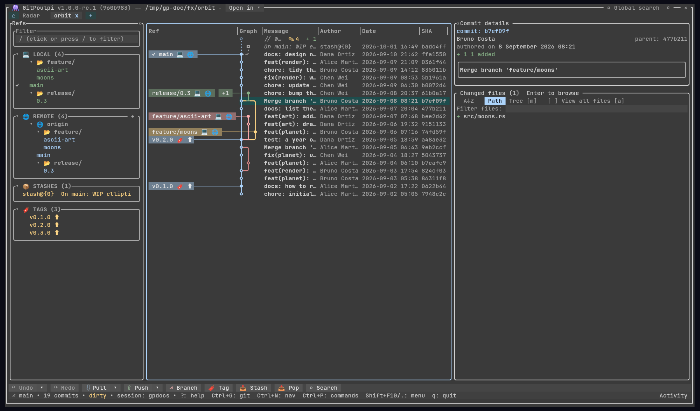
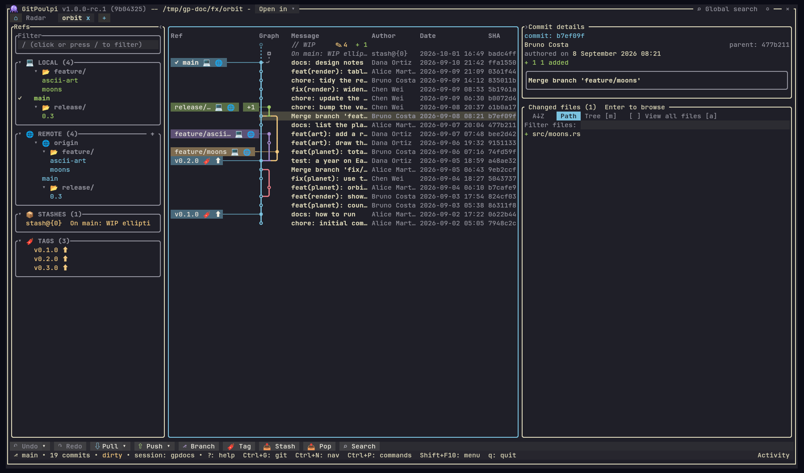
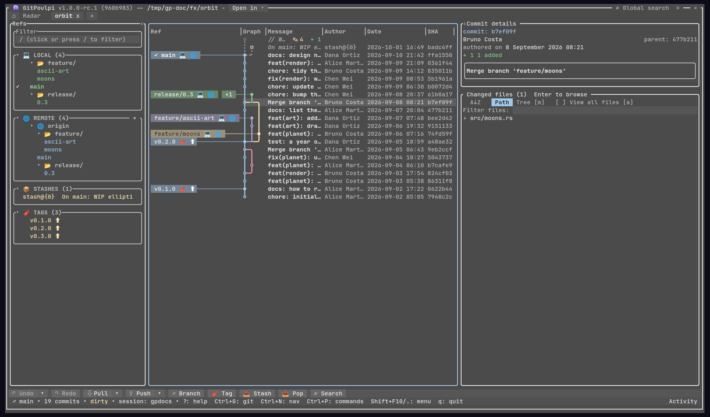
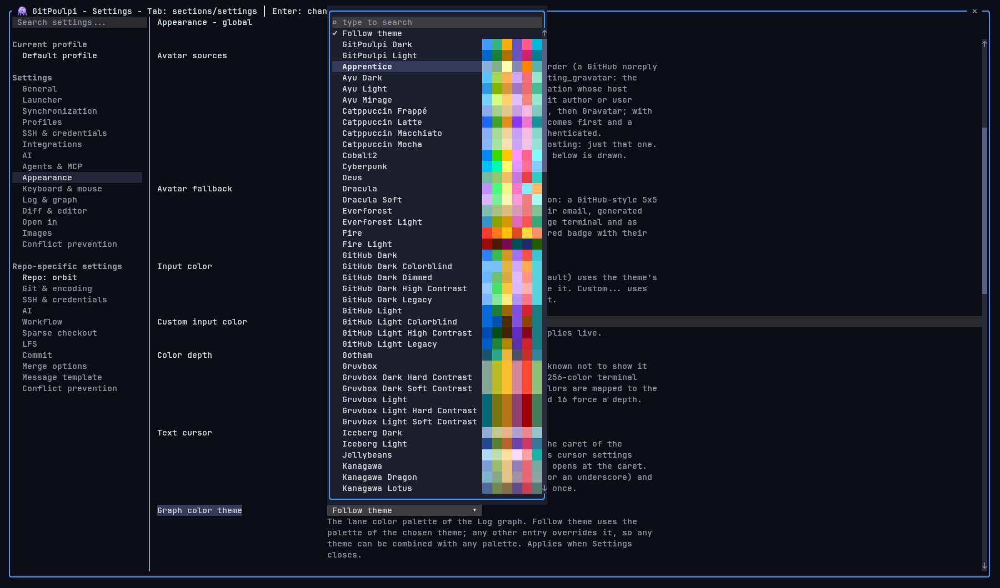

[English](../themes.md) · [Čeština](../cs/themes.md) · [Deutsch](../de/themes.md) · [Español](../es/themes.md) · [Français](../fr/themes.md) · [Italiano](../it/themes.md) · [日本語](../ja/themes.md) · [한국어](../ko/themes.md) · [Nederlands](../nl/themes.md) · [Polski](../pl/themes.md) · [Português (Brasil)](../pt-BR/themes.md) · [Português (Portugal)](../pt-PT/themes.md) · [Русский](../ru/themes.md) · **Svenska** · [Türkçe](../tr/themes.md) · [Українська](../uk/themes.md) · [简体中文](../zh-CN/themes.md)

# Teman

Ett tema bestämmer varje färg GitPoulpi målar: text, paneler, markering,
knappar, diff- och merge-vyerna, redigeraren, verktygsfältets ikoner och
Log-grafens spårfärger. Byt tema i **Inställningar > Utseende > Tema**, eller
med `gitpoulpi config set ui.theme <slug>`. För att se hur de ser ut, hoppa till
[galleriet](#galleri).

## Inbyggda förinställningar

`gitpoulpi theme list` skriver ut de som finns i ditt bygge, i den ordning
Inställningars kombolista visar dem: **GitPoulpi Dark** (`dark`, målad
över terminalens egen bakgrund) och **GitPoulpi Light** (`light`) först,
sedan alla andra förinställningar i alfabetisk ordning efter etikett.
`ui.theme = "system"` (standard) följer din terminal: Light på en ljus
terminalbakgrund, annars Dark (se ”Systemdetektering” nedan); det gamla
`default` är detsamma som `system`. Kombolistan för spårpaletten använder samma
ordning.

| Slug | Etikett | Källa till färgerna |
|---|---|---|
| `system` (standard) | System | ingen palett: GitPoulpi Light på en ljus terminalbakgrund, annars GitPoulpi Dark |
| `dark` | GitPoulpi Dark | originaltema från GitPoulpi, målat över terminalens egen bakgrund |
| `light` | GitPoulpi Light | originaltema från GitPoulpi |
| `catppuccin-latte` / `catppuccin-frappe` / `catppuccin-macchiato` / `catppuccin-mocha` | Catppuccin Latte / Frappé / Macchiato / Mocha | [github.com/catppuccin/palette](https://github.com/catppuccin/palette) |
| `cyberpunk` | Cyberpunk | [iTerm2-Color-Schemes](https://github.com/mbadolato/iTerm2-Color-Schemes) ”Cyberpunk” |
| `dracula` | Dracula | [draculatheme.com/contribute](https://draculatheme.com/contribute) |
| `everforest-dark` | Everforest Dark | [github.com/sainnhe/everforest/blob/master/palette.md](https://github.com/sainnhe/everforest/blob/master/palette.md) |
| `fire` / `fire-light` | Fire / Fire Light | egna GitPoulpi-teman: Fire är glöd på en bränd-orange bakgrund med lågorange; Fire Light är dess ljusa tvilling på en riktigt orange bakgrund |
| `github-dark` / `github-light` | GitHub Dark / GitHub Light | GitHubs Primer-teman, [github.com/primer/github-vscode-theme](https://github.com/primer/github-vscode-theme) med @primer/primitives (`canvas.default`, `canvas.inset` som sidofält, `fg.*`, `accent.fg`); inget värde justerat |
| `gruvbox-dark` / `gruvbox-light` | Gruvbox Dark / Light | [github.com/morhetz/gruvbox#palette](https://github.com/morhetz/gruvbox#palette) |
| `kanagawa` / `kanagawa-lotus` | Kanagawa (wave) / Kanagawa Lotus | [github.com/rebelot/kanagawa.nvim](https://github.com/rebelot/kanagawa.nvim) |
| `matrix` | Matrix | [iTerm2-Color-Schemes](https://github.com/mbadolato/iTerm2-Color-Schemes) ”Matrix” (inget rött i schemat: `danger` är `#ff5555`) |
| `monokai` | Monokai | den ursprungliga Monokai-paletten ([monokai.nl](https://monokai.nl/)) |
| `nord` | Nord | [www.nordtheme.com](https://www.nordtheme.com) |
| `one-dark` / `one-light` | One Dark / One Light | Atom One Dark / One Light ([One Dark](https://github.com/atom/one-dark-syntax), [One Light](https://github.com/atom/one-light-syntax)) |
| `rose-pine` / `rose-pine-moon` / `rose-pine-dawn` | Rosé Pine / Moon / Dawn | [rosepinetheme.com/palette](https://rosepinetheme.com/palette/) |
| `solarized-dark` / `solarized-light` | Solarized Dark / Light | Ethan Schoonovers Solarized ([ethanschoonover.com/solarized](https://ethanschoonover.com/solarized/)) |
| `sunset` | Sunset | originaltema från GitPoulpi: indigoblå skymning med korall och guld |
| `terminal` | Terminal (16 färger) | använder bara terminalens egna 16 färger |
| `tokyo-night` / `tokyo-night-day` | Tokyo Night (night) / Tokyo Night Day | [github.com/folke/tokyonight.nvim](https://github.com/folke/tokyonight.nvim) (förgrunden i Day är mörkare gjord för att klara kontrastreglerna) |
| `vesper` | Vesper | [github.com/raunofreiberg/vesper](https://github.com/raunofreiberg/vesper) (inget blått eller lila i paletten: accenten är persika) |
| `vscode-dark` / `vscode-light` | VS Code Dark / VS Code Light | VS Codes standard Dark Modern / Light Modern, [github.com/microsoft/vscode/tree/main/extensions/theme-defaults/themes](https://github.com/microsoft/vscode/tree/main/extensions/theme-defaults/themes) (`dark_modern.json`, `light_modern.json`, plus VS Codes färgstandarder för listmarkeringen och ANSI-/diagramaccenterna; Lights dämpade grå är `616161`) |

### Importerade från terminalcolors.com

Importerade från terminalpaletterna på terminalcolors.com; varje schema tillhör sina upphovspersoner. 90 förinställningar byggs från paletten bakgrund, förgrund, markering och 16 ANSI-färger (accent = blå, success = grön, warning = gul, danger = röd, AI = magenta, muted = ljusare svart), med en och samma härledning för alla; en färg som inte klarar GitPoulpis kontrastregler görs ljusare eller mörkare tills den gör det. Tabellen genereras av `scripts/gen-terminalcolors.py` till `crates/gitpoulpi-config/src/theme/terminalcolors_data.rs`. Slugs är `<familj>-<variant>` (`default` utelämnas); etiketterna är alfabetiska i kombolistan som de andra.

| Familj | Slugs |
|---|---|
| [Apprentice](https://terminalcolors.com/themes/apprentice/) | `apprentice` |
| [Ayu](https://terminalcolors.com/themes/ayu/) | `ayu-dark`, `ayu-light`, `ayu-mirage` |
| [Cobalt2](https://terminalcolors.com/themes/cobalt2/) | `cobalt2` |
| [Deus](https://terminalcolors.com/themes/deus/) | `deus` |
| [Dracula](https://terminalcolors.com/themes/dracula/) | `dracula-soft` |
| [Everforest](https://terminalcolors.com/themes/everforest/) | `everforest-light` |
| [GitHub](https://terminalcolors.com/themes/github/) | `github-dark-colorblind`, `github-dark-dimmed`, `github-dark-high-contrast`, `github-dark-legacy`, `github-light-colorblind`, `github-light-high-contrast`, `github-light-legacy` |
| [Gotham](https://terminalcolors.com/themes/gotham/) | `gotham` |
| [Gruvbox](https://terminalcolors.com/themes/gruvbox/) | `gruvbox-dark-hard-contrast`, `gruvbox-dark-soft-contrast`, `gruvbox-light-hard-contrast`, `gruvbox-light-soft-contrast` |
| [Iceberg](https://terminalcolors.com/themes/iceberg/) | `iceberg-dark`, `iceberg-light` |
| [Jellybeans](https://terminalcolors.com/themes/jellybeans/) | `jellybeans` |
| [Kanagawa](https://terminalcolors.com/themes/kanagawa/) | `kanagawa-dragon` |
| [Lucario](https://terminalcolors.com/themes/lucario/) | `lucario` |
| [Miasma](https://terminalcolors.com/themes/miasma/) | `miasma` |
| [Moonfly](https://terminalcolors.com/themes/moonfly/) | `moonfly` |
| [Night](https://terminalcolors.com/themes/night-owl/) | `night-owl-dark`, `night-owl-light` |
| [Nightfly](https://terminalcolors.com/themes/nightfly/) | `nightfly` |
| [Nightfox](https://terminalcolors.com/themes/nightfox/) | `nightfox`, `nightfox-carbonfox`, `nightfox-dawnfox`, `nightfox-dayfox`, `nightfox-duskfox`, `nightfox-nordfox`, `nightfox-terafox` |
| [Noctis](https://terminalcolors.com/themes/noctis/) | `noctis`, `noctis-azureus`, `noctis-bordo`, `noctis-hibernus`, `noctis-lilac`, `noctis-lux`, `noctis-minimus`, `noctis-obscuro`, `noctis-sereno`, `noctis-uva`, `noctis-viola` |
| [Nordic](https://terminalcolors.com/themes/nordic/) | `nordic` |
| [One](https://terminalcolors.com/themes/one-half/) | `one-half-dark`, `one-half-light` |
| [Panda](https://terminalcolors.com/themes/panda/) | `panda` |
| [Posterpole](https://terminalcolors.com/themes/posterpole/) | `posterpole`, `posterpole-gray` |
| [Seoul256](https://terminalcolors.com/themes/seoul256/) | `seoul256-dark`, `seoul256-light` |
| [Shades](https://terminalcolors.com/themes/shades-of-purple/) | `shades-of-purple`, `shades-of-purple-super-dark` |
| [Sonokai](https://terminalcolors.com/themes/sonokai/) | `sonokai`, `sonokai-andromeda`, `sonokai-atlantis`, `sonokai-espresso`, `sonokai-maia`, `sonokai-shusia` |
| [Srcery](https://terminalcolors.com/themes/srcery/) | `srcery` |
| [Tender](https://terminalcolors.com/themes/tender/) | `tender` |
| [Tokyo](https://terminalcolors.com/themes/tokyo-night/) | `tokyo-night-moon`, `tokyo-night-storm` |
| [Tomorrow](https://terminalcolors.com/themes/tomorrow/) | `tomorrow`, `tomorrow-night`, `tomorrow-night-blue`, `tomorrow-night-bright`, `tomorrow-night-eighties` |
| [Zenbones](https://terminalcolors.com/themes/zenbones/) | `zenbones-duckbones`, `zenbones-forestbones-dark`, `zenbones-forestbones-light`, `zenbones-kanagawabones`, `zenbones-neobones-dark`, `zenbones-neobones-light`, `zenbones-nordbones`, `zenbones-rosebones-dark`, `zenbones-rosebones-light`, `zenbones-seoulbones-dark`, `zenbones-seoulbones-light`, `zenbones-tokyobones-dark`, `zenbones-tokyobones-light`, `zenbones-vimbones`, `zenbones-zenburned`, `zenbones-zenwritten-dark`, `zenbones-zenwritten-light` |

`ui.side_bg` är bakgrunden för Refs-rutan och högerpanelen (commit-detaljer,
lokala ändringar, fillistor), som GitHub och VS Code målar sina
sidofält. Catppuccin (dess `mantle`), GitHub
och VS Code sätter den; för alla andra förinställningar är den `default`, vilket
betyder samma som `ui.bg`. En temafil kan sätta `side_bg` under `[ui]`
(`gitpoulpi theme export` skriver ut den).

Tre roller till under `[ui]` färgar ramen, som GitHub och VS Code gör:

| Roll | Var den målar |
|---|---|
| `ui.toolbar_bg` | Verktygsfältets rad och den **markerade repository-fliken**, så att fliken ser ut att sitta ihop med verktygsfältet. Verktygsfältets knappchips behåller sin egen `chrome.toolbar_bg`. |
| `ui.statusbar_bg` | Statusraden (längst ned om inte `ui.statusbar_position` säger överst). |
| `ui.statusbar_fg` | Statusradens text. Text som inte skulle synas mot den bakgrunden målas om med den; varnings- och feltext som syns behåller sin färg. |

Förinställningarna sätter dem så att de passar sin app: VS Code Dark och Light den blå (`#007acc`)
statusraden med vit text och VS Codes grå titelradstoner för verktygsfältet;
GitHub sina sidhuvudstoner. Alla andra förinställningar (även de importerade
terminalpaletterna) härleder ett verktygsfält ett steg från `bg` och en statusrad
en aning från den, med `text` på, och kontrastreglerna håller texten läsbar.
`dark` (GitPoulpi Dark) och `terminal` använder terminalens egen bakgrund, så
alla tre är `default` där: inget målas och den markerade fliken behåller
markeringsfärgen. En temafil som utelämnar dem ärver sin bas värden; `default`
betyder ingen tint (statusraden följer då `side_bg`).

Där ett schemas kommentars- eller dämpade grå är för svag för att läsas görs den
ljusare tills den klarar GitPoulpis kontrastregler; panel- och
markeringsnyanser som schemat saknar härleds från dess bakgrund.

### Galleri

Alla inbyggda teman, på samma repository med en merge commit markerad (`scripts/docs-screenshots.sh` tar om dem).

| **GitPoulpi Dark** (`dark`) | **GitPoulpi Light** (`light`) | **Apprentice** (`apprentice`) |
|---|---|---|
|  |  |  |
| **Ayu Dark** (`ayu-dark`) | **Ayu Light** (`ayu-light`) | **Ayu Mirage** (`ayu-mirage`) |
|  |  |  |
| **Catppuccin Frappé** (`catppuccin-frappe`) | **Catppuccin Latte** (`catppuccin-latte`) | **Catppuccin Macchiato** (`catppuccin-macchiato`) |
|  |  |  |
| **Catppuccin Mocha** (`catppuccin-mocha`) | **Cobalt2** (`cobalt2`) | **Cyberpunk** (`cyberpunk`) |
|  |  |  |
| **Deus** (`deus`) | **Dracula** (`dracula`) | **Dracula Soft** (`dracula-soft`) |
|  |  |  |
| **Everforest Dark** (`everforest-dark`) | **Everforest Light** (`everforest-light`) | **Fire** (`fire`) |
|  |  |  |
| **Fire Light** (`fire-light`) | **GitHub Dark** (`github-dark`) | **GitHub Dark Colorblind** (`github-dark-colorblind`) |
|  |  |  |
| **GitHub Dark Dimmed** (`github-dark-dimmed`) | **GitHub Dark High Contrast** (`github-dark-high-contrast`) | **GitHub Dark Legacy** (`github-dark-legacy`) |
|  |  |  |
| **GitHub Light** (`github-light`) | **GitHub Light Colorblind** (`github-light-colorblind`) | **GitHub Light High Contrast** (`github-light-high-contrast`) |
|  |  |  |
| **GitHub Light Legacy** (`github-light-legacy`) | **Gotham** (`gotham`) | **Gruvbox Dark** (`gruvbox-dark`) |
|  |  |  |
| **Gruvbox Dark Hard Contrast** (`gruvbox-dark-hard-contrast`) | **Gruvbox Dark Soft Contrast** (`gruvbox-dark-soft-contrast`) | **Gruvbox Light** (`gruvbox-light`) |
|  |  |  |
| **Gruvbox Light Hard Contrast** (`gruvbox-light-hard-contrast`) | **Gruvbox Light Soft Contrast** (`gruvbox-light-soft-contrast`) | **Iceberg Dark** (`iceberg-dark`) |
|  |  |  |
| **Iceberg Light** (`iceberg-light`) | **Jellybeans** (`jellybeans`) | **Kanagawa** (`kanagawa`) |
|  |  |  |
| **Kanagawa Dragon** (`kanagawa-dragon`) | **Kanagawa Lotus** (`kanagawa-lotus`) | **Lucario** (`lucario`) |
|  |  |  |
| **Matrix** (`matrix`) | **Miasma** (`miasma`) | **Monokai** (`monokai`) |
|  |  |  |
| **Moonfly** (`moonfly`) | **Night Owl Dark** (`night-owl-dark`) | **Night Owl Light** (`night-owl-light`) |
|  |  |  |
| **Nightfly** (`nightfly`) | **Nightfox** (`nightfox`) | **Nightfox Carbonfox** (`nightfox-carbonfox`) |
|  |  |  |
| **Nightfox Dawnfox** (`nightfox-dawnfox`) | **Nightfox Dayfox** (`nightfox-dayfox`) | **Nightfox Duskfox** (`nightfox-duskfox`) |
|  |  |  |
| **Nightfox Nordfox** (`nightfox-nordfox`) | **Nightfox Terafox** (`nightfox-terafox`) | **Noctis** (`noctis`) |
|  |  |  |
| **Noctis Azureus** (`noctis-azureus`) | **Noctis Bordo** (`noctis-bordo`) | **Noctis Hibernus** (`noctis-hibernus`) |
|  |  |  |
| **Noctis Lilac** (`noctis-lilac`) | **Noctis Lux** (`noctis-lux`) | **Noctis Minimus** (`noctis-minimus`) |
|  |  |  |
| **Noctis Obscuro** (`noctis-obscuro`) | **Noctis Sereno** (`noctis-sereno`) | **Noctis Uva** (`noctis-uva`) |
|  |  |  |
| **Noctis Viola** (`noctis-viola`) | **Nord** (`nord`) | **Nordic** (`nordic`) |
|  |  |  |
| **One Dark** (`one-dark`) | **One Half Dark** (`one-half-dark`) | **One Half Light** (`one-half-light`) |
|  |  |  |
| **One Light** (`one-light`) | **Panda** (`panda`) | **Posterpole** (`posterpole`) |
|  |  |  |
| **Posterpole Gray** (`posterpole-gray`) | **Rosé Pine** (`rose-pine`) | **Rosé Pine Dawn** (`rose-pine-dawn`) |
|  |  |  |
| **Rosé Pine Moon** (`rose-pine-moon`) | **Seoul256 Dark** (`seoul256-dark`) | **Seoul256 Light** (`seoul256-light`) |
|  |  |  |
| **Shades of Purple** (`shades-of-purple`) | **Shades of Purple Super Dark** (`shades-of-purple-super-dark`) | **Solarized Dark** (`solarized-dark`) |
|  |  |  |
| **Solarized Light** (`solarized-light`) | **Sonokai** (`sonokai`) | **Sonokai Andromeda** (`sonokai-andromeda`) |
|  |  |  |
| **Sonokai Atlantis** (`sonokai-atlantis`) | **Sonokai Espresso** (`sonokai-espresso`) | **Sonokai Maia** (`sonokai-maia`) |
|  |  |  |
| **Sonokai Shusia** (`sonokai-shusia`) | **Srcery** (`srcery`) | **Sunset** (`sunset`) |
|  |  |  |
| **Tender** (`tender`) | **Terminal (16 färger)** (`terminal`) | **Tokyo Night** (`tokyo-night`) |
|  |  |  |
| **Tokyo Night Day** (`tokyo-night-day`) | **Tokyo Night Moon** (`tokyo-night-moon`) | **Tokyo Night Storm** (`tokyo-night-storm`) |
|  |  |  |
| **Tomorrow** (`tomorrow`) | **Tomorrow Night** (`tomorrow-night`) | **Tomorrow Night Blue** (`tomorrow-night-blue`) |
|  |  |  |
| **Tomorrow Night Bright** (`tomorrow-night-bright`) | **Tomorrow Night Eighties** (`tomorrow-night-eighties`) | **Vesper** (`vesper`) |
|  |  |  |
| **VS Code Dark** (`vscode-dark`) | **VS Code Light** (`vscode-light`) | **Zenbones Duckbones** (`zenbones-duckbones`) |
|  |  |  |
| **Zenbones Forestbones Dark** (`zenbones-forestbones-dark`) | **Zenbones Forestbones Light** (`zenbones-forestbones-light`) | **Zenbones Kanagawabones** (`zenbones-kanagawabones`) |
|  |  |  |
| **Zenbones Neobones Dark** (`zenbones-neobones-dark`) | **Zenbones Neobones Light** (`zenbones-neobones-light`) | **Zenbones Nordbones** (`zenbones-nordbones`) |
|  |  |  |
| **Zenbones Rosebones Dark** (`zenbones-rosebones-dark`) | **Zenbones Rosebones Light** (`zenbones-rosebones-light`) | **Zenbones Seoulbones Dark** (`zenbones-seoulbones-dark`) |
|  |  |  |
| **Zenbones Seoulbones Light** (`zenbones-seoulbones-light`) | **Zenbones Tokyobones Dark** (`zenbones-tokyobones-dark`) | **Zenbones Tokyobones Light** (`zenbones-tokyobones-light`) |
|  |  |  |
| **Zenbones Vimbones** (`zenbones-vimbones`) | **Zenbones Zenburned** (`zenbones-zenburned`) | **Zenbones Zenwritten Dark** (`zenbones-zenwritten-dark`) |
|  |  |  |
| **Zenbones Zenwritten Light** (`zenbones-zenwritten-light`) |
|  |

## Vilket tema som helst med vilken spårpalett som helst

Varje tema har sina egna spårfärger för Log-grafen, men du kan kombinera vilket
tema som helst med vilken palett som helst: **Inställningar > Utseende >
Färgtema för grafen** erbjuder **Följ temat** (standard) plus varje spårpalett
från varje tema (GitPoulpi Dark, GitPoulpi Light, sedan Material,
Serie, ... och `graph_palette` i dina egna temafiler).



I `config.toml`:

```toml
[ui]
theme = "nord"
graph_color_theme = "material"   # eller "theme" för att följa temat
```

`ui.input_color` är samma sorts åsidosättning för textfält: standardvärdet
`theme` följer temats inmatningsfärger; `gray`, `blue`, `slate`, `dark` och
`custom` tvingar en bakgrund (det är mörka färger, så välj `theme` på ett ljust
tema).

## Egna teman

Lägg en `.toml`-fil i mappen `themes/` i konfigurationskatalogen
(`gitpoulpi config path` skriver ut dess överordnade katalog; mappen är
`${config}/themes/`). Filnamnet utan `.toml` är temats slug, vilket är vad
`ui.theme` tar. En fil får inte återanvända en förinställnings slug (den hoppas
över med en varning).

Börja från en komplett fil:

```
gitpoulpi theme export nord > "$(dirname "$(gitpoulpi config path)")/themes/mine.toml"
```

Behåll sedan bara det du ändrar. En fil är en uppsättning **partiella
åsidosättningar** av en `base` (en förinställning, eller ett annat användartema;
kedjor är högst 4 led djupa och cykler avvisas; ingen `base` betyder `dark`):

```toml
name = "My Nord"            # etiketten i kombolistan; standard = filnamnet
base = "nord"
light = false               # ärvs när den saknas
syntax = "base16-ocean.dark"
graph_palette = ["#88c0d0", "#a3be8c"]

[ui]
bg = "#2e3440"              # "default" | "#rrggbb" | "ansi:N"
accent = "#88c0d0"
toolbar_bg = "#3b4252"      # verktygsfältet och den markerade fliken
statusbar_bg = "#5e81ac"    # statusraden
statusbar_fg = "#eceff4"

[diff]
add_bg = "#2f3b2f"
```

Färger är `"#rrggbb"`, `"ansi:N"` (terminalens palettpost N) eller
`"default"` (terminalens egen färg). Grupper och nycklar är de som
`gitpoulpi theme export <slug>` ger. Inget är ödesdigert: en okänd nyckel eller
en felaktig färg ignoreras, en okänd `base` faller tillbaka på `dark`, och
`gitpoulpi theme list` rapporterar varje problem under `warnings` (appen visar
dem en gång på statusraden).

Filerna läses om när Tema-kombolistan öppnas och när Inställningar stängs; det
finns ingen filbevakare. Ett körande fönster tillämpar ett tema som satts från
CLI nästa gång dess Inställningar stängs, som varje annan live-nyckel.

## Systemdetektering

Med `ui.theme = "system"` frågar GitPoulpi terminalen efter dess bakgrundsfärg
**en gång, vid start** (OSC 11-frågan, besvarad av kitty, WezTerm, Alacritty,
foot, iTerm2, Windows Terminal, tmux och de flesta andra) och väljer Light för
en ljus bakgrund, annars Dark. Väntan är högst cirka 100 ms, och en terminal som
inte känner till frågan kostar ingenting: svaret läses alltid innan gränssnittet
startar, så ingenting skrivs ut och inga tangenttryckningar sväljs. Utan svar
(och alltid på Windows, som inte skickar frågan) läser den `COLORFGBG` och
faller sedan tillbaka på Dark. En terminal vars bakgrund ändras medan GitPoulpi
körs följs inte; starta om den, eller välj Light eller Dark uttryckligen.

## Färgdjup

Teman är truecolor (`#rrggbb`). `ui.color_depth` (Inställningar > Utseende >
Färgdjup, gäller direkt) avgör hur det når terminalen:

| Värde | Effekt |
|---|---|
| `auto` (standard) | Truecolor, utom där det är känt att det inte fungerar: Apple Terminal (`TERM_PROGRAM=Apple_Terminal`) använder 256 färger, Linux-konsolen (`TERM=linux`) 16, och en `*-256color`-terminal som inte sätter någon `COLORTERM` (och inte är WezTerm, kitty eller Windows Terminal) 256. `COLORTERM=truecolor` betyder alltid truecolor. |
| `truecolor` | Alltid 24-bitarsfärg. |
| `256` | Varje RGB-färg blir den närmaste xterm-256-posten. |
| `16` | Den närmaste av de 16 ANSI-färgerna; terminalens egen palett avgör den exakta nyansen. |

Använd `256` eller `16` om ett tema visas med fel färger över ssh eller i en
gammal multiplexer. Förinställningen Terminal behöver inget av detta. Truecolor
kostar ingenting; mappningspasset körs över skärmen en gång per bildruta, och
bara när det är aktivt.

## Live-förhandsvisning

Under Inställningar > Utseende listar kombolistan Tema **System (följer
terminalen)**, förinställningarna och sedan dina egna temafiler. När du flyttar
markeringen tillämpas det temat direkt, så hela inställningsskärmen målas om
under dig; **Enter** behåller det (det sparas), **Esc** eller ett klick utanför
återställer det förra och sparar ingenting. Palettkommandot **App: Tema...**
(`Ctrl+P`) öppnar Inställningar på den raden.

### Byt tema från paletten

**App: Byt tema...** (`Ctrl+P`, eller `Ctrl+N t`; tangenten kan bindas om som
`nav_prefix.change_theme`) öppnar en lista med samma teman utan att gå via
Inställningar: **System (följer terminalen)**, förinställningarna och sedan dina
egna temafiler, var och en med fyra små färgchips. Det aktuella temat är
kryssat. Skriv för att snäva in listan; när du flyttar markeringen förhandsvisas
temat direkt, **Enter** tillämpar det och sparar `ui.theme` i `config.toml`,
**Esc** (eller ett klick utanför listan) sätter tillbaka det förra temat och
sparar ingenting.

Under filterfältet snävar ett segmenterat förfilter in listan: **Alla**,
**Mörka**, **Ljusa** och **Färgade** (klicka på ett segment, `Tab` /
`Shift+Tab`, eller `Alt+1`..`Alt+4`). Mörka och Ljusa kommer från ljusstyrkan i
temats `ui.bg`; **Färgade** behåller teman vars bakgrund är tydligt tintad
(blå, violett, gul, grön...) och utelämnar vitt, benvitt, svart och nästan
svarta gråtoner, så Solarized Dark, Dracula eller Nord är färgade medan GitHub
Dark och One Light inte är det. Ett färgat tema visas också under Mörka eller
Ljusa. **System** och transparenta teman (utan egen bakgrund) visas bara under
Alla. Förfiltret kombineras med det du skriver. Väljarna för färgtema för grafen
och språk förhandsvisar på samma sätt: Logs spår och hela gränssnittet ändras
när markeringen flyttas.


Under kombolistan visar en rad med färgchips temat som gäller (bakgrund, text,
dämpad, accent, markering, danger, diff tillagt, diff borttaget, sedan de sex
första spårfärgerna) och följer förhandsvisningen. Kombolistan **Färgtema för
grafen** under **Utseende** visar några spårfärger bredvid varje palett, och val
gäller när Inställningar stängs.

Ett tema med egen bakgrund (Light och de andra målade förinställningarna) fyller
hela fönstret, inklusive Inställningar och helsidesvyerna, och ger text som inte
har någon egen färg temats textfärg; Dark och Terminal lämnar terminalens färger
ifred.

## Från kommandoraden

| Kommando | Utdata |
|---|---|
| `gitpoulpi theme list` | JSON `{themes: [{slug, label, source, light, lane_palette}], warnings}`; `source` är `preset` eller `user`. |
| `gitpoulpi theme export <slug>` | Den kompletta temafilen som TOML på stdout (JSON: `{slug, toml}`); den tolkas tillbaka till samma tema. |
| `gitpoulpi config set ui.theme <slug>` | Valideras mot förinställningarna och din `themes/`-mapp; ett okänt namn är ett fel som listar de giltiga. `system` och `default` accepteras. |
| `gitpoulpi config set ui.graph_color_theme <name>` | `theme` (följ temat) eller vilket spårpalettnamn som helst; ett okänt namn listar de giltiga. |

MCP-servern erbjuder `theme_list` och `theme_export` som skrivskyddade verktyg.
