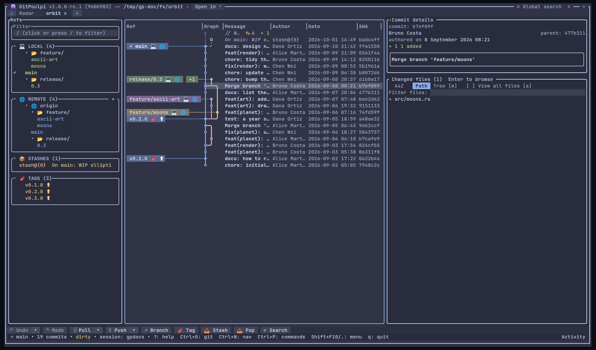
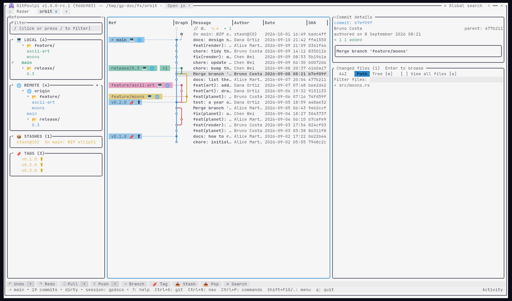
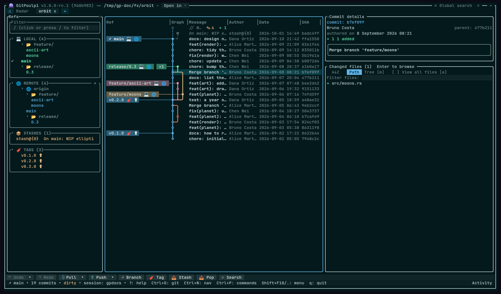
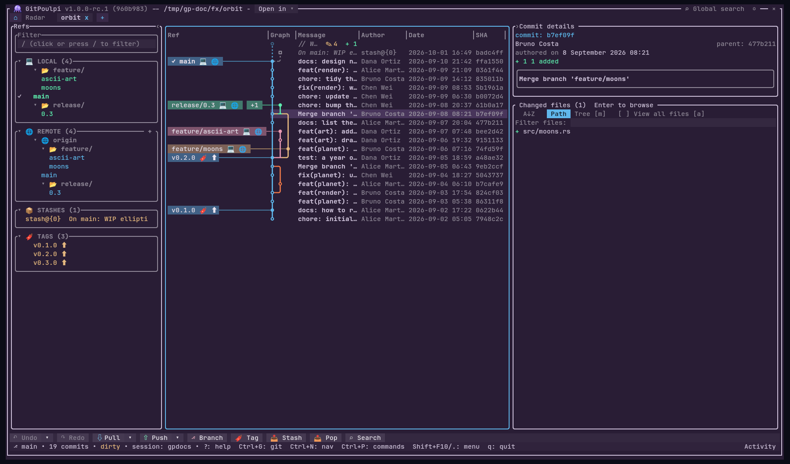
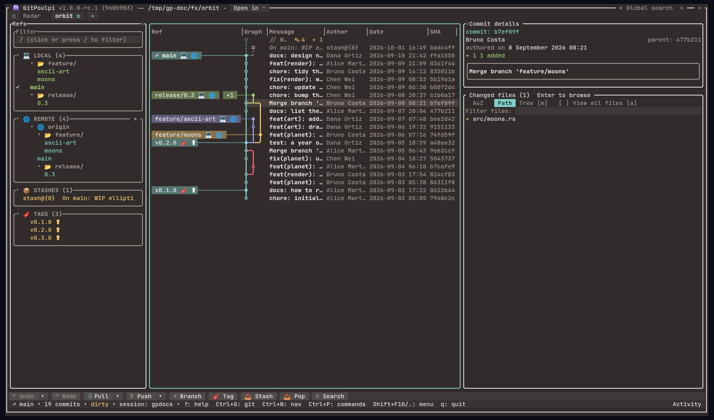
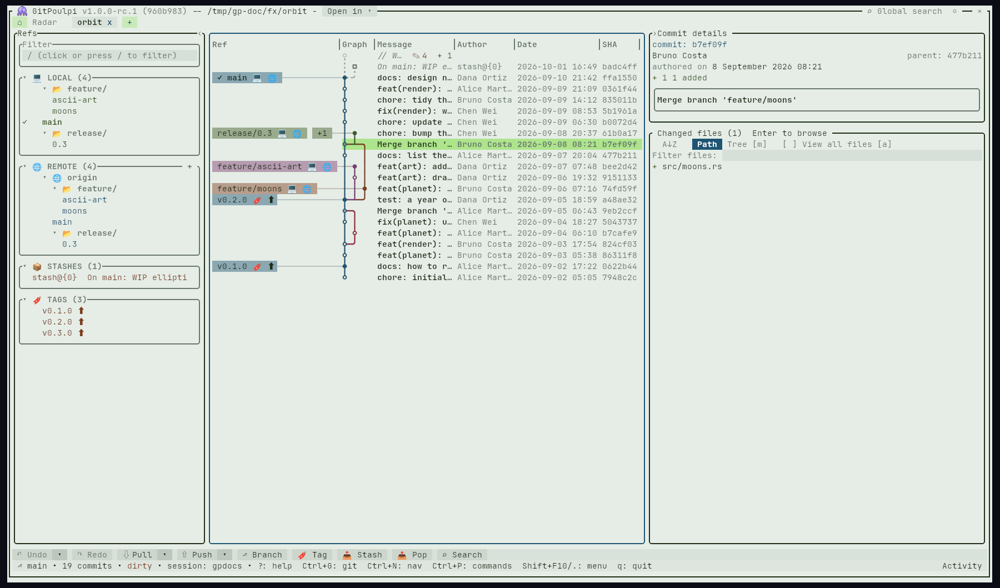

**English** · [Čeština](cs/themes.md) · [Deutsch](de/themes.md) · [Español](es/themes.md) · [Français](fr/themes.md) · [Italiano](it/themes.md) · [日本語](ja/themes.md) · [한국어](ko/themes.md) · [Nederlands](nl/themes.md) · [Polski](pl/themes.md) · [Português (Brasil)](pt-BR/themes.md) · [Português (Portugal)](pt-PT/themes.md) · [Русский](ru/themes.md) · [Svenska](sv/themes.md) · [Türkçe](tr/themes.md) · [Українська](uk/themes.md) · [简体中文](zh-CN/themes.md)

# Themes

A theme sets every color GitPoulpi paints: text, panels, selection, buttons,
the diff and merge views, the editor, the toolbar icons and the Log graph's
lane colors. Switch themes in **Settings > Appearance > Theme**, or with
`gitpoulpi config set ui.theme <slug>`. To see what each one looks like, jump to the
[gallery](#gallery).

## Built-in presets

`gitpoulpi theme list` prints the ones in your build, in the order the
Settings combo shows them: **GitPoulpi Dark** (`dark`, painted
over your terminal's own background) and **GitPoulpi Light** (`light`) first,
then every other preset alphabetically by label. `ui.theme = "system"` (the
default) follows your terminal: Light on a light terminal background, Dark
otherwise (see "System detection" below); legacy `default` is the same as
`system`. The lane palette combo uses the same order.

| Slug | Label | Source of the colors |
|---|---|---|
| `system` (default) | System | not a palette: GitPoulpi Light on a light terminal background, GitPoulpi Dark otherwise |
| `dark` | GitPoulpi Dark | original GitPoulpi theme, painted over your terminal's own background |
| `light` | GitPoulpi Light | original GitPoulpi theme |
| `catppuccin-latte` / `catppuccin-frappe` / `catppuccin-macchiato` / `catppuccin-mocha` | Catppuccin Latte / Frappé / Macchiato / Mocha | [github.com/catppuccin/palette](https://github.com/catppuccin/palette) |
| `cyberpunk` | Cyberpunk | [iTerm2-Color-Schemes](https://github.com/mbadolato/iTerm2-Color-Schemes) "Cyberpunk" |
| `dracula` | Dracula | [draculatheme.com/contribute](https://draculatheme.com/contribute) |
| `everforest-dark` | Everforest Dark | [github.com/sainnhe/everforest/blob/master/palette.md](https://github.com/sainnhe/everforest/blob/master/palette.md) |
| `fire` / `fire-light` | Fire / Fire Light | original GitPoulpi themes: Fire is embers on a burnt-orange background with flame orange; Fire Light its light twin on a real orange background |
| `github-dark` / `github-light` | GitHub Dark / GitHub Light | GitHub's Primer themes, [github.com/primer/github-vscode-theme](https://github.com/primer/github-vscode-theme) with @primer/primitives (`canvas.default`, `canvas.inset` as the sidebar, `fg.*`, `accent.fg`); no value adjusted |
| `gruvbox-dark` / `gruvbox-light` | Gruvbox Dark / Light | [github.com/morhetz/gruvbox#palette](https://github.com/morhetz/gruvbox#palette) |
| `kanagawa` / `kanagawa-lotus` | Kanagawa (wave) / Kanagawa Lotus | [github.com/rebelot/kanagawa.nvim](https://github.com/rebelot/kanagawa.nvim) |
| `matrix` | Matrix | [iTerm2-Color-Schemes](https://github.com/mbadolato/iTerm2-Color-Schemes) "Matrix" (no red in the scheme: `danger` is `#ff5555`) |
| `monokai` | Monokai | the original Monokai palette ([monokai.nl](https://monokai.nl/)) |
| `nord` | Nord | [www.nordtheme.com](https://www.nordtheme.com) |
| `one-dark` / `one-light` | One Dark / One Light | Atom [One Dark](https://github.com/atom/one-dark-syntax) / [One Light](https://github.com/atom/one-light-syntax) |
| `rose-pine` / `rose-pine-moon` / `rose-pine-dawn` | Rosé Pine / Moon / Dawn | [rosepinetheme.com/palette](https://rosepinetheme.com/palette/) |
| `solarized-dark` / `solarized-light` | Solarized Dark / Light | Ethan Schoonover's [Solarized](https://ethanschoonover.com/solarized/) |
| `sunset` | Sunset | original GitPoulpi theme: indigo dusk with coral and gold |
| `terminal` | Terminal (16 colors) | uses only your terminal's own 16 colors |
| `tokyo-night` / `tokyo-night-day` | Tokyo Night (night) / Tokyo Night Day | [github.com/folke/tokyonight.nvim](https://github.com/folke/tokyonight.nvim) (the Day foreground is darkened to pass the contrast rules) |
| `vesper` | Vesper | [github.com/raunofreiberg/vesper](https://github.com/raunofreiberg/vesper) (no blue or purple in the palette: the accent is peach) |
| `vscode-dark` / `vscode-light` | VS Code Dark / VS Code Light | VS Code's default Dark Modern / Light Modern, [github.com/microsoft/vscode/tree/main/extensions/theme-defaults/themes](https://github.com/microsoft/vscode/tree/main/extensions/theme-defaults/themes) (`dark_modern.json`, `light_modern.json`, plus VS Code's color defaults for the list selection and the ANSI/chart accents; the Light muted gray is `616161`) |

### Imported from terminalcolors.com

Imported from the terminal palettes of [terminalcolors.com](https://terminalcolors.com/) (each family below links to its page there); each scheme belongs to its authors. 90 presets are built from the palette's background, foreground, selection and 16 ANSI colors (accent = blue, success = green, warning = yellow, danger = red, AI = magenta, muted = bright black), by one derivation shared by all of them; a color that fails GitPoulpi's contrast rules is lightened or darkened until it passes. The table is generated by `scripts/gen-terminalcolors.py` into `crates/gitpoulpi-config/src/theme/terminalcolors_data.rs`. Slugs are `<family>-<variant>` (`default` dropped); labels are alphabetical in the combo like the others.

| Family | Slugs |
|---|---|
| [Apprentice](https://terminalcolors.com/themes/apprentice/) | `apprentice` |
| [Ayu](https://terminalcolors.com/themes/ayu/) | `ayu-dark`, `ayu-light`, `ayu-mirage` |
| [Cobalt2](https://terminalcolors.com/themes/cobalt2/) | `cobalt2` |
| [Deus](https://terminalcolors.com/themes/deus/) | `deus` |
| [Dracula](https://terminalcolors.com/themes/dracula/) | `dracula-soft` |
| [Everforest](https://terminalcolors.com/themes/everforest/) | `everforest-light` |
| [GitHub](https://terminalcolors.com/themes/github/) | `github-dark-colorblind`, `github-dark-dimmed`, `github-dark-high-contrast`, `github-dark-legacy`, `github-light-colorblind`, `github-light-high-contrast`, `github-light-legacy` |
| [Gotham](https://terminalcolors.com/themes/gotham/) | `gotham` |
| [Gruvbox](https://terminalcolors.com/themes/gruvbox/) | `gruvbox-dark-hard-contrast`, `gruvbox-dark-soft-contrast`, `gruvbox-light-hard-contrast`, `gruvbox-light-soft-contrast` |
| [Iceberg](https://terminalcolors.com/themes/iceberg/) | `iceberg-dark`, `iceberg-light` |
| [Jellybeans](https://terminalcolors.com/themes/jellybeans/) | `jellybeans` |
| [Kanagawa](https://terminalcolors.com/themes/kanagawa/) | `kanagawa-dragon` |
| [Lucario](https://terminalcolors.com/themes/lucario/) | `lucario` |
| [Miasma](https://terminalcolors.com/themes/miasma/) | `miasma` |
| [Moonfly](https://terminalcolors.com/themes/moonfly/) | `moonfly` |
| [Night](https://terminalcolors.com/themes/night-owl/) | `night-owl-dark`, `night-owl-light` |
| [Nightfly](https://terminalcolors.com/themes/nightfly/) | `nightfly` |
| [Nightfox](https://terminalcolors.com/themes/nightfox/) | `nightfox`, `nightfox-carbonfox`, `nightfox-dawnfox`, `nightfox-dayfox`, `nightfox-duskfox`, `nightfox-nordfox`, `nightfox-terafox` |
| [Noctis](https://terminalcolors.com/themes/noctis/) | `noctis`, `noctis-azureus`, `noctis-bordo`, `noctis-hibernus`, `noctis-lilac`, `noctis-lux`, `noctis-minimus`, `noctis-obscuro`, `noctis-sereno`, `noctis-uva`, `noctis-viola` |
| [Nordic](https://terminalcolors.com/themes/nordic/) | `nordic` |
| [One](https://terminalcolors.com/themes/one-half/) | `one-half-dark`, `one-half-light` |
| [Panda](https://terminalcolors.com/themes/panda/) | `panda` |
| [Posterpole](https://terminalcolors.com/themes/posterpole/) | `posterpole`, `posterpole-gray` |
| [Seoul256](https://terminalcolors.com/themes/seoul256/) | `seoul256-dark`, `seoul256-light` |
| [Shades](https://terminalcolors.com/themes/shades-of-purple/) | `shades-of-purple`, `shades-of-purple-super-dark` |
| [Sonokai](https://terminalcolors.com/themes/sonokai/) | `sonokai`, `sonokai-andromeda`, `sonokai-atlantis`, `sonokai-espresso`, `sonokai-maia`, `sonokai-shusia` |
| [Srcery](https://terminalcolors.com/themes/srcery/) | `srcery` |
| [Tender](https://terminalcolors.com/themes/tender/) | `tender` |
| [Tokyo](https://terminalcolors.com/themes/tokyo-night/) | `tokyo-night-moon`, `tokyo-night-storm` |
| [Tomorrow](https://terminalcolors.com/themes/tomorrow/) | `tomorrow`, `tomorrow-night`, `tomorrow-night-blue`, `tomorrow-night-bright`, `tomorrow-night-eighties` |
| [Zenbones](https://terminalcolors.com/themes/zenbones/) | `zenbones-duckbones`, `zenbones-forestbones-dark`, `zenbones-forestbones-light`, `zenbones-kanagawabones`, `zenbones-neobones-dark`, `zenbones-neobones-light`, `zenbones-nordbones`, `zenbones-rosebones-dark`, `zenbones-rosebones-light`, `zenbones-seoulbones-dark`, `zenbones-seoulbones-light`, `zenbones-tokyobones-dark`, `zenbones-tokyobones-light`, `zenbones-vimbones`, `zenbones-zenburned`, `zenbones-zenwritten-dark`, `zenbones-zenwritten-light` |

`ui.side_bg` is the background of the Refs pane and the right panel (commit
detail, working changes, file lists), as GitHub and VS Code paint
their sidebars. Catppuccin (its `mantle`), GitHub
and VS Code set it; for every other preset it is `default`, meaning the same
as `ui.bg`. A theme file can set `side_bg` under `[ui]` (`gitpoulpi theme export`
prints it).

Three more roles under `[ui]` color the chrome, as GitHub and VS Code do:

| Role | Where it paints |
|---|---|
| `ui.toolbar_bg` | The toolbar row, and the **selected repository tab**, so the tab reads as attached to the toolbar. The toolbar's button chips keep their own `chrome.toolbar_bg`. |
| `ui.statusbar_bg` | The status line (at the bottom unless `ui.statusbar_position` says top). |
| `ui.statusbar_fg` | The text of the status line. Text that would not read on that fill is repainted with it; warning and error text that does read keeps its color. |

Presets set them to match their app: VS Code Dark and Light the blue (`#007acc`) status line
with white text and VS Code's title-bar grays for the toolbar; GitHub its header
tones. Every other preset (including the imported terminal palettes) derives a
toolbar one step off `bg` and a status line a little off it, with `text` on it,
and the contrast rules keep the text readable. `dark` (GitPoulpi Dark) and `terminal`
use the terminal's own background, so all three are `default` there: nothing is
painted and the selected tab keeps the selection color. A theme file that
omits them inherits its base's values; `default` means no tint (the status line
then follows `side_bg`).

Where a scheme's comment or muted gray is too dim to read, it is lightened
until it passes GitPoulpi's contrast rules; panel and selection shades the
scheme lacks are derived from its background.

### Gallery

Every built-in theme, on the same repository with a merge commit selected (`scripts/docs-screenshots.sh` retakes them).

| **GitPoulpi Dark** (`dark`) | **GitPoulpi Light** (`light`) | **Apprentice** (`apprentice`) |
|---|---|---|
|  |  |  |
| **Ayu Dark** (`ayu-dark`) | **Ayu Light** (`ayu-light`) | **Ayu Mirage** (`ayu-mirage`) |
|  |  |  |
| **Catppuccin Frappé** (`catppuccin-frappe`) | **Catppuccin Latte** (`catppuccin-latte`) | **Catppuccin Macchiato** (`catppuccin-macchiato`) |
|  |  |  |
| **Catppuccin Mocha** (`catppuccin-mocha`) | **Cobalt2** (`cobalt2`) | **Cyberpunk** (`cyberpunk`) |
|  |  |  |
| **Deus** (`deus`) | **Dracula** (`dracula`) | **Dracula Soft** (`dracula-soft`) |
|  |  |  |
| **Everforest Dark** (`everforest-dark`) | **Everforest Light** (`everforest-light`) | **Fire** (`fire`) |
|  |  |  |
| **Fire Light** (`fire-light`) | **GitHub Dark** (`github-dark`) | **GitHub Dark Colorblind** (`github-dark-colorblind`) |
|  |  |  |
| **GitHub Dark Dimmed** (`github-dark-dimmed`) | **GitHub Dark High Contrast** (`github-dark-high-contrast`) | **GitHub Dark Legacy** (`github-dark-legacy`) |
|  |  |  |
| **GitHub Light** (`github-light`) | **GitHub Light Colorblind** (`github-light-colorblind`) | **GitHub Light High Contrast** (`github-light-high-contrast`) |
|  |  |  |
| **GitHub Light Legacy** (`github-light-legacy`) | **Gotham** (`gotham`) | **Gruvbox Dark** (`gruvbox-dark`) |
|  |  |  |
| **Gruvbox Dark Hard Contrast** (`gruvbox-dark-hard-contrast`) | **Gruvbox Dark Soft Contrast** (`gruvbox-dark-soft-contrast`) | **Gruvbox Light** (`gruvbox-light`) |
|  |  |  |
| **Gruvbox Light Hard Contrast** (`gruvbox-light-hard-contrast`) | **Gruvbox Light Soft Contrast** (`gruvbox-light-soft-contrast`) | **Iceberg Dark** (`iceberg-dark`) |
|  |  |  |
| **Iceberg Light** (`iceberg-light`) | **Jellybeans** (`jellybeans`) | **Kanagawa** (`kanagawa`) |
|  |  |  |
| **Kanagawa Dragon** (`kanagawa-dragon`) | **Kanagawa Lotus** (`kanagawa-lotus`) | **Lucario** (`lucario`) |
|  |  |  |
| **Matrix** (`matrix`) | **Miasma** (`miasma`) | **Monokai** (`monokai`) |
|  |  |  |
| **Moonfly** (`moonfly`) | **Night Owl Dark** (`night-owl-dark`) | **Night Owl Light** (`night-owl-light`) |
|  |  |  |
| **Nightfly** (`nightfly`) | **Nightfox** (`nightfox`) | **Nightfox Carbonfox** (`nightfox-carbonfox`) |
|  |  |  |
| **Nightfox Dawnfox** (`nightfox-dawnfox`) | **Nightfox Dayfox** (`nightfox-dayfox`) | **Nightfox Duskfox** (`nightfox-duskfox`) |
|  |  |  |
| **Nightfox Nordfox** (`nightfox-nordfox`) | **Nightfox Terafox** (`nightfox-terafox`) | **Noctis** (`noctis`) |
|  |  |  |
| **Noctis Azureus** (`noctis-azureus`) | **Noctis Bordo** (`noctis-bordo`) | **Noctis Hibernus** (`noctis-hibernus`) |
|  |  |  |
| **Noctis Lilac** (`noctis-lilac`) | **Noctis Lux** (`noctis-lux`) | **Noctis Minimus** (`noctis-minimus`) |
|  |  |  |
| **Noctis Obscuro** (`noctis-obscuro`) | **Noctis Sereno** (`noctis-sereno`) | **Noctis Uva** (`noctis-uva`) |
|  |  |  |
| **Noctis Viola** (`noctis-viola`) | **Nord** (`nord`) | **Nordic** (`nordic`) |
|  |  |  |
| **One Dark** (`one-dark`) | **One Half Dark** (`one-half-dark`) | **One Half Light** (`one-half-light`) |
|  |  |  |
| **One Light** (`one-light`) | **Panda** (`panda`) | **Posterpole** (`posterpole`) |
|  |  |  |
| **Posterpole Gray** (`posterpole-gray`) | **Rosé Pine** (`rose-pine`) | **Rosé Pine Dawn** (`rose-pine-dawn`) |
|  |  |  |
| **Rosé Pine Moon** (`rose-pine-moon`) | **Seoul256 Dark** (`seoul256-dark`) | **Seoul256 Light** (`seoul256-light`) |
|  |  |  |
| **Shades of Purple** (`shades-of-purple`) | **Shades of Purple Super Dark** (`shades-of-purple-super-dark`) | **Solarized Dark** (`solarized-dark`) |
|  |  |  |
| **Solarized Light** (`solarized-light`) | **Sonokai** (`sonokai`) | **Sonokai Andromeda** (`sonokai-andromeda`) |
|  |  |  |
| **Sonokai Atlantis** (`sonokai-atlantis`) | **Sonokai Espresso** (`sonokai-espresso`) | **Sonokai Maia** (`sonokai-maia`) |
|  |  |  |
| **Sonokai Shusia** (`sonokai-shusia`) | **Srcery** (`srcery`) | **Sunset** (`sunset`) |
|  |  |  |
| **Tender** (`tender`) | **Terminal (16 colors)** (`terminal`) | **Tokyo Night** (`tokyo-night`) |
|  |  |  |
| **Tokyo Night Day** (`tokyo-night-day`) | **Tokyo Night Moon** (`tokyo-night-moon`) | **Tokyo Night Storm** (`tokyo-night-storm`) |
|  |  |  |
| **Tomorrow** (`tomorrow`) | **Tomorrow Night** (`tomorrow-night`) | **Tomorrow Night Blue** (`tomorrow-night-blue`) |
|  |  |  |
| **Tomorrow Night Bright** (`tomorrow-night-bright`) | **Tomorrow Night Eighties** (`tomorrow-night-eighties`) | **Vesper** (`vesper`) |
|  |  |  |
| **VS Code Dark** (`vscode-dark`) | **VS Code Light** (`vscode-light`) | **Zenbones Duckbones** (`zenbones-duckbones`) |
|  |  |  |
| **Zenbones Forestbones Dark** (`zenbones-forestbones-dark`) | **Zenbones Forestbones Light** (`zenbones-forestbones-light`) | **Zenbones Kanagawabones** (`zenbones-kanagawabones`) |
|  |  |  |
| **Zenbones Neobones Dark** (`zenbones-neobones-dark`) | **Zenbones Neobones Light** (`zenbones-neobones-light`) | **Zenbones Nordbones** (`zenbones-nordbones`) |
|  |  |  |
| **Zenbones Rosebones Dark** (`zenbones-rosebones-dark`) | **Zenbones Rosebones Light** (`zenbones-rosebones-light`) | **Zenbones Seoulbones Dark** (`zenbones-seoulbones-dark`) |
|  |  |  |
| **Zenbones Seoulbones Light** (`zenbones-seoulbones-light`) | **Zenbones Tokyobones Dark** (`zenbones-tokyobones-dark`) | **Zenbones Tokyobones Light** (`zenbones-tokyobones-light`) |
|  |  |  |
| **Zenbones Vimbones** (`zenbones-vimbones`) | **Zenbones Zenburned** (`zenbones-zenburned`) | **Zenbones Zenwritten Dark** (`zenbones-zenwritten-dark`) |
|  |  |  |
| **Zenbones Zenwritten Light** (`zenbones-zenwritten-light`) |
|  |

## Any theme with any lane palette

Every theme brings its own lane colors for the Log graph, but you can
combine any theme with any palette: **Settings > Appearance > Graph color
theme** offers **Follow theme** (the default) plus every lane palette of every
theme (GitPoulpi Dark, GitPoulpi Light, then Material, Serie, ... and the
`graph_palette` of your own theme files). 

In `config.toml`:

```toml
[ui]
theme = "nord"
graph_color_theme = "material"   # or "theme" to follow the theme
```

`ui.input_color` is the same kind of override for text inputs: the default
`theme` follows the theme's input colors; `gray`, `blue`, `slate`, `dark` and
`custom` force a background (they are dark colors, so pick `theme` on a light
theme).

## Your own themes

Put a `.toml` file in the `themes/` folder of the configuration directory
(`gitpoulpi config path` prints its parent; the folder is `${config}/themes/`).
The file name without `.toml` is the theme's slug, which is what `ui.theme`
takes. A file may not reuse a preset's slug (it is skipped with a warning).

Start from a complete file:

```
gitpoulpi theme export nord > "$(dirname "$(gitpoulpi config path)")/themes/mine.toml"
```

Then keep only what you change. A file is a set of **partial overrides** on a
`base` (a preset, or another user theme; chains are at most 4 deep and cycles
are rejected; no `base` means `dark`):

```toml
name = "My Nord"            # the label in the combo; default = file name
base = "nord"
light = false               # inherited when absent
syntax = "base16-ocean.dark"
graph_palette = ["#88c0d0", "#a3be8c"]

[ui]
bg = "#2e3440"              # "default" | "#rrggbb" | "ansi:N"
accent = "#88c0d0"
toolbar_bg = "#3b4252"      # toolbar row and selected tab
statusbar_bg = "#5e81ac"    # status line
statusbar_fg = "#eceff4"

[diff]
add_bg = "#2f3b2f"
```

### Changed words in a diff (`diff.add_emph_bg`, `diff.del_emph_bg`)

The stronger backgrounds the Diff view paints on the words that differ inside
a changed line, over `diff.add_bg` (added lines) and `diff.del_bg` (removed
lines); the text keeps `diff.add_fg` and `diff.del_fg`. Every preset sets both.
A theme file that sets `diff.add_bg` or `diff.del_bg` but not the matching
emphasis gets one derived from it (30% of the way towards the text color of
that side), so a custom background never ends up with the base theme's
emphasis. A value of `default` (the Terminal preset), or a terminal whose
color depth would draw both backgrounds alike, marks the words in bold and
underline instead. See [Changed words in a diff](interface-tour.md#changed-words-in-a-diff).

Colors are `"#rrggbb"`, `"ansi:N"` (the terminal's palette entry N) or
`"default"` (the terminal's own color). Groups and keys are those of
`gitpoulpi theme export <slug>`. Nothing is fatal: an unknown key or a bad
color is ignored, an unknown `base` falls back to `dark`, and
`gitpoulpi theme list` reports each problem under `warnings` (the app shows
them once in the status line).

Files are re-read when the Theme combo opens and when Settings close. A
running window also notices `config.toml` (a `gitpoulpi config set ui.theme ...`
from a shell) and the active theme's file being rewritten, and applies the new
colors within about a second, without a restart.

### `ui.border_focused`

The frame of the pane that has the keyboard focus: the Log, the Refs sidebar,
the Staged and Unstaged panes, the commit detail, the history, review and
rewrite panes, the diff, file and editor frames. It paints borders only; text,
labels and icons (the "commit :" label, the Home icon, the tab buttons) keep
using `ui.accent`. That lets a theme frame the active pane in a color that
would be unreadable as text, for example a bright yellow on a light theme.
When a theme does not set it, it follows `ui.accent` (in a user file too: a
file that changes `accent` alone gets that accent on its focused frames), so
every built-in theme looks as it did. Dialogs and popups keep an accent frame.

```toml
[ui]
accent = "#1f5fbf"
border_focused = "#ffd700"
```

## System detection

With `ui.theme = "system"`, GitPoulpi asks the terminal for its background
color **once, at start-up** (the OSC 11 query, answered by kitty, WezTerm,
Alacritty, foot, iTerm2, Windows Terminal, tmux and most others) and picks
Light for a light background, Dark otherwise. The wait is at most about
100 ms, and a terminal that does not know the query costs nothing: the reply
is always read before the interface starts, so nothing is printed and no keys
are swallowed. Without an answer (and always on Windows, which does not send
the query) it reads `COLORFGBG`, then falls back to Dark. A terminal whose
background changes while GitPoulpi runs is not followed; restart it, or pick
Light or Dark explicitly.

## Color depth

Themes are truecolor (`#rrggbb`). `ui.color_depth` (Settings > Appearance >
Color depth, applies at once) decides how that reaches the terminal:

| Value | Effect |
|---|---|
| `auto` (default) | Truecolor, except where known not to work: Apple Terminal (`TERM_PROGRAM=Apple_Terminal`) uses 256 colors, the Linux console (`TERM=linux`) 16, and a `*-256color` terminal that sets no `COLORTERM` (and is not WezTerm, kitty or Windows Terminal) 256. `COLORTERM=truecolor` always means truecolor. |
| `truecolor` | 24-bit color always. |
| `256` | Every RGB color becomes the nearest xterm-256 entry. |
| `16` | The nearest of the 16 ANSI colors; the terminal's own palette sets the exact shade. |

Use `256` or `16` if a theme shows as wrong colors over ssh or in an old
multiplexer. The Terminal preset needs none of this. Truecolor costs nothing;
the mapping pass runs over the screen once per frame only when active.

## Live preview

In Settings > Appearance, the Theme combo lists **System (follows terminal)**,
the presets, then your own theme files. Moving the highlight applies that theme
at once, so the whole Settings screen repaints under you; **Enter** keeps it
(it is saved), **Esc** or a click away restores the previous one and saves
nothing. The palette entry **App: Theme...** (`Ctrl+P`) opens Settings on that
row.

### Change theme from the palette

**App: Change Theme...** (`Ctrl+P`, or `Ctrl+N t`; the key is rebindable as
`nav_prefix.change_theme`) opens a list of the same themes without going
through Settings: **System (follows terminal)**, the presets, then your own
theme files, each with four small color chips. The current theme is checked.
Type to narrow the list; moving the highlight previews the theme at once,
**Enter** applies it and saves `ui.theme` to `config.toml`, **Esc** (or a click
outside the list) puts the previous theme back and saves nothing.

Under the filter field a segmented prefilter narrows the list: **All**,
**Dark**, **Light** and **Colored** (click a segment, `Tab` / `Shift+Tab`, or
`Alt+1`..`Alt+4`). Dark and Light come from the brightness of the theme's
`ui.bg`; **Colored** keeps the themes whose background is clearly tinted (blue,
violet, yellow, green...) and leaves out white, off-white, black and
near-black grays, so Solarized Dark, Dracula or Nord are colored while GitHub
Dark and One Light are not. A colored theme also shows under Dark or Light.
**System** and transparent themes (no background of their own) appear under
All only. The prefilter combines with what you type. The graph color theme
and language pickers preview the same way: the Log's lanes and the whole UI
change as the highlight moves.


Under the combo, a strip of color chips shows the theme in force (background,
text, muted, accent, selection, danger, diff added, diff removed, then the first
six lane colors), and follows the preview. The **Graph color theme** combo on
**Appearance** shows a few lane colors next to each palette, and picks apply
when the Settings close.

A theme with its own background (Light and the other painted presets) fills the
whole window, including Settings and the full-page views, and gives text that
has no color of its own the theme's text color; Dark and Terminal leave your
terminal's colors alone.

## From the command line

| Command | Output |
|---|---|
| `gitpoulpi theme list` | JSON `{themes: [{slug, label, source, light, lane_palette}], warnings}`; `source` is `preset` or `user`. |
| `gitpoulpi theme export <slug>` | The complete theme file as TOML on stdout (JSON: `{slug, toml}`); it parses back to the same theme. |
| `gitpoulpi config set ui.theme <slug>` | Validated against the presets and your `themes/` folder; an unknown name is an error listing the valid ones. `system` and `default` are accepted. |
| `gitpoulpi config set ui.graph_color_theme <name>` | `theme` (follow the theme) or any lane palette name; an unknown name lists the valid ones. |

The MCP server offers `theme_list` and `theme_export` as read-only tools.
