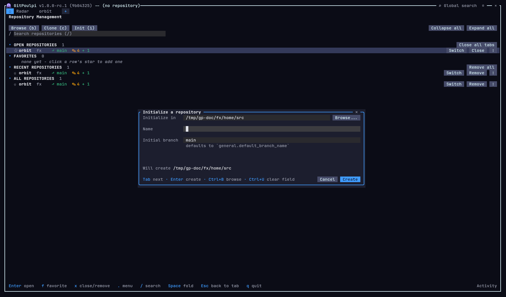

[English](../getting-started.md) · [Čeština](../cs/getting-started.md) · [Deutsch](../de/getting-started.md) · [Español](../es/getting-started.md) · [Français](../fr/getting-started.md) · [Italiano](../it/getting-started.md) · [日本語](../ja/getting-started.md) · [한국어](../ko/getting-started.md) · [Nederlands](../nl/getting-started.md) · [Polski](../pl/getting-started.md) · [Português (Brasil)](../pt-BR/getting-started.md) · [Português (Portugal)](../pt-PT/getting-started.md) · [Русский](../ru/getting-started.md) · [Svenska](../sv/getting-started.md) · **Türkçe** · [Українська](../uk/getting-started.md) · [简体中文](../zh-CN/getting-started.md)

# Başlarken

Bu sayfa sizi yeni bir kurulumdan ilk commit'inize götürür.
[Arayüz turu](interface-tour.md) pencerenin her bölgesini adlandırır.
[Ayarlar](settings.md) her seçeneği listeler.

## 1. Kurun ve başlatın

[Kurulum](installation.md) sayfasını izleyin. Ardından bir Git deposunda bir
terminal açın ve şunu çalıştırın:

```
gitpoulpi
```

GitPoulpi, geçerli klasörü
içeren depoyu açar. Bir deponun dışındaysanız **Ana** sekmesini açar; orada bir
depoya göz atabilir, klonlayabilir veya başlatabilirsiniz
(bkz. [7. adım](#7-depoları-açma-klonlama-ve-başlatma)).

Simgeler bir Nerd Font ya da emoji içeren bir yazı tipi ister. Kutucuklar
görüyorsanız [Sorun giderme](troubleshooting.md) sayfasına bakın.


## 2. Geri kalan her şeyi öğrenmek için üç tuş

| Tuş | Açar |
|---|---|
| `?` | **Yardım**: her tuş ve fare hareketi. Süzmek için yazın. `Ctrl+D` bu belgeleri tarayıcınızda açar. |
| `Ctrl+P` | **Komut paleti**: bir komut bulmak için yazın, `Enter` çalıştırır. Her satır kısayolunu gösterir. |
| `Ctrl+,` | **Ayarlar**. Başlık çubuğunda ×'in solundaki dişli de bunları açar. |

Her şeyi klavyeyle de fareyle de yapabilirsiniz. Palet her komuta ulaşır.
Bkz. [Klavye kısayolları](keybindings.md) ve
[Fare ve hareketler](mouse-and-gestures.md).


## 3. Geçmişe göz atın

Pencerenin ortası **Log**'dur: commit başına bir satır, en yeni en üstte. Dalları
ve tag'leri renkli haplar olarak, grafiği, mesajı, yazarı, tarihi ve kısa hash'i
gösterir.

- Bir commit'e tıklayın. Ayrıntıları ve değişen dosyaları sağda görünür.
- Değişen bir dosyaya tıklayın. Diff'i ortada açılır. `Esc` kapatır.
- `j` / `k` veya ok tuşları seçimi hareket ettirir. `f` commit'lerde arar.
- Menüsü için bir commit'e sağ tıklayın.


## 4. Bir değişiklik yapın ve stage'leyin

Bir dosyayı düzenleyicinizde düzenleyin. **Log'un üst satırı** artık çalışma
değişikliklerini gösterir: değişen dosya sayısını taşıyan kesik çizgili bir
satır. Üzerine tıklayın. Sağ panel **Unstaged Dosyalar** ve **Staged Dosyalar**
listelerini gösterir.

- Bir dosyanın üzerine gelin ve **Dosyayı Stage'le** düğmesine tıklayın. Ya da
  **Tüm Değişiklikleri Stage'le** düğmesine tıklayın.
- Diff'ini açmak için bir dosya adına tıklayın. Orada tek bir **hunk**
  (**Hunk'ı Stage'le**) ya da tek bir **satır** stage'leyebilirsiniz.

Bkz. [Stage'leme ve commit'leme](staging-and-committing.md).


## 5. Commit yapın

Sağ alttaki commit formuna bir özet ve isteğe bağlı olarak bir açıklama yazın.
Ardından yeşil **N dosyadaki değişiklikleri commit et** düğmesine tıklayın ya da
`Ctrl+Enter` tuşlarına basın (ya da her yerden `Ctrl+G Enter`). Değişikliklerinizi yeni bir commit yerine son
commit'e eklemek için **Önceki commit'i amend et** kutusunu işaretleyin.

[YZ](ai.md) özelliğini açtıysanız özetin yanındaki `✦` düğmesi, stage'lenmiş
değişikliklerden bir mesaj yazar. GitPoulpi, siz **N dosyadaki değişiklikleri commit
et** düğmesine tıklamadan asla commit yapmaz.

## 6. Çalışmanızı paylaşın

Araç çubuğunda her biri bir `▾` listesi olan **Pull** ve **Push** düğmeleri
vardır. Klavyeden `Ctrl+G` tuşuna ve ardından bir harfe basın: `Ctrl+G p` pull
yapar, `Ctrl+G Shift+P` push yapar. `Ctrl+G` sonrasında durum çubuğu harfleri
listeler.

GitPoulpi, `git`'inizin zaten kullandığı kimlik doğrulamayı kullanır (kimlik
bilgisi yardımcısı, ssh-agent). Kendine ait bir hesap gerektirmez. Pull
request'leri görmek ve oluşturmak için bir barındırma hesabını bir kez bağlayın.
Bkz. [Barındırma hizmetleri ve issue takipçileri](hosting-integration.md).

## 7. Depoları açma, klonlama ve başlatma

Sekme satırının sol ucundaki ev simgesine tıklayın ya da `Ctrl+O` tuşlarına
basın. **Ana** sekme (Depo Yönetimi), açık, favori ve son depolarınızı **Gözat**,
**Klonla** ve **Init** düğmeleriyle listeler. Her depo kendi sekmesinde açılır.
`Ctrl+W` geçerli sekmeyi kapatır.


**Klonla** bir URL ve bir klasör sorar ya da bağlı bir hesaptan (GitHub, GitLab, Gitea, Forgejo, Azure DevOps, Bitbucket, Gerrit)
bir depo seçmenizi sağlar (bkz.
[Bağlı bir hesaptan klonlama](hosting-integration.md#bağlı-bir-hesaptan-klonlama)).
**Init** bir klasörü yeni bir depoya dönüştürür.
Üçünde de (ve açtıkları klasör seçicide) `Ctrl+N` her alanın ve düğmenin üzerinde bir rozet gösterir: karakterine basın, imleç alana gelir ya da düğmeye basılır.

|  |  |
|---|---|

### Kısmi checkout

Büyük bir deponun diske tamamen inmesi gerekmez. Klonla iletişim kutusunda
**Kısmi checkout (yalnızca bazı klasörler)** kutusunu işaretleyin ve istediğiniz
klasörleri boşluk veya virgülle ayırarak yazın (`src docs/guide`). Yalnızca bu
klasörler ve deponun kökündeki dosyalar checkout edilir; tüm geçmiş yine de
indirilir, dolayısıyla Log, blame ve dallar her zamanki gibi çalışır. Kutu
işaretliyken en az bir klasör gerekir.


Herhangi bir depoyu daha sonra da değiştirebilirsiniz: komut paletini (`Ctrl+P`)
açıp **Depo: Kısmi Checkout...** komutunu çalıştırın ya da deponun sekme
menüsündeki **Kısmi checkout...** öğesini kullanın. İletişim kutusu, şu anda
checkout edilmiş klasörleri tek bir alanda listeler: oradan adları ekleyin veya
silin ve **Uygula**'ya (`Enter`) basın; her dosyayı geri getirmek için
**Kapat (tam checkout)** düğmesini kullanın. Çalışma ağacı kısmiyken durum
çubuğunda küçük bir `kısmi` rozeti görünür. Aynı denetimler *Ayarlar > Kısmi checkout* sayfasında da vardır
(satır başına bir yol yazılan bir liste ve **Başlat**, **Durdur** ve **Yenile** düğmeleri).

Notlar:

- Bu, git'in cone kipidir (desenler değil, klasörler); `*`, `..` ve mutlak yollar
  reddedilir.
- Geri Al, kümenin değiştirilmesini kaydetmez: hiçbir şey kaybolmaz ve **Kapat**
  her dosyayı geri getirir. Git, commit'lenmemiş değişiklik içeren bir klasörü
  bırakmayı reddedebilir (hata durum çubuğunda görünür); önce commit'leyin veya
  stash'leyin.
- Aynı işi betiklerden ve ajanlardan da yapabilirsiniz: `gitpoulpi clone <url> --sparse src docs` ve
  `gitpoulpi sparse-checkout status | set | add | disable` (bkz. [CLI
  başvurusu](cli-reference.md)); MCP sunucusunda da aynı araçlar vardır.

## Sonrasında

- [Arayüz turu](interface-tour.md): gördüğünüz her şeyin adı.
- [Log ile çalışmak](log-and-history.md) ve
  [Stage'leme ve commit'leme](staging-and-committing.md): günlük iş.
- [Temalar](themes.md) ve [Ayarlar](settings.md).
- [YZ desteği](ai.md) ve [Barındırma hizmetleri ve issue takipçileri](hosting-integration.md):
  isteğe bağlı iki entegrasyon.
- [CLI başvurusu](cli-reference.md) ve [MCP ve ajanlar](mcp-and-agents.md):
  aynı işlemler betiklerden ve ajanlardan.
- [Sorun giderme](troubleshooting.md).
