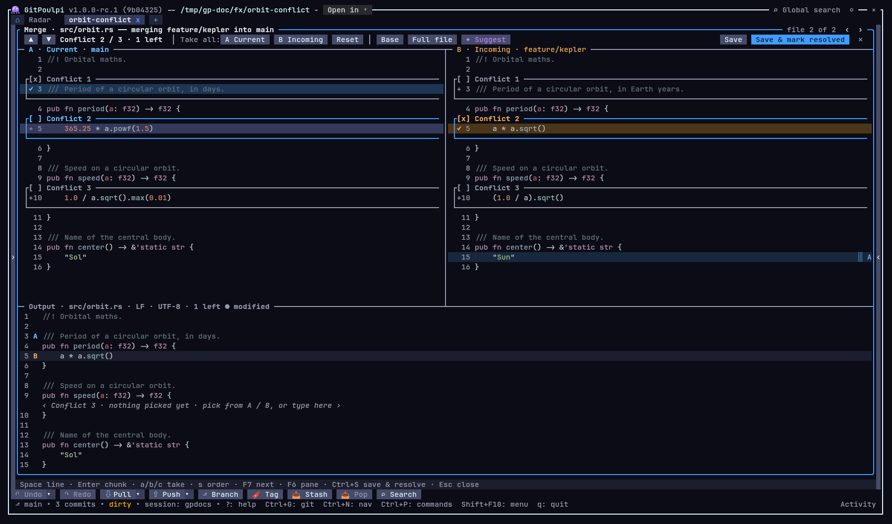

[English](../merge-conflicts.md) · [Čeština](../cs/merge-conflicts.md) · [Deutsch](../de/merge-conflicts.md) · [Español](../es/merge-conflicts.md) · [Français](../fr/merge-conflicts.md) · [Italiano](../it/merge-conflicts.md) · [日本語](../ja/merge-conflicts.md) · [한국어](../ko/merge-conflicts.md) · [Nederlands](../nl/merge-conflicts.md) · [Polski](../pl/merge-conflicts.md) · [Português (Brasil)](../pt-BR/merge-conflicts.md) · [Português (Portugal)](../pt-PT/merge-conflicts.md) · [Русский](../ru/merge-conflicts.md) · [Svenska](../sv/merge-conflicts.md) · **Türkçe** · [Українська](../uk/merge-conflicts.md) · [简体中文](../zh-CN/merge-conflicts.md)

# Merge çakışmalarını çözmek

Bir merge, cherry-pick, revert veya rebase çakışmalarda durduğunda Log bir
banner gösterir (*Merge sürüyor · feature → main · 2 çakışmalı dosya*) ve
çakışmalı dosyalar Durum panelinde kırmızı bir `!` ile görünür. Birini **merge
düzenleyicide** açın: A (mevcut taraf) ve B (gelen taraf) yan yana, altında da
yazdığınız dosya olan **Çıktı**. Bu sayfa kısa sürümdür; tuşların tam listesi
[Klavye kısayolları](keybindings.md) sayfasındadır.

## Açma

- Durum panelindeki bir `!` satırında Enter veya çift tık; sağ tık menüsü
  **Merge Düzenleyicide Aç** ile başlar.
- Banner'daki **Çakışmaları çöz...** düğmesi (ilk çakışmalı dosyayı açar).
- Çakışmalı bir dosyanın Diff görünümü: **Merge Düzenleyici** düğmesi
  (`Shift+E`).
- Palet: **Çakışmalar: Merge Düzenleyiciyi Aç**.

Hiçbir şey kendiliğinden açılmaz: durmuş bir işlem yalnızca banner'ı ve
`!` satırlarını gösterir.

Düzenleyici pencerenin tüm genişliğini kaplar: Refs kenar çubuğu
ve sağ panel düzenleyici açıkken gizlenir, kapatınca geri gelir (`F9` bu arada
onları gösterir veya gizler). Düzenleyici en az `merge.side_by_side_min_width`
sütun genişliğindeyse A ve B yan yana durur (varsayılan 100, Ayarlar > Diff ve
düzenleyici; `0` her zaman demektir); daha darsa sekmelerin ardında her seferinde
bir taraf görürsünüz. Uzun satırlar yana kayar, A ve B birlikte (`Shift+←` /
`Shift+→`, Shift+tekerlek veya yatay tekerlek); hiçbir zaman alt satıra
kaydırılmazlar.

## Seçim yapma

Her çakışma A'da ve B'de çerçeveli bir bloktur; başlığında bir onay kutusu ve
her satırın önünde bir `+` / `✓` bulunur.

| Şunun için... | Tuş | Fare |
|---|---|---|
| imlecin altındaki satırı al (odaktaki taraf) | `Space` | satıra tıkla |
| odaktaki tarafın tüm parçasını al | `Enter` | başlığındaki `[ ]` üzerine tıkla |
| bu çakışma için yalnızca A / yalnızca B al | `a` / `b` | parçaya sağ tık |
| ikisini de al, önce A sonra B / önce B sonra A | `c` / `Shift+C` | parçaya sağ tık |
| hiçbirini alma | `x` | parçaya sağ tık |
| seçilmiş iki tarafın sırasını değiştir | `s` | `1.` / `2.` rozetine tıkla |
| A'nın tamamını / B'nin tamamını al (her çakışma) | `Shift+A` / `Shift+B` | araç çubuğu |
| bu çakışmanın seçimini kaldır (çözülmemişe dön) | A / B içinde `u`, her yerde `Alt+U` | parçaya sağ tık, **Seçimi kaldır (çözülmemişe dön)** |
| tüm dosyayı özgün çakışmalarına sıfırla (Çıktıya yazdıysanız önce sorar; `Ctrl+Z` geri getirir) | A / B içinde `Shift+U`, her yerde `Alt+R` | Tümünü al: yanındaki **Sıfırla** |
| sonraki / önceki çakışma | `F7` / `Shift+F7`, `Alt+Down` / `Alt+Up` (A / B içinde `n` / `Shift+N`) | `▼` / `▲` veya bir kaydırma çubuğundaki işarete tıkla |
| bir sayı hareketi tekrarlar | `3j`, `2k`, `2n`, `3N` (A / B içinde) | |
| sonraki / önceki çakışmalı dosya | `Alt+PageDown` / `Alt+PageUp` | başlıktaki `›` / `‹` |
| Temel (ortak ata) bölmesini göster veya gizle | `Alt+D` (A / B içinde `d`) | `Temel` |
| tüm dosyayı A ve B'de göster (**Tüm dosya**) | `Alt+F` (A / B içinde `f`) | `Tüm dosya` |
| A'ya veya B'ye daha fazla genişlik ver / eşit genişliklere dön | `Alt+Right` / `Alt+Left`, `Alt+0` | ayırıcıyı sürükle; üzerine çift tık |
| A / B / Temel'i yana kaydır | `Shift+←` / `Shift+→` (`Shift+H` / `Shift+L`) | Shift+tekerlek, yatay tekerlek |
| Refs ve Durum panellerini göster veya gizle | `F9` | |
| A'ya, B'ye, Çıktıya odaklan | `F6` / `Shift+F6` | tıkla |
| bulunulan çakışmada bir bölmeye git | `Alt+1` A, `Alt+2` B, `Alt+3` Çıktı, `Alt+4` Temel; veya `Ctrl+N` sonra `1` / `2` / `3` | |
| komşu bölmeye geç (A, Temel, B, Çıktı), aynı çakışma | A / B içinde `h` / `l` veya `←` / `→` | |
| Çıktı yüksekliğini döngüyle değiştir | `z` | başlığını sürükle |
| geri al / yinele (seçimler ve yazma, tek yığın) | `Ctrl+Z` / `Ctrl+Y` | |
| dosyayı yaz, çakışmalı bırak | `Alt+S` | **Kaydet** |
| dosyayı yaz ve çözüldü işaretle | `Ctrl+S` | **Kaydet ve Çözüldü İşaretle** |
| kapat | `Esc` | `✕` |

Her kaydırma çubuğu (A / B / Temel ve Çıktı) çakışma başına bir işaret taşır:
hâlâ seçim gerekiyorsa turuncu, ele alındıysa yeşil, geçerli olan için mavi. Bir
işarete tıklamak o çakışmaya atlar (kaydırma çubuğunun tutamacının altındaki bir
işaret zaten ekrandadır, bu yüzden orada tıklama tutamacı sürükler).

**Tüm dosya**, A ve B'de tüm dosyayı gösterir; yalnızca çakışmalar değil, her fark renklidir:

Çıktı gerçek bir düzenleyicidir: içine tıklayıp yazabilir, seçebilir, kesip yapıştırabilir,
`Ctrl+F` ile arayabilirsiniz. Elle düzenlediğiniz bir çakışmadaki seçim, düzenlemenizin yerine
geçer (`Ctrl+Z` geri getirir). Hiçbir şey seçilmemiş bir çakışmayla veya hâlâ
çakışma işaretine benzeyen bir satırla kaydetmek önce sorar.

### ✦ Çözüm öner (YZ)

YZ açıkken (Ayarlar > YZ; bkz. [YZ desteği](ai.md)) araç çubuğunda bir **✦ Öner**
düğmesi, bir çakışmanın sağ tık menüsünde *✦ Çözüm Öner (YZ)* bulunur; `Alt+I` ve
palet (`YZ: Merge Çakışması Çözümü Öner`) de aynısını yapar. Yalnızca geçerli
çakışma üzerinde çalışır ve yalnızca siz istediğinizde başlar. Yanıt, o çakışmanın
Çıktıdaki bölümünün yerine tek bir düzenleme olarak geçer ve düzenlendi (`✎`)
diye işaretlenir; böylece `Ctrl+Z` çakışmayı eski haline döndürür. Sizin yerinize
asla kaydedilmez veya stage'lenmez. Çalışırken ipucu satırı geçen süreyi
gösterir; `Esc` iptal eder, bir hata da orada görünür. YZ kapalıyken bu
denetimlerin hiçbiri yoktur.

**Kaydet ve Çözüldü İşaretle**'den sonra dosya stage'lenir ve çakışmalı dosyalar
listesi geri gelir; sonraki dosyayı kendiniz açın. `Ctrl+Z` (veya
Geri al düğmesi) son "çözüldü işaretle"yi geri alır. Hiç dosya kalmadığında banner
**Commit (merge)** (cherry-pick, revert veya rebase için **Devam et**) ve
**Merge işlemini iptal et** önerir; iptal önce sorar: HEAD'i, indeksi ve çalışma
ağacını eski durumlarına döndürür.

Sonucu HEAD'e eşit olan bir merge (her yerde bizim tarafı aldınız) hiçbir şey
stage'lenmemiş ve değişmiş dosyası olmasa da yine de tamamlanabilir: **Commit
(merge)** commit istemini merge mesajıyla açar ve commit'in iki ebeveyni olur.
Aynı şekilde, bir merge durmuşken hiçbir şey stage'lenmemiş olsa da composer'ın
Commit düğmesi etkindir.

Boş bir cherry-pick veya revert (değişiklik zaten uygulanmış) commit'lenemez: git
reddeder ve **Devam et** bunu söyleyip **Atla**'ya yönlendirir. **Atla** (banner
düğmesi, palet girişi *Git: Cherry-pick veya Revert'i Atla*, CLI
`conflicts skip`) önce sorar, sonra işlemi onun için hiçbir şey kaydetmeden
bitirir; HEAD, indeks ve çalışma ağacı HEAD'e döner. Atla geri alınamaz (bilerek
vazgeçilmemiş hiçbir şey kaybolmaz); bir merge'de atlanacak bir şey yoktur.

## Metin olmayan çakışmalar

Bir ikili dosya, bir Git LFS işaretçisi, 8 MiB'den büyük bir dosya, bir tarafta
silinmiş bir dosya, bir yeniden adlandırma artığı, bir sembolik bağlantı, bir kip
değişikliği veya bir alt modülde seçilecek satır yoktur. Düzenleyici, her tarafın
ne içerdiğini gösteren bir **kart** ve seçenek başına bir düğme gösterir; seçmek
dosyayı hemen çözer ve stage'ler.

| Kart | Seçenekler |
|---|---|
| İkili dosya, LFS işaretçisi, çok büyük | **A'yı koru** (`a`), **B'yi al** (`b`), **Temeli al** (`o`, varsa), **Merge aracında aç** (`m`) |
| Bir tarafta silinmiş, diğerinde değişmiş | **Dosyayı koru** (`k`), **Silmeyi kabul et** (`Shift+D`) |
| Yeniden adlandırma artığı (yol yalnızca bir tarafta var) | **Dosyayı koru** (`k`), **Dosyayı sil** (`Shift+D`) |
| Sembolik bağlantı, alt modül, dosya kipi | **A'yı koru**, **B'yi al**, **Temeli al** |

Dosya bir resimse (PNG, JPEG, GIF, WebP, BMP, ICO) kutular A, B ve Temel
resimlerini de gösterir; sığdırılmış ve salt okunur, onlara yetecek genişlikte bir
pencerede; bkz. [Görseller](image-view.md#merge-düzenleyicisinde).

`Esc` kartı seçmeden kapatır. Harici merge aracı, Ayarlar > Diff ve düzenleyici içindeki
`general.external_merge_tool` ayarıdır (`{base}`, `{local}` = A, `{remote}` = B,
`{merged}`; boş olması `git mergetool` demektir); araç başarıyla çıkınca dosya
stage'lenir.

## Çakışma önleme

GitPoulpi, merge etmeden *önce* size haber verebilir. Üzerinde olduğunuz dal, ayrıldığı dalla (**temel dalıyla**)
çakışacaksa, Log'un üst kenarlık satırında bir şerit belirir: **origin/main ile 2 dosyada çakışma** ve bir **Dosyaları
göster** düğmesi. Şerit, süren işlemlerin banner'larından sonraki ilk boş kenarlık satırını alır; bu yüzden onlardan biri
görünürken yer açılmasını bekleyebilir. Hiçbir şey merge edilmez: daemon iki commit'in bellekte bir merge'ünü yapar
(libgit2 ya da git 2.38 veya daha yenisiyle `git merge-tree --write-tree`; daha eski bir git özelliği günlükte tek bir
satırla kapatır), bu yüzden dosyalarınıza, indeksinize ve ref'lerinize dokunulmaz.

- **Temel dal**, dalın pull request'inin hedef dalıdır (GitPoulpi bunu zaten biliyorsa: Pull Request'ler bölümünün tuttuğu
  önbellek; bunun için ağ çağrısı yapılmaz); yoksa **Temel dallar** desenlerinden (Ayarlar > Çakışma önleme)
  ayrıldığı noktadan beri en az commit'i olan daldır. Eşitlikte ucu ayrılma noktasına en yakın olan, sonra uzak izleme dalı
  yerel dala göre, sonra ad kazanır. Dalın kendisi ve kendi uzak kopyası asla temel dal olmaz.
- **Açılır pencere** (şeride tıklayın ya da klavyeden çalışan paletteki **Çakışmalar: Tahmin Edilen Çakışmaları Göster**)
  dosyaları listeler ve **Merge önizlemesini aç** ile **Temel dalın üstüne Rebase** düğmelerini içerir. Bunlar temel dalın
  kendi menü satırlarıdır (*Merge <temel> → <dal>*, *Rebase <dal> → <temel> üstüne*) sizin için çalıştırılır: geri alma
  geçmişine yazılır, yani `Ctrl+Z` onları geri alır; gerçekten çakışan bir merge de diğerleri gibi merge düzenleyicisinde
  durur. Sol ve Sağ düğmeler arasında gezinir, Enter birine basar, Esc kapatır.
- **Ne zaman çalışır**: arka planda, depo sakinleştikten yaklaşık 2 saniye sonra (bir commit, bir checkout, bir dalı taşıyan
  fetch, bir rebase), her `(HEAD, temel)` çifti için bir kez. HEAD taşındığında şerit hemen gizlenir ve yeni cevapla geri
  gelir ya da gelmez. Ayrık bir HEAD denetlenmez.
- **Temel dal listeleri**: bir deponun Temel dallarının nereden geldiği, **Çakışma önleme** sayfasındaki bir seçimdir.
  **Varsayılan** genel varsayılanı izler (Ayarlar > Çakışma önleme'de başka bir liste seçene kadar yerleşik `**`,
  yani her dal); **Liste: <ad>** adlandırılmış listelerinizden birini izler; **Kendi listesi** deponun kendine ait listesidir.
  Listeler paylaşılır: birini düzenleyin, onu izleyen her depo değişikliği bir sonraki denetimde kullanır, yeniden başlatma
  gerekmez. **Liste olarak kaydet...** deponun kendi desenlerini adlandırılmış bir listeye çevirir, **Varsayılana sıfırla**
  deponun seçimini bırakır. Bir deponun izlediği listeyi silmek, onu varsayılanı kullanmaya döndürür.
- **Kapatma**: Ayarlar > Çakışma önleme'deki **Proaktif çakışma algılamayı etkinleştir**, ya da tek bir depo için onun **Çakışma
  önleme** sayfası. Bir betikten `gitpoulpi conflicts check` aynı cevabı JSON olarak yazdırır ([CLI
  başvurusu](cli-reference.md)).

## Ajanlar

Bir ajan size bir çakışmayı gösterebilir (`gitpoulpi ui show conflict <path>
[--conflict N]`: düzenleyici onun üzerinde açılır, hiçbir şey seçilmez) veya bir
çözüm **önerebilir** (`gitpoulpi ui propose resolution <path> --pick 1=a,2=ba`
veya `--content-file F`; *YZ ajanlarının onaylayacağım değişiklikler önermesine
izin ver* ayarını gerektirir). Bir öneri düzenleyiciyi seçimler (veya tüm metin)
Çıktıda hazır olarak ve mor bir *✦ claude-code önerdi* banner'ıyla açar. Gözden
geçirin, istediğinizi değiştirin ve **Ctrl+S**'ye basın: bir şeyi yazan veya stage'leyen
yalnızca budur. Düzenleyiciyi kapatmak öneriyi reddeder. Bkz. [MCP ve
ajanlar](mcp-and-agents.md).

Bir betikten aynı işlemler `gitpoulpi conflicts list | show | resolve |
unresolve | state | abort` komutlarıdır ([CLI başvurusu](cli-reference.md)); `conflicts check` merge'den önce bunları tahmin eder.
