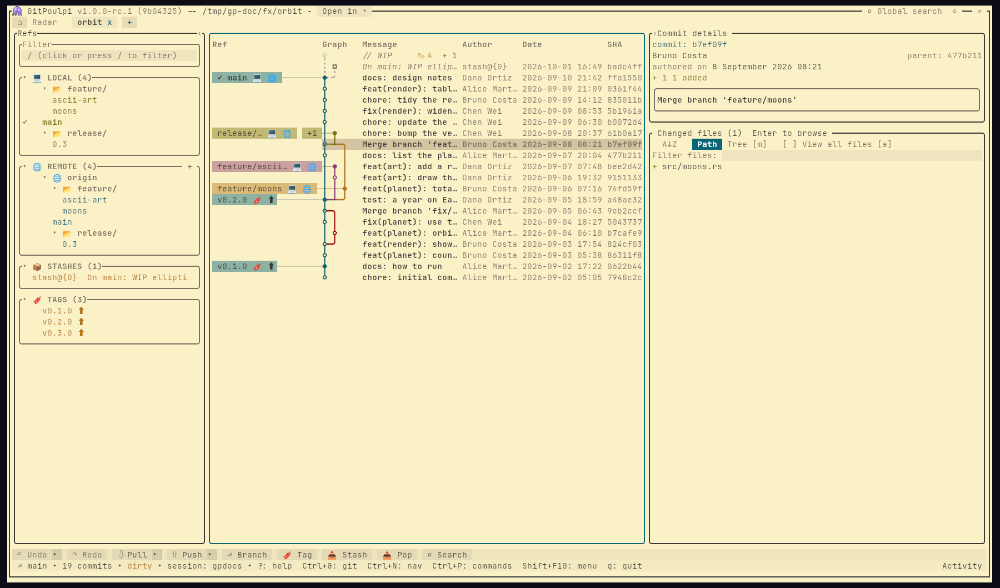
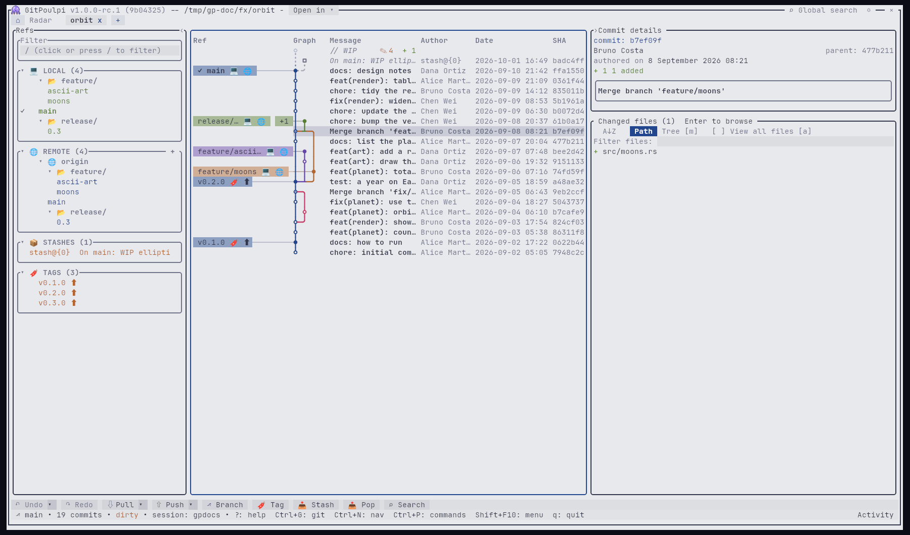
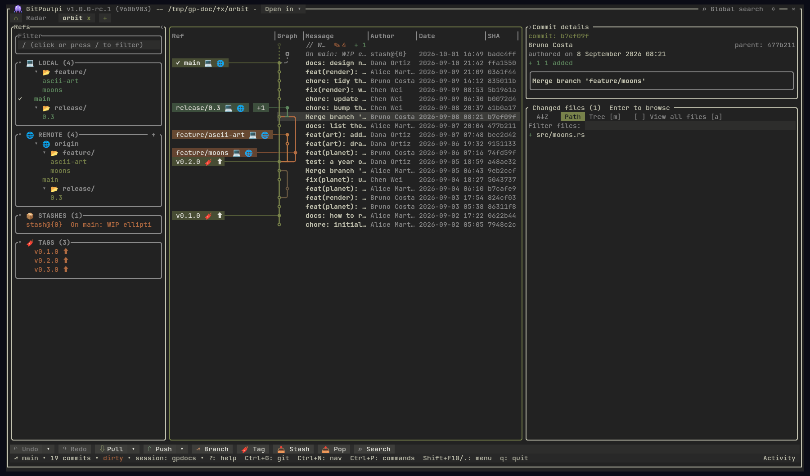
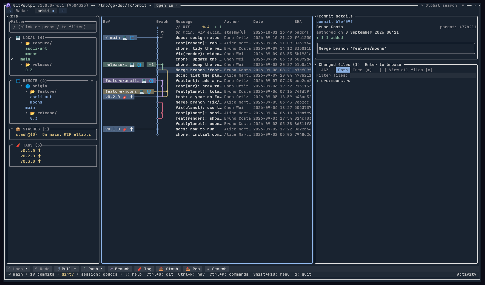
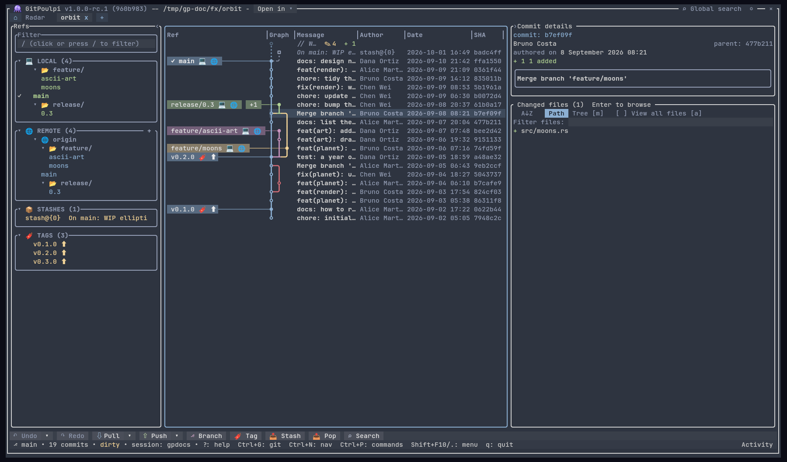
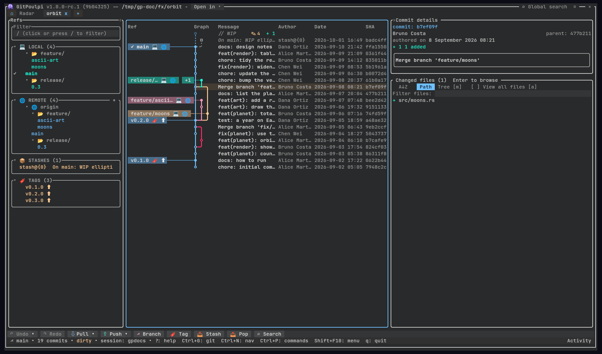
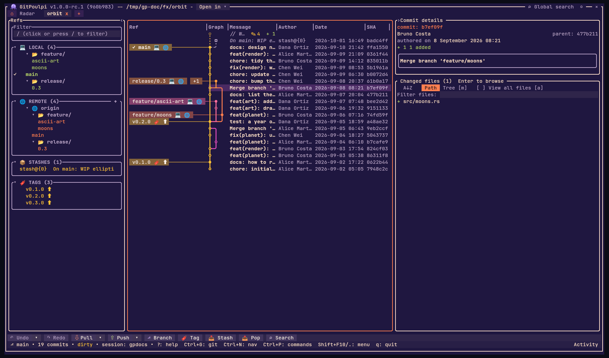

[English](../themes.md) · [Čeština](../cs/themes.md) · [Deutsch](../de/themes.md) · [Español](../es/themes.md) · [Français](../fr/themes.md) · [Italiano](../it/themes.md) · [日本語](../ja/themes.md) · [한국어](../ko/themes.md) · [Nederlands](../nl/themes.md) · [Polski](../pl/themes.md) · [Português (Brasil)](../pt-BR/themes.md) · [Português (Portugal)](../pt-PT/themes.md) · [Русский](../ru/themes.md) · [Svenska](../sv/themes.md) · **Türkçe** · [Українська](../uk/themes.md) · [简体中文](../zh-CN/themes.md)

# Temalar

Bir tema, GitPoulpi'nin çizdiği her rengi belirler: metin, paneller, seçim, düğmeler,
diff ve merge görünümleri, düzenleyici, araç çubuğu simgeleri ve Log grafiğinin şerit
renkleri. Temayı **Ayarlar > Görünüm > Tema** üzerinden ya da
`gitpoulpi config set ui.theme <slug>` ile değiştirebilirsiniz. Her birinin nasıl göründüğünü görmek için doğrudan [galeriye](#galeri) geçin.

## Yerleşik hazır ayarlar

`gitpoulpi theme list`, derlemenizdeki hazır ayarları Ayarlar açılır listesinin
gösterdiği sırayla yazdırır: önce **GitPoulpi Dark** (`dark`, terminalinizin kendi
arka planının üzerine çizilir) ve **GitPoulpi Light** (`light`), ardından diğer tüm
hazır ayarlar etikete göre alfabetik sırayla. `ui.theme = "system"` (varsayılan)
terminalinizi izler: açık renkli bir terminal arka planında Light, aksi halde Dark
(aşağıdaki "Sistem algılama" bölümüne bakın); eski `default` değeri `system` ile aynıdır.
Şerit paleti listesi aynı sırayı kullanır.

| Slug | Etiket | Renklerin kaynağı |
|---|---|---|
| `system` (varsayılan) | Sistem | bir palet değildir: açık terminal arka planında GitPoulpi Light, aksi halde GitPoulpi Dark |
| `dark` | GitPoulpi Dark | özgün GitPoulpi teması, terminalinizin kendi arka planının üzerine boyanır |
| `light` | GitPoulpi Light | özgün GitPoulpi teması |
| `catppuccin-latte` / `catppuccin-frappe` / `catppuccin-macchiato` / `catppuccin-mocha` | Catppuccin Latte / Frappé / Macchiato / Mocha | [github.com/catppuccin/palette](https://github.com/catppuccin/palette) |
| `cyberpunk` | Cyberpunk | [iTerm2-Color-Schemes](https://github.com/mbadolato/iTerm2-Color-Schemes) "Cyberpunk" |
| `dracula` | Dracula | [draculatheme.com/contribute](https://draculatheme.com/contribute) |
| `everforest-dark` | Everforest Dark | [github.com/sainnhe/everforest/blob/master/palette.md](https://github.com/sainnhe/everforest/blob/master/palette.md) |
| `fire` / `fire-light` | Fire / Fire Light | özgün GitPoulpi temaları: Fire, yanık turuncu bir arka planda alev turuncusuyla közlerdir; Fire Light, gerçek turuncu bir arka plandaki açık ikizidir |
| `github-dark` / `github-light` | GitHub Dark / GitHub Light | GitHub'ın Primer temaları, [github.com/primer/github-vscode-theme](https://github.com/primer/github-vscode-theme) ve @primer/primitives (`canvas.default`, `canvas.inset` kenar paneli için, `fg.*`, `accent.fg`); hiçbir değer ayarlanmadı |
| `gruvbox-dark` / `gruvbox-light` | Gruvbox Dark / Light | [github.com/morhetz/gruvbox#palette](https://github.com/morhetz/gruvbox#palette) |
| `kanagawa` / `kanagawa-lotus` | Kanagawa (wave) / Kanagawa Lotus | [github.com/rebelot/kanagawa.nvim](https://github.com/rebelot/kanagawa.nvim) |
| `matrix` | Matrix | [iTerm2-Color-Schemes](https://github.com/mbadolato/iTerm2-Color-Schemes) "Matrix" (şemada kırmızı yok: `danger` değeri `#ff5555`) |
| `monokai` | Monokai | özgün Monokai paleti ([monokai.nl](https://monokai.nl/)) |
| `nord` | Nord | [www.nordtheme.com](https://www.nordtheme.com) |
| `one-dark` / `one-light` | One Dark / One Light | Atom One Dark / One Light ([One Dark](https://github.com/atom/one-dark-syntax), [One Light](https://github.com/atom/one-light-syntax)) |
| `rose-pine` / `rose-pine-moon` / `rose-pine-dawn` | Rosé Pine / Moon / Dawn | [rosepinetheme.com/palette](https://rosepinetheme.com/palette/) |
| `solarized-dark` / `solarized-light` | Solarized Dark / Light | Ethan Schoonover'ın Solarized'ı ([ethanschoonover.com/solarized](https://ethanschoonover.com/solarized/)) |
| `sunset` | Sunset | özgün GitPoulpi teması: mercan ve altınla çivit mavisi alacakaranlık |
| `terminal` | Terminal (16 colors) | yalnızca terminalinizin kendi 16 rengini kullanır |
| `tokyo-night` / `tokyo-night-day` | Tokyo Night (night) / Tokyo Night Day | [github.com/folke/tokyonight.nvim](https://github.com/folke/tokyonight.nvim) (Day'in ön plan rengi, karşıtlık kurallarını geçmesi için koyulaştırılmıştır) |
| `vesper` | Vesper | [github.com/raunofreiberg/vesper](https://github.com/raunofreiberg/vesper) (paletinde mavi ya da mor yok: vurgu rengi şeftalidir) |
| `vscode-dark` / `vscode-light` | VS Code Dark / VS Code Light | VS Code'un varsayılan Dark Modern / Light Modern temaları, [github.com/microsoft/vscode/tree/main/extensions/theme-defaults/themes](https://github.com/microsoft/vscode/tree/main/extensions/theme-defaults/themes) (`dark_modern.json`, `light_modern.json`, ayrıca liste seçimi ile ANSI/grafik vurguları için VS Code'un varsayılan renkleri; Light'ın soluk grisi `616161`) |

### terminalcolors.com'dan içe aktarılanlar

terminalcolors.com terminal paletlerinden içe aktarılmıştır; her şema kendi yazarlarına aittir. 90 hazır ayar, paletin arka planından, ön planından, seçiminden ve 16 ANSI renginden oluşturulur (vurgu = mavi, başarı = yeşil, uyarı = sarı, tehlike = kırmızı, YZ = macenta, soluk = parlak siyah); hepsi için ortak tek bir türetme kullanılır; GitPoulpi'nin karşıtlık kurallarını geçemeyen bir renk, geçene kadar açılır ya da koyulaştırılır. Tablo, `scripts/gen-terminalcolors.py` tarafından `crates/gitpoulpi-config/src/theme/terminalcolors_data.rs` dosyasına üretilir. Slug'lar `<aile>-<varyant>` biçimindedir (`default` düşer); etiketler, diğerleri gibi açılır listede alfabetik sıralıdır.

| Aile | Slug'lar |
|---|---|
| [Apprentice](https://terminalcolors.com/themes/apprentice/) | `apprentice` |
| [Ayu](https://terminalcolors.com/themes/ayu/) | `ayu-dark`, `ayu-light`, `ayu-mirage` |
| [Cobalt2](https://terminalcolors.com/themes/cobalt2/) | `cobalt2` |
| [Deus](https://terminalcolors.com/themes/deus/) | `deus` |
| [Dracula](https://terminalcolors.com/themes/dracula/) | `dracula-soft` |
| [Everforest](https://terminalcolors.com/themes/everforest/) | `everforest-light` |
| [GitHub](https://terminalcolors.com/themes/github/) | `github-dark-colorblind`, `github-dark-dimmed`, `github-dark-high-contrast`, `github-dark-legacy`, `github-light-colorblind`, `github-light-high-contrast`, `github-light-legacy` |
| [Gotham](https://terminalcolors.com/themes/gotham/) | `gotham` |
| [Gruvbox](https://terminalcolors.com/themes/gruvbox/) | `gruvbox-dark-hard-contrast`, `gruvbox-dark-soft-contrast`, `gruvbox-light-hard-contrast`, `gruvbox-light-soft-contrast` |
| [Iceberg](https://terminalcolors.com/themes/iceberg/) | `iceberg-dark`, `iceberg-light` |
| [Jellybeans](https://terminalcolors.com/themes/jellybeans/) | `jellybeans` |
| [Kanagawa](https://terminalcolors.com/themes/kanagawa/) | `kanagawa-dragon` |
| [Lucario](https://terminalcolors.com/themes/lucario/) | `lucario` |
| [Miasma](https://terminalcolors.com/themes/miasma/) | `miasma` |
| [Moonfly](https://terminalcolors.com/themes/moonfly/) | `moonfly` |
| [Night](https://terminalcolors.com/themes/night-owl/) | `night-owl-dark`, `night-owl-light` |
| [Nightfly](https://terminalcolors.com/themes/nightfly/) | `nightfly` |
| [Nightfox](https://terminalcolors.com/themes/nightfox/) | `nightfox`, `nightfox-carbonfox`, `nightfox-dawnfox`, `nightfox-dayfox`, `nightfox-duskfox`, `nightfox-nordfox`, `nightfox-terafox` |
| [Noctis](https://terminalcolors.com/themes/noctis/) | `noctis`, `noctis-azureus`, `noctis-bordo`, `noctis-hibernus`, `noctis-lilac`, `noctis-lux`, `noctis-minimus`, `noctis-obscuro`, `noctis-sereno`, `noctis-uva`, `noctis-viola` |
| [Nordic](https://terminalcolors.com/themes/nordic/) | `nordic` |
| [One](https://terminalcolors.com/themes/one-half/) | `one-half-dark`, `one-half-light` |
| [Panda](https://terminalcolors.com/themes/panda/) | `panda` |
| [Posterpole](https://terminalcolors.com/themes/posterpole/) | `posterpole`, `posterpole-gray` |
| [Seoul256](https://terminalcolors.com/themes/seoul256/) | `seoul256-dark`, `seoul256-light` |
| [Shades](https://terminalcolors.com/themes/shades-of-purple/) | `shades-of-purple`, `shades-of-purple-super-dark` |
| [Sonokai](https://terminalcolors.com/themes/sonokai/) | `sonokai`, `sonokai-andromeda`, `sonokai-atlantis`, `sonokai-espresso`, `sonokai-maia`, `sonokai-shusia` |
| [Srcery](https://terminalcolors.com/themes/srcery/) | `srcery` |
| [Tender](https://terminalcolors.com/themes/tender/) | `tender` |
| [Tokyo](https://terminalcolors.com/themes/tokyo-night/) | `tokyo-night-moon`, `tokyo-night-storm` |
| [Tomorrow](https://terminalcolors.com/themes/tomorrow/) | `tomorrow`, `tomorrow-night`, `tomorrow-night-blue`, `tomorrow-night-bright`, `tomorrow-night-eighties` |
| [Zenbones](https://terminalcolors.com/themes/zenbones/) | `zenbones-duckbones`, `zenbones-forestbones-dark`, `zenbones-forestbones-light`, `zenbones-kanagawabones`, `zenbones-neobones-dark`, `zenbones-neobones-light`, `zenbones-nordbones`, `zenbones-rosebones-dark`, `zenbones-rosebones-light`, `zenbones-seoulbones-dark`, `zenbones-seoulbones-light`, `zenbones-tokyobones-dark`, `zenbones-tokyobones-light`, `zenbones-vimbones`, `zenbones-zenburned`, `zenbones-zenwritten-dark`, `zenbones-zenwritten-light` |

`ui.side_bg`, GitHub ve VS Code'un kenar çubuklarını boyadığı gibi, Refs
panelinin ve sağ panelin (commit ayrıntısı, çalışma değişiklikleri, dosya listeleri) arka
plan rengidir. Catppuccin (`mantle` rengi), GitHub ve VS Code
bunu ayarlar; diğer tüm hazır ayarlarda değer `default`'tur, yani `ui.bg` ile aynıdır. Bir
tema dosyası `[ui]` altında `side_bg` ayarlayabilir (`gitpoulpi theme export` bunu
yazdırır).

`[ui]` altındaki üç rol daha, GitHub ve VS Code'un yaptığı gibi arayüz çerçevesini renklendirir:

| Rol | Nereyi boyar |
|---|---|
| `ui.toolbar_bg` | Araç çubuğu satırı ve **seçili depo sekmesi**; böylece sekme araç çubuğuna bağlı görünür. Araç çubuğunun düğme çipleri kendi `chrome.toolbar_bg` değerini korur. |
| `ui.statusbar_bg` | Durum çubuğu (`ui.statusbar_position` üst demedikçe en altta). |
| `ui.statusbar_fg` | Durum çubuğunun metni. O dolguda okunmayacak metin bununla yeniden boyanır; okunabilen uyarı ve hata metinleri kendi rengini korur. |

Hazır ayarlar bunları kendi uygulamalarına uyacak biçimde ayarlar: VS Code Dark ve Light için beyaz metinli mavi (`#007acc`)
durum çubuğu ve araç çubuğu için VS Code'un başlık çubuğu grileri; GitHub için kendi başlık
tonları. Diğer tüm hazır ayarlar (içe aktarılan terminal paletleri dahil) araç çubuğunu
`bg`'den bir adım farklı, durum çubuğunu ondan biraz farklı bir tonda türetir ve üzerine
`text` rengini koyar; karşıtlık kuralları metnin okunabilir kalmasını sağlar. `dark`
(GitPoulpi Dark) ve `terminal` terminalin kendi arka planını kullanır, bu yüzden üçü de
orada `default`'tur: hiçbir şey boyanmaz ve seçili sekme seçim rengini korur. Bunları
atlayan bir tema dosyası temelinin değerlerini devralır; `default` ton yok demektir
(durum çubuğu o zaman `side_bg`'yi izler).

Bir şemanın yorum ya da soluk grisi okunamayacak kadar donuksa, GitPoulpi'nin karşıtlık
kurallarını geçene kadar açılır; şemada bulunmayan panel ve seçim tonları, arka planından
türetilir.

### Galeri

Her yerleşik tema, aynı depoda bir merge commit'i seçiliyken (`scripts/docs-screenshots.sh` bunları yeniden çeker).

| **GitPoulpi Dark** (`dark`) | **GitPoulpi Light** (`light`) | **Apprentice** (`apprentice`) |
|---|---|---|
|  |  |  |
| **Ayu Dark** (`ayu-dark`) | **Ayu Light** (`ayu-light`) | **Ayu Mirage** (`ayu-mirage`) |
|  |  |  |
| **Catppuccin Frappé** (`catppuccin-frappe`) | **Catppuccin Latte** (`catppuccin-latte`) | **Catppuccin Macchiato** (`catppuccin-macchiato`) |
|  |  |  |
| **Catppuccin Mocha** (`catppuccin-mocha`) | **Cobalt2** (`cobalt2`) | **Cyberpunk** (`cyberpunk`) |
|  |  |  |
| **Deus** (`deus`) | **Dracula** (`dracula`) | **Dracula Soft** (`dracula-soft`) |
|  |  |  |
| **Everforest Dark** (`everforest-dark`) | **Everforest Light** (`everforest-light`) | **Fire** (`fire`) |
|  |  |  |
| **Fire Light** (`fire-light`) | **GitHub Dark** (`github-dark`) | **GitHub Dark Colorblind** (`github-dark-colorblind`) |
|  |  |  |
| **GitHub Dark Dimmed** (`github-dark-dimmed`) | **GitHub Dark High Contrast** (`github-dark-high-contrast`) | **GitHub Dark Legacy** (`github-dark-legacy`) |
|  |  |  |
| **GitHub Light** (`github-light`) | **GitHub Light Colorblind** (`github-light-colorblind`) | **GitHub Light High Contrast** (`github-light-high-contrast`) |
|  |  |  |
| **GitHub Light Legacy** (`github-light-legacy`) | **Gotham** (`gotham`) | **Gruvbox Dark** (`gruvbox-dark`) |
|  |  |  |
| **Gruvbox Dark Hard Contrast** (`gruvbox-dark-hard-contrast`) | **Gruvbox Dark Soft Contrast** (`gruvbox-dark-soft-contrast`) | **Gruvbox Light** (`gruvbox-light`) |
|  |  |  |
| **Gruvbox Light Hard Contrast** (`gruvbox-light-hard-contrast`) | **Gruvbox Light Soft Contrast** (`gruvbox-light-soft-contrast`) | **Iceberg Dark** (`iceberg-dark`) |
|  |  |  |
| **Iceberg Light** (`iceberg-light`) | **Jellybeans** (`jellybeans`) | **Kanagawa** (`kanagawa`) |
|  |  |  |
| **Kanagawa Dragon** (`kanagawa-dragon`) | **Kanagawa Lotus** (`kanagawa-lotus`) | **Lucario** (`lucario`) |
|  |  |  |
| **Matrix** (`matrix`) | **Miasma** (`miasma`) | **Monokai** (`monokai`) |
|  |  |  |
| **Moonfly** (`moonfly`) | **Night Owl Dark** (`night-owl-dark`) | **Night Owl Light** (`night-owl-light`) |
|  |  |  |
| **Nightfly** (`nightfly`) | **Nightfox** (`nightfox`) | **Nightfox Carbonfox** (`nightfox-carbonfox`) |
|  |  |  |
| **Nightfox Dawnfox** (`nightfox-dawnfox`) | **Nightfox Dayfox** (`nightfox-dayfox`) | **Nightfox Duskfox** (`nightfox-duskfox`) |
|  |  |  |
| **Nightfox Nordfox** (`nightfox-nordfox`) | **Nightfox Terafox** (`nightfox-terafox`) | **Noctis** (`noctis`) |
|  |  |  |
| **Noctis Azureus** (`noctis-azureus`) | **Noctis Bordo** (`noctis-bordo`) | **Noctis Hibernus** (`noctis-hibernus`) |
|  |  |  |
| **Noctis Lilac** (`noctis-lilac`) | **Noctis Lux** (`noctis-lux`) | **Noctis Minimus** (`noctis-minimus`) |
|  |  |  |
| **Noctis Obscuro** (`noctis-obscuro`) | **Noctis Sereno** (`noctis-sereno`) | **Noctis Uva** (`noctis-uva`) |
|  |  |  |
| **Noctis Viola** (`noctis-viola`) | **Nord** (`nord`) | **Nordic** (`nordic`) |
|  |  |  |
| **One Dark** (`one-dark`) | **One Half Dark** (`one-half-dark`) | **One Half Light** (`one-half-light`) |
|  |  |  |
| **One Light** (`one-light`) | **Panda** (`panda`) | **Posterpole** (`posterpole`) |
|  |  |  |
| **Posterpole Gray** (`posterpole-gray`) | **Rosé Pine** (`rose-pine`) | **Rosé Pine Dawn** (`rose-pine-dawn`) |
|  |  |  |
| **Rosé Pine Moon** (`rose-pine-moon`) | **Seoul256 Dark** (`seoul256-dark`) | **Seoul256 Light** (`seoul256-light`) |
|  |  |  |
| **Shades of Purple** (`shades-of-purple`) | **Shades of Purple Super Dark** (`shades-of-purple-super-dark`) | **Solarized Dark** (`solarized-dark`) |
|  |  |  |
| **Solarized Light** (`solarized-light`) | **Sonokai** (`sonokai`) | **Sonokai Andromeda** (`sonokai-andromeda`) |
|  |  |  |
| **Sonokai Atlantis** (`sonokai-atlantis`) | **Sonokai Espresso** (`sonokai-espresso`) | **Sonokai Maia** (`sonokai-maia`) |
|  |  |  |
| **Sonokai Shusia** (`sonokai-shusia`) | **Srcery** (`srcery`) | **Sunset** (`sunset`) |
|  |  |  |
| **Tender** (`tender`) | **Terminal (16 colors)** (`terminal`) | **Tokyo Night** (`tokyo-night`) |
|  |  |  |
| **Tokyo Night Day** (`tokyo-night-day`) | **Tokyo Night Moon** (`tokyo-night-moon`) | **Tokyo Night Storm** (`tokyo-night-storm`) |
|  |  |  |
| **Tomorrow** (`tomorrow`) | **Tomorrow Night** (`tomorrow-night`) | **Tomorrow Night Blue** (`tomorrow-night-blue`) |
|  |  |  |
| **Tomorrow Night Bright** (`tomorrow-night-bright`) | **Tomorrow Night Eighties** (`tomorrow-night-eighties`) | **Vesper** (`vesper`) |
|  |  |  |
| **VS Code Dark** (`vscode-dark`) | **VS Code Light** (`vscode-light`) | **Zenbones Duckbones** (`zenbones-duckbones`) |
|  |  |  |
| **Zenbones Forestbones Dark** (`zenbones-forestbones-dark`) | **Zenbones Forestbones Light** (`zenbones-forestbones-light`) | **Zenbones Kanagawabones** (`zenbones-kanagawabones`) |
|  |  |  |
| **Zenbones Neobones Dark** (`zenbones-neobones-dark`) | **Zenbones Neobones Light** (`zenbones-neobones-light`) | **Zenbones Nordbones** (`zenbones-nordbones`) |
|  |  |  |
| **Zenbones Rosebones Dark** (`zenbones-rosebones-dark`) | **Zenbones Rosebones Light** (`zenbones-rosebones-light`) | **Zenbones Seoulbones Dark** (`zenbones-seoulbones-dark`) |
|  |  |  |
| **Zenbones Seoulbones Light** (`zenbones-seoulbones-light`) | **Zenbones Tokyobones Dark** (`zenbones-tokyobones-dark`) | **Zenbones Tokyobones Light** (`zenbones-tokyobones-light`) |
|  |  |  |
| **Zenbones Vimbones** (`zenbones-vimbones`) | **Zenbones Zenburned** (`zenbones-zenburned`) | **Zenbones Zenwritten Dark** (`zenbones-zenwritten-dark`) |
|  |  |  |
| **Zenbones Zenwritten Light** (`zenbones-zenwritten-light`) |
|  |

## Herhangi bir tema, herhangi bir şerit paletiyle

Her tema, Log grafiği için kendi şerit renklerini getirir; ancak herhangi bir temayı
herhangi bir paletle birleştirebilirsiniz: **Ayarlar > Görünüm > Grafik renk teması**,
**Temayı izle** seçeneğini (varsayılan) ve her temanın her şerit paletini sunar
(GitPoulpi Dark, GitPoulpi Light, ardından Material, Serie, ... ve kendi tema
dosyalarınızın `graph_palette` değeri). 

`config.toml` içinde:

```toml
[ui]
theme = "nord"
graph_color_theme = "material"   # ya da temayı izlemek için "theme"
```

`ui.input_color`, metin girdileri için aynı türden bir geçersiz kılmadır: varsayılan
`theme` temanın girdi renklerini izler; `gray`, `blue`, `slate`, `dark` ve
`custom` bir arka planı zorlar (bunlar koyu renklerdir, bu yüzden açık bir temada `theme`
seçin).

## Kendi temalarınız

Yapılandırma klasörünün `themes/` klasörüne bir `.toml` dosyası koyun
(`gitpoulpi config path` üst klasörünü yazdırır; klasör `${config}/themes/` olur).
`.toml` uzantısı olmadan dosya adı temanın slug'ıdır ve `ui.theme` bunu alır. Bir dosya
bir hazır ayarın slug'ını yeniden kullanamaz (uyarıyla atlanır).

Eksiksiz bir dosyadan başlayın:

```
gitpoulpi theme export nord > "$(dirname "$(gitpoulpi config path)")/themes/mine.toml"
```

Sonra yalnızca değiştirdiklerinizi bırakın. Dosya, bir `base` (bir hazır ayar ya da başka
bir kullanıcı teması; zincirler en fazla 4 derinliğindedir, döngüler reddedilir; `base`
yoksa `dark` kabul edilir) üzerindeki **kısmi geçersiz kılmalar** kümesidir:

```toml
name = "My Nord"            # açılır listedeki etiket; varsayılan = dosya adı
base = "nord"
light = false               # yoksa devralınır
syntax = "base16-ocean.dark"
graph_palette = ["#88c0d0", "#a3be8c"]

[ui]
bg = "#2e3440"              # "default" | "#rrggbb" | "ansi:N"
accent = "#88c0d0"
toolbar_bg = "#3b4252"      # araç çubuğu satırı ve seçili sekme
statusbar_bg = "#5e81ac"    # durum çubuğu
statusbar_fg = "#eceff4"

[diff]
add_bg = "#2f3b2f"
```

Renkler `"#rrggbb"`, `"ansi:N"` (terminal paletinin N. girdisi) ya da `"default"`
(terminalin kendi rengi) olarak yazılır. Grup ve anahtarlar `gitpoulpi theme export <slug>`
çıktısındakilerdir. Hiçbir şey ölümcül değildir: bilinmeyen bir anahtar ya da hatalı bir
renk yok sayılır, bilinmeyen bir `base` değeri `dark`'a döner ve `gitpoulpi theme list`
her sorunu `warnings` altında bildirir (uygulama bunları durum çubuğunda bir kez gösterir).

Dosyalar Tema açılır listesi açıldığında ve Ayarlar kapandığında yeniden okunur. Çalışan
bir pencere ayrıca `config.toml` dosyasının (kabuktan yapılan bir
`gitpoulpi config set ui.theme ...`) ve etkin temanın dosyasının yeniden yazıldığını fark
eder ve yeni renkleri yeniden başlatmadan yaklaşık bir saniye içinde uygular.

### `ui.border_focused`

Klavye odağı olan panelin çerçevesi: Log, Refs kenar çubuğu, Staged ve Unstaged
panelleri, commit ayrıntısı, geçmiş, inceleme ve yeniden yazma panelleri, diff, dosya ve
düzenleyici çerçeveleri. Yalnızca kenarlıkları boyar; metin, etiketler ve simgeler
("commit :" etiketi, Home simgesi, sekme düğmeleri) `ui.accent` kullanmaya devam eder.
Böylece bir tema etkin paneli, metin olarak okunamayacak bir renkle çerçeveleyebilir,
örneğin açık bir temada parlak sarı. Tema bunu ayarlamadığında `ui.accent` değerini izler
(kullanıcı dosyasında da: yalnızca `accent` değerini değiştiren bir dosya, odaklı
çerçevelerinde de o vurgu rengini alır), bu yüzden yerleşik her tema eskisi gibi görünür.
Diyaloglar ve açılır pencereler vurgu renginde çerçeve kullanmaya devam eder.

```toml
[ui]
accent = "#1f5fbf"
border_focused = "#e7df00"
```

## Sistem algılama

`ui.theme = "system"` iken GitPoulpi, terminalden arka plan rengini **başlangıçta bir
kez** ister (OSC 11 sorgusu; kitty, WezTerm, Alacritty, foot, iTerm2, Windows Terminal,
tmux ve çoğu terminal yanıtlar) ve açık bir arka plan için Light, aksi halde Dark seçer.
Bekleme en fazla yaklaşık 100 ms sürer ve sorguyu bilmeyen bir terminalin bir maliyeti
yoktur: yanıt her zaman arayüz başlamadan önce okunur, bu yüzden hiçbir şey yazdırılmaz
ve hiçbir tuş yutulmaz. Yanıt yoksa (ve sorguyu göndermeyen Windows'ta her zaman)
`COLORFGBG` okunur, sonra Dark'a dönülür. GitPoulpi çalışırken arka planı değişen bir
terminal izlenmez; yeniden başlatın ya da Light veya Dark'ı açıkça seçin.

## Renk derinliği

Temalar truecolor'dur (`#rrggbb`). `ui.color_depth` (Ayarlar > Görünüm > Renk derinliği,
hemen uygulanır) bunun terminale nasıl ulaşacağını belirler:

| Değer | Etki |
|---|---|
| `auto` (varsayılan) | Çalışmadığı bilinen yerler dışında truecolor: Apple Terminal (`TERM_PROGRAM=Apple_Terminal`) 256 renk, Linux konsolu (`TERM=linux`) 16, `COLORTERM` ayarlamayan bir `*-256color` terminal (ve WezTerm, kitty ya da Windows Terminal olmayan) 256 kullanır. `COLORTERM=truecolor` her zaman truecolor demektir. |
| `truecolor` | Her zaman 24 bit renk. |
| `256` | Her RGB rengi en yakın xterm-256 girdisine dönüşür. |
| `16` | 16 ANSI renginin en yakını; tam tonu terminalin kendi paleti belirler. |

Bir tema ssh üzerinden ya da eski bir çoklayıcıda yanlış renklerle görünüyorsa `256` veya
`16` kullanın. Terminal hazır ayarının bunların hiçbirine ihtiyacı yoktur. Truecolor'un
maliyeti yoktur; eşleme geçişi yalnızca etkinken, kare başına bir kez ekranın üzerinden
geçer.

## Canlı önizleme

Ayarlar > Görünüm içinde Tema açılır listesi **Sistem (terminali izler)** seçeneğini,
hazır ayarları, ardından kendi tema dosyalarınızı listeler. Vurguyu hareket ettirmek o
temayı hemen uygular, böylece Ayarlar ekranının tamamı altınızda yeniden boyanır;
**Enter** onu korur (kaydedilir), **Esc** ya da başka bir yere tıklamak öncekini geri
getirir ve hiçbir şey kaydetmez. **Uygulama: Tema...** palet girdisi (`Ctrl+P`) Ayarlar'ı
o satırda açar.

### Temayı paletten değiştirme

**Uygulama: Temayı Değiştir...** (`Ctrl+P` ya da `Ctrl+N t`; tuş
`nav_prefix.change_theme` olarak yeniden atanabilir) Ayarlar'a gitmeden aynı temaların
bir listesini açar: **Sistem (terminali izler)**, hazır ayarlar, ardından kendi tema
dosyalarınız; her biri dört küçük renk çipiyle gösterilir. Geçerli tema işaretlidir.
Listeyi daraltmak için yazın; vurguyu hareket ettirmek temayı hemen önizler, **Enter**
uygular ve `ui.theme` değerini `config.toml` dosyasına kaydeder, **Esc** (ya da listenin
dışına tıklamak) önceki temayı geri koyar ve hiçbir şey kaydetmez.

Filtre alanının altında bölümlü bir ön filtre listeyi daraltır: **Tümü**, **Koyu**,
**Açık** ve **Renkli** (bir bölüme tıklayın, `Tab` / `Shift+Tab` ya da
`Alt+1`..`Alt+4`). Koyu ve Açık, temanın `ui.bg` parlaklığından gelir; **Renkli**, arka
planı belirgin biçimde renk tonlu (mavi, mor, sarı, yeşil...) olan temaları tutar ve beyaz,
kırık beyaz, siyah ve siyaha yakın grileri dışarıda bırakır; bu yüzden Solarized Dark,
Dracula ya da Nord renklidir, GitHub Dark ve One Light değildir. Renkli bir tema ayrıca
Koyu ya da Açık altında da görünür. **Sistem** ve saydam temalar (kendi arka planı
olmayanlar) yalnızca Tümü altında görünür. Ön filtre yazdıklarınızla birleşir. Grafik
renk teması ve dil seçicileri de aynı biçimde önizler: vurgu hareket ettikçe Log'un
şeritleri ve arayüzün tamamı değişir.


Açılır listenin altında, geçerli temayı gösteren bir renk çipi şeridi (arka plan, metin,
soluk, vurgu, seçim, tehlike, diff eklenen, diff silinen, ardından ilk altı şerit rengi)
önizlemeyi izler. **Görünüm** sayfasındaki **Grafik renk teması** açılır listesi her
paletin yanında birkaç şerit rengi gösterir ve seçimler Ayarlar kapandığında uygulanır.

Kendi arka planı olan bir tema (Light ve boyanmış diğer hazır ayarlar) Ayarlar ve tam
sayfa görünümler dahil tüm pencereyi doldurur ve kendi rengi olmayan metne temanın metin
rengini verir; Dark ve Terminal terminalinizin renklerine dokunmaz.

## Komut satırından

| Komut | Çıktı |
|---|---|
| `gitpoulpi theme list` | JSON `{themes: [{slug, label, source, light, lane_palette}], warnings}`; `source` değeri `preset` ya da `user`'dır. |
| `gitpoulpi theme export <slug>` | Eksiksiz tema dosyası stdout'ta TOML olarak (JSON: `{slug, toml}`); aynı temaya geri ayrıştırılır. |
| `gitpoulpi config set ui.theme <slug>` | Hazır ayarlara ve `themes/` klasörünüze karşı doğrulanır; bilinmeyen bir ad, geçerli olanları listeleyen bir hatadır. `system` ve `default` kabul edilir. |
| `gitpoulpi config set ui.graph_color_theme <name>` | `theme` (temayı izle) ya da herhangi bir şerit paleti adı; bilinmeyen bir ad geçerli olanları listeler. |

MCP sunucusu `theme_list` ve `theme_export` araçlarını salt okunur araçlar olarak sunar.
