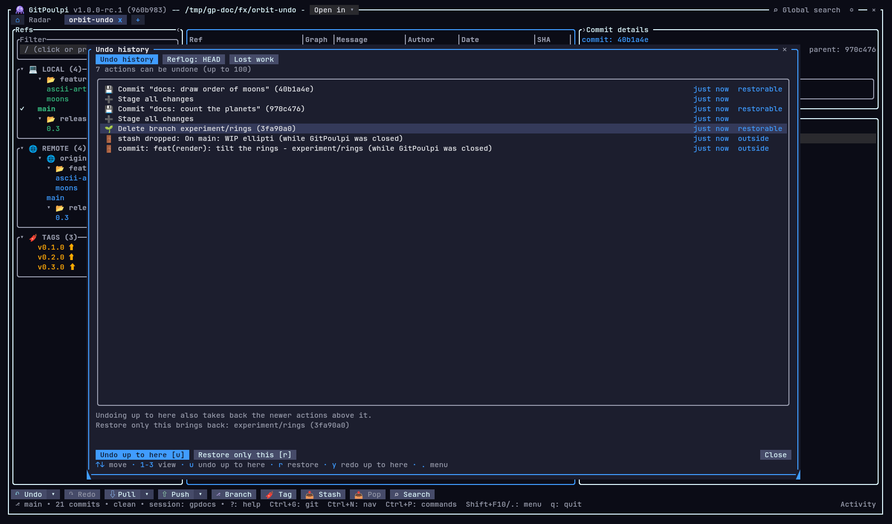
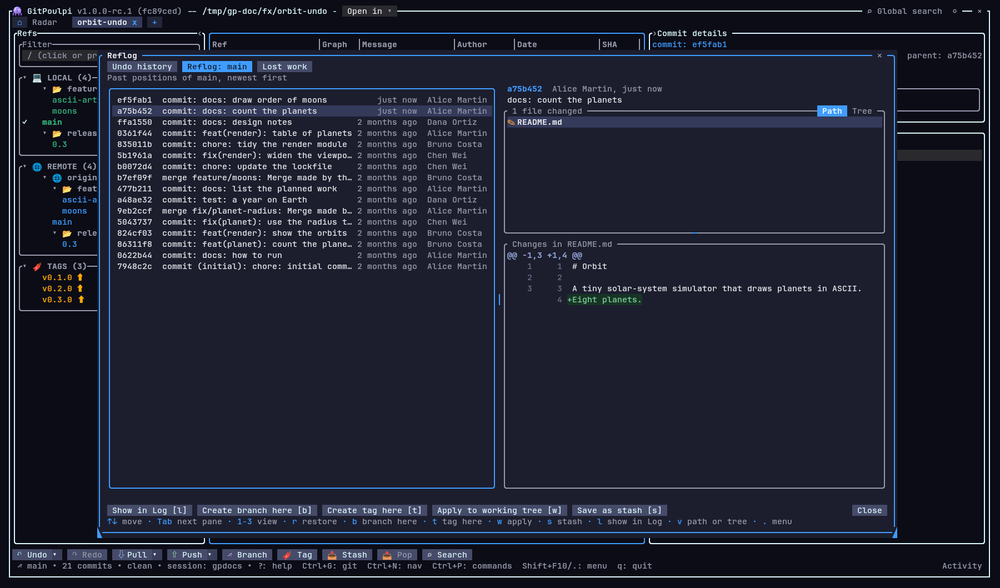

[English](../undo-redo.md) · [Čeština](../cs/undo-redo.md) · [Deutsch](../de/undo-redo.md) · [Español](../es/undo-redo.md) · [Français](../fr/undo-redo.md) · [Italiano](../it/undo-redo.md) · [日本語](../ja/undo-redo.md) · [한국어](../ko/undo-redo.md) · [Nederlands](../nl/undo-redo.md) · [Polski](../pl/undo-redo.md) · [Português (Brasil)](../pt-BR/undo-redo.md) · [Português (Portugal)](../pt-PT/undo-redo.md) · [Русский](../ru/undo-redo.md) · [Svenska](../sv/undo-redo.md) · **Türkçe** · [Українська](../uk/undo-redo.md) · [简体中文](../zh-CN/undo-redo.md)

# Geri al ve yinele

**Her zaman geri dönebilirsiniz.** GitPoulpi'nin deponuzda yaptığı her değişiklik
kaydedilir (varsayılan olarak 100 eyleme kadar, `general.undo_depth`); bir dalın
bulunduğu her konum da kaydedilir, başka programların yaptığı hareketler dahil.
Bir hata yaparsanız aşağıdakilerden biri çalışmanızı geri getirir:

| Yapmak istediğiniz | Kullanın |
|---|---|
| son yapılan şeyi geri almak | `Ctrl+Z` (yinele: `Ctrl+Y` ya da `Ctrl+Shift+Z`) veya araç çubuğundaki **Geri al** ve **Yinele** düğmeleri |
| birkaç şeyi birden ya da çok önce yapılan bir şeyi geri almak | **Geri alma geçmişi** (`Alt+Z`, Geri al'ın yanındaki ok, `Düzenle: Geri Alma Geçmişi...`) |
| birkaç eylem önce kaldırdığınız bir dalı, tag'i, stash'i, dosyayı veya hunk'ı, **o zamandan beri yaptıklarınızı geri almadan** geri getirmek | Geri alma geçmişindeki **Yalnızca bunu geri yükle** |
| bir dalı eski yerine taşımak (başka bir program taşımış olsa bile) | dalın **Reflog**'u (ref menüsünde `Reflog...`) |
| artık hiçbir dalın ulaşmadığı commit'leri bulmak | **Kaybolan çalışma** (`Düzenle: Kaybolan Commit'ler Kurtar...`) |
| bir kabuğun veya bir **YZ ajanının** dallar, tag'ler, stash'ler ya da HEAD üzerinde yaptığını geri almak | aynı `Ctrl+Z`: bu değişiklikler de geçmişte, **dışarıda** işaretiyle durur ([GitPoulpi dışında yapılan değişiklikler](#gitpoulpi-dışında-yapılan-değişiklikler) bölümüne bakın) |

Yok eden ve geri alınabilen her eylemden sonra (atma, dosya silme, dal veya tag
silme, hard reset, stash atma, uzak depo kaldırma) durum çubuğu bunu söyler: "atma
bitti - geri almak için Ctrl+Z"; tuş, sizin atadığınız haliyle gösterilir. Geri
al ipucu kaç eylem geriye gidebileceğinizi söyler.

`Ctrl+Z`, GitPoulpi'nin deponuza yaptığı son şeyi geri alır. `Ctrl+Y` (ya da
`Ctrl+Shift+Z`) onu geri koyar. Araç çubuğunda **Geri al** ve **Yinele**
düğmeleri vardır, paletin `Düzenle: Geri Al` ve `Düzenle: Yinele` komutları
vardır ve her düğmenin ipucu neyi geri alacağını söyler ("Geri al: Commit
\"fix typo\" (a81b9e4)").


Yinele işlemi asla yeniden çalıştırmaz. Kaydedilmiş durumu geri yükler; bu yüzden
yinelenen bir commit, aynı kimlik ve aynı zaman damgasıyla tam olarak aynı
commit'tir.

Bir metin alanı klavyeyi tutarken `Ctrl+Z` etkisizdir (commit mesajı, filtre
kutusu, kendi metin geri almasını tutan düzenleyici).

## Geri alma geçmişi

`Alt+Z` (yeniden atanabilir), Geri al düğmesinin yanındaki ok veya `Düzenle: Geri
Alma Geçmişi...` kaydedilmiş her eylemi içeren bir panel açar, en yeni önce: eylemin türünü
gösteren bir simge (commit, dal, tag, stash, reset, merge ve benzerleri, atma,
stage'leme, yapılandırma, dış değişiklik), ne yaptığı kendi dilinizde, ne kadar
önce olduğu ve durumu (**tek başına geri yüklenebilir**, nedeniyle birlikte
**engelli** ya da **geri alındı** ve yinelemeye hazır). Girdiler birkaç güne
yayıldığında ince bir başlık (Bugün, Dün, sonra tarih) her günü başlatır. Başlık
bunları sayar ("12 eylem geri alınabilir (en çok 100)").

Geri aldığınız eylemler, en yeni eylemin **üstünde**, bir ayracın altında ("geri
alındı - Yinele bunları geri getirir") soluk renkte durur; Yinele'nin geri
getireceği ayraca en yakın olanıdır. Seçim bunların üzerinde değil, en yeni
eylemde başlar. Ok tuşları gezinir (başlıklar ve ayraç atlanır), `1` / `2` / `3`
(veya `Ctrl+Tab` / `Ctrl+Shift+Tab`) üç görünüm arasında geçiş yapar, `Esc` kapatır.
`Enter` hiçbir zaman bir eylem çalıştırmaz: her düğmenin düğmelerin altındaki ipucu
satırında gösterilen kendi harfi vardır. Seçili satır için:

- **Buraya kadar geri al** (`u`): o eylemi ve ondan yeni her eylemi, en yeniden
  başlayarak geri alır; hepsini listeleyen tek bir onaydan sonra. Daemon'un riskli
  bulduğu bir adım, çalışmadan önce yeniden sorar.
- **Yalnızca bunu geri yükle** (`r`): o tek eylemin kaldırdığını geri getirir ve
  ondan sonra yapılan her şeyi korur. Silinmiş bir dal veya tag sahip olduğu
  commit'te geri gelir (adı şimdi kullanımdaysa başka bir ad sorulur, boş bir ad
  doldurulmuş olarak); atılmış bir stash stash listesinin başına geri konur; atılmış
  ya da silinmiş bir dosya, o zamandan beri dokunulmamışsa yerine geri yazılır,
  aksi halde yanına `name.restored` olarak yazılır (hiçbir şeyin üzerine yazılmaz);
  kaldırılmış bir uzak depo, upstream, ignore satırı veya attributes satırı yeniden
  eklenir. Bir reset, amend, rebase, merge veya commit, eski uçta `restore/<dal>-<sha>`
  adlı bir dal alır - geçerli dalınız ve dosyalarınız asla hareket etmez. Onay,
  tam olarak ne yapacağını gösterir ve geri yükleme yeni bir eylemdir: `Ctrl+Z`
  onu geri alır.
- **Tüm diziyi geri al** (`x`): en yeni girdiler tek bir dizi çalıştırmasının olduğu sürece sunulur
  (bkz. [Dizi çalıştırmaları](#dizi-çalıştırmaları)).
- Geri alınmış bir satırda **Buraya kadar yinele** (`y`).
- **main dalını Commit eyleminin bıraktığı yere geri yükle** (`o` veya panelin dışından
  `Alt+Shift+Z` / `Düzenle: Dalı Engelli Eylemin Bıraktığı Yere Geri Yükle`): başka
  bir program dalı taşıyıp Geri al'ı engellediğinde, reflog eylemin onu nerede
  bıraktığını hâlâ bilir.

Aynı eylemler için bir satıra sağ tıklayın (veya `.` tuşuna basın): menü olarak
açılır.

Bir [dizinin](sequences.md) bir adımının yaptığı bir satır `⟳ Backup` rozetini taşır ve ayrıntı satırı
hangi adım olduğunu söyler ("\"Backup\" dizisi yaptı, adım 3/4.").



## Reflog

Yerel bir dalın ref menüsünde **Reflog...** vardır; `Düzenle: Reflog...` HEAD'in
reflog'unu gösterir ve Geri alma geçmişinde bunun için bir sekme vardır. Dalın
bulunduğu konumları listeler, en yeni önce: kısa SHA, kaydedilen neden, ne kadar
önce ve kim tarafından - bir kabukta yapılan hareketler dahil. Seçili konumun
mesajı ve değişen dosyaları listenin yanında gösterilir.

Reflog 200 konumluk sayfalar halinde okunur. Daha uzun olan kendiliğinden devam
eder: imleci (veya kaydırmayı) listenin sonuna yaklaştırmak sonraki sayfayı
getirir ve bir sonraki varken son satır **... Daha fazla yükle** der. **Daha fazla
yükle** (`d`, veya paletteki `Reflog: Daha Fazla Yükle`) onu hemen getirir ve
durum çubuğunda "yüklenen konumlar: N" der. Git'in reftable biçimini kullanan
depolar da diğerleri gibi okunur.



**Log'da göster** (`l`), **Burada dal oluştur** (`b`), **Burada tag oluştur** (`t`),
**Çalışma ağacına uygula** (`a`), **Stash olarak kaydet** (`s`) (son üçü aşağıda Kaybolan
çalışma'daki gibi çalışır) ve
**`<dal>` dalını bu konuma geri yükle** (`r`). Geri yükleme geri alınabilir. Dal
checkout edilmişse ve üzerine yazmadan taşıyamayacağı yerel değişiklikleriniz
varsa, bir açılır liste onlara ne olacağını sorar: değişikliklerimi koru, soft,
mixed veya hard. Hard dosyalarınızdaki değişiklikleri atar ama önce kaydeder; bu
yüzden `Ctrl+Z` onları yine geri getirir (bunu kırmızıyla söyler).

## Kaybolan çalışma

`Düzenle: Kaybolan Commit'ler Kurtar...` (Log'un commit menüsünde de) hiçbir dalın,
tag'in veya stash'in ulaşmadığı commit'leri bulur: bir reflog'un hâlâ adını andıkları
(silinmiş bir dalın commit'leri), yalnızca bir undo pin'inin tuttukları ve sahipsiz
olanlar. Liste hemen görünür; sahipsiz commit'ler için daha yavaş tarama, bir
döndürücü gösterilirken dolar; arayüzü asla bloklamaz.


**Burada dal oluştur** (`b`) bir commit'i seçtiğiniz bir adla kurtarır,
**Burada tag oluştur** (`t`) onu bir tag ile sabitler (varsayılan ad
`restored-<kısa kimlik>`), **Cherry-pick** (`c`) onu geçerli dala uygular. Kaybolan
bir commit Log'da yoktur; bu yüzden bu görünümde "Log'da göster" yoktur (Reflog
görünümü bunu hâlâ ulaşılabilir commit'ler için korur).

**Değişiklikleri geri getir**, commit'in değiştirdiklerini commit'lemeden geri koyar:
**Çalışma ağacına uygula** (`a`) commit'in değişikliklerini dosyalara yeniden uygular,
ya hep ya hiç (dizin ve HEAD olduğu gibi kalır; merge commit'i reddedilir). Temiz
uygulanamadığında hiçbir şeye dokunulmaz ve pencere **Stash olarak kaydet** (`s`)
önerir; bu, aynı değişiklikleri bunun yerine yeni bir stash olarak saklar ve bu eylem
tek başına da her zaman kullanılabilir. İkisi de journal'a yazılır: `Ctrl+Z` dosyaları
geri koyar ya da stash'i yeniden siler. Aynı eylemler `gitpoulpi apply-commit <rev>` ve
`gitpoulpi stash from-commit <rev> [-m M]` komutlarıdır ve Reflog görünümünde de vardır.

### Paneller, hunk'lar ve pencere

Reflog ve Kaybolan çalışma solda commit listesini, sağda ise seçili commit'in
başlığını, **değiştirdiği her dosyayı** ve seçili dosyanın hunk'larını gösterir
(yalnızca hunk'lar, panele sığacak şekilde sarılır). Dosya listesi ana pencerenin
sağ panelindekiyle aynıdır: `Yol` veya `Ağaç` (`v`, ya da düğmeye tıklayın), bir klasör
`Enter`, `Left` veya `Right` ile katlanır, bir tıklama ya da oklar bir dosya seçer ve
hunk'ları altında görünür (daemon'a arayüz iş parçacığının dışında sorulur; son birkaç
dosya tutulur). Commit listesinin, dosya listesinin ve hunk'ların her birinin basıp
sürükleyebileceğiniz bir kaydırma çubuğu vardır.

- `Tab` / `Shift+Tab` panelleri dolaşır (liste, dosyalar, hunk'lar); oklar, `PageUp`,
  `PageDown`, `Home` ve `End` klavyenin bulunduğu panelde çalışır (kenarlığı yanar).
  Bir dosyada `Enter` hunk'larına geçer.
- **Ayraçlar**: liste ile sağ panel arasındakini ya da dosyalar ile hunk'lar
  arasındakini sürükleyin; bir ayraca çift tıklamak onu sıfırlar. Klavye:
  `Alt+Left` / `Alt+Right`, `Alt+Up` / `Alt+Down`, `Alt+0` ikisini de sıfırlar.
  Paletteki `Reflog / Kaybolan Çalışma: Panel Boyutlarını Sıfırla`, `Sonraki Panel` ve
  `Dosya Listesi Yol veya Ağaç` satırları aynısını yapar.
- `Ctrl+N` ana pencerede olduğu gibi üç görünüm sekmesinin ve üç panelin üzerinde
  rozetler gösterir; bir rozet tuşu oraya atlar.
- **Pencereyi taşıyın ve boyutlandırın**: taşımak için başlık çubuğunu, boyutlandırmak
  için sol, sağ ve alt kenarları ya da bir alt köşeyi (`◢` tutamağı) sürükleyin (hiçbir
  zaman 60 x 16'dan küçük olmaz, hep ekranda kalır). Kapatma çarpısı kendi tıklamasını
  korur ve pencerenin dışında bırakmak onu asla kapatmaz. Klavye karşılığı `Ctrl+N` ve
  ardından `m`'dir: oklar taşır, `Shift`+oklar boyutlandırır, `0` sıfırlar, `Enter` veya
  `Esc` çıkar (açıkken kenarlık bunu söyler). Paletteki `Pencere: Taşı veya
  Boyutlandır` ve `Pencere: Konumu ve Boyutu Sıfırla` satırları da vardır. Yerin
  korunup korunmayacağı `ui.dialog_geometry` ayarıdır (*Ayarlar > Görünüm > Düzen >
  Pencere konumunu ve boyutunu hatırla*): `session` (varsayılan), `saved` (sonraki
  açılışta geri yüklenir) veya `never`.

## Komut paletinden

Üç görünümün her satır eylemi aynı zamanda bir komut paleti satırıdır; böylece panel
için fare de, akılda tutulacak bir harf de gerekmez. Panel açıkken `Ctrl+P` tuşuna
basın: palet üstünde açılır ve **Geri Alma Geçmişi:**, **Reflog:** ve **Kaybolan
Çalışma:** satırları ekrandaki görünümün seçili satırı üzerinde çalışır.

| Görünüm | Palet satırları |
|---|---|
| Geri alma geçmişi | `Geri Alma Geçmişi: Buraya Kadar Geri Al...`, `Buraya Kadar Yinele...`, `Tüm Diziyi Geri Al`, `Yalnızca Bunu Geri Yükle...`, `Dalı Eski Yerine Geri Yükle...`, `Yenile`, `Kapat` |
| Reflog | `Reflog: Log'da Göster`, `Burada Dal Oluştur...`, `Burada Tag Oluştur...`, `Değişiklikleri Çalışma Ağacına Uygula`, `Değişiklikleri Stash Olarak Kaydet`, `Bu Konuma Geri Yükle...`, `Daha Fazla Yükle`, `Yenile` |
| Kaybolan çalışma | `Kaybolan Çalışma: Burada Dal Oluştur...`, `Burada Tag Oluştur...`, `Cherry-pick`, `Değişiklikleri Çalışma Ağacına Uygula`, `Değişiklikleri Stash Olarak Kaydet`, `Yeniden Tara` |

Görünümleri açık değilken satırlar (nedeniyle birlikte) soluk gösterilir; üç açıcı,
`Düzenle: Geri Alma Geçmişi...`, `Düzenle: Reflog...` ve `Düzenle: Kaybolan Commit'ler
Kurtar...`, açık bir paneli kendi görünümlerine de geçirir. Seçimin yapamayacağı bir
satır, hiçbir şey yapmamak yerine durum çubuğunda nedenini söyler: "bu eylem zaten geri
alındı: Buraya kadar yinele'yi kullanın", bir girdinin tek başına neden geri
yüklenemediği, "yalnızca bir dal veya HEAD geri taşınabilir" ve benzerleri. `...`
satırları düğmeyle aynı onayı ya da ad istemini açar.

## Dizi çalıştırmaları

Bir [dizi](sequences.md) (Yedekleme: hepsini stage'le, YZ commit mesajı, commit, push) bir şeyi değiştiren
**her adım için tek bir olağan günlük girdisi** oluşturur: buradaki stage ve commit, YZ mesajı ve push değil
(bir push asla geri alınmaz, aşağıya bakın). Günlük depo başınadır ve kesinlikle en yeni başta olacak biçimdedir,
bu yüzden bir çalıştırma tek bir girdi olamaz: her biri kendi denetimlerini korur ve her biri onu yapan
çalıştırmayla etiketlenir (`sequence:Backup#<run> 3/4`). Eski günlüklerde etiket yoktur ve eskisi gibi yüklenir.

**Tüm diziyi geri al**, bir çalıştırmanın girdilerini en yeniden başlayarak, her biri olağan bir Geri al olarak geri alır.
Günlüğün en yeni girdileri tek bir çalıştırmanınsa, ardışıksa sunulur: başka bir çalıştırmanın bir girdisi, elle
yaptığınız bir değişiklik ya da araya giren GitPoulpi dışında yapılmış bir değişiklik grubu bitirir. Nerede olduğu:

- Geri alma geçmişi: `Tüm diziyi geri al` düğmesi (`x`), satırın sağ tık menüsü ve
  `Geri Alma Geçmişi: Tüm Diziyi Geri Al` palet satırı;
- komut paleti: `Düzenle: Tüm Diziyi Geri Al` (uygulanırken satırda dizinin adı bulunur);
- komut satırı ve MCP: `gitpoulpi undo --sequence` (aşağıda).

Her girdi, tek bir Geri al'ın yapıldığı gibi tek başına denetlenir: upstream'inde zaten olan bir commit
gitmeden önce "yine de geri alınsın mı?" diye sorar (yanıtlayın, gerisi devam eder) ve ilerlemiş bir dal ya da
sürmekte olan bir merge reddeder. İlk ret (veya bir soruya "hayır") **durdurur** ve hangi adım olduğunu ve nedenini
söyler: *"Backup" geri alma 3/4. adımda durdu (Commit "wip" (a81b9e4)): ... Kalan eylem: 2*.
Geri alınan geri alınmış kalır, daha eski girdiler günlükte durur ve düz bir Geri al (ya da düğme yeniden) oradan devam eder.

Yalnızca bu deponun günlüğü geri alınır. Başka bir depoda da işlem yapan bir çalıştırma (bir worktree adımı
sonraki adımları yeni worktree'nin sekmesine taşıdı) o deponun kendi günlüğünde girdiler bıraktı; onu açın ve orada
geri alın. **Yinele** girdi başınadır: bütün bir çalıştırmayı geri aldıktan sonra `Ctrl+Y` en yeni adımı geri getirir,
sonra bir sonrakini, her biri kendi denetimiyle.

## Nelerin geri alınabildiği

| Alan | İşlemler |
|---|---|
| Commit'ler | commit, amend, reword, YZ commit composer (tüm commit'leri tek adım olarak) |
| Dallar ve tag'ler | oluşturma, silme, yeniden adlandırma, upstream'i ayarlama veya kaldırma, izleme dalı oluşturma, tag oluşturma / silme / not ekleme, fast-forward, bir pull request'i dal olarak checkout etme |
| Dolaşma | bir dalın veya bir commit'in checkout'u (ayrık HEAD dahil) |
| Geçmiş | merge (fast-forward ya da merge commit), rebase (sade ve etkileşimli, bittikten sonra), cherry-pick, revert, reset (soft, mixed ve hard), bir pull'un yerel kısmı, **Pull: tüm dallar** (taşıdığı her dal tek adımda; checkout yapılmış dalın dosyaları da onunla geri gelir) |
| Çalışma değişiklikleri | stage ve unstage (dosya, klasör, hunk, satırlar, tümü), atma (dosya, klasör, hunk, satırlar, bir dosya checkout'u), yama veya bir commit'in değişikliklerini uygulama (`apply-commit`), **bir dosyayı diskten silme**, **yok sayma** (dosya, uzantı veya klasör: seçtiğiniz `.gitignore` dosyasındaki satır), **ikili ya da metin olarak ele alma** (`.gitattributes` satırı) |
| Stash'ler | push, apply, pop, drop, bir commit'in değişikliklerini stash olarak kaydetme (`stash from-commit`) |
| Uzak depolar ve yapılandırma | bir uzak depoyu ekleme, kaldırma, yeniden adlandırma, URL'sini veya push URL'sini değiştirme, Git LFS izleme ve izlemeyi bırakma |
| Bir sunucuda | **bir uzak depodaki dalı veya tag'i silme** (ref'in menüsünden, paletten, `branch delete-remote`, `tag delete-remote`, `tag delete --both` ile ya da uzak dalı da silen bir iş akışı bitirmesiyle): aşağıya bakın |

Bir merge, cherry-pick veya revert çakışmalarda durmuşken **Kaydet ve Çözüldü
İşaretle**, stage ve unstage de geri alınabilir (her biri altındakinden önce geri
alınır) ve **Merge işlemini iptal et** (ya da cherry-pick, revert) geri alınabilir: onu
geri almak durmuş işlemin tamamını geri getirir; çakışmalarıyla (çözülmemiş her
dosyanın üç sürümü), zaten çözülmüş ve stage'lenmiş dosyalarla, çalışma
ağacındaki çakışma işaretleriyle ve merge mesajıyla birlikte; yinele yeniden
iptal eder. Stage'ler ve çözümler, işlem bittiğinde (commit'lendiğinde ya da
iptal edildiğinde) geri alınabilir olmaktan çıkar. *Unstage* ve *Unstage All*,
hâlâ çakışmalı olan bir dosyaya asla dokunmaz: geri alınacak staged bir
değişikliği yoktur.

Bir atma ya da hard reset'in attığı her şey önce saklanır; bu yüzden geri almak
tam baytları, izlenmeyen dosyaları, çalıştırılabilir bitleri ve sembolik
bağlantıları da geri getirir. Silinmiş bir stash'i geri almak aynı stash'i, aynı
commit kimliğiyle geri verir (eski konumunda değil, stash listesinin başında,
`stash@{0}` olarak). Bir uzak deponun kaldırılmasını geri almak, onun uzak izleme
dallarını, `origin/HEAD` takma adını ve onu izleyen dalların upstream ayarlarını
geri verir.

### Bir uzak sunucudaki dalı veya tag'i silme

Silmeden önce GitPoulpi, dalın veya tag'in şu an ne tuttuğunu sunucuya sorar ve
kaydeder: uzak depo, ad ve tam commit (açıklamalı bir tag için tag nesnesinin
kendisi, böylece açıklaması korunur). Silme ancak sunucu hâlâ bu değeri tutuyorsa
yapılır.

**Geri al onu geri gönderir**: aynı adla, aynı commit'te, asla zorlamadan. Bu,
başkalarının gördüğü bir sunucuda yapılan bir değişiklik olduğundan Geri al
**her zaman önce sorar** ve bunu söyler ("Bunu geri almak origin üzerinde topic
dalını 3f2a1c0... konumunda yeniden oluşturur"); girdinin adımları da bunu söyler
(`gitpoulpi undo --dry-run`). Bir push ile aynı kimlik bilgilerini kullanır. Uzak
izleme dalı da onunla birlikte geri gelir. **Yinele** onu aynı güvenlikle yeniden
siler.

Geri al, hiçbir şeyi değiştirmeden şu durumlarda reddeder:

- dal veya tag o zamandan beri uzak depoda **yeniden oluşturulmuş** ya da
  taşınmış: kaydedilenden başka bir commit'te ve push, bir başkasının çalışmasının
  üzerine yazardı (ret iki commit'i de adlandırır);
- commit (veya tag nesnesi) **artık deponuzda yok** (çöp toplamayla silindi):
  geri alma yapılamaz.

"Yerelde ve uzak depoda sil" **tek bir girdidir**: Geri al yerel ve uzak dalı ya da
tag'i birlikte geri yükler, Yinele ikisini de yeniden siler. Yalnızca uzak dalı
silmek yerel olana dokunmaz; geri almak da aynısını yapar. Uzak dalı da silen bir
iş akışı bitirmesi bütün olarak geri alınabilir.

## Nelerin geri alınamadığı ve nedeni

- **Bir sunucudaki çoğu şey**: push, bir tag push'lama, LFS push, kilitleme ve
  kilidi açma, pull request açma. Bu durum başkalarıyla paylaşılır; bir push'u
  geri almak onların tarafında bir force-push veya silme olurdu ve GitPoulpi bunu
  sizin yerinize yapmaz. (Bir uzak dalı veya tag'i silmek istisnadır: geri alma
  yalnızca sunucunun tuttuğunu geri koyar ve orada bir şey değiştiyse reddeder.)
  Geri al da böyle bir işlem yüzünden asla engellenmez.
- **Fetch**: yalnızca sunucuyu yansıtan uzak izleme ref'lerini hareket ettirir.
  Sonraki fetch bunu yine yapardı.
- **Bir rebase'i iptal etmek**: bunun için geri al sunulmaz (bir rebase dalları
  hareket ettirir ve kendi durumunu tutar; iptal etmek zaten geri dönüş yoludur).
  Bir **merge, cherry-pick veya revert**'i iptal etmek ise yukarıda anlatıldığı
  gibi kaydedilir.
- **Bir worktree oluşturmak**, **bir worktree'yi kaldırmak** (önce kaydedilen
  şey kalır: commit, stash; onunla birlikte silinen dal günlüğe yazılır, yani Geri Al
  klasörü değil dalı geri getirir), **bir yama dosyası oluşturmak**, clone, init,
  barındırma eylemleri (pull request'ler, issue'lar) ve YZ çağrıları: bunlar
  deponun geçmişinin parçası değildir.
- Dosya menüsünden **yeni boş bir dosya oluşturmak**, bir merge sonrasında
  `*.orig` dosyalarının otomatik kaldırılması ve yerleşik düzenleyicide bir dosya
  kaydetmek kaydedilmez. **SSH komutunu** (`core.sshCommand`) veya **kısmi checkout**'u değiştirmek de
  kaydedilmez (hiçbir şey kaybolmaz; *Kapat* her dosyayı geri getirir).
- **`.git/info/exclude` veya `.git/info/attributes` dosyasına yazmak** (yok sayma ve ikili/metin olarak ele alma listelerindeki "yalnızca bu klon" seçeneği): bu dosyalar çalışma ağacının dışındadır, bu yüzden kaydedilmez.
- **GitPoulpi dışında çalışma ağacındaki dosyalarda yapılan düzenlemeler** (bir
  düzenleyici, bir betik, kod yazan bir YZ ajanı) hiçbir zaman yakalanmaz: onların
  anlık görüntüsü yoktur; bu yüzden bir kabukta yapılan `git reset --hard` ya da
  `git checkout -- file` commit'lenmemiş düzenlemeleri kalıcı olarak kaybeder. Bir
  kabuğun işinden yakalanan, ref'lerde yaşayandır: sonraki bölüme bakın.

## GitPoulpi dışında yapılan değişiklikler

Bir YZ ajanıyla (ya da GitPoulpi'nin yanında bir kabukla) çalıştığınızda git
işinin çoğu pencerenin dışında olur: commit'ler, yeni dallar ve worktree'ler,
silinen dallar, reset'ler, rebase'ler, stash'ler. GitPoulpi bunları da görür.
Daemon gördüğü son ref'leri (yerel dallar, tag'ler, HEAD, stash listesi, worktree
listesi) tutar ve depo değiştiğinde ve bu GitPoulpi'nin kendi işi olmadığında,
geri alma geçmişine **tutarlı her değişiklik için bir girdi** kaydeder; **dışarıda**
işaretiyle, git'in günlüğe yazdığı nedenle (`commit: fix login`, `rebase
(finish)`, `reset: moving to HEAD~1`, `checkout: moving from a to b`) ve git'in
bunu yapan için kaydettiği adla. GitPoulpi bir kabuğu bir YZ ajanından ayırt
edemez ve asla tahmin yürütmez; girdi yalnızca dışarıda yapıldığını söyler.

- **Bir seri tek girdidir.** İki bakış arasında yapılan yirmi commit, ilk
  değerden sonuncuya tek bir girdidir; bir rebase, bittiğinde kaydedilen tek bir
  girdidir (bir rebase veya merge durmuşken hiçbir şey kaydedilmez).
- **Silinen ref'ler sabitlenir.** Kaybolan bir dal, tag veya stash, hiçbir şey onu
  budayamadan önce eski commit'inde `refs/gitpoulpi/undo/` altında canlı tutulur;
  böylece **Yalnızca bunu geri yükle** (ya da `Ctrl+Z`) ajanın sildiği dalı, reflog
  ve bir çöp toplama sonrasında bile geri getirir.
- **GitPoulpi kapalıyken.** Anlık görüntü günlüğün yanına kaydedilir
  (`.git/gitpoulpi/refs-snapshot.json`); böylece hiçbir GitPoulpi çalışmazken olan
  şey bir sonraki başlangıçta bulunur ve "GitPoulpi kapalıyken" diye işaretlenir.
- **`Ctrl+Z` bunlarda da diğer girdiler gibi çalışır**: ref'ler geri döner, silinmiş
  bir dal yeniden oluşturulur, atılmış bir stash yeniden saklanır, dışarıda yapılan
  bir checkout eski dalı yeniden checkout eder. Checkout yapılmış bir dal `git
  reset --keep` gibi geri döner: dosyalar onu izler ve yerel değişikliklerinizden
  biri yoldaysa **reddeder ve hiçbir şeyi değiştirmez**. Yinele onu yeniden uygular.
  **Yalnızca bunu geri yükle** de çalışır: silinmiş bir dal geri gelir ve sonraki
  eylemler kalır; taşınmış bir dal `restore/<dal>-<sha>` olarak geri gelir.
- **Durum çubuğu bunu bir kez söyler**: yeni bir dış girdi geldiğinde ve pencere
  öndeyken "dış değişiklik kaydedildi - geri almak için Ctrl+Z".
- Dış değişiklik artık en yeni girdi olduğundan, eski "dış bir değişiklik
  tarafından engellendi" reddi çoğunlukla ortadan kalkar: önce dış değişikliği
  geri alırsınız.

Kaydedilmeyenler: uzak izleme dallarının yalnızca fetch kaynaklı hareketleri
(sunucuyu yansıtırlar), GitPoulpi'nin kendi gizli ref'leri, hiçbir dal
değişikliği olmadan eklenen veya kaldırılan bir worktree (taşıdığı dalın girdisi
"çalışma ağacı eklendi: <yol>" der; geri almak yalnızca ref'leri taşır, worktree'yi
kaldırmaz) ve dosyaların içindeki her şey. `general.journal_outside = false`
(Ayarlar > Genel, "GitPoulpi dışında yapılan değişiklikleri kaydet") bunu kapatır:
dışarıda yapılan hiçbir şey kaydedilmez ve dışarıda yapılan bir değişiklik en yeni
girdiyi, eskiden olduğu gibi, engeller.

## Geri alma reddettiğinde

Harekete geçmeden önce GitPoulpi, işlemin dokunduğu her şeyin işlemin bıraktığı
gibi olduğunu denetler. Değilse **hiçbir şey değiştirmez** ve nelerin kaydığını
söyler:

- `main`, Commit'in bıraktığı a81b9e4'te değil 3f2a1c0'dadır (örneğin bir
  kabukta yapılmış bir commit);
- bir dosya, indeks, bir stash ya da bir yapılandırma bölümü sonradan değişmiştir;
- bir merge, rebase veya cherry-pick sürmektedir;
- işlem, çalışırken GitPoulpi durdurulduğu için hiç tamamlanmamıştır (girdi
  *kesintiye uğradı* olarak işaretlenir, asla kendiliğinden geri alınmaz ve
  `gitpoulpi undo --list` neyi değiştirmek üzere olduğunu gösterir; böylece elle
  düzeltebilirsiniz).

Geri al kesinlikle son giren ilk çıkar sırasındadır: engellenmiş en yeni girdi,
daha eskileri de engeller; çünkü hâlâ geçerli olan daha yeni bir işlemin altındaki
daha eski bir işlemi geri almak tahmin yürütmek olurdu. Her şeyi kendiniz eski
haline getirirseniz girdi yeniden geçerli olur. Bir girdinin dokunmadığı hiçbir
şeye dokunmayan değişiklikler (başka bir daldaki bir kabuk commit'i, bir fetch)
hiçbir şeyi engellemez.

### Temizleyemediğiniz engelli bir girdi: Unut

En yeni girdi kalıcı olarak takıldığında (depo GitPoulpi dışında ilerlemiş ya da
girdi hiç bitmemiş), altındaki hiçbir şey de geri alınamaz. Geri al ipucu ve ret
bunu söyler ve çıkış yolunu adlandırır: paletteki **Düzenle: Engellenen geri alma
girdisini unut** (önce sorar) ya da komut satırında `gitpoulpi undo-forget`.
Unutmak yalnızca o tek girdiyi günlükten kaldırır; depoya asla dokunulmaz ve girdi
artık geri alınamaz ya da yinelenemez. Altındaki girdi o zaman en yeni olur.

İki durum kendiliğinden çözülür:

- düz git ile bitirdiğiniz çakışmalı bir merge veya rebase: girdi, GitPoulpi depo
  durumunu bir sonraki okuyuşunda kapatılır;
- **Kaydet ve Çözüldü İşaretle** ile çözdüğünüz, çakışmalı bir stash pop veya
  apply'ın dosyaları: Geri al, çözülmüş dosya hâlâ stage'liyken ve commit
  edilmemişken çakışmayı geri koyar.

## Onaylar

Geri al yalnızca riskli olduğunda sorar:

- geri aldığınız commit (veya merge, rebase, cherry-pick, revert) zaten dalın
  upstream'indedir: geri almak yayımladığınız geçmişi yeniden yazar ve sonucu
  force-push yapmanız gerekir;
- commit'lenmemiş değişiklikleriniz var ve geri alma çalışma ağacını hareket
  ettiriyor: değişiklikleriniz korunur, ancak biri yeniden yazılması gereken bir
  dosyadaysa geri alma hiçbir şeyi değiştirmeden durur.

- girdi bir uzak depodaki dalı veya tag'i sildi: onu geri almak **sunucuya geri
  push'lar** (yukarıya bakın), bu yüzden her zaman sorar; onu orada yeniden silen
  yinele de öyle.

Tüm bir diziyi geri almak listeyi bir kez sorar (panelde), sonra riskli her girdi yukarıdaki gibi yeniden sorar.

Yinele ve yalnızca ref taşıyan her geri alma asla sormaz: diğer yön bir
tuş uzağınızdadır.

## Ne kadar geriye

`general.undo_depth` (Ayarlar > Genel) tutulan işlem sayısıdır. Varsayılan
**100**'dür; `0` sınırsız demektir. Düşürmek en eski girdileri hemen unutur. Bir
geri almadan sonra yeni bir işlem başlatmak, her düzenleyicide olduğu gibi,
yineleyebileceğiniz şeyleri siler.

Geçmiş worktree başına tutulur (bağlı bir worktree'nin kendi geçmişi vardır), git
klasöründe (`.git/gitpoulpi/journal.json`); bu yüzden programı kapatsanız da
korunur ve asla `git status` ya da bir commit'in parçası olmaz.

## Kapatmak

`general.undo_enabled = false` (Ayarlar > Genel, "Geri alma açık") tüm özelliği
kapatır (ve onunla birlikte dış değişikliklerin kaydı da). Hiçbir şey kaydedilmez ya da tutulmaz; böylece stage'leme, atma ve commit
biraz daha hızlıdır. Geri al ve Yinele düğmeleri kaybolur ve `Ctrl+Z` "Geri alma
kapalı (Ayarlar > Genel)" der.

**Kapatmak geçmişi siler**: günlük dosyası ve aşağıda anlatılan gizli ref'ler,
kapalıyken daemon'a ulaşan ilk istekte silinir. Yeniden açmak boş bir geçmişle
başlar.

## Nelerin saklandığı

Bir geri almanın asla veri kaybettirmemesini sağlamak için bir girdinin
ihtiyaç duyabileceği her commit, tag nesnesi, stash veya anlık görüntü, girdi
geçmişte durduğu sürece `refs/gitpoulpi/undo/` altındaki gizli bir ref ile
canlı tutulur. GitPoulpi'nin kendi listelerinin dışında bırakılırlar, ancak bir
kabukta `git log --all` veya `git for-each-ref` bunları gösterir ve
`git push --mirror` bunları push'lar (bunun yerine `git push --all` kullanın).
Girdileri geçmişten düştüğünde ya da geri al kapatıldığında silinirler. Başka
hiçbir şey asla silinmez.

## Komut satırından ve MCP'den

```
gitpoulpi undo [--dry-run] [--expect <id>] [--yes]
gitpoulpi redo [--dry-run] [--expect <id>] [--yes]
gitpoulpi undo --list [--all]
gitpoulpi undo --sequence [--dry-run] [--yes]
gitpoulpi undo-forget [--dry-run] [--redo] [--expect <id>] [--yes]
```

- `--dry-run` adımları anlatır ve hiçbir şeyi değiştirmez.
- `--list` günlüğü yazdırır, en yeni en sonda (`--all` artık yinelenemeyen ama
  hâlâ tutulan girdileri ekler), her girdinin kimliği ve durumuyla.
- `--expect <id>`, o girdi hâlâ en yeni olmadıkça çağrının *eski* diye reddetmesini
  sağlar: bir betik (veya ikinci bir pencere) baktığından başka bir şeyi asla
  geri almaz.
- `--sequence`, günlüğün en üstündeki dizi çalıştırmasını geri alır (bkz.
  [Dizi çalıştırmaları](#dizi-çalıştırmaları)): tek bir `sequence run` çalıştırmasının yaptığı en yeni
  ardışık girdiler, en yeniden başlayarak, her biri kendi denetimleriyle bir `undo`. `--dry-run` onları
  listeler; `--yes` olmadan bir tane isteyen ilk girdi (çıkış **3**) onu durdurur, adımı adlandırır, o ana kadar
  geri alınanlar `undone` içinde ve kalanlar `left` içinde. Bir ret `stopped.refused` ile **2** ile çıkar;
  günlüğün üstü tek bir çalıştırmanın değilse yanıt `{"no_sequence": {...}}`, çıkış 2'dir. Girdiler
  çalıştırmalarını `undo --list` içinde taşır (`summary.origin`: `name`, `run_id`, `step`, `of`).
  `--expect` ile birlikte kullanılmaz.
- `undo-forget`, engelli en yeni girdiyi günlükten düşürür (`--redo`: en yeni
  yineleme girdisi). O girdi engelli değilse reddeder ve `--yes` olmadan **3** ile
  çıkar. MCP için bir değişiklik işlemidir, ama yıkıcı değildir: depoya
  dokunulmaz.
- Çıkış kodu **0** yapıldı, **2** reddedildi (JSON nedenini adlandırır, örneğin
  silinmiş bir uzak dal yeniden oluşturulduğunda `RemoteRefMoved`), **3** riskli ve
  `--yes` gerekir (bir uzak depodaki dalın veya tag'in silinmesini geri almak
  sunucuya push'lar).

Sonrasındaki her şeyi geri almadan geri dönmek:

```
gitpoulpi undo-restore <id> [--name N] [--dry-run]      (ayrıca: undo restore <id>)
gitpoulpi reflog [<ref>] [--skip N] [--limit N]
gitpoulpi reflog-restore <ref> <oid> [--mode keep|soft|mixed|hard] [--dry-run]   (ayrıca: reflog restore ...)
gitpoulpi lost-commits [--skip N] [--limit N] [--no-deep] [--budget-ms MS]
```

- `undo --list` her girdi için **yalnızca bunu geri yükle** ile nelerin geri
  getirilebileceğini (`restore.items`) ya da neden hiçbir şeyin getirilemeyeceğini
  (`restore.not_restorable`) gösterir ve girdiyi kimin yaptığını:
  `"source": "gitpoulpi"`, ya da bir kabuğun veya YZ ajanının yaptığı bir değişiklik
  için `outside.message` (git'in nedeni) ve `outside.committer` ile `"source":
  "outside"`. `undo`, `redo` ve `undo-restore` dış girdileri diğerleri gibi işler.
- `undo-restore <id>` o tek girdinin kaldırdığını (silinmiş bir dal veya tag, atılmış
  bir stash, atılmış ya da silinmiş bir dosya, izleme dalları ve upstream'leriyle
  birlikte kaldırılmış bir uzak depo, bir ignore satırı) geri getirir ve sonraki
  her işlemi korur. Asla üzerine yazmaz: sonradan değişmiş bir dosya için saklanan
  sürüm yanına `<name>.restored` olarak yazılır; alınmış bir dal adı bir reddir
  (çıkış 2) ve boş bir ad önerir, onu `--name` ile verin; bir reset, amend veya
  rebase sonrasında eski uçta yeni bir dal oluşturur ve dalınızı asla hareket
  ettirmez. Geri yükleme tek bir günlük girdisidir, yani `gitpoulpi undo` onu geri
  alır.
- `reflog`, `HEAD`'in ya da bir dalın nerede bulunduğunu git'in gerekçesiyle listeler,
  bir kabuğun yaptıkları dahil. `reflog-restore` bir dalı (ya da `HEAD`'i) bu
  konumlardan birine taşır; commit edilmemiş değişiklikleri olan, checkout edilmiş
  bir dal için `--mode` gerekir. O da günlüğe yazılır.
- `lost-commits`, hiçbir dalın, tag'in, uzak deponun veya stash'in ulaşmadığı
  commit'leri listeler. Birinin işini commit'lemeden geri almak için:
  `apply-commit <rev>` (çalışma ağacına, ya hep ya hiç) veya `stash from-commit <rev>`
  (stash olarak); ikisi de journal'a yazılır.
- Bir kabuk hareketi en yeni girdiyi engellediğinde, ret girdinin beklediğini tutan
  reflog konumunu taşır (`reason.RefMoved.restore`); onu `reflog-restore`'a verin.

Yukarıdaki eylemlerin her yüzeyden geri alınabilir olması için iki komut vardır:
`gitpoulpi rm-file <yollar>` (dosyaları çalışma ağacından silme) ve
`gitpoulpi ignore <desen> [--file <yol/.gitignore>]` (bir `.gitignore` dosyasına
satır ekleme; satır zaten oradaysa hiçbir şey olmaz; geri almak dosyayı eski haline
getirir ya da komut oluşturduysa kaldırır ve dosya sonradan düzenlendiyse
reddeder).

MCP sunucusunda komut başına bir araç vardır, dolayısıyla `undo`, `redo`, `rm-file`
ve `ignore` da araçlardır. `undo`, `redo` ve `rm-file` yıkıcı olarak sınıflandırılır
(`reset` gibi kapılanır, bkz. [MCP ve ajanlar](mcp-and-agents.md)); `ignore` sıradan
bir değişiklik işlemidir. Günlük depodaki bir dosyadır; bu yüzden bir kabukta
`gitpoulpi undo` pencerenin yaptığını geri alır ve pencere bir betiğin yaptığını
geri alabilir.
