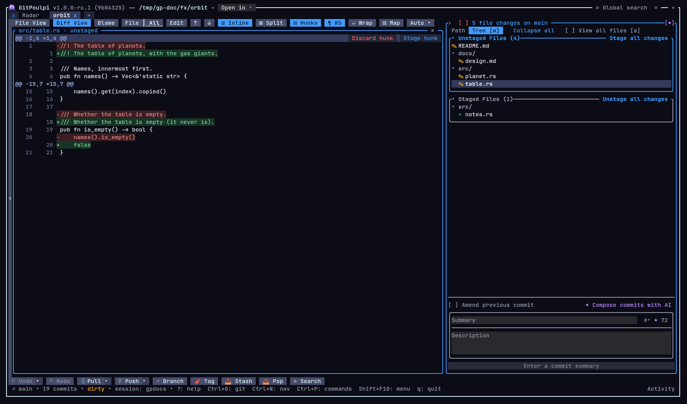

[English](../interface-tour.md) · [Čeština](../cs/interface-tour.md) · [Deutsch](../de/interface-tour.md) · [Español](../es/interface-tour.md) · [Français](../fr/interface-tour.md) · [Italiano](../it/interface-tour.md) · [日本語](../ja/interface-tour.md) · [한국어](../ko/interface-tour.md) · [Nederlands](../nl/interface-tour.md) · [Polski](../pl/interface-tour.md) · [Português (Brasil)](../pt-BR/interface-tour.md) · [Português (Portugal)](../pt-PT/interface-tour.md) · [Русский](../ru/interface-tour.md) · [Svenska](../sv/interface-tour.md) · [Türkçe](../tr/interface-tour.md) · **Українська** · [简体中文](../zh-CN/interface-tour.md)

# Огляд інтерфейсу

Ця сторінка називає кожну область вікна GitPoulpi, згори донизу. Інші сторінки
використовують ті самі назви. На знімках екрана невеликий демонстраційний
репозиторій із вигаданими авторами.

## Рамка

### Рядок заголовка

Верхній край вікна має вигляд
`🐙 GitPoulpi vX.Y.Z -- <шлях до репозиторію>` (назва сеансу - у рядку стану, типово внизу).

- **🐙** відкриває вікно **Про GitPoulpi**: версія, можливості збірки, ліцензія, посилання, коротка примітка про те, що GitPoulpi - незалежний проєкт, сторонні крейти, а також ліцензії та подяки. У терміналі, що малює зображення, восьминіг - піксельний логотип кольору вашого логотипа (в інших залишається емодзі). Палітра: `Довідка: про GitPoulpi`; клавіші: `Ctrl+N`, потім `A`. У вікні «Про GitPoulpi» зіниці восьминога стежать за вказівником миші. Клацніть логотип (або натисніть `Space`), щоб прокрутити його до наступного кольору. Праве клацання по логотипу (або `c`) показує список кольорів. GitPoulpi зберігає ваш вибір у `ui.logo_color`. Посилання відкриваються клацанням або своєю клавішею доступу (`s` вихідний код, `d` документація, `i` ліцензія), а `l` перелічує сторонні крейти з версіями та ліцензіями (список з прокруткою; `Esc` або `l` повертає назад, як і клацання по її заголовку). Кожен крейт у списку має посилання на його сторінку (репозиторій, а якщо його немає - сторінка на crates.io): клацніть рядок або виберіть його клавішами `↑` `↓` і натисніть `Enter`, щоб відкрити його в браузері. `t` (або команда палітри `Довідка: ліцензії та подяки`) показує ліцензійні повідомлення та подяки для всього, що вбудовано в програму, у вигляді тексту, що прокручується (`Up` / `Down`, `PgUp` / `PgDn`, `Home` / `End`; назад - `Esc` або `t`). У скрипті той самий текст виводить `gitpoulpi licenses`.
- **Версія** (`v1.0.0`, а коли є новіший випуск, `доступна vX.Y.Z`) стоїть
  між назвою та шляхом: клацання відкриває панель оновлення, коли є новіший випуск,
  а інакше вкладку **Нотатки до випуску**. Див. [Оновлення](updates.md).
- **Відкрити в ▾** одразу після шляху відкриває папку вкладки в терміналі,
  редакторі, мультиплексорі або файловому менеджері (`Alt+O`). Див.
  [Відкрити в](open-in.md).
- **⌕ Глобальний пошук** (лупа з підписом), одразу ліворуч від шестірні, відкриває [глобальний пошук](search.md) (`Ctrl+Alt+F`). Коли рядок заголовка завузький, ця кнопка першою поступається місцем: спершу зникає підпис (лупа лишається), потім уся кнопка.
- **Шестірня** (`⚙`), одразу ліворуч від **×**, відкриває **Налаштування** (`Ctrl+,`).
- **×** на правому краї виходить, як `q`.

### Рядок стану

Типово рядок стану - останній рядок вікна (**Налаштування > Вигляд > Розташування рядка стану** переносить його вгору, над вкладки репозиторіїв). Він показує поточну гілку, завантажені commit'и
(`500 / 48213 commits`, поки ще лишається завантажити старішу історію, з `...` замість
загальної кількості, поки її підраховують; просто `2500 commits`, коли завантажено всю історію),
`зміни` або `чисто`, назву сесії, позначку `розріджений` у частковому (sparse) checkout і
найкорисніші клавіші: `?` довідка, `Ctrl+G` дії git, `Ctrl+N` навігація, `Ctrl+P` команди,
`Shift+F10` меню, `q` вийти. У вузькому вікні найменш корисні клавіші опускаються. Рядок
стану також показує повідомлення про стан і прогрес. Клавіші, які він показує, завжди
чинні, зокрема й ті, що ви змінили (див. [Налаштування](settings.md#клавіатура-й-миша)).
Спосіб підрахунку загальної кількості - це налаштування (**Рахувати всі commits через**, див.
[Налаштування](settings.md#журнал-і-граф)).

На його правому краї кнопка **Активність** відкриває Журнал активності: вкладку «Операції git»
(операції з їхньою тривалістю, повідомлення та помилки), вкладку «Застосунок» (журнал застосунку
з полем рівня та кнопкою **Очистити журнал**) і поле **Область**, що звужує обидві до цього
репозиторію, робочого простору або всіх репозиторіїв. Число на кнопці рахує помилки, які ви ще
не переглянули. Ліворуч від неї індикатор завдань показує фонове завдання, що виконується, з `[x]`
для його скасування. Вкладка **Головна** має такий самий рядок стану з кнопкою «Активність»
унизу праворуч (вона відкривається на «Усі репозиторії»). Коли операція не вдається, рядок
стану червоним каже причину, де б ви не були; клацання по ньому (або `Журнал активності: відкрити
останню помилку` в палітрі) відкриває запис Журналу активності з подробицями, «Копіювати для ШІ»
і запропонованим наступним кроком. Усе це описано в розділі
[Коли щось не вдається](troubleshooting.md#коли-щось-не-вдається).

### Накладені вікна

Палітра команд, довідка, контекстні меню, діалоги, спливні вікна та Налаштування
відкриваються поверх вікна. Кожне має `✕` у правому верхньому куті рамки; `Esc` або
клацання по `✕` закриває його, а клацання поза межами закриває діалог, спливне вікно чи
панель (див. [Закриття вікон і діалогів](mouse-and-gestures.md#закриття-вікон-і-діалогів)).

## Рядок вкладок

Вкладка **Головна** (значок будинку) розташована на лівому краї, за нею -
[чип робочого простору](workspaces.md) (щойно у вас є робочий простір), закріплена вкладка
**Radar** (закривається, як будь-яка вкладка; див. [Radar](radar.md)) і вкладка
**Робочі простори**, коли ви її відкрили (`Alt+J`; закривається, як будь-яка вкладка). Далі
йде по одній вкладці на кожен відкритий репозиторій. Хрестик `x`, що закриває вкладку, видно
лише на активній вкладці та на вкладці під вказівником. Рядок вкладок містить лише вкладки
(кнопка [глобального пошуку](search.md) - у рядку заголовка).

**Налаштування > Вигляд > Розташування панелі вкладок** переносить цей рядок униз вікна (під рядок стану) або перетворює його на колонку біля лівого краю: одна вкладка в рядку, спершу Головна, потім чип робочого простору, Radar, вкладка «Робочі простори», вкладки (довга назва закінчується на `…`) і `+`. Коли вкладок більше, ніж рядків, рядок `…` показує, скільки приховано вище (`▲`) і нижче (`▼`), і відкриває список вкладок; колесо прокручує колонку. Поруч із панеллю інструментів-колонкою вкладки залишаються ззовні. Вікно вужче за 80 стовпців тримає вкладки вгорі. Клацання, хрестик закриття, клацання середньою кнопкою, меню правої кнопки, перетягування для зміни порядку та клавіатура працюють однаково в будь-якому положенні.

- **+** одразу після останньої вкладки відкриває невелике меню: **Нова вкладка** (`Alt+T`,
  палітра **Вкладка: нова вкладка**) і, поки їхні вкладки закриті, **Radar** і
  **Робочі простори** (`Alt+J`), які відкривають ці вкладки; **Вкладка: нова...** у палітрі
  відкриває те саме меню. **Нова вкладка** - це вигляд Головна з готовим полем пошуку, тож набране
  одразу фільтрує ваші репозиторії. Виберіть один (чи Огляд, Клонувати, Init), і його
  вкладка з'явиться в кінці панелі; уже відкритий репозиторій лише перемикається.
  `Esc` у порожньому пошуку, `Ctrl+W`, її `x` або клацання середньою кнопкою
  закривають Нову вкладку й повертають на вкладку, де ви були. Вона ніколи не
  зберігається у вашій сесії.

  
- Клацніть вкладку правою кнопкою або натисніть `Ctrl+T`, щоб відкрити меню вкладки:
  **Нова вкладка**, **Закрити вкладку**, **Закрити інші вкладки...**, **Закрити вкладки праворуч...**,
  **Додати в обране** (або **Прибрати з обраного**), **Додати до робочого простору** (або
  **Прибрати з робочого простору**, коли у вас є робочі простори), **Копіювати шлях**,
  **Відкрити в ›**, **SSH і облікові дані...** і **Розріджений checkout...**.
- `Ctrl+PageUp` і `Ctrl+PageDown` перемикають вкладки. `Ctrl+W` закриває поточну
  вкладку. Клацання середньою кнопкою по вкладці теж закриває її (з тим самим питанням).
- `t` (або `Ctrl+N t`) відкриває вибір вкладки, список відкритих вкладок із
  пошуком.
- **Зміна порядку вкладок:** натисніть вкладку репозиторію й перетягніть її вбік (тінь вкладки
  йде за вказівником, а смужка показує, куди вона стане; `Esc` скасовує), або перетягніть рядок
  вибору вкладки, натисніть `Alt+Вгору` / `Alt+Вниз` на виділеному рядку вибору, або виконайте в палітрі
  **Вкладка: перемістити ліворуч** / **Вкладка: перемістити праворуч**. Порядок зберігається разом
  із сеансом. Просте клацання без руху, як і раніше, вибирає вкладку. Будинок, чип робочого простору
  і `+` ніколи не переміщуються.
- **Вийти й cd сюди** з'являється праворуч від вкладок, коли ви запустили
  GitPoulpi через обгортку оболонки `gp`, а вкладка - не та папка, з якої ви
  запустили. Див. [Стеження за папкою активної вкладки](following-the-tab-folder.md).
- **Чип робочого простору** одразу після будинку (кольорова точка й назва або
  «Немає робочого простору») перемикає [робочий простір](workspaces.md): клацніть
  по ньому або натисніть `Alt+W`. З'являється, щойно у вас є робочий простір.

Із увімкненим **Запам'ятовувати вкладки** (типово) ваші вкладки повертаються
під час наступного запуску. Worktree відкривається у власній вкладці, одразу після
вкладки свого репозиторію (**Групувати вкладки worktree** у Налаштування > Загальні,
типово ввімкнено). Ця вкладка закривається, коли worktree видаляють.

### Головна

Вкладка Головна - це менеджер репозиторіїв. Вона має чотири розділи: **ВІДКРИТІ
РЕПОЗИТОРІЇ**, **ОБРАНЕ**, **НЕЩОДАВНІ РЕПОЗИТОРІЇ** і **УСІ РЕПОЗИТОРІЇ**. Кожен
рядок показує гілку, кількість commit'ів попереду й позаду та кількість змін.
Кожен рядок має зірку (обране), **Відкрити** або **Перейти**, **Закрити** або
**Прибрати** та меню `⋮`.

Угорі: **Огляд**, **Клонувати**, **Init**, поле пошуку, **Згорнути все** і
**Розгорнути все**. Папка, якої більше немає, сама зникає з *Нещодавніх* і *Усіх*.
Відсутнє обране залишається, із кнопкою **Прибрати**. **Прибрати** ніколи нічого не
видаляє на диску.

Клавіші: `Enter` відкрити, `f` обране, `x` закрити або прибрати, `.` меню,
`/` пошук, `Space` згорнути розділ, `Esc` назад до вашої вкладки.
`Ctrl+N` показує значок на полі пошуку, кожному розділі та кожній кнопці: натисніть символ значка, щоб перейти до елемента або натиснути його (див. [Значки](keybindings.md#значки)).

Одне поле пошуку фільтрує все під ним, зокрема обране: репозиторій залишається, якщо його назва, гілка або шлях містить введений текст. Робочі простори мають власну вкладку й не є сторінкою вкладки Головна: відкрийте її з меню біля `+`, клавішею `Alt+J` або з палітри й закрийте її кнопкою `x`: див. [Робочі простори](workspaces.md).

**Клонувати** перелічує для кожного підключеного профілю (GitHub, GitLab, Gitea, Forgejo, Azure DevOps, Bitbucket, Gerrit) репозиторії, до яких ви маєте доступ, по одному розділу на власника: спершу ваші, потім по одному на організацію чи групу (за алфавітом), кожен під заголовком. Замок позначає приватний репозиторій. Поле пошуку фільтрує всі розділи; розділ без збігів зникає. `Up` і `Down` пропускають заголовки, а `Home`, `End`, `PgUp` і `PgDn` працюють у списку.

## Панель інструментів

Типово це рядок під панелями та над рядком стану. **Налаштування > Вигляд > Розташування панелі інструментів** ставить його вгору (під вкладками), вниз або колонкою ліворуч чи праворуч від панелей (вікно вужче за 80 стовпців малює колонку рядком унизу). Кнопки стоять на початку рядка або колонки; **Налаштування > Вигляд > Вирівнювання кнопок панелі інструментів** ставить їх по центру або в кінець. Кожна кнопка має власний колір значка, який задає тема (див. [Теми](themes.md)). Коли місця на всі не вистачає, найменш важливі кнопки ховаються за `⋯`. У колонці кожна кнопка займає рядок, `▾` стоїть наприкінці рядка, а меню відкривається поруч із колонкою; меню нижньої панелі інструментів відкривається вгору.

| Кнопка | Що робить |
|---|---|
| **Скасувати**, **Повторити** | Скасовують або відновлюють останню операцію (`Ctrl+Z`, `Ctrl+Y`). Приховані, коли Скасування вимкнено. Див. [Скасування й повторення](undo-redo.md). |
| **Pull** `▾` | Робить pull так, як каже **Налаштування > Git і кодування > Кнопка Pull**. Список `▾` має **Fetch All**, **Pull (fast-forward, якщо можливо)**, **Pull (лише fast-forward)** і **Pull (rebase)**. Пункт списку виконується один раз і не змінює кнопку. |
| **Push** `▾` | Робить push поточної гілки. Список `▾` робить push один раз у вибраний вами віддалений репозиторій. |
| **Гілка** | Створює гілку на поточному commit'і. |
| **Tag** | Створює tag на поточному commit'і. |
| **Stash**, **Pop** | Ховає всі зміни в stash. Повертає останній stash (pop). |
| **LFS** `▾` | Дії Git LFS: fetch, checkout, pull, push, prune (`Ctrl+G l`). Прихована, коли Git LFS вимкнено. Див. [Git LFS](lfs.md). |
| **Flow** `▾` | Меню робочого процесу гілок (почати, завершити, синхронізувати, просунути; `Ctrl+G Shift+W`). Лише в репозиторії, що має робочий процес. Див. [Робочі процеси гілок](branching-workflows.md). |
| **Пошук** | Відкриває рядок пошуку commit'ів над Log (`f`). |

На кінці (праворуч у рядку, внизу в колонці), коли репозиторій прив'язано до хоста, **чип** показує pull request поточної гілки (наприклад `GH #12` або `GL !53`) або тьмяний `+ PR`. **Налаштування > Вигляд > Закріпити кнопку pull request в кінці** (типово ввімкнено) тримає його там; вимкнено, він іде разом з іншими кнопками й відповідає їхньому вирівнюванню. Див. [Інтеграції хостингів і трекерів issues](hosting-integration.md). У колонці випадаючий список профілів займає останній рядок.

На правому краї, коли у вас два чи більше [профілів](settings.md#профілі),
**випадаючий список профілів** вибирає авторство commit'ів для цього
репозиторію. Перший рядок, *Типовий*, відповідає **Налаштування > Профілі**. Після
вибору профілю GitPoulpi питає, чи записати також його ім'я та e-mail у конфіг git
репозиторію (`user.name`, `user.email`). **Записати в конфіг git** записує їх. `Esc`
залишає вибір лише в GitPoulpi. Палітра: `Репозиторій: змінити профіль...`.

Кожна кнопка має команду палітри та скорочення.

## Банери

Смуга над Log повідомляє, коли репозиторій в особливому стані. Вона має кнопки для
продовження роботи. Кожна кнопка також є командою палітри.

| Банер | Кнопки |
|---|---|
| Merge, cherry-pick або revert зупинився на конфліктах | **Вирішити конфлікти...**, **Commit merge** або **Продовжити**, **Перервати** |
| Триває rebase | **Вирішити конфлікти...**, **Продовжити**, **Пропустити**, **Перервати** |
| **Застосування патчів (git am)** | **Вирішити конфлікти**, **Продовжити**, **Пропустити**, **Перервати** |
| Залишений `index.lock` блокує всі зміни | **Видалити index.lock** (спершу питає) |
| Auto-stash не повернуто | **Pop now**, **Показати stash**, **Почати спочатку**, **Drop** (вибір залежить від стану) |

Див. [Вирішення конфліктів merge](merge-conflicts.md) і
[Усунення несправностей і FAQ](troubleshooting.md).

## Бічна панель Refs (ліворуч)

Дерево всього, що називає commit. Кожен розділ має лічильник у заголовку, шеврон для
згортання та власну позицію прокрутки. Перетягніть межу між двома розділами, щоб
змінити їхній розмір.

- Поле **Фільтр** угорі (`/`): фільтрує кожен розділ за назвою.
- **LOCAL**: ваші гілки, у папках за `/` (`feature/`, `fix/`). Галочка позначає поточну
  гілку. Папки можна вимкнути в Налаштуваннях.
- **REMOTE**: кожен віддалений репозиторій з його гілками під ним.
- **WORKTREES**: пов'язані worktree, якщо вони є. Двічі клацніть одне, щоб
  відкрити його у власній вкладці.
- **STASHES**: ваші stash'і. Клацніть один правою кнопкою, щоб побачити **Pop**, **Apply** і **Drop**.
- **TAGS**: ваші tag'и, у папках за `/`, як гілки (`releases/`, `backups/`). Стрілка означає, що tag є й у віддаленому репозиторії.
- **PULL REQUESTS** і **ISSUES**: після підключення облікового запису хостингу та
  прив'язки репозиторію.
- **SUBMODULES**: підмодулі та їхній стан, якщо вони є. Див.
  [Підмодулі](submodules.md).

**Показати або сховати розділ:** клацніть правою кнопкою на заголовку розділу або на порожній частині панелі, щоб побачити список розділів із прапорцями (останній видимий лишається). Вибір зберігається між запусками; див. [Розділи лівої панелі](mouse-and-gestures.md#розділи-лівої-панелі).

Наведіть курсор на рядок, щоб побачити його кнопки: сховати чи показати ref у Log
та **Solo** (показати лише commit'и цього ref'а). Двічі клацніть локальну гілку або
tag, щоб зробити checkout. Клацніть рядок правою кнопкою, щоб відкрити його меню.
`‹` у заголовку бічної панелі згортає її (`Ctrl+N h`).

Обидві бічні панелі (бічна панель Refs, `Ctrl+N h`, і права панель, `Ctrl+N l`) належать до Log: показ або згортання будь-якої з них, поки відкрито diff, перегляд файлу чи редактор, стосується лише цього виду. Diff або перегляд файлу також самі згортають бічну панель Refs, щоб дати місце вмісту. Після повернення до Log обидві панелі такі, якими ви їх там залишили, і саме цей стан зберігається до наступного запуску.

## Log (в центрі)

Один рядок на commit, найновіші першими. Клацніть заголовок правою кнопкою, щоб
показати чи сховати стовпці. Перетягніть межу між двома заголовками, щоб змінити
ширину стовпця. Перетягніть заголовок, щоб перемістити стовпець.

Панель не має заголовка: що це, кажуть заголовки стовпців. У commit'а без ref рядок під вказівником показує блідий значок із назвою гілки, до якої він належить; якщо цю гілку видалено, закреслений значок показує назву, прочитану з merge-commit'а, що її злив (вимикається параметром **Показувати підказку гілки на commit під курсором** у Налаштування > Журнал і граф).

| Стовпець | Показує |
|---|---|
| **Ref** | Кольорові мітки для гілок і tag'ів на commit'і: значок ноутбука для локальних, глобус для віддалених, значок tag'а для tag'ів, `+N`, коли там вказує більше ref. Tag'и малюються там, де вони є, ніколи як підказка. |
| **Граф** | Доріжки гілок, merge і точки відгалуження. Малюється зображеннями в kitty, Ghostty, WezTerm та iTerm2 (а також Windows Terminal і foot через sixel) і символами в інших терміналах. Кольори доріжок беруться з теми або з вибраної вами палітри (див. [Теми](themes.md)). При найменшій ширині (одна крапка commit'у) стовпець стає компактним: усі commit'и на одній доріжці, без ліній гілок і merge. |
| **Повідомлення** | Підсумок commit'у. |
| **Автор** | Автор, з необов'язковим аватаром. |
| **Дата** | Дата автора у вибраному вами форматі. |
| **Зміни** | Необов'язково: змінені файли та рядки `+додано -видалено`. |
| **SHA** | Короткий хеш. |

Особливі рядки:

- **Рядок робочих змін** (рядок WIP) угорі: пунктирне коло, `// WIP` або ваш чернетковий
  опис і кількість змінених і доданих файлів. Клацніть його, щоб додати в індекс і
  зробити commit на правій панелі.
- **Рядки stash'ів**: маленький квадрат на доріжці поруч із commit'ом, на якому
  зроблено stash.
- Під час пошуку рядки, що не збігаються, тьмяніють.

Наведіть курсор на клітинку, щоб побачити підказку з повним текстом. Клацніть рядок
правою кнопкою, щоб відкрити [меню commit'у](log-and-history.md#меню-commitу).

## Права панель

Права панель відображає вибране в Log.

**Робочі зміни** (вибрано рядок WIP):

- Заголовок на кшталт `4 file changes on main`. Під час merge з конфліктами він
  додає кількість файлів із конфліктами. Червоний `[✖]` ліворуч відкидає всі
  зміни (спершу питає). Коли ШІ увімкнено, `[✦]` праворуч пояснює зміни.
- **Шлях** або **Дерево** (плоский список чи папки, `m`), **Згорнути все** і
  **Усі файли** (`a`).
- **Файли unstaged** і **Файли staged**, кожен із лічильником і кнопкою **Stage всі
  зміни** або **Unstage всі зміни**. Наведіть курсор на рядок, щоб побачити його
  кнопку **Stage файл** або **Unstage файл**.
- **Форма commit'у** внизу: **Amend попереднього commit'у**, **Скласти commit'и за
  допомогою ШІ** (коли ШІ увімкнено), **Заголовок** із лічильником символів і
  кнопкою `✦`, **Опис** і кнопка **Commit змін у N файлах**.

**Подробиці commit'у** (вибрано commit), згори донизу: повний хеш, автор з аватаром
і датою, хеш батьківського та кількість змін, потім повідомлення (заголовок і опис;
перетягніть його нижню межу, щоб змінити розмір). Панель **Змінені файли** під ним
починається з власних елементів керування: перемикач сортування, **Шлях** / **Дерево**,
**Усі файли** і поле **Фільтр файлів**, закріплені над списком, який єдиний
прокручується. Клацніть файл, щоб відкрити його diff. У низькому вікні першим
поступається повідомлення (до одного рядка), потім список. Вигляд робочих змін тримає
свій рядок **Шлях** / **Дерево** / **Усі файли** над списками файлів, над Unstaged і Staged.

У кожному списку файлів є меню для файлів, папок і порожньої частини, а кілька файлів можна вибрати одразу (**Ctrl+клацання**, **Shift+клацання**); див. [Staging і commit'и](staging-and-committing.md).

## Центральна панель, коли відкрито файл

Клацніть змінений файл, і його вигляд замінить Log. `Esc` повертає Log. Угорі
проходить смуга кнопок:

| Кнопка | Що робить |
|---|---|
| **Файл**, **Diff**, **Blame** | Вибирають, що панель показує для файлу. |
| **Історія │ Усі** | Вибирає список [стовпця commit'ів](#стовпець-commitів) поруч із виглядом і показує стовпець. |
| **Змінити** | Відкриває вбудований редактор на копії в робочому дереві. |
| `↑` `↓` | Попередній або наступний hunk. |
| **Inline**, **Split** | Одна колонка або пліч-о-пліч. |
| **Hunks** | Лише змінені hunk'и або весь файл. |
| **WS** | Показати чи сховати зміни лише пробілів. |
| **Wrap** | Переносити довгі рядки. |
| **Map** | Мінікарта всього файлу поруч зі смугою прокрутки. |
| **Кодування** | Кодування, у якому читається файл (спершу **Автовизначення**). |

У diff робочого дерева кожен hunk має кнопки **Stage hunk** і **Відкинути hunk**.
Натисніть `v`, щоб виділити рядки, потім додайте в індекс або відкиньте лише їх.

Обидва вигляди описано в [Blame](log-and-history.md#blame) та [Історія файлу](log-and-history.md#історія-файлу).

Вбудований **редактор** має підсвітку синтаксису, номери рядків, скасування,
пошук і рядок стану з рядком, стовпцем, закінченням рядка, відступами та мовою.

Файл-зображення показується як зображення: до й після в diff або сам файл у
Перегляді файлу. Див. [Зображення](image-view.md).

Двійковий файл, який не є зображенням (PDF, документ, архів), показує кнопку **Відкрити в**, якщо система знає програми для його типу: див. [Відкрити в](open-in.md).

## Стовпець commit'ів

Один стовпець може стояти ліворуч від diff файлу commit'а, перегляду файлу або Blame (ніколи поруч із вбудованим редактором, який редагує робочу копію: стовпець зникає, коли редактор відкривається, і повертається, коли той закривається на diff). Він має три стани:

- **Історія**: commit'и цього одного файлу, по два рядки ([Історія файлу](log-and-history.md#історія-файлу)). Праворуч показано версію файлу у вибраному commit'і.
- **Усі**: компактний список commit'ів журналу з його графом, описаний нижче.
- **Сховано**: тонка смужка `›` ліворуч від виду повертає стовпець (її підказка називає клавішу).

Смуга кнопок виду завжди займає всю ширину над стовпцем, тож жодна кнопка не зсувається, коли стовпець відкривається, закривається чи змінює список. На ній перемикач **`Історія │ Усі`** (два сегменти одного елемента, завжди однакової ширини) вибирає список: клацання по сегменту показує цей список і відкриває стовпець, якщо його було сховано; клацання по вже вибраному сегменту, коли стовпець показано, ховає його. Сегмент списку на екрані підсвічено; поки стовпець сховано, підкреслено той, з яким він повернеться, і список зберігається. Його підказка називає клацання, повторне клацання по вибраному сегменту і `Alt+C`. Історія файлу відкривається й там, де відкривалася раніше (меню файлів, `Історія файлу: ...` у палітрі).

- **Показати чи сховати**: `Alt+C` (палітра `Вигляд: показати чи сховати стовпець commit'ів`), клацання по вибраному сегменту перемикача, ✕ на стовпці або смужка `›`. У палітрі `Вигляд: стовпець commit'ів: сховати`, `... : історія файлу` і `... : усі commit'и` вибирають стан. Вибір разом зі списком запам'ятовується з іншими налаштуваннями стовпця. Без вибору про список «Усі» вирішує ширина терміналу: він показується, починаючи з 140 стовпців. Стовпець не малюється, коли сусідньому виду лишилося б менше 30 стовпців, а граф «Усі» - для diff робочого дерева та порівняння (історія файлу показується: їй commit не потрібен).
- **Ширина**: перетягніть його праву межу (підсвічена межа йде за вказівником) або скористайтеся `Вигляд: розширити стовпець commit'ів` і `Вигляд: звузити стовпець commit'ів`. Вона може займати до 70% центрального стовпця (решта лишається виду, якому ніколи не залишається менше 30 стовпців). Вона запам'ятовується разом з іншими розмірами.
- **Вибір commit'а**: клацніть його або віддайте стовпцю клавіатуру (`Ctrl+N` і його значок, або `Вигляд: перейти до стовпця commit'ів`) і користуйтеся `Вгору` / `Вниз`, `PageUp` / `PageDown`, `Home` / `End`. `Enter` або `Вправо` переходить до списку файлів commit'а, `Esc` повертає клавіатуру виду. Права панель іде за вибором: відомості про commit і його змінені файли, щоб відкрити інший його файл.
- **Що робить вид**: відкритий файл лишається відкритим. Якщо вибраний commit його змінив, вид показує його diff у цьому commit'і. Якщо ні, він показує файл таким, яким той був тоді, з позначкою "без змін у цьому commit'і" в заголовку. Якщо в commit'і немає такого файлу, вид повідомляє про це й лишається придатним до роботи. Blame лишається Blame, за станом вибраного commit'а.

Список «Усі» стоїть під заголовком (власні назви стовпців журналу). Один commit у рядку: доріжки графа, заголовок (повідомлення), ім'я автора та коротка дата і, якщо ви це ввімкнете, мітки гілок і тегів. Це сам список журналу, ті самі commit'и в тому самому порядку, а старіші підвантажуються під час прокручування. Доріжки малюються як у стовпці «Граф» журналу: у терміналі, що показує зображення (див. [Вибір термінала](terminals.md)), як з'єднані доріжки з круглими маркерами та, коли в стовпці «Граф» увімкнено аватари, із зображеннями авторів у кружечках; в інших терміналах символами. Типово доріжки займають потрібне їм місце, а заголовок завжди зберігає кілька слів: у вузькому стовпці першим зникає автор, потім дата, і лише тоді обрізаються доріжки. Зменшена до найменшої ширини, однієї крапки commit'у, частина «Граф» стає компактною, як у журналі: усі commit'и на одній доріжці без ліній гілок і merge. Частина, обрізана панеллю (рядок прокручено вбік або частина «Граф» ширша за місце), зберігає свої зображення й аватари, обрізані по краю. Колесо прокручує список під вказівником.

- **Підказки й меню**: якщо затримати вказівник на рядку, з'являється підказка журналу для частини під ним (усе повідомлення на заголовку, ім'я та email автора, повна дата). Праве клацання по рядку (або клавіша меню, `Shift+F10`, коли клавіатура в стовпця; `Вигляд: стовпець commit'ів: меню вибраного рядка` у палітрі) відкриває його меню: *Показати в Log*, diff файлу в цьому commit'і, файл таким, яким він був у цьому commit'і, blame файлу в цьому commit'і, потім власне меню журналу для цього commit'у (копіювання, cherry-pick, гілка, а під рискою пункти, що переписують, як-от revert). Кожен із чотирьох перших пунктів має й команду палітри (`Вигляд: стовпець commit'ів: показати ...`). У списку «Історія» рядки мають власне меню історії файлу й ті самі підказки.
- **Ширина частин і прокручування вбік**: перетягніть межу в заголовку, щоб задати ширину частини ліворуч від неї: доріжок, повідомлення, автора, дати, ref'ів, змін або SHA. Остання частина теж має межу: клітинка одразу після неї (власна межа стовпця, коли рядок заповнює все місце), підсвічена так само, яка задає ширину цієї останньої частини. Як у журналі (`ui.column_resize`), межа за замовчуванням - це клітинка-роздільник між двома частинами, де закінчується підсвічування рядка графа (підсвічування проходить крізь неї, тож між нею і наступною частиною немає звичайної клітинки): у заголовку в ній лежить позначка, а вниз по стовпцю малюється тонка лінія, поки на ній вказівник або її тягнуть, і перетягування з будь-якої точки лінії змінює ширину; з `header` це перша літера наступної назви, яка підсвічується, поки на ній вказівник (лінія не малюється, перетягувати можна лише із заголовка). Доки ви нічого не змінювали, повідомлення займає те, що лишили інші; перше перетягування фіксує кожну частину на її поточній ширині, повідомлення включно, тож зміна однієї частини зсуває наступні й не чіпає жодної іншої ширини. Частина, ширину якої ви задали, зберігається й ніколи не поступається місцем: коли рядок стає ширшим за стовпець, він прокручується вбік через Shift+колесо, горизонтальне колесо або `Shift+Вліво` / `Shift+Вправо`, коли клавіатура в стовпця, а смуга прокрутки на нижній межі показує, де ви. З клавіатури: `Tab` вибирає частину (серед показаних), `]` розширює її, `[` звужує, `0` повертає всім частинам автоматичну ширину (у палітрі є `Вигляд: стовпець commit'ів: вибрати наступну частину`, `... розширити частину`, `... звузити частину`, `... скинути ширину частин`, `... прокрутити ліворуч` і `... прокрутити праворуч`). Ширини запам'ятовуються. Поки доріжки обрізано прокручуванням, вони малюються символами навіть у терміналі, що показує зображення.
- **Вибір частин**: права кнопка на заголовку відкриває меню з прапорцем для кожної частини: кожного стовпця, який пропонує журнал: Ref, Граф, Повідомлення, Автор, Дата, Зміни та SHA. Повідомлення показується завжди. **Ref**, **Зміни** та **SHA** типово вимкнено; увімкнені, Ref несе мітки гілок і тегів commit'у, Зміни - його файли й рядки `+додано -видалено`, а SHA - його короткий хеш, усе як власні стовпці журналу. Як і Ref, Зміни та SHA ніколи не поступаються місцем: натомість рядок прокручується вбік. З клавіатури `Вигляд: стовпець commit'ів: вибрати стовпці` відкриває те саме меню (стрілки та `Enter` вибирають рядок), а `Вигляд: стовпець commit'ів: перемкнути стовпець Ref`, `... перемкнути стовпець Граф`, `... перемкнути стовпець Автор`, `... перемкнути стовпець Дата`, `... перемкнути стовпець Зміни` і `... перемкнути стовпець SHA` одразу перемикають частину. Показані частини, їхній порядок і ширина належать лише цьому стовпцю: вони зберігаються в `config.toml` (`ui.commit_column_columns_visible`, `ui.commit_column_columns_order`, `ui.commit_column_columns_widths`), окремо від стовпців самого журналу, які ніколи не змінюються разом із ними, і навпаки.
- **Переміщення частин**: перетягніть назву в заголовку на іншу, щоб перемістити туди цю частину, як у журналі (рядок іде за вказівником; з `ui.column_resize = "header"` перша літера назви - межа зміни розміру, тож натискайте на решту назви). Будь-яка частина може стояти будь-де, доріжки й мітки Ref включно. З клавіатури `Tab` вибирає частину, а `<` / `>` пересувають її на одне місце ліворуч чи праворуч серед показаних (у палітрі є `Вигляд: стовпець commit'ів: пересунути частину ліворуч` і `... пересунути частину праворуч`). Порядок запам'ятовується.

  

Жести миші також перелічено в розділі [Миша та жести](mouse-and-gestures.md#стовпець-commitів-список-усі).

## Розміри запам'ятовуються

GitPoulpi зберігає кожен розмір, який ви перетягли, між перемиканнями вкладок і
перезапусками. Розміри однакові для всіх репозиторіїв. Це стосується роздільників
між бічною панеллю Refs, Log і правою панеллю, висоти кожного розділу Refs, блока
повідомлення commit'у, ширини стовпців Log, панелей редактора merge і роздільника
вибору папки. Розміри зберігаються як частки вікна, тож розкладка, зроблена на
широкому терміналі, пасує й вузькому.

Щоб скинути всі розміри, виконайте команду палітри `Навігація: скинути розкладку`.
Деякі розміри мають і власне скидання: `Навігація: скинути розміри розділів Refs`,
`Подробиці commit'у: скинути розмір повідомлення`, а в редакторі merge -
подвійне клацання на роздільнику або `Alt+0`.

## Накладені вікна та особливі екрани

- **Палітра команд** (`Ctrl+P`): поле фільтра над кожною командою. Кожен рядок
  показує своє скорочення. Команда, яку зараз не можна виконати, сіра, а причина
  показана внизу. Команди мають префікс групи, як-от `Git:`, `Refs:`, `Навігація:`,
  `Diff:`, `Зміни:`, `Commit:`, `Вигляд:`, `Репозиторій:`, `Вкладка:`, `LFS:`,
  `Pull requests:`, `Issues:` або `ШІ:`. Введіть префікс, щоб побачити його групу.
- **Списки вибору**: деякі команди палітри відкривають другий список, наприклад
  `Застосунок: змінити тему...`, `Застосунок: змінити мову...` і
  `Застосунок: змінити колірну тему графа...`. Вікно показує кожен варіант наживо,
  поки ви рухаєтеся списком. `Enter` залишає його. `Esc` повертає попередній вибір.
  Список тем має фільтри **Усі**, **Темні**, **Світлі** і **Кольорові**. Див.
  [Теми](themes.md).
- **Довідка** (`?`): вкладки. **Клавіші** перелічує кожну клавішу та жест; решта вкладок (Початок, Log, Зміни, Refs, Хостинг, Налашт., ШІ і CLI) - короткі посібники з дій із вказівкою, як дістатися до кожної. Вкладку перемикають `Tab` / `Shift+Tab`, `Left` / `Right`, `Alt+1`..`Alt+8` або клацанням. Друкуйте, щоб відфільтрувати поточну вкладку. `Ctrl+D` або клацання по посиланню внизу відкриває сторінку документації вкладки, на якій ви перебуваєте.

  

  
- **Рядок пошуку** (`f`): угорі праворуч у Log. Показує `n з N` збігів.
- **Контекстні меню**: праве клацання або `.` на вибраному рядку. Рядок із `›`
  відкриває підменю.
- **Діалоги**: підтвердження, назва гілки чи tag'а, Клонувати, Init, Створити Pull
  request, вибір після відхиленого push та інші. `Enter` приймає, `Esc` скасовує.
- **Інтерактивний rebase** і **композер commit'ів** замінюють Log екраном перегляду.
  Див. [Робота з Log](log-and-history.md#інтерактивний-rebase) і
  [Staging і commit'и](staging-and-committing.md#композер-commitів-розбийте-зміни-на-commitи).

  

- **Налаштування** (`Ctrl+,` або шестірня в рядку заголовка): список сторінок ліворуч і параметри
  сторінки праворуч. Див. [Налаштування](settings.md).

  

- **Спливні вікна** для довгих відповідей, як-от спливне вікно ШІ **Пояснення
  змін** (`↑` `↓` прокрутка, `c` копіювати, `Esc` закрити).

  

Усі списки у спливних вікнах працюють однаково. Див.
[Скорочення клавіатури](keybindings.md) і [Миша та жести](mouse-and-gestures.md).

## Слова, вжиті в цій документації

| Слово | Значення |
|---|---|
| Панель | Одна з трьох колонок: бічна панель Refs, Log (або відкритий файл), права панель. |
| Мітка ref | Мітка гілки чи tag'а в стовпці Ref. |
| Рядок WIP | Рядок робочих змін угорі Log. |
| Hunk | Один блок змінених рядків у diff. |
| Композер | Форма commit'у та перегляд ШІ, що розбиває зміни на commit'и. |
| Послідовність | Клавіша, за якою йде інша клавіша, наприклад `Ctrl+G`, потім `s`. |
| Префікс | `Ctrl+G` (дії git) або `Ctrl+N` (навігація). |
| Значок | Літера, яку `Ctrl+N` показує поруч з елементом. Натисніть її, щоб сфокусувати цей елемент. |
