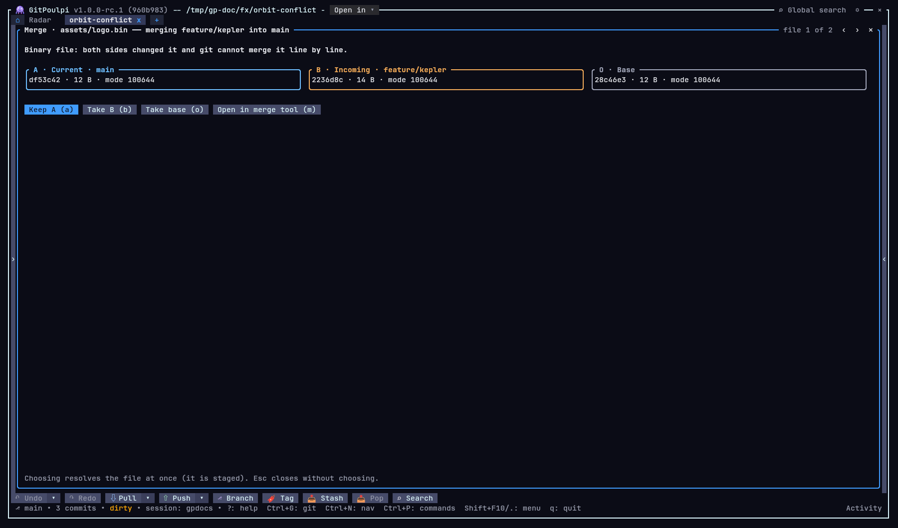

[English](../merge-conflicts.md) · [Čeština](../cs/merge-conflicts.md) · [Deutsch](../de/merge-conflicts.md) · [Español](../es/merge-conflicts.md) · [Français](../fr/merge-conflicts.md) · [Italiano](../it/merge-conflicts.md) · [日本語](../ja/merge-conflicts.md) · [한국어](../ko/merge-conflicts.md) · [Nederlands](../nl/merge-conflicts.md) · [Polski](../pl/merge-conflicts.md) · [Português (Brasil)](../pt-BR/merge-conflicts.md) · [Português (Portugal)](../pt-PT/merge-conflicts.md) · [Русский](../ru/merge-conflicts.md) · [Svenska](../sv/merge-conflicts.md) · [Türkçe](../tr/merge-conflicts.md) · **Українська** · [简体中文](../zh-CN/merge-conflicts.md)

# Вирішення конфліктів merge

Коли merge, cherry-pick, revert або rebase зупиняється на конфліктах, Log
показує банер (*Merge триває · feature у main · 2 файли із конфліктами*), а
файли з конфліктами з'являються на панелі Status із червоним `!`. Відкрийте
один із них у **редакторі merge**: A (поточна сторона) і B (вхідна сторона)
поруч, а під ними **Результат** - файл, який ви пишете. Це коротка версія;
повний список клавіш є на сторінці [Скорочення клавіатури](keybindings.md).

## Як його відкрити

- Enter або подвійне клацання на рядку з `!` на панелі Status; контекстне меню
  (праве клацання) починається з пункту **Відкрити в редакторі merge**.
- Кнопка банера **Вирішити конфлікти...** (відкриває перший файл із конфліктом).
- Подання Diff файлу з конфліктом: кнопка **Редактор merge** (`Shift+E`).
- Палітра: **Конфлікти: відкрити редактор merge**.

Нічого не відкривається саме: зупинена операція лише показує банер і
рядки з `!`.

Редактор займає всю ширину вікна: бічна панель Refs і права
панель сховані, поки він відкритий, і повертаються, коли ви його закриваєте
(`F9` показує чи ховає їх тим часом). A і B стоять поруч, коли редактор має
щонайменше `merge.side_by_side_min_width` стовпців завширшки (типово 100,
Налаштування > Diff і редактор; `0` означає завжди); вужче показано одну
сторону за раз, на вкладках. Довгі рядки прокручуються вбік разом в A і B
(`Shift+←` / `Shift+→`, Shift+коліщатко або бічне коліщатко) і ніколи не переносяться.

## Вибір

Кожен конфлікт - це блок у рамці в A і в B, із прапорцем у заголовку та
`+` / `✓` перед кожним рядком.

| Щоб... | Клавіша | Миша |
|---|---|---|
| взяти рядок під курсором (активна сторона) | `Space` | клацання по рядку |
| взяти весь блок активної сторони | `Enter` | клацання по `[ ]` у його заголовку |
| взяти лише A / лише B для цього конфлікту | `a` / `b` | праве клацання на блоці |
| взяти обидва, A потім B / B потім A | `c` / `Shift+C` | праве клацання на блоці |
| нічого не брати | `x` | праве клацання на блоці |
| поміняти порядок двох вибраних сторін | `s` | клацання по значку `1st` / `2nd` |
| узяти все з A / усе з B (кожен конфлікт) | `Shift+A` / `Shift+B` | панель інструментів |
| скасувати вибір цього конфлікту (знову не вирішено) | `u` в A / B, `Alt+U` будь-де | праве клацання на блоці, **Скасувати вибір** |
| скинути весь файл до початкових конфліктів (питає, якщо ви друкували в Результаті; `Ctrl+Z` повертає) | `Shift+U` в A / B, `Alt+R` будь-де | **Скинути** поруч із «Взяти все» |
| наступний / попередній конфлікт | `F7` / `Shift+F7`, `Alt+Down` / `Alt+Up` (`n` / `Shift+N` в A / B) | `▼` / `▲` або клацання по мітці на смузі прокручування |
| число повторює рух | `3j`, `2k`, `2n`, `3N` (в A / B) | |
| наступний / попередній файл із конфліктом | `Alt+PageDown` / `Alt+PageUp` | `›` / `‹` у заголовку |
| показати чи сховати панель Основа (спільний предок) | `Alt+D` (`d` в A / B) | `Основа` |
| показати весь файл в A і B (**Увесь файл**) | `Alt+F` (`f` в A / B) | `Увесь файл` |
| дати A або B більше ширини / повернути рівну ширину | `Alt+Right` / `Alt+Left`, `Alt+0` | перетягнути роздільник; подвійне клацання по ньому |
| прокрутити A / B / Основу вбік | `Shift+←` / `Shift+→` (`Shift+H` / `Shift+L`) | Shift+коліщатко, бічне коліщатко |
| показати чи сховати панелі Refs і Status | `F9` | |
| фокус на A, B, Результат | `F6` / `Shift+F6` | клацання |
| перейти до панелі на поточному конфлікті | `Alt+1` A, `Alt+2` B, `Alt+3` Результат, `Alt+4` Основа; або `Ctrl+N`, потім `1` / `2` / `3` | |
| перейти до сусідньої панелі (A, Основа, B, Результат), той самий конфлікт | `h` / `l` або `←` / `→` в A / B | |
| перебрати висоти Результату по колу | `z` | перетягнути його заголовок |
| скасувати / повторити (вибір і набраний текст, один стек) | `Ctrl+Z` / `Ctrl+Y` | |
| записати файл, залишити його в конфлікті | `Alt+S` | **Зберегти** |
| записати файл і позначити його вирішеним | `Ctrl+S` | **Зберегти й позначити вирішеним** |
| закрити | `Esc` | `✕` |

Кожна смуга прокручування (A / B / Основа та Результат) має по одній мітці на
конфлікт: помаранчева, поки потрібен вибір, зелена, коли опрацьовано, синя для
поточного. Клацання по мітці переходить до цього конфлікту (мітка під повзунком
смуги вже на екрані, тож там клацання перетягує повзунок).

**Увесь файл** показує весь файл в A і B з усіма відмінностями, а не лише
конфлікти:

Результат - це справжній редактор: клацніть у ньому й друкуйте, виділяйте,
вирізайте та вставляйте, шукайте через `Ctrl+F`. Вибір на конфлікті, який ви
правили вручну, замінює вашу правку (`Ctrl+Z` її повертає). Збереження з
конфліктом, де нічого не вибрано, або з рядком, що досі схожий на маркер
конфлікту, спершу питає підтвердження.

### ✦ Запропонувати вирішення (ШІ)

Коли ШІ увімкнено (Налаштування > ШІ; див. [Допомога ШІ](ai.md)), на панелі
інструментів є кнопка **Запропонувати**, у контекстному меню конфлікту є
*Запропонувати вирішення (ШІ)*, і те саме роблять `Alt+I` та палітра
(`ШІ: запропонувати вирішення конфлікту merge`). Вона працює лише з поточним
конфліктом і запускається тільки на ваш запит. Відповідь замінює частину
Результату для цього конфлікту однією правкою, позначеною як змінена (`✎`), тож
`Ctrl+Z` повертає конфлікт, як було. Результат ніколи не зберігається й не додається в
індекс за вас. Поки вона працює, рядок підказок показує витрачений час; `Esc`
скасовує, а збій теж показано там. Коли ШІ вимкнено, жодного з цих елементів
немає.

Після **Зберегти й позначити вирішеним** файл потрапляє в індекс, і знову
показано список файлів із конфліктами; наступний файл
відкрийте самі. `Ctrl+Z` (або кнопка Скасувати) повертає останнє «позначено
вирішеним». Коли не залишилося жодного файлу, банер пропонує **Commit merge**
(або **Продовжити** для cherry-pick, revert чи rebase) і **Перервати merge**,
що спершу питає: воно повертає HEAD, індекс і робоче дерево такими, якими
вони були.

Merge, результат якого дорівнює HEAD (ви скрізь узяли нашу сторону), не має
нічого в індексі й жодного зміненого файлу, але його все одно можна
завершити: **Commit merge** відкриває запит commit'у з повідомленням merge, і
commit має обох батьків. Так само кнопка Commit у формі commit'у активна без
нічого в індексі, поки merge зупинено.

Порожній cherry-pick або revert (зміна вже застосована) закомітити не можна:
git це відхиляє, а **Продовжити** каже про це й вказує на **Пропустити**.
**Пропустити** (кнопка банера, пункт палітри *Git: пропустити cherry-pick чи
revert*, CLI `conflicts skip`) спершу питає, потім завершує операцію, нічого
для неї не записавши; HEAD, індекс і робоче дерево повертаються до HEAD.
Пропуск не можна скасувати (нічого не губиться, від чого ви не відмовилися
свідомо); у merge нічого пропускати.

## Конфлікти, що не є текстом

Двійковий файл, вказівник Git LFS, файл понад 8 МіБ, файл, видалений з одного
боку, залишок перейменування, символічне посилання, зміна режиму або підмодуль
не мають рядків для вибору. Редактор показує **картку** з тим, що містить
кожна сторона, і по кнопці на кожен вибір; вибір одразу вирішує файл і додає
його в індекс.

| Картка | Варіанти |
|---|---|
| Двійковий файл, вказівник LFS, завеликий | **Залишити A** (`a`), **Взяти B** (`b`), **Взяти основу** (`o`, коли вона є), **Відкрити в зовнішньому merge-інструменті** (`m`) |
| Видалено з одного боку, змінено з іншого | **Залишити файл** (`k`), **Прийняти видалення** (`Shift+D`) |
| Залишок перейменування (шлях є лише з одного боку) | **Залишити файл** (`k`), **Видалити файл** (`Shift+D`) |
| Символічне посилання, підмодуль, режим файлу | **Залишити A**, **Взяти B**, **Взяти основу** |

Коли файл - зображення (PNG, JPEG, GIF, WebP, BMP, ICO), у блоках також
показано зображення A, B і Основи, вписані та лише для читання, у вікні
достатньої ширини; див. [Зображення](image-view.md#у-редакторі-merge).

`Esc` закриває картку без вибору. Зовнішній merge-інструмент - це
`general.external_merge_tool` у Налаштування > Diff і редактор (`{base}`, `{local}` =
A, `{remote}` = B, `{merged}`; порожнє означає `git mergetool`); файл
додається в індекс, коли інструмент завершується успішно.

## Запобігання конфліктам

GitPoulpi може сказати вам про конфлікт *до* merge. Коли гілка, на якій ви стоїте, конфліктувала б із
гілкою, від якої її створено (її **базою**), у верхньому рядку рамки Log з'являється смужка:
**Конфлікти з origin/main у 2 файлах** з кнопкою **Показати файли**. Вона займає наступний вільний рядок
рамки після банерів поточних операцій, тож поки видно якийсь із них, їй може бракувати місця. Нічого не
зливається: демон робить у пам'яті merge двох commit'ів (libgit2 або `git merge-tree --write-tree` з
git 2.38 чи новішим; старіший git вимикає цю можливість одним рядком у журналі), тож ваші файли, індекс
і refs лишаються недоторканими.

- **База** - це цільова гілка pull request'а цієї гілки, якщо GitPoulpi уже її знає (кеш, який веде
  розділ Pull requests; мережевий виклик для цього не робиться), інакше - гілка з-поміж шаблонів
  **Базових гілок** (Налаштування > Запобігання конфліктам), що має найменше commit'ів від розгалуження.
  За рівності перемагає гілка, кінчик якої ближче до розгалуження, потім віддалена гілка над локальною,
  потім назва. Сама гілка та її віддалена копія ніколи не стають базою.
- **Спливне вікно** (клацання по смужці або команда палітри **Конфлікти: показати передбачені конфлікти**,
  яка працює з клавіатури) перелічує файли й має кнопки **Відкрити перегляд merge** та **Rebase на базу**. Це
  власні рядки меню базової гілки (*Merge <base> у <branch>*, *Rebase <branch> на <base>*), виконані за вас:
  вони журналюються, тож `Ctrl+Z` їх відкочує, а merge, що таки конфліктує, зупиняється в редакторі merge,
  як будь-який інший. Вліво й Вправо перемикають кнопки, Enter натискає, Esc закриває.
- **Коли працює**: у фоні, приблизно через 2 секунди після того, як репозиторій заспокоївся (commit,
  checkout, fetch, що посунув гілку, rebase), один раз на пару `(HEAD, база)`. Смужка ховається, щойно HEAD
  рухається, і повертається (або ні) з новою відповіддю. Відокремлений HEAD не перевіряється.
- **Списки базових гілок**: звідки беруться Базові гілки репозиторію, обирають на його сторінці **Запобігання конфліктам**. **Типовий** іде за глобальним типовим списком (вбудований `**`, кожна гілка, доки ви не оберете інший список у Налаштування > Загальні > Запобігання конфліктам); **Список: <name>** іде за одним з ваших іменованих списків; **Власний список** - це окремий список репозиторію. Списки спільні: відредагуйте один, і кожен репозиторій, що йде за ним, застосує зміну під час наступної перевірки, без перезапуску. **Зберегти як список...** перетворює власні шаблони репозиторію на іменований список, **Скинути до типового** прибирає вибір репозиторію. Видалення списку, за яким іде репозиторій, змушує його використовувати типовий.
- **Вимкнення**: **Увімкнути завчасне виявлення конфліктів** в Налаштування > Загальні, а для одного
  репозиторію - на його сторінці **Запобігання конфліктам**. Зі скрипта `gitpoulpi conflicts check` виводить
  ту саму відповідь у JSON ([Довідник CLI](cli-reference.md)).

## Агенти

Агент може показати вам конфлікт (`gitpoulpi ui show conflict <path> [--conflict
N]`: редактор відкривається на ньому, нічого не вибрано) або **запропонувати**
вирішення (`gitpoulpi ui propose resolution <path> --pick 1=a,2=ba` чи
`--content-file F`, потрібен пункт *Дозволити ШІ-агентам пропонувати зміни на
моє підтвердження*). Пропозиція відкриває редактор із уже вибраним (або з
усім текстом) у Результаті та фіолетовим банером *✦ Запропоновано claude-code*.
Перегляньте її, змініть, що хочете, і натисніть **Ctrl+S**: лише це щось
записує чи додає в індекс. Закриття редактора відхиляє пропозицію. Див.
[MCP та агенти](mcp-and-agents.md).

У скрипті ті самі операції - `gitpoulpi conflicts list | show | resolve |
unresolve | state | abort` ([Довідник CLI](cli-reference.md)); `conflicts check` передбачає їх до merge.
