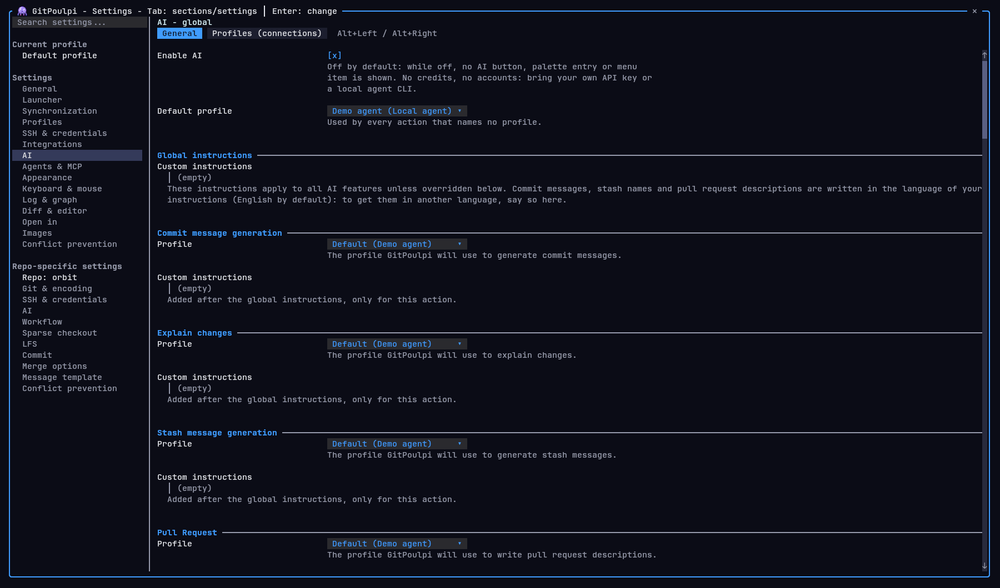

[English](../settings.md) · [Čeština](../cs/settings.md) · [Deutsch](../de/settings.md) · [Español](../es/settings.md) · [Français](../fr/settings.md) · [Italiano](../it/settings.md) · [日本語](../ja/settings.md) · [한국어](../ko/settings.md) · [Nederlands](../nl/settings.md) · [Polski](../pl/settings.md) · [Português (Brasil)](../pt-BR/settings.md) · [Português (Portugal)](../pt-PT/settings.md) · [Русский](../ru/settings.md) · [Svenska](../sv/settings.md) · [Türkçe](../tr/settings.md) · **Українська** · [简体中文](../zh-CN/settings.md)

# Налаштування

Відкрийте Налаштування за допомогою `Ctrl+,`, `Ctrl+N`, а потім `,`, значка
шестірні в рядку заголовка (ліворуч від `×`) або `Ctrl+P` > *Налаштування*. Екран
Налаштувань замінює вікно, поки він відкритий. Закрити його можна через `✕` угорі
праворуч, `Esc` або `q`. Спершу він питає лише тоді, коли закриття щось знищить
(див. [Закриття Налаштувань](#закриття-налаштувань)).

Зміни одразу зберігаються в `config.toml`. [Довідник конфігурації](config-reference.md)
описує кожен ключ, його типове значення та змінну середовища. Ця сторінка
описує сам екран Налаштувань.

## Як користуватися екраном Налаштувань

| Щоб | Зробіть |
|---|---|
| Перейти зі списку сторінок до параметрів | `Tab` / `Shift+Tab` або клацніть. |
| Переміщатися | `j` / `k` або стрілки. |
| Змінити параметр | `Enter` або `Space`, або клацніть його значення. Див. нижче. |
| Закрити | Клацніть `✕` або натисніть `Esc` чи `q`. Поки відкрито поле, випадаючий список чи підтвердження, `Esc` закриває лише його. |

Що саме роблять `Enter` або `Space`, залежить від рядка:

- Прапорець перемикається.
- Випадаючий список відкривається. Стрілки вибирають, `Enter` підтверджує.
- Текстове або числове поле починає редагування. Працюють стрілки, `Home`,
  `End`, `Backspace` і `Delete`, а клацання ставить курсор. `Enter`, `Tab`, `Up`,
  `Down` або клацання деінде зберігає значення. `Esc` скасовує. Відхилене значення
  залишається в полі червоним, а рядок стану називає причину.
- Рядок кнопок (**Створити**, **Видалити**, **Перевірити**...) показує лише ті кнопки,
  що доречні зараз. `Left` / `Right` вибирають кнопку, `Enter` натискає її, або
  клацніть по ній. Кнопка, що щось видаляє, спершу питає.

На кожній сторінці значення починаються в одному стовпці, тож підписи вирівняні
ліворуч, а поля - праворуч. Текст чи число - це тонована смуга, вибір - смуга, що
закінчується на `▾`, прапорець - `[x]`. Довгий підпис переноситься, а не
обрізається, а у вузькому вікні значення переходить під свій підпис.

Сірий рядок пояснює, чому він неактивний. Наприклад, **Інтенсивність підсвітки рядка**
неактивна, поки **Тло доріжок графа** має значення **Вимк.**

### Списки

Сторінки, що редагують кілька однотипних елементів (Профілі, ШІ, Робочий процес,
Відкрити в, Зображення), показують їх як **список ліворуч і поля вибраного елемента
праворуч**. У вузькому вікні список стоїть над полями. Скрізь список має однакову
будову:

- Позначка рядка показує стан: `●` активний профіль, `★` запис за замовчуванням, `⚠`
  незавершений елемент (профіль без email), причина стоїть там, де були б деталі.
- Під списком: **+ Додати**, **Дублювати**, **Видалити**, `↑` і `↓`. Кнопка, що зараз
  недоречна (`↑` на першому рядку), тьмяніє. **+ Додати ▾** відкриває випадаючий
  список, де сторінка пропонує пресети чи види.
- **Видалити** спершу питає, крім елемента, який ви щойно додали й не змінювали.
- Потягніть рядок, щоб перемістити його; смуга показує, куди він ляже, а `Esc`
  скасовує перетягування. Подвійне клацання переходить до полів елемента.

| Клавіша | Дія |
|---|---|
| `Up` / `Down`, `Home` / `End`, `PageUp` / `PageDown` | Вибрати елемент. |
| `Insert` | Додати елемент (відкриває випадаючий список, якщо він є). |
| `Ctrl+D` | Дублювати елемент. |
| `Delete` | Видалити елемент після підтвердження. |
| `Alt+Up` / `Alt+Down` | Перемістити елемент угору чи вниз. |
| `Enter` або `Right` | Перейти до полів елемента. |
| `Left` | Назад до списку сторінок. |
| `Alt+Left` / `Alt+Right` | Перемикає вкладки «Загальні» і списку (будь-де на сторінці). |

На кожній із цих сторінок під заголовком є дві **вкладені вкладки**, щоб налаштування самої сторінки ніколи не плутали з властивістю вибраного елемента: **Загальні** - власні налаштування сторінки (активний профіль, типовий запис, інструкції, які отримує кожна дія ШІ, шаблон робочого процесу...), і вкладка, названа за елементами (**Профілі**, **Профілі (підключення)**, **Записи**, **Редактори**, **Правила**), де розташовані список і поля вибраного елемента. Сторінка відкривається на вкладці **Загальні**; налаштування запам’ятовують вкладку, на якій ви залишили кожну сторінку, до виходу із застосунку, так само як позицію прокрутки й вибраний рядок кожної сторінки (і вкладки). Клацніть вкладку або натисніть `Alt+Left` / `Alt+Right`. Пошук, рядки налаштувань у палітрі команд і посилання «задайте в налаштуваннях» відкривають вкладку, на якій розташоване налаштування.
[Клавіатура й миша](#клавіатура-й-миша) має ті самі дві вкладки (**Загальні**, **Скорочення**).

Клавіші можна перепризначити в **Клавіатура й миша** (контекст *preferences*, див.
[Скорочення](keybindings.md)).

### Багаторядкові редактори

Налаштування з кількома рядками (наприклад, шляхи sparse checkout, опис шаблону commit, базові гілки запобігання конфліктам і хуки робочого процесу) відкриваються в невеликому редакторі через `Enter` або клацання; `Ctrl+S` залишає текст, `Esc` відкидає. Миша там працює як у будь-якому текстовому полі:

- Клацання ставить курсор у місце клацання.
- Перетягування виділяє текст; колесо прокручує.
- Подвійне клацання виділяє слово під вказівником.
- `Shift` + клацання розширює виділення від курсора до вказівника.

Те саме доступне з клавіатури: `Shift` зі стрілками виділяє, `Ctrl` зі стрілками переходить за словами, `Ctrl+A` виділяє все, `Ctrl+C` і `Ctrl+X` копіюють і вирізають.

### Закриття Налаштувань

`✕`, `Esc` і `q` роблять те саме. Налаштування застосовують кожну зміну одразу, тож
здебільшого вони просто закриваються. Питання **Закрити налаштування?** з'являється
лише тоді, коли щось буде втрачено:

- на сторінці **Робочий процес** є незбережені зміни;
- у шаблоні повідомлення commit'у є незбережені зміни;
- у профілі не вказано електронну пошту автора (commit'и, які він створює, не можна
  приписати вам).

Вікно пропонує **Перейти до нього** (відкриває цю сторінку), **Відкинути й закрити**
або **Усе одно закрити**, а також **Скасувати**. Малі редактори всередині Налаштувань
(текст інструкцій ШІ, хук робочого процесу, шляхи sparse checkout) мають власний `✕` і
питають **Відкинути зміни?** лише тоді, коли їхній текст змінювали.

### Спливні вікна над Налаштуваннями

Рядок заголовка показує восьминога й назву застосунку, як і головне вікно. Клацніть
восьминога, щоб відкрити «Про програму».

Кілька загальновіконних спливних вікон відкриваються поверх Налаштувань і
повертають їх такими, як було (сторінка, позиція прокручування й незбережені зміни
Робочого процесу чи шаблонів лишаються):

- палітра команд (`Ctrl+P`),
- вибір теми (`Ctrl+N y`, **Застосунок: змінити тему...**), що показує кожну тему
  просто на Налаштуваннях; `Esc` повертає попередню тему,
- вибір мови й кольорів графа (`Ctrl+N`, далі ті самі літери, що й у головному вікні),
- пошук по робочому простору (`Ctrl+Alt+F`),
- «Про програму» (`Ctrl+N a`, восьминіг або **Довідка: про GitPoulpi**) і оверлей
  довідки (`?`).

Закривайте кожне через `Esc`, його власний `✕` або клацання поза ним. Команди, що
діють на те, що закривають Налаштування (вкладка, гілка, diff...), у палітрі
перелічені, але сірі з приміткою «спочатку закрийте налаштування», а хорди `Ctrl+N`
для них показують цей рядок на нижній межі Налаштувань: закрийте Налаштування, потім
виконайте їх.

`Ctrl+N` показує значок на кожному елементі сторінки: полі пошуку, списку сторінок (один значок, на поточній сторінці), вкладених вкладках, списку та його кнопках, кожному полі на екрані й хрестику закриття. Натисніть символ значка, і станеться те саме, що й після клацання на цьому елементі: текстове поле відкривається для редагування, прапорець перемикається, випадаючий список відкривається, кнопка виконується. `Esc` скасовує. Поле, прокручене за межі екрана, значка не має. Поки ви вводите текст у полі або відкрито випадаючий список, редактор чи пошук, `Ctrl+N` належить їм. Див. [Значки](keybindings.md#значки).

### Поле пошуку

Поле вгорі списку сторінок шукає за назвою та описом кожного параметра на
кожній сторінці. Клацніть його або натисніть `/` чи `Ctrl+F` і вводьте. Розгорнеться
список результатів. Кожен результат показує параметр і його сторінку. `Up` / `Down`
вибирають, `Enter` переходить до параметра, `Esc` закриває список.

## Налаштування з палітри команд

Більшість налаштувань можна змінити, не відкриваючи цей екран: введіть `Налаштування:` або `Settings:` у палітрі команд (`Ctrl+P`). Рядки створюються з полів самих сторінок, тож нове налаштування з'являється в обох місцях.

- Прапорець називається **Налаштування: перемкнути ...**. Він перемикається одразу, а рядок показує `[x]` або `[ ]`.
- Випадаючий список називається **Налаштування: ...**. `Enter` звужує палітру до його значень, поточне позначено як `поточне`; `Enter` на значенні вибирає його.
- Число або текст відкриває рядок введення з поточним значенням. Значення, яке відхилила б сторінка (не число, поза діапазоном), відхиляється так само, і рядок залишається відкритим.
- Налаштування, якому потрібна власна сторінка (список, комбінований список, варіанти якого визначаються під час роботи), відкриває Налаштування на ній.

Значення зберігається в `config.toml` і застосовується точно так, як на сторінці. Англійські слова ключа налаштування (`remember tabs`) знаходять рядок будь-якою мовою.

## Сторінки

Список сторінок має дві групи:

- **Налаштування**: глобальні налаштування.
- **Налаштування репозиторію**: налаштування репозиторію активної вкладки. Вони
  з'являються, лише коли відкрито репозиторій.

### Загальні

| Параметр | Що робить |
|---|---|
| **Мова** | Мова інтерфейсу: **Авто** (мова вашої системи, інакше англійська), English, Français, Español, Português (Brasil), Português (Portugal), Italiano, Deutsch, 简体中文, 日本語, 한국어, Русский, Українська, Polski, Čeština, Nederlands, Svenska, Türkçe. Застосовується одразу, без перезапуску. Назви місяців і дати в Log змінюються разом із нею. Змінна середовища `GITPOULPI_LANG` (наприклад, `GITPOULPI_LANG=fr`) має пріоритет над цим вибором. Вивід CLI та MCP залишається англійською. |
| **Перекладати терміни git** | Типово вимкнено: commit, push, pull, stash, tag та інші терміни git залишаються англійськими в усіх мовах. Увімкнено: використовується власна лексика git відповідної мови (українською: *надсилання*, *отримання*, *схованка*, *тег*). Застосовується одразу. |
| **Git-слова англійською** | Лише для японської, корейської та китайської: показує *stage*, *unstage*, *staged* англійськими словами замість транскрипції. Не діє, поки ввімкнено **Перекладати терміни git**. |
| **Запам'ятовувати вкладки** | Відновлює вкладки останнього сеансу під час запуску. Якщо вимкнено, запуск усередині репозиторію відкриває лише цей репозиторій, а запуск поза ним починається з вкладки «Головна» без вкладки репозиторію. Потрібен перезапуск. |
| **Увімкнути Radar** | Типово ввімкнено (`general.radar_enabled`). Вимкнено - вкладка Radar, її команди палітри та `Alt+R` приховані, а для неї нічого не завантажується у фоні. Застосовується одразу. Див. [Radar](radar.md#закрити-вкладку-або-вимкнути-radar). У збірці без Radar не показується. |
| **Вкладка при запуску всередині репозиторію** | Вкладка, на якій відкривається запуск, коли папка, з якої його виконано, лежить усередині репозиторію (`general.startup_tab_in_repo`): **Поточний репозиторій** (типово, вкладка цього репозиторію, за потреби відкрита), **Остання вкладка** (вкладка, активна під час останнього виходу), **Головна**, **Radar**. Репозиторій, указаний через `--repo`, завжди відкриває власну вкладку. **Остання вкладка** відкриває «Головна», якщо вимкнено **Запам'ятовувати вкладки** або нічого не запам'ятовано; **Radar** відкриває «Головна», якщо Radar вимкнено або його немає в збірці. Читається один раз при запуску; потрібен перезапуск. |
| **Вкладка при запуску поза репозиторієм** | Вкладка, на якій відкривається запуск, коли папка, з якої його виконано, не є репозиторієм (наприклад, папка користувача) (`general.startup_tab_outside_repo`): **Головна** (типово), **Остання вкладка**, **Radar**. **Остання вкладка** відкриває «Головна», якщо вимкнено **Запам'ятовувати вкладки** або нічого не запам'ятовано; **Radar** відкриває «Головна», якщо Radar вимкнено або його немає в збірці. Читається один раз при запуску; потрібен перезапуск. |
| **Вкладка при запуску з лаунчера** | Вкладка, на якій відкривається запуск, коли GitPoulpi запущено створеним ним ярликом на робочому столі або в меню «Пуск» (він передає `--launcher`), незалежно від папки (`general.startup_tab_launcher`): **Остання вкладка** (типово), **Головна**, **Radar**. Має пріоритет над двома налаштуваннями вище. **Остання вкладка** відкриває «Головна», якщо вимкнено **Запам'ятовувати вкладки** або нічого не запам'ятовано; **Radar** відкриває «Головна», якщо Radar вимкнено або його немає в збірці. Ярлики, створені старою версією, отримують цей параметр при наступному запуску. Читається один раз при запуску; потрібен перезапуск. У Windows копія, закріплена на панелі завдань, теж переписується під час наступного запуску, а запуск без оболонки навколо (подвійне клацання, закріплений сам exe) вважається запуском з лаунчера. |
| **Групувати вкладки worktree** | Типово ввімкнено (`general.group_worktree_tabs`). Вкладки пов'язаних worktree репозиторію стоять одразу після вкладки репозиторію, а відтягнута вкладка worktree повертається на це місце. Вимкнено - вкладки лишаються там, де ви їх поклали. Увімкнення знову групує відкриті вкладки. |
| **Типова папка клонування** | Звідки починається діалог «Клонувати». Порожньо: `%USERPROFILE%\source\repos` у Windows, `~/src` в інших системах. |
| **Типова папка огляду** | Де відкривається «Огляд». Порожньо: остання використана папка, інакше ваша домашня папка. |
| **Де зберігати дані репозиторію** | Де GitPoulpi зберігає дані окремого репозиторію (`session.per_repo_state_dir`): **У .git** (типово: у робочому дереві нічого не з'являється, усі worktree ділять ці дані), **У робочому дереві** (папка `.gitpoulpi`; потрібна, щоб закомітити командний `workflow.toml`) або **У моїй папці даних користувача** (поза репозиторієм). Папка `.gitpoulpi`, залишена старішою версією, переноситься в нове місце, коли вперше знадобиться, і видаляється, щойно стане порожньою; файл, який відстежує git (закомічений `workflow.toml`), ніколи не переміщується й не видаляється та лишається доступним для читання. |
| **Типова назва гілки** | Перша гілка репозиторію, створеного через Init. Порожньо: вирішує git. Наявні гілки не перейменовуються. |
| **Увімкнути завчасне виявлення конфліктів** | Типово ввімкнено (`general.conflict_detection`). Попереджає в Log, коли злиття поточної гілки в гілку, від якої її створено, спричинило б конфлікт, ще до спроби. Репозиторій може вимкнути його для себе на сторінці **Запобігання конфліктам**. Див. [Вирішення конфліктів merge](merge-conflicts.md#запобігання-конфліктам). Застосовується після закриття Налаштувань. |
| **Рівень журналу**, **Зберігати файли журналу**, **Максимальний розмір файлу журналу** | Журнал застосунку, на якому ґрунтується Журнал активності: найдокладніший записуваний рівень (`log.level`), як довго зберігаються файли (ціле число й одиниця - дні, тижні, місяці чи роки - в одному рядку: клацніть число, щоб набрати його, Вгору й Вниз міняють його на крок, Tab переходить до одиниці, а Enter відкриває її список; щонайбільше від 1 до 10 років, типово 1 тиждень, `log.retention_days` і `log.retention_unit`) і розмір, за якого файл дня ротується (число та МіБ або ГіБ, від 1 МіБ до 1 ГіБ, `log.max_file_mb` і `log.max_file_unit`). |
| **Показувати тривалість операцій**, **Розширене ведення журналу** | Вкладка «Операції git» Журналу активності: тривалість кожної операції (`log.timings`, типово ввімкнено) і також фонова робота, оновлення та auto-fetch (`log.extended`, типово вимкнено). Див. [Коли щось не вдається](troubleshooting.md#журнал-активності). |
| **Скасування ввімкнено**, **Глибина історії скасування**, **Записувати зміни, зроблені поза GitPoulpi** | Група **Історія скасувань**. Вмикає або вимикає скасування й задає, скільки операцій воно зберігає (типово 100, `0` означає без обмежень). Вимкнення скасування стирає історію скасувань після підтвердження. Останній пункт записує також те, що оболонка чи агент роблять з гілками, tag'ами, stash'ами та HEAD. Див. [Скасування й повторення](undo-redo.md). |

#### Лаунчер (інтеграція з робочим столом)

Група **Лаунчер**, остання на сторінці «Загальні», створює ярлик, який запускає GitPoulpi
з лаунчера системи у вибраному вами терміналі.

| Рядок | Що робить |
|---|---|
| **Термінал для ярликів** | `ui.launch_terminal`: **Автоматично**, **Типовий у системі** або один із терміналів, знайдених на цьому комп'ютері (те саме виявлення, що й у **Відкрити в**). Автоматично: Windows Terminal у Windows (інакше WezTerm, Alacritty, звичайна консоль), `xdg-terminal-exec` у Linux (Omarchy; інакше перший знайдений термінал), Terminal у macOS, якщо не встановлено iTerm2, Ghostty, WezTerm чи kitty. |
| **Відкривати знову в цьому терміналі за подвійним клацанням** | Лише Windows (`ui.relaunch_in_terminal`). Подвійне клацання по exe відкриває стандартну консоль, яка погано малює зображення: GitPoulpi відкривається знову у вибраному терміналі, а перше вікно закривається. Не відбувається, якщо програму запущено з термінала. |
| **Показувати відкрите вікно за клацанням** | `ui.reuse_window` (увімкнено за замовчуванням). Клацання ярлика GitPoulpi (`gitpoulpi launch`) показує вікно вже відкритого GitPoulpi замість запуску ще одного. Новий термінал запускається, лише якщо жоден не відкритий, параметр вимкнено або вікно не може вийти на передній план. На передній план воно виходить у Windows, у WezTerm і в Hyprland; на інших робочих столах Linux клацання, як і раніше, запускає нове вікно. У macOS не використовується (Dock уже це робить). Щоб навмисно відкрити ще одне вікно, утримуйте **Shift** під час клацання (Windows) або скористайтеся дією **New Window** запису лаунчера (Linux); зі скрипта це робить `gitpoulpi launch --new-window`. |
| **Псевдонім команди** | `ui.command_alias`: випадаючий список із пунктами **Немає** та `gp`, або введіть будь-яке ім'я (літери, цифри, `-`, `_`, `.`; без пробілів і роздільників шляху). Вбудована кнопка **Створити** робить так, що це ім'я запускає GitPoulpi (коли псевдонім уже є, вона стає **Видалити** і видаляє всі псевдоніми, створені GitPoulpi). Під рядком з'являється попередження, коли ім'я вже запускає щось інше у вашому PATH, а в Windows - коли PowerShell має вбудований псевдонім з таким ім'ям (там `gp` - це `Get-ItemProperty`, і він має перевагу над будь-яким файлом). Псевдонім або функцію оболонки звідси не видно: oh-my-zsh сам визначає `gp`, і він має перевагу над нашим. |
| **Псевдонім нової вкладки** | `ui.command_alias_add`: друга команда, наприклад `gpa`, що відкриває поточну теку новою вкладкою вже запущеного GitPoulpi (`gitpoulpi --add`) замість запуску ще одного; якщо жодного не запущено, вона запускає GitPoulpi як звичайно, а якщо їх кілька, питає, до якого приєднатися. Випадаючий список із пунктами **Немає**, `gpa` і назвою псевдоніма з додатковою `a` в кінці, або введіть будь-яке ім'я (ті самі правила, що вище). Єдина кнопка **Створити** робить обидві команди, **Видалити** видаляє всі команди, створені GitPoulpi; кожна має власний рядок стану. У Linux і macOS це скрипт із двох рядків, у Windows - `.cmd`. Див. [Довідник CLI](cli-reference.md#додати-папку-до-відкритого-вікна). |
| **Додати GitPoulpi до PATH** | Додає до PATH для нових терміналів папку, з якої працює GitPoulpi, і папку псевдонімів. Кнопка в рядку називається **Додати** або **Прибрати**, а **Прибрати** прибирає рівно те, що було додано. Папки, які вже є в PATH, не чіпаються (тоді в рядку стоїть **уже в PATH**). |
| **Linux: Лаунчер застосунків** | Записує `~/.local/share/applications/gitpoulpi.desktop` (враховує `XDG_DATA_HOME`) і значок у `~/.local/share/icons/hicolor/256x256/apps`. В Omarchy це той самий запис, що його створює `omarchy-tui-install` (`xdg-terminal-exec --app-id=TUI.tile -e <exe>`); для інших терміналів - відповідна команда (`kitty`, `wezterm start --`, `alacritty -e`, `ghostty -e`, `foot`, ...). |
| **Linux: Робочий стіл** | Той самий запис у папці робочого столу, якщо вона у вас є. |
| **Windows: Меню «Пуск»** | `GitPoulpi.lnk` у `%APPDATA%\Microsoft\Windows\Start Menu\Programs`. Копія, закріплена на панелі завдань, сама відстежує зміни значка й кольору; якщо її значок лишився старим, відкріпіть її та закріпіть знову (правий клік на записі в меню «Пуск», потім **Закріпити на панелі завдань**). |
| **Windows: Робочий стіл** | `GitPoulpi.lnk` на вашому робочому столі. |
| **macOS: Папка «Програми»** | `~/Applications/GitPoulpi.app` - невеликий пакет, що відкриває термінал із запущеним GitPoulpi. |

Кожен рядок показує свій стан: **не створено**, **створено**, **застаріло, оновлюється...** (exe
переміщено або вибрано інший термінал; GitPoulpi сам перезаписує ярлик протягом секунди, тож ви рідко це бачите) або «там лежить
файл, створений не GitPoulpi» (файл із такою назвою існує, але його створив не GitPoulpi,
тож його ніколи не чіпають). **Видалити** видаляє лише файли, створені GitPoulpi (вони мають
позначку `X-GitPoulpi=1`). Значок - восьминіг кольору вашого логотипа (вікно «Про GitPoulpi»,
клавіша `c`); у Linux кожен колір має власну назву значка, тож лаунчер, що кешує значки, показує новий колір. Створений ярлик сам залишається актуальним: коли ви змінюєте колір або термінал чи exe переміщується, GitPoulpi перезаписує ярлики, які створив (ніколи не чужі й ніколи не створюючи нових), під час запуску та під час роботи. Кнопки «Оновити» немає; є лише **Створити** (для ярлика, якого ще немає) і **Видалити**.

**Групування на панелі завдань і в доку.** GitPoulpi працює у вікні термінала, тому панель завдань зазвичай показує його під значком термінала, без крапки «запущено» під закріпленим значком GitPoulpi. Windows: ярлики несуть AppUserModelID `GitPoulpi.GitPoulpi`, а GitPoulpi, запущений з такого ярлика, дає вікну свого термінала той самий ID і свій значок (він знаходить вікно, на мить надаючи йому унікальний заголовок, а потім відновлює заголовок), тож вікно опиняється під закріпленим значком GitPoulpi. Вікно термінала з кількома вкладками переміщується як ціле: усі його вкладки групуються під значком GitPoulpi, доки в ньому працює GitPoulpi. Раніше створені ярлики та закріплення на панелі завдань переписуються тією самою синхронізацією; якщо закріплення досі показує значок термінала, відкріпіть його й закріпіть знову. Linux: kitty, foot, Alacritty, WezTerm і Ghostty запускаються з класом вікна `gitpoulpi`, а запис `.desktop` указує його (`StartupWMClass`), тож док групує вікно під значком запуску; інші термінали зберігають власний значок. macOS: нічого робити, Dock групує за застосунком.

##### Псевдонім команди та PATH за системами

| Система | Псевдонім | PATH |
|---|---|---|
| Linux, macOS | Символічне посилання `~/.local/bin/<name>` на `gitpoulpi-tui`. Посилання не може нести маркер, тому воно вважається нашим, коли його ціль - файл `gitpoulpi-tui`; звичайний файл або посилання на щось інше **не наші** й ніколи не замінюються та не видаляються. | Блок між `# >>> GitPoulpi PATH (X-GitPoulpi=1) >>>` і `# <<< GitPoulpi PATH <<<` у `~/.bashrc` та `~/.zshrc` (в тих, що існують; якщо жодного немає, то `~/.zshrc` у macOS і `~/.bashrc` в іншому), а також `~/.config/fish/conf.d/gitpoulpi-path.fish`, якщо налаштовано fish. Видалення прибирає блок (або файл fish) і більше нічого. |
| Windows | `%LOCALAPPDATA%\Programs\GitPoulpi\bin\<name>.cmd`, двохрядкова обгортка з `REM X-GitPoulpi=1`. | Користувацький PATH у `HKCU\Environment`, записаний через PowerShell, потім розсилання `WM_SETTINGCHANGE`, щоб нові програми його побачили. Значення `GitPoulpiPathAdded` запам'ятовує, що додано, і видалення прибирає лише це. |

Нові термінали бачать зміну PATH, а ті, що вже відкриті, - ні. Жодна з цих дій не журналюється: скасування для них немає, дорога назад - **Видалити**.

У палітрі є ті самі дії (**Лаунчер: створити ярлик**, **Лаунчер: створити ярлик на робочому столі**,
**Лаунчер: видалити ярлики**, **Лаунчер: створити псевдонім команди**, **Лаунчер: видалити псевдонім команди**,
**Лаунчер: додати до PATH**, **Лаунчер: прибрати з PATH**), а `gitpoulpi desktop shortcut
status|install|remove [--where launcher|desktop|startmenu]` робить те саме зі скрипту.

Команда палітри **Застосунок: змінити мову...** (`Ctrl+N g`) відкриває той самий
список мов. Там мова на підсвіченому рядку показується наживо; `Enter` залишає її,
а `Esc` повертає попередню.

### Синхронізація

Як GitPoulpi тримає репозиторій узгодженим зі своїми remote'ами і що робить із
вашими локальними змінами в цей час.

| Параметр | Що робить |
|---|---|
| **Інтервал auto-fetch** | Робить fetch кожного remote у фоні з цим інтервалом: число й одиниця (хвилини чи години) в одному рядку. Типово 5 хвилин, максимум 60 хвилин (1 година), `0` вимикає. `general.auto_fetch_interval_minutes` лишається в хвилинах; `general.auto_fetch_interval_unit` лише фіксує, як це показано. Потрібен перезапуск. |
| **Робити fetch при відкритті вкладки** | Запускає Fetch All у фоні під час відкриття вкладки репозиторію. Типово ввімкнено. Репозиторій, для якого fetch робили менш ніж 60 секунд тому, повторно не завантажується. |
| **Автоочищення** | Fetch'і також видаляють віддалені гілки стеження, яких більше немає на remote'і. Типово вимкнено. |
| **Автоочищення tag'ів** | Fetch'і також видаляють локальні tag'и, які видалено на віддаленому репозиторії. Зачіпає лише tag'и, що були на віддаленому: tag, якого ви ніколи не надсилали (push), лишається. Типово вимкнено, як і в git. Потрібен git 2.41 або новіший. CLI: `gitpoulpi fetch --prune-tags`; ключ конфігурації `general.auto_prune_tags`. Див. [Гілки, tag'и та бічна панель Refs](log-and-history.md#гілки-tagи-та-бічна-панель-refs). |
| **Тримати підмодулі актуальними** | Після checkout або pull оновлює підмодулі до commit'ів, які записує репозиторій. Див. [Підмодулі](submodules.md). |
| **Видаляти файли «.orig» після merge** | Коли merge завершено, видаляє резервні файли `*.orig`. Типово вимкнено. |
| **Auto-stash перед checkout, pull, merge або rebase** | Що робити, коли локальні зміни блокують одну з цих операцій: **питати** (діалог пропонує сховати зміни, виконати операцію й повернути stash), **завжди** (робити це без питання) або **ніколи** (відмовляти). |
| **Включати невідстежувані файли в auto-stash** | Автоматичний stash забирає й невідстежувані файли. |

Також на цій сторінці, у групі **Оновлення**:

| Параметр | Що робить |
|---|---|
| **Перевіряти оновлення** | Випадаючий список (`updates.mode`): **Сповіщати** (типово) раз на день у фоні перевіряє й показує `доступна vX.Y.Z` у рядку заголовка; **Авто** ще й завантажує оновлення у фоні, якщо GitPoulpi встановлено з архіву випуску (коли перезапускати, вирішуєте ви); **Вимкнено** не робить жодних запитів. Застосовується одразу. Див. [Оновлення](installation.md#оновлення). |
| **Канал оновлень** | Випадаючий список (`updates.channel`): **Стабільний** (типово) або **Попередній** (також кандидати до випуску). Застосовується одразу. |

Також на цій сторінці, у групі **Переписування історії**, ліміти часу зовнішніх скриптів (див. [Переписування історії](history-rewrite.md)):

| Параметр | Що робить |
|---|---|
| **Ліміт часу відповіді скрипта** | Скільки часу зовнішній скрипт має, щоб відповісти для одного коміту: число й одиниця (мілісекунди чи секунди) в одному рядку. Типово 5 секунд, від 1 мілісекунди до 10 хвилин (`rewrite.script_timeout_ms`, `rewrite.script_timeout_unit`). Після тайм-ауту весь процес зупиняється, а переписування завершується помилкою без жодних змін. |
| **Ліміт часу на один прохід скрипта** | Скільки може тривати один повний прохід зовнішнього скрипта: число й одиниця (секунди, хвилини чи години). Типово 1 година, до 24 годин (`rewrite.script_total_timeout_s`, `rewrite.script_total_timeout_unit`). |

### Профілі

Профілі авторства commit'ів: ім'я та email, які використовуються для commit'ів,
зроблених із GitPoulpi. На вкладці **Загальні** є випадаючий список **Активний профіль**; вкладка
**Профілі** - це [список](#списки) (додавання, дублювання, видалення, зміна порядку)
із полями вибраного. Кожен профіль має **ID профілю**, **Назва профілю**, **Ім'я автора** та
**Email автора**. Профіль без email має в списку `⚠`. Якщо активного профілю немає або в
профілі порожні ім'я чи email, діють власні `user.name` і `user.email` репозиторію.

Якщо профілів два чи більше, на панелі інструментів на правому краї з'являється
випадаючий список профілів. Він задає профіль лише для активного репозиторію.
Після вибору діалог пропонує також записати це авторство в git-конфігурацію цього
репозиторію. Команда палітри: **Репозиторій: змінити профіль...**.

Ці профілі - не профілі хостингів зі сторінки «Інтеграції» і не ШІ-профілі зі
сторінки «ШІ».

### SSH і облікові дані

SSH використовує системний `ssh`, тож ваш ssh-agent і конфігурація ssh
працюють як і раніше. GitPoulpi ніколи не читає вміст ключів.

| Параметр | Що робить |
|---|---|
| **Шлях до приватного ключа** | Якщо задано, fetch, pull, push і clone запускають git з `GIT_SSH_COMMAND=ssh -i "<key>" -o IdentitiesOnly=yes`, тож ssh пропонує лише цей ключ. Порожньо: агент і ваша конфігурація ssh діють без змін. |
| **Шлях до публічного ключа** | Використовується, лише коли шлях до приватного ключа порожній: ssh вибирає відповідний ключ, який тримає ssh-agent (або апаратний ключ). |
| **Тип ключа** | Тип, який створює **Згенерувати пару ключів**: `ed25519`, `rsa` (4096 біт) або `ecdsa` (NIST P-256). |
| **Облікові дані HTTPS** | Як fetch, pull, push і clone автентифікуються через HTTPS: **credential_helper** (власний помічник git, типово), **prompt** (ігнорує помічники; git питає в терміналі) або **none** (без облікових даних, лише публічні remote'и). |
| **Забути всі імена користувачів і паролі** | Видаляє кожен токен, який GitPoulpi зберіг у вашому помічнику облікових даних. Спершу просить підтвердження. |
| **Згенерувати пару ключів** | Створює пару ключів вибраного типу (**Тип ключа**) в `~/.ssh/gitpoulpi_<type>` без парольної фрази й записує обидва шляхи. Ніколи не перезаписує файл. |

Шляхи до ключів діють з наступної передачі. Префікс `~/` означає вашу домашню
папку.

Параметр, заданий деінде, завжди переважає ці шляхи. Порядок, від найвищого
пріоритету до найнижчого:

1. `GIT_SSH_COMMAND` або `GIT_SSH` у середовищі, де працює GitPoulpi.
2. `core.sshCommand` у git-конфігурації репозиторію або вашій глобальній
   git-конфігурації. Пункт *Ключ SSH...* меню вкладки записує його для репозиторію.
3. Два шляхи до ключів із цієї сторінки.
4. Типові значення ssh та агент.

Ключ може також належати обліковому запису хостингу; див.
[Інтеграції хостингів і трекерів issues](hosting-integration.md#ключ-ssh-для-профілю).

### Інтеграції

Підключає ваші облікові записи. Група **Хостинг** містить GitHub, GitHub
Enterprise, GitLab, GitLab self-managed, Azure DevOps, Azure DevOps Server,
Bitbucket, Bitbucket Data Center, Gitea, Forgejo і Gerrit. Група **Трекери issues** містить Jira Cloud,
Jira Data Center, Trello, Linear, YouTrack, Redmine і Local Markdown. Кожен провайдер має **Підключити**, поле токена, права
(scopes), потрібні токену, і посилання на сторінку токенів хостингу. Ця сторінка
має власний посібник: [Інтеграції хостингів і трекерів issues](hosting-integration.md).

Два параметри розташовані над провайдерами. Натисніть `Up` на першому провайдері,
щоб дістатися до них.

| Параметр | Що робить |
|---|---|
| **Оновлення pull requests та issues** | Як часто оновлюються списки бічної панелі та значок на панелі інструментів: число й одиниця (хвилини чи години). Типово 5 хвилин, до 2 годин, `0` вимикає таймер (`general.hosting_refresh_minutes`, `general.hosting_refresh_unit`). |
| **Термінологія запитів на рев'ю** | Слово для рев'ю на хостингу: **Авто (за хостом)**, **Pull Request** або **Merge Request**. |
| **Ховати чип pull request після закриття чи злиття** | Типово ввімкнено (`ui.hide_finished_pr_chip`; у GitLab там стоїть «merge request»). Чип на панелі інструментів показує останній запит поточної гілки; коли цей запит закрито чи злито, чип ховається, а замість нього з'являється тьмяний чип **+ PR** (створити новий запит), наче в гілки його немає. Вимкнено: чип завжди показує останній запит, незалежно від стану. Застосовується одразу. |

### ШІ

На вкладці **Загальні**: перемикач, що вмикає ШІ, типовий профіль, інструкції, які
отримує кожна дія, а також профіль та інструкції для кожної дії. Вкладка
**Профілі (підключення)** - це [список](#списки) ШІ-профілів із вбудованою таблицею
змінних середовища профілю. Блок *Рев'ю коду* на вкладці Загальні також
містить типові значення [контексту рев'ю](ai.md#контекст-ревю): **Запускати агента в репозиторії**
(*Налаштування профілю*, *Так*, *Ні*), **Додати CLAUDE.md**, **Додати AGENTS.md** і **Додатковий файл** (шлях або
посилання; порожньо - нічого не додається, з кнопкою **Огляд...** під ним, що відкриває вибір файлу; `Enter` на кнопці - її клавіатурна форма). Ця сторінка має власний посібник: [Допомога ШІ](ai.md).

### Агенти й MCP

Що ШІ-агенти можуть робити в цьому вікні і чи може працювати сервер MCP. Два
рядки MCP з'являються лише в збірках, що містять сервер; див.
[MCP та агенти](mcp-and-agents.md).

| Параметр | Що робить |
|---|---|
| **Сервер MCP** | Увімкнено (типово): агент може запустити сервер (`gitpoulpi mcp serve`). Вимкнено: він відмовляється запускатися. Зберігається як `mcp.enabled`. Зміна діє, коли агент наступного разу запустить сервер; уже запущений сервер зберігає свої налаштування. |
| **Порт сервера MCP** | Порт, який слухає `--http`, коли адресу не задано, від 1 до 65535 (типово 8808). Зберігається в порту `mcp.bind`; його хост зберігається (`127.0.0.1`, якщо порожній). Діє, коли агент наступного разу запустить сервер. |
| **Дозволити ШІ-агентам керувати виглядом** | Дозволяє агентам показати вам commit, файл або повідомлення в цьому вікні (`ui show`). Вимкнено: жоден агент не дістається вікна. |
| **Дозволити ШІ-агентам пропонувати зміни на моє підтвердження** | Дозволяє агентам відкривати наперед заповнені діалоги Reword, commit, гілки чи tag, які ви підтверджуєте. Типово вимкнено. Див. [MCP та агенти](mcp-and-agents.md#дозволи). |
| **Відкривати вікно для агентів**, **Команда запуску (custom)** | Чи може агент відкрити вікно GitPoulpi, коли жодного не відкрито, і з яким терміналом або мультиплексором. Типово вимкнено. |

### Вигляд

| Параметр | Що робить |
|---|---|
| **Тема** | **Системна (як у терміналі)**, вбудована тема або один із ваших файлів тем. Тема на підсвіченому рядку показується наживо: `Enter` залишає її, `Esc` повертає попередню. Смуга **Кольори** під рядком показує поточні кольори. Див. [Теми](themes.md). |
| **Аватари авторів** | **вимк.** (типово, без мережі), **граф** (всередині точки commit'у) або **автор** (у стовпці Author). Коли ввімкнено, хеш email кожного автора надсилається до Gravatar і вашого хостингу. |
| **Джерела аватарів**, **Резервний аватар** | Де шукаються зображення і в якому порядку. Для авторів без зображення: **identicon** (згенерований візерунок) або **ініціали**. |
| **Колір полів введення**, **Власний колір полів введення** | Тло текстових полів: **Як у темі** (типово), фіксований темний колір або ваш `#rrggbb`. |
| **Глибина кольору** | **auto** (типово), **truecolor**, **256** або **16**. Див. [Теми](themes.md). |
| **Колірна тема графа** | **Як у темі** (типово: кольори доріжок самої теми) або будь-яка палітра доріжок. Кожна палітра показує кілька своїх кольорів. Застосовується після закриття Налаштувань. Команда палітри **Застосунок: змінити колірну тему графа...** (`Ctrl+N Shift+Y`) показує кожну палітру наживо. |
| **Тло доріжок графа** | **Вимк.** (прозоре) або **Підсвітка рядка**: легка смуга кольору доріжки за стовпцем графа з тонкою планкою на краю. |
| **Інтенсивність підсвітки рядка** | Наскільки блякла смуга підсвітки: **Сильна**, **Середня** (типово) або **Слабка**. Планка на краю зберігає повний колір. |
| **Розташування панелі інструментів** | `ui.toolbar_position`: Де розташована панель інструментів: Угорі, Внизу (типово), Ліворуч або Праворуч. Ліворуч і Праворуч роблять із неї колонку поруч із панелями; у вікні вужчому за 80 стовпців вона малюється внизу. Застосовується одразу. |
| **Вирівнювання кнопок панелі інструментів** | `ui.toolbar_align`: Де кнопки стоять уздовж панелі: На початку (типово), По центру або В кінці. Початок - це лівий край рядка та верх колонки; кінець - правий край і низ. Застосовується одразу. |
| **Закріпити кнопку pull request в кінці** | `ui.toolbar_pr_pinned`: Увімк. (типово): кнопка pull request стоїть на дальньому кінці панелі інструментів (праворуч, а в колонці внизу) за будь-якого вирівнювання. Вимк.: вона йде разом з іншими кнопками й вирівнюється з ними. Застосовується одразу. |
| **Розташування рядка стану** | `ui.statusbar_position`: Де розташований рядок стану (гілка, лічильники, повідомлення, підказки клавіш): Угорі, над вкладками репозиторіїв, або Внизу (типово). Вкладка Головна зберігає власний рядок стану внизу. Застосовується одразу. |
| **Розташування панелі вкладок** | `ui.tabs_position`: Де розташовані вкладки репозиторіїв: Угорі (типово), Внизу або Ліворуч, список з однією вкладкою в рядку біля лівого краю вікна. У вікні вужчому за 80 стовпців вони малюються вгорі. Поруч із панеллю інструментів-колонкою вкладки залишаються ззовні. Застосовується одразу. |
| **Локаль дати/часу** | **системна** (типово): назви місяців і днів мовою інтерфейсу. **english**: завжди англійські назви. |
| **Формат дати**, **Формат дати/часу**, **Докладний формат дати** | Шаблони дат для стовпця дати в Історії файлу та Blame, стовпця Date в Log і подробиць commit'у. Кожен показує перегляд наживо. Токени див. у [довіднику конфігурації](config-reference.md#ui). |

### Журнал і граф

Як малюється граф commit'ів і скільки commit'ів завантажує Log. Кольори графа
розташовані на сторінці **Вигляд**.

| Параметр | Що робить |
|---|---|
| **Рендерер графа** | **auto** малює зображення там, де це дозволяє термінал, а символи - в інших місцях. **зображення** примусово вмикає зображення, **текст** - символи. Потрібен перезапуск. |
| **Протокол зображень** | Як зображення потрапляють у термінал: **auto**, **kitty**, **iterm2**, **sixel** або **none**. Потрібен перезапуск. |
| **Показувати stash'і в графі** | Рядок для кожного stash'а в Log. Вимкнено: stash'и є лише на бічній панелі. |
| **Показувати підказку гілки на commit під курсором** | Типово ввімкнено (`ui.graph_ghost_ref`). У стовпці Ref commit під курсором без власного ref показує блідий значок із назвою гілки, до якої він належить (інакше віддаленої гілки), виведеною з історії, якщо у стовпці вистачає місця. Гілка, видалена після merge, усе одно показується закресленою під назвою з теми merge-commit'а (`Merge branch 'x'`, `Merge pull request #N from owner/x`, ...); squash-merge, rebase і fast-forward такого сліду не лишають. Tag'и ніколи не показуються як підказка. Якщо навести курсор на значок, видно його тип. Клацання по ньому нічого особливого не робить; гілку створює команда палітри `Git: створити гілку на вибраному commit'і...`. |
| **З'єднувач ref-commit** | Тонка лінія від мітки ref до точки її commit'у. |
| **Розкладка стовпців** | `ui.log_columns_layout`, застосовується до Log одразу. **Під панель** (типово): кожен стовпець точно вміщується в панель, розтягується лише Повідомлення. **Прокрутка вбік**: стовпці зберігають свою ширину, Повідомлення теж, а таблиця прокручується вбік, коли вона ширша за панель (`Shift+Left` / `Shift+Right`, горизонтальне колесо, смуга на нижній межі). Той самий перемикач є у виборі стовпців Log і в палітрі. |
| **Зміна ширини стовпців** | `ui.column_resize`, застосовується одразу до Log, Radar і стовпця commit'ів у поданнях diff, файлу та blame. **Лінія** (`line`, типово): кожна межа стовпця - це проміжок в одну клітинку з маленькою позначкою в заголовку, поки курсор на межі, униз по всій таблиці малюється тонка акцентна лінія, і перетягування будь-де вздовж неї змінює ширину. **Заголовок** (`header`): без позначки, перший символ комірки заголовка після межі підсвічується й є єдиним місцем, звідки можна тягнути. Клавіші зміни ширини (`Shift+C` у Log, `C` у Radar, `Tab` у стовпці commit'ів) однакові в обох режимах. |
| **Показувати кількість змін WIP у повідомленні, коли стовпець Changes сховано** | Показує лічильники змін (`✎ 3  + 2  − 1`) у повідомленні рядка WIP. Коли стовпець Changes показано, лічильники йдуть туди. |
| **Дерево папок гілок** | Групує гілки й tag'и за `/` у папки на бічній панелі. `y` на панелі Refs перемикає. |
| **Розділи лівої панелі** | Чий вибір визначає, які розділи лівої панелі показано чи сховано: **для кожного репозиторію** (типово; кожен репозиторій має власний набір, глобальний править за початковий) або **глобально** (один набір для всіх репозиторіїв). Перемикання туди й назад зберігає обидва набори. Див. [миша та жести](mouse-and-gestures.md). (`ui.sidebar_sections_scope`) |
| **Клацання по ref показує його в графі** | Одинарне клацання по ref на панелі Refs прокручує Log до місця, куди він вказує, і ненадовго підсвічує рядок (вибір commit'у й права панель залишаються на місці). Вимкнено: клацання лише виділяє рядок бічної панелі. **Показати в графі** працює в обох випадках. |
| **Пропозиції композера** | Чи відкривається ШІ-композер commit'ів з файлами кожної пропозиції **розгорнуто** або **згорнуто**. |
| **Початкові commit'и в графі** | Скільки commit'ів Log завантажує під час відкриття репозиторію. Типово 5000, мінімум 500. Більші значення уповільнюють великі репозиторії. |
| **Ліниве завантаження commit'ів у графі** | Увімкнено: інші commit'и підвантажуються у фоні, коли ви доходите до найстарішого завантаженого commit'у. Вимкнено: Log зупиняється на початкових commit'ах. |
| **Commit'ів за одне ліниве завантаження** | Скільки commit'ів отримує одне фонове завантаження. |
| **Рахувати всі commit'и через** | Як рядок стану дізнається загальну кількість для «завантажено / всього» (`log.commit_count`, випадаючий список, застосовується одразу): **System git** запускає один процес `git rev-list --count` (типово, зазвичай найшвидше); **libgit2** рахує всередині GitPoulpi і не запускає процесів - для комп'ютерів, де антивірус перевіряє кожну команду й кожен виклик git повільний; **Вимкнено** ніколи не рахує й показує лише завантажені commit'и. |
| **Показувати авторів через .mailmap** | Log, blame та історія файлу показують кожного автора так, як його називає `.mailmap` репозиторію (`log.use_mailmap`, перемикач, типово ввімкнений, діє одразу). Збережені commit'и ніколи не змінюються. Вимкнено - показує імена так, як вони закомічені. Див. `history-rewrite.md`, *Вкладка «Особи»*. |
| **Максимум commit'ів у графі** | Ліниве завантаження зупиняється на цьому числі. `0` означає без обмежень. Кожен commit займає в пам'яті приблизно 300 байтів. |

### Diff і редактор

| Параметр | Що робить |
|---|---|
| **Розмір табуляції** | Стовпців на позицію табуляції, від 1 до 8 (типово 4). |
| **Кінець рядка** | Що записує редактор під час збереження: **Авто (як у файлі)**, **LF** або **CRLF**. |
| **Підсвітка синтаксису** | Кольори мови в редакторі. |
| **Номери рядків** | Стовпець номерів рядків у редакторі та diff. |
| **Стежити за вибором у редакторі** | Поки редактор відкрито, вибір іншого файлу на правій панелі відкриває його й у редакторі, попередньо запропонувавши зберегти незбережені зміни. Файл, який не можна редагувати, відкривається у звичайному вигляді. Лише для робочих змін: файл, вибраний із commit'а, виводить з редактора до diff цього commit'а. Типово ввімкнено (`editor.follow_selection`). |
| **Перенесення слів** | Переносить довгі рядки diff. |
| **Типовий вигляд**, **Лише hunks**, **Показувати зміни лише пробілів**, **Мінікарта** | Початковий стан подання Diff. Панель подання Diff змінює їх і зберігає. |
| **Анотації Blame**, **Ширина анотацій Blame** | З якого боку вигляду Blame колонка анотацій (аватар, автор, вік, опис): **right** (типово) або **left**, і її ширина в клітинках (від 24 до 90). Потягніть межу колонки у вигляді Blame або натисніть `>` / `<`: ширина збережеться тут (`ui.blame_side`, `ui.blame_width`). Див. [Blame](log-and-history.md#blame). |
| **Редактор merge: поруч від (стовпців)** | Від цієї ширини редактор merge показує A і B поруч. Типово 100, мінімум 40, `0` означає завжди. Нижче цієї ширини A і B є вкладками. Див. [Вирішення конфліктів merge](merge-conflicts.md). |
| **Зовнішній редактор** | Команда для пункту файлу, що відкриває його в редакторі. `{file}` - шлях. Порожньо: VS Code, якщо встановлено, інакше системний типовий. |
| **Зовнішній diff-інструмент** | Команда для пункту *Відкрити в зовнішньому інструменті (diff)*. `{local}` і `{remote}` - дві версії. Порожньо: `git difftool`. |
| **Зовнішній інструмент merge** | Команда для *Відкрити в зовнішньому merge-інструменті* на картці конфлікту. `{base}`, `{local}`, `{remote}` і `{merged}` - файли. Порожньо: `git mergetool`. |
| **Файловий провідник** | Команда для *Показати в папці*. `{path}` - файл, `{dir}` - його папка. |

### Відкрити в

Редагує список кнопки **Відкрити в** у рядку заголовка. Вкладка **Загальні**
містить кнопки папки **Вийти й cd сюди**, **Типовий запис** і **Відновити знайдені
значення**. Вкладка **Записи** - це [список](#списки) (кожен запис має назву й
команду): **+ Додати ▾** пропонує пресети та **Власний**, а
запис за замовчуванням позначено `★`. Поля вибраного запису містять кнопку
**Перевірити**. Див. [Відкрити в](open-in.md).

Перший рядок, **Стежити за папкою активної вкладки**, має два значення:

- **кнопки** (типово): панель вкладок показує **Вийти й cd сюди**, коли активна
  вкладка - не та папка, де запущено GitPoulpi.
- **auto**: без кнопок. Кожен вихід переводить папку вашої оболонки на активну
  вкладку, а відкриття нової вкладки запускає запис «Відкрити в» за замовчуванням.

Див. [Стеження за папкою активної вкладки](following-the-tab-folder.md).

### Зображення

Як показуються файли зображень і яку програму використовує **Редагувати в**. Див.
[Зображення](image-view.md). Вкладка **Загальні** містить наведені нижче параметри
перегляду, **Типовий запис** і **Відновити знайдені значення**; вкладка
**Редактори** - це список редакторів зображень. У збірці без перегляду зображень
параметрів перегляду немає.

| Параметр | Що робить |
|---|---|
| **Показувати зображення** | Показує файл зображення як зображення в поданні Diff і в Перегляді файлу. Вимкнено: звичайне повідомлення про двійковий файл. Типово ввімкнено. |
| **Без протоколу зображень** | У терміналі без вбудованого протоколу зображень: **Кольори напівблоків** (типово) або **Лише картка**. |
| **Максимальний розмір перегляду** | Більші зображення не декодуються; натомість показується картка. Число та МіБ або ГіБ, типово 32 МіБ, до 1 ГіБ (`ui.image_view_max_mib`, `ui.image_view_max_unit`). |
| **Піксельне збільшення з** | `1x`, `2x` (типово) або `ніколи`: від цього збільшення зображення показує квадратні пікселі замість згладженого. |
| **Синхронізувати масштаб і прокрутку до/після** | Дві панелі diff зображень мають спільний масштаб і позицію прокрутки. Типово ввімкнено. |

Вкладка **Редактори** - це [список](#списки), як і [Відкрити в](open-in.md):
для кожного редактора **Назва**, **Команда**, мітки змінних
`${file}` `${dir}` `${name}` `${repo}` і **Перевірити на тестовому зображенні**;
**+ Додати ▾** пропонує пресети та **Власний**, а **Відновити знайдені значення**
(на вкладці **Загальні**) скидає список. Поки ви його не змінюєте, список містить редактори,
встановлені на цьому комп'ютері, і застосунок системи за замовчуванням. Кожна
зміна застосовується одразу.

### Клавіатура й миша

**Налаштування > Клавіатура й миша** має дві вкладки (клацання або `Alt+Left` / `Alt+Right`).
**Загальні** містить клавіатурний протокол і налаштування миші; **Скорочення**
показує кожне скорочення за контекстом, з полем пошуку (`/`) і фільтрами. На рядку:

| Клавіша | Дія |
|---|---|
| `Enter` або подвійне клацання | Захоплює нову клавішу. Конфлікти й попередження терміналу показуються, поки ви натискаєте. |
| `a` | Додає додаткову клавішу. |
| `u` | Відв'язує дію. |
| `r` | Повертає рядок до типового значення. |
| `R` | Скидає всі скорочення до початкових після підтвердження. |
| `c` або клацання по `!` рядка | Показує дію разом з усіма діями, з клавішами яких конфліктує її клавіша; `Esc` знову показує все. Клавіша, що конфліктує з клавішею іншої дії, червона, попередження лише про клавішу (термінал не може її надіслати) - помаранчеве. |

Скористайтеся ним, щоб усунути конфлікти з tmux, AutoHotkey, herdr або вашим
терміналом. Ті самі налаштування живуть у таблиці `[keybindings]` файлу
`config.toml`; див. [довідник конфігурації](config-reference.md#keybindings) та
[Скорочення клавіатури](keybindings.md).

Три параметри розташовані на вкладці **Загальні**.

| Параметр | Що робить |
|---|---|
| **Клавіатурний протокол Kitty** | **auto** просить термінал про клавіатурний протокол kitty, щоб `Ctrl+,`, `Ctrl+Enter` і `Ctrl+Shift+N` доходили. **вимк.** ніколи не просить; використовуйте, якщо термінал працює некоректно. Потрібен перезапуск. |
| **Миша ввімкнена** | Вимкнено: миша й виділення тексту залишаються вашому терміналу. Потрібен перезапуск. |
| **Рядків за крок коліщатка миші** | На скільки рядків один крок коліщатка зсуває Log. Потрібен перезапуск. |

### Лише для репозиторію: Git і кодування

| Параметр | Що робить |
|---|---|
| **Бекенд git** | `git2` (libgit2, типово) або `system` (ваш встановлений `git`). Глобальний. Діє для демонів, запущених після зміни. |
| **Кнопка Pull** | Що робить кнопка Pull: merge (fast-forward, якщо можливо), лише fast-forward або rebase. Глобальний. Пункти `▾` його не змінюють. |
| **Кнопка Push** | **одразу** робить push відразу; **питати** спершу показує меню remote'ів. Глобальний. |
| **Типове кодування** | Кодування для показу тексту, що **не є коректним UTF-8**: вміст файлів, blame, diff і повідомлення commit'ів. На сторінці є глобальний рядок і рядок для цього репозиторію; репозиторний має перевагу. Коректний UTF-8 ніколи не перекодовується, а stage нічого не перекодовує. |
| **core.autocrlf**, **core.eol** | Власні параметри git цього репозиторію. Рядок записує `core.autocrlf` або `core.eol` у git-конфігурацію репозиторію. **(успадковано)** прибирає значення репозиторію, тож діє ваша глобальна git-конфігурація. `Ctrl+Z` повертає попереднє значення. Еквівалент у CLI - `gitpoulpi repo-config`. |
| **Git LFS** | Показує Git LFS в інтерфейсі. Див. [Git LFS](lfs.md). |
| **Встановлювати фільтри LFS перед pull і push** | Перед pull або push запускає `git lfs install --local`, коли репозиторій використовує LFS, а його фільтрів немає. |
| **Програма git-lfs** | Знайдена програма `git-lfs` (лише для читання). |
| **Ініціалізувати LFS для цього репозиторію** | Запускає `git lfs install --local` зараз. |

### Лише для репозиторію: Розріджений checkout

Ті самі елементи керування, що й у діалозі розрідженого checkout (`Репозиторій: розріджений checkout...`), але
як сторінка налаштувань цього репозиторію (`gitpoulpi ui show settings sparse-checkout`).

| Параметр | Що робить |
|---|---|
| **Стан** | Чи є це робоче дерево розрідженим checkout. |
| **Каталоги для збереження** | Один каталог у рядку, відносно кореня репозиторію. `Enter` (або клацання) відкриває багаторядковий редактор: `Ctrl+S` залишає текст, `Esc` відкидає. Поки розріджений checkout увімкнено, поле показує поточні каталоги. Режим cone у git знає лише каталоги (без шаблонів і окремих файлів), файли в корені завжди розгорнуто, а порожній список відхиляється. |
| **Почати розріджений checkout** | Розгортає лише перелічені каталоги. Коли розріджений checkout уже ввімкнено, та сама кнопка називається **Застосувати список каталогів** і застосовує змінений список: каталог, якого в списку більше немає, видаляється з робочої папки. Неактивна, поки список порожній. |
| **Зупинити розріджений checkout** | Повернення до повного checkout: усі файли повертаються (після підтвердження). Неактивна, поки розріджений checkout вимкнено. |
| **Оновити розріджений checkout** | Знову застосовує поточний список (наприклад, після того, як скрипт чи інший інструмент розгорнув файли поза ним). Надсилає поточні каталоги, а не ще не підтверджений текст поля. Неактивна, поки розріджений checkout вимкнено. |

Кнопки виконуються як звичайні фонові дії (поки одна працює, сторінка показує «застосовується розріджений checkout...»).
Як і діалог, вони не потрапляють у стек скасування: нічого не втрачається, а **Вимкнути** повертає кожен файл.

### Лише для репозиторію: LFS

Стан LFS цього репозиторію (`gitpoulpi ui show settings lfs`; немає в збірці без LFS).

- **Не налаштовано:** «Git LFS не налаштовано в `<репозиторій>`» і кнопка **Налаштувати LFS тут**, що запускає
  `git lfs install --local` (фільтри й хуки цього репозиторію, ніколи глобальна конфігурація; потрібен `git-lfs`). Коли
  `.gitattributes` репозиторію вже спрямовує файли через LFS, але його хуків немає, сторінка каже про це.
- **Налаштовано:** «Git LFS налаштовано в `<репозиторій>`» і шаблони, відстежувані в `.gitattributes`
  (`filter=lfs`).

LFS вважається **ініціалізованим**, коли цей репозиторій має власні хуки LFS (хук `pre-push` або `post-checkout`, який
записує `git lfs install --local`). Самі лише фільтри не рахуються: `git lfs install` на рівні користувача задає їх для
кожного репозиторію, тож кожен репозиторій виглядав би ініціалізованим.

Кнопка **`LFS ▾`** на панелі інструментів слідує за тим самим станом: вона показується лише в репозиторії, де LFS
ініціалізовано або де його вже використовує `.gitattributes`, і прихована у звичайному репозиторії (а також доки не
завершилося перше читання LFS репозиторію, тож вона може з'явитися за мить після відкриття репозиторію). Ініціалізація
з цієї сторінки її показує. Команди палітри `LFS:` лишаються доступними всюди, зокрема **LFS: ініціалізувати для цього
репозиторію**.

### Лише для репозиторію: Commit

Як поводиться commit у цьому репозиторії (`gitpoulpi ui show settings commit`). Обидва перемикачі за замовчуванням
**вимкнені** і зберігаються лише для цього репозиторію (`[preferences]` у
[`repo-state.toml`](config-reference.md#налаштування-репозиторію-gitpoulpirepo-statetoml)).

| Параметр | Що робить |
|---|---|
| **Надсилати під час кожного commit'у** | Після успішного commit'у надсилає поточну гілку до її upstream, як звичайне надсилання (відстежувана передача, з текстом під час виконання «створення коміту, потім надсилання...»). Гілка без upstream комітиться, але не надсилається, і повідомлення про це скаже: перше надсилання нової гілки лишається за кнопкою **Push**, що задає upstream. Відхилене надсилання відкриває звичайну картку відхиленого push; commit лишається. |
| **Типово обходити хуки git під час кожного commit'у** | Прапорець **Пропустити хуки** у формі commit'у (поруч з **Amend попереднього commit'у**; `Shift+H` на панелі Status або **Commit: пропуск хуків** у палітрі) спершу позначений, тож хуки `pre-commit` і `commit-msg` не запускаються (`git commit --no-verify`). Це й далі вибір на кожен commit: після commit'у прапорець повертається до цього типового значення. |

Без цього типового значення хуки commit'у репозиторію запускаються під час кожного commit'у, який би бекенд не
використовував GitPoulpi (репозиторій із хуками commit'у комітиться через системний `git`, бо libgit2 жодного не
запускає). Хук, що завершується помилкою, показує свій вивід у записі Журналу активності (рядок стану каже, що commit не вдався), і нічого не комітиться.

### Лише для репозиторію: Опції merge

Один перемикач, **Squash** (типово вимкнено). Коли ввімкнено, merge локальної гілки (меню гілки, перетягування,
`Merge` у палітрі) кладе зміни гілки в індекс без merge-commit'у (`git merge --squash`): commit залишається за вами.
Форма commit'у відкривається з повідомленням squash від git (`SQUASH_MSG`, без рядків-коментарів) - один раз
на кожен squash. Після цього нічого не триває (немає `MERGE_HEAD`), тож **Перервати** не застосовується: щоб
відмовитися, відкиньте зміни в індексі. Squash, що зупинився на конфліктах, лишає їх на панелі Status, як будь-який
merge з конфліктами. Зміни в індексі не є записом скасування (жоден ref не рухався, тож відновлювати нічого);
`gitpoulpi merge <гілка> --squash` у CLI робить те саме, незалежно від налаштування.

### Лише для репозиторію: Шаблон повідомлення

Повідомлення, з якого починається форма commit'у (`gitpoulpi ui show settings commit-template`).

- **Заповнювати порожню панель commit'у шаблоном**: *порожня* форма commit'у заповнюється шаблоном, один раз на
  commit (якщо ви очистили її вручну, це поважається до наступного commit'у).
- **Відкидати рядки-коментарі під час створення commit'у**: під час створення commit'у рядки, що починаються з `#` (або з
  `core.commentChar` репозиторію), видаляються з повідомлення, як це зробив би `git commit --cleanup=strip`. GitPoulpi
  комітить через `-m`, який git не чистить, тож робить це сам. Коли перемикач вимкнено, рядок із `#` лишається в commit'і.
- **Короткий опис** (підпис рахує 72 стовпці, що залишилися, і на скільки їх перевищено) і багаторядковий **Опис**
  (`Enter` або клацання відкриває редактор, `Ctrl+S` залишає).
- **Зберегти шаблон** записує шаблон у `commit-template.txt` у папці даних репозиторію (див.
  `session.per_repo_state_dir`) і задає `commit.template` цього репозиторію на цей файл, тож `git commit` у командному
  рядку й інші інструменти теж його використовують. Якщо `commit.template` уже вказує на інший файл, сторінка
  показує шлях до нього, редагує *той файл* і лишає налаштування в спокої.

### Лише для репозиторію: Запобігання конфліктам

`gitpoulpi ui show settings conflict-prevention`. Сторінка завчасного виявлення конфліктів цього репозиторію (див.
[Вирішення конфліктів merge](merge-conflicts.md#запобігання-конфліктам)):

- **Увімкнути завчасне виявлення конфліктів із цільовою гілкою**: типово ввімкнено. Якщо зняти прапорець, виявлення
  вимикається лише для цього репозиторію; глобальний перемикач - **Увімкнути завчасне виявлення конфліктів** на
  сторінці «Загальні». Обидва мають бути ввімкнені.
- **Базові гілки** (типово `**`): гілки, від яких могла початися поточна гілка, по одному шаблону в рядку (`Enter` або
  клацання відкриває редактор, `Ctrl+S` залишає). Таблиця шаблонів під ним - довідка:

  | Шаблон | Що збігається |
  |---|---|
  | `origin/main` | лише ця гілка |
  | `origin/**` | кожна гілка remote `origin` |
  | `origin/feature/**` | гілки `origin`, назва яких починається з `feature/` |
  | `!origin/abc` | виключає цю гілку |

  Локальна гілка - це її проста назва (`main`), віддалена гілка стеження має спереду свій remote (`origin/main`). `*` і `?`
  лишаються в межах одного сегмента шляху, `**` перетинає їх. Порожні рядки та коментарі з `#` ігноруються; список
  лише з виключень означає «кожна гілка, окрім цих». Зберігається в `repo-state.toml` і читається знову після закриття
  Налаштувань.

### Лише для репозиторію: ШІ

ШІ-профіль цього репозиторію та інструкції для кожної дії, а також *Інструкції
репозиторію*, що застосовуються до кожної дії в цьому репозиторії. Порожні поля
використовують глобальні ШІ-налаштування. Див. [Допомога ШІ](ai.md#інструкції). Його блок *Рев'ю коду* повторює
чотири рядки контексту рев'ю: кожен вибір починається з *Використати глобальні (значення)*, що показує глобальне значення, а порожній
**Додатковий файл** показує глобальний сірим (і має ту саму кнопку **Огляд...**; вибір починається в корені
репозиторію, а файл усередині репозиторію зберігається відносно нього); перемикач **Без додаткового файлу** вимикає
глобальний додатковий файл для цього репозиторію, тоді як порожнє поле й далі слідує за ним; **Скинути до глобальних** (з'являється, щойно репозиторій має власні значення)
повертає всі. Вони зберігаються в `repo-state.toml` цього репозиторію.

### Лише для репозиторію: Робочий процес

`gitpoulpi ui show settings workflow`. Робочий процес із гілками для цього репозиторію (шаблон, виявлення, базова гілка) описано в окремому посібнику: [Робочі процеси з гілками](branching-workflows.md#налаштування--робочий-процес). Вкладка **Загальні**
містить усе, що не є правилом (шаблон, виявлення, хуки, потік issue, місце збереження); вкладка **Правила** - це
[список](#списки) із групами (**Базові гілки**, **Типи гілок**, **Правила завершення**); **+ Додати ▾** вибирає вид,
а елементи рухаються в межах своєї групи. На відміну від інших сторінок, тут є чернетка (смуга є на обох вкладках): смуга, закріплена внизу сторінки,
показує **● Не збережено** (або **Без змін**) разом із **Зберегти у спільний файл**, **Лише для мене** і **Відкинути зміни**, а закриття
Налаштувань із незбереженою чернеткою спершу питає.

## Файли, змінні середовища та CLI

- Файл налаштувань - `config.toml` у папці конфігурації вашої ОС. `gitpoulpi config path`
  показує, де він лежить.
- Стан кожного репозиторію живе в `.gitpoulpi/repo-state.toml` усередині репозиторію.
- `gitpoulpi config get <key>` і `gitpoulpi config set <key> <value>` читають і
  записують кожне налаштування.
- Змінні середовища й параметри командного рядка мають пріоритет над файлом.

[Довідник конфігурації](config-reference.md) містить подробиці.
