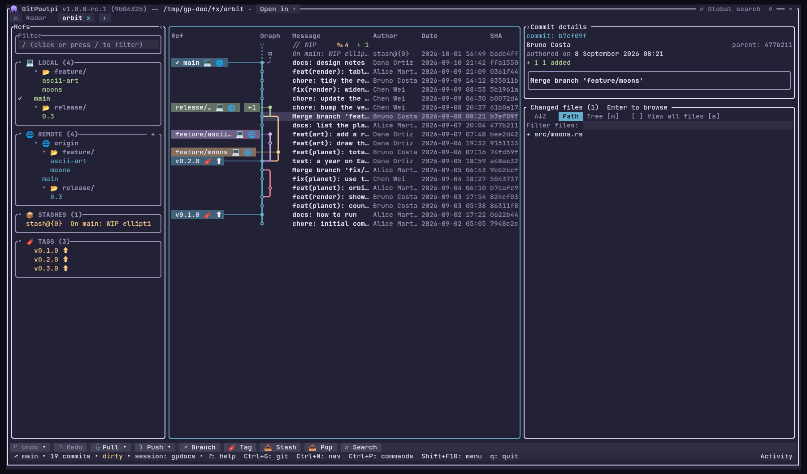
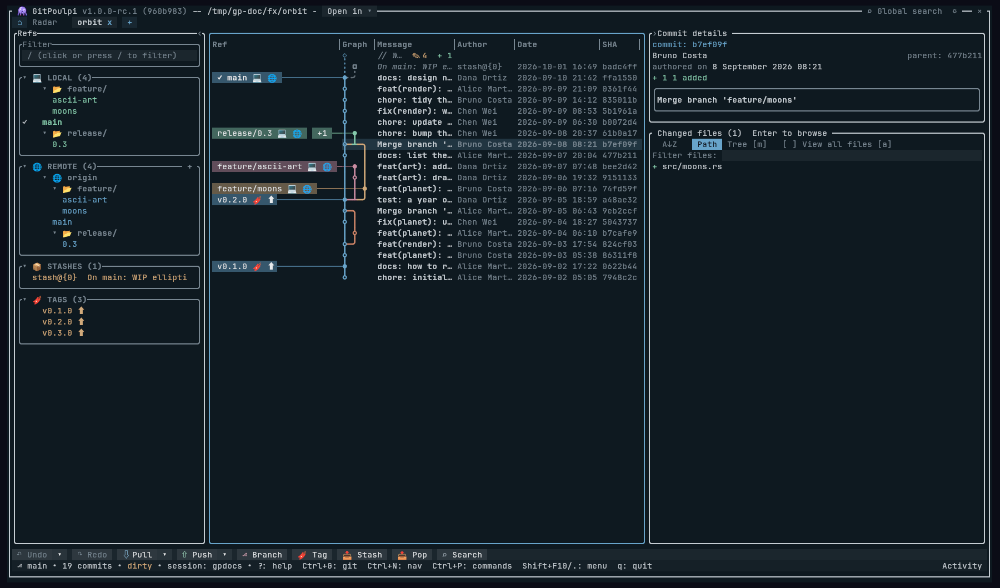
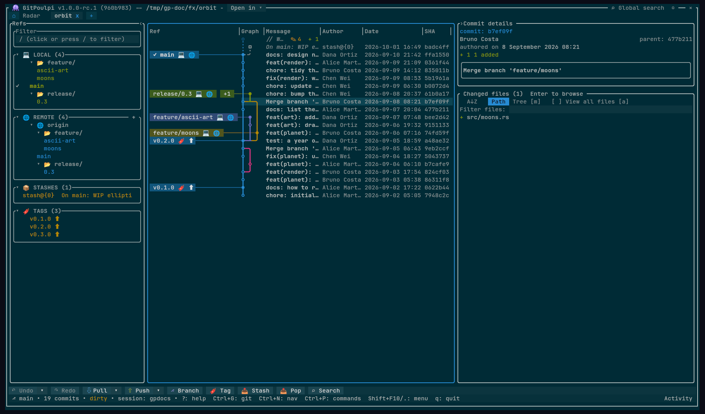
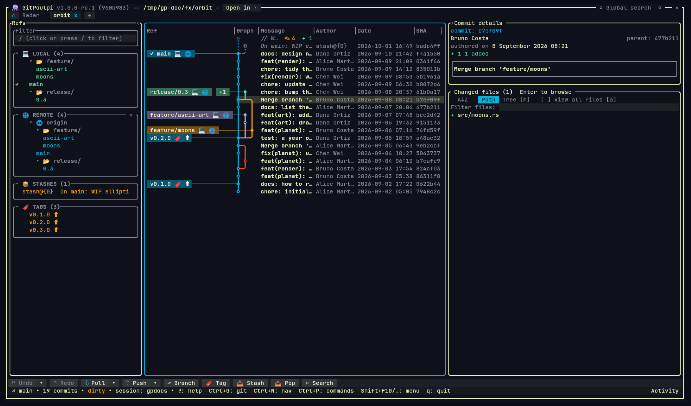
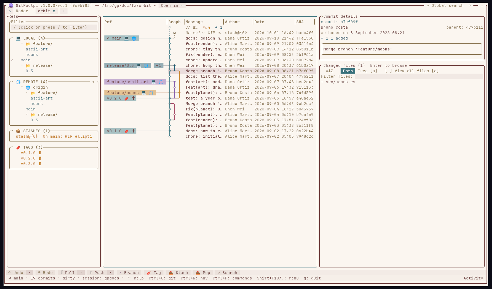

[English](../themes.md) · [Čeština](../cs/themes.md) · [Deutsch](../de/themes.md) · [Español](../es/themes.md) · [Français](../fr/themes.md) · [Italiano](../it/themes.md) · [日本語](../ja/themes.md) · [한국어](../ko/themes.md) · [Nederlands](../nl/themes.md) · [Polski](../pl/themes.md) · [Português (Brasil)](../pt-BR/themes.md) · [Português (Portugal)](../pt-PT/themes.md) · [Русский](../ru/themes.md) · [Svenska](../sv/themes.md) · [Türkçe](../tr/themes.md) · **Українська** · [简体中文](../zh-CN/themes.md)

# Теми

Тема задає кожен колір, яким малює GitPoulpi: текст, панелі, виділення, кнопки,
подання diff і merge, редактор, значки панелі інструментів і кольори доріжок
графа Log. Змінюйте тему в **Налаштування > Вигляд > Тема** або командою
`gitpoulpi config set ui.theme <slug>`. Щоб побачити, як виглядає кожна з них, перейдіть до [галереї](#галерея).

## Вбудовані пресети

`gitpoulpi theme list` виводить ті, що є у вашій збірці, у порядку, в якому їх
показує список у Налаштуваннях: спершу **GitPoulpi Dark** (`dark`, малюється
поверх власного тла вашого терміналу) і **GitPoulpi Light** (`light`), потім усі
інші пресети за алфавітом міток. `ui.theme = "system"` (типово) відповідає вашому
терміналу: Light на світлому тлі терміналу, інакше Dark (див. «Визначення
системної теми» нижче); застаріле `default` - те саме, що `system`. Список палітр
доріжок використовує той самий порядок.

| Slug | Мітка | Джерело кольорів |
|---|---|---|
| `system` (типово) | Система | не палітра: GitPoulpi Light на світлому тлі терміналу, інакше GitPoulpi Dark |
| `dark` | GitPoulpi Dark | оригінальна тема GitPoulpi, малюється поверх власного тла вашого терміналу |
| `light` | GitPoulpi Light | оригінальна тема GitPoulpi |
| `catppuccin-latte` / `catppuccin-frappe` / `catppuccin-macchiato` / `catppuccin-mocha` | Catppuccin Latte / Frappé / Macchiato / Mocha | [github.com/catppuccin/palette](https://github.com/catppuccin/palette) |
| `cyberpunk` | Cyberpunk | [iTerm2-Color-Schemes](https://github.com/mbadolato/iTerm2-Color-Schemes) «Cyberpunk» |
| `dracula` | Dracula | [draculatheme.com/contribute](https://draculatheme.com/contribute) |
| `everforest-dark` | Everforest Dark | [github.com/sainnhe/everforest/blob/master/palette.md](https://github.com/sainnhe/everforest/blob/master/palette.md) |
| `fire` / `fire-light` | Fire / Fire Light | оригінальні теми GitPoulpi: Fire - жаринки на тлі випаленого помаранчевого з полум'яно-помаранчевим; Fire Light - його світла пара на справжньому помаранчевому тлі |
| `github-dark` / `github-light` | GitHub Dark / GitHub Light | теми Primer від GitHub, [github.com/primer/github-vscode-theme](https://github.com/primer/github-vscode-theme) з @primer/primitives (`canvas.default`, `canvas.inset` для бічної панелі, `fg.*`, `accent.fg`); жодне значення не змінено |
| `gruvbox-dark` / `gruvbox-light` | Gruvbox Dark / Light | [github.com/morhetz/gruvbox#palette](https://github.com/morhetz/gruvbox#palette) |
| `kanagawa` / `kanagawa-lotus` | Kanagawa (wave) / Kanagawa Lotus | [github.com/rebelot/kanagawa.nvim](https://github.com/rebelot/kanagawa.nvim) |
| `matrix` | Matrix | [iTerm2-Color-Schemes](https://github.com/mbadolato/iTerm2-Color-Schemes) «Matrix» (у схемі немає червоного: `danger` - це `#ff5555`) |
| `monokai` | Monokai | оригінальна палітра Monokai ([monokai.nl](https://monokai.nl/)) |
| `nord` | Nord | [www.nordtheme.com](https://www.nordtheme.com) |
| `one-dark` / `one-light` | One Dark / One Light | Atom One Dark / One Light ([One Dark](https://github.com/atom/one-dark-syntax), [One Light](https://github.com/atom/one-light-syntax)) |
| `rose-pine` / `rose-pine-moon` / `rose-pine-dawn` | Rosé Pine / Moon / Dawn | [rosepinetheme.com/palette](https://rosepinetheme.com/palette/) |
| `solarized-dark` / `solarized-light` | Solarized Dark / Light | Solarized від Ethan Schoonover ([ethanschoonover.com/solarized](https://ethanschoonover.com/solarized/)) |
| `sunset` | Sunset | оригінальна тема GitPoulpi: індигові сутінки з кораловим і золотим |
| `terminal` | Terminal (16 colors) | використовує лише власні 16 кольорів вашого терміналу |
| `tokyo-night` / `tokyo-night-day` | Tokyo Night (night) / Tokyo Night Day | [github.com/folke/tokyonight.nvim](https://github.com/folke/tokyonight.nvim) (передній план Day затемнено, щоб він проходив правила контрасту) |
| `vesper` | Vesper | [github.com/raunofreiberg/vesper](https://github.com/raunofreiberg/vesper) (у палітрі немає синього чи пурпурового: акцент - персиковий) |
| `vscode-dark` / `vscode-light` | VS Code Dark / VS Code Light | типові Dark Modern / Light Modern з VS Code, [github.com/microsoft/vscode/tree/main/extensions/theme-defaults/themes](https://github.com/microsoft/vscode/tree/main/extensions/theme-defaults/themes) (`dark_modern.json`, `light_modern.json`, плюс типові кольори VS Code для виділення в списках і акценти ANSI/діаграм; приглушений сірий у Light - `616161`) |

### Імпортовано з terminalcolors.com

Імпортовано з палітр терміналів terminalcolors.com; кожна схема належить її авторам. 90 пресетів побудовано з тла, переднього плану, виділення та 16 кольорів ANSI палітри (акцент = синій, успіх = зелений, попередження = жовтий, небезпека = червоний, ШІ = пурпуровий, приглушений = яскраво-чорний) за єдиним способом виведення, спільним для всіх; колір, що не проходить правила контрасту GitPoulpi, світлішає або темнішає, доки не пройде. Таблицю генерує `scripts/gen-terminalcolors.py` у `crates/gitpoulpi-config/src/theme/terminalcolors_data.rs`. Slug'и мають вигляд `<family>-<variant>` (`default` відкинуто); мітки в списку йдуть за алфавітом, як і решта.

| Сімейство | Slug'и |
|---|---|
| [Apprentice](https://terminalcolors.com/themes/apprentice/) | `apprentice` |
| [Ayu](https://terminalcolors.com/themes/ayu/) | `ayu-dark`, `ayu-light`, `ayu-mirage` |
| [Cobalt2](https://terminalcolors.com/themes/cobalt2/) | `cobalt2` |
| [Deus](https://terminalcolors.com/themes/deus/) | `deus` |
| [Dracula](https://terminalcolors.com/themes/dracula/) | `dracula-soft` |
| [Everforest](https://terminalcolors.com/themes/everforest/) | `everforest-light` |
| [GitHub](https://terminalcolors.com/themes/github/) | `github-dark-colorblind`, `github-dark-dimmed`, `github-dark-high-contrast`, `github-dark-legacy`, `github-light-colorblind`, `github-light-high-contrast`, `github-light-legacy` |
| [Gotham](https://terminalcolors.com/themes/gotham/) | `gotham` |
| [Gruvbox](https://terminalcolors.com/themes/gruvbox/) | `gruvbox-dark-hard-contrast`, `gruvbox-dark-soft-contrast`, `gruvbox-light-hard-contrast`, `gruvbox-light-soft-contrast` |
| [Iceberg](https://terminalcolors.com/themes/iceberg/) | `iceberg-dark`, `iceberg-light` |
| [Jellybeans](https://terminalcolors.com/themes/jellybeans/) | `jellybeans` |
| [Kanagawa](https://terminalcolors.com/themes/kanagawa/) | `kanagawa-dragon` |
| [Lucario](https://terminalcolors.com/themes/lucario/) | `lucario` |
| [Miasma](https://terminalcolors.com/themes/miasma/) | `miasma` |
| [Moonfly](https://terminalcolors.com/themes/moonfly/) | `moonfly` |
| [Night](https://terminalcolors.com/themes/night-owl/) | `night-owl-dark`, `night-owl-light` |
| [Nightfly](https://terminalcolors.com/themes/nightfly/) | `nightfly` |
| [Nightfox](https://terminalcolors.com/themes/nightfox/) | `nightfox`, `nightfox-carbonfox`, `nightfox-dawnfox`, `nightfox-dayfox`, `nightfox-duskfox`, `nightfox-nordfox`, `nightfox-terafox` |
| [Noctis](https://terminalcolors.com/themes/noctis/) | `noctis`, `noctis-azureus`, `noctis-bordo`, `noctis-hibernus`, `noctis-lilac`, `noctis-lux`, `noctis-minimus`, `noctis-obscuro`, `noctis-sereno`, `noctis-uva`, `noctis-viola` |
| [Nordic](https://terminalcolors.com/themes/nordic/) | `nordic` |
| [One](https://terminalcolors.com/themes/one-half/) | `one-half-dark`, `one-half-light` |
| [Panda](https://terminalcolors.com/themes/panda/) | `panda` |
| [Posterpole](https://terminalcolors.com/themes/posterpole/) | `posterpole`, `posterpole-gray` |
| [Seoul256](https://terminalcolors.com/themes/seoul256/) | `seoul256-dark`, `seoul256-light` |
| [Shades](https://terminalcolors.com/themes/shades-of-purple/) | `shades-of-purple`, `shades-of-purple-super-dark` |
| [Sonokai](https://terminalcolors.com/themes/sonokai/) | `sonokai`, `sonokai-andromeda`, `sonokai-atlantis`, `sonokai-espresso`, `sonokai-maia`, `sonokai-shusia` |
| [Srcery](https://terminalcolors.com/themes/srcery/) | `srcery` |
| [Tender](https://terminalcolors.com/themes/tender/) | `tender` |
| [Tokyo](https://terminalcolors.com/themes/tokyo-night/) | `tokyo-night-moon`, `tokyo-night-storm` |
| [Tomorrow](https://terminalcolors.com/themes/tomorrow/) | `tomorrow`, `tomorrow-night`, `tomorrow-night-blue`, `tomorrow-night-bright`, `tomorrow-night-eighties` |
| [Zenbones](https://terminalcolors.com/themes/zenbones/) | `zenbones-duckbones`, `zenbones-forestbones-dark`, `zenbones-forestbones-light`, `zenbones-kanagawabones`, `zenbones-neobones-dark`, `zenbones-neobones-light`, `zenbones-nordbones`, `zenbones-rosebones-dark`, `zenbones-rosebones-light`, `zenbones-seoulbones-dark`, `zenbones-seoulbones-light`, `zenbones-tokyobones-dark`, `zenbones-tokyobones-light`, `zenbones-vimbones`, `zenbones-zenburned`, `zenbones-zenwritten-dark`, `zenbones-zenwritten-light` |

`ui.side_bg` - це тло панелі Refs і правої панелі (подробиці commit'у, робочі зміни,
списки файлів), як GitHub і VS Code малюють свої бічні панелі.
Catppuccin (його `mantle`), GitHub і VS Code його
задають; у кожного іншого пресета воно `default`, тобто те саме, що `ui.bg`.
Файл теми може задати `side_bg` у `[ui]` (його виводить `gitpoulpi theme export`).

Ще три ролі в `[ui]` фарбують оздоблення вікна, як це роблять GitHub і VS Code:

| Роль | Що вона малює |
|---|---|
| `ui.toolbar_bg` | Рядок панелі інструментів і **вибрану вкладку репозиторію**, щоб вкладка виглядала прикріпленою до панелі інструментів. Чипи кнопок панелі інструментів зберігають власний `chrome.toolbar_bg`. |
| `ui.statusbar_bg` | Рядок стану (унизу, якщо `ui.statusbar_position` не каже «вгорі»). |
| `ui.statusbar_fg` | Текст рядка стану. Текст, який не читався б на цій заливці, перефарбовується ним; текст попереджень і помилок, що читається, зберігає свій колір. |

Пресети задають їх під свій застосунок: VS Code Dark і Light - синій (`#007acc`) рядок стану з білим текстом і сірі
відтінки заголовка вікна VS Code для панелі інструментів; GitHub - тони свого
заголовка. Кожен інший пресет (зокрема імпортовані палітри терміналів) виводить
панель інструментів на крок від `bg`, а рядок стану трохи далі від неї, з `text`
на ньому, і правила контрасту зберігають читабельність тексту. `dark` (GitPoulpi
Dark) і `terminal` використовують власне тло терміналу, тож усі три там мають
`default`: нічого не малюється, а вибрана вкладка зберігає колір виділення. Файл теми,
що їх пропускає, успадковує значення своєї бази; `default` означає відсутність відтінку
(рядок стану тоді відповідає `side_bg`).

Якщо коментар або приглушений сірий схеми надто тьмяний, щоб його читати, його
освітлюють, доки він не пройде правила контрасту GitPoulpi; відтінки панелей і
виділення, яких схема не має, виводяться з її тла.

### Галерея

Кожна вбудована тема на тому самому репозиторії з вибраним commit'ом merge (`scripts/docs-screenshots.sh` знімає їх заново).

| **GitPoulpi Dark** (`dark`) | **GitPoulpi Light** (`light`) | **Apprentice** (`apprentice`) |
|---|---|---|
|  |  |  |
| **Ayu Dark** (`ayu-dark`) | **Ayu Light** (`ayu-light`) | **Ayu Mirage** (`ayu-mirage`) |
|  |  |  |
| **Catppuccin Frappé** (`catppuccin-frappe`) | **Catppuccin Latte** (`catppuccin-latte`) | **Catppuccin Macchiato** (`catppuccin-macchiato`) |
|  |  |  |
| **Catppuccin Mocha** (`catppuccin-mocha`) | **Cobalt2** (`cobalt2`) | **Cyberpunk** (`cyberpunk`) |
|  |  |  |
| **Deus** (`deus`) | **Dracula** (`dracula`) | **Dracula Soft** (`dracula-soft`) |
|  |  |  |
| **Everforest Dark** (`everforest-dark`) | **Everforest Light** (`everforest-light`) | **Fire** (`fire`) |
|  |  |  |
| **Fire Light** (`fire-light`) | **GitHub Dark** (`github-dark`) | **GitHub Dark Colorblind** (`github-dark-colorblind`) |
|  |  |  |
| **GitHub Dark Dimmed** (`github-dark-dimmed`) | **GitHub Dark High Contrast** (`github-dark-high-contrast`) | **GitHub Dark Legacy** (`github-dark-legacy`) |
|  |  |  |
| **GitHub Light** (`github-light`) | **GitHub Light Colorblind** (`github-light-colorblind`) | **GitHub Light High Contrast** (`github-light-high-contrast`) |
|  |  |  |
| **GitHub Light Legacy** (`github-light-legacy`) | **Gotham** (`gotham`) | **Gruvbox Dark** (`gruvbox-dark`) |
|  |  |  |
| **Gruvbox Dark Hard Contrast** (`gruvbox-dark-hard-contrast`) | **Gruvbox Dark Soft Contrast** (`gruvbox-dark-soft-contrast`) | **Gruvbox Light** (`gruvbox-light`) |
|  |  |  |
| **Gruvbox Light Hard Contrast** (`gruvbox-light-hard-contrast`) | **Gruvbox Light Soft Contrast** (`gruvbox-light-soft-contrast`) | **Iceberg Dark** (`iceberg-dark`) |
|  |  |  |
| **Iceberg Light** (`iceberg-light`) | **Jellybeans** (`jellybeans`) | **Kanagawa** (`kanagawa`) |
|  |  |  |
| **Kanagawa Dragon** (`kanagawa-dragon`) | **Kanagawa Lotus** (`kanagawa-lotus`) | **Lucario** (`lucario`) |
|  |  |  |
| **Matrix** (`matrix`) | **Miasma** (`miasma`) | **Monokai** (`monokai`) |
|  |  |  |
| **Moonfly** (`moonfly`) | **Night Owl Dark** (`night-owl-dark`) | **Night Owl Light** (`night-owl-light`) |
|  |  |  |
| **Nightfly** (`nightfly`) | **Nightfox** (`nightfox`) | **Nightfox Carbonfox** (`nightfox-carbonfox`) |
|  |  |  |
| **Nightfox Dawnfox** (`nightfox-dawnfox`) | **Nightfox Dayfox** (`nightfox-dayfox`) | **Nightfox Duskfox** (`nightfox-duskfox`) |
|  |  |  |
| **Nightfox Nordfox** (`nightfox-nordfox`) | **Nightfox Terafox** (`nightfox-terafox`) | **Noctis** (`noctis`) |
|  |  |  |
| **Noctis Azureus** (`noctis-azureus`) | **Noctis Bordo** (`noctis-bordo`) | **Noctis Hibernus** (`noctis-hibernus`) |
|  |  |  |
| **Noctis Lilac** (`noctis-lilac`) | **Noctis Lux** (`noctis-lux`) | **Noctis Minimus** (`noctis-minimus`) |
|  |  |  |
| **Noctis Obscuro** (`noctis-obscuro`) | **Noctis Sereno** (`noctis-sereno`) | **Noctis Uva** (`noctis-uva`) |
|  |  |  |
| **Noctis Viola** (`noctis-viola`) | **Nord** (`nord`) | **Nordic** (`nordic`) |
|  |  |  |
| **One Dark** (`one-dark`) | **One Half Dark** (`one-half-dark`) | **One Half Light** (`one-half-light`) |
|  |  |  |
| **One Light** (`one-light`) | **Panda** (`panda`) | **Posterpole** (`posterpole`) |
|  |  |  |
| **Posterpole Gray** (`posterpole-gray`) | **Rosé Pine** (`rose-pine`) | **Rosé Pine Dawn** (`rose-pine-dawn`) |
|  |  |  |
| **Rosé Pine Moon** (`rose-pine-moon`) | **Seoul256 Dark** (`seoul256-dark`) | **Seoul256 Light** (`seoul256-light`) |
|  |  |  |
| **Shades of Purple** (`shades-of-purple`) | **Shades of Purple Super Dark** (`shades-of-purple-super-dark`) | **Solarized Dark** (`solarized-dark`) |
|  |  |  |
| **Solarized Light** (`solarized-light`) | **Sonokai** (`sonokai`) | **Sonokai Andromeda** (`sonokai-andromeda`) |
|  |  |  |
| **Sonokai Atlantis** (`sonokai-atlantis`) | **Sonokai Espresso** (`sonokai-espresso`) | **Sonokai Maia** (`sonokai-maia`) |
|  |  |  |
| **Sonokai Shusia** (`sonokai-shusia`) | **Srcery** (`srcery`) | **Sunset** (`sunset`) |
|  |  |  |
| **Tender** (`tender`) | **Terminal (16 colors)** (`terminal`) | **Tokyo Night** (`tokyo-night`) |
|  |  |  |
| **Tokyo Night Day** (`tokyo-night-day`) | **Tokyo Night Moon** (`tokyo-night-moon`) | **Tokyo Night Storm** (`tokyo-night-storm`) |
|  |  |  |
| **Tomorrow** (`tomorrow`) | **Tomorrow Night** (`tomorrow-night`) | **Tomorrow Night Blue** (`tomorrow-night-blue`) |
|  |  |  |
| **Tomorrow Night Bright** (`tomorrow-night-bright`) | **Tomorrow Night Eighties** (`tomorrow-night-eighties`) | **Vesper** (`vesper`) |
|  |  |  |
| **VS Code Dark** (`vscode-dark`) | **VS Code Light** (`vscode-light`) | **Zenbones Duckbones** (`zenbones-duckbones`) |
|  |  |  |
| **Zenbones Forestbones Dark** (`zenbones-forestbones-dark`) | **Zenbones Forestbones Light** (`zenbones-forestbones-light`) | **Zenbones Kanagawabones** (`zenbones-kanagawabones`) |
|  |  |  |
| **Zenbones Neobones Dark** (`zenbones-neobones-dark`) | **Zenbones Neobones Light** (`zenbones-neobones-light`) | **Zenbones Nordbones** (`zenbones-nordbones`) |
|  |  |  |
| **Zenbones Rosebones Dark** (`zenbones-rosebones-dark`) | **Zenbones Rosebones Light** (`zenbones-rosebones-light`) | **Zenbones Seoulbones Dark** (`zenbones-seoulbones-dark`) |
|  |  |  |
| **Zenbones Seoulbones Light** (`zenbones-seoulbones-light`) | **Zenbones Tokyobones Dark** (`zenbones-tokyobones-dark`) | **Zenbones Tokyobones Light** (`zenbones-tokyobones-light`) |
|  |  |  |
| **Zenbones Vimbones** (`zenbones-vimbones`) | **Zenbones Zenburned** (`zenbones-zenburned`) | **Zenbones Zenwritten Dark** (`zenbones-zenwritten-dark`) |
|  |  |  |
| **Zenbones Zenwritten Light** (`zenbones-zenwritten-light`) |
|  |

## Будь-яка тема з будь-якою палітрою ліній

Кожна тема має власні кольори ліній для графа Log, але ви можете поєднати будь-яку
тему з будь-якою палітрою: **Налаштування > Вигляд > Колірна тема графа**
пропонує **Як у темі** (типово) і кожну палітру доріжок кожної теми (GitPoulpi Dark,
GitPoulpi Light, далі Material, Serie, ... і `graph_palette` ваших власних
файлів тем). 

У `config.toml`:

```toml
[ui]
theme = "nord"
graph_color_theme = "material"   # or "theme" to follow the theme
```

`ui.input_color` - це перевизначення того самого роду для текстових полів: типове
`theme` бере кольори полів із теми; `gray`, `blue`, `slate`, `dark` і `custom`
примусово задають тло (це темні кольори, тож на світлій темі вибирайте `theme`).

## Ваші власні теми

Покладіть файл `.toml` у папку `themes/` каталогу конфігурації
(`gitpoulpi config path` виводить її батьківську папку; папка - `${config}/themes/`).
Назва файлу без `.toml` - це slug теми, який приймає `ui.theme`. Файл не може
повторно використати slug пресета (його пропускають із попередженням).

Почніть із повного файлу:

```
gitpoulpi theme export nord > "$(dirname "$(gitpoulpi config path)")/themes/mine.toml"
```

Потім залиште лише те, що змінюєте. Файл - це набір **часткових перевизначень** над
`base` (пресетом або іншою користувацькою темою; ланцюжки мають не більше 4 рівнів,
цикли відхиляються; без `base` береться `dark`):

```toml
name = "My Nord"            # the label in the combo; default = file name
base = "nord"
light = false               # inherited when absent
syntax = "base16-ocean.dark"
graph_palette = ["#88c0d0", "#a3be8c"]

[ui]
bg = "#2e3440"              # "default" | "#rrggbb" | "ansi:N"
accent = "#88c0d0"
toolbar_bg = "#3b4252"      # toolbar row and selected tab
statusbar_bg = "#5e81ac"    # status bar
statusbar_fg = "#eceff4"

[diff]
add_bg = "#2f3b2f"
```

Кольори - це `"#rrggbb"`, `"ansi:N"` (запис N палітри терміналу) або `"default"`
(власний колір терміналу). Групи й ключі - ті, що виводить
`gitpoulpi theme export <slug>`. Жодна помилка не є фатальною: невідомий ключ або хибний колір
ігнорується, невідомий `base` повертає до `dark`, а `gitpoulpi theme list` повідомляє
про кожну проблему в `warnings` (застосунок показує їх один раз у рядку стану).

Файли перечитуються, коли відкривається список Тема і коли закриваються Налаштування.
Запущене вікно також помічає, що `config.toml` (наприклад, після
`gitpoulpi config set ui.theme ...` з оболонки) або файл активної теми було перезаписано,
і застосовує нові кольори приблизно за секунду, без перезапуску.

### `ui.border_focused`

Рамка панелі, що має фокус клавіатури: Log, бічна панель Refs, панелі Staged і Unstaged,
подробиці commit'у, панелі історії, рев'ю та переписування, рамки diff, файлів і редактора.
Вона малює лише рамки; текст, підписи та значки (підпис «commit :», значок «Головна»,
кнопки вкладок) і далі використовують `ui.accent`. Тож тема може обрамляти активну панель
кольором, який був би нечитабельним як колір тексту, наприклад яскраво-жовтим у світлій темі.
Якщо тема його не задає, він наслідує `ui.accent` (і в користувацькому файлі теж: файл, що
змінює лише `accent`, дає цей акцент і рамкам панелі в фокусі), тож усі вбудовані теми
виглядають як раніше. Діалоги та спливні вікна зберігають рамку кольору акценту.

```toml
[ui]
accent = "#1f5fbf"
border_focused = "#e7df00"
```

## Визначення системної теми

Із `ui.theme = "system"` GitPoulpi питає термінал про колір його тла **один раз, під
час запуску** (запит OSC 11, на який відповідають kitty, WezTerm, Alacritty, foot,
iTerm2, Windows Terminal, tmux і більшість інших) і вибирає Light для світлого тла,
інакше Dark. Очікування триває щонайбільше близько 100 мс, а термінал, який не знає запиту,
нічого не втрачає: відповідь завжди зчитується до запуску інтерфейсу, тож нічого не
друкується і жодні клавіші не поглинаються. Без відповіді (і завжди у Windows, який
запиту не надсилає) читається `COLORFGBG`, потім повернення до Dark. Зміна тла терміналу,
поки працює GitPoulpi, не відстежується; перезапустіть його або явно виберіть
Light чи Dark.

## Глибина кольору

Теми - truecolor (`#rrggbb`). `ui.color_depth` (Налаштування > Вигляд >
Глибина кольору, застосовується одразу) визначає, як це потрапляє до терміналу:

| Значення | Дія |
|---|---|
| `auto` (типово) | Truecolor, окрім місць, де відомо, що він не працює: Apple Terminal (`TERM_PROGRAM=Apple_Terminal`) використовує 256 кольорів, консоль Linux (`TERM=linux`) - 16, а термінал `*-256color`, що не задає `COLORTERM` (і не є WezTerm, kitty чи Windows Terminal), - 256. `COLORTERM=truecolor` завжди означає truecolor. |
| `truecolor` | Завжди 24-бітний колір. |
| `256` | Кожен колір RGB стає найближчим записом xterm-256. |
| `16` | Найближчий із 16 кольорів ANSI; точний відтінок задає власна палітра терміналу. |

Використовуйте `256` або `16`, якщо тема показується хибними кольорами через ssh чи в
старому мультиплексорі. Пресету Terminal нічого з цього не потрібно. Truecolor нічого не
коштує; прохід відображення по екрану виконується раз на кадр і лише коли він активний.

## Попередній перегляд наживо

У Налаштування > Вигляд список «Тема» показує **Системна (як у терміналі)**, пресети, а
потім ваші власні файли тем. Перехід підсвічування застосовує цю тему одразу, тож увесь екран
Налаштувань перемальовується під вами; **Enter** залишає її (вона зберігається), **Esc**
або клацання повз списку повертає попередню й нічого не зберігає. Пункт палітри
**Застосунок: тема...** (`Ctrl+P`) відкриває Налаштування на цьому рядку.

### Змінити тему з палітри

**Застосунок: змінити тему...** (`Ctrl+P` або `Ctrl+N t`; клавішу можна перепризначити як
`nav_prefix.change_theme`) відкриває список тих самих тем без переходу в Налаштування:
**Системна (як у терміналі)**, пресети, потім ваші власні файли тем, кожна з чотирма
малими чипами кольорів. Поточна тема позначена галочкою. Друкуйте, щоб звузити список;
перехід підсвічування одразу показує тему, **Enter** застосовує її й зберігає `ui.theme` у
`config.toml`, **Esc** (або клацання поза списком) повертає попередню тему й нічого не зберігає.

Під полем фільтра сегментований префільтр звужує список: **Усі**, **Темні**, **Світлі**
і **Кольорові** (клацання по сегменту, `Tab` / `Shift+Tab` або `Alt+1`..`Alt+4`). Темні й
Світлі визначаються яскравістю `ui.bg` теми; **Кольорові** залишає теми, чиє тло явно
підфарбоване (синє, фіолетове, жовте, зелене...), і виключає білі, майже білі, чорні та
майже чорні сірі, тож Solarized Dark, Dracula чи Nord - кольорові, а GitHub Dark і
One Light - ні. Кольорова тема показується також у Темних або Світлих. **Системна** і
прозорі теми (без власного тла) з'являються лише в Усі. Префільтр поєднується з тим,
що ви друкуєте. Вибір колірної теми графа та мови попередньо переглядається так само:
доріжки Log і весь інтерфейс змінюються, поки ви рухаєте підсвічування.


Під списком смужка чипів кольорів показує чинну тему (тло, текст, приглушений, акцент,
виділення, небезпека, diff доданого, diff видаленого, потім перші шість кольорів ліній)
і змінюється разом із попереднім переглядом. Список **Колірна тема графа** на сторінці **Вигляд**
показує кілька кольорів ліній біля кожної палітри, а вибір застосовується, коли
закриваються Налаштування.

Тема з власним тлом (Light та інші намальовані пресети) заповнює все вікно, зокрема
Налаштування та повносторінкові вигляди, і надає тексту без власного кольору колір
тексту теми; Dark і Terminal не чіпають кольорів вашого терміналу.

## З командного рядка

| Команда | Вивід |
|---|---|
| `gitpoulpi theme list` | JSON `{themes: [{slug, label, source, light, lane_palette}], warnings}`; `source` - це `preset` або `user`. |
| `gitpoulpi theme export <slug>` | Повний файл теми у TOML на stdout (JSON: `{slug, toml}`); він розбирається назад у ту саму тему. |
| `gitpoulpi config set ui.theme <slug>` | Перевіряється за пресетами та вашою папкою `themes/`; невідома назва - помилка зі списком припустимих. Приймаються `system` і `default`. |
| `gitpoulpi config set ui.graph_color_theme <name>` | `theme` (брати з теми) або будь-яка назва палітри доріжок; невідома назва виводить список припустимих. |

Сервер MCP пропонує `theme_list` і `theme_export` як інструменти лише для читання.
