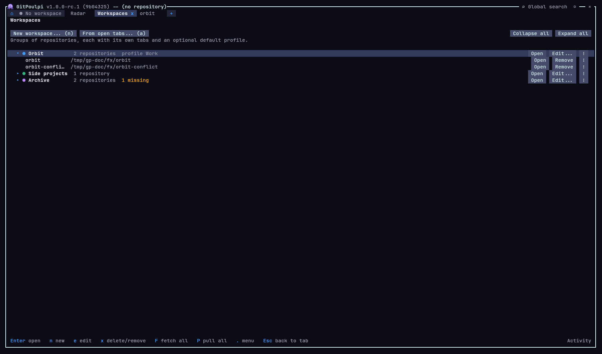

**English** · [Čeština](cs/workspaces.md) · [Deutsch](de/workspaces.md) · [Español](es/workspaces.md) · [Français](fr/workspaces.md) · [Italiano](it/workspaces.md) · [日本語](ja/workspaces.md) · [한국어](ko/workspaces.md) · [Nederlands](nl/workspaces.md) · [Polski](pl/workspaces.md) · [Português (Brasil)](pt-BR/workspaces.md) · [Português (Portugal)](pt-PT/workspaces.md) · [Русский](ru/workspaces.md) · [Svenska](sv/workspaces.md) · [Türkçe](tr/workspaces.md) · [Українська](uk/workspaces.md) · [简体中文](zh-CN/workspaces.md)

# Workspaces

A **workspace** is a named group of repositories: the ones you work on together
(a front end, its API, the docs). It remembers which of them are open as tabs,
and can carry a **default commit profile**, so commits in those repositories use
the right identity without you switching by hand. A repository can be in several
workspaces, and being in none is fine: "No workspace" is today's plain tab list.

Workspaces are stored in `workspaces.toml`, beside `config.toml`, shared by every
session, the window, the CLI and MCP (`gitpoulpi workspace ...`, see the
[CLI reference](cli-reference.md)). A workspace added, renamed or removed from a shell or by `gitpoulpi workspace ...` while the window is
open shows up by itself within a second or so (the Workspaces tab, the tab bar's chip and its list), with
no key press. Closing or deleting a workspace never
touches a repository on disk. Workspace edits are settings, like favorites and
profiles: they are not part of [Undo and redo](undo-redo.md), and Delete asks
first.

## The workspace chip

Once you have a workspace, a chip appears on the tab bar right after the `⌂`: a
colored dot and the active workspace's name, or "No workspace" (dimmed). On a
narrow bar it shrinks to the dot, and on a very narrow one it goes away.


- **Click it**, press `Alt+W`, or run `Workspace: Switch...` from the palette to
  open a dropdown: your workspaces, "No workspace", and "Manage workspaces..."
  (which opens the Workspaces tab).
- **Switching swaps the tabs.** The tabs you had open are kept for the workspace
  you leave, and the target's tabs come back (the first time, its repositories
  that exist). Switch back and everything is where you left it. It restarts the
  window like a tab switch; the daemon stays.
- **The workspace is remembered**: the next launch comes back in it.
- **Closing the last tab** of a workspace keeps the workspace active and shows
  the Home tab.
- **The `+` (new tab) while a workspace is active** adds the repository you pick
  to the tab list and asks nothing. To put it in the workspace itself, use
  "Add to workspace" in the tab's right-click menu (or `Workspace: Add Tab to
  Workspace`); "Remove from workspace" takes it out again and leaves the tab open.

With no workspace yet, there is no chip: create one from the Workspaces tab or the
palette first.

## The Workspaces tab

Open it from the `+` menu, with `Alt+J`, or with `Workspace: Manage...` in the palette; its `x` (or `Ctrl+W`) closes it, and it stays open across restarts until you close it. Each workspace is a row with
its color dot, name, how many repositories it lists (and how many are missing),
its default profile, and "active" when the window is in it. `Right`, `Space` or a
click unfolds it to its repositories.



| Per workspace | Key | |
|---|---|---|
| Open | `Enter` | Makes it active and opens its tabs. |
| Edit... | `e` | The form below. |
| Delete... | `x` | Asks first. Repositories are not touched. |
| Fetch all | `Shift+F` | One repository after the other, progress in the status line, failures listed at the end. |
| Pull all | `Shift+P` | The same, fast-forward only: it never stops on a merge. |
| Clone missing | `m` | Clones every missing repository that has a recorded remote. |
| New workspace... | `n` | |
| From open tabs... | `a` | A new workspace with your open tabs checked. |

A **missing** repository (its folder is gone) stays listed, marked, with
**Locate...** (`l` or `Enter`: pick where it is now), **Clone** (when its
`origin` URL was recorded when it was added) and **Remove** (`x`). Every row
also has a `⋮` menu (right-click, `.` or `Shift+F10`) with the same actions, and
every action is in the palette under `Workspace:`.

## The New / Edit form


- **Name**: required, unique.
- **Color**: a dropdown of theme colors; the dot on the chip and the rows.
- **Description**: free text.
- **Profile**: a dropdown of your `[[profiles]]`, or "None". It is optional.
- **✦ AI instructions**: only with AI on, see [below](#ai-instructions-of-a-workspace).
- **Repositories**: a checklist of every repository GitPoulpi knows (open tabs,
  favorites, recent, the workspace's own, missing ones included). `Space` checks
  a row; **Add folder...** (`Ctrl+B`) picks a repository from disk. The origin
  URL of each new repository is read from the repository and recorded (without
  any credential), which is what Clone uses later.

## AI instructions of a workspace

With AI turned on (*Settings > AI*), the form has a **✦ AI instructions** row with an **Edit...** button (`Enter` on
the row). It opens a small editor of what the AI is told in **every repository of the workspace**: pick *Every AI
action* or one action (commit message, explain, stash message, pull request, commit composer, conflict resolution,
code review) in the **For** list, choose **Combine** - *Add to global* (sent after the global instructions) or
*Replace global* (sent instead of them) - and write the text. **Apply** keeps the whole set, **Save** on the form
writes it into `workspaces.toml` with the workspace; **Cancel** drops what you typed. With AI off the row is
hidden and the workspace's instructions are left as they are.

The workspace's words sit between the global and the repository's own instructions (see
[AI instructions](ai.md#instructions) for the order and for what *replace* does). A repository belonging to
several workspaces uses the window's active workspace when it contains it, else the first that does. From a
script: `gitpoulpi workspace set-ai-instructions <id> [--action <a>] [--mode append|replace] (--text ... |
--clear)`; `workspace show` prints them as `ai_instructions`.

```toml
[[workspace]]
id = "acme"
name = "Acme"
repos = ["/home/u/src/acme-api"]

[workspace.ai_instructions]       # every AI action in this workspace
text = "Use the Acme glossary."
mode = "add"                       # or "replace"

[workspace.ai_overrides.code_review]   # one action
text = "Flag missing tests."
mode = "add"
```

## The default profile

Commits are signed by the first of these that applies:

1. the profile you chose **by hand** for that repository (the toolbar's profile
   field),
2. the **active workspace's** profile, when the repository is one of its
   members,
3. `general.active_profile`.

The profile field on the toolbar says where it comes from: "Work - from
workspace Acme". The field also shows when you have a single profile, as long as
a workspace's default is in effect. A workspace whose profile no longer exists
simply stops applying. In the CLI, `commit --workspace <id>` (or
`GITPOULPI_WORKSPACE`) resolves the same way.

## Keys

| Key | Action |
|---|---|
| `Alt+W` | Open the workspace dropdown |
| `Alt+J` | Open the Workspaces tab |
| `n`, `a` | New workspace, new from the open tabs |
| `e` | Edit the workspace |
| `Shift+F`, `Shift+P`, `m`, `l` | Fetch all, Pull all, Clone missing, Locate |

All of them can be rebound in Settings > Keybindings; the full list is in
[Keybindings](keybindings.md).
