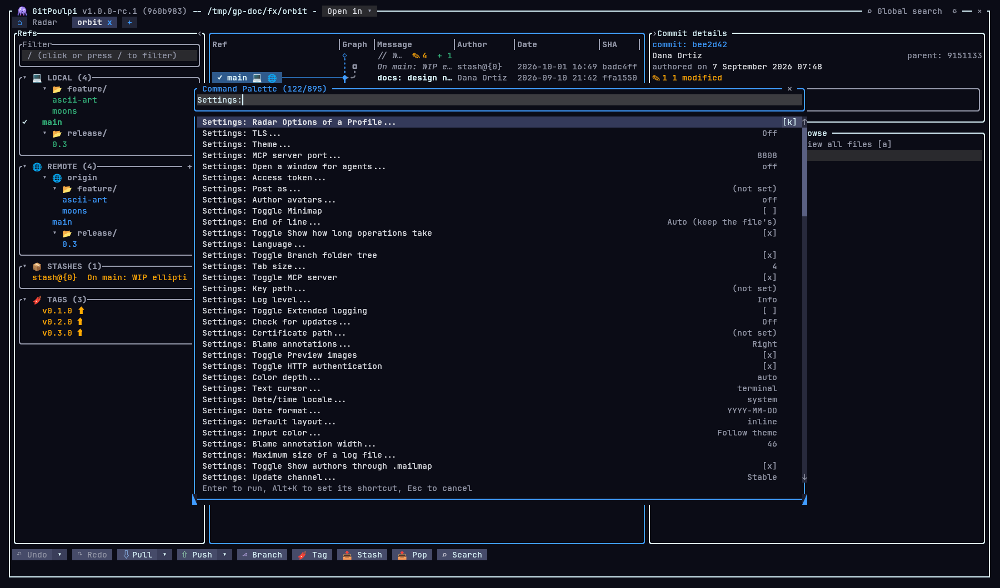
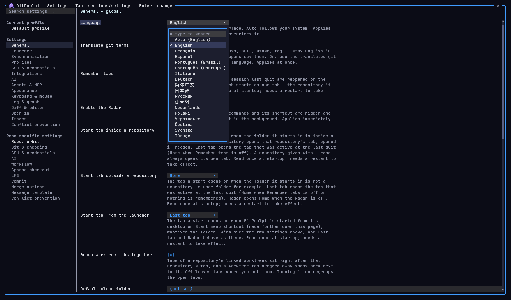
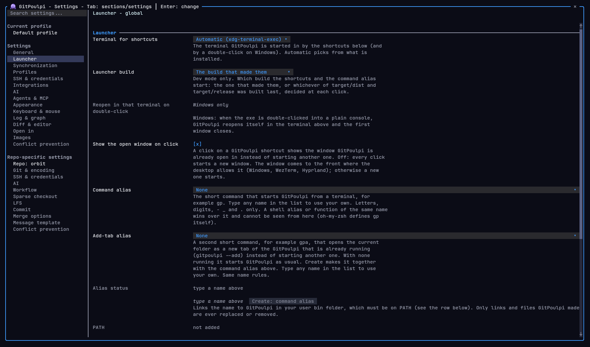

[English](../settings.md) · [Čeština](../cs/settings.md) · [Deutsch](../de/settings.md) · [Español](../es/settings.md) · [Français](../fr/settings.md) · [Italiano](../it/settings.md) · [日本語](../ja/settings.md) · [한국어](../ko/settings.md) · [Nederlands](../nl/settings.md) · [Polski](../pl/settings.md) · [Português (Brasil)](../pt-BR/settings.md) · [Português (Portugal)](../pt-PT/settings.md) · [Русский](../ru/settings.md) · [Svenska](../sv/settings.md) · [Türkçe](../tr/settings.md) · [Українська](../uk/settings.md) · **简体中文**

# 设置

使用 `Ctrl+,`、`Ctrl+N` 然后 `,`、标题栏中 × 左侧的齿轮，或 `Ctrl+P` > *设置* 打开设置。设置界面打开时会取代整个窗口。点击右上角的 `✕`、按 `Esc` 或 `q` 即可关闭。只有关闭会丢失内容时，它才会先询问（见[关闭设置](#关闭设置)）。

更改会立即保存到 `config.toml`。[配置参考](config-reference.md)描述了每个键、其默认值及其环境变量。本页描述设置界面。

## 使用设置界面

| 要做的事 | 操作 |
|---|---|
| 在页面列表和选项之间切换 | `Tab` / `Shift+Tab`，或点击。 |
| 移动 | `j` / `k` 或方向键。 |
| 更改选项 | `Enter` 或 `Space`，或点击它的值。见下文。 |
| 关闭 | 点击 `✕`，或按 `Esc` 或 `q`。字段、下拉列表或确认框打开时，`Esc` 只关闭它们。 |

`Enter` 或 `Space` 的作用取决于所在的行：

- 复选框会切换。
- 下拉列表会打开。方向键选择，`Enter` 确认。
- 文本或数字字段开始编辑。方向键、`Home`、`End`、`Backspace` 和 `Delete` 均可使用，点击可放置光标。`Enter`、`Tab`、`Up`、`Down` 或点击别处会保存该值。`Esc` 取消。被拒绝的值会以红色保留在字段中，状态栏会给出原因。
- 一行按钮（**创建**、**移除**、**测试**……）只显示当前适用的按钮。`Left` / `Right` 选择，`Enter` 按下，也可以直接点击。会删除内容的按钮会先询问。

每一页的值都从同一列开始，因此标签在左侧对齐，字段在右侧对齐。文本或数字是一条着色的色带，选项是以 `▾` 结尾的色带，复选框是 `[x]`。较长的标签会换行而不是被截断；窗口较窄时，值会移到标签下方。

灰色的行会说明它为何不可用。例如，当 **图泳道背景** 为 **关闭** 时，**行着色强度** 为灰色。

### 列表

要编辑多个同类项目的页面（配置、AI、工作流、打开方式、图像）会把它们显示为**左侧一个列表，右侧是所选项目的字段**。窗口较窄时，列表在字段上方。列表在各处的形式都相同：

- 行首的标记表示状态：`●` 是当前使用的配置，`★` 是默认条目，`⚠` 是尚未完成的项目（例如没有邮箱的配置），原因会显示在详情位置。
- 列表下方：**+ 添加**、**创建副本**、**删除**、`↑` 和 `↓`。当前不适用的按钮（例如第一行的 `↑`）会变暗。页面提供预设或类型时，**+ 添加 ▾** 会打开一个下拉列表。
- **删除** 会先询问，但刚添加且没有编辑过的项目除外。
- 拖动某一行可移动它；一条横线显示它将落在哪里，`Esc` 取消拖动。双击会进入该项目的字段。

| 按键 | 作用 |
|---|---|
| `Up` / `Down`、`Home` / `End`、`PageUp` / `PageDown` | 选择项目。 |
| `Insert` | 添加项目（有下拉列表时会打开它）。 |
| `Ctrl+D` | 创建该项目的副本。 |
| `Delete` | 删除该项目，需先确认。 |
| `Alt+Up` / `Alt+Down` | 上移或下移该项目。 |
| `Enter` 或 `Right` | 进入该项目的字段。 |
| `Left` | 回到页面列表。 |
| `Alt+Left` / `Alt+Right` | 在“常规”标签页和列表标签页之间切换（页面任意位置）。 |

这些页面的标题下各有两个**子标签页**，这样页面自身的设置不会与所选项目的属性混淆：**常规**是页面自身的设置（当前配置、默认条目、每个操作都会收到的指令、工作流模板等），另一个以项目命名（**配置**、**配置（连接）**、**条目**、**编辑器**、**规则**），包含列表和所选项目的字段。页面默认打开**常规**；设置会记住你离开每个页面时所在的标签页，以及每个页面（和标签页）的滚动位置和所选行，直到退出应用。点击标签页，或按 `Alt+Left` / `Alt+Right`。搜索框、命令面板中的设置行，以及写着“请在设置中指定”的链接，都会打开该设置所在的标签页。[键盘与鼠标](#键盘与鼠标)也有同样的两个标签页（**常规**、**键位绑定**）。

这些键可以在**键盘与鼠标**中重新绑定（上下文 *preferences*，见[快捷键](keybindings.md)）。

### 多行编辑器

包含多行内容的设置（例如稀疏检出路径、commit 模板的描述、冲突预防的基础分支和工作流钩子）通过 `Enter` 或点击打开一个小编辑器；`Ctrl+S` 保留文本，`Esc` 丢弃。鼠标在其中的用法与任何文本框相同：

- 点击会把光标放在点击处。
- 拖动可选择文本；滚轮可滚动。
- 双击会选中指针下的单词。
- `Shift` + 点击会把选区从光标扩展到指针处。

键盘同样可以：`Shift` 加方向键选择，`Ctrl` 加方向键按单词跳转，`Ctrl+A` 全选，`Ctrl+C` 和 `Ctrl+X` 复制和剪切。

### 关闭设置

`✕`、`Esc` 和 `q` 的作用相同。设置会立即应用每项更改，所以大多数时候它直接关闭。只有会丢失内容时，它才会询问**关闭设置？**：

- **工作流**页有尚未保存的更改；
- commit 消息模板有尚未保存的更改；
- 某个配置没有作者邮箱（它所做的 commit 无法归到你名下）。

对话框提供 **前往** （打开相应页面）、**丢弃并关闭** 或 **仍然关闭**，以及 **取消**。设置里的小编辑器（AI 指令文本、工作流钩子、稀疏检出路径）有各自的 `✕`，只有文本被编辑过时才会询问**丢弃更改？**。

### 设置之上的弹出窗口

标题行显示应用的章鱼图标和名称，与主窗口一致。点击章鱼会打开“关于”。

有几个窗口级的弹出窗口可以在设置之上打开，关闭后设置原样保留（页面、滚动位置，以及未保存的工作流或模板更改都不会丢）：

- 命令面板（`Ctrl+P`），
- 主题选择器（`Ctrl+N y`，**应用：更改主题…**），它会直接在设置页上预览每个主题；按 `Esc` 会恢复之前的主题，
- 语言和图配色选择器（`Ctrl+N` 加上与主窗口相同的字母），
- 工作空间搜索（`Ctrl+Alt+F`），
- “关于”（`Ctrl+N a`、章鱼图标，或**帮助：关于 GitPoulpi**）和帮助浮层（`?`）。

用 `Esc`、弹出窗口自己的 `✕`，或点击它之外的地方来关闭。那些作用于设置所遮盖内容（标签页、分支、diff 等）的命令，会列在命令面板里但呈灰色，并标明“请先关闭设置”；对应的 `Ctrl+N` 组合键则会把这行提示显示在设置的底部边框上：请先关闭设置，再运行它们。

按 `Ctrl+N` 会在页面的每个控件上显示徽标：搜索框、页面列表（当前页面上一个徽标）、子标签页、列表及其按钮、屏幕上的每个字段和关闭按钮 `✕`。按下徽标上的字符，效果与点击该控件相同：文本字段进入编辑，复选框被切换，下拉列表被打开，按钮被执行。按 `Esc` 取消。滚出屏幕的字段没有徽标。正在字段中输入，或下拉列表、编辑器、搜索处于打开状态时，`Ctrl+N` 归它们所有。参见[徽标](keybindings.md#徽标)。

### 搜索框

页面列表顶部的框会搜索每一页上每个选项的名称和说明。点击它，或按 `/` 或 `Ctrl+F`，然后输入。匹配项列表会下拉显示。每个匹配项显示选项及其所在页面。`Up` / `Down` 选择，`Enter` 跳转到该选项，`Esc` 关闭列表。

## 通过命令面板修改设置

大多数设置无需打开设置界面即可更改：在命令面板（`Ctrl+P`）中输入 `设置：` 或 `Settings:`。这些行由各页面的字段自动生成，因此新设置会同时出现在两处。

- 复选框对应 **设置：切换 ...**。立即切换，该行显示 `[x]` 或 `[ ]`。
- 下拉列表对应 **设置：...**。按 `Enter` 将面板缩小到它的取值，当前值标有 `当前`；在某个取值上按 `Enter` 即选中。
- 数字或文本会打开一个已填入当前值的输入框。页面会拒绝的值（不是数字、超出范围）同样会被拒绝，输入框保持打开。
- 需要整页的设置（列表、选项在运行时才能确定的组合框）会在设置界面中打开对应位置。

值会保存到 `config.toml`，并与页面完全一样地生效。设置键的英文单词（`remember tabs`）在任何语言下都能找到该行。

## 各个页面

页面列表分为两组：

- **设置**：全局设置。
- **仓库专属设置**：活动标签页所在仓库的设置。仅在打开仓库时显示。

### 常规

| 选项 | 作用 |
|---|---|
| **语言** | 界面语言：**自动**（你的系统语言，否则为英语）、English、Français、Español、Português (Brasil)、Português (Portugal)、Italiano、Deutsch、简体中文、日本語、한국어、Русский、Українська、Polski、Čeština、Nederlands、Svenska、Türkçe。立即生效，无需重启。Log 的月份名称和日期会随之变化。环境变量 `GITPOULPI_LANG`（例如 `GITPOULPI_LANG=fr`）会覆盖此选择。CLI 和 MCP 的输出仍为英文。 |
| **翻译 git 术语** | 默认关闭：commit、push、pull、stash、tag 及其他 git 术语在所有语言中都保持英文。开启：使用该语言自己的 git 词汇（法语：*Tirer*、*Pousser*、*Remiser*、*Étiquette*）。立即生效。 |
| **使用英文 git 词汇** | 仅适用于日语、韩语和中文：把 *stage*、*unstage*、*staged* 显示为英文单词，而不是其音译。**翻译 git 术语** 开启时无效。 |
| **记住标签页** | 启动时重新打开上一次会话的标签页。关闭时，在仓库内启动只打开该仓库，在仓库外启动则停在主页，不打开任何仓库标签页。需要重启。 |
| **启用 Radar** | 默认开启（`general.radar_enabled`）。关闭后，Radar 标签页、它的面板命令和 `Alt+R` 都会隐藏，后台也不会为它获取任何内容。立即生效。见 [Radar](radar.md#关闭标签页或关闭-radar)。没有 Radar 的构建中不显示。 |
| **在仓库内启动时的标签页** | 启动所在的文件夹位于仓库内时，打开哪个标签页（`general.startup_tab_in_repo`）：**当前仓库**（默认。该仓库的标签页，必要时打开）、**上次的标签页**（上次退出时处于活动状态的标签页）、**主页**、**Radar**。用 `--repo` 指定的仓库总是打开自己的标签页。**上次的标签页**：**记住标签页** 关闭或没有记住任何标签页时为主页；**Radar**：Radar 关闭或构建中没有时为主页。仅在启动时读取；需重启生效。 |
| **在仓库外启动时的标签页** | 启动所在的文件夹不是仓库（例如用户文件夹）时，打开哪个标签页（`general.startup_tab_outside_repo`）：**主页**（默认）、**上次的标签页**、**Radar**。**上次的标签页**：**记住标签页** 关闭或没有记住任何标签页时为主页；**Radar**：Radar 关闭或构建中没有时为主页。仅在启动时读取；需重启生效。 |
| **从启动器启动时的标签页** | 通过 GitPoulpi 创建的桌面或开始菜单快捷方式（会传入 `--launcher`）启动时，无论文件夹是什么，打开哪个标签页（`general.startup_tab_launcher`）：**上次的标签页**（默认）、**主页**、**Radar**。优先于上面两项设置。 **上次的标签页**：**记住标签页** 关闭或没有记住任何标签页时为主页；**Radar**：Radar 关闭或构建中没有时为主页。 旧版本创建的快捷方式会在下次启动时获得该参数。 仅在启动时读取；需重启生效。 在 Windows 上，你固定到任务栏的副本也会在下次启动时被重写；没有 shell 包裹的启动（双击、直接固定的 exe）算作启动器启动。 |
| **将 worktree 标签页归在一起** | 默认开启（`general.group_worktree_tabs`）。仓库已链接的 worktree 的标签页紧跟在该仓库的标签页之后，被拖开的 worktree 标签页会回到那里。关闭后，标签页留在你放的位置。开启会重新归拢已打开的标签页。 |
| **默认克隆文件夹** | “克隆”对话框的起始位置。为空时：Windows 上为 `%USERPROFILE%\source\repos`，其他系统为 `~/src`。 |
| **克隆对话框的起始来源** | 克隆对话框打开时所在的来源（`repos.clone_start_source`）：**上次使用**（默认，即它上次关闭时显示的来源，无论是克隆完成还是取消）、**通过 URL 克隆**，或你已连接的某个集成。来源不再可用时，回退到“通过 URL 克隆”。从 Radar 发起的克隆使用它自己的来源。 |
| **默认浏览文件夹** | “浏览”打开的位置。为空时：你上次使用的文件夹，否则为你的主文件夹。 |
| **仓库数据位置** | GitPoulpi 存放各仓库自身数据的位置（`session.per_repo_state_dir`）：**在 .git 内**（默认：工作区里不会多出任何东西，所有 worktree 共用）、**在工作区内**（一个 `.gitpoulpi` 文件夹；要提交团队共用的 `workflow.toml` 时需要这样）或 **在我的用户数据文件夹中**（仓库之外）。旧版本留下的 `.gitpoulpi` 文件夹会在第一次需要时被移到新位置，并在清空后删除；git 跟踪的文件（已提交的 `workflow.toml`）绝不会被移动或删除，仍然可读。 |
| **默认分支名** | 你用“初始化”创建的仓库的第一个分支。为空时：由 git 决定。它不会重命名任何已有分支。 |
| **日志级别**、**日志文件保留时长**、**单个日志文件的最大大小** | 活动日志背后的应用程序日志：记录的最详细的级别（`log.level`）、文件保留多久（一个整数加一个单位，天、周、月或年，在同一行：点击数字即可输入，上下键步进，Tab 移到单位，Enter 打开它的列表；最多 10 年，默认 1 周，`log.retention_days` 和 `log.retention_unit`）以及一天的文件轮转的大小（一个数字加 MiB 或 GiB，1 MiB 到 1 GiB，`log.max_file_mb` 和 `log.max_file_unit`）。 |
| **显示操作耗时**、**扩展日志** | 活动日志的“Git 操作”标签页：每个操作的耗时（`log.timings`，默认开启），以及后台工作，即刷新和自动 fetch（`log.extended`，默认关闭）。参见[出错时](troubleshooting.md#活动日志)。 |
| **启用撤销**、**撤销历史深度**、**记录在 GitPoulpi 之外所做的更改** | **撤销历史** 组。开启或关闭撤销，并设置它保留多少次操作（默认 100，`0` 表示不限）。关闭撤销会在确认后清除撤销历史。最后一项还会记录 shell 或代理对分支、tag、stash 和 HEAD 所做的操作。参见[撤销与重做](undo-redo.md)。 |

命令面板命令 **应用：更改语言…**（`Ctrl+N g`）会打开同一份语言列表。在其中，高亮的语言会实时预览；`Enter` 保留，`Esc` 恢复之前的语言。

### 启动器

**启动器** 页（`gitpoulpi ui show settings launcher`）会创建一个快捷方式，从系统启动器中以你选择的终端启动 GitPoulpi。

| 行 | 作用 |
|---|---|
| **快捷方式使用的终端** | `ui.launch_terminal`：**自动**、**系统默认**，或在本机找到的某个终端（检测方式与 **打开方式** 相同）。自动：Windows 上为 Windows Terminal（否则依次为 WezTerm、Alacritty、普通控制台），Linux 上为 `xdg-terminal-exec`（Omarchy；否则为找到的第一个终端），macOS 上为 Terminal，除非安装了 iTerm2、Ghostty、WezTerm 或 kitty。 |
| **双击时在该终端中重新打开** | 仅限 Windows（`ui.relaunch_in_terminal`）。双击 exe 会打开默认控制台，而它无法正确绘制图片：GitPoulpi 会在所选终端中重新打开，并关闭第一个窗口。从终端启动时不会这样做。 |
| **点击时显示已打开的窗口** | `ui.reuse_window`（默认开启）。点击 GitPoulpi 快捷方式（`gitpoulpi launch`）时，显示已打开的 GitPoulpi 的窗口，而不是再启动一个。 只有在没有已打开的窗口、此设置关闭，或窗口无法置前时，才会启动新的终端。窗口能置前的环境是 Windows、WezTerm 和 Hyprland；在其他 Linux 桌面上，点击仍会启动新窗口。macOS 不使用此项（Dock 已经这样做）。 若要有意再打开一个窗口，请在点击时按住 **Shift**（Windows），或使用启动器的 **New Window** 操作（Linux）；脚本中可用 `gitpoulpi launch --new-window`。 |
| **命令别名** | `ui.command_alias`：下拉列表提供 **无** 和 `gp`，也可以输入任意名称（字母、数字、`-`、`_`、`.`；不能有空格或路径分隔符）。行内的 **创建** 按钮让该名称启动 GitPoulpi（别名存在后它会变成 **移除**，移除 GitPoulpi 创建的所有别名）。当该名称在你的 PATH 中已经运行着别的程序时，行下方会显示警告；在 Windows 上，如果 PowerShell 有同名的内置别名，也会警告（那里的 `gp` 是 `Get-ItemProperty`，它优先于任何文件）。shell 别名或函数在这里看不到：oh-my-zsh 自己就定义了 `gp`，它优先于我们的。 |
| **新标签页别名** | `ui.command_alias_add`：第二个命令，例如 `gpa`，它会把当前文件夹作为新标签页在已运行的 GitPoulpi 中打开（`gitpoulpi --add`），而不是再启动一个；没有正在运行的则照常启动 GitPoulpi，有多个时会询问加入哪一个。下拉列表提供 **无**、`gpa` 以及命令别名加上 `a` 的名称，也可以输入任意名称（规则同上）。同一个 **创建** 按钮会同时创建两个命令，**移除** 会移除 GitPoulpi 创建的所有命令；两者各有自己的状态行。在 Linux 和 macOS 上它是一个两行的脚本，在 Windows 上是一个 `.cmd`。参见 [CLI 参考](cli-reference.md#将文件夹添加到已打开的窗口)。 |
| **将 GitPoulpi 添加到 PATH** | 把 GitPoulpi 运行所在的文件夹和别名文件夹加入你的 PATH，供新打开的终端使用。该行的按钮显示为 **添加** 或 **移除**，**移除** 只取走当初添加的内容。PATH 中已有的文件夹不会被改动（此时该行显示 **已在 PATH 中**）。 |
| **应用启动器**（Linux） | 写入 `~/.local/share/applications/gitpoulpi.desktop`（遵循 `XDG_DATA_HOME`），并把图标写入 `~/.local/share/icons/hicolor/256x256/apps`。在 Omarchy 上，该条目与 `omarchy-tui-install` 创建的相同（`xdg-terminal-exec --app-id=TUI.tile -e <exe>`）；对其他终端则使用相应的命令（`kitty`、`wezterm start --`、`alacritty -e`、`ghostty -e`、`foot` 等）。 |
| **桌面**（Linux） | 在你的桌面文件夹中放置同一个条目（如果该文件夹存在）。 |
| **开始菜单**（Windows） | 在 `%APPDATA%\Microsoft\Windows\Start Menu\Programs` 中创建 `GitPoulpi.lnk`。固定到任务栏的副本会自动跟随图标和颜色的更改；如果它的图标仍是旧的，请取消固定后再固定一次（右键点击开始菜单中的该项，然后选择 **固定到任务栏**）。 |
| **桌面**（Windows） | 在桌面上创建 `GitPoulpi.lnk`。 |
| **“应用程序”文件夹**（macOS） | `~/Applications/GitPoulpi.app`，一个打开终端并运行 GitPoulpi 的小型应用包。 |

每一行都会显示其状态：**未创建**、**已创建**、**已过期**（exe 已移动或选择了其他终端；GitPoulpi 会在一秒内自行重写，所以你很少会看到它），或 **此处有一个不是 GitPoulpi 创建的文件**（存在同名文件，但不是 GitPoulpi 创建的，因此绝不会改动它）。**移除** 只删除 GitPoulpi 创建的文件（带有 `X-GitPoulpi=1` 标记）。图标是采用你徽标颜色的章鱼（关于 > 颜色）；在 Linux 上每种颜色都有各自的图标名，所以缓存图标的启动器也会显示新颜色。快捷方式创建后会自行保持最新：当你更改颜色、终端或 exe 移动时，GitPoulpi 会在启动时以及运行期间重写它自己创建的快捷方式（不会碰不是它创建的，也绝不会新建）。没有“更新”按钮，只有 **创建**（针对尚不存在的快捷方式）和 **移除**。

**任务栏与 Dock 分组。** GitPoulpi 运行在终端窗口里，因此任务栏通常把它显示在终端的图标下，固定的 GitPoulpi 图标下没有“正在运行”的圆点。Windows：快捷方式带有 AppUserModelID `GitPoulpi.GitPoulpi`，从快捷方式启动的 GitPoulpi 会给自己的终端窗口设置同样的 ID 和自己的图标（它通过暂时给窗口设置唯一标题来找到窗口，随后恢复标题），于是窗口归入固定的 GitPoulpi 图标之下。有多个标签页的终端窗口会作为一个整体：GitPoulpi 在其中运行时，它的所有标签页都归在 GitPoulpi 的图标下。之前创建的快捷方式和任务栏固定项会由同一套同步重写；如果某个固定项仍显示终端的图标，请取消固定后重新固定。Linux：kitty、foot、Alacritty、WezTerm 和 Ghostty 以窗口类 `gitpoulpi` 启动，`.desktop` 条目写明了它（`StartupWMClass`），所以 Dock 会把窗口归在启动器的图标下；其他终端保留自己的图标。macOS：无需操作，Dock 按应用分组。

#### 命令别名与 PATH，按系统

| 系统 | 别名 | PATH |
|---|---|---|
| Linux、macOS | 一个符号链接 `~/.local/bin/<name>`，指向 `gitpoulpi-tui`。链接里无法放标记，所以当它的目标是名为 `gitpoulpi-tui` 的文件时才算我们创建的；普通文件，或指向其他任何东西的链接，**不是我们的**，绝不会被替换或移除。 | 在 `~/.bashrc` 和 `~/.zshrc`（存在哪个写哪个；两者都没有时，macOS 写 `~/.zshrc`，其他系统写 `~/.bashrc`）中写入位于 `# >>> GitPoulpi PATH (X-GitPoulpi=1) >>>` 与 `# <<< GitPoulpi PATH <<<` 之间的代码块；已配置 fish 时还会写 `~/.config/fish/conf.d/gitpoulpi-path.fish`。移除时只删除该代码块（或 fish 文件），不碰其他内容。 |
| Windows | `%LOCALAPPDATA%\Programs\GitPoulpi\bin\<name>.cmd`，一个简短的小脚本，里面有 `REM X-GitPoulpi=1`（它还会导出 `GITPOULPI_CMDCMDLINE`，用来识别从地址栏启动）。 | `HKCU\Environment` 中的用户 PATH，通过 PowerShell 写入，随后广播 `WM_SETTINGCHANGE`，让新程序能看到。值 `GitPoulpiPathAdded` 记录了添加的内容，移除时只取走它。 |

新打开的终端能看到 PATH 的变化，已经打开的看不到。这两个操作都不记入撤销日志：没有对应的撤销，**移除** 就是退回的办法。

命令面板中也有相同的操作（**启动器：创建快捷方式**、**启动器：创建桌面快捷方式**、**启动器：移除快捷方式**、**启动器：创建命令别名**、**启动器：移除命令别名**、**启动器：添加到 PATH**、**启动器：从 PATH 中移除**），在脚本中可以用 `gitpoulpi desktop shortcut status|install|remove [--where launcher|desktop|startmenu]` 完成同样的操作。

#### 在文件资源管理器地址栏中输入（Windows）

在文件资源管理器窗口的地址栏中输入别名（`gp`）或 `gitpoulpi`，然后按 Enter：GitPoulpi 会在 **快捷方式使用的终端** 所选的终端中打开，位于该窗口显示的文件夹，不会打开 **上次的标签页**。**点击时显示已打开的窗口** 开启且已有 GitPoulpi 在运行时，该文件夹会改为成为那个窗口的一个新标签页。

- **`gp`（命令别名）。** 别名存在之后，创建别名时还会在 `HKCU\Software\Microsoft\Windows\CurrentVersion\App Paths` 下注册 `gp.exe`，指向 `gitpoulpi-launch.exe`；移除时会删除该键（仅当它是我们创建的）。当别名所在的文件夹在你的 PATH 中（**将 GitPoulpi 添加到 PATH**）时，Windows 会先运行 `.cmd` 小脚本，GitPoulpi 出现之前控制台窗口可能闪现一下。旧版本写入的小脚本会在设置读取别名时自动重写。
- **`gitpoulpi`。** 需要已安装 **文件管理器菜单**：安装时还会在 App Paths 下注册 `gitpoulpi.exe`。没有它时，只有 GitPoulpi 的文件夹在你的 PATH 中才能找到 `gitpoulpi`，此时控制台同样可能闪现。

文件资源管理器沿用你登录 Windows 时的 PATH：之后添加到 PATH 的文件夹，要注销再重新登录后才会在那里生效。在此之前只能找到 App Paths 中的条目，而 Windows 找不到的名称会作为网址在浏览器中打开。

Linux 和 macOS 没有对应功能：它们的文件管理器的位置栏不会运行程序。请使用 **文件管理器菜单** 项，或在终端中使用命令别名。

#### 文件管理器菜单（在 GitPoulpi 中打开）

在快捷方式下方，**文件管理器菜单** 各行会在文件夹的右键菜单中添加 **在 GitPoulpi 中打开**。每个文件管理器一个状态行（在 Linux 上，此处找到的每个文件管理器各一行，仍保留该菜单项的文件管理器也有；**已检测到** 一行列出找到的内容），然后是 **安装** 和 **移除** 按钮。**安装** 会为找到的每个文件管理器写入该菜单项；**移除** 会先询问，然后取走安装所写入的全部内容，无论该文件管理器是否仍已安装。

该菜单项运行 `gitpoulpi launch --folder <文件夹>`（在 Windows 上是无控制台的 `gitpoulpi-launch.exe --folder`），由这条命令在点击时决定怎么做：**点击时显示已打开的窗口** 开启且有 GitPoulpi 窗口打开时，仓库内的文件夹会成为最近使用的窗口的一个新标签页，该窗口会被置前；否则在 **快捷方式使用的终端** 所选的终端中于该文件夹启动 GitPoulpi。因此更换终端不会让菜单项变成已过期；exe 被移动或徽标换了颜色则会，而 GitPoulpi 会自动重写它自己创建的菜单项（不会新建），与快捷方式相同。该菜单项需要 GitPoulpi 旁边有启动程序（`gitpoulpi`，Windows 上是 `gitpoulpi-launch.exe`）；没有它时，该行会这样说明，按钮保持不可用。

| 系统 | 安装写入的内容 |
|---|---|
| Windows | 按用户的键，无需管理员权限：`HKCU\Software\Classes\Directory\shell\GitPoulpi`、`Directory\Background\shell\GitPoulpi` 和 `Drive\shell\GitPoulpi`，各带一个 `command` 子键，因此该菜单项会出现在文件夹上、已打开文件夹的空白处和驱动器上。每个键都带有 `X-GitPoulpi` 值；没有它的键**不是我们的**，绝不会被改动。还会在 `HKCU\Software\Microsoft\Windows\CurrentVersion\App Paths` 下注册 `gitpoulpi.exe`，指向 `gitpoulpi-launch.exe`。在 Windows 11 上，该菜单项只出现在经典菜单中：**显示更多选项**、Shift+F10 或 Shift+右键（新的顶层菜单只列出打包应用）。移除会删除我们的键，然后仅当安装创建的父键变空时才删除它们。 |
| Linux | 仅针对在 PATH 中找到的文件管理器。GNOME Files 和 Caja：在 `~/.local/share/nautilus/scripts` 或 `~/.config/caja/scripts` 中放一个以该菜单项命名的脚本（位于 **Scripts** 子菜单中）。Dolphin：`~/.local/share/kio/servicemenus/gitpoulpi-open.desktop`，带可执行权限（KDE Frameworks 6 会忽略没有可执行权限的用户服务菜单；不支持 5.85 之前的 KDE Frameworks 5）。Nemo：`~/.local/share/nemo/actions` 中的两个动作（选中的文件夹、背景）。Thunar：合并进 `~/.config/Thunar/uca.xml` 的一个动作；你自己的动作会保留，移除时文件会逐字节还原（如果是安装创建的则删除）。PCManFM 和 PCManFM-Qt：`~/.local/share/file-manager/actions/gitpoulpi-open.desktop`。图标写到 `~/.local/share/icons/hicolor/256x256/apps/gitpoulpi-folder.png`，随最后一个菜单项一起移除。遵循 `XDG_DATA_HOME` 和 `XDG_CONFIG_HOME`。该菜单项出现在选中的文件夹上，文件管理器提供的话也出现在文件夹空白处。 |
| macOS | 一个快速操作 `~/Library/Services/Open in GitPoulpi.workflow`：在访达中右键点击文件夹，然后选择 **快速操作**。仅限选中的文件夹（访达没有文件夹空白处的菜单）。第一次点击时，macOS 会询问该工作流服务是否可以控制你的终端（自动化提示，例如“WorkflowServiceRunner.xpc”想要控制“……”）：请选择允许。如果没有看到该项，请在“系统设置 > 键盘 > 键盘快捷键 > 服务”中启用。 |

GitPoulpi 写入的每个文件和键都带有 `X-GitPoulpi=1` 标记（脚本中是一行 `# X-GitPoulpi=1`），移除只会删除带标记的。这些操作改动的是你的系统，不是某个仓库：撤销不涵盖它们，**移除** 就是退回的办法。Linux 和 macOS 上文件管理器的位置栏不会运行程序，所以那里没有可输入的内容；终端里有命令别名。

命令面板中有 **启动器：安装“在 GitPoulpi 中打开”菜单** 和 **启动器：移除“在 GitPoulpi 中打开”菜单**，在脚本中可以用 `gitpoulpi desktop folder-menu status|install|remove` 完成。

### 同步

GitPoulpi 如何让仓库与其远程保持同步，以及在此期间如何处理你的本地更改。

| 选项 | 作用 |
|---|---|
| **自动 Fetch 间隔** | 按此间隔在后台 fetch 每个远程，在同一行里是一个数字加一个单位（分钟或小时）。默认 5 分钟，最大 60 分钟（1 小时），`0` 表示关闭。`general.auto_fetch_interval_minutes` 始终以分钟为单位；`general.auto_fetch_interval_unit` 只记录它的显示方式。需要重启。 |
| **打开标签页时 Fetch** | 打开仓库标签页时在后台运行“全部 Fetch”。默认开启。最近 60 秒内已 fetch 过的仓库不会再次 fetch。 |
| **自动 Prune** | Fetch 同时会移除远程上已不存在的远程跟踪分支。默认开启，因此在服务器上删除的分支（例如在 GitLab 上）会在下一次 fetch 后从“远程”部分消失。不可撤销：已清理的分支如果在远程重新出现，会在下一次 fetch 时回来。 |
| **自动清理 tag** | Fetch 同时会删除远程已经删除的本地 tag。只处理曾经存在于远程的 tag：你从未 push 过的 tag 会保留。默认关闭，与 git 一致。需要 git 2.41 或更高版本。CLI：`gitpoulpi fetch --prune-tags`；配置键 `general.auto_prune_tags`。参见 [分支、tag 和 引用侧栏](log-and-history.md#分支tag-和-引用侧栏)。 |
| **保持子模块最新** | 在 checkout 或 pull 之后，把子模块更新到仓库所记录的 commit。参见[子模块](submodules.md)。 |
| **merge 后删除“.orig”文件** | merge 完成后，删除 `*.orig` 备份文件。默认关闭。 |
| **checkout、pull、merge 或 rebase 前自动 stash** | 本地更改阻碍这些操作之一时的处理方式：**询问**（对话框提议 stash 这些更改、运行操作并恢复 stash）、**总是**（不询问直接执行）或 **从不**（拒绝）。 |
| **自动 stash 包含未跟踪文件** | 自动 stash 也会包含未跟踪文件。 |

此页的 **更新** 组还有：

| 选项 | 作用 |
|---|---|
| **检查更新** | 下拉列表（`updates.mode`）：**通知**（默认）每天在后台检查一次，并在标题栏显示 `vX.Y.Z 可用`；**自动** 在 GitPoulpi 是通过发布压缩包安装时，还会在后台下载更新（何时重启仍由你决定）；**关闭** 从不发出请求。立即生效。参见[更新](updates.md)。 |
| **更新通道** | 下拉列表（`updates.channel`）：**稳定版**（默认）或 **预发布版**（也包括候选版本）。立即生效。 |
| **安装方式** | 只读。GitPoulpi 是怎样装到这台电脑上的（发布压缩包、为此用户或所有用户安装的安装程序、Chocolatey、winget、Scoop、Homebrew、apt、MSI 软件包、AUR、Docker 镜像、cargo，或开发构建）。它决定更新的应用方式，见[更新](updates.md)。 |

管理员在整台机器范围的更新策略中设置过的行，会显示**由管理员设定**，且无法在此更改。

此页的**重写历史**组是外部脚本的时间限制（见[重写历史](history-rewrite.md)）：

| 选项 | 作用 |
|---|---|
| **脚本响应时限** | 外部脚本回答一个 commit 的时限，在同一行里是一个数字加一个单位（毫秒或秒）。默认 5 秒，范围 1 毫秒到 10 分钟（`rewrite.script_timeout_ms`、`rewrite.script_timeout_unit`）。超时后整个进程会被停止，重写失败，且不会移动任何内容。 |
| **脚本单次遍历时限** | 外部脚本完整遍历一次所允许的最长时间，是一个数字加一个单位（秒、分钟或小时）。默认 1 小时，最长 24 小时（`rewrite.script_total_timeout_s`、`rewrite.script_total_timeout_unit`）。 |

### 配置

commit 身份配置：从 GitPoulpi 进行的 commit 所使用的姓名和邮箱。**常规**标签页包含 **当前配置** 下拉列表；**配置**标签页是一个[列表](#列表)（可添加、创建副本、删除、重新排序），并带有所选配置的字段。每个配置有一个 **配置 ID**、一个 **配置名称**、一个 **作者姓名** 和一个 **作者邮箱**。没有邮箱的配置在列表中显示 `⚠`。没有当前配置，或配置的姓名或邮箱为空时，使用仓库自己的 `user.name` 和 `user.email`。

有两个或更多配置时，工具栏最右端会显示一个配置组合框。它只为当前仓库设置配置。选择之后，会弹出对话框，提议同时把该身份写入该仓库的配置。对应的命令面板命令是 **仓库：更改配置文件…**。

这些配置不是“集成”页的托管配置，也不是 AI 页的 AI 配置。

### SSH 与凭据

SSH 使用你系统的 `ssh`，因此你的 ssh-agent 和 ssh 配置仍然有效。GitPoulpi 从不读取密钥内容。

| 选项 | 作用 |
|---|---|
| **私钥路径** | 设置后，fetch、pull、push 和 clone 会以 `GIT_SSH_COMMAND=ssh -i "<key>" -o IdentitiesOnly=yes` 运行 git，因此 ssh 只会提供该密钥。为空时：ssh-agent 和你的 ssh 配置原样生效。 |
| **公钥路径** | 仅在私钥路径为空时使用：ssh 会选取由 ssh-agent（或硬件密钥）持有的匹配密钥。 |
| **密钥类型** | **生成密钥对** 所创建的类型：`ed25519`、`rsa`（4096 位）或 `ecdsa`（NIST P-256）。 |
| **HTTPS 凭据** | fetch、pull、push 和 clone 通过 HTTPS 的认证方式：**credential_helper**（git 自己的助手，默认）、**prompt**（忽略助手；git 在终端中询问）或 **none**（无凭据，仅限公开远程）。 |
| **忘记所有用户名和密码** | 移除 GitPoulpi 存储在你的凭据助手中的所有令牌。会先请你确认。 |
| **生成密钥对** | 在 `~/.ssh/gitpoulpi_<type>` 创建一个 **密钥类型** 的密钥对，不设密码短语，并记录其两个路径。它绝不会覆盖已有文件。 |

密钥路径对下一次传输生效。`~/` 前缀表示你的主文件夹。

在其他地方所做的设置始终优先于这些路径。优先级顺序，从高到低：

0. 在某个仓库自己的 [SSH 与凭据](#仓库专属ssh-与凭据) 页面（仓库专属组）中为它选择的密钥。
1. GitPoulpi 运行环境中的 `GIT_SSH_COMMAND` 或 `GIT_SSH`。
2. 仓库 git 配置或你的全局 git 配置中的 `core.sshCommand`。较早版本中标签页菜单的 *SSH 密钥…* 项会为单个仓库写入它；SSH 与凭据会提议把它移入 GitPoulpi。
3. 本页的两个密钥路径。
4. ssh 自身的默认值和 ssh-agent。

密钥也可以属于某个托管账号；参见[托管平台与议题跟踪器](hosting-integration.md#每个配置的-ssh-密钥)。

### 集成

连接你的账号。**托管平台** 组包括 GitHub、GitHub Enterprise、GitLab、GitLab Self-Managed、Azure DevOps、Azure DevOps Server、Bitbucket、Bitbucket Data Center、Gitea、Forgejo 和 Gerrit。**议题跟踪器** 组包括 Jira Cloud、Jira Data Center、Trello、Linear、YouTrack、Redmine 和 Local Markdown。每个提供商都有 **连接**、一个令牌字段、令牌所需的权限范围，以及指向该主机令牌页面的链接。本页有专门的指南：[托管平台与议题跟踪器](hosting-integration.md)。

提供商上方有两个选项。在第一个提供商上按 `Up` 即可到达它们。

| 选项 | 作用 |
|---|---|
| **Pull Requests 和议题刷新间隔** | 侧边栏列表和工具栏标记的刷新频率，是一个数字加一个单位（分钟或小时）。默认 5 分钟，最多 2 小时，`0` 表示关闭计时器（`general.hosting_refresh_minutes`、`general.hosting_refresh_unit`）。 |
| **评审请求术语** | 托管评审所使用的词：**自动（按托管平台）**、**Pull Request** 或 **Merge Request**。 |
| **Pull request 已关闭或已 merge 时隐藏其徽章** | 默认开启（`ui.hide_finished_pr_chip`；在 GitLab 上写作“merge request”）。工具栏上的徽章显示已检出分支最新的请求；该请求一旦关闭或已 merge，徽章就会隐藏，转而显示淡色的 **+ PR** 徽章（发起新请求），就像该分支没有请求一样。关闭后，无论状态如何，徽章始终显示最新的请求。立即生效。 |

### AI

**常规**标签页：开启 AI 的开关、默认配置、每个操作都会收到的指令，以及每个操作的配置和指令。**配置（连接）**标签页是 AI 配置的[列表](#列表)，其中有一张内嵌的表格用于配置的环境变量。常规标签页的*代码评审*块还包含[评审上下文](ai.md#评审上下文)的默认值：**在仓库中运行代理**（*按配置设置*、*是*、*否*）、**包含 CLAUDE.md**、**包含 AGENTS.md** 和**额外文件**（路径或链接；留空则不添加，其下有一个**浏览…**按钮，会打开文件选择器；按钮上的 `Enter` 是它的键盘形式）。本页有专门的指南：[AI 辅助](ai.md)。

在各操作区块之下是**隐私**组：

| 选项 | 作用 |
|---|---|
| **发送前遮蔽密钥** | 开启（默认）：请求中发现的令牌、私钥和密码在请求离开之前会被替换为 `[REDACTED:<rule>]`。关闭：一行红字说明密钥会原样发送。 |
| **排除敏感文件** | 开启（默认）：`.env` 文件、私钥和证书（`[privacy] sensitive_patterns`）的更改绝不会成为请求的一部分。关闭：一行红字说明只要它们属于请求就会被发送。 |
| **发送前显示所发内容…** | 每个操作一个开关（commit 消息、解释、stash 消息、pull request 描述、commit 撰写器、冲突解决、代码评审、拆分 commit）：在请求发出之前，在**发送的内容**对话框中显示该请求。对话框中的*不再显示*复选框会关闭其中一个。历史重写操作显示它们自己的对话框。 |
| **全部重新显示** | 有开关处于关闭时出现；把它们全部重新打开。 |

见 [AI > 隐私](ai.md#隐私)。

### 代理与 MCP

AI 代理在此窗口中可以做什么、MCP 服务器是否可以运行，以及它的 HTTP 端点如何受到保护。MCP 行只在包含该服务器的构建中显示；参见 [MCP 与代理](mcp-and-agents.md)。

| 选项 | 作用 |
|---|---|
| **MCP 服务器** | 开启（默认）：代理可以启动服务器（`gitpoulpi mcp serve`）。关闭：它拒绝启动。保存为 `mcp.enabled`。更改会在代理下次启动服务器时生效；已在运行的服务器沿用其设置。 |
| **MCP 服务器端口** | 未指定地址时 `--http` 监听的端口，1 到 65535（默认 8808）。保存在 `mcp.bind` 的端口中；其主机部分保持不变（为空时为 `127.0.0.1`）。在代理下次启动服务器时生效。 |
| **允许 AI 代理控制视图** | 允许代理在此窗口中向你展示 commit、文件或通知（`ui show`）。关闭：没有任何代理能触及窗口。 |
| **允许 AI 代理提出更改供我确认** | 允许代理打开预填好的改写、commit、分支或 tag 对话框供你确认。默认关闭。参见 [MCP 与代理](mcp-and-agents.md#权限)。 |
| **为代理打开窗口**、**启动命令（自定义）** | 没有窗口打开时，代理是否可以打开 GitPoulpi 窗口，以及使用哪个终端或多路复用器。默认关闭。 |
| **HTTP 身份验证** | 开启（默认）：MCP HTTP 端点只响应带有访问令牌的请求。关闭会显示红色警告：任何能访问该端点的程序都可以运行 MCP 设置允许的每个工具，并且 `--allow-remote` 会被拒绝。保存为 `mcp.http_auth`。 |
| **访问令牌** | 令牌，已遮蔽。遮蔽后的值是一个按钮：`Enter`（或点击）会在下一行完整显示它，再按则隐藏。**复制**会把它放进剪贴板，不会在状态栏回显；**更换**在确认后替换它（持有旧令牌的客户端会立即被拒绝，无需重启服务器）；**创建**生成第一个令牌。`Left` / `Right` 在按钮之间移动，`Enter` 按下其中一个。这个令牌就是 `gitpoulpi mcp token`。 |
| **TLS** | **关闭**（默认）、**自签名**（服务器一次性创建证书并显示其指纹）或**文件**（你的证书和密钥）。服务器自己终结 TLS。保存为 `mcp.tls`；服务器下次启动时生效。 |
| **证书路径**、**密钥路径** | 与**文件**一起使用的 PEM 文件（`mcp.tls_cert`、`mcp.tls_key`）。 |
| **证书指纹** | 只读：端点所提供证书的 SHA-256 指纹，供客户端核对。 |
| **位于隧道或反向代理之后** | 你声明端点前面的隧道或代理会加密流量，这样 `--allow-remote` 就可以在没有 TLS 的情况下运行。服务器无法检查这一点，所以开启期间会显示红色警告。保存为 `mcp.behind_proxy`。见 [MCP 与代理](mcp-and-agents.md#从另一台机器访问端点)。 |

### 外观

| 选项 | 作用 |
|---|---|
| **主题** | **系统（跟随终端）**、某个内置主题，或你自己的某个主题文件。高亮的主题会实时预览：`Enter` 保留，`Esc` 恢复之前的主题。该行下方的 **颜色** 条显示当前生效的颜色。参见[主题](themes.md)。 |
| **作者头像** | **关闭**（默认，不联网）、**图**（在 commit 圆点中）或 **作者**（在“作者”列中）。开启时，每个作者邮箱的哈希会发送给 Gravatar 和你的托管提供商。 |
| **头像来源**、**头像回退** | 在何处查找图片，以及按什么顺序。对于没有图片的作者：**identicon**（生成的图案）或 **首字母**。 |
| **输入框颜色**、**自定义输入框颜色** | 文本字段的背景：**跟随主题**（默认）、固定的深色，或你自己的 `#rrggbb`。 |
| **文本光标** | `ui.text_cursor`：**terminal**（默认）把终端自身的光标放在获得焦点的文本框的插入点处，呈竖线（终端的光标设置会生效，输入法的候选窗口也会在插入点处打开）；**drawn** 绘制 GitPoulpi 自己的插入符，并保持终端光标隐藏。立即生效。命令面板：`设置：文本光标…`。 |
| **色深** | **auto**（默认）、**truecolor**、**256** 或 **16**。参见[主题](themes.md)。 |
| **图配色主题** | **跟随主题**（默认：主题自己的泳道颜色）或任意泳道调色板。每个调色板显示其若干颜色。在设置关闭时生效。命令面板命令 **应用：更改图配色主题…**（`Ctrl+N Shift+Y`）可实时预览每个调色板。 |
| **图泳道背景** | **关闭**（透明）或 **行着色**：图列后方一条淡淡的泳道色带，边缘有一条细条。 |
| **行着色强度** | 行着色色带的淡化程度：**强**、**中**（默认）或 **弱**。边缘细条保持完整颜色。 |
| **工具栏位置** | `ui.toolbar_position`：工具栏的位置：顶部、底部（默认）、左侧或右侧。左侧和右侧会在窗格旁形成一列；窗口窄于 80 列时改为画在底部。立即生效。 |
| **记住对话框的位置和大小** | `ui.dialog_geometry`：**本次会话**（默认）、**保存到磁盘** 或 **从不**：你移动或调整过大小的对话框是否保持其位置。对所有对话框统一生效的一项设置；每个对话框各自记住自己的位置和大小。立即生效。 |
| **工具栏按钮对齐** | `ui.toolbar_align`：按钮在工具栏上的位置：起始（默认）、居中或末尾。起始是一行的左侧和一列的顶部；末尾是右侧和底部。立即生效。 |
| **将 pull request 按钮固定在末端** | `ui.toolbar_pr_pinned`：开启（默认）时，无论对齐方式如何，pull request 按钮都位于工具栏的最末端（右侧，竖排时在底部）。关闭时，它与其他按钮一起排列并随之对齐。立即生效。 |
| **状态栏位置** | `ui.statusbar_position`：状态栏（分支、计数、消息、按键提示）的位置：顶部（位于仓库标签页上方）或底部（默认）。主页标签页在底部保留自己的状态栏。立即生效。 |
| **标签栏位置** | `ui.tabs_position`：仓库标签页的位置：顶部（默认）、底部或左侧，左侧是窗口左边缘的列表，每行一个标签页。窗口窄于 80 列时改为画在顶部。与竖排工具栏并用时，标签页位于最外侧。立即生效。 |
| **日期/时间区域** | **系统**（默认）：月份和星期名称使用界面语言。**english**：始终使用英文名称。 |
| **日期格式**、**日期/时间格式**、**日期详细格式** | 文件历史和 Blame 日期列、Log 的日期列，以及 commit 详情的日期模式。每个都显示实时预览。各记号参见[配置参考](config-reference.md#ui)。 |

### 键盘与鼠标

**设置 > 键盘与鼠标** 有两个标签页（点击，或按 `Alt+Left` / `Alt+Right`）。**常规** 包含键盘协议和鼠标设置；**键位绑定** 按上下文列出每个快捷键，带有搜索框（`/`）和过滤器。在某一行上：

| 按键 | 操作 |
|---|---|
| `Enter` 或双击 | 捕获一个新按键。按键时会显示冲突和终端警告。 |
| `a` | 添加一个备用按键。 |
| `u` | 取消该操作的绑定。 |
| `r` | 把该行重置为默认值。 |
| `R` | 在确认后重置所有快捷键。 |
| `c`，或点击该行的 `!` | 列出该操作以及与其按键冲突的所有操作；`Esc` 重新显示全部。与其他操作冲突的按键显示为红色，仅关于按键本身的警告（终端无法发送）显示为橙色。 |

可用它解决与 tmux、AutoHotkey、herdr 或你终端的冲突。相同的设置也存在于 `config.toml` 的 `[keybindings]` 表中；参见[配置参考](config-reference.md#keybindings)和[键位绑定](keybindings.md)。

**常规** 标签页上有三个选项。

| 选项 | 作用 |
|---|---|
| **Kitty 键盘协议** | **auto** 会向终端请求 kitty 键盘协议，这样 `Ctrl+,`、`Ctrl+Enter` 和 `Ctrl+Shift+N` 才能送达。**off** 从不请求；终端行为异常时请使用它。需要重启。 |
| **启用鼠标** | 关闭则把鼠标和文本选择交给你的终端。需要重启。 |
| **鼠标滚轮行数** | 滚轮每滚一格在 Log 中移动多少行。需要重启。 |

### 日志与图

commit 图如何绘制，以及 Log 加载多少个 commit。图配色位于 **外观** 页。

| 选项 | 作用 |
|---|---|
| **图渲染器** | **auto** 在终端支持时绘制图片，其他情况绘制字符。**image** 强制使用图片，**text** 强制使用字符。需要重启。 |
| **图像协议** | 图片送达终端的方式：**auto**、**kitty**、**iterm2**、**sixel** 或 **none**。需要重启。 |
| **在图中显示 stash** | Log 中每个 stash 占一行。关闭：stash 只在侧边栏中显示。 |
| **在悬停的 commit 上显示虚影分支** | 默认开启（`ui.graph_ghost_ref`）。在 Ref 列有空间时，没有自身 ref 的悬停 commit 会显示一个淡色药丸，内含它所属分支（否则为远程分支）的名称，由历史推断得出。合并后被删除的分支仍会以删除线显示，名称取自 merge commit 标题中的名称（`Merge branch 'x'`、`Merge pull request #N from owner/x`……）；squash merge、rebase 和快进合并不会留下这样的痕迹。tag 绝不显示为虚影。悬停在药丸上会显示其类型。点击它不会有特别的效果；创建分支请使用面板命令 `Git：在所选 commit 处创建分支…`。 |
| **引用到 commit 的连线** | 从 ref 标签到其 commit 圆点的一条细线。 |
| **列布局** | `ui.log_columns_layout`，立即应用于 Log。**适应窗格**（默认）：每列都恰好适应窗格，只有消息列伸缩。**横向滚动**：各列保持宽度，消息列也是，表格比窗格宽时可横向滚动（`Shift+Left` / `Shift+Right`、横向滚轮、底部边框上的滚动条）。Log 的列选择器和命令面板中有同样的开关。 |
| **列宽调整** | `ui.column_resize`，立即应用于 Log、Radar 以及 diff、文件和 Blame 视图的 commit 列。**线条**（默认）：每条列边界是一个单元格宽的间隙，表头中带一个小刻度；指针在边界上时，整个表格会画出一条细的强调色线，从线上任意位置拖动都可调整宽度。**表头**：没有刻度，边界之后的表头单元格的第一个字符会亮起，并且是唯一可以拖动的位置。调整键（Log 中的 `Shift+C`、Radar 中的 `C`、commit 列中的 `Tab`）在两种模式下作用相同。 |
| **隐藏“更改”列时在消息中显示 WIP 更改数** | 在 WIP 行的消息中显示更改数（`✎ 3  + 2  − 1`）。当“更改”列显示时，计数会改放在该列中。 |
| **分支文件夹树** | 在侧边栏中按 `/` 把分支和 tag 分组为文件夹。在引用窗格中按 `y` 切换。 |
| **左侧窗格分区** | 左侧窗格中显示或隐藏的分区由谁决定：**按仓库**（默认；每个仓库各自保存一套，全局设置是起点）或**全局**（所有仓库共用一套）。来回切换会同时保留两套。参见[鼠标与手势](mouse-and-gestures.md)。（`ui.sidebar_sections_scope`） |
| **点击引用时在图中定位** | 在引用窗格中点击一个 ref，Log 会滚动到它所指的位置并让该行闪烁（commit 选择和右侧窗格保持不变）。关闭：点击只会选中侧边栏的行。**在图中定位** 在两种情况下都可用。 |
| **撰写器提议** | AI commit 撰写器打开时，每个提议的文件是 **展开** 还是 **折叠**。 |
| **图中初始 commit 数** | 打开仓库时 Log 加载多少个 commit。默认 5000，最小 500。较大的值会拖慢大型仓库。 |
| **图中懒加载 commit** | 开启：滚动到已加载的最旧 commit 时，会在后台加载更多。关闭：Log 停在初始的 commit 处。 |
| **每次懒加载 commit 数** | 一次后台加载获取多少个 commit。 |
| **图中最大 commit 数** | 懒加载在此数量处停止。`0` 表示不限。每个 commit 约占用 300 字节内存。 |
| **统计 commit 总数的方式** | 状态栏中 `已加载 / 总数` 的总数是如何得出的（`log.commit_count`，下拉列表，立即生效）：**System git** 运行一个 `git rev-list --count` 进程（默认，通常最快）；**libgit2** 在 GitPoulpi 内部统计，不启动进程，适用于杀毒软件会扫描每条命令、让每次 git 调用都变慢的机器；**关闭** 从不统计，只显示已加载的 commit。 |
| **通过 .mailmap 显示作者** | Log、blame 和文件历史会按仓库 `.mailmap` 所指定的名字显示每位作者（`log.use_mailmap`，开关，默认开启，立即生效）。已存储的 commit 绝不会被改动。关闭则显示 commit 时的原始名字。见 `history-rewrite.md` 的*身份标签页*。 |

### Diff 与编辑器

| 选项 | 作用 |
|---|---|
| **制表符宽度** | 每个制表位的列数，1 到 8（默认 4）。 |
| **行尾** | 编辑器保存时写入的内容：**自动（保持文件原样）**、**LF** 或 **CRLF**。 |
| **语法高亮** | 编辑器中的语言配色。 |
| **行号** | 编辑器和 diff 的行号列。 |
| **在编辑器中跟随选择** | 编辑器打开时，在右侧窗格中选择其他文件也会在编辑器中打开它，并会先询问是否保存未保存的更改。无法编辑的文件会在其常规视图中打开。仅适用于工作区更改：从某个 commit 中选择的文件会离开编辑器，显示该 commit 的 diff。 |
| **自动换行** | 对较长的 diff 行换行。 |
| **默认布局**、**仅显示 hunk**、**显示仅空白字符的更改**、**缩略图** | diff 视图的初始状态。diff 视图栏会更改并保存它们。 |
| **Blame 注释**、**Blame 注释宽度** | Blame 视图中注释列（头像、作者、时间、摘要）所在的一侧：**right**（默认）或 **left**，以及它的宽度（以单元格计，24 到 90）。在 Blame 视图中拖动该列的边框，或按 `>` / `<` 键，会把宽度保存在这里（`ui.blame_side`、`ui.blame_width`）。参见 [Blame](log-and-history.md#blame)。 |
| **merge 编辑器：并排显示起始宽度（列）** | 从此宽度起，merge 编辑器并排显示 A 和 B。默认 100，最小 40，`0` 表示始终并排。低于此宽度时，A 和 B 为标签页。参见[解决 merge 冲突](merge-conflicts.md)。 |
| **外部编辑器** | 文件的 *在外部编辑器中打开* 项所用的命令。`{file}` 为路径。为空时：已安装则用 VS Code，否则用系统默认程序。 |
| **外部 diff 工具** | *在外部 diff 工具中打开* 所用的命令。`{local}` 和 `{remote}` 为两个版本。为空时：`git difftool`。 |
| **外部 merge 工具** | 冲突卡片上 *在 merge 工具中打开* 所用的命令。`{base}`、`{local}`、`{remote}` 和 `{merged}` 为相应文件。为空时：`git mergetool`。 |
| **文件管理器** | *在文件夹中显示* 所用的命令。`{path}` 为文件，`{dir}` 为其所在文件夹。 |

### 打开方式

编辑标题栏中 **打开方式** 按钮的列表。**常规**标签页包含 **退出并 cd** 文件夹按钮、**默认条目**和**恢复检测到的默认值**。**条目**标签页是一个[列表](#列表)（各有一个标签和一个命令）：**+ 添加 ▾** 提供预设和**自定义**，默认条目以 `★` 标记。所选条目的字段中有一个**测试**按钮。参见[打开方式](open-in.md)。

第一行 **跟随活动标签页的文件夹** 有两个值：

- **按钮**（默认）：当活动标签页不是启动 GitPoulpi 时所在的文件夹时，标签行显示 **退出并 cd 到此**。
- **auto**：没有按钮。每次退出都会把你 shell 的文件夹切换到活动标签页，打开新标签页时会运行默认的“打开方式”条目。

参见[跟随活动标签页的文件夹](following-the-tab-folder.md)。

### 图像

图像文件如何显示，以及 **编辑方式** 使用哪个程序。参见[图像](image-view.md)。**常规**标签页包含下面的查看器选项、**默认条目**和**恢复检测到的默认值**；**编辑器**标签页是图像编辑器的列表。不含图像预览的构建没有查看器选项。

| 选项 | 作用 |
|---|---|
| **预览图像** | 在 Diff 视图和文件视图中把图像文件显示为图片。关闭：显示普通的二进制提示。默认开启。 |
| **无图像协议时** | 在没有内联图像协议的终端上：**半块彩色**（默认）或 **仅信息卡**。 |
| **预览大小上限** | 更大的图像不会被解码；改为显示信息卡。一个数字加 MiB 或 GiB，默认 32 MiB，最大 1 GiB（`ui.image_view_max_mib`、`ui.image_view_max_unit`）。 |
| **从此缩放起使用像素化** | `1x`、`2x`（默认）或 `never`：从此缩放起，图片显示为方形像素，而不是平滑后的图片。 |
| **同步前后缩放与滚动** | 图像 diff 的两个窗格共用同一个缩放和滚动位置。默认开启。 |

**编辑器**标签页是与[打开方式](open-in.md)相同的一个[列表](#列表)：每个编辑器有 **标签**、**命令**、变量色块 `${file}` `${dir}` `${name}` `${repo}` 和 **用示例图像测试**；**+ 添加 ▾** 提供预设和**自定义**，**恢复检测到的默认值**会重置列表。在你编辑之前，该列表包含这台机器上已安装的编辑器和系统默认应用。每项更改立即生效。

### 冲突预防

主动冲突检测的全局部分（`gitpoulpi ui show settings conflict-prevention-global`）；仓库自己的页面是[仓库专属：冲突预防](#仓库专属冲突预防)。命令面板的 **冲突：编辑基础分支列表…** 会打开此页。

| 选项 | 作用 |
|---|---|
| **启用主动冲突检测** | 默认开启（`general.conflict_detection`）。当把当前分支 merge 到它的来源分支会产生冲突时，在你尝试之前就在 Log 上发出警告。仓库可以在自己的 **冲突预防** 页中单独关闭它。参见[解决 merge 冲突](merge-conflicts.md#冲突预防)。关闭设置时生效。 |
| **默认基础分支** | 在开关下方。仓库自己没有列表时所使用的基础分支模式列表：**内置（`**`）**，即所有分支，或你的某个命名列表（`conflict_prevention.default_list`）。关闭设置时应用于已打开的仓库。**恢复内置默认** 会回到 `**`。 |
| **基础分支列表** | 同在此页：你的基础分支模式命名列表（`[conflict_prevention.lists.<name>]`），每个一块，包括它的 **名称**（重命名时，若它是默认列表则仍保持默认；沿用旧名称的仓库会使用默认列表，直到你重新选择它）、它的 **模式**（每行一个，`Enter` 或点击打开编辑器，`Ctrl+S` 保留）、**设为默认** 和 **删除列表**（会先询问，并说明沿用它的仓库将改用默认列表）。在 **新建列表** 中输入名称并按 `Enter` 即可添加；新列表以 `**` 开头。编辑列表会更改每个沿用它的仓库。 |

### 仓库专属：Git 与编码

| 选项 | 作用 |
|---|---|
| **Git 后端** | `git2`（libgit2，默认）或 `system`（你已安装的 `git`）。全局。对更改之后启动的守护进程生效。 |
| **Pull 按钮** | Pull 按钮的行为：merge（可能时快进）、仅快进，或 rebase。全局。`▾` 菜单中的各项不会改变它。 |
| **Push 按钮** | **直接** 立即 push；**询问** 先显示远程菜单。全局。 |
| **push 前检查每个远程** | 默认开启（`git.push_group_preflight`）。在 push 有额外 push 目标的分支之前，先查看每个远程（一次快速查询，仅当该远程有差异时才从中下载），这样第三个远程上的问题会在第一次 push 开始之前就显示出来。关闭后：依次向每个远程 push，并报告结果。全局。 |
| **Merge fast-forward** | 当分支本可直接 fast-forward 时，你发起的 merge 怎么做：**never**（默认）始终生成 merge commit，**allowed** 可能时 fast-forward（git 自己的默认行为），**only** 只 fast-forward，否则拒绝。全局（`git.merge_fast_forward`）；仓库可在其 [Merge 选项](#仓库专属merge-选项)页中覆盖它。 |
| **默认编码** | 用于显示 **不是有效 UTF-8** 的文本的编码：文件内容、blame、diff 和 commit 消息。该页有一个全局行和一个此仓库的行；仓库行优先。有效的 UTF-8 绝不会被重新解码，stage 也绝不会重新编码任何内容。 |
| **core.autocrlf**、**core.eol** | 此仓库自己的 git 设置。该行会把 `core.autocrlf` 或 `core.eol` 写入仓库的 git 配置。**（继承）** 会移除仓库的值，于是你的全局 git 配置生效。`Ctrl+Z` 恢复之前的值。对应的 CLI 命令是 `gitpoulpi repo-config`。 |
| **新分支的额外 push 目标** | 仅限此仓库：在这个标题下，仓库的每个远程各有一个复选框。勾选的远程会成为每个新分支的额外 push 目标（除其 upstream 之外），时间点是该分支首次获得 upstream 时（首次设置它的 push，或从远程分支创建的分支）。这个选择会复制到分支自己的 `gitpoulpi-push-to` 键中，所以已存在的分支不会改变：请在它们 Refs 行的 **远程** 徽标上（或在该行按 `u`）编辑。保存在仓库的数据中（`repo-state.toml` 里的 `default_push_targets`）。 |
| **Git LFS** | 在界面中显示 Git LFS。参见 [Git LFS](lfs.md)。 |
| **在 pull 和 push 之前安装 LFS 过滤器** | 在 pull 或 push 之前，当仓库使用 LFS 而其过滤器缺失时，运行 `git lfs install --local`。 |
| **git-lfs 程序** | 检测到的 `git-lfs` 程序（只读）。 |
| **为此仓库初始化 LFS** | 立即运行 `git lfs install --local`。 |

### 仓库专属：SSH 与凭据

`gitpoulpi ui show settings ssh-credentials`。*此仓库* 如何登录，保存在 GitPoulpi 的私有文件夹中：不会向仓库或 git 的配置写入任何内容，并且（和任何设置一样）不可撤销。它只用于此仓库的 fetch、pull、push、子模块和 LFS。对应的 CLI 是 `gitpoulpi repo-auth`（参见 [CLI 参考](cli-reference.md)）。也可以从命令面板进入此页：**仓库：SSH 与凭据…**。按 **保存** 之前不会发送任何内容；该页向守护进程发出请求，所以绝不会卡住。

| 行 | 作用 |
|---|---|
| **HTTPS：登录方式** | **系统**（git 自己的助手，默认）、**GitPoulpi 账户**（某个集成的令牌；主机是此仓库某个远程的账户排在前面，其下一行显示最近一次令牌检查的结果：缺少和多余的权限范围）、**凭据助手** 或 **令牌命令**。 |
| **Git 用户名** | 作为 HTTPS 远程的用户名发送。选 **系统** 时，它能让凭据管理器在多个已存储的账户中选定一个。 |
| **忽略此仓库设置的凭据助手** | 仅限 **系统**。仓库为自己设置的助手（它的 `.git/config` 及其包含的文件）会列在其下，并注明各自来自哪个文件；系统级和全局的助手仍然有效。 |
| **助手**、**命令**、**主机**、**缓存（分钟）** | 仓库为登录而运行的命令。*助手* 是 git 凭据助手；*令牌命令* 输出一个令牌（参数列表按空格拆分，含空格的参数加引号，并显示在 **实际运行** 下；不经过 shell 运行，在仓库文件夹中执行）。**主机** 把它限定在这些主机上（留空：主远程所在的主机）；**缓存** 是令牌重复使用的时长（默认 50 分钟）。**使用此仓库当前的助手** 会把仓库设置的助手复制到该字段中。 |
| **SSH：登录方式** | **系统**（ssh 自身的设置、代理和默认密钥）、**密钥文件** 或 **账户密钥**（某个集成的密钥）。 |
| **私钥文件** | 选择在 `~/.ssh` 中找到的某个密钥，或输入路径。只提供这一个密钥，提供给仓库的每个 SSH 远程，包括子模块。当其他账户可以读取该密钥文件时（Linux 和 macOS 上是组或其他人的权限位，Windows 上是 Everyone、Users 或 Authenticated Users 的条目），会出现警告，说明 OpenSSH 会拒绝这样的密钥（“bad permissions”），而 **仅限我的账户** 可以修复它（`chmod 600`，Windows 上则是只给你的账户和 SYSTEM 的 DACL）。 |
| **已知主机文件**、**严格检查主机密钥** | 一个可选的受信任主机密钥文件，以及拒绝不在其中的主机。 |
| **ssh 程序** | 将要运行的程序（只读）。 |
| **固定在 git 配置中** | 仅当此仓库设置了自己的 `core.sshCommand` 时才有（即 GitPoulpi 以前写入的“此仓库的 SSH 密钥”固定）。该命令以只读方式显示。**移入 GitPoulpi** 会保存等效的 **密钥文件** 选择，然后从 git 的配置中移除该固定；当该命令是普通的 `ssh -i <key>` 固定、且页面没有未保存的编辑、SSH 选择仍是 **系统** 时才提供。其他任何命令则显示一条说明：请用 `git config` 编辑。这次移动和这里的每个设置一样不可撤销，移除固定也不在撤销栈上（不会丢失任何内容：密钥已在该配置中）。 |
| **远程** | 只读：每个远程及其协议，以及它将使用的身份。该配置所覆盖的设置（`core.sshCommand`、`credential.helper`）会连同其文件一起列出，无法使用的配置会说明原因。 |

按钮（每个都有按键：`Tab`/`Left`/`Right` 在它们之间移动，`Enter` 按下）：

- **测试连接** 用已保存的选择检查每个远程，先 fetch 再 push（不移动任何数据），并打开结果面板：每个远程的成功或失败、应答的身份（服务器接受的密钥，或令牌被接受的账户）、耗时，以及对失败的平实解读。它在后台运行，片刻之后显示旋转指示符。面板可用 `Up`/`Down`、`PgUp`/`PgDn`、`Home`/`End`、滚轮和滚动条滚动，用 `Esc` 或它的叉号关闭。命令面板中的对应项是 **仓库：测试连接**。
- **保存** 发送这些选择。**还原** 丢弃未保存的选择。带着未保存的选择关闭设置时会先询问。
- **使用默认值** 先询问，然后忘记该配置：HTTPS 使用 git 的助手，SSH 使用 ssh 自身的设置。命令面板中的对应项是 **仓库：使用默认凭据**，同样会询问。

保存 **凭据助手** 或 **令牌命令** 时，会先询问 **允许此命令？**：命令逐字显示（控制字符会被写明，长行会换行），附带它的 SHA-256 和两个答案，`1` **保存并允许** 和 `2` **取消**。在你按下方向键或数字之前不会选中任何答案，所以误按 `Enter` 不会有任何效果；`Esc`、**取消** 和面板的叉号都会取消。`PgUp`/`PgDn`/`Home`/`End` 和滚动条可以滚动较长的命令。如果该命令已经存储且没有更改，保存页面的另一半时不会再次询问。

无法使用的配置（缺少密钥文件、此版本尚不支持运行的来源）会让传输带着原因失败，而不是退回到本机自己的身份。

当配置不全是默认值时，**Push** 菜单的末尾有一行说明 push 以谁的身份登录（**登录身份：github-corp（令牌）** 或 **SSH 密钥：work_ed25519**）；它会打开此页。同样的一行也会加到 fetch、pull 和 push 的活动日志条目中。由此页的选择引起的失败（无法运行的凭据助手、尚不知道的 SSH 主机密钥、被拒绝的登录、失败的令牌命令、因服务器不是账户的地址而没有发送的令牌）会在其活动日志条目上显示 **SSH 与凭据…** 按钮（在条目上按 `r`），当某个集成账户可能是来源时，它位于 **打开集成** 旁边。标签页菜单的 **SSH 与凭据…** 行同样会打开此页；它取代了以前的 **SSH 密钥…** 固定菜单及其命令面板项。

### 仓库专属：稀疏检出

与“稀疏检出”对话框（`仓库：稀疏检出…`）相同的控件，作为此仓库设置的一页（`gitpoulpi ui show settings sparse-checkout`）。

| 选项 | 作用 |
|---|---|
| **状态** | 此工作区是否为稀疏检出。 |
| **要保留的目录** | 每行一个目录，相对于仓库根目录。`Enter`（或点击）会打开多行编辑器：`Ctrl+S` 保留文本，`Esc` 放弃。稀疏检出开启时，该字段显示当前的目录。git 的 cone 模式只认目录（不支持模式，也不支持单个文件），根目录下的文件始终会被检出，空列表会被拒绝。 |
| **开始稀疏检出** | 只检出列出的目录。稀疏检出开启后，同一个按钮会变成 **应用目录列表**，并应用编辑后的列表：不再在列表中的目录会从你的工作目录中移除。列表为空时呈灰色。 |
| **停止稀疏检出** | 回到完整检出：所有文件都会回来（需先确认）。稀疏检出关闭时呈灰色。 |
| **刷新稀疏检出** | 再次应用当前列表（例如脚本或其他工具检出了列表之外的文件之后）。它发送的是当前目录，而不是字段中尚未发送的文本。稀疏检出关闭时呈灰色。 |

这些按钮作为普通的后台操作运行（运行时页面会显示“正在应用稀疏检出…”）。和对话框一样，它们不在撤销栈上：不会丢失任何内容，**停止** 会找回所有文件。

### 仓库专属：LFS

此仓库的 LFS 状态（`gitpoulpi ui show settings lfs`；不含 LFS 的构建没有此页）。

- **未初始化：**显示“`<仓库>` 中尚未设置 Git LFS”和 **在此设置 LFS** 按钮，它运行 `git lfs install --local`（只为本仓库安装过滤器和钩子，绝不改动全局配置；需要 `git-lfs`）。当仓库的 `.gitattributes` 已经把文件交给 LFS 处理、但钩子缺失时，页面会说明这一点。
- **已初始化：**显示“`<仓库>` 中已设置 Git LFS”，以及 `.gitattributes` 中跟踪的模式（`filter=lfs`）。

当此仓库有自己的 LFS 钩子（`git lfs install --local` 写入的 `pre-push` 或 `post-checkout` 钩子）时，才算 LFS **已初始化**。只有过滤器不算：用户级的 `git lfs install` 会为每个仓库设置过滤器，那样每个仓库看起来都已初始化。

工具栏的 **`LFS ▾`** 按钮遵循同样的状态：它只在 LFS 已初始化、或 `.gitattributes` 已使用 LFS 的仓库中显示，在普通仓库中保持隐藏（在一个仓库第一次读取 LFS 状态完成之前也是隐藏的，所以它可能在仓库打开片刻之后才出现）。在此页初始化后它就会出现。`LFS：` 命令面板命令在任何地方都可用，包括 **LFS：为此仓库初始化**。

### 仓库专属：Commit

在此仓库中进行 commit 的行为（`gitpoulpi ui show settings commit`）。两个开关默认都是**关闭**，并且只为此仓库保存（[`repo-state.toml`](config-reference.md#按仓库的设置gitpoulpirepo-statetoml) 中的 `[preferences]`）。

| 设置 | 作用 |
|---|---|
| **每次 commit 时 push** | 一次 commit 成功后，把已检出的分支 push 到它的上游，和普通 push 一样（一个可跟踪的传输，进行时显示“正在 commit，随后 push…”）。没有上游的分支只 commit 不 push，并在通知里说明：新分支的第一次 push 仍归 **Push** 按钮，由它来设置上游。push 被拒绝时会打开通常的“push 被拒绝”卡片；commit 保留。 |
| **每次 commit 默认绕过 git 钩子** | commit 表单里的 **跳过钩子** 复选框（在 **修订上一个 commit** 旁边；状态窗格中按 `Shift+H`，或命令面板的 **Commit：切换“跳过钩子”**）默认勾选，于是 `pre-commit` 和 `commit-msg` 钩子不会运行（`git commit --no-verify`）。它仍然是每次 commit 单独做的选择：commit 之后会回到这个默认值。 |

没有这个默认值时，无论 GitPoulpi 使用哪个后端，仓库的 commit 钩子都会在每次 commit 时运行（带有 commit 钩子的仓库会通过系统 `git` 来 commit，因为 libgit2 不运行任何钩子）。钩子失败时，它的输出会显示在活动日志的对应条目中（状态栏会说明 commit 失败），并且不会 commit 任何内容。

### 仓库专属：Merge 选项

两项设置。**Fast-forward** 决定分支本可直接 fast-forward 时 merge 怎么做：

| 选择 | 你发起的 merge…… |
|---|---|
| **（继承）** | 沿用 Git 页中的全局 **Merge fast-forward** 设置（默认 **never**）。 |
| **never** | 始终生成 merge commit（`git merge --no-ff`），即使分支只是领先。该 commit 的第一个父 commit 是旧的末端，第二个是被 merge 的分支，消息是 git 自己的（`Merge branch 'x' into y`）。 |
| **allowed** | 能 fast-forward 时就 fast-forward，否则生成 merge commit（git 的默认行为）。 |
| **only** | 只 fast-forward，分支已分叉时以 *cannot fast-forward* 拒绝（`git merge --ff-only`）。 |

它适用于你发起的每一次 merge：分支菜单、拖放、命令面板的 `Merge`，以及 `gitpoulpi merge`（其 `--ff`、`--no-ff` 和 `--ff-only` 标志可对单次 merge 覆盖它）。菜单会说明这次 merge 将做什么：*将 x merge 到 y（merge commit）*、*（fast-forward）* 或 *（仅 fast-forward）*，而单独的 *将 y fast-forward 到 x* 项（及其命令面板命令）在每种选择下都只需一步。merge commit 和 fast-forward 一样是普通的撤销条目。Flow 操作自己选择 merge 策略，会忽略此设置。

你自己的选择优先于 git 的：在 **never** 或 **only** 下，GitPoulpi 发起的 merge 会显式传递该标志，所以仓库 git 配置中的 `merge.ff` 会被覆盖。只有在 **allowed** 下，git 的 `merge.ff` 才仍然生效，仓库设置了它时，页面会在该行下方显示。（该行只读取仓库自己的 `.git/config`，不读取你的全局 git 配置。）

**Squash**（默认关闭）。开启后，merge 一个本地分支（分支菜单、拖放、命令面板的 `Merge`）会把该分支的更改暂存起来，但不生成 merge commit（`git merge --squash`）：commit 留给你自己完成。commit 表单会带着 git 的 squash 消息（`SQUASH_MSG`，去掉注释行）打开，每次 squash 一次。之后没有任何进行中的操作（没有 `MERGE_HEAD`），所以 **中止** 不适用：要退回，请丢弃已暂存的更改。遇到冲突而停下的 squash，会像任何有冲突的 merge 一样把冲突留在状态窗格中。已暂存的更改不是撤销条目（没有移动任何 ref，所以没有可恢复的内容）；CLI 的 `gitpoulpi merge <branch> --squash` 无论此设置如何都是同样的效果。squash 优先于 **Fast-forward**。

### 仓库专属：消息模板

commit 表单开头预填的一段消息（`gitpoulpi ui show settings commit-template`）。

- **用模板预填空的 commit 面板**：*空的* commit 表单会预填该模板，每次 commit 一次（手动清空后，在下一次 commit 之前会尊重你的清空）。
- **生成 commit 时丢弃注释行**：commit 时，以 `#`（或仓库的 `core.commentChar`）开头的行会从消息中移除，效果和 `git commit --cleanup=strip` 一样。GitPoulpi 使用 `-m` 来 commit，而 git 不会清理这种消息，所以由它自己来做。关闭开关时，`#` 开头的行会留在 commit 里。
- **摘要**（标签会计算 72 列还剩多少、超出多少）和多行的 **描述**（`Enter` 或点击打开编辑器，`Ctrl+S` 保留）。
- **保存模板** 把模板写入仓库数据文件夹（见 `session.per_repo_state_dir`）中的 `commit-template.txt`，并把此仓库的 `commit.template` 设为该文件，这样命令行的 `git commit` 和其他工具也会使用它。如果 `commit.template` 已经指向另一个文件，页面会显示该文件的路径，编辑的是*那个文件*，并且不改动该设置。

### 仓库专属：冲突预防

`gitpoulpi ui show settings conflict-prevention`。本仓库的主动冲突检测页（参见[解决 merge 冲突](merge-conflicts.md#冲突预防)）：

- **检查与基础分支的冲突**：默认开启。取消勾选只会为此仓库关闭检测；全局开关是全局 **冲突预防** 页的 **启用主动冲突检测**。两者都必须开启。
- **基础分支来自**：此仓库的基础分支来自哪里。**默认** 沿用全局默认（内置的 `**`，或在 设置 > 冲突预防 的 **默认基础分支** 下选择的列表）；**列表：<名称>** 沿用你的某个命名列表，所以编辑该列表也会改变此仓库；**自有列表** 是仓库自己的列表（选择它时，从当前生效的模式的副本开始）。在有这个选择之前写入、且带有自有模式的仓库文件，会被视为 **自有列表**。
- **基础分支**（每行一个模式）：选择 **自有列表** 时，`Enter` 或点击打开编辑器，`Ctrl+S` 保留；选择 **默认** 或 **列表** 时，生效的模式以只读方式显示。它下方的模式表是参考：

  | 模式 | 匹配 |
  |---|---|
  | `origin/main` | 仅该分支 |
  | `origin/**` | 远程 `origin` 的所有分支 |
  | `origin/feature/**` | `origin` 中以 `feature/` 开头的分支 |
  | `!origin/abc` | 排除该分支 |

  本地分支就是它的裸名称（`main`），远程跟踪分支前面带有远程名（`origin/main`）。`*` 和 `?` 只在一个路径段内匹配，`**` 可以跨段。空行和 `#` 注释会被忽略；只有排除项的列表表示“除这些之外的每个分支”。这个选择保存在 `repo-state.toml` 中，设置关闭时重新读取。
- **另存为列表…**：输入名称并按 `Enter`；生效的模式会成为一个命名列表（与 设置 > 冲突预防 所编辑的相同），此仓库随之沿用。
- **恢复默认**（会先询问）：丢弃此仓库的选择、列表和自有模式；重新沿用默认设置。
- **使用工作流的基础分支**（为仓库设置了带基础分支的[分支工作流](branching-workflows.md)时显示）：用这些基础分支填充 **自有列表**，每个都作为本地分支和任一远程的分支（`main` 和 `*/main`）。它只复制一次，不会跟随工作流之后的更改。

### 仓库专属：AI

此仓库中每个操作的 AI 配置和指令，以及适用于此仓库中每个操作的 *仓库指令*。空字段使用全局 AI 设置。参见 [AI 辅助](ai.md#指令)。其*代码评审*块重复那四个评审上下文行：每个选项都从*使用全局（值）*开始，显示全局值，空的**额外文件**则以灰色显示全局值（并有同样的**浏览…**按钮；选择器从仓库根目录开始，仓库内的文件以相对于根目录的路径保存）；**无额外文件**开关会为此仓库关掉全局的额外文件，而空字段则继续沿用它；**重置为全局**（仓库有了自己的值之后才显示）会把它们全部恢复。它们保存在此仓库的 `repo-state.toml` 中。

### 仓库专属：工作流

`gitpoulpi ui show settings workflow`。此仓库的分支工作流（模板、检测、基础分支）有专门的指南：[分支工作流](branching-workflows.md#设置--工作流)。**常规**标签页包含规则以外的内容（模板、检测、钩子、议题流程、保存位置）；**规则**标签页是一个分组的[列表](#列表)（**基础分支**、**主题类型**、**完成规则**）；**+ 添加 ▾** 选择类型，各项只能在自己的分组内移动。与其他页面不同，它保留一份草稿（该栏在两个标签页上都有）：页面底部固定的一栏显示 **● 未保存**（或 **无更改**），并带有 **保存到共享文件**、**仅为我保存** 和 **放弃更改**；草稿未保存时关闭设置，会先询问。

## 文件、环境变量和 CLI

- 设置文件是你操作系统配置文件夹中的 `config.toml`。`gitpoulpi config path` 会打印其位置。
- 每个仓库的状态保存在仓库内的 `.gitpoulpi/repo-state.toml` 中。
- `gitpoulpi config get <key>` 和 `gitpoulpi config set <key> <value>` 读取和写入每一项设置。
- 环境变量和命令行标志会覆盖该文件。

[配置参考](config-reference.md)给出了详细信息。
