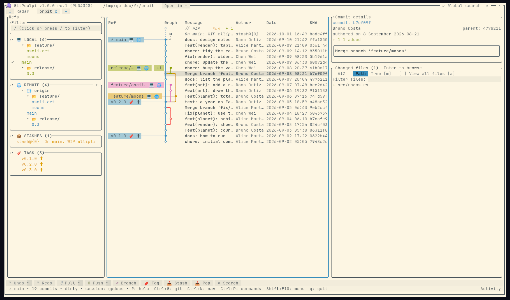
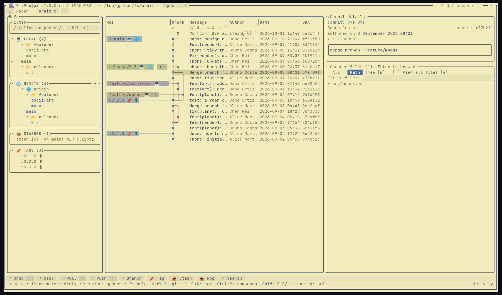
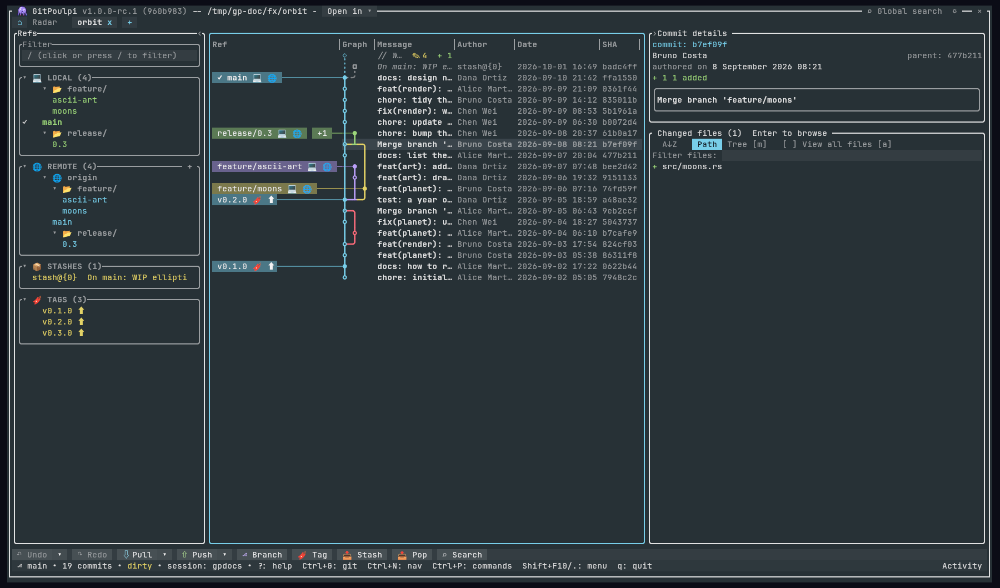

[English](../themes.md) · [Čeština](../cs/themes.md) · [Deutsch](../de/themes.md) · [Español](../es/themes.md) · [Français](../fr/themes.md) · [Italiano](../it/themes.md) · [日本語](../ja/themes.md) · [한국어](../ko/themes.md) · [Nederlands](../nl/themes.md) · [Polski](../pl/themes.md) · [Português (Brasil)](../pt-BR/themes.md) · [Português (Portugal)](../pt-PT/themes.md) · [Русский](../ru/themes.md) · [Svenska](../sv/themes.md) · [Türkçe](../tr/themes.md) · [Українська](../uk/themes.md) · **简体中文**

# 主题

主题决定 GitPoulpi 绘制的每一种颜色：文本、面板、选中项、按钮、diff 与 merge 视图、编辑器、工具栏图标，以及 Log 图的泳道颜色。你可以在 **设置 > 外观 > 主题** 中切换主题，也可以使用 `gitpoulpi config set ui.theme <slug>`。想查看各主题的外观，请直接跳到[图库](#图库)。

## 内置预设

`gitpoulpi theme list` 会打印你的构建中包含的预设，顺序与设置中的下拉列表一致：首先是 **GitPoulpi Dark**（`dark`，绘制在终端自身背景之上）和 **GitPoulpi Light**（`light`），然后是其余所有预设，按标签的字母顺序排列。`ui.theme = "system"`（默认值）跟随你的终端：终端背景为浅色时用 Light，否则用 Dark（见下文“系统检测”）；旧的 `default` 等同于 `system`。泳道调色板的下拉列表使用相同的顺序。

| Slug | 标签 | 颜色来源 |
|---|---|---|
| `system`（默认） | 系统 | 不是调色板：终端背景为浅色时用 GitPoulpi Light，否则用 GitPoulpi Dark |
| `dark` | GitPoulpi Dark | GitPoulpi 原创主题，绘制在终端自身的背景之上 |
| `light` | GitPoulpi Light | GitPoulpi 原创主题 |
| `catppuccin-latte` / `catppuccin-frappe` / `catppuccin-macchiato` / `catppuccin-mocha` | Catppuccin Latte / Frappé / Macchiato / Mocha | [github.com/catppuccin/palette](https://github.com/catppuccin/palette) |
| `cyberpunk` | Cyberpunk | [iTerm2-Color-Schemes](https://github.com/mbadolato/iTerm2-Color-Schemes) "Cyberpunk" |
| `dracula` | Dracula | [draculatheme.com/contribute](https://draculatheme.com/contribute) |
| `everforest-dark` | Everforest Dark | [github.com/sainnhe/everforest/blob/master/palette.md](https://github.com/sainnhe/everforest/blob/master/palette.md) |
| `fire` / `fire-light` | Fire / Fire Light | GitPoulpi 原创主题：Fire 是焦橙色背景上的余烬配火焰橙；Fire Light 是它的浅色孪生，使用真正的橙色背景 |
| `github-dark` / `github-light` | GitHub Dark / GitHub Light | GitHub 的 Primer 主题，[github.com/primer/github-vscode-theme](https://github.com/primer/github-vscode-theme) 搭配 @primer/primitives（`canvas.default`，侧边栏使用 `canvas.inset`，`fg.*`，`accent.fg`）；未调整任何取值 |
| `gruvbox-dark` / `gruvbox-light` | Gruvbox Dark / Light | [github.com/morhetz/gruvbox#palette](https://github.com/morhetz/gruvbox#palette) |
| `kanagawa` / `kanagawa-lotus` | Kanagawa (wave) / Kanagawa Lotus | [github.com/rebelot/kanagawa.nvim](https://github.com/rebelot/kanagawa.nvim) |
| `matrix` | Matrix | [iTerm2-Color-Schemes](https://github.com/mbadolato/iTerm2-Color-Schemes) “Matrix”（该配色中没有红色：`danger` 为 `#ff5555`） |
| `monokai` | Monokai | 原版 Monokai 调色板 ([monokai.nl](https://monokai.nl/)) |
| `nord` | Nord | [www.nordtheme.com](https://www.nordtheme.com) |
| `one-dark` / `one-light` | One Dark / One Light | Atom One Dark / One Light ([One Dark](https://github.com/atom/one-dark-syntax), [One Light](https://github.com/atom/one-light-syntax)) |
| `rose-pine` / `rose-pine-moon` / `rose-pine-dawn` | Rosé Pine / Moon / Dawn | [rosepinetheme.com/palette](https://rosepinetheme.com/palette/) |
| `solarized-dark` / `solarized-light` | Solarized Dark / Light | Ethan Schoonover 的 Solarized ([ethanschoonover.com/solarized](https://ethanschoonover.com/solarized/)) |
| `sunset` | Sunset | GitPoulpi 原创主题：靛蓝黄昏，配珊瑚红与金色 |
| `terminal` | Terminal (16 colors) | 仅使用终端自身的 16 种颜色 |
| `tokyo-night` / `tokyo-night-day` | Tokyo Night (night) / Tokyo Night Day | [github.com/folke/tokyonight.nvim](https://github.com/folke/tokyonight.nvim)（Day 的前景色已加深，以通过对比度规则） |
| `vesper` | Vesper | [github.com/raunofreiberg/vesper](https://github.com/raunofreiberg/vesper)（调色板中没有蓝色或紫色：强调色为桃色） |
| `vscode-dark` / `vscode-light` | VS Code Dark / VS Code Light | VS Code 默认的 Dark Modern / Light Modern，[github.com/microsoft/vscode/tree/main/extensions/theme-defaults/themes](https://github.com/microsoft/vscode/tree/main/extensions/theme-defaults/themes)（`dark_modern.json`、`light_modern.json`，外加 VS Code 为列表选中项和 ANSI/图表强调色设定的默认颜色；Light 的柔和灰为 `616161`） |

### 从 terminalcolors.com 导入

从 terminalcolors.com 的终端调色板导入；每个配色方案归其作者所有。共有 90 个预设，由调色板的背景、前景、选中色和 16 种 ANSI 颜色构建而成（accent = 蓝色，success = 绿色，warning = 黄色，danger = 红色，AI = 品红色，muted = 亮黑色），所有预设共用同一套推导规则；未通过 GitPoulpi 对比度规则的颜色会被调亮或调暗，直到通过为止。该表由 `scripts/gen-terminalcolors.py` 生成到 `crates/gitpoulpi-config/src/theme/terminalcolors_data.rs`。Slug 的形式为 `<family>-<variant>`（省略 `default`）；标签在下拉列表中与其他预设一样按字母顺序排列。

| 系列 | Slugs |
|---|---|
| [Apprentice](https://terminalcolors.com/themes/apprentice/) | `apprentice` |
| [Ayu](https://terminalcolors.com/themes/ayu/) | `ayu-dark`, `ayu-light`, `ayu-mirage` |
| [Cobalt2](https://terminalcolors.com/themes/cobalt2/) | `cobalt2` |
| [Deus](https://terminalcolors.com/themes/deus/) | `deus` |
| [Dracula](https://terminalcolors.com/themes/dracula/) | `dracula-soft` |
| [Everforest](https://terminalcolors.com/themes/everforest/) | `everforest-light` |
| [GitHub](https://terminalcolors.com/themes/github/) | `github-dark-colorblind`, `github-dark-dimmed`, `github-dark-high-contrast`, `github-dark-legacy`, `github-light-colorblind`, `github-light-high-contrast`, `github-light-legacy` |
| [Gotham](https://terminalcolors.com/themes/gotham/) | `gotham` |
| [Gruvbox](https://terminalcolors.com/themes/gruvbox/) | `gruvbox-dark-hard-contrast`, `gruvbox-dark-soft-contrast`, `gruvbox-light-hard-contrast`, `gruvbox-light-soft-contrast` |
| [Iceberg](https://terminalcolors.com/themes/iceberg/) | `iceberg-dark`, `iceberg-light` |
| [Jellybeans](https://terminalcolors.com/themes/jellybeans/) | `jellybeans` |
| [Kanagawa](https://terminalcolors.com/themes/kanagawa/) | `kanagawa-dragon` |
| [Lucario](https://terminalcolors.com/themes/lucario/) | `lucario` |
| [Miasma](https://terminalcolors.com/themes/miasma/) | `miasma` |
| [Moonfly](https://terminalcolors.com/themes/moonfly/) | `moonfly` |
| [Night](https://terminalcolors.com/themes/night-owl/) | `night-owl-dark`, `night-owl-light` |
| [Nightfly](https://terminalcolors.com/themes/nightfly/) | `nightfly` |
| [Nightfox](https://terminalcolors.com/themes/nightfox/) | `nightfox`, `nightfox-carbonfox`, `nightfox-dawnfox`, `nightfox-dayfox`, `nightfox-duskfox`, `nightfox-nordfox`, `nightfox-terafox` |
| [Noctis](https://terminalcolors.com/themes/noctis/) | `noctis`, `noctis-azureus`, `noctis-bordo`, `noctis-hibernus`, `noctis-lilac`, `noctis-lux`, `noctis-minimus`, `noctis-obscuro`, `noctis-sereno`, `noctis-uva`, `noctis-viola` |
| [Nordic](https://terminalcolors.com/themes/nordic/) | `nordic` |
| [One](https://terminalcolors.com/themes/one-half/) | `one-half-dark`, `one-half-light` |
| [Panda](https://terminalcolors.com/themes/panda/) | `panda` |
| [Posterpole](https://terminalcolors.com/themes/posterpole/) | `posterpole`, `posterpole-gray` |
| [Seoul256](https://terminalcolors.com/themes/seoul256/) | `seoul256-dark`, `seoul256-light` |
| [Shades](https://terminalcolors.com/themes/shades-of-purple/) | `shades-of-purple`, `shades-of-purple-super-dark` |
| [Sonokai](https://terminalcolors.com/themes/sonokai/) | `sonokai`, `sonokai-andromeda`, `sonokai-atlantis`, `sonokai-espresso`, `sonokai-maia`, `sonokai-shusia` |
| [Srcery](https://terminalcolors.com/themes/srcery/) | `srcery` |
| [Tender](https://terminalcolors.com/themes/tender/) | `tender` |
| [Tokyo](https://terminalcolors.com/themes/tokyo-night/) | `tokyo-night-moon`, `tokyo-night-storm` |
| [Tomorrow](https://terminalcolors.com/themes/tomorrow/) | `tomorrow`, `tomorrow-night`, `tomorrow-night-blue`, `tomorrow-night-bright`, `tomorrow-night-eighties` |
| [Zenbones](https://terminalcolors.com/themes/zenbones/) | `zenbones-duckbones`, `zenbones-forestbones-dark`, `zenbones-forestbones-light`, `zenbones-kanagawabones`, `zenbones-neobones-dark`, `zenbones-neobones-light`, `zenbones-nordbones`, `zenbones-rosebones-dark`, `zenbones-rosebones-light`, `zenbones-seoulbones-dark`, `zenbones-seoulbones-light`, `zenbones-tokyobones-dark`, `zenbones-tokyobones-light`, `zenbones-vimbones`, `zenbones-zenburned`, `zenbones-zenwritten-dark`, `zenbones-zenwritten-light` |

`ui.side_bg` 是引用窗格和右侧窗格（commit 详情、工作区更改、文件列表）的背景，GitHub 和 VS Code 的侧边栏也是这样绘制的。Catppuccin（取其 `mantle`）、GitHub 和 VS Code 设置了它；其他所有预设中它为 `default`，即与 `ui.bg` 相同。主题文件可以在 `[ui]` 下设置 `side_bg`（`gitpoulpi theme export` 会打印它）。

`[ui]` 下另有三个角色用于为界面外框着色，GitHub 和 VS Code 也是如此：

| 角色 | 绘制位置 |
|---|---|
| `ui.toolbar_bg` | 工具栏行，以及 **选中的仓库标签页**，使该标签页看起来与工具栏相连。工具栏的按钮块保留各自的 `chrome.toolbar_bg`。 |
| `ui.statusbar_bg` | 状态栏（位于底部，除非 `ui.statusbar_position` 设为顶部）。 |
| `ui.statusbar_fg` | 状态栏的文本。在该底色上看不清的文本会用它重绘；本来就能看清的警告和错误文本保留原色。 |

预设会设置它们以匹配各自的应用：VS Code Dark 和 Light 使用蓝色（`#007acc`）状态栏配白色文本，工具栏使用 VS Code 标题栏的灰色；GitHub 使用其页眉色调。其他所有预设（包括导入的终端调色板）把工具栏推导为与 `bg` 相差一级，状态栏比它再略微偏离，并在其上使用 `text`，对比度规则会确保文本清晰可读。`dark`（GitPoulpi Dark）和 `terminal` 使用终端自身的背景，所以这三项在那里都是 `default`：不绘制任何内容，选中的标签页保留选中色。省略它们的主题文件会继承其基础主题的取值；`default` 表示不着色（此时状态栏跟随 `side_bg`）。

如果某个配色的注释色或柔和灰太暗而无法阅读，会被调亮直到通过 GitPoulpi 的对比度规则；配色中缺少的面板色和选中色则由其背景推导而来。

### 图库

每个内置主题，使用同一个仓库并选中一个 merge commit（`scripts/docs-screenshots.sh` 可重新截图）。

| **GitPoulpi Dark** (`dark`) | **GitPoulpi Light** (`light`) | **Apprentice** (`apprentice`) |
|---|---|---|
|  |  |  |
| **Ayu Dark** (`ayu-dark`) | **Ayu Light** (`ayu-light`) | **Ayu Mirage** (`ayu-mirage`) |
|  |  |  |
| **Catppuccin Frappé** (`catppuccin-frappe`) | **Catppuccin Latte** (`catppuccin-latte`) | **Catppuccin Macchiato** (`catppuccin-macchiato`) |
|  |  |  |
| **Catppuccin Mocha** (`catppuccin-mocha`) | **Cobalt2** (`cobalt2`) | **Cyberpunk** (`cyberpunk`) |
|  |  |  |
| **Deus** (`deus`) | **Dracula** (`dracula`) | **Dracula Soft** (`dracula-soft`) |
|  |  |  |
| **Everforest Dark** (`everforest-dark`) | **Everforest Light** (`everforest-light`) | **Fire** (`fire`) |
|  |  |  |
| **Fire Light** (`fire-light`) | **GitHub Dark** (`github-dark`) | **GitHub Dark Colorblind** (`github-dark-colorblind`) |
|  |  |  |
| **GitHub Dark Dimmed** (`github-dark-dimmed`) | **GitHub Dark High Contrast** (`github-dark-high-contrast`) | **GitHub Dark Legacy** (`github-dark-legacy`) |
|  |  |  |
| **GitHub Light** (`github-light`) | **GitHub Light Colorblind** (`github-light-colorblind`) | **GitHub Light High Contrast** (`github-light-high-contrast`) |
|  |  |  |
| **GitHub Light Legacy** (`github-light-legacy`) | **Gotham** (`gotham`) | **Gruvbox Dark** (`gruvbox-dark`) |
|  |  |  |
| **Gruvbox Dark Hard Contrast** (`gruvbox-dark-hard-contrast`) | **Gruvbox Dark Soft Contrast** (`gruvbox-dark-soft-contrast`) | **Gruvbox Light** (`gruvbox-light`) |
|  |  |  |
| **Gruvbox Light Hard Contrast** (`gruvbox-light-hard-contrast`) | **Gruvbox Light Soft Contrast** (`gruvbox-light-soft-contrast`) | **Iceberg Dark** (`iceberg-dark`) |
|  |  |  |
| **Iceberg Light** (`iceberg-light`) | **Jellybeans** (`jellybeans`) | **Kanagawa** (`kanagawa`) |
|  |  |  |
| **Kanagawa Dragon** (`kanagawa-dragon`) | **Kanagawa Lotus** (`kanagawa-lotus`) | **Lucario** (`lucario`) |
|  |  |  |
| **Matrix** (`matrix`) | **Miasma** (`miasma`) | **Monokai** (`monokai`) |
|  |  |  |
| **Moonfly** (`moonfly`) | **Night Owl Dark** (`night-owl-dark`) | **Night Owl Light** (`night-owl-light`) |
|  |  |  |
| **Nightfly** (`nightfly`) | **Nightfox** (`nightfox`) | **Nightfox Carbonfox** (`nightfox-carbonfox`) |
|  |  |  |
| **Nightfox Dawnfox** (`nightfox-dawnfox`) | **Nightfox Dayfox** (`nightfox-dayfox`) | **Nightfox Duskfox** (`nightfox-duskfox`) |
|  |  |  |
| **Nightfox Nordfox** (`nightfox-nordfox`) | **Nightfox Terafox** (`nightfox-terafox`) | **Noctis** (`noctis`) |
|  |  |  |
| **Noctis Azureus** (`noctis-azureus`) | **Noctis Bordo** (`noctis-bordo`) | **Noctis Hibernus** (`noctis-hibernus`) |
|  |  |  |
| **Noctis Lilac** (`noctis-lilac`) | **Noctis Lux** (`noctis-lux`) | **Noctis Minimus** (`noctis-minimus`) |
|  |  |  |
| **Noctis Obscuro** (`noctis-obscuro`) | **Noctis Sereno** (`noctis-sereno`) | **Noctis Uva** (`noctis-uva`) |
|  |  |  |
| **Noctis Viola** (`noctis-viola`) | **Nord** (`nord`) | **Nordic** (`nordic`) |
|  |  |  |
| **One Dark** (`one-dark`) | **One Half Dark** (`one-half-dark`) | **One Half Light** (`one-half-light`) |
|  |  |  |
| **One Light** (`one-light`) | **Panda** (`panda`) | **Posterpole** (`posterpole`) |
|  |  |  |
| **Posterpole Gray** (`posterpole-gray`) | **Rosé Pine** (`rose-pine`) | **Rosé Pine Dawn** (`rose-pine-dawn`) |
|  |  |  |
| **Rosé Pine Moon** (`rose-pine-moon`) | **Seoul256 Dark** (`seoul256-dark`) | **Seoul256 Light** (`seoul256-light`) |
|  |  |  |
| **Shades of Purple** (`shades-of-purple`) | **Shades of Purple Super Dark** (`shades-of-purple-super-dark`) | **Solarized Dark** (`solarized-dark`) |
|  |  |  |
| **Solarized Light** (`solarized-light`) | **Sonokai** (`sonokai`) | **Sonokai Andromeda** (`sonokai-andromeda`) |
|  |  |  |
| **Sonokai Atlantis** (`sonokai-atlantis`) | **Sonokai Espresso** (`sonokai-espresso`) | **Sonokai Maia** (`sonokai-maia`) |
|  |  |  |
| **Sonokai Shusia** (`sonokai-shusia`) | **Srcery** (`srcery`) | **Sunset** (`sunset`) |
|  |  |  |
| **Tender** (`tender`) | **Terminal (16 colors)** (`terminal`) | **Tokyo Night** (`tokyo-night`) |
|  |  |  |
| **Tokyo Night Day** (`tokyo-night-day`) | **Tokyo Night Moon** (`tokyo-night-moon`) | **Tokyo Night Storm** (`tokyo-night-storm`) |
|  |  |  |
| **Tomorrow** (`tomorrow`) | **Tomorrow Night** (`tomorrow-night`) | **Tomorrow Night Blue** (`tomorrow-night-blue`) |
|  |  |  |
| **Tomorrow Night Bright** (`tomorrow-night-bright`) | **Tomorrow Night Eighties** (`tomorrow-night-eighties`) | **Vesper** (`vesper`) |
|  |  |  |
| **VS Code Dark** (`vscode-dark`) | **VS Code Light** (`vscode-light`) | **Zenbones Duckbones** (`zenbones-duckbones`) |
|  |  |  |
| **Zenbones Forestbones Dark** (`zenbones-forestbones-dark`) | **Zenbones Forestbones Light** (`zenbones-forestbones-light`) | **Zenbones Kanagawabones** (`zenbones-kanagawabones`) |
|  |  |  |
| **Zenbones Neobones Dark** (`zenbones-neobones-dark`) | **Zenbones Neobones Light** (`zenbones-neobones-light`) | **Zenbones Nordbones** (`zenbones-nordbones`) |
|  |  |  |
| **Zenbones Rosebones Dark** (`zenbones-rosebones-dark`) | **Zenbones Rosebones Light** (`zenbones-rosebones-light`) | **Zenbones Seoulbones Dark** (`zenbones-seoulbones-dark`) |
|  |  |  |
| **Zenbones Seoulbones Light** (`zenbones-seoulbones-light`) | **Zenbones Tokyobones Dark** (`zenbones-tokyobones-dark`) | **Zenbones Tokyobones Light** (`zenbones-tokyobones-light`) |
|  |  |  |
| **Zenbones Vimbones** (`zenbones-vimbones`) | **Zenbones Zenburned** (`zenbones-zenburned`) | **Zenbones Zenwritten Dark** (`zenbones-zenwritten-dark`) |
|  |  |  |
| **Zenbones Zenwritten Light** (`zenbones-zenwritten-light`) |
|  |

## 任意主题搭配任意泳道调色板

每个主题都自带 Log 图的泳道颜色，但你可以把任意主题与任意调色板组合：**设置 > 外观 > 图配色主题** 提供 **跟随主题**（默认），以及每个主题的每个泳道调色板（GitPoulpi Dark、GitPoulpi Light，然后是 Material、Serie 等，以及你自己主题文件中的 `graph_palette`，排在预设之后，列在主题名称下）。自定义主题会在下次打开列表时出现（那时会重新读取文件），选中一个会把它的文件名存入 `ui.graph_color_theme`（主安装存在 `[ui]` 中，其他安装存在各自的 `[installation.settings.<id>]` 条目中，与主题相同）。没有 `graph_palette` 的主题文件使用其 `base` 的泳道颜色（未指定时为默认预设），与文件中其他所有颜色的继承方式相同。与内置泳道调色板同名的自定义主题（例如 `gruvbox`）会替换列表中的那个调色板。如果已配置的名称不再存在（文件被删除或重命名），图会使用当前主题的泳道颜色，设置中会把该名称标为*未找到*，直到你选择另一个。

在 `config.toml` 中：

```toml
[ui]
theme = "nord"
graph_color_theme = "material"   # or "theme" to follow the theme
```

`ui.input_color` 是针对文本输入框的同类覆盖项：默认值 `theme` 跟随主题的输入框颜色；`gray`、`blue`、`slate`、`dark` 和 `custom` 会强制指定背景（它们都是深色，所以在浅色主题上请选 `theme`）。

## 你自己的主题

把一个 `.toml` 文件放进配置目录的 `themes/` 文件夹（`gitpoulpi config path` 会打印其父目录；该文件夹为 `${config}/themes/`）。不含 `.toml` 的文件名就是主题的 slug，也就是 `ui.theme` 所接受的值。文件不能沿用某个预设的 slug（否则会被跳过并给出警告）。

从一个完整的文件开始：

```
gitpoulpi theme export nord > "$(dirname "$(gitpoulpi config path)")/themes/mine.toml"
```

然后只保留你要修改的部分。文件是针对某个 `base`（一个预设，或另一个用户主题；链最多 4 层，循环会被拒绝；不写 `base` 则为 `dark`）的 **局部覆盖** 集合：

```toml
name = "My Nord"            # the label in the combo; default = file name
base = "nord"
light = false               # inherited when absent
syntax = "base16-ocean.dark"
graph_palette = ["#88c0d0", "#a3be8c"]

[ui]
bg = "#2e3440"              # "default" | "#rrggbb" | "ansi:N"
accent = "#88c0d0"
toolbar_bg = "#3b4252"      # toolbar row and selected tab
statusbar_bg = "#5e81ac"    # status bar
statusbar_fg = "#eceff4"

[diff]
add_bg = "#2f3b2f"
```

### diff 中变更的词（`diff.add_emph_bg`、`diff.del_emph_bg`）

Diff 视图在变更行内不同的词上绘制的更深背景，叠在 `diff.add_bg`（新增行）和 `diff.del_bg`（删除行）之上；文字保持 `diff.add_fg` 和 `diff.del_fg`。每个预设都设置了这两项。如果主题文件设置了 `diff.add_bg` 或 `diff.del_bg` 却没有设置对应的强调色，就会由它派生出一个（朝该侧文字颜色靠近 30%），这样自定义背景绝不会带着基础主题的强调色。值为 `default`（Terminal 预设），或终端的色深会让两种背景看起来一样时，会改用粗体加下划线来标记这些词。见[diff 中变更的词](interface-tour.md#diff-中变更的词)。

颜色可以是 `"#rrggbb"`、`"ansi:N"`（终端调色板的第 N 项）或 `"default"`（终端自身的颜色）。分组和键与 `gitpoulpi theme export <slug>` 的输出一致。一切都不会致命：未知的键或无效的颜色会被忽略，未知的 `base` 回退为 `dark`，而 `gitpoulpi theme list` 会在 `warnings` 下报告每个问题（应用会在状态栏显示一次）。

文件会在主题下拉列表打开时和设置关闭时重新读取。正在运行的窗口还会注意到 `config.toml`（例如在 shell 中执行 `gitpoulpi config set ui.theme ...`）和当前主题文件被重写，并在大约一秒内应用新颜色，无需重启。

### `ui.border_focused`

拥有键盘焦点的面板的边框：Log、Refs 侧边栏、Staged 和 Unstaged 面板、提交详情、历史、审阅和改写面板，以及 diff、文件和编辑器的边框。它只绘制边框；文本、标签和图标（“commit :”标签、Home 图标、标签页按钮）仍使用 `ui.accent`。这样主题就可以用一种作为文本会难以阅读的颜色来框出活动面板，例如在浅色主题上用亮黄色。主题没有设置它时，它跟随 `ui.accent`（用户文件中也一样：只更改 `accent` 的文件会让聚焦的边框也使用该强调色），因此所有内置主题的外观保持不变。对话框和弹出窗口仍使用强调色边框。

```toml
[ui]
accent = "#1f5fbf"
border_focused = "#ffd700"
```

## 系统检测

当 `ui.theme = "system"` 时，GitPoulpi 会 **在启动时仅一次** 向终端询问其背景色（OSC 11 查询，kitty、WezTerm、Alacritty、foot、iTerm2、Windows Terminal、tmux 及大多数其他终端都会应答），背景为浅色则选用 Light，否则选用 Dark。等待时间最多约 100 毫秒，不认识该查询的终端不会有任何代价：应答总是在界面启动之前读完，因此不会打印任何内容，也不会吞掉任何按键。没有应答时（在不发送该查询的 Windows 上始终如此），它会读取 `COLORFGBG`，再回退为 Dark。GitPoulpi 运行期间终端背景发生变化时不会跟随；请重启它，或明确选择 Light 或 Dark。

## 色深

主题是真彩色（`#rrggbb`）。`ui.color_depth`（设置 > 外观 > 色深，立即生效）决定这些颜色如何送达终端：

| 值 | 效果 |
|---|---|
| `auto`（默认） | 使用真彩色，已知不支持的情况除外：Apple Terminal（`TERM_PROGRAM=Apple_Terminal`）使用 256 色，Linux 控制台（`TERM=linux`）使用 16 色，未设置 `COLORTERM` 的 `*-256color` 终端（且不是 WezTerm、kitty 或 Windows Terminal）使用 256 色。`COLORTERM=truecolor` 始终表示真彩色。 |
| `truecolor` | 始终使用 24 位色。 |
| `256` | 每个 RGB 颜色都变为最接近的 xterm-256 项。 |
| `16` | 取最接近的 16 种 ANSI 颜色之一；确切的色调由终端自身的调色板决定。 |

如果主题在 ssh 下或旧的多路复用器中显示为错误的颜色，请使用 `256` 或 `16`。Terminal 预设不需要这些。真彩色没有任何代价；映射处理仅在启用时才会每帧对屏幕执行一次。

主题属于每个安装：多个共用同一份配置的 GitPoulpi 安装各自保留自己的主题，所以在一个安装中选择主题绝不会给其他安装重新着色。

## 实时预览

在 设置 > 外观 中，主题下拉列表依次列出 **系统（跟随终端）**、各预设，然后是你自己的主题文件。移动高亮项会立即应用该主题，整个设置界面会在你眼前重绘；按 **Enter** 保留（并保存），按 **Esc** 或点击别处则恢复之前的主题且不保存任何内容。命令面板项 **应用：主题…**（`Ctrl+P`）会打开设置并定位到该行。

### 从命令面板更改主题

**应用：更改主题…**（`Ctrl+P`，或 `Ctrl+N t`；该键可重新绑定为 `nav_prefix.change_theme`）会打开一个包含相同主题的列表，无需经过设置：**系统（跟随终端）**、各预设，然后是你自己的主题文件，每项带有四个小色块。当前主题带有勾选标记。输入文字即可缩小列表；移动高亮项会立即预览主题，**Enter** 应用并把 `ui.theme` 保存到 `config.toml`，**Esc**（或点击列表外部）恢复之前的主题且不保存任何内容。

过滤字段下方有一个分段式预过滤器可缩小列表：**全部**、**深色**、**浅色** 和 **彩色**，当你有自己的主题文件时还有 **自定义**（点击某一段、`Tab` / `Shift+Tab`，或 `Alt+1`..`Alt+5`）。深色和浅色由主题 `ui.bg` 的亮度决定；**彩色** 保留背景明显带有色调（蓝、紫、黄、绿等）的主题，并排除白色、近白色、黑色和近黑色的灰色，因此 Solarized Dark、Dracula 或 Nord 属于彩色，而 GitHub Dark 和 One Light 不是。彩色主题同时也会出现在深色或浅色之下。**系统** 和透明主题（没有自己的背景）只出现在全部之下。**自定义** 只保留你的 `themes/` 文件夹中的主题文件（自定义主题对那几个按钮来说仍是深色、浅色或彩色）；该文件夹中没有主题时，这个按钮不会绘制，也无法用按键到达。预过滤器可与你输入的内容组合使用。图配色主题和语言选择器的预览方式相同：高亮项移动时，Log 的泳道和整个界面都会随之变化。


下拉列表下方有一排色块，显示当前生效的主题（背景、文本、柔和色、强调色、选中色、危险色、diff 新增、diff 删除，然后是前六种泳道颜色），并随预览变化。**外观** 页上的 **图配色主题** 下拉列表在每个调色板旁边显示若干泳道颜色，所选项会在设置关闭时应用。

带有自己背景的主题（Light 和其他绘制型预设）会填满整个窗口，包括设置和整页视图，并让没有自身颜色的文本使用主题的文本色；Dark 和 Terminal 则保持你终端的颜色不变。

## 通过命令行

| 命令 | 输出 |
|---|---|
| `gitpoulpi theme list` | JSON `{themes: [{slug, label, source, light, lane_palette}], warnings}`；`source` 为 `preset` 或 `user`。 |
| `gitpoulpi theme export <slug>` | 完整的主题文件，以 TOML 形式输出到 stdout（JSON：`{slug, toml}`）；解析回来得到相同的主题。 |
| `gitpoulpi config set ui.theme <slug>` | 对照预设和你的 `themes/` 文件夹进行校验；未知名称会报错并列出有效名称。接受 `system` 和 `default`。 |
| `gitpoulpi config set ui.graph_color_theme <name>` | `theme`（跟随主题）或任意泳道调色板名称；未知名称会列出有效名称。 |

MCP 服务器提供 `theme_list` 和 `theme_export` 两个只读工具。
