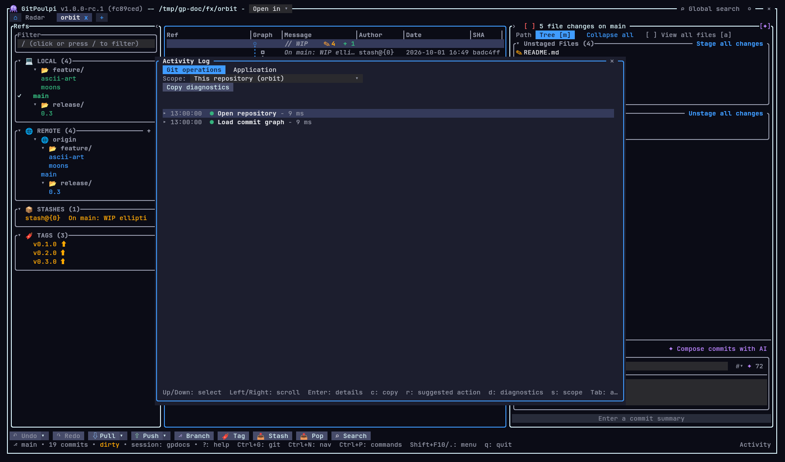

[English](../troubleshooting.md) · [Čeština](../cs/troubleshooting.md) · [Deutsch](../de/troubleshooting.md) · [Español](../es/troubleshooting.md) · [Français](../fr/troubleshooting.md) · [Italiano](../it/troubleshooting.md) · [日本語](../ja/troubleshooting.md) · [한국어](../ko/troubleshooting.md) · [Nederlands](../nl/troubleshooting.md) · [Polski](../pl/troubleshooting.md) · [Português (Brasil)](../pt-BR/troubleshooting.md) · [Português (Portugal)](../pt-PT/troubleshooting.md) · [Русский](../ru/troubleshooting.md) · [Svenska](../sv/troubleshooting.md) · [Türkçe](../tr/troubleshooting.md) · [Українська](../uk/troubleshooting.md) · **简体中文**

# 故障排除与常见问题

请先看下面的快速解答；较长的章节涉及 Git LFS 和图的渲染。如果这些都没有帮助，请在 GitHub 仓库提交议题，并附上你的操作系统、终端、`gitpoulpi --version` 以及你的操作步骤。

## 出错时

操作失败时不会弹出窗口，也没有带边框的卡片：**状态栏**会用红色说明标题和原因（*error: Fetch failed: The remote could not be reached.*），并一直保留，直到被另一条消息取代。它右端的“活动”按钮会统计你还没看过的错误。点击这条红色消息，或运行命令面板的 `活动日志：打开最近的错误`，即可在活动日志中打开对应条目。你触发的每一种失败都是如此，而不只是 git 操作：

- **git 操作**：fetch、push、pull、checkout、merge、rebase、commit、stash……
- **克隆**（以及创建新仓库）：“克隆失败”。
- **对 GitHub 或 GitLab 的调用**：选择器和“克隆”对话框中的仓库列表、创建 pull request 或议题、在“集成”页面检查令牌或 SSH 密钥：“托管服务请求失败”。
- **外部程序**：编辑器、diff 或 merge 工具、文件管理器、浏览器、终端或启动器、图像编辑器、设置中的*测试*按钮：“外部工具运行失败”。
- **AI 请求**（commit 消息、解释、冲突建议……）：“AI 请求失败”。
- **无法写入的文件**：内置编辑器的保存、merge 编辑器、无法保存的设置：“保存失败”。

无论哪个视图在最前面，红色消息都在状态栏上：仓库标签页、主页、雷达、工作空间、设置（在屏幕最下一行）、活动日志或对话框之下。在状态栏被盖住的地方（主页、雷达、工作空间、设置），消息会写在最下一行上，直到你看过这个错误。它会跟着你从一个标签页到另一个标签页。切换标签页时仍在运行的操作不会被跟随：请打开活动日志查看它的结果。

无法刷新的 PULL REQUESTS 和议题分区的列表，改为在分区中保留自己的一行（它们会自动刷新，每隔几秒出一条消息只会是噪音）。仍然打开着的对话框（克隆、创建 pull request……）也会保留自己的单行消息，方便你修正字段后重试。

活动日志中的条目包含以前弹出窗口显示的全部内容：

- **标题和原因。** “Fetch 失败”，接着一句用平实的话说明原因，再说明下一步该做什么。能识别的情况有：远程有你没有的 commit（*先 pull*）、凭据被拒绝（*检查“设置 > 集成”或你的 SSH 密钥*）、因冲突而停止、本地更改会被覆盖（*commit、stash 或丢弃*）、无法连接远程，以及另一个 git 进程占着仓库的锁。其他情况则显示 git 自己的第一行输出。以同样方式失败的克隆或托管服务调用（凭据被拒绝、主机无法连接）措辞相同；其他失败会得到一句说明失败内容的话（“无法克隆该仓库。”“无法运行该程序。”）。
- **详情**，在条目打开时显示（`Enter`，或打开它的那次点击）：操作、运行的 git 命令、退出码以及它最后输出的几行（对于内置 git 库，则是它的错误类别和代码）。凭据、令牌和 `Authorization` 头在显示、记录或复制之前都会被隐去。
- **复制**（按钮，或 `c`）会把一段文字放进剪贴板，便于粘贴到与能解释它的人或 AI 的对话中：GitPoulpi 版本、系统、终端、后端、失败的操作及其详情，以及 git 版本。
- 如有，复制旁边会有一个**用于下一步的按钮**（或按 `r`）：*先 Pull*（远程会拒绝的 push）、*Stash 后重试*（本地更改妨碍了 checkout、merge、rebase 或 pull）、*重试*（无法连接远程）、*打开集成*（凭据）。它会执行这一步并关闭窗口。如果失败的是不同于当前标签页的另一个仓库，只提供*打开集成*：重试会在错误的仓库里运行。
- 不用鼠标：命令面板里有 `活动日志：打开最近的错误`、`活动日志：复制最近的错误` 和 `活动日志：执行建议的操作`（即状态栏所示错误的条目的补救按钮）。

因远程已前进而被拒绝的 push 仍使用它自己的对话框（先 pull、带 lease 的 force push、取消）；这些情况同样会记在活动日志里。

### 活动日志

状态栏最右端的 **活动** 按钮（按钮上的数字统计你还没看过的错误）、`Ctrl+N` 然后 `Shift+A`，以及命令面板中的 `视图：活动日志` 都能打开这个窗口。`Ctrl+N` 会在窗口的每个标签页、框、字段、复选框和按钮上（以及列表的第一项上）显示一个徽标；按下该字符的效果与点击它相同。有两个标签页，**Git 操作**和**应用程序**，用 `Tab`、点击、`g`（Git 操作）或 `p`（应用程序）切换，它们下方有一个对两者都生效的**范围**框（见下文）。

- **应用程序**：程序自己的日志行，包括窗口的和后台守护进程的，最新的在前。**级别** 框（下拉列表：错误、警告、信息、调试、跟踪；`l` 打开）决定显示多少；请求比当前记录的更详细的内容也会提高记录级别（并保存为 `log.level`）。其下的 **显示** 为每个级别提供一个复选框（错误、警告、信息、调试、跟踪，每个都标出所含行数），用来隐藏或显示该级别的行，例如只看错误；**全部** / **无** 会勾选或取消勾选所有复选框。按键 `1` 到 `5` 按该顺序切换各级别，`a` 是全部，`n` 是无；命令面板里有 `活动日志：显示或隐藏…级别`、`活动日志：显示所有级别` 和 `活动日志：不显示任何级别`。高于级别框所选级别的那些级别显示为灰色（它们不会被记录；把指针悬停在上面可以看到原因）。勾选状态会保留到你退出为止，并且只有“应用程序”标签页有。**筛选**（`/`）只保留包含你输入文字的行。**全部复制（已筛选）** 复制当前显示的内容（勾选状态和筛选同时生效）；**打开日志文件夹** 在文件管理器中打开该文件夹。长行不会被截断：见下面的“长行”。


**清空日志**（`x`，或面板命令 `活动日志：清空应用日志`）位于 **应用程序** 标签页：它先询问，然后清空所有保留日期的日志文件和屏幕上的列表。此操作无法撤销，也不在撤销历史中。

- **Git 操作**（窗口默认打开的标签页）：各项操作，最新的在前，每项都有运行时间和耗时（`Push - 123 ms`）：打开仓库、加载 commit 图、fetch、pull、push、commit、checkout、merge、rebase、stash、clone。失败、状态消息、失败的克隆和工作空间的 Fetch all 也列在这里；`Enter` 或点击会打开一项（它的原因、下一步、命令、退出码和输出），`c` 或它的“复制”按钮会复制它，`r` 或它的按钮会执行建议的步骤。`Tab`（或 `p`）切换到“应用程序”标签页；`Left`/`Right` 横向滚动长行。

- **长行**（两个标签页）：比窗口更宽的标题行或详情行绝不会被截断。列表下方会出现一条水平滚动条；用 `Left` / `Right`（可重新绑定为 `activity_log.scroll_left` / `activity_log.scroll_right`）、`Shift` + 滚轮或水平滚轮、命令面板的 `活动日志：向左滚动` / `活动日志：向右滚动`，或滚动条（拖动滑块，或按一下滑道让滑块移到指针下方）横向滚动。`Home` 回到开头，切换标签页时另一个标签页从左边缘开始。换行的文本（摘要、建议的操作）保持换行。


- **是哪个操作产生了错误。** 每次失败都会说明是什么产生了它，在条目中、在应用程序日志中和复制的报告中都是如此。操作按人的叫法命名（`Remove remote`、`Fetch all remotes`、`Hosting request: create pull request`、`Token command`），带上它的主要参数（`remote=cm6`、一个分支、一个路径；绝不包含消息正文，URL 和令牌像其他地方一样被隐去），然后是仓库、请求方（`TUI`、`CLI` 或 `MCP`）和操作 id，即守护进程给该请求的编号（fetch、push 或 pull 还有其作业编号）。在“Git 操作”标签页中，条目的标题形如 `Remove remote failed (remote=cm6) - ... [CLI #12]`，其详情以 `操作：`、`仓库：`、`请求来源：` 和 `操作 ID：` 开头；没有自己标题的操作，其标题就是它本身的名称（`Remove remote failed`）。在“应用程序”标签页中，失败行以同样的词语开头并带一个标记：`Remove remote failed (remote=cm6) [op #12, CLI, repo name]: backend error: no such remote: cm6`。这样的行可以打开它的操作：点击它，或选中它再按 `Enter`（命令面板的 `活动日志：显示此行对应的操作`）。`]` 和 `[` 选择下一条和上一条失败行（`活动日志：下一个失败的操作` / `活动日志：上一个失败的操作`）；选中某一行后，方向键移动选中项而不是滚动。打开的条目在由窗口自己执行该操作时就是窗口自己的；对于 CLI 或代理针对同一会话造成的失败，窗口会根据该行生成一个条目。复制的错误报告包含 `operation:`、`arguments:`、`repository:`、`requested by:` 和 `operation id:` 这几行（报告始终为英文），因此可以单独粘贴。在脚本中，失败命令的 `--json` 错误保持不变；守护进程对失败请求的应答在新增的 `context` 字段中带有同样的信息。

- **范围**（标签页下方的下拉列表，按 `s` 打开，或用命令面板的 `活动日志：选择范围`）：两个标签页所针对的对象。各行是**此仓库（名称）**（你打开日志时所在标签页的仓库；从主页打开时没有这一项，因为主页没有仓库）、**所有仓库**、每个**工作空间**，以及窗口所知的每个仓库。从仓库标签页打开时，日志停在*此仓库*上；从主页（“活动”按钮、`Ctrl+N` 再按 `Shift+A`）打开时停在*所有仓库*上；`Ctrl+N` 再按 `Shift+G` 和命令面板的 `视图：全局活动日志` 总是停在*所有仓库*上，点击仓库不是当前标签页的失败的红色错误也一样（例如失败的克隆）。你上一次的选择会在本次会话中保留，两种打开方式各自独立。在“应用程序”标签页上，如果程序写某行日志时是针对某个仓库的（失败的 push、某个操作的耗时），这一行就属于该仓库；在*所有仓库*下，每个这样的行都会标明属于谁（`[name]`）。完全不属于任何仓库的行（启动、设置、守护进程自身）和不属于任何仓库的条目（失败的保存）是**应用级**的：它们在每个范围下都会显示，在范围比*所有仓库*更窄时标为 `[app-wide]`，所以筛选绝不会把失败藏起来。命令面板里也有 `活动日志：Git 操作` 和 `活动日志：应用日志`，用于切换标签页。

- **复制诊断信息**（两个标签页上都有的按钮、`d`，始终是整份日志，不受范围影响；以及命令面板的 `视图：复制诊断信息`）会复制版本、系统、终端和后端、最近一次失败及其详情，以及所选级别下的最后 200 行日志：出问题时交给 AI 的内容块。

耗时由窗口测量（从请求到守护进程应答，含往返），所以 CLI 或 MCP 所做的事不会被计时。`log.timings`（默认开启）可关闭耗时，`log.extended`（默认关闭）还会列出后台工作，即定期刷新和自动 fetch；两者都在“设置 > 常规”中其他 Log 设置的旁边，而且每个操作无论如何都会写入应用程序日志（你要求的操作用 `info`，后台操作用 `debug`）。

日志文件是 `gitpoulpi-YYYY-MM-DD.log`，默认保留一周，最多十年（`log.retention_days`，1 到 3650），在 GitPoulpi 启动时清理，并在 `log.max_file_mb`（5 MiB）处轮转。位置见[配置参考](config-reference.md#log应用程序日志)。在脚本中，失败命令的 `--json` 错误会在 `detail` 下带上同样的信息；参见 [CLI 参考](cli-reference.md)。

点击红色消息，会在*所有仓库*范围的日志中打开对应条目。“Git 操作”列表只属于本次会话；“应用程序”标签页的程序日志在重启之后仍然保留。

**后台任务。** fetch、push、pull、克隆或 LFS 传输，工作空间的 Fetch all / Pull all / Clone missing，AI 请求，以及正在发送的拉取请求或议题都是任务：状态栏右端显示正在运行的任务和用于取消的 `[x]`，点击其标签（或 `Ctrl+N` 再按 `Shift+J`，命令面板的 `Jobs: Show background jobs`）会打开面板，每个任务一个取消按钮（也可按 `c` 或 `Del`）。克隆在后台运行，AI 请求和工作空间遍历在切换标签页后仍会继续，并在你回到其仓库时生效。越过可安全停止的节点的任务会变灰并说明原因；被取消的任务不会改动仓库。

## 快速解答

**工具栏和侧栏显示方框或问号，而不是图标。**
请在终端中使用 Nerd Font 或任何覆盖 emoji 的字体。没有它们，图和文字仍然可以正常工作。

**commit 图由字符组成，而不是图片。** 这是自动回退：图片需要终端支持 kitty 图形协议（kitty、Ghostty、开启了 kitty 图形的 herdr）或 iTerm2 协议（WezTerm、Rio、mintty），或 sixel（Windows Terminal、foot、Tabby、Konsole，以及背后的终端支持 sixel 的 tmux）。Windows 控制台、zellij 和 screen 使用字符。想强制使用其中任何一种，请参见下面的图章节、[选择终端](terminals.md)和[多路复用器](multiplexers.md)。

**鼠标没有反应，或者无法用鼠标选择文本。**
GitPoulpi 会捕获鼠标，以便点击能到达它。要用终端自身选择文本，请在拖动时按住 `Shift`（在大多数终端中）。你也可以在 diff 内选择（拖动，然后按 `y`）。要关闭鼠标捕获，请使用 *设置 > 键盘与鼠标 > 启用鼠标*（需要重启）。键盘可以使用每一条命令。

**某个快捷键不起作用。** 你的终端、tmux 或 AutoHotkey 脚本可能在 GitPoulpi 看到按键之前就把它截走了（在 Linux 和 macOS 终端中，`Ctrl+,` 经常只会作为普通的 `,` 到达；`Ctrl+Shift+N` 看起来像 `Ctrl+N`）。请使用替代方式（`Ctrl+N` 然后按 `,` 打开设置；`Ctrl+P` 可到达每一条命令），或者重新绑定该组合键：参见[设置](settings.md#键盘与鼠标)。

**`Ctrl+Tab` 无法切换标签页。** kitty、WezTerm、Ghostty 和 Windows Terminal 把 `Ctrl+Tab` 和 `Ctrl+Shift+Tab` 留给自己的标签页，所以这个按键根本到不了 GitPoulpi。`Ctrl+PageDown` / `Ctrl+PageUp` 始终可用。若想把这一对按键交给 GitPoulpi，请在终端的配置中释放它们，然后重启终端（或重新加载其配置）：

- kitty，在 `kitty.conf` 中（不带动作的 `map` 会取消默认映射；配合 `--when-focus-on` 和 `title:...` 之类的窗口条件，kitty 可以只在匹配的窗口获得焦点时取消映射，参见 kitty 的映射文档）：

  ```
  map ctrl+tab
  map ctrl+shift+tab
  ```

- WezTerm，在 `wezterm.lua` 中：

  ```lua
  config.keys = {
    { key = 'Tab', mods = 'CTRL', action = wezterm.action.DisableDefaultAssignment },
    { key = 'Tab', mods = 'CTRL|SHIFT', action = wezterm.action.DisableDefaultAssignment },
  }
  ```

- Ghostty，在其配置文件中：

  ```
  keybind = ctrl+tab=unbind
  keybind = ctrl+shift+tab=unbind
  ```

- Windows Terminal，在 `settings.json` 中（`"id": null` 会取消默认绑定）：

  ```json
  "keybindings": [
    { "id": null, "keys": "ctrl+tab" },
    { "id": null, "keys": "ctrl+shift+tab" }
  ]
  ```

  （较旧的设置文件会在 `actions` 下列出带有这些按键的 `nextTab` / `prevTab`：请在那里删掉这些按键。）

此后终端自己的 `Ctrl+Tab` 标签页切换就不再可用。只能通过 kitty 键盘协议发送该按键的终端需要开启它（默认即开启，参见[键盘快捷键](keybindings.md#终端无法发送的按键以及-kitty-键盘协议)）。

**我不记得某个快捷键。** 按 `Ctrl+P` 并输入你想要的内容；每个结果都会显示它的快捷键。`?` 会列出全部。

**设置中的某个选项是灰色的。** 它依赖于另一个选项。该行会说明是哪一个（例如，*行着色强度*需要把*图泳道背景*设为*行着色*）。

**Log 上方出现“Auto-stash pending”。** GitPoulpi 为了执行某个操作 stash 了你的更改，却无法把它们放回去。请使用横幅上的 **立即 Pop**、**Show stash**、**重新开始**（撤销该操作并放回你的更改）或 **Drop**；参见 [Auto-stash](log-and-history.md#自动-stash)。

**代理报告 `no_viewer` 或 `deferred`。** `no_viewer`：该仓库没有打开任何 GitPoulpi 窗口（或者*允许 AI 代理控制视图*已关闭）。`deferred`：窗口显示了一个提示块；`Ctrl+N Enter` 接受它。参见 [MCP 与代理](mcp-and-agents.md#向用户展示内容)。

**我打开 GitPoulpi 后看到空窗口，或看到 `log error: backend error`。**
请确认你是在 Git 仓库内启动的（否则你会进入主页标签页：请使用 **浏览**、**克隆** 或 **初始化**）。然后运行 `gitpoulpi daemon status`；`gitpoulpi daemon restart` 会重启此仓库的后台进程。按 `r` 刷新。

**同一个仓库的两个窗口行为异常。** 它们有意共用每个仓库的同一个守护进程，所以一个窗口中的更改会显示在另一个窗口中。如果守护进程似乎卡住了，`gitpoulpi daemon stop --all` 会停止每个会话的守护进程；下一个窗口会启动新的守护进程。

**commit、pull 或 push 要求输入密码，或认证失败。**
GitPoulpi 的网络操作使用你的 `git` 自己的凭据助手和 ssh-agent。请先确认在普通终端中 `git fetch` 可以正常工作。用于 pull request 的 GitHub/GitLab 令牌是独立且可选的：参见[托管平台与议题跟踪器](hosting-integration.md)。

**fetch、pull 或 push 失败，提示“已配置的凭据助手失败”、“远程的 SSH 主机密钥尚未知”或登录被拒绝，且它的活动日志条目上有“SSH 与凭据…”按钮。**
失败源于此仓库的登录方式。该按钮会打开 设置 > SSH 与凭据，你可以在那里为此仓库另选一个来源：忽略仓库自己助手的 git 自带助手、某个集成账户、某个密钥文件（及已知主机文件），或你自己的助手或令牌命令；随后 **测试连接** 会检查每个远程。对于无法运行的助手，`git config --show-origin --get-all credential.helper` 会显示它是在哪里设置的。

**“GitPoulpi 没有把账户令牌发送到 ……”。** 仓库的远程指向的服务器不是所选账户所绑定的地址（通常是仓库自己配置中的 `url.<x>.insteadOf` 重写），所以令牌被扣下了。请修正远程，或在该页面中选择另一个来源。

**“此仓库的令牌命令失败”、“…… 自你确认以来已更改”、“无法使用此仓库的登录方式”。**
该页面的选择无法执行：令牌命令没有输出令牌（会引用它最后的几行错误输出，并去除机密）、它运行的某个脚本在你确认之后发生了变化（请在该页面重新确认命令），或者所选的密钥文件或账户已不存在。每一种提示都带有 **SSH 与凭据…** 按钮。

**OpenSSH 对某个密钥文件提示“bad permissions”。** 其他账户可以读取该密钥。在 设置 > SSH 与凭据 中，**私钥文件** 一行会显示警告和 **仅限我的账户** 按钮。

**“Staging...”一直留在状态栏。** 后台刷新仍在运行；文件列表更新时它就会消失。`r` 会强制刷新。

**非常大的仓库很慢。** 在设置 > 日志与图页面中调低*图中初始 commit 数*（开启*图中懒加载 commit*时，Log 会随着滚动加载更多）；隐藏 Log 的*更改*列并关闭头像；如果不需要撤销，关闭*启用撤销*（这样 stage 和 commit 时就完全没有记录开销）。`GITPOULPI_TIMING=1` 会把每个请求的耗时写入临时文件夹中的 `gitpoulpi-timing.log`，值得附在性能报告里。

**AI 按钮缺失或为灰色。** AI 默认关闭；参见 [AI 辅助](ai.md#故障排除)。

**GitPoulpi 自己关闭了。** 每次退出都有记录：请在配置目录中查找 `gitpoulpi-tui-exit.log`（崩溃之后还有 `gitpoulpi-tui-panic.txt`）（`gitpoulpi config path` 会打印设置文件的路径，它就在那里），并把它附到议题中。

**我的设置在哪里？** `gitpoulpi config path`。按仓库的状态位于仓库内的 `.gitpoulpi/repo-state.toml`。

**GitPoulpi 会把任何东西发送到别处吗？** 只发送你要求的内容：发往你远程仓库的 git 操作、连接账号之后的托管请求、按下 AI 按钮之后的 AI 请求，以及（如果你开启了头像）发往 Gravatar 的作者邮箱哈希。没有任何遥测。参见 [AI 辅助](ai.md#隐私)。

## 所有写操作都失败：“Unable to create index.lock”

已死掉的 git 命令（崩溃、被杀掉的终端）可能会留下 `.git/index.lock`，此后对仓库的每一次更改都会失败。一旦该文件超过 10 秒，GitPoulpi 会在 Log 上方显示一个提示条：**删除 index.lock**（命令面板：*仓库：删除过期的 index.lock*；CLI：`gitpoulpi index-lock remove`）。它会先询问，并且只删除那一个文件。GitPoulpi 无法可靠地判断是否还有其他 git 程序在运行，所以在你确认之前，请确保没有（IDE、另一个终端）。在关联的 worktree 中，锁是该 worktree 自己的，位于 `.git/worktrees/<name>`。

## “git am”停了，而 Rebase 的中止没有反应

`am`（从邮箱应用补丁）不是 rebase。停下的 `git am` 有它自己的提示条 **正在应用补丁（git am）**，带有解决冲突、继续、跳过和中止（命令面板：*git am：继续 / 跳过此补丁 / 中止*；CLI：`conflicts am-continue|am-skip|am-abort`）。中止会先询问，丢弃到目前为止已应用的补丁，并把分支放回原来的位置。与 rebase 按钮一样，这些操作不可撤销。

## 撤销是灰色的，并显示“无法撤销 ……”（被阻止的条目）

日志中最新的条目卡住了：仓库在 GitPoulpi 之外发生了变化，或者该条目被中断。悬停在撤销按钮上查看原因；如果它永久卡住，工具提示会指向 **编辑：忘记被阻止的撤销条目**（命令面板）或 `gitpoulpi undo-forget`。它会先询问，并且只从日志中丢弃该条目；仓库不会被触碰。参见[撤销与重做](undo-redo.md)。

## 大文件显示为三行文本（“LFS 文件显示为指针”）

本应是图片、模型或大型二进制文件的文件，却包含 `version https://git-lfs.github.com/spec/v1` 和一行 `oid sha256:...`：它是 Git LFS 的**指针**，真正的内容尚未下载（或者没有安装 LFS 过滤器）。

- 看一下状态窗格：使用 LFS 但缺少 `git-lfs` 的仓库会显示一条琥珀色横幅。请安装该程序（https://git-lfs.com；Windows：随 Git for Windows 附带，或 `winget install GitHub.GitLFS`；Debian/Ubuntu：`apt install git-lfs`；macOS：`brew install git-lfs`），然后重新打开或按 `r`。
- `gitpoulpi lfs status` 会说明程序是否已安装、过滤器和钩子是否已设置，以及跟踪了哪些模式；`gitpoulpi lfs files` 会列出指针文件，以及哪些是 `local`。
- 安装了 `git-lfs` 后，在命令面板中运行 **`LFS：pull 对象`**（或 `gitpoulpi lfs pull`）：它会下载对象并替换指针。如果还没有 LFS 过滤器，它会先为此仓库安装。
- 如果下载失败，提示会指出原因（远程的凭据、服务器上已不存在该对象）。GitPoulpi 不需要自己的账号：LFS 使用你的远程仓库通常使用的凭据（凭据助手或 ssh-agent）。
- 克隆 LFS 仓库绝不会因 LFS 而失败；如果下载步骤无法运行，克隆仍在，只是带着指针，之后 `LFS：pull 对象` 可以补完。`gitpoulpi clone --no-lfs` 会有意跳过下载。
- 你可以在设置 > Git 与编码 > Git LFS（或 `[git] lfs_enabled = false`）中关闭所有与 LFS 相关的功能。

## “git-lfs not found” / “Git LFS is not installed”

提示 `Git LFS is not installed. This repository stores large files with Git LFS; ...`（或带有 *打开安装页面* 按钮的对话框，或 git 自己的 `git-lfs: command not found` / `'lfs' is not a git command`）表示该仓库已配置为使用 LFS - 它的 `.gitattributes`、`.git/config` 过滤器或 `pre-push` 钩子会调用 `git-lfs` - 而该程序不在 GitPoulpi 看到的 `PATH` 上。请安装它（链接见上文）。在 Windows 上，该程序随 Git for Windows 附带；如果 `git lfs version` 在终端中可以运行，但 GitPoulpi 仍说它缺失，请从能看到相同 `PATH` 的终端启动 GitPoulpi。若想对 GitPoulpi 隐藏 LFS，同时不改变 git 自己的行为，请关闭 `git.lfs_enabled`。

## 图由字符绘制，而不是图片（herdr、tmux、其他终端）

只有在确定终端会显示像素时，GitPoulpi 才会把图列和作者头像绘制为像素：裸 WezTerm、Rio、mintty 和 3.7.7 之前的 iTerm2 中的 iTerm2 内联图像；kitty、Ghostty、iTerm2 3.7.7 及更高版本中的 Kitty 图形协议，以及**当 herdr 自己的配置设置了 `kitty_graphics = true`**（`[terminal]`，旧版 herdr 中为 `[experimental]`）且 herdr 运行在 WezTerm、kitty 或 Ghostty 内时的 herdr。Windows Terminal、foot、Tabby、Konsole 和 mlterm（以及背后的终端支持 sixel 的 tmux）使用 sixel 图片。其他任何地方都绘制字符，这始终是正确的。

- 在开启了 Kitty 图形、但配置是 GitPoulpi 找不到的 herdr 中（或依赖 herdr 的默认值），请设置 `ui.image_protocol = "kitty"`（设置 > 日志与图 > 图像协议）并重启。
- 在图的位置显示方框或乱码的终端中，请设置 `ui.image_protocol = "none"` 或 `ui.graph_renderer = "text"`。
- 无论配置如何，`GITPOULPI_TERMINAL_IMAGE=off` 都会关闭图片。

**herdr 远程（`herdr --remote <host>`，或 `ssh` 然后 `herdr`）：默认使用文本图。** 通过 SSH 时，GitPoulpi 运行在远程主机上，只能读取远程的环境和 herdr 的 `config.toml`。是否出现 Kitty 图片由*本地* herdr 客户端（它自己的 `kitty_graphics` 设置和它自己的终端）决定，GitPoulpi 看不到这些：当客户端不绘制图片时，这些单元格会保持空白。因此只要检测到通过 SSH 运行的 herdr（`SSH_CONNECTION` / `SSH_CLIENT` / `SSH_TTY`），GitPoulpi 就会绘制文本图。如果你本地的 herdr 设置了 `kitty_graphics = true`，并且终端能绘制 Kitty 图像（kitty、Ghostty），请在远程上用 `ui.graph_renderer = "image"`（或 `ui.image_protocol = "kitty"`）选择启用。图片以内联方式发送（`t=d`），适用于任何字节流。如果该列是空的，请设置 `ui.graph_renderer = "text"`。

**泳道后面出现较浅的矩形。** 凡是没有绘制任何内容的地方，图片都是透明的（非预乘 alpha 的 RGBA PNG），因此终端的背景和选择带会透出来。Kitty 协议终端、**WezTerm** 和 **Rio** 会合成该 alpha；此时 GitPoulpi 会在图片下方保留普通的空白单元格，并在它们之后发送图片。其他所有 iTerm2 协议终端（旧版 iTerm2、mintty）不确定能否混合 PNG alpha，所以在那里图片带有一个主题颜色的不透明背景，在背景与其不同的终端上可能显示为一个矩形；`ui.graph_renderer = "text"` 可以去掉它。设置 `ui.graph_lane_background = "off"` 后，在透明路径上泳道后面不会绘制任何东西。

**Windows：图列是空白的、画在错误的行上，或屏幕撕裂（WezTerm 20240203、Rio、mintty）。** 这些终端背后的伪控制台会丢弃或错放图片序列（[选择终端](terminals.md#windows)）。请设置 `ui.graph_renderer = "text"`，或改用 Windows Terminal。

在 tmux、zellij、screen 和 herdr 内，哪些内容能通过以及需要添加哪些配置，参见[多路复用器](multiplexers.md)。

参见[配置参考](config-reference.md)中的 `ui.graph_renderer` 和 `ui.image_protocol`。
