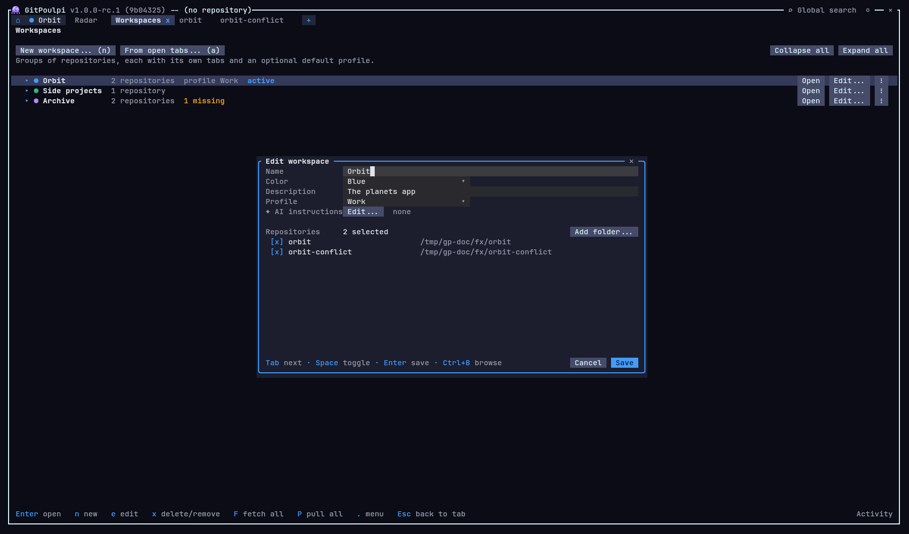

[English](../workspaces.md) · [Čeština](../cs/workspaces.md) · [Deutsch](../de/workspaces.md) · [Español](../es/workspaces.md) · [Français](../fr/workspaces.md) · [Italiano](../it/workspaces.md) · [日本語](../ja/workspaces.md) · [한국어](../ko/workspaces.md) · [Nederlands](../nl/workspaces.md) · [Polski](../pl/workspaces.md) · [Português (Brasil)](../pt-BR/workspaces.md) · [Português (Portugal)](../pt-PT/workspaces.md) · [Русский](../ru/workspaces.md) · [Svenska](../sv/workspaces.md) · [Türkçe](../tr/workspaces.md) · [Українська](../uk/workspaces.md) · **简体中文**

# 工作空间

**工作空间**是有名称的仓库分组：把你会一起处理的仓库放在一起（前端、它的 API、文档）。它会记住其中哪些仓库以标签页打开，还可以带一个**默认提交配置文件**，这样这些仓库中的提交会自动使用正确的身份，无需手动切换。一个仓库可以属于多个工作空间，不属于任何工作空间也完全没问题：“无工作空间”就是原来那样普通的标签页列表。

工作空间保存在 `config.toml` 旁的 `workspaces.toml` 中，由所有会话、窗口、CLI 和 MCP 共用（`gitpoulpi workspace ...`，参见 [CLI 参考](cli-reference.md)）。窗口打开时，在 shell 中或通过 `gitpoulpi workspace ...` 添加、重命名或移除的工作空间，大约一秒内就会自行显示出来（工作空间标签页、标签栏的标记及其列表），无需按任何键。关闭或删除工作空间绝不会动磁盘上的任何仓库。工作空间的修改属于设置，和收藏、配置文件一样：它们不属于[撤销与重做](undo-redo.md)，删除前会先询问。

## 工作空间标记

一旦有了工作空间，标签栏上 `⌂` 之后就会出现一个标记：一个彩色圆点加上当前工作空间的名称，或者（变暗的）“无工作空间”。标签栏较窄时，它会缩成一个圆点，非常窄时则消失。


- **点击它**、按 `Alt+W`，或在命令面板中运行 *工作空间：切换…*，即可打开下拉列表：你的各个工作空间、“无工作空间”和“管理工作空间…”（会打开工作空间标签页）。
- **切换会替换标签页。**离开的工作空间会保留你当时打开的标签页，目标工作空间的标签页则会回来（第一次是其中实际存在的仓库）。切回去时一切都在原来的位置。它会像切换标签页一样重启窗口；守护进程保持运行。
- **工作空间会被记住**：下次启动时仍回到其中。
- **关闭工作空间的最后一个标签页**会保持该工作空间为当前，并显示主页标签页。
- **有工作空间处于当前状态时使用 `+`（新标签页）**，会把你选的仓库添加到标签页列表，不会再询问任何事。要把它放进工作空间本身，请使用该标签页右键菜单中的“添加到工作空间”（或 *工作空间：将标签页添加到工作空间*）；“从工作空间移除”会把它移出，但标签页保持打开。

还没有工作空间时没有标记：请先从工作空间标签页或命令面板创建一个。

## 工作空间标签页

从 `+` 菜单、`Alt+J` 或命令面板中的 `工作空间：管理…` 打开；它的 `x`（或 `Ctrl+W`）会关闭它，在你关闭之前，重启后它仍保持打开。每个工作空间占一行，显示它的颜色圆点、名称、列出的仓库数（以及缺失的数量）、默认配置文件，以及窗口正处于其中时的“当前”。`Right`、`Space` 或点击会展开它，显示其中的仓库。


| 对每个工作空间 | 按键 | |
|---|---|---|
| 打开 | `Enter` | 将其设为当前，并打开它的标签页。 |
| 编辑… | `e` | 下面的表单。 |
| 删除… | `x` | 会先询问。仓库不受影响。 |
| 全部 fetch | `Shift+F` | 逐个仓库进行，进度显示在状态栏中，失败项在结束时列出。 |
| 全部 pull | `Shift+P` | 同样如此，但仅快进：绝不会停在 merge 上。 |
| 克隆缺失的仓库 | `m` | 克隆每个有记录远程的缺失仓库。 |
| 新建工作空间… | `n` | |
| 从打开的标签页… | `a` | 新建一个工作空间，并勾选你已打开的标签页。 |

**缺失**的仓库（它的文件夹已不存在）仍会列出并带有标记，同时有**定位…**（`l` 或 `Enter`：选择它现在的位置）、**克隆**（添加时记录了它的 `origin` URL 才可用）和**移除**（`x`）。每一行还有一个 `⋮` 菜单（右键、`.` 或 `Shift+F10`），包含同样的操作，所有操作也都在命令面板的 `工作空间：` 类别下。

## 新建 / 编辑表单



- **名称**：必填，且唯一。
- **颜色**：主题颜色的下拉列表；用于标记和各行上的圆点。
- **描述**：自由文本。
- **配置文件**：你的 `[[profiles]]` 的下拉列表，或“无”。可选。
- **✦ AI 指令**：仅在 AI 开启时可见，见[下文](#工作空间的-ai-指令)。
- **仓库**：GitPoulpi 已知的所有仓库的清单（已打开的标签页、收藏、最近使用、该工作空间自己的，包括缺失的）。`Space` 勾选一行；**添加文件夹…**（`Ctrl+B`）从磁盘选择一个仓库。每个新仓库的 origin URL 会从仓库中读取并记录（不含任何凭据），之后克隆时会用到它。

## 工作空间的 AI 指令

AI 开启时（*设置 > AI*），表单中有一行 **✦ AI 指令**，带有**编辑…**按钮（在该行上按 `Enter`）。它会打开一个小编辑器，用来设置告诉 AI 的、适用于**该工作空间每个仓库**的内容：在**适用于**列表中选择*所有 AI 操作*或某一个操作（commit 消息、解释、stash 消息、pull request、commit 撰写器、冲突解决、代码评审），在**组合方式**中选择 *追加到全局*（排在全局指令之后发送）或*替换全局*（取代它们发送），然后写下文本。**应用**保留整组设置，表单上的**保存**会把它连同工作空间一起写入 `workspaces.toml`；**取消**则丢弃你输入的内容。AI 关闭时该行隐藏，工作空间的指令保持原样。

工作空间的内容位于全局指令和仓库自己的指令之间（顺序以及*替换*的作用见 [AI 指令](ai.md#指令)）。属于多个工作空间的仓库，使用窗口当前的工作空间（当它包含该仓库时），否则使用第一个包含它的。在脚本中：`gitpoulpi workspace set-ai-instructions <id> [--action <a>] [--mode append|replace] (--text ... | --clear)`；`workspace show` 会把它们输出为 `ai_instructions`。

```toml
[[workspace]]
id = "acme"
name = "Acme"
repos = ["/home/u/src/acme-api"]

[workspace.ai_instructions]       # 此工作空间中的每个 AI 操作
text = "Use the Acme glossary."
mode = "add"                       # 或 "replace"

[workspace.ai_overrides.code_review]   # 单个操作
text = "Flag missing tests."
mode = "add"
```

## 默认配置文件

提交时的署名取下列第一个适用的：

1. 你为该仓库**手动**选择的配置文件（工具栏的配置文件字段），
2. **当前工作空间**的配置文件，前提是该仓库是它的成员，
3. `general.active_profile`。

工具栏上的配置文件字段会说明它的来源：“Work - 来自工作空间 Acme”。只要工作空间的默认配置文件在起作用，即使你只有一个配置文件，该字段也会显示。如果工作空间的配置文件已不存在，它就不再生效。在 CLI 中，`commit --workspace <id>`（或 `GITPOULPI_WORKSPACE`）的解析方式相同。

## 按键

| 按键 | 动作 |
|---|---|
| `Alt+W` | 打开工作空间下拉列表 |
| `Alt+J` | 打开工作空间标签页 |
| `n`, `a` | 新建工作空间，从打开的标签页新建 |
| `e` | 编辑工作空间 |
| `Shift+F`, `Shift+P`, `m`, `l` | 全部 fetch，全部 pull，克隆缺失的仓库，定位 |

所有这些都可以在“设置 > 键盘与鼠标”中重新绑定；完整列表见[快捷键](keybindings.md)。
